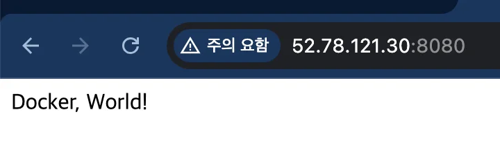
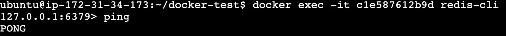

<details>
<summary>EC2 콘솔 접속</summary>

---

- 해당하는 인스턴스 클릭
    

- 연결 클릭
    

    

- 해당 EC2의 콘솔 창으로 접속 
    

</details>

> ✏️ 
> 
> <a id="1c3eda9b0fe1813c9653d58931d80c26"></a>
> 
> 브라우저에서 aws 콘솔로 접속하는 것 보다는, SSH로 터미널에서 접속하는 것이 더 자주 사용되고 편리하다&#46; 
> 
> - 강의에서는 해당 내용을 다루지 않으니 추가 자료 조사 후 적용이 필요하다&#46; 

- 코드 변경 시, push &#45; 이전과 동일
    <a id="1c3eda9b0fe181b6bbaeea56af1cbe0e"></a>

    <a href="#/post/1c3eda9b-0fe1-81dc-87e3-e396c635e23c">페이지</a> 

- <code>compose&#46;yml</code>
    - Mysql, Redis 설정 정보 추가 

    <a id="1c3eda9b0fe18118b225df7c989fb0bf"></a>

    ```yaml
    services:
      instagram-server:
        image: 002177417362.dkr.ecr.ap-northeast-2.amazonaws.com/instagram-server:latest
        ports:
          - 8080:8080
        depends_on:
          my-db:
            condition: service_healthy
          my-cache-server:
            condition: service_healthy
      my-db:
        image: mysql
        environment:
          MYSQL_ROOT_PASSWORD: pwd1234
          MYSQL_DATABASE: mydb
        volumes:
          - ./mysql_data:/var/lib/mysql
        ports:
          - 3306:3306
        healthcheck:
          test: [ "CMD", "mysqladmin", "ping" ]
          interval: 5s
          retries: 10
      my-cache-server:
        image: redis
        ports:
          - 6379:6379
        healthcheck:
          test: [ "CMD", "redis-cli", "ping" ]
          interval: 5s
          retries: 10
    ```

- compose 실행
    <a id="1c3eda9b0fe181bda109d7b54828e1c2"></a>

    ```bash
    # compose 실행
    docker compose up -d --build

    # 실행 확인
    docker compose ps

    # 종료 
    docker compose down
    ```

- 확인
    

    - redis
        
