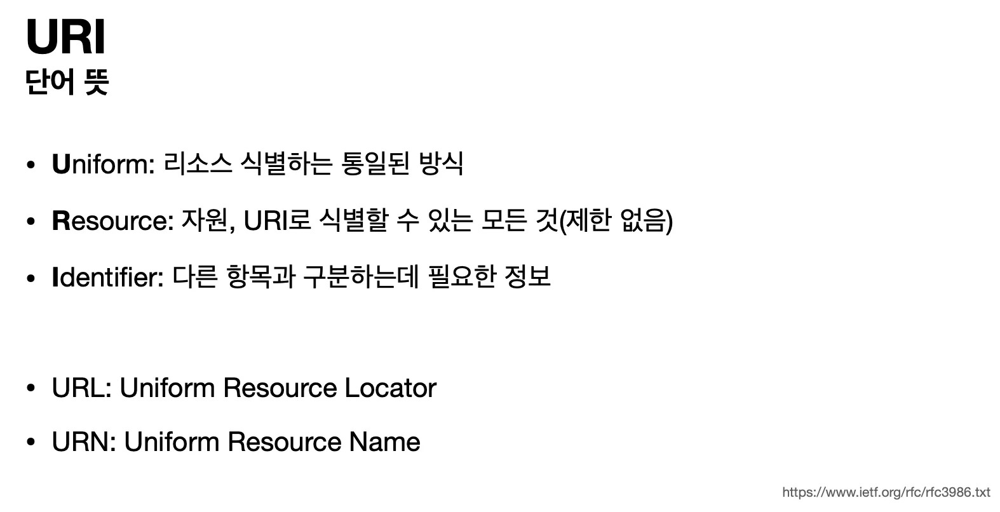
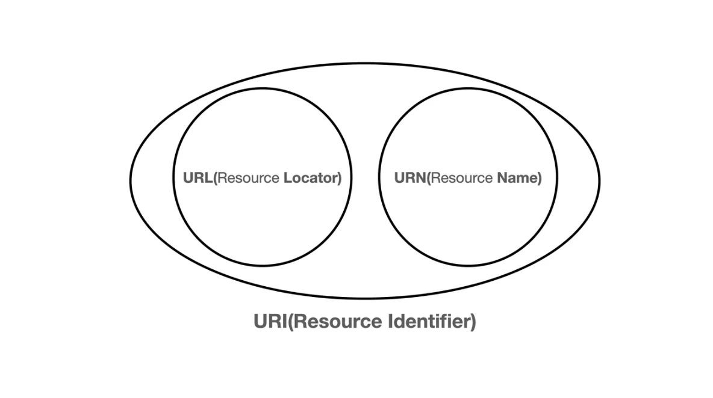
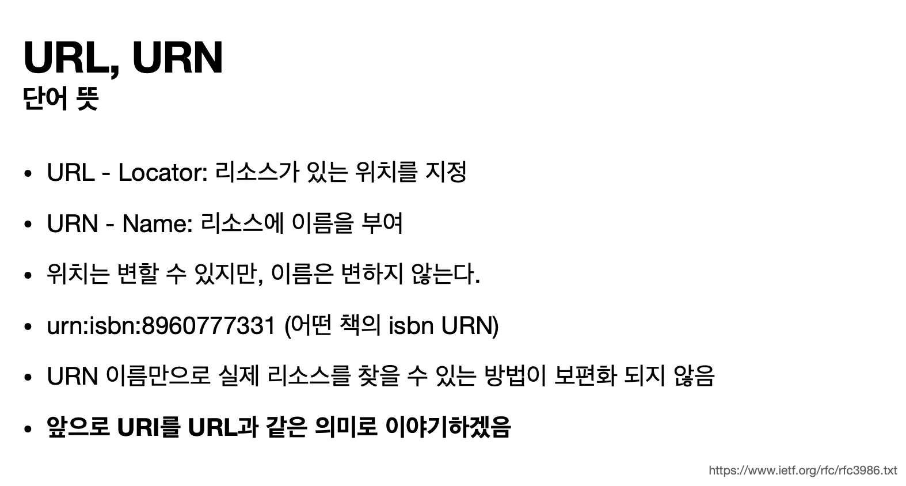
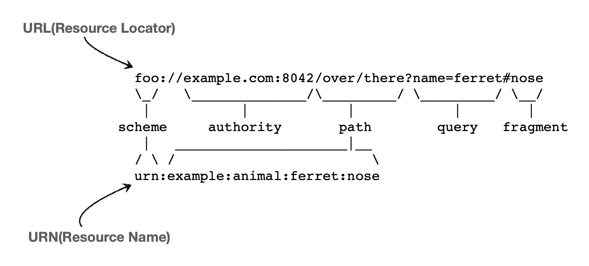
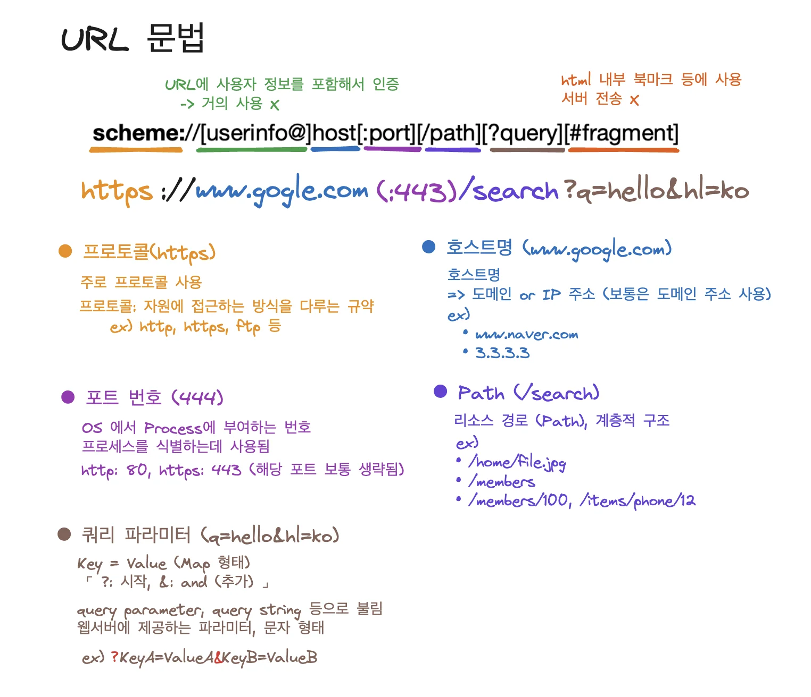
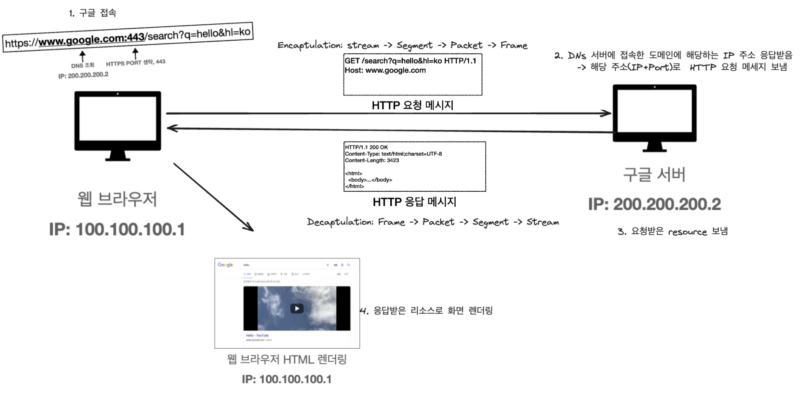

# URI, URL, URN

## URI 

> <strong>U</strong><strong>niform </strong><strong>R</strong><strong>esource </strong><strong>I</strong><strong>dentifier</strong>

→ 리소스를 식별하는 통합된 방법 

> URI → 위치 (locator) 또는  이름(name) 으로 분류된다&#46; 

## URL, URN

## URL 문법

# 웹 브라우저 요청 흐름

자세한 내용 → 아래 링크 확인

> <a href="#/post/1c3eda9b-0fe1-81d3-b50b-e27922be1de2">페이지</a> &#45; TCP/IP 통신 전체 흐름 

예시) youtube 영상 재생

1. youtube(구글)에서 사용자가 영상 재생 버튼을 클릭한다&#46;

1. 웹브라우저(구글)에서는  서버에 리소스를 요청하기 위해  서버로  요청 메시지(HTTP GET 요청)를 보낸다&#46; 

1. 구글 서버에서는 요청 메세지를 확인하여 상태코드(정상 응답&#58; 200)와 리소스를 담아 HTTP 응답 메세지를 보낸다&#46;  

1. 웹브라우저(구글)에서는 응답메세지를 해석하여 해당하는 리소스를 사용자에게 보여준다&#46;
