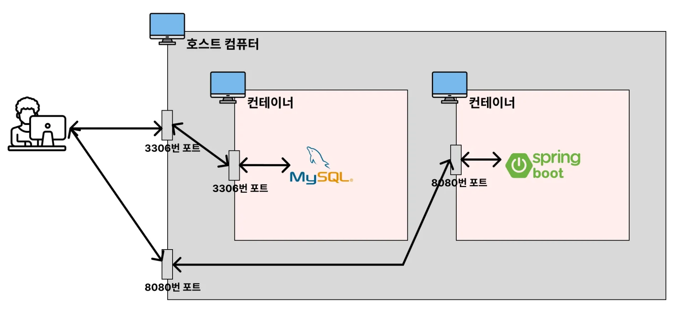
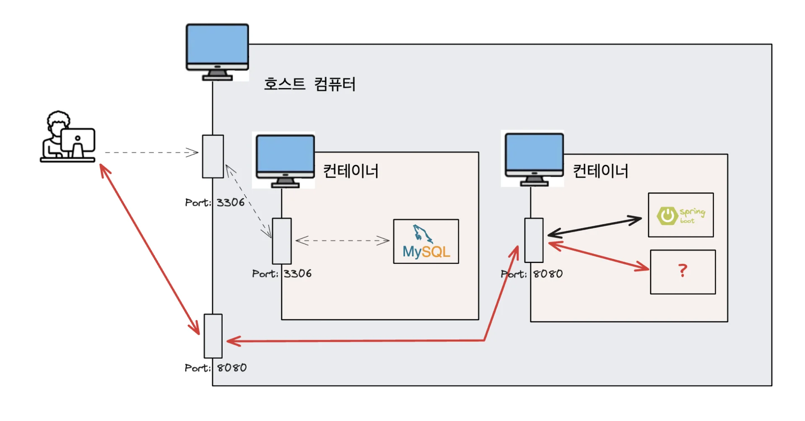
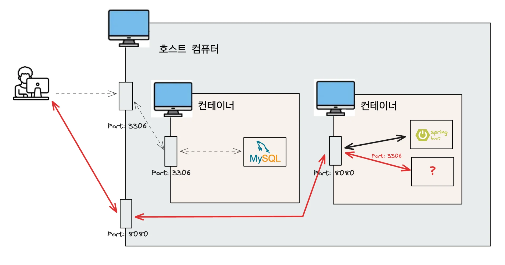
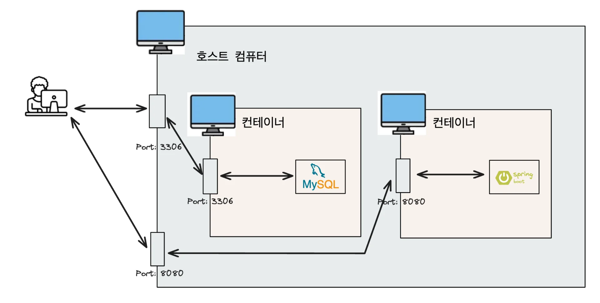
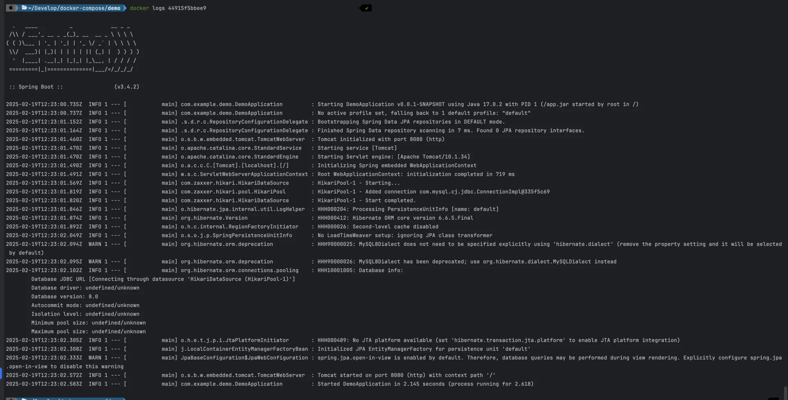

<a id="1c3eda9b0fe1817f9fccca1948d9f3c1"></a>

## 컨테이너로 실행시킨 Spring Boot가 MySQL에 연결이 안 되는 이유

---

> ✏️ 
> 
> <a id="1c3eda9b0fe181a88e3dfea8e5e1860f"></a>
> 
> 각각의 컨테이너는 <strong><u>자신만의 네트워크망과 IP 주소</u></strong>를 가지고 있다&#46; 

- <strong>예상 동작</strong>
    

- 실제 동작
    

    <a id="1c3eda9b0fe18123a8dad65813421b86"></a>

    호스트 컴퓨터 입장에서 <code>localhost</code>는 호스트 컴퓨터를 가르키지만, <br><strong><u>Spring 컨테이너 입장</u></strong>에서 <code>localhost</code>는<strong> </strong><strong><u>Spring Boot 컨테이너</u></strong><strong>를</strong> 가르킨다&#46;

    <a id="1c3eda9b0fe181c7877bcf2a1ade2af9"></a>

    ### 🧐 문제 원인

    ---

    <a id="1c3eda9b0fe1819ba4b4f3352bbaca1d"></a>

    이전 챕터에서 프로젝트 <code>application&#46;yml</code>에서 아래와 같이 DB 설정 정보를 입력했다&#46; 

    <a id="1c3eda9b0fe18134b97ef7476647cc2d"></a>

    ```yaml
    spring:
      datasource:
        url: jdbc:mysql://localhost:3306/mydb
        username: root
        password: pwd1234
        driver-class-name: com.mysql.cj.jdbc.Driver
    ```

    <a id="1c3eda9b0fe181e089e4cf86d99b0013"></a>

    Spring Boot가 실행되는 환경인 컨테이너 입장에서 <code>localhost&#58;3306</code>은  아래와 같이 <strong><u>Spring Boot 컨테이너 내부</u></strong>에 있는 <strong><u>3306번 포트</u></strong> 와 연결을  시도한다&#46;

    <a id="1c3eda9b0fe181f598d4ec7974916443"></a>

    하지만 <strong><u>해당 컨테이너 내부 3306 포트</u></strong>에는 <strong><u>아무것도 실행되고 있지 않</u></strong>다&#46;

    <a id="1c3eda9b0fe181e997aae051326ca0f6"></a>

    아래와 같이 구조상의 문제로 인해 <strong><u>Spring Boot 와 MySQL 의 연결 오류</u></strong>가 발생되었다&#46; 

    

    <a id="1c3eda9b0fe181c5b21ae101ba9aed9c"></a>

    ### 🤓 해결 

    ---

    > 🤔 
    > 
    > <a id="1c3eda9b0fe18181b5d6e4511dc7ff6f"></a>
    > 
    > 어떻게 <strong><u>Spring Boot 컨테이너</u></strong>에서 <strong><u>다른 컨테이너에 존재하는 MySQL에 연결</u></strong>할 수 있을까?
    > 
    > <a id="1c3eda9b0fe181759de8c7f325693068"></a>
    > 
    > → <code>compose&#46;yml</code>에서 정의한<strong><u> Service 이름</u></strong>으로 <strong><u>서로 통신 가능</u></strong>하다&#46; 

    <a id="1c3eda9b0fe1819b9a23e1e97ea7613b"></a>

    ### Spring Boot의 DB 정보(<code>application&#46;yml</code>)를 아래와 같이 수정

    - <strong>compose&#46;yml</strong>
        <a id="1c3eda9b0fe181a19d92cd027fdb7048"></a>

        ```yaml
        services:
          my-server:
            build: .
            ports:
              - 8080:8080
            depends_on:
              my-db:
                condition: service_healthy
          my-db:  ->  다른 컨테이너에서 실행되는 mysql의 service 이름
            image: mysql
            environment:
              MYSQL_ROOT_PASSWORD: pwd1234
              MYSQL_DATABASE: mydb
            volumes:
              - ./mysql_data:/var/lib/mysql
            ports:
              - 3306:3306
            healthcheck:
              test: [ "CMD", "mysqladmin", "ping" ]
              interval: 5s
              retries: 10
        ```

        - 위 <code>compose&#46;yml</code> 에서 정의한 <strong><u>service 이름</u></strong>을 <strong><u>컨테이너 주소(IP)</u></strong>와 같이 사용할 수 있다&#46; 

    - <strong>application&#46;yml</strong>
        <a id="1c3eda9b0fe181dcbd1bc6224aad394b"></a>

        ```yaml
        spring:
          datasource:
            url: jdbc:mysql://my-db:3306/mydb
            username: root
            password: pwd1234
            driver-class-name: com.mysql.cj.jdbc.Driver
        ```

    <a id="1c3eda9b0fe181ae85b7fb35b8d3758d"></a>

    위와 같이 <strong><code>application&#46;yml</code></strong><strong>을 수정한 후, 컨테이너를 재실행하면 정상적으로 MySQL이 연결된다&#46;  </strong>

    

    <a id="1c3eda9b0fe181d1b1e8d11b8ed3d836"></a>

    ```bash
    ./gradlew clean build
    docker compose down

    docker compose up --build -d

    docker ps # 정상적으로 Spring Boot, MySQL이 실행된 걸 확인할 수 있다. 

    docker logs [컨테이너 ID]
    ```

    - 로그 확인 시, DB 연결이 정상적으로 된 것을 확인할 수 있다&#46;
        
