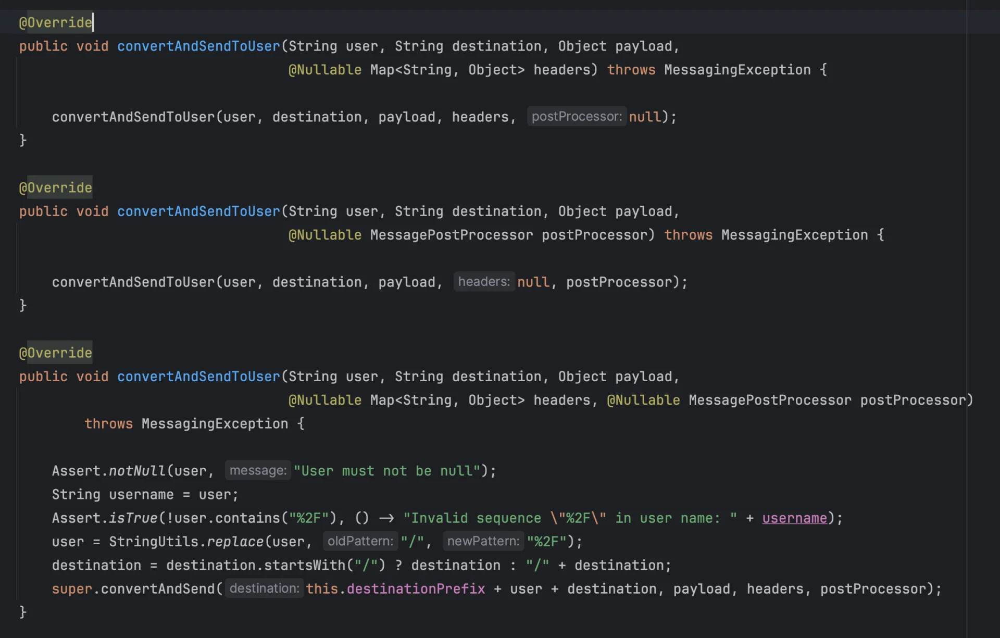

<a id="1c3eda9b0fe181bcba00f78c223caa92"></a>

## <code>Dead Letter Exchange(DLX)</code>, <code>Dead Letter Queue(DLQ)</code>  이해

---

> 📖 
> 
> <a id="1c3eda9b0fe181c18d4df3e5779a5954"></a>
> 
> 개발자라면 <u>운영 상에서 오류가 발생</u>되는 경우, <strong><u>재처리</u></strong><strong> 할 수 있는 방법들을 항상 고민</strong>해야 한다&#46;
> 
> <a id="1c3eda9b0fe181cba680cf3df95a05c5"></a>
> 
> 만약 RabbitMQ 내부에서 메세지가 오류 상황으로 인해 정상 처리되지 않는 경우, 다시 메세지를 전송해야한다&#46; ( 재처리 )
> 
> <a id="1c3eda9b0fe181c6bb17e1308fa5e4c4"></a>
> 
> 이를 <code>DLX</code>, <code>DLQ</code>를 통해 실패된 메세지(Dead Letter)를 재처리 가능하다&#46;

<a id="1c3eda9b0fe181c7966dd06597b2e7c4"></a>

### DLQ ( Dead Letter Queue )

> ✏️ 
> 
> <a id="1c3eda9b0fe1810eb2a3eda0bf554a26"></a>
> 
> 큐에서 정상 처리되지 못한 <code>Dead Letter</code>의 경우 <code>DLQ</code>로 전송된다&#46;
> 
> <a id="1c3eda9b0fe1811b8232cc1acc7242be"></a>
> 
> <code>DLQ</code>에서 <code>Dead Letter</code>( 실패된 메세지 )를 저장 및 수정하여 다시 재전송한다&#46;

<details>
<summary>Dead Letter 로 판단하는 케이스</summary>

| &#45; | Dead Letter 판단 기준 | 설명 |
| --- | --- | --- |
| 1 | <strong><code>NACK 처리, 거부</code></strong> | <code>basic&#46;reject</code> or <code>basic&#46;nack</code> 로 메시지가 처리되지 못한 경우 |
| 2 | <strong><code>TTL(Time&#45;To&#45;Live) 만료</code></strong> | 메시지 TTL이 초과된 경우, DLQ로 이동 |
| 3 | <strong><code>큐 설정 초과 (Overflow)</code></strong> | 큐에 설정된 최대 메시지 개수를 초과하는 경우, 가장 오래된 메시지가 삭제되고 해당 메시지를 DLQ로 이동 |

<details>
<summary>이전 정리 </summary>

1. <code>NACK 처리, 거부</code>
    - <code>basic&#46;reject</code> or<code> basic&#46;nack </code>로 메세지가 처리되지 못한  경우

1. <code>TTL(</code><strong><code>Time&#45;To&#45;Live</code></strong><code>) 만료</code>
    - 메세지 TTL이 초과된 경우, DLQ로 이동

<a id="1c3eda9b0fe181c5ac64c57b2a3f1d0b"></a>

3&#46; <code>큐 설정 초과</code> ( Overflow )

- <strong><u>큐에 설정된 최대 메세지 갯수를 초과</u></strong>하는 경우, <strong>가장 오래된 메세지가 삭제</strong>되고 <strong><u>해당 메세지를 DLQ로 이동</u></strong>시키다&#46;

</details>

</details>

<a id="1c3eda9b0fe1814db09aca071fe413a7"></a>

### DLX ( Dead Letter Exchange )

> ✏️ 
> 
> <a id="1c3eda9b0fe181b1a026fb299ab789a3"></a>
> 
> <strong>DLX</strong>는<strong> </strong><u>DLQ와 바인딩될 때 사용되는 exchange</u>로 실패 메세지(Dead Letter)가 DLQ로 전송되는 경우 사용한다&#46; 
> 
> - 큐에서 메세지 전송에 실패하면 DLX를 통해 Dead Letter를 DLQ로 이동시킨다&#46;

<a id="1c3eda9b0fe1815fae5de8deef3ec966"></a>

잘못된 형식의 큐로 인해 처리가 어려운 경우 Dead Letter Queue 영역으로 이동하여 에러의 원인을 분석하고 재 처리를 시도할 수 있다&#46; 

- 처리 중에 예외가 발생한 메세지

- TTL(TIme To Live)이 만료된 메세지

- 큐의 길이 제한(x&#45;max&#45;length)을 초과하여 삭제된 메세지

<a id="1c3eda9b0fe1817891fee72732f9f914"></a>

Dead Letter가 DLX를 통해 DLQ(Dead Letter Queue ) 전달되고,<br>DLQ에서는 해당 메세지를 분석하여 에러의 원인 파악할 수 있다&#46;

<a id="1c3eda9b0fe18134bf4fc314fd87e8bd"></a>

```java
@Bean
public Queue orderQueue() {
    return QueueBuilder.durable(MAIN_QUEUE)
            .withArgument("x-dead-letter-exchange", DLX) // DLX 설정
            .withArgument("x-dead-letter-routing-key", DLQ) // DLQ로 이동할 라우팅 키
            .build();
}
```

<a id="1c3eda9b0fe181ab817ff1cd6c825b21"></a>

### 의문점

<a id="1c3eda9b0fe181ea8689cf4ee06b7b25"></a>

rabbitListener가 Transaction과 같이 convertAndSend를 통해 메세지를 전송하고 정상 처리에 대한 Ack

<a id="1c3eda9b0fe181aabe24f8fdcd25b6c1"></a>

? consumer는 Rabbit 외부에 존재하는 객체인가?

- RabbitMQ 인스턴스를 처리하는 래핑 클래스

<a id="1c3eda9b0fe18190a267ca1bc2ba8c0d"></a>

<br><br><code>SimpMessagingTemplate</code>&#46;convertAndSend()를 통해 메세지를 전달하며

<a id="1c3eda9b0fe18192bfbac913ac6f2af1"></a>

해당 메서드에서는 <code>MessagingException</code>을 예외로 처리한다&#46; 


