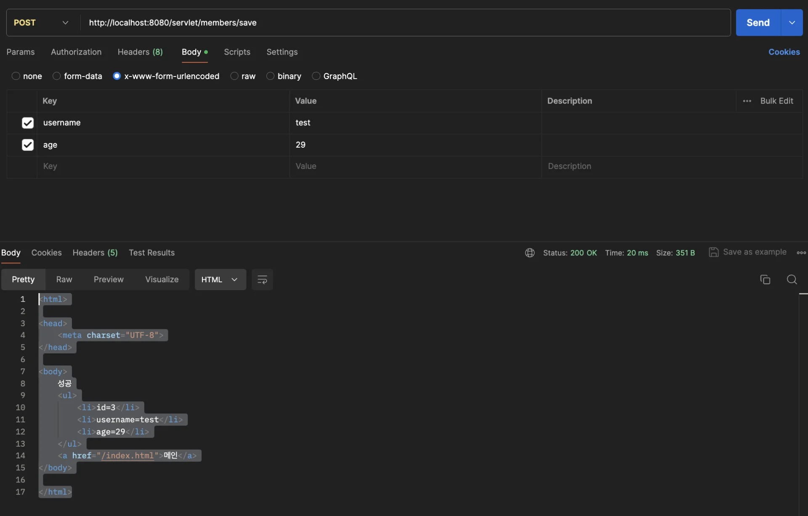
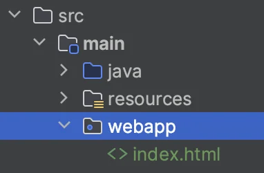
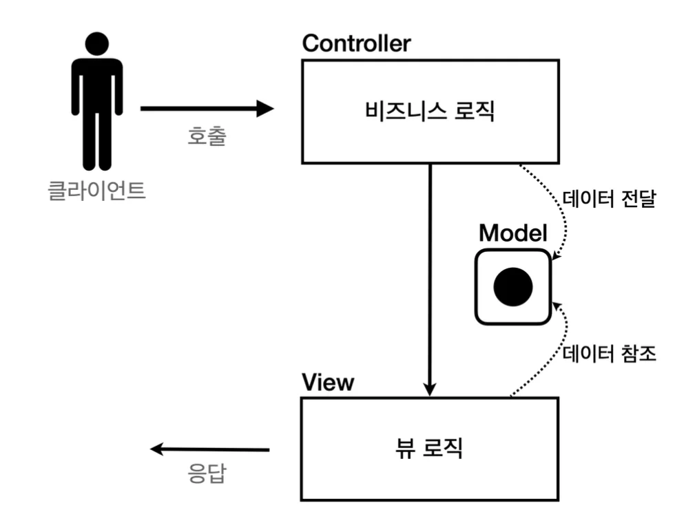
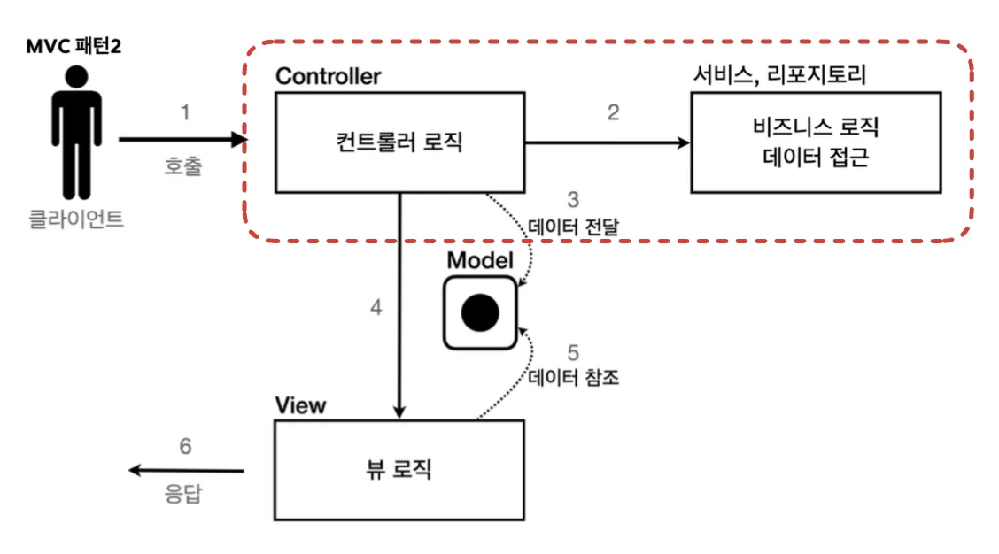

> 📌 간단한 회원관리 웹 애플리케이션  생성<code><br>1&#46;서블릿</code>   &#45; 개선 →  <code>2&#46;JSP </code>  &#45; 개선 → <code>3&#46;MVC 패턴</code>  &#45; 개선 →<code> 4&#46; 프론트 컨트롤러</code>

<a id="1c3eda9b0fe181e58d7ac4b8cd17950e"></a>

## 회원  관리 웹 애플리케이션 요구사항 

> 📌 <strong>요구 사항</strong>
> 
> > <strong>회원 정보</strong>
> 
> - 이름&#58; <code>username</code>
> 
> - 나이&#58; <code>age</code>
> 
> > <strong>기능 요구사항</strong>
> 
> - 회원 저장
> 
> - 회원 목록 조회

<details>
<summary><strong>회원 도메인 모델 ( </strong><strong><code>Member</code></strong><strong> )</strong></summary>

<a id="1c3eda9b0fe181039e6dd4e78061bc22"></a>

```java
package hello.servlet.domain.member;


import lombok.Getter;
import lombok.Setter;

@Getter
@Setter
public class Member {

    private Long id;
    private String username;
    private int age;

    public Member() {
    }

    public Member(String username, int age) {
        this.username = username;
        this.age = age;
    }
}
```

</details>

> <a href="https://beautiful-college-c84.notion.site/033b72b3c9f942cc911445d377517735">페이지</a> 

<details>
<summary><strong>회원 저장소 ( </strong><strong><code>MemberRepository</code></strong><strong> )</strong></summary>

<a id="1c3eda9b0fe18178971bcf10a8d01f07"></a>

```java
package hello.servlet.domain.member;

import java.util.ArrayList;
import java.util.HashMap;
import java.util.List;
import java.util.Map;

/**
 * 동시성 문제가 고려되어 있지 않음, 실무에서는 ConcurrentHashMap, AtomicLong 사용 고려
 */
public class MemberRepository  {

    private static Map<Long, Member> store = new HashMap<>();  // static 사용
    private static long sequence = 0L;  // static 사용

    ========================== 싱글톤 패턴 ============================

    private static final MemberRepository instance = new MemberRepository();

    public static MemberRepository getInstance() {
        return instance;
    }

		// 싱글톤 패턴 - 생성자 접근 제한(private), 인스턴스 1개 생성 
    private MemberRepository() {}
    
    =================================================================

    public Member save(Member member) {
        member.setId(++sequence);
        store.put(member.getId(), member);
        return member;
    }

    public Member findById(Long id) {
        return store.get(id);
    }

    public List<Member> findAll() {
        return new ArrayList<>(store.values());
    }

    public void clearStore() {
        store.clear();
    }
}
```

</details>

<details>
<summary><strong>회원 저장소 테스트 코드 ( </strong><strong><code>MemberRepositoryTest</code></strong><strong> )</strong></summary>

<a id="1c3eda9b0fe181e0a391f537debe8af8"></a>

```java
package hello.servlet.domain.member;

import org.junit.jupiter.api.AfterEach;
import org.junit.jupiter.api.Test;

import java.util.List;

import static org.assertj.core.api.Assertions.assertThat;

class MemberRepositoryTest {

    MemberRepository memberRepository = MemberRepository.getInstance();

    @AfterEach
    void afterEach() {
        memberRepository.clearStore();
    }

    @Test
    void save() {
        // given
        Member member = new Member("hello", 20);

        // when
        Member saveMember = memberRepository.save(member);

        // then
        Member findMember = memberRepository.findById(saveMember.getId());
        assertThat(findMember).isEqualTo(saveMember);
    }

    @Test
    void findAll() {
        // given
        Member member1 = new Member("member1", 20);
        Member member2 = new Member("member2", 30);

        memberRepository.save(member1);
        memberRepository.save(member2);

        //when
        List<Member> result = memberRepository.findAll();

        // then
        assertThat(result.size()).isEqualTo(2);
        assertThat(result).contains(member1, member2);
    }
}
```

</details>

<a id="1c3eda9b0fe18150a6bfeca4bbdb1fe7"></a>

## 회원 관리 앱 &#45; 서블릿

<details>
<summary><strong>회원 등록 폼</strong> ( <code>MemberFormServlet</code> )</summary>

> 회원 정보를 입력할 수 있는 HTML Form 만들어서 응답함<br>→  HTML  string 데이터로 작성  ( <del>… 겁나 번거롭고 쓸데없는… , 안씀)</del>

<a id="1c3eda9b0fe181338901c857de4b3984"></a>

```java
package hello.servlet.web.servlet;

import jakarta.servlet.ServletException;
import jakarta.servlet.http.HttpServlet;
import jakarta.servlet.http.HttpServletRequest;
import jakarta.servlet.http.HttpServletResponse;

import java.io.IOException;
import java.io.PrintWriter;

public class MemberFormServlet extends HttpServlet {

    @Override
    protected void service(HttpServletRequest request, HttpServletResponse response) throws ServletException, IOException {
        response.setContentType("text/html");
        response.setCharacterEncoding("utf-8");

        PrintWriter w = response.getWriter();
        w.write("<!DOCTYPE html>\n" +
                    "<html>\n" +
                    "<head>\n" +
                    "    <meta charset=\"UTF-8\">\n" +
                    "    <title>Title</title>\n" +
                    "</head>\n" +
                    "<body>\n" +
                    "<form action=\"/servlet/members/save\" method=\"post\">\n" +
                    "    username: <input type=\"text\" name=\"username\" />\n" +
                    "    age:      <input type=\"text\" name=\"age\" />\n" +
                    " <button type=\"submit\">전송</button>\n" + "</form>\n" +
                    "</body>\n" +
                    "</html>\n");

    }
}

```

</details>

<details>
<summary><strong>회원 저장</strong> ( <code>MemberSaveServlet</code> )</summary>

<details>
<summary><strong>MemberSaveServlet</strong></summary>

1. <code>회원 생성</code> &#45; HttpServletRequest에서 html&#45;form에서 입력된 정보 가져와<strong><u>(</u></strong><code>request&#46;getParameter()</code>)  회원 정보(<code>Member 객체</code>) 생성

1. <code>회원 저장</code><strong> </strong>&#45;<strong>  </strong>MemberRepository(싱글톤 구현)에 회원(생성한 member 객체) 저장(<code>save()</code>)

1. <code>응답 생성</code> &#45; HttpServletResponse객체에 반환할 html과 회원 정보를 동적으로 생성하여 응답(<code>response&#46;getWriter&#46;write()</code>)

<a id="1c3eda9b0fe18122b77ad1c6c0cd34d5"></a>

```java
package hello.servlet.web.servlet;

import hello.servlet.domain.member.Member;
import hello.servlet.domain.member.MemberRepository;
import jakarta.servlet.ServletException;
import jakarta.servlet.annotation.WebServlet;
import jakarta.servlet.http.HttpServlet;
import jakarta.servlet.http.HttpServletRequest;
import jakarta.servlet.http.HttpServletResponse;

import java.io.IOException;
import java.io.PrintWriter;


@WebServlet(name = "memberSaveServlet", urlPatterns = "/servelt/members/save")
public class MemberSaveServlet extends HttpServlet {

    private MemberRepository memberRepository = MemberRepository.getInstance();

    @Override
    protected void service(HttpServletRequest request, HttpServletResponse response) throws ServletException, IOException {
        System.out.println("MemberSaveServlet.service");
        
        // 클라이언트에서 동적 데이터 가져옴
        String username = request.getParameter("username");
        int age = Integer.parseInt(request.getParameter("age"));
				
				// 가져온 데이터로 회원(member) 인스턴스 생성
        Member member = new Member(username, age);
        System.out.println("member = " + member);
				
				// 회원 저장
        memberRepository.save(member);
				
				
				// response 정보 생성
        response.setContentType("text/html");
        response.setCharacterEncoding("utf-8");

        PrintWriter w = response.getWriter();
        w.write("<html>\n" +
                "<head>\n" +
                " <meta charset=\"UTF-8\">\n" + "</head>\n" +
                "<body>\n" +
                "성공\n" +
                "<ul>\n" +
                // member 객체를 통한 동적 HTML 생성
                "    <li>id=" + member.getId() + "</li>\n" +
                "    <li>username=" + member.getUsername() + "</li>\n" +
                " <li>age=" + member.getAge() + "</li>\n" + 
                "</ul>\n" +
                "<a href=\"/index.html\">메인</a>\n" + "</body>\n" +
                "</html>");
    }
}
```

</details>

<details>
<summary><strong>PostMan을 통한 테스트</strong></summary>

<a id="1c3eda9b0fe181cba0c8d9792c871935"></a>

<del>GET 요청으로 잘못보내서 계속 오류남…</del>



</details>

</details>

<details>
<summary><strong>회원 목록</strong> ( <code>MemberListServlet</code><strong> )</strong></summary>

1. <code>테스트용 회원 정보 생성 및 저장</code>

1. <code>모든 회원을 조회</code> (<code>memberRepository&#46;findAll()</code>)

1. <code>회원 목록 HTML 동적 생성</code> &#45;  회원 목록 HTML을 <code>for문</code>를 통해서 회원 수 만큼 동적으로 생성하고 응답(<code>responce&#46;getWriter()&#46;write()</code>)

<a id="1c3eda9b0fe1813987f5d7581e3d2aca"></a>

```java
package com.example.springmvc1.domain.web;

import com.example.springmvc1.domain.member.Member;
import com.example.springmvc1.domain.member.MemberRepository;
import jakarta.servlet.ServletException;
import jakarta.servlet.annotation.WebServlet;
import jakarta.servlet.http.HttpServlet;
import jakarta.servlet.http.HttpServletRequest;
import jakarta.servlet.http.HttpServletResponse;

import java.io.IOException;
import java.io.PrintWriter;
import java.util.List;

@WebServlet(name = "memberListServlet", urlPatterns = "/servlet/members")
public class MemberListServlet extends HttpServlet {

    private MemberRepository memberRepository = MemberRepository.getInstance();

    @Override
    protected void service(HttpServletRequest request, HttpServletResponse response) throws ServletException, IOException {
        
        // 테스트용 회원 정보 생성 및 저장
        Member test1 = new Member("test1", 20);
        Member test2 = new Member("test2", 20);

        memberRepository.save(test1);
        memberRepository.save(test2);

				// 저장된 모든 회원 정보 불러옴
        List<Member> members = memberRepository.findAll();;
				
				// response header
        response.setContentType("text/html");
        response.setCharacterEncoding("utf-8");

				// repsonse html 
        PrintWriter w = response.getWriter();
        w.write("<html>");
        w.write("<head>");
        w.write("    <meta charset=\"UTF-8\">");
        w.write("    <title>Title</title>");
        w.write("</head>");
        w.write("<body>");
        w.write("<a href=\"/index.html\">메인</a>");
        w.write("<table>");
        w.write("   <thead>");
        w.write("   <th>id</th>");
        w.write("   <th>username</th>");
        w.write("   <th>age</th>");
        w.write("   </thead>");
        w.write("   <tbody>");
        for (Member member : members) {
            w.write("   <tr>");
            w.write("        <td>" + member.getId() + "</td>");
            w.write("        <td>" + member.getUsername() + "</td>");
            w.write("        <td>" + member.getAge() + "</td>");
            w.write("   </tr>");
        }
        w.write("      </tbody>");
        w.write("</table>");
        w.write("</body>");
        w.write("</html>");

    }
}

```

</details>

<details>
<summary><strong>Welcom 페이지 변경</strong></summary>

> src/main/webap/index&#46;html



<a id="1c3eda9b0fe181b1beacd009af55faa0"></a>

```html
<!DOCTYPE html>
<html>
<head>
    <meta charset="UTF-8">
    <title>Title</title>
</head>
<body>
<ul>
    <li><a href="basic.html">서블릿 basic</a></li>
    <li>서블릿
        <ul>
            <li><a href="/servlet/members/new-form">회원가입</a></li>
            <li><a href="/servlet/members">회원목록</a></li>
        </ul>
    </li>
    <li>JSP
        <ul>
            <li><a href="/jsp/members/new-form.jsp">회원가입</a></li>
            <li><a href="/jsp/members.jsp">회원목록</a></li>
        </ul>
    </li>
    <li>서블릿 MVC
        <ul>
            <li><a href="/servlet-mvc/members/new-form">회원가입</a></li>
            <li><a href="/servlet-mvc/members">회원목록</a></li>
        </ul>
    </li>
    <li>FrontController - v1
        <ul>
            <li><a href="/front-controller/v1/members/new-form">회원가입</a></li>
            <li><a href="/front-controller/v1/members">회원목록</a></li>
        </ul>

        /li>
    <li>FrontController - v2
        <ul>
            <li><a href="/front-controller/v2/members/new-form">회원가입</a></li>
            <li><a href="/front-controller/v2/members">회원목록</a></li>
        </ul>
    </li>
    <li>FrontController - v3
        <ul>
            <li><a href="/front-controller/v3/members/new-form">회원가입</a></li>
            <li><a href="/front-controller/v3/members">회원목록</a></li>
        </ul>
    </li>
    <li>FrontController - v4
        <ul>
            <li><a href="/front-controller/v4/members/new-form">회원가입</a></li>
            <li><a href="/front-controller/v4/members">회원목록</a></li>
        </ul>
    </li>
    <li>FrontController - v5 - v3
        <ul>
            <li><a href="/front-controller/v5/v3/members/new-form">회원가입</a></li>
        </ul>
    </li>
    <li>FrontController - v5 - v4
        <ul>
            <li><a href="/front-controller/v5/v4/members/new-form">회원가입</a></li>
            <li><a href="/front-controller/v5/v4/members">회원목록</a></li>
        </ul>
    </li>
    <li>SpringMVC - v1
        <ul>
            <li><a href="/springmvc/v1/members/new-form">회원가입</a></li>
            <li><a href="/springmvc/v1/members">회원목록</a></li>
        </ul>
    </li>
    <li>SpringMVC - v2
        <ul>
            <li><a href="/springmvc/v2/members/new-form">회원가입</a></li>
            <li><a href="/springmvc/v2/members">회원목록</a></li>
        </ul>
    </li>
    <li>SpringMVC - v3
        <ul>
            <li><a href="/springmvc/v3/members/new-form">회원가입</a></li>
            <li><a href="/springmvc/v3/members">회원목록</a></li>
        </ul>
    </li>
</ul>
</body>
</html>
```

</details>

<a id="1c3eda9b0fe181e99006ca969d73c1b3"></a>

## 회원 관리 앱 &#45; JSP

<details>
<summary><strong>JSP 라이브러리 추가</strong></summary>

- <strong>build&#46;gradle</strong>
    <a id="1c3eda9b0fe1814b85fce411d18c9c4d"></a>

    ```java
    //JSP 추가 시작
    implementation 'org.apache.tomcat.embed:tomcat-embed-jasper'
    implementation 'jakarta.servlet:jakarta.servlet-api' //스프링부트 3.0 이상
    implementation 'jakarta.servlet.jsp.jstl:jakarta.servlet.jsp.jstl-api' //스프링부트 3.0 이상
    implementation 'org.glassfish.web:jakarta.servlet.jsp.jstl' //스프링부트 3.0 이상
    //JSP 추가 끝
    ```

</details>

> 📌 JSP 문법
> 
> - JSP 명시
>     <a id="1c3eda9b0fe1810d9fc3f6dfe2d45d4a"></a>
> 
>     ⇒ <code>&#60;%&#64; page contentType=&#34;text/html;charset=UTF&#45;8&#34; language=&#34;java&#34; %&#62;</code>
> 
> - 자바의 import 문 사용<br>⇒ <code>&#60;%&#64; page import=&#34;hello&#46;servlet&#46;domain&#46;member&#46;MemberRepository&#34; %&#62;</code>
> 
> - 자바 코드를 입력
>     <a id="1c3eda9b0fe1812dac61d7fe9cb800ac"></a>
> 
>     ⇒  <code>&#60;% &#126; 자바 코드 &#126; %&#62;</code>
> 
> - 자바 코드를 출력 <br>⇒  <code>&#60;%= &#126;&#126; %&#62;</code>

<details>
<summary><strong>회원 등록 Form JSP </strong>( <code>new&#45;from&#46;jsp</code> )</summary>

<a id="1c3eda9b0fe181acb8d6dbdea7d34a5b"></a>

```html
<%@ page contentType="text/html;charset=UTF-8" language="java" %>
<html>
<head>
    <title>Title</title>
</head>
<body>
    <form action="/jsp/members/save.jsp" method="post">
        username: <input type="text" name="username" />
        age: <input type="text" name="age" />
        <button type="submit">전송</button>
    </form>
</body>
</html>
```

</details>

<details>
<summary><strong>회원 저장 JSP</strong> ( <code>save&#46;jsp</code> )</summary>

<a id="1c3eda9b0fe18109b16ee698da1202f4"></a>

```html
<%@ page import="hello.servlet.domain.member.MemberRepository" %>
<%@ page import="hello.servlet.domain.member.Member" %>
<%@ page contentType="text/html;charset=UTF-8" language="java" %>
<%
 // request, response 사용 가능
	 
	MemberRepository memberRepository = MemberRepository.getInstance();
	
	System.out.println("save.jsp");
	String username = request.getParameter("username");
	int age = Integer.parseInt(request.getParameter("age"));
	
	Member member = new Member(username, age);
	System.out.println("member = " + member);
	memberRepository.save(member);
	
%>
<html>
<head>
    <meta charset="UTF-8">
</head>
<body> 
성공  
<ul>
   <li>id=<%=member.getId()%></li>
   <li>username=<%=member.getUsername()%></li>
   <li>age=<%=member.getAge()%></li>
</ul>
<a href="/index.html">메인</a>
</body>
</html>
```

</details>

<details>
<summary><strong>회원 목록 JSP</strong> ( <code>members&#46;jsp</code> )</summary>

> 회원 리포지토리를 먼저 조회하고,

<a id="1c3eda9b0fe18102be48e4c673383f36"></a>

```html
<%
   MemberRepository memberRepository = MemberRepository.getInstance();
   List<Member> members = memberRepository.findAll();
%>
```

> 결과 List를 사용해서 중간에 <code>&#60;tr&#62;&#60;td&#62;</code> HTML 태그를 반복해서 출력하고 있다&#46;

<a id="1c3eda9b0fe18198aa94c87d2af80c16"></a>

```html
	<%
    for (Member member : members) {
        out.write("  <tr>");
        out.write("    <td>" + member.getId() + "</td>");
        out.write("    <td>" + member.getUsername() + "</td>");
        out.write("    <td>" + member.getAge() + "</td>");
        out.write("  </tr>");
		} 
	%>
```

> main/webapp/jsp/members&#46;jsp

<a id="1c3eda9b0fe1813aadb2dfb895285f3b"></a>

```html
<%@ page import="java.util.List" %>
<%@ page import="hello.servlet.domain.member.MemberRepository" %>
<%@ page import="hello.servlet.domain.member.Member" %>
<%@ page contentType="text/html;charset=UTF-8" language="java" %>
<%
   MemberRepository memberRepository = MemberRepository.getInstance();
   List<Member> members = memberRepository.findAll();
%>
<html>
<head>
     <meta charset="UTF-8">
     <title>Title</title>
</head>
<body>
<a href="/index.html">메인</a> 
<table>
	<thead>
	<th>id</th>
	<th>username</th>
	<th>age</th>
	</thead>
	<tbody>
	<%
    for (Member member : members) {
        out.write("  <tr>");
        out.write("    <td>" + member.getId() + "</td>");
        out.write("    <td>" + member.getUsername() + "</td>");
        out.write("    <td>" + member.getAge() + "</td>");
        out.write("  </tr>");
		} 
	%>
    </tbody>
</table>
</body>
</html>
```

</details>

<a id="1c3eda9b0fe1813a9b18cce02f87007e"></a>

### 서블릿과 JSP의 한계 

<a id="1c3eda9b0fe181cf9520f295c8bc8343"></a>

<strong><u>서블릿으로 개발 시</u></strong>, <strong><u>뷰(View) 화면을 위한 HTML 코드</u></strong><u>가</u>  <strong>자바 코드에 섞</strong>여서 코드가 지저분하고 쓸데없이 복잡했다&#46;

<a id="1c3eda9b0fe181298863f371b2f54860"></a>

<strong>J</strong><strong><u>SP를 사용</u></strong>한 덕분에 <strong><u>뷰를 생성</u></strong>하는<strong><u> HTML 작업을 깔끔</u></strong>하게 가져가고, 중간에 <strong><u>동적으로 변경이 필요한 부분</u></strong>에만 <strong><u>자바 코드 적용</u></strong>하여 더 개선된 방식으로 처리했다&#46;

- 너무 많은 역활
    <a id="1c3eda9b0fe1814289c2e1c7656253c7"></a>

    그러나 코드의 상위 절반은 회원을 저장하기 위한 비지니스 로직이고, 나머지 하위 절반만 결과를 HTML로 보여주기 위한 뷰 영역이다&#46; 회원 목록의 경우에도 마찬가지다&#46;<br>코드를 잘 보면,<strong><u> JAVA 코드, 데이터를 조회하는 리포지토리 등등 다양한 코드가 모두 JSP에 노출</u></strong>되어 있다&#46;


<a id="1c3eda9b0fe18154b358c410a5ea3a43"></a>

<strong><u>즉, 하나의 JSP에서 화면 뷰, 비지니스 로직 등 너무 많은 역할을 처리한다&#46; </u></strong>

<a id="1c3eda9b0fe1812a8b1cc862aa264eda"></a>

따라서 수백 수천줄이 넘어가는 실무에서 JSP 사용한다면&#46;&#46;&#46; 지옥의 시작이다&#46;

<a id="1c3eda9b0fe1816ca28ec17fc0851cb0"></a>

결과적으로 너무 많은 역할을 하기 때문에 유지 보수가 어렵다&#46; 

- <strong>변경 라이프 사이클</strong>
    <a id="1c3eda9b0fe18181a36df91a701d1100"></a>

    UI를 일부 수정 하는 일과 비즈니스 로직을 수정하는 일은 각각 다르게 발생할 가능성이 매우 높고 대부분 서로에게 영향을 주지 않는다&#46;

    <a id="1c3eda9b0fe181058cbdd6ba3f754068"></a>

     즉, view와 비니지스 로직 사이에 변경 사이클이 달라 <br> 

<a id="1c3eda9b0fe1816db77bc1914f1ea248"></a>

<strong><u>MVC 패턴의 등장</u></strong><br><strong>비즈니스 로직</strong>은 서블릿처럼  <strong><u>모듈을</u></strong><u> </u><strong><u>분리하여 처리</u></strong>하고, <strong>JSP</strong>는 목적에 맞게<strong> H</strong><strong><u>TML로 화면(View)을 그리도록</u></strong> 처리해야 한다&#46; 과거 개발자들도 모두 비슷한 고민이 있었고, 이  해결하기 위해  MVC패턴이 등장했다&#46; 

<a id="1c3eda9b0fe1810688ace2ce30413205"></a>

## 회원 관리 앱 &#45; MVC 패턴

<a id="1c3eda9b0fe181329fc6ed6f495a4c42"></a>

### MVC 패턴 

<details>
<summary><strong>M</strong><strong>odel   </strong><strong>V</strong><strong>iew   </strong><strong>C</strong><strong>ontroller</strong></summary>




- <strong>뷰</strong>&#58; <strong><u>모델에 담겨있는 데이터를 사용해서 화면을 그리</u></strong>는 일에 집중한다&#46; 여기서는 <strong>HTML을 생성</strong>하는 부분을 말한다

- <strong>컨트롤러</strong>&#58; <strong><u>HTTP 요청을 받</u></strong>아서 <strong><u>파라미터를 검증</u></strong>하고, <strong><u>비즈니스 로직을 실행 </u></strong>및 <strong><u>뷰에 전달할 결과 데이터를 조회해서 모델에 담</u></strong>는다&#46; 

- <strong>모델</strong>&#58; <strong><u>뷰에 출력할 데이터를 담</u></strong>아둔다&#46; 뷰가 필요한 데이터를 모두 모델에 담아서 전달해주는 덕분에 뷰는 비즈니스 로직이나 데이터 접근을 몰라도 되고, 화면을 렌더링 하는 일에 집중할 수 있다&#46;

</details>

<details>
<summary><strong>3 Layer Achitecture</strong><strong>&#58;  &#91; </strong><strong><code>C</code></strong><code>ontroller</code>, <strong><code>S</code></strong><code>ervice</code>, <strong><code>R</code></strong><code>epository</code> <strong>&#93;</strong></summary>



- <code>Controller</code>&#58; 클라이언트로부터 요청 및 반환 처리

- <code>Service</code>&#58; 비지니스 로직

- <code>Repository</code>&#58; 데이터 관리(DB)

</details>

<a id="1c3eda9b0fe181db82dee0b31d959d65"></a>

### 코드

<a id="1c3eda9b0fe181a7b380f00d50750147"></a>

### 회원 등록

<details>
<summary><strong>컨트롤러</strong>  ( <code>MvcMemberFormServlet</code> )</summary>

- <code>dispatcher&#46;forward()</code> 
    - 다른 서블릿이나 JSP로 이동할 수 있는 기능이다&#46; <br>서버 내부에서 다시 호출이 발생한다&#46;

- <code>/WEB&#45;INF</code>
    - 이 경로안에 JSP가 있으면 외부에서 직접 JSP를 호출할 수 없다&#46; <br>우리가 기대하는 것은 항상 컨트롤러를 통해서JSP를 호출하는 것이다&#46;

- <strong><code>redirect</code></strong><strong> vs </strong><strong><code>forward</code></strong>
    - <strong><code>redirect</code></strong>는 실제 <strong><u>클라이언트(웹 브라우저)에 응답이 나갔</u></strong>다가, 클<strong><u>라이언트가 redirect 경로로 다시 요청</u></strong>한다&#46;
        <a id="1c3eda9b0fe1817bbe09e67a3300aaf0"></a>

        따라서 클라이언트가 인지할 수 있고, URL 경로도 실제로 변경된다&#46; 

    - 반면에 <strong><code>forward</code></strong>는 <strong><u>서버 내부에서 일어나는 호출</u></strong>이기 때문에<u> 클라이언트가 전혀 인지하지 못</u>한다&#46;

<a id="1c3eda9b0fe181feb8f5f039cfacdc0f"></a>

```java
package hello.servlet.web.servletmvc;

import jakarta.servlet.RequestDispatcher;
import jakarta.servlet.ServletException;
import jakarta.servlet.annotation.WebServlet;
import jakarta.servlet.http.HttpServlet;
import jakarta.servlet.http.HttpServletRequest;
import jakarta.servlet.http.HttpServletResponse;

import java.io.IOException;


@WebServlet(name = "mvcMemberFormServlet", urlPatterns = "/servlet-mvc/members/new-form")
public class MvcMemberFormServlet extends HttpServlet {

    @Override
    protected void service(HttpServletRequest request, HttpServletResponse response) throws ServletException, IOException {
        String viewPath = "/WEB-INF/view/new-form.jsp";
        RequestDispatcher dispatcher = request.getRequestDispatcher(viewPath);
        dispatcher.forward(request, response);
    }
}

```

</details>

<details>
<summary><strong>뷰( </strong><code>new&#45;form&#46;jsp</code> )</summary>

> <code>main/webapp/WEB&#45;INF/views/new&#45;form&#46;jsp</code>

> ☝🏻 <strong>상대경로&#58; </strong><code>save</code>
> 
> - 현재 계층 경로&#58; <code>/servlet&#45;mvc/members/</code>
> 
> - 결과&#58; <code>/servlet&#45;mvc/members/save</code>
> 
> > 절대 경로&#58; <code>/save</code>

<a id="1c3eda9b0fe1816d8b3aecb1d077f014"></a>

```xml
<%@ page contentType="text/html;charset=UTF-8" language="java" %>
<html>
<head>
		<meta charset="UTF-8">
		<title>Title</title>
</head>
<body>

<!-- 상대경로 사용, [현재 URL이 속한 계층 경로 + /save] --> 
<form action="save" method="post">
		username: <input type="text" name="username" />
		age: <input type="text" name="age" /> 
		<button type="submit">전송</button>
</form>

</body>
</html>
```

</details>

<a id="1c3eda9b0fe1813c9648fd71335ae9fa"></a>

### 회원 저장

<details>
<summary>컨트롤러 ( <code>MvcMemberSaveServlet</code> )</summary>

- <code>request&#46;setAttribute(&#34;member&#34;, member);</code>
    - HttpServletRequest를 Model로 사용

    - Model에 데이터를 보관

    - <code>request&#46;getAttribute(&#34;member&#34;)</code>를 통해 가져옴 

-  <code>RequestDispatcher dispatcher = request&#46;getRequestDispatcher(viewPath);</code>
    - request 객체의 getRequestDispatcher 메서드를 호출

    - viewPath 경로에 대한 RequestDispatcher 객체를 생성

- <code>dispatcher&#46;forward(request, response);</code>
    - 클라이언트의 요청을 다른 자원(주로 JSP 파일)으로 전달하는 메서드

    -  서블릿에서 클라이언트의 요청을 받아서 처리한 후, 그 결과를 JSP 파일 등 다른 자원을 통해 클라이언트에게 전달할 때 사용된다&#46;

<a id="1c3eda9b0fe181c5b27ff240f5cff5cb"></a>

```java
package hello.servlet.web.servletmvc;

import hello.servlet.domain.member.Member;
import hello.servlet.domain.member.MemberRepository;
import jakarta.servlet.RequestDispatcher;
import jakarta.servlet.ServletException;
import jakarta.servlet.annotation.WebServlet;
import jakarta.servlet.http.HttpServlet;
import jakarta.servlet.http.HttpServletRequest;
import jakarta.servlet.http.HttpServletResponse;

import java.io.IOException;

@WebServlet(name = "mvcMemberSaveServlet", urlPatterns = "/servlet-mvc/members/save")
public class MvcMemberSaveServlet extends HttpServlet {

    private MemberRepository memberRepository = MemberRepository.getInstance();

    @Override
    protected void service(HttpServletRequest request, HttpServletResponse response) throws ServletException, IOException {
        String username = request.getParameter("username");
        int age = Integer.parseInt(request.getParameter("adge"));

        Member member = new Member(username, age);
        System.out.println("member = " + member);
        memberRepository.save(member);

        // Model에 데이터를 보관한다.
        request.setAttribute("member", member);

        String viewPath = "WEB-INF/view/save-result.jsp";
        RequestDispatcher dispatcher = request.getRequestDispatcher(viewPath);
        dispatcher.forward(request, response);
    }
}
```

</details>

<details>
<summary>뷰 ( <code>save&#45;result&#46;jsp</code> ) </summary>

> <strong>main/webapp/WEB&#45;INF/views/save&#45;result&#46;jsp</strong>

- <code>&#60;%= request&#46;getAttribute(&#34;member&#34;)%&#62;</code> 
    - 모델에 저장한 member 객체를 꺼냄, 그러나<strong><u> 번거롭고 복잡</u></strong>하다&#46;

- <strong><u><code>&#36;{}</code></u></strong>
    <a id="1c3eda9b0fe18185b3f3c0e22eb8f3aa"></a>

    <strong>JSP에서</strong><strong> </strong><strong>제공하는 문법</strong>, 이 문법을 사용하면<strong><u> request의 attribute(모델)에 담긴 데이터를 간단하게 조회</u></strong>할 수 있다&#46;

<a id="1c3eda9b0fe1814b8aebe8bd6ecb353b"></a>

```java
<%@ page contentType="text/html;charset=UTF-8" language="java" %>
<html>
<head>
   <meta charset="UTF-8">
</head>
<body> 
성공 
<ul>
   <li>id=${member.id}</li>
   <li>username=${member.username}</li>
   <li>age=${member.age}</li>
</ul>
<a href="/index.html">메인</a>
</body>
</html>
```

</details>

<a id="1c3eda9b0fe181e78356e8563070f02b"></a>

### 회원 목록 조회

<details>
<summary>컨트롤러 ( <code>MvcMemberListServlet</code> )</summary>

- <code>request&#46;setAttribute(&#34;members&#34;, members);</code>
    - <strong>HttpServletRequest(request) 객체</strong>를 사용해서 <code>List&#60;Member&#62; members</code> 를 모델에 보관

<a id="1c3eda9b0fe18172aa04ec8a048f3656"></a>

```java
package hello.servlet.web.servletmvc;

import hello.servlet.domain.member.Member;
import hello.servlet.domain.member.MemberRepository;
import jakarta.servlet.RequestDispatcher;
import jakarta.servlet.ServletException;
import jakarta.servlet.annotation.WebServlet;
import jakarta.servlet.http.HttpServlet;
import jakarta.servlet.http.HttpServletRequest;
import jakarta.servlet.http.HttpServletResponse;


import java.io.IOException;
import java.util.List;

@WebServlet(name = "mvcMemberListServlet", urlPatterns = "/servlet-mvc/members")
public class MvcMemberListServlet extends HttpServlet {
    private MemberRepository memberRepository = MemberRepository.getInstance();
    
    @Override
    protected void service(HttpServletRequest request, HttpServletResponse response) throws ServletException, IOException {
        System.out.println("MvcMemberListServlet.service");
        List<Member> members = memberRepository.findAll();

        request.setAttribute("members", members);

        String viewPath = "/WEB-INF/views/members.jsp";
        RequestDispatcher dispatcher = request.getRequestDispatcher(viewPath);
        dispatcher.forward(request, response);
    }
}
```

</details>

<details>
<summary>뷰 ( <code>members&#46;jsp</code> )</summary>

- <code>&#60;c&#58;forEach&#62;</code>
    - 모델에 담아둔 members를 JSP가 제공하는 taglib기능을 사용해서 반복하면서 출력

    - <code>members</code> 리스트에서 <code>member</code> 를 순서대로 꺼내서 <code>item</code> 변수에 담고, 출력하는 과정을 반복

    - 해당 기능 사용 시, 아래와 같이 선언 추가 필요<br><code>&#60;%&#64; taglib prefix=&#34;c&#34; uri=&#34;http&#58;//java&#46;sun&#46;com/jsp/jstl/core&#34;%&#62;</code>


<a id="1c3eda9b0fe181d695bfd3b89d1bb923"></a>

```java
<%@ page contentType="text/html;charset=UTF-8" language="java" %>
 <%@ taglib prefix="c" uri="http://java.sun.com/jsp/jstl/core"%>
 <html>
 <head>
     <meta charset="UTF-8">
     <title>Title</title>
 </head>
<body>
<a href="/index.html">메인</a> <table>
     <thead>
     
     <th>id</th>
     <th>username</th>
     <th>age</th>
     </thead>
     <tbody>
     <c:forEach var="item" items="${members}">
         <tr>
             <td>${item.id}</td>
             <td>${item.username}</td>
             <td>${item.age}</td>
         </tr>
     </c:forEach>
     </tbody>
 </table>
 </body>
 </html>
```

> 👉🏻 모델에 담아둔 members를 <strong>JSP가 제공하는 </strong><strong><code>taglib기능</code></strong><strong>을 사용</strong>해서 반복해 출력함<br>→  <code>members</code> 리스트에서 <code>member</code> 를 순서대로 꺼내서 <code>item</code> 변수에 담고, 출력하는 과정을 반복

> ☝🏻 <code>&#60;c&#58;forEach&#62;</code> 이 기능을 사용하려면 다음과 같이 선언해야 한다&#46;<br>⇒  <code>&#60;%&#64; taglib prefix=&#34;c&#34; uri=&#34;http&#58;//java&#46;sun&#46;com/jsp/jstl/core&#34;%&#62;</code>

<a id="1c3eda9b0fe18144a911e5baa4289dea"></a>

<br>

</details>

<a id="1c3eda9b0fe18119a877ea9310ceceb6"></a>

### MVC 패턴 한계

<a id="1c3eda9b0fe1814e9da3f4aea53c94f7"></a>

MVC 패턴을 적용한 덕분에<strong><u> 컨트롤러의 역할</u></strong>과<strong><u> 뷰를 렌더링 하는 역할</u></strong>을 <strong><u>명확하게 구분할 수 있</u></strong>다&#46;<br>특히 뷰는 화면을 그리는 역할에 충실한 덕분에, 코드가 깔끔하고 직관적이다&#46; 단순하게 모델에서 필요한 데이터를 꺼내고, 화면을 만들면 된다&#46; 그런데 컨트롤러는 딱 봐도 중복이 많고, 필요하지 않는 코드들도 많이 보인다&#46;<br>

- <strong>포워드 중복</strong>
    <a id="1c3eda9b0fe181a8bef3fbb7aed949dd"></a>

    View로 이동하는 코드가 항상 중복 호출되어야 한다&#46;<br>메서드로 공통화해도 되지만, 해당 메서드도 항상 직접 호출해야 한다&#46;

    <a id="1c3eda9b0fe181a48c0cdf908cb4bf23"></a>

    ```java
    RequestDispatcher dispatcher = request.getRequestDispatcher(viewPath);
    dispatcher.forward(request, response);
    ```

- <strong>ViewPath에 중복</strong>
    <a id="1c3eda9b0fe181d2bfecdf118e2cdff4"></a>

    ```java
    String viewPath = "/WEB-INF/views/new-form.jsp";
    ```

    - prefix&#58; <code>/WEB&#45;INF/views/</code> 

    - suffix&#58; <code>&#46;jsp</code>

    <a id="1c3eda9b0fe181fd8a90df35fe4142da"></a>

     만약 jsp가 아닌 thymeleaf 같은 다른 뷰로 변경한다면 전체 코드를 다 변경해야 한다&#46;

- <strong>사용하지 않는 코드</strong>
    <a id="1c3eda9b0fe1812ba2ead79b678c8789"></a>

    다음 코드를 사용할 때도 있고, 사용하지 않을 때도 있다&#46; 특히 response는 현재 코드에서 사용되지 않는다&#46;

    <a id="1c3eda9b0fe181c49ba9cc95c40ec1e7"></a>

    ```java
     HttpServletRequest request, HttpServletResponse response
    ```

    <a id="1c3eda9b0fe181c7b1c8c4e750465b3e"></a>

    그리고 이런 <code>HttpServletRequest</code> , <code>HttpServletResponse</code> 를 사용하는 코드는 테스트 케이스를 작성하기도 어렵다&#46;<br>

- <strong>공통 처리가 어렵다</strong><br>기능이 복잡해질 수 록 컨트롤러에서 공통으로 처리해야 하는 부분이 점점 더 많이 증가할 것이다&#46; 단순히 공통 기능을 메서드로 뽑으면 될 것 같지만, 결과적으로 해당 메서드를 항상 호출해야 하고, 실수로 호출하지 않으면 문제가 될 것이다&#46; 그리고 호출하는 것 자체도 중복이다&#46;

- <strong>정리하면 공통 처리가 어렵다는 문제가 있다&#46;</strong><br>이 문제를 해결하려면 컨트롤러 호출 전에 먼저 공통 기능을 처리해야 한다&#46; 소위 <strong>수문장 역할</strong>을 하는 기능이 필요하다&#46;<br><strong><u>프론트 컨트롤러(Front Controller) 패턴</u></strong>을 도입하면 <strong><u>이런 문제를 깔끔하게 해결</u></strong>할 수 있다&#46;<br><strong><u>스프링 MVC의 핵심</u></strong>도 바로 이<strong> </strong>프론트 컨트롤러에 있다&#46;
