> 📝 
> 
> <a id="1d0eda9b0fe180bd9c5cd191ba94fdb3"></a>
> 
> <strong>질문</strong>
> 
> <details>
> <summary></summary>
> 
> 
> 
> </details>

<a id="1d0eda9b0fe1801b8295db5332aa24d6"></a>

‣

<a id="1d0eda9b0fe1801cbb84d356ec268196"></a>

## 데코레이션 패턴

---

> 📖 
> 
> <a id="1d2eda9b0fe1807e80b2eb953c7135ac"></a>
> 
> <strong>데코레이션 패턴</strong>
> 
> ---
> 
> > 기존 코드를 변경하지 않고 부가 기능을 추가하는 패턴
> 
> 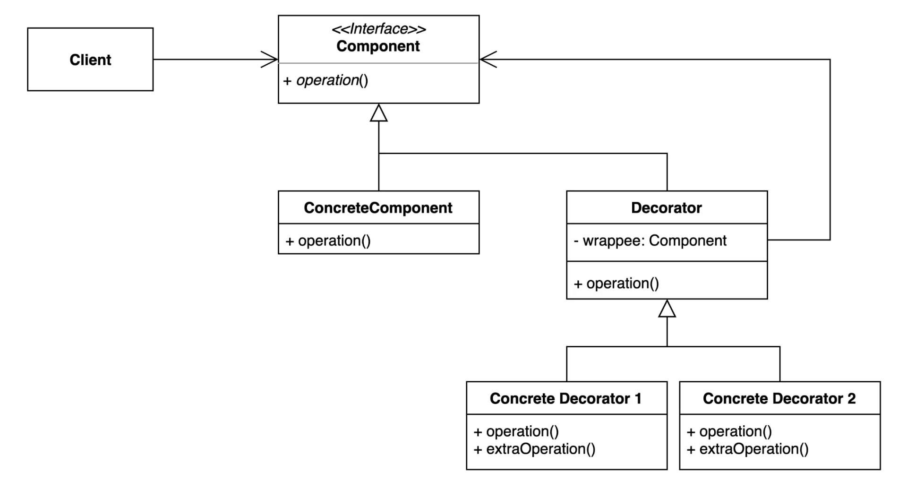
> 
> - 다이나믹하게(동적으로) 런타임에 부가 기능을 추가할 수 있다&#46;
>     - 다이나믹, 동적 이라는 단어가 들어가면 일반적으로 <strong><u>런타임에서 변경</u></strong>할 수 있다는 의미이다&#46;
> 
> - <code>상속</code>이 아닌 <strong><u>위임</u></strong><strong><u>을</u></strong><strong><u> 사용</u></strong>해서 보다 <strong><u>유연하게(런타임에) 부가 기능을 추가</u></strong>하는 것도 가능하다&#46;
> 
> - 상속 대신 <strong><u>객체 합성(Composition</u></strong>)을 사용하여 <u>기능을 확장</u>하며, <u>기존 코드를 수정하지 않고도 새로운 기능을 추가</u>( <strong>OCP</strong> )할 수 있어 <strong><u>유연성과 재사용성을 높</u></strong>일 수 있다&#46;

<details>
<summary>🧐 <strong><code>구성</code></strong><strong>(Composition) vs </strong><strong><code>합성</code></strong><strong>(Composition) vs </strong><strong><code>위임</code></strong><strong>(Delegation)</strong></summary>

| <strong>용어</strong> | <strong>개념 요약</strong> | <strong>관점</strong> | <strong>관계</strong> |
| --- | --- | --- | --- |
| <strong><code>구성</code></strong><strong>(Composition)</strong> | 다른 객체를 필드로 포함하여 기능을 재사용 | 구조 중심 | 가장 넓은 개념 |
| <strong><code>합성</code></strong><strong>(Composition)</strong> | 구성과 같음 (동의어) | 구조 중심 | 구성과 동일 |
| <strong><code>위임</code></strong><strong>(Delegation)</strong> | 포함된 객체에게 실제 일을 맡기는 것 | 동작 중심 | 구성의 한 방식 |

</details>

<a id="1d0eda9b0fe180a284acf2688a3ac655"></a>

### 1&#46; 기본 예제

<a id="1d0eda9b0fe1802da67df70c0529591b"></a>

### 코드

<details>
<summary>&#91; 코드 &#93; CommentService</summary>

<a id="1d0eda9b0fe1801bbe20d06316519f2f"></a>

```java
package me.whiteship.designpatterns._02_structural_patterns._09_decorator._01_before;

public class CommentService {
    public void addComment(String comment) {
        System.out.println(comment);
    }
}
```

</details>

<details>
<summary>&#91; 코드 &#93; SpamFilteringCommentService</summary>

<a id="1d2eda9b0fe180b68113fa5ba664573a"></a>

```java
package me.whiteship.designpatterns._02_structural_patterns._09_decorator._01_before;

public class SpamFilteringCommentService extends CommentService {

    @Override
    public void addComment(String comment) {
        boolean isSpam = isSpam(comment);
        if (!isSpam) {
            super.addComment(comment);
        }
    }

    private boolean isSpam(String comment) {
        return comment.contains("http");
    }
}

```

</details>

<details>
<summary>&#91; 코드 &#93; TrimmingCommentService</summary>

<a id="1d2eda9b0fe180139d97f824fe165bcc"></a>

```java
package me.whiteship.designpatterns._02_structural_patterns._09_decorator._01_before;

public class TrimmingCommentService extends CommentService {

    @Override
    public void addComment(String comment) {
        super.addComment(trim(comment));
    }

    private String trim(String comment) {
        return comment.replace("...", "");
    }
}
```

</details>

<details>
<summary>&#91; 코드 &#93; Client</summary>

<a id="1d2eda9b0fe180f4a47aff30bcf744b5"></a>

```java
package me.whiteship.designpatterns._02_structural_patterns._09_decorator._01_before;

public class Client {

    private CommentService commentService;

    public Client(CommentService commentService) {
        this.commentService = commentService;
    }

    private void writeComment(String comment) {
        commentService.addComment(comment);
    }

    public static void main(String[] args) {
        Client client = new Client(new SpamFilteringCommentService());
        client.writeComment("오징어게임");
        client.writeComment("보는게 하는거 보다 재밌을 수가 없지...");
        client.writeComment("http://whiteship.me");
    }

}

```

</details>

<details>
<summary>실행 결과</summary>

- SpamFilteringCommentService
    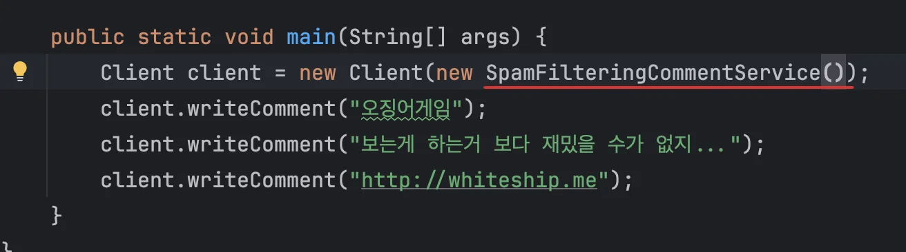

    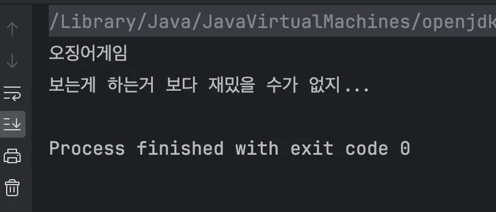

    - 

- TrimmingCommentService
    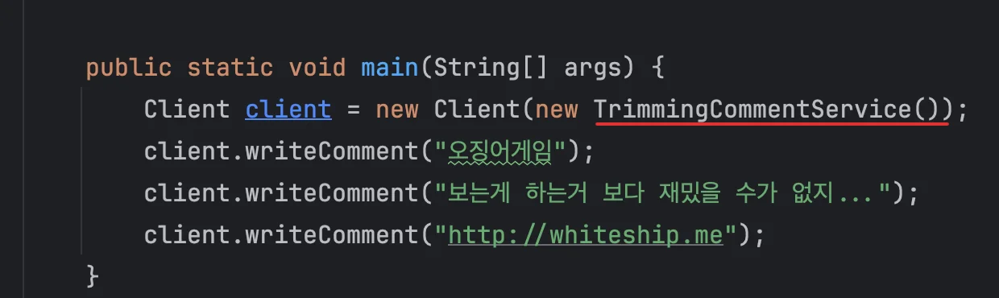

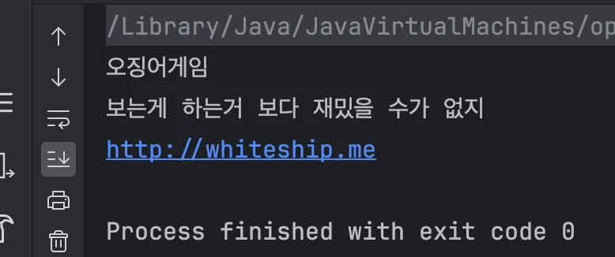

</details>

<a id="1d0eda9b0fe1807fa432d6ae45f0fcfa"></a>

### 문제점

1. 기존 코드의 변경없이 확장이 가능하지만, <strong><u>확장에 대한 유연성이 떨</u></strong>어진다 
    - <strong>클래스에 대한 </strong><strong><u>다중 상속</u></strong><strong><u>을 지원하지 않</u></strong>기 때문에 예시 코드에서의 spam() 메서드와 trim() 같이 사용하려하는 경우, <strong><u>기</u></strong><u>존의 코드를 재사용하는 것이 아닌, </u><strong><u>새로운 클래스를 생성</u></strong>하여 다시 <strong><u>해당 동작을 중복해서 정의</u></strong>해야 한다&#46; 
        <a id="1d2eda9b0fe180e2a7acca038a222c86"></a>

        ```java
        public class SpamFilteringAndTrimmingCommentService {
        		
        		// filtering 로직
        		// trimming 로직
        }
        ```

1. 다른 클래스의 기능을 사용하려는 경우, 매번 클라이언트에서 다른 클래스의 의존성을 주입해야 한다&#46;
    <a id="1d2eda9b0fe180598624c91e40bdd4d4"></a>

    ```java
    public class Client {

        public static void main(String[] args) {
            // 1. 필터링이 필요한 경우, SpamFilteringCommentService 의존성 주입
            Client client = new Client(new SpamFilteringCommentService());
            
            // 2. trimming이 필요한 경우, TrimmingCommentService 의존성 주입
            Client client = new Client(new TrimmingCommentService());
    ```

<a id="1d0eda9b0fe180aca9c0f31138427bb2"></a>

### 2&#46; 패턴 적용

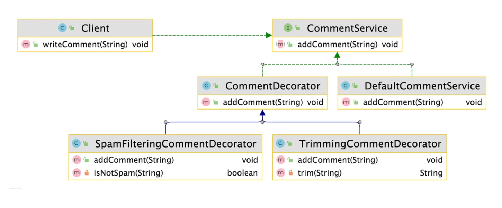

<a id="1d0eda9b0fe1807bb643d3df4c6872e3"></a>

### 코드

<details>
<summary>&#91; 코드 &#93; &#60;interface&#62; CommentService</summary>

<a id="1d0eda9b0fe180a19bb9c460fead49f1"></a>

```java
public interface CommentService {
    void addComment(String comment);
}
```

</details>

<details>
<summary>&#91; 코드 &#93; DefaultCommentService</summary>

<a id="1d0eda9b0fe1805c9448eea29cfb60d2"></a>

```java
package _02_structural_patterns._09_decorator._02_after;

public class DefaultCommentService implements CommentService {

    @Override
    public void addComment(String comment) {
        System.out.println(comment);
    }
}
```

</details>

<details>
<summary>&#91; 코드 &#93; CommentDecorator</summary>

<a id="1d2eda9b0fe1803ba9dbce6953f0de6d"></a>

```java
package _02_structural_patterns._09_decorator._02_after;

public class CommentDecorator implements CommentService {

    private final CommentService commentService;

    public CommentDecorator(CommentService commentService) {
        this.commentService = commentService;
    }

    @Override
    public void addComment(String comment) {
        commentService.addComment(comment);
    }
}

```

</details>

<details>
<summary>&#91; 코드 &#93; SpamFilteringCommentDecorator</summary>

<a id="1d2eda9b0fe180d08ccdc17858cfecb2"></a>

```java
package _02_structural_patterns._09_decorator._02_after;

public class SpamFilteringCommentDecorator extends CommentDecorator {

    public SpamFilteringCommentDecorator(CommentService commentService) {
        super(commentService);
    }

    @Override
    public void addComment(String comment) {
        if (isNotSpam(comment)) {
            super.addComment(comment);
        }
    }

    private boolean isNotSpam(String comment) {
        return !comment.contains("http");
    }
}

```

</details>

<details>
<summary>&#91; 코드 &#93; TrimmingCommentDecorator</summary>

<a id="1d2eda9b0fe180629f06f071b72dcc7b"></a>

```java
package _02_structural_patterns._09_decorator._02_after;

public class TrimmingCommentDecorator extends CommentDecorator{

    public TrimmingCommentDecorator(CommentService commentService) {
        super(commentService);
    }

    @Override
    public void addComment(String comment) {
        super.addComment(trim(comment));
    }

    private String trim(String comment) {
        return comment.replace("...", "");
    }
}
```

</details>

---

<details>
<summary>&#91; 코드 &#93; Client</summary>

<a id="1d2eda9b0fe1800a9bbadb591be9803c"></a>

```java
package _02_structural_patterns._09_decorator._02_after;

public class Client {

    private CommentService commentService;

    public Client(CommentService commentService) {
        this.commentService = commentService;
    }

    public void writeComment(String comment) {
        commentService.addComment(comment);
    }
}

```

</details>

<details>
<summary>&#91; 코드 &#93; App</summary>

<a id="1d2eda9b0fe180ce9eb8c02dce0305ae"></a>

```java
package _02_structural_patterns._09_decorator._02_after;

public class App {

    private static final boolean enabledSpamFilter = true;
    private static final boolean enabledTrimming = true;

    public static void main(String[] args) {
        CommentService commentService = new DefaultCommentService();

        if (enabledSpamFilter) {
            commentService = new SpamFilteringCommentDecorator(commentService);
        }

        if (enabledTrimming) {
            commentService = new TrimmingCommentDecorator(commentService);
        }

        Client client = new Client(commentService);
        client.writeComment("오징어게임");
        client.writeComment("보는게 하는거 보다 재밌을 수가 없지...");
        client.writeComment("http://whiteship.me");
    }
}

```

</details>

<a id="1d2eda9b0fe180968761fdd8f8423f8d"></a>

### Notes

<details>
<summary>자바에서 <strong>상속받은 클래스는 생성될 때 반드시 부모 생성자를 먼저 호출해야 한다&#46;</strong></summary>

> 🗒️ 
> 
> <a id="1d2eda9b0fe1802a8309c938a1f04ce1"></a>
> 
> <strong><code>super</code></strong><strong> 호출 규칙</strong>
> 
> ---
> 
> | 파라미터 | <strong>부모 클래스 생성자</strong> | <strong>자식 클래스에서 super()</strong> | <strong>자동 호출 여부</strong> | <strong>명시 필요 여부</strong> |
> | --- | --- | --- | --- | --- |
> | <strong>O</strong> | 기본 생성자 있음 | super() | 자동 호출됨 | 생략 가능 |
> | ❌ | 기본 생성자 없음 | super(&#46;&#46;&#46;) | 자동 호출 안 됨 | ❗ 반드시 명시 |

<details>
<summary>1&#46; 부모 클래스의 생성자에 파라미터로 넘기는 값이 없는 경우, super 키워드를 정의하지 않아도 내부적으로 처리 해준다&#46;</summary>

<a id="1d2eda9b0fe180c889fdc8e06d48cdb7"></a>

```java
class Parent {
    public Parent() {
        System.out.println("Parent 생성자");
    }
}

class Child extends Parent {
    public Child() {
        // super()가 생략되어 있어도 자동으로 호출됨!
        System.out.println("Child 생성자");
    }
}
```

<a id="1d2eda9b0fe180698a96c2e1a14c1975"></a>

🔁 내부적으로는 아래처럼 동작함

<a id="1d2eda9b0fe180deb926d7c4db4eeffd"></a>

```java
public Child() {
    super(); // 자동 삽입됨
    System.out.println("Child 생성자");
}
```

</details>

<details>
<summary><strong>2&#46; 부모 클래스에 매개변수 있는 생성자만 있는 경우</strong></summary>

<a id="1d5eda9b0fe18051821bce82aa7fa5af"></a>

<strong>예시 코드 </strong>

<a id="1d2eda9b0fe180e88899f79193136224"></a>

```java
class Parent {
    public Parent(String name) {
        System.out.println("Parent: " + name);
    }
}

class Child extends Parent {
    public Child() {
        // ❌ super() 생략 불가! 컴파일 오류!
    }
}
```

<a id="1d2eda9b0fe1805d85bfe6f2cd8d74e5"></a>

<strong>🤬 오류</strong>

<a id="1d2eda9b0fe18000b26ae667e1d23181"></a>

```java
Constructor 'Parent()' is undefined
```

- 자바는 기본적으로 super()를 자동으로 넣으려 하는데, Parent()가 없으니 호출할 수 없다&#46;

<a id="1d2eda9b0fe18088bbe6e6528272bcfd"></a>

✅ 해결

<a id="1d2eda9b0fe1802f8ef3f774f432e739"></a>

```java
class Child extends Parent {
    public Child() {
        super("child 생성자"); // 명시적으로 부모 생성자 호출
        System.out.println("Child 생성자");
    }
}
```

</details>

<a id="1d2eda9b0fe180d295d5c030dc1f3b41"></a>

<strong> </strong>

</details>

<details>
<summary>🧐 자바의 표현식 평가 순서(Evaluation Order)</summary>

> 🧐 
> 
> <a id="1d2eda9b0fe180b5aa91f7378f71218e"></a>
> 
> <strong>의문점</strong>
> 
> ---
> 
> <a id="1d2eda9b0fe180dca5a3d3a22265bf8e"></a>
> 
> ```java
> commentService = new SpamFilteringCommentDecorator(commentService);
> ```
> 
> - commentService에 들어있는 값(commentService 객체)을 넘기는 게 먼저인가?
> 
> - 아니면 <strong>새로운 객체 SpamFilteringCommentDecorator를 만든 뒤 </strong>commentService 할당하는게 먼저인가?
> 
> - 만약 후자라면 <strong> 덮어씌워서 오류가 나야되지 않은가?</strong>

<a id="1d2eda9b0fe180e6ab90fa0a84c74422"></a>

```java
commentService = new SpamFilteringCommentDecorator(commentService);
```

<a id="1d2eda9b0fe18059ae93f44313555a85"></a>

위 코드의 동작 순서는 아래와 같다&#46;

<a id="1d2eda9b0fe180efac36cd196f317e49"></a>

```java
1. 현재 commentService(= DefaultCommentService)를 인자로 준비
2. new SpamFilteringCommentDecorator(commentService) → 새로운 객체 생성
3. 그 결과를 commentService 변수에 대입 (덮어씌움)
```

<a id="1d2eda9b0fe18087bb37e9dc23669975"></a>

즉, <strong>오른쪽부터 평가되고</strong>, 그 다음에 왼쪽 변수에 할당된다&#46;

> 자바는 <strong>“오른쪽 표현식(RHS)이 먼저 평가되고 그 결과를 왼쪽(LHS)에 할당”</strong> <br>하는 규칙을 따른다&#46;

<a id="1d2eda9b0fe180359551fd48957c49d2"></a>

```java
commentService = new SpamFilteringCommentDecorator(commentService);
//        ↑                           ↑
//   (3) 대입                   (1) 인자 준비 → (2) 객체 생성
```

<a id="1d2eda9b0fe180b3b260e1516c4ce93e"></a>

따라서 기존의 <code>commentService</code>를 먼저 인자로 넘기고 그걸 감싼 <code>SpamFilteringCommentDecorator</code> 인스턴스를 만든 뒤 마지막에 <strong>다시 commentService 변수에 할당되기 떄문에 </strong>오류가 발생되지 않고 wrapping 구조를 형성한다&#46;

</details>

<details>
<summary>🤔 어떻게 동적으로 래핑 구조를 형성하여 동작될 수 있는가?</summary>

---

<a id="1d2eda9b0fe180cb98a4c2122501d9f5"></a>

### 의문점

---

<a id="1d2eda9b0fe180c5898dcb369b06f4eb"></a>

```java
package _02_structural_patterns._09_decorator._02_after;

public class App {

    private static final boolean enabledSpamFilter = true;
    private static final boolean enabledTrimming = true;

    public static void main(String[] args) {
        CommentService commentService = new DefaultCommentService();

        if (enabledSpamFilter) {
            commentService = new SpamFilteringCommentDecorator(commentService);
        }

        if (enabledTrimming) {
            commentService = new TrimmingCommentDecorator(commentService);
        }

        Client client = new Client(commentService);
        client.writeComment("http://spam.com");
       
```

- 데코레이션 패턴 사용 시, 위와 같이 런타임에서 동적으로 의존성을 부여할 수 있다

- 그러나 commentService를 통해 재할당이 일어난다&#46;

> 🧐 
> 
> <a id="1d2eda9b0fe18069bcd2e57cd2557462"></a>
> 
> 그렇다면 기존의 인스턴스를 덮어씌워서 이전에 할당한 의존성이 사라져야 되는 것이 아닌가?

<a id="1d2eda9b0fe18063a8c3ccc1ab9ce1b0"></a>

### 정리

---

<a id="1d2eda9b0fe180998163e1f692936e27"></a>

```java
CommentService commentService = new DefaultCommentService();

if (enabledSpamFilter) {
    commentService = new SpamFilteringCommentDecorator(commentService);
}

if (enabledTrimming) {
    commentService = new TrimmingCommentDecorator(commentService);
}

Client client = new Client(commentService);
client.writeComment("http://whiteship.me");
```

<a id="1d2eda9b0fe180d2bc11fd04efd35834"></a>

위 예시 코드의 실제 호출을 보면 아래와 같다&#46;

<a id="1d2eda9b0fe180adbc56eb67c321fe56"></a>

<strong>실제 호출</strong>

<a id="1d2eda9b0fe180fb91f6df02760ea26a"></a>

```java
// 클라이언트 코드
CommentService commentService = new DefaultCommentService();
commentService = new SpamFilteringCommentDecorator(commentService);
commentService = new TrimmingCommentDecorator(commentService);

commentService.addComment("http://spam.com");
```

<a id="1d2eda9b0fe180e0a939d37ecae569e6"></a>

```java
// 아래와 같이 래핑하여 생성하는 것과 동일하다.
CommentService commentServer = 
		new TrimmingCommentDecorator(
				new SpamFilteringCommentDecorator(
						new DefaultCommentService()
				)
		);
```

<a id="1d2eda9b0fe1808bbe0ed3a92859417c"></a>

```java
[TrimmingCommentDecorator]
   ↓
[SpamFilteringCommentDecorator]
   ↓
[DefaultCommentService]
```

<a id="1d2eda9b0fe180cba060f192c8dc20bf"></a>

즉, 위와 같은 래핑 구조를 가지면서 로직이 처리된다&#46; 

> ‘🧐 어떻게 래핑 구조를 가질 수 있는가?’ 에 대한 내용은 위 <br><code>자바의 표현식 평가 순서(Evaluation Order)</code> 정리 내용 참조 바람

- 데코레이터는 다음 데코레이터 또는 원본 객체를 <strong>필드로 가지고 있다&#46;</strong>

- 이를 통해 연속적으로 덧붙이거나 가공할 수 있다&#46;

</details>

<a id="1d0eda9b0fe180599880fb928360254e"></a>

### 3&#46; 장•단점

- 장점
    1. <strong>새로운 클래스를 만들지 않</strong>고 <strong><u>기존 기능을 조합</u></strong>할 수 있다&#46;
        1. 재사용 가능

    1. 컴파일 타임이 아닌 <strong><u>런타임에 동적으로 기능을 변경</u></strong><strong> </strong>할 수 있다&#46;

- 단점
    1. 데코레이터를 조합하는 코드가 복잡할 수 있다&#46;
        - 더 많은 데코레이터가 있는 경우, 오히려 <strong><u>상속을 사용</u></strong>하는 것이 더 많은 코드(클래스)를 작성해야 한다&#46;
            <a id="1d2eda9b0fe180709f00f1dceac88316"></a>

            → <code class="language-math">O(2^n)</code>

        - 따라서 그나마 단점이지만 단점이 아니다&#46;

<a id="1d0eda9b0fe180db81f5f404d0df895f"></a>

### 4&#46; 실무 활용

> ✏️ 
> 
> > <strong>자바</strong>
> 
> -  <strong><code>InputStream</code></strong>, <strong><code>OutputStream</code></strong>, <strong><code>Reader</code></strong>, <strong><code>Writer</code></strong>의 생성자를 활용한 랩퍼
> 
> - <code>java&#46;util&#46;</code><strong><code>Collections</code></strong>가 제공하는 메소드들 활용한 랩퍼
> 
> - <code>javax&#46;servlet&#46;http&#46;</code><strong><code>HttpServletRequest</code></strong><code>/</code><strong><code>ResponseWrapper</code></strong>
> 
> > <strong>스프링</strong>
> 
> - <strong><code>ServerHttpRequestDecorator</code></strong>

<a id="1d0eda9b0fe1805db8dcf39be77e6e80"></a>

### 코드

<details>
<summary>&#91; 코드 &#93; AdapterInJava</summary>

> ✏️ 
> 
> <a id="1d2eda9b0fe1805fb89dfd273a033533"></a>
> 
> 보는 목적에 따라 어댑터 패턴이 될수도 있고, 데코레이션 패턴이 될 수 있다&#46;
> 
> <a id="1d2eda9b0fe18032bda2e54935fe08f0"></a>
> 
> ```java
> // [ BufferedReader -> InputStreamReader -> FileInputStream ]
> new BufferedReader(
>      new InputStreamReader(
>          new FileInputStream("input.txt");
>      )
> );
> ```

<a id="1d0eda9b0fe180dbacd2c2c28e30fc38"></a>

```java
package _02_structural_patterns._09_decorator._03_java;

import java.io.*;
import java.util.*;

public class AdapterInJava {
    public static void main(String[] args) {
        // collections
        List<String> strings = Arrays.asList("a", "b", "c");
        Enumeration<String> enumeration = Collections.enumeration(strings);
        ArrayList<String> list = Collections.list(enumeration);

        try(InputStream is = new FileInputStream("input.txt");
            InputStreamReader isr = new InputStreamReader(is);
            BufferedReader reader = new BufferedReader(isr)) {
            while(reader.ready()) {
                System.out.println(reader.readLine());
            }
        } catch (IOException e) {
            throw new RuntimeException(e);
        }
    }
}
```

</details>

<details>
<summary>&#91; 코드 &#93; DecoratorInJava</summary>

> ✏️ 
> 
> <details>
> <summary><code>Collections&#46;checkedList()</code></summary>
> 
> 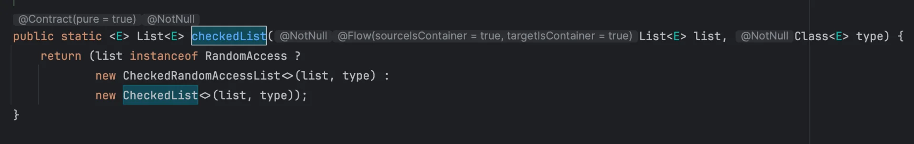
> 
> 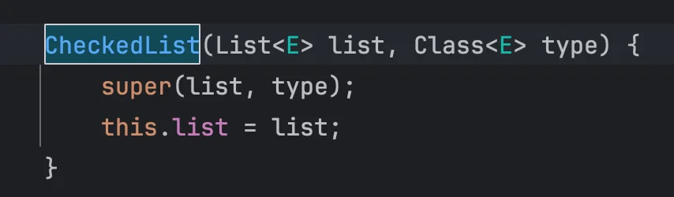
> 
> 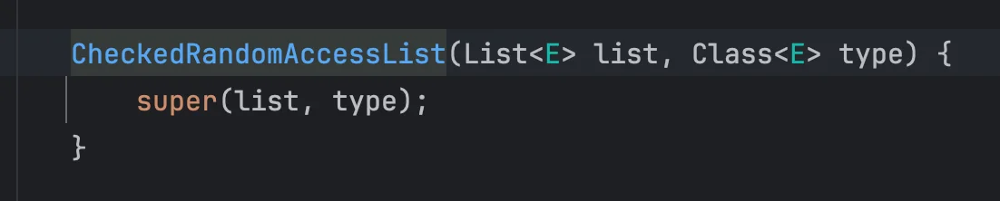
> 
> </details>
> 
> <details>
> <summary><code>Collections&#46;unmodifiableList()</code></summary>
> 
> 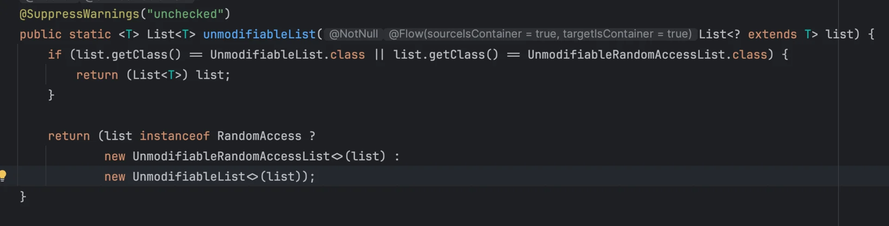
> 
> 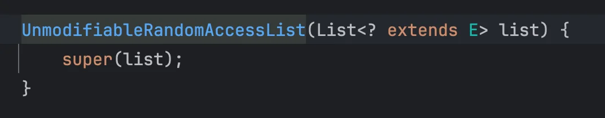
> 
> 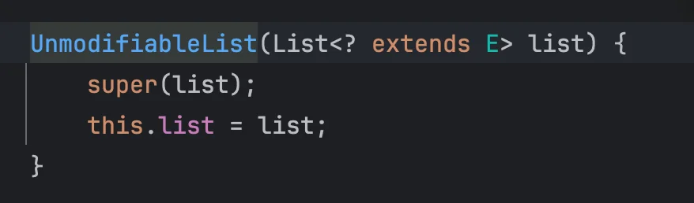
> 
> </details>
> 
> <details>
> <summary><code>Collections&#46;synchronizedList()</code></summary>
> 
> 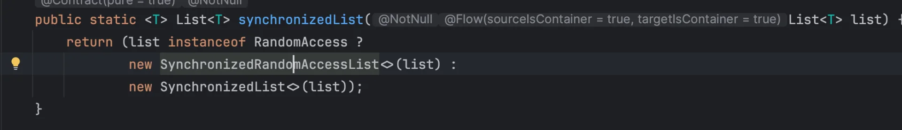
> 
> 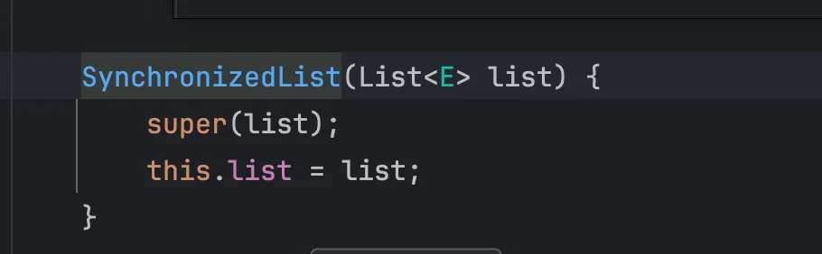
> 
> 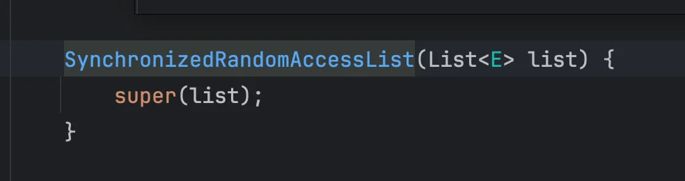
> 
> </details>
> 
> ---
> 
> <a id="1d2eda9b0fe1809a93f6c44c83f98fa0"></a>
> 
> 상속 및 super() 를 통해  래핑 구조를 만든다&#46;

<a id="1d2eda9b0fe180d1a07ee3e2b6e4d71d"></a>

```java
package _02_structural_patterns._09_decorator._03_java;

import jakarta.servlet.http.HttpServletRequestWrapper;
import jakarta.servlet.http.HttpServletResponseWrapper;

import java.util.ArrayList;
import java.util.Collections;
import java.util.List;

public class DecoratorInJava {

    public static void main(String[] args) {
        ArrayList list = new ArrayList<>();
        list.add(new Book());

        List books = Collections.checkedList(list, Book.class);

        // books.add(new Item()); // 컴파일 오류: ClassCastException

        List unmodifianleList = Collections.unmodifiableList(list);
        list.add(new Item());
        unmodifianleList.add(new Book());

        // 서블릿 요청 또는 응답 랩퍼
        HttpServletRequestWrapper requestWrapper;
        HttpServletResponseWrapper responseWrapper;
    }

    public static class Book {
    }

    public static class Item {
    }
}
```

</details>

<details>
<summary>&#91; 코드 &#93; DecoratorInSpring</summary>

> ✏️ 
> 
> <a id="1d2eda9b0fe180bc9423fb8fbc4f03de"></a>
> 
> <code>ServerHttpRequestDecorator</code>, <code>ServerHttpResponseDecorator</code>
> 
> ---
> 
> - 서버 HTTP 리퀘스트와 서버 HTTP 리스폰스를 우리가 커스터마이징 할 수 있는 데코레이터 인터페이스이다&#46;
> 
> - 웹 필터를 통하는 모든 요청들이 커스터마이징한 데코레이터의 하위 클래스들을 다 거쳐가게 되어있다&#46;
> 
> - 그러면 요청, 응답 본문을 로깅하거나, 의심스러운 요청인 경우, 처리하지 않는다거나 등 여러가지 다양한 래퍼들을 정의하여 처리할 수 있다&#46;

<a id="1d2eda9b0fe180fc9b78ca55487f78a8"></a>

```java
package _02_structural_patterns._09_decorator._03_java;

import org.springframework.beans.factory.xml.BeanDefinitionDecorator;
import org.springframework.http.server.reactive.ServerHttpRequestDecorator;
import org.springframework.http.server.reactive.ServerHttpResponseDecorator;

public class DecoratorInSpring {

    public static void main(String[] args) {
        // 빈 설정 데코레이터
        BeanDefinitionDecorator decorater;

        // 웹플럭스 HTTP 요청 / 응답 데코레이터
        ServerHttpRequestDecorator httpRequestDecorator;
        ServerHttpResponseDecorator httpResponseDecorator;
    }
}

```

</details>
