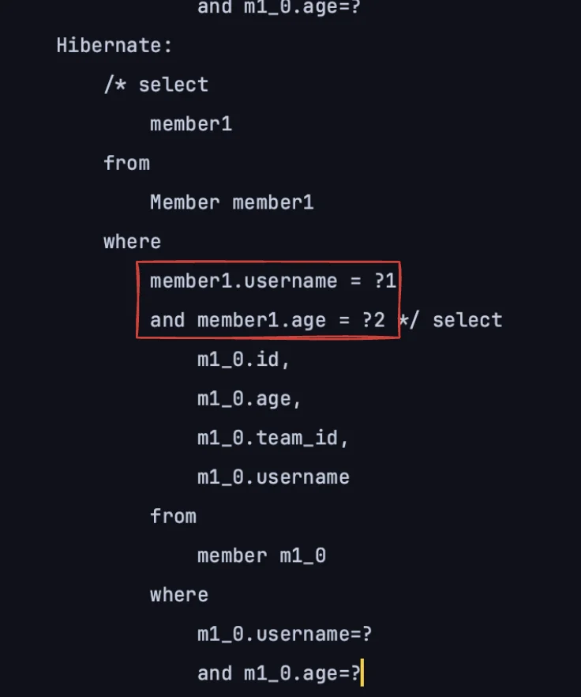
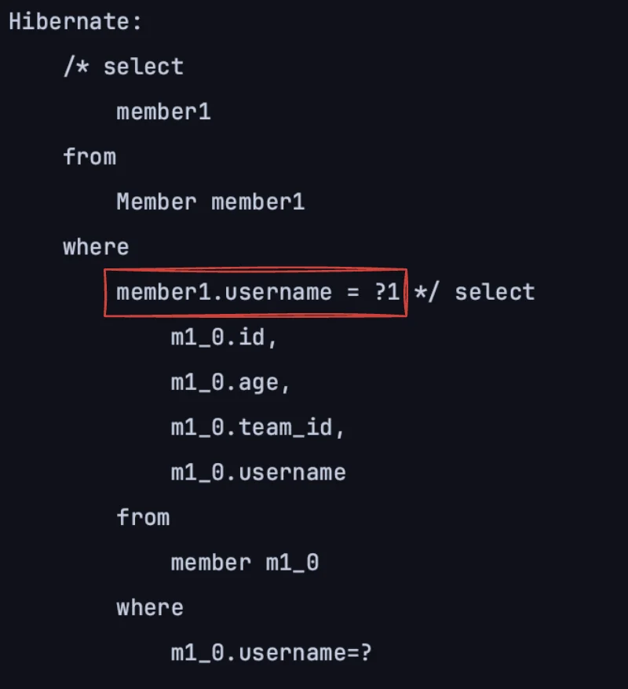

> ✏️ 
> 
> <a id="1c3eda9b0fe1819b99edc7c39a882919"></a>
> 
> 동적 쿼리를 Where에 다중 파라미터로 처리하는 방법은 <u>자바를 활용하는 Querydsl에서는 가장 큰 장점 중 하나</u>이다&#46;  따라서 굉장히 중요하다&#46; 

<a id="1c3eda9b0fe181cd8b02ff7b11955e89"></a>

## Where 다중 파라미터 

---

> 📖 
> 
> <a id="1c3eda9b0fe181cc9ac0f19409e54e43"></a>
> 
> <code>Where 다중 파라미터</code> 방법을 사용하면<u> 깔끔하게 코드를 작성</u>하여 <u>동적 쿼리 처리가 가능</u>하다&#46;<br>비교 조건 파라미터를 따로 메서드로 추출하여 넘기기 떄문에 얻을 수 있는 장점이 많다&#46; 
> 
> <a id="1c3eda9b0fe181b29d2aee409ad92961"></a>
> 
> 1&#46; 메서드를 <u>다른 쿼리에서도 재활용</u> 할 수 있다&#46; 
> 
> <details>
> <summary><u><code>&#46;and()</code></u><u> 등 연산자 메서드를 사용</u>하여 상황에 맞게 조립 할 수 있다&#46;</summary>
> 
> <details>
> <summary>ex)  광고 상태 isValid, 날짜 IN &#58; isServicable</summary>
> 
> <a id="1c3eda9b0fe1815eb9bcdc1b7762109d"></a>
> 
> ```java
> private BooleanExpression isServicable( ... ) {
> 		return isValid(...).and(DateBetweenIN(...));
> }
> ```
> 
> - 위와 같이 메서드를 재사용 및 조합해서  서비스 로직들을 정의할 수 있다&#46;
> 
> </details>
> 
> </details>
> 
> - ☝🏻 <code>null</code> 체크  따로 해줘야 한다&#46; ( 살짝 번거로움 )
> 
> <a id="1c3eda9b0fe181a3b1eaf40ed3740e7d"></a>
> 
> 2&#46; 쿼리 자체의 <strong><u>가독성이 높</u></strong>아진다&#46;

<details>
<summary>Where 다중 파라미터 </summary>

- 테스트 
    <a id="1c3eda9b0fe181c9aa9ad1143d641291"></a>

    ```java
    @Test
    public void dynamicQuery_WhereParam() {

        String usernameParam = "member1";
        Integer ageParam = 10;

        List<Member> result = searchMember2(usernameParam, ageParam);
        assertThat(result.size()).isEqualTo(1);
    }
    ```

- <strong><u>where 절</u></strong>에서 <strong><u>다중 파라미터</u></strong>를 사용한 <u>동적 쿼리 처리</u>
    - 간단한 null 값 비교인 경우, 아래와 같이 삼항연산자를 사용하여 많이 처리한다&#46; 

    - <u>조건으로 넘</u>기는 <u>비교 파라미터 값</u>을 아래와 같이 <u>메서드로 추출</u>하여 처리하는 경우 <strong><u>깔끔하게 코드 작성이 가능</u></strong>하다&#46; 
        - 반환 타입은 <code>BooleanExpression</code>이어야 한다&#46; 

    <a id="1c3eda9b0fe1811da362f887e7ab009b"></a>

    ```java
    private List<Member> searchMember2(String usernameCond, Integer ageCond) {
        return queryFactory
                .selectFrom(member)
                .where(usernameEq(usernameCond), ageEq(ageCond))
                .fetch();
    }

    private BooleanExpression usernameEq(String usernameCond) {
        return usernameCond != null? member.username.eq(usernameCond) : null;
    }

    private BooleanExpression ageEq(Integer ageCond) {
        return ageCond != null? member.age.eq(ageCond) : null;
    }
    ```

<details>
<summary>쿼리 확인</summary>

- 아래와 같이 넘겨받은 인자 값으로 조회 쿼리를 날리는 것을 확인할 수 있다&#46; 



</details>

</details>

<details>
<summary>파라미터들 조합 &#45; <code>&#46;and()</code></summary>

> ☝🏻 
> 
> <a id="1c3eda9b0fe1811081f7def9db65f36e"></a>
> 
> 해당  방법 사용 시, <code>null</code> 체크를 주의해서 처리해야 한다 &#46;

<a id="1c3eda9b0fe1810294b5f258e73c8f49"></a>

```java
private BooleanExpression allEq(String usernameCond, Integer ageCond) {
   return usernameEq(usernameCond).and(ageEq(ageCond));
}
```

- 위와 같이 <code>&#46;and()</code> 를 사용해서 한번에 파리미터를 넘길 수 있다&#46;

- <u>반환 타입</u>은 <code>BooleanExpression</code>이어야 한다&#46; 

---

<details>
<summary>&#91; 전체 코드 &#93; &#45; 동적 쿼리 조회</summary>

<a id="1c3eda9b0fe181fc9ce8c18cb90f09db"></a>

```java
private List<Member> searchMember2(String usernameCond, Integer ageCond) {
    return queryFactory
            .selectFrom(member)
            .where(allEq(usernameCond, ageCond))
            .fetch();
}

private BooleanExpression usernameEq(String usernameCond) {
    return usernameCond != null ? member.username.eq(usernameCond) : null;
}

private BooleanExpression ageEq(Integer ageCond) {
    return ageCond != null ? member.age.eq(ageCond) : null;
}

private BooleanExpression allEq(String usernameCond, Integer ageCond) {
    return usernameEq(usernameCond).and(ageEq(ageCond));
}
```

</details>

</details>

> ☝🏻 
> 
> <a id="1c3eda9b0fe181678cf4fc89d0e82725"></a>
> 
> <code>&#46;where()</code>에 null 값 할당 시 무시된다&#46; 
> 
> <details>
> <summary>ex)</summary>
> 
> <a id="1c3eda9b0fe181e59c07e59055d49d9c"></a>
> 
> 조건을 여러 개 나열하면 and 조건으로 처리한다&#46; 
> 
> - 인자 값으로 <code>null</code> 을 넘김
>     <a id="1c3eda9b0fe1811e92d4caf907558bf6"></a>
> 
>     ```java
>     @Test
>     public void dynamicQuery_WhereParam() {
> 
>         String usernameParam = "member1";
>         Integer ageParam = null;
> 
>         List<Member> result = searchMember2(usernameParam, ageParam);
>         assertThat(result.size()).isEqualTo(1);
>     }
>     ```
> 
>     <details>
>     <summary><code>searchMember2(&#46;&#46;&#46;)</code> &#45; 동적 조회 로직은 위와 동일함</summary>
> 
>     <a id="1c3eda9b0fe181ed95a5eec79f9bb052"></a>
> 
>     ```java
>      private List<Member> searchMember2(String usernameCond, Integer ageCond) {
>         return queryFactory
>                 .selectFrom(member)
>                 .where(usernameEq(usernameCond), ageEq(ageCond))
>                 .fetch();
>     }
> 
>     private Predicate usernameEq(String usernameCond) {
>         return usernameCond != null? member.username.eq(usernameCond) : null;
>     }
> 
>     private Predicate ageEq(Integer ageCond) {
>         return ageCond != null? member.age.eq(ageCond) : null;
>     }
>     ```
> 
>     </details>
> 
> - 쿼리 확인
>     - 아래와 같이 null 값 필드가 무시되는 것을 확인할 수 있다&#46;
> 
>     
> 
> </details>
