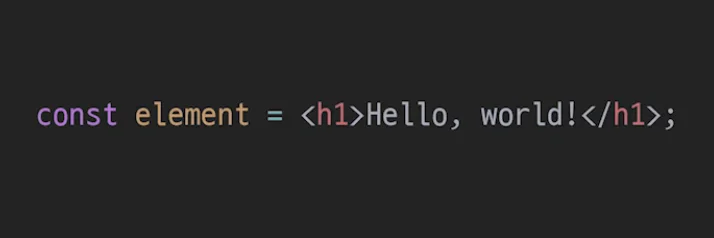
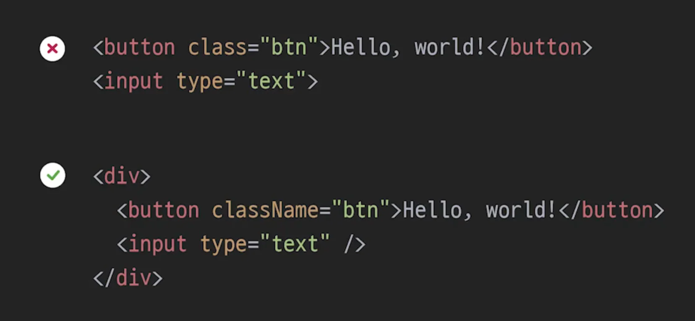
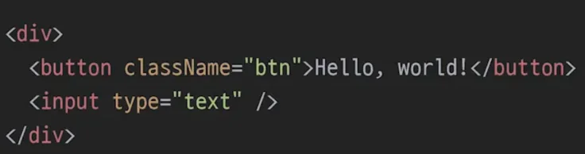

## JSX 

### JSX = HTML &#43; Javascript

- Javascript를 확장한 문법 ( Javascript XML )

- 모양은 HTML에 가까움

- 내부적으로 JavaScript 사용 가능

- React는 이 JSX를 이용하여 화면을 그림 ( 컴포넌트 )

### JSX에서 사용되는 태그의 속성 이름이 HTML과 조금 다르다&#46;

- class  → className

- for → htmlFor

- onclick → onClick

### 태그를 명시적으로 닫아줘야 한다&#46;

### 여러개의 테그를 만드는 경우, 해당 Tag를 감싸는 최상위 Tag가 필요하다&#46;

## JSX &#45; Javascript

## JSX &#45; 조건문

## JSX &#45; 반복문

## JSX &#45; 스타일링

## JSX &#45; 구구단 출력
