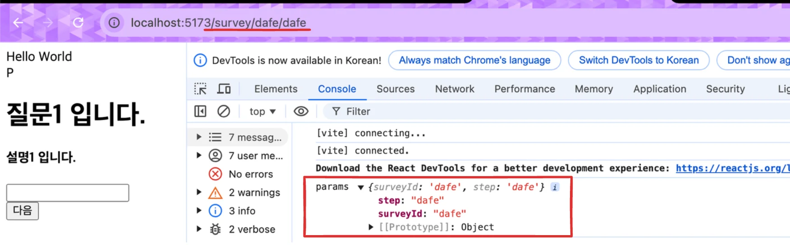

[feat: 라우터 적용](https://github.com/gyungsubLee/inflearn_react_prac/commit/9598d29fd064cd493e5115184851e9628f700f9f)

<a id="1c3eda9b0fe1815d8d7afc7d2a27d273"></a>

### <code>useParams</code> 을 사용한 <u>Path Variable</u> 받아오기

- Route에 정의한 변수(<code>Path Variable</code> …)를 받아올 수 있다&#46; 
    > ☝🏻 
    > 
    > <a id="1c3eda9b0fe181f8825cd4c3c596c8a0"></a>
    > 
    > <strong>오류 )</strong> path에 <code>Path Variable</code>을 <u>정의하지 못</u>하면 <code>useParams</code>로 데이터를 가져올 수 없다&#46; 
    > 
    > - 🤬 실패 &#45; Path&#58; <code>/survey</code>
    > 
    > - 😁 성공 &#45; Path&#58;  <code>/survey/&#58;surveyId/&#58;step</code>

    > ✏️ 
    > 
    > <a id="1c3eda9b0fe1814f8c93c4c3e01e6b94"></a>
    > 
    > Path Variable &#91; 문법&#58; <code>/&#58;변수명</code> &#93; 
    > 
    > - path&#58; <code>/survey/&#58;surveyId/&#58;step</code>
    >     - <code>surveyId</code>
    > 
    >     - <code>step</code>

    - 코드

    <a id="1c3eda9b0fe18156ab29d24e0a43c3b7"></a>

    ```javascript
    import { Route, Routes } from "react-router-dom";
    import CompletionPage from "./pages/CompletionPage";
    import SurveyPage from "./pages/SurveyPage";

    function App() {
      return (
        <>
          <div>Hello World</div>
          <Routes>
            <Route path="/done" element={<CompletionPage />} />
            <Route path="/survey/:surveyId/:step" element={<SurveyPage />} />
          </Routes>
        </>
      );
    }

    export default App;
    ```

    <a id="1c3eda9b0fe181f282fdf080eb540fa4"></a>

    ```javascript
    import { useState } from "react";
    import { useParams } from "react-router-dom";

     .  .  .

    const SurveyPage = () => {
      const params = useParams();
      console.log("params", params);

        .  . .
    ```

    - 실행 화면 

    

<a id="1c3eda9b0fe1819c8d80f060408b55fe"></a>

### <code>useParams</code>을 통해 질문 배열과 페이지 연동하기

<a id="1c3eda9b0fe181c4a40ee4b243240474"></a>

### 자동으로 페이지가 이동되어야 하는 경우 &#45; <code>useNavigate</code>

> 🤔 
> 
> <a id="1c3eda9b0fe181fca52af1715e6ff06a"></a>
> 
> 이전에는 링크 태그를 사용하여 직접 링크를 만들어 페이지를 이동 시켰다&#46; 
> 
> <a id="1c3eda9b0fe181e0adb4c774069ddb3f"></a>
> 
> 그러나 만약 이런 링크로 둘 수 없는, 자동으로 페이지가 이동되어야 하는 경우
> 
> - button을 클릭하여 특정 페이지와 연동
> 
> <a id="1c3eda9b0fe181389a5dc73ff433ef29"></a>
> 
> React&#45;router&#45;dom 에서 제공하는 <code>useNavigate</code>를 통해 직접 이동 페이지를 이동시킬 수 있다&#46; 
> 
> - Path를 특정 이벤트와 연관시켜 변경 가능하다&#46;

> ☝🏻 
> 
> <a id="1c3eda9b0fe18178bf9ed96a52408dbe"></a>
> 
> 주의사항
> 
> - path는 문자열이어야 한다&#46;
>     - 🤬 오류) <code>navigate(1);</code> 
> 
>     - 😁 해결) <code>navigate(&#39;1&#39;);</code> 
> 
> - 절대 경로로 적지 않으면, 다음 path로 자동으로 추가된다&#46; 
>     - 🤬 오류) <code>navigate(&#96;&#36;{step &#43; 1}&#96;);</code>
> 
>     - 😁 해결) <code>navigate(&#96;/&#36;{step &#43; 1}&#96;);</code> 

<details>
<summary>해결 1) 절대 경로 사용</summary>

- 아래와 같이 절대 경로로 넘길 경우, id 값을 Props로 받아와야 한다&#46; 

<a id="1c3eda9b0fe181e99ae7f83644a29fb4"></a>

```javascript
import { IActionButtons } from "../../\btypes";
import { useNavigate } from "react-router-dom";

const ActionButtons: React.FC<IActionButtons> = ({ questionsLength, id, step }) => {
  const isLast = questionsLength - 1 === step;
  const navigate = useNavigate();

  return (
    <div>
      {step === 0 || (
        <button
          onClick={() => {
            navigate(`/survey/${id}/${step - 1}`);
          }}
        >
          이전
        </button>
      )}
      {isLast ? (
        <button
          onClick={() => {
            // TODO: 서버로 설문 조사 데이터 넘기기
            navigate("/done");
          }}
        >
          제출
        </button>
      ) : (
        <button
          onClick={() => {
            navigate(`/survey/${id}/${step + 1}`);
          }}
        >
          다음
        </button>
      )}
    </div>
  );
};

export default ActionButtons;

```

</details>

<details>
<summary>해결 2) 상대 경로 사용 ( 중첩 라우트 )</summary>

<a id="1c3eda9b0fe18190b4c6ea0edfc44187"></a>

```javascript
import { Route, Routes } from "react-router-dom";
import CompletionPage from "./pages/CompletionPage";
import SurveyPage from "./pages/SurveyPage";

function App() {
  return (
    <>
      <div>Hello World</div>
      <Routes>
        <Route path="/done" element={<CompletionPage />} />
        <Route path="/survey/:surveyId" element={<SurveyPage />}>
          <Route path=":step" element={<SurveyPage />} />
        </Route>
      </Routes>
    </>
  );
}

export default App;
```

<a id="1c3eda9b0fe181f28f9ed9e6ec4446f5"></a>

위와 같이 경로를 쪼개주면, 하위 컴포넌트가 상위 컴포넌트를 parent 경로로 판단하여, 상대 경로로 이동해도 parent 경로를 기준으로 이동한다&#46;

- Parent(상위) 경로&#58; <code>/survey/&#58;surveyId</code>

- Child(하위) 경로&#58; <code>&#58;step</code><br>

<a id="1c3eda9b0fe181338839dbaabdad79e4"></a>

```javascript
import { IActionButtons } from "../../\btypes";
import { useNavigate } from "react-router-dom";

const ActionButtons: React.FC<IActionButtons> = ({
  questionsLength,
  step,
}) => {
  const isLast = questionsLength - 1 === step;
  const navigate = useNavigate();

  return (
    <div>
      {step === 0 || (
        <button
          onClick={() => {
            navigate(`${step - 1}`);
          }}
        >
          이전
        </button>
      )}
      {isLast ? (
        <button
          onClick={() => {
            // TODO: 서버로 설문 조사 데이터 넘기기
            navigate("/done");
          }}
        >
          제출
        </button>
      ) : (
        <button
          onClick={() => {
            navigate(`${step + 1}`);
          }}
        >
          다음
        </button>
      )}
    </div>
  );
};

export default ActionButtons;

```

</details>

<details>
<summary>중첩 라우트 사용 시, useParams() 타입 오류 발생</summary>


</details>
