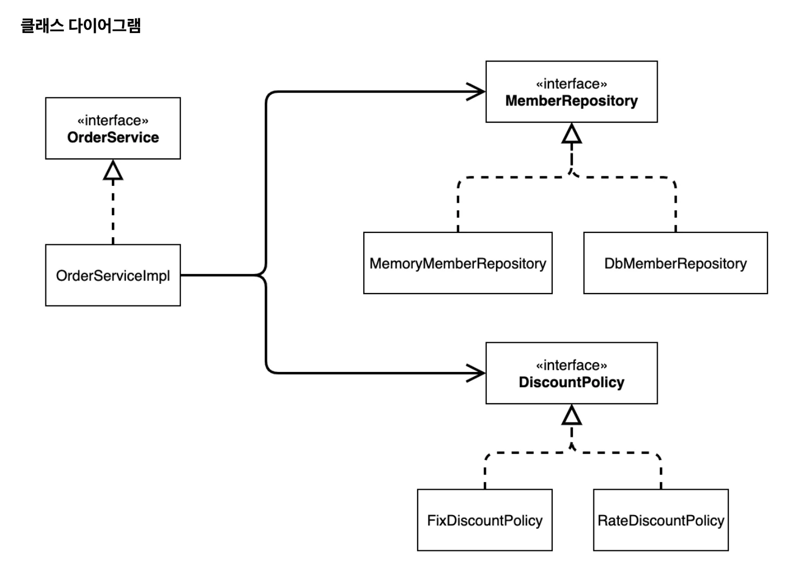

## IoC(Inversion of Control, 제어의 역전)

---

기존의 프로그램은 클라이언트 구현 객체가 스스로 필요한 서버 구현 객체를 생성하고, 연결하고, 실행했다&#46; 

> <code>MemberServiceImpl</code> → <code>MemberRepository</code>, <code>MemoryMemberRepository</code> 

한마디로 <strong>구현 객체가 프로그램의 제어 흐름을 스스로 조종</strong>했다&#46; 

→ <strong><code>DIP</code></strong>, <strong><code>OCP</code></strong>, <strong><code>SRP</code></strong> 위반

그래서 이를  <code>AppConfig</code>를 통해, 외부에서 제어 흐름 통제하는 방식으로 변경하였다&#46; 

<code>OderServiceImpl</code>은 필요한 인터페이스들을 호출하지만, <strong><code>AppConfig</code></strong><strong>를 통해 외부에서 구현객체가 주입되기(DI)</strong> 때문에 <u>어떤 구현 객체들이 실행될 지 모른다&#46; </u>

따라서<strong> </strong><strong>프로그램에 대한 제어 흐름의 대한 권한 모두 AppConfig가 가지고 있다</strong>&#46; 심지어 <code>OrderServiceImpl</code> 도 <code>AppConfig</code>가 생성한다&#46;

 또한, <code>OderService 인터페이스의 구현 객체</code>를 생성하고 실행할 수도 있다&#46; 

이렇듯 <strong>프로그램의 제어 흐름</strong>을 직접 제어하는 것이 아니라 <strong>외부에서 관리(</strong><strong><code>AppConfig</code></strong><strong>)</strong>하는 것을 <strong>제어의 역전(IoC</strong>)이라 한다&#46; 

<strong>IoC 컨테이너, DI 컨테이너</strong>

> <code>AppConfig</code> 처럼 <strong>객체를 생성하고 관리하면서 의존관계를 연결해 주는 것</strong>을 <strong><u>IoC 컨테이너</u></strong> 또는 <strong><u>DI 컨테이너</u></strong>라 한다&#46;

(의존관계 주입에 초점을 맞춰 최근에는 주로 DI 컨테이너라 하며, 어샘블러, 오르젝트 팩토리 등으로 불리기도 함&#46;)

&#43;) <strong>프레임워크  vs 라이브러리</strong>

프레임워크가 내가 작성한 코드를 제어하고, 대신 실행하면 그것은 프레임워크가 맞다&#46;(JUnit)

반면에 내가 작성한 코드가 직접 제어의 흐름을 담당한다면 그것은 프레임워크가 아니라 라이브러리다&#46; 

## 의존관계 주입 DI(Dependency Injection)

---

> 의존관계는 <strong>정적인 클래스 의존 관계</strong>와, <strong>실행 시점에 결정되는 동적인 객체(인스턴스) 의존관계</strong> 둘을 분리해서 생각해야 한다&#46;  → <code>클래스 다이어그램</code>, <code>객체 다이어그램</code>

### 정적인 클래스 의존관계

정적인 의존관계는 애플리케이션을 실행하지 않아도 분석할 수 있다&#46;  → <code>클래스 다이어그램</code>

> 

### 동적인 객체 인스턴스 의존관계

애플리케이션 실행 시점에서, 실제 생성된 객체 인스턴스 의존관계이다&#46;

> 애플리케이션 <strong>실행 시점(런타임)</strong>에 외부에서 실제 구현 객체를 생성하고 클라이언트에 전달(<code>DI, 의존관계 주입</code>)해서 클라이언트와 서버의 실제 의존관계가 형성된다&#46; → 클라이언트 코드의 변경 X, 호출 대상의 타입 인스턴스를 변경 가능 → 정적인 클래스 의존관계 변경  , 동적인 객체 인스턴스 의존관계 변경 가능
