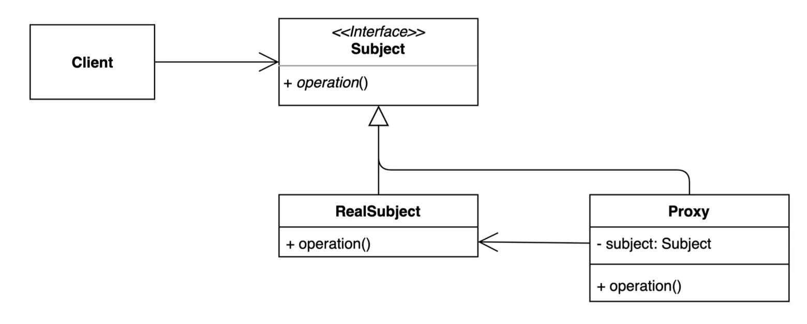
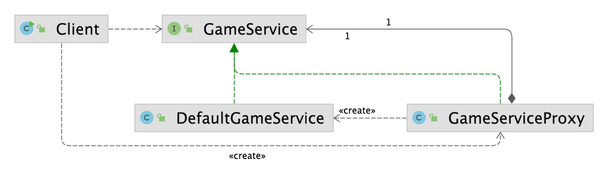

> 📝 
> 
> <a id="1d3eda9b0fe180c5a9c9e6f5ae2845d5"></a>
> 
> <strong>질문</strong>
> 
> <details>
> <summary>프록시 패턴이란 무엇인가?</summary>
> 
> 
> 
> </details>
> 
> <details>
> <summary>프록시 패턴의 장단점은?</summary>
> 
> 
> 
> </details>
> 
> <details>
> <summary>프록시 패턴의 실무 활용 예?</summary>
> 
> 
> 
> </details>

<a id="1d3eda9b0fe18038902de8558971dbfb"></a>

## <strong>프록시 </strong>패턴

---

> 📖 
> 
> <a id="1d3eda9b0fe180b08e86e35ed7805292"></a>
> 
> <strong>프록시 패턴</strong>
> 
> ---
> 
> > 특정 객체에 대한 접근을 제어하거나 기능을 추가할 수 있는 패턴
> 
> 
> 
> - 특정 객체에 대한 <u>접근을 제어</u>하거나 <u>추가 기능</u>을 제공하기 위해 <u>대리자 역할(Proxy)을 하는 객체</u>를 정의한다&#46;
> 
> - 객체에 직접 접근하지 않고도 작업을 수행할 수 있도록 하며, <strong><u>원래 객체와 동일한 인터페이스를 구현</u></strong>하여 클라이언트가 원래 객체와 프록시 객체를 구분하지 못하도록 설계한다&#46;
> 
> - 초기화 지연, 접근 제어, 로깅, 캐싱 등 다양하게 응용해 사용 가능하다
> 
> ---
> 
> <details>
> <summary>구성 요소</summary>
> 
> - <code>Subject</code>&#58;  원래 객체와 프록시가 구현해야 하는 공통 인터페이스
> 
> - <code>RealSubject</code>&#58; 실제 작업을 수행하는 원래 객체
> 
> - <code>Proxy</code>&#58; RealSubject에 대한 접근을 제어하거나 추가 기능을 제공하는 대리 객체
> 
> </details>
> 
> <details>
> <summary>목적</summary>
> 
> - 실제 객체(<code>RealSubject</code>)의 <strong>접근 제어</strong>
> 
> - 실제 객체(<code>RealSubject</code>)의 <strong>생성 지연</strong>
> 
> - 추가적인 부가 기능 추가 ( 로깅, 캐시, 보안 등 )<br>
> 
> </details>
> 
> <details>
> <summary>사용 사례</summary>
> 
> - 리소스가 비쌀 때
>     - 리소스가 많이 소모되는 객체를 필요할  때만 생성하고 싶을 때 ( 지연 초기화, Lazy Initialization)
> 
>     - DB, 네트워크 등 무거운 객체를 지연 초기화 ( ex, JPA Lazy )
> 
> - 접근 제어가 필요할 때
>     - 원격 객체에 로컬 대리자를 제공하고 싶을 때 (Remote Proxy)
> 
>     - 민감한 데이터나 리소스에 대한 접근 권한 제어
> 
>     - 보안, 권한 검사
> 
> - 기능 확장이 필요할 때 
>     - 로깅, 캐싱, 트랜잭션, 성능 측정, 권한 검사  등 부가 기능 추가
> 
> </details>
> 
> <details>
> <summary>종류</summary>
> 
> - Virtual Proxy&#58; 비용이 많이 드는 객체를 지연 생성
> 
> - Remote Proxy&#58; 원격 객체의 로컬 대리자 역할
> 
> - Protection Proxy&#58; 접근 권한 관리
> 
> - Smart Proxy&#58; 추가 작업(예&#58; 참조 횟수 관리, 캐싱 등)을 수행
> 
> </details>
> 
> <details>
> <summary>실무 팁</summary>
> 
> - Spring에서는 대부분 프록시 CGLIB(클래스 기반) 또는 JDK Dynamic Proxy(인터페이스 기반)로 자동 생성한다&#46; 
> 
> - 직접 프록시를 만들 필요 없이 <code>&#64;Transactional</code>, <code>&#64;Cacheable</code>, <code>&#64;Async</code> 같은 애노테이션들이 프록시 기반으로 자동 생성되어 동작된다&#46; 
> 
> - 프록시 패턴은 데코레이터 패턴과도 유사하지만, 접근 제어 목적이 더 강하다&#46; 
> 
> </details>

<a id="1d3eda9b0fe180b5b99cdf6f7f4b9621"></a>

### 1&#46; 기본 예제

<a id="1d3eda9b0fe1802fa853ca0858aff025"></a>

### 코드

<details>
<summary>&#91; 코드 &#93; GameService</summary>

<a id="1d3eda9b0fe1803384d1e2f288a83628"></a>

```java
package _02_structural_patterns._12_proxy._01_before;

public class GameService {

    public void startGame() {
        System.out.println("이 자리에 오신 여러분을 진심으로 환영합니다.");
    }
}
```

</details>

<details>
<summary>&#91; 코드 &#93; Client</summary>

<a id="1d3eda9b0fe180639589de706ed042cb"></a>

```java
package _02_structural_patterns._12_proxy._01_before;

public class Client {

    public static void main(String[] args) {
        GameService gameService = new GameService();
        gameService.startGame();
    }
}
```

</details>

<a id="1d3eda9b0fe18052ae00c70036fa6409"></a>

### 2&#46; 패턴 적용

<a id="1d3eda9b0fe1808b8f8ffcd1b757b1bb"></a>

### 코드



<details>
<summary>&#91; 코드 &#93; &#60; interface &#62; GameService</summary>

<a id="1d3eda9b0fe180678482d6e258350ccf"></a>

```java
package _02_structural_patterns._12_proxy._02_after;

public interface GameService {

    void startGame();
}
```

</details>

<details>
<summary>&#91; 코드 &#93; DefaultGameService</summary>

<a id="1d3eda9b0fe180b1bb88fcdd5b976166"></a>

```java
package _02_structural_patterns._12_proxy._02_after;

public class DefaultGameService implements GameService {

    @Override
    public void startGame() {
        System.out.println("이 자리에 오신 여러분을 진심으로 환영합니다.");
    }
}
```

</details>

<details>
<summary>&#91; 코드 &#93; GameService<strong>Proxy</strong></summary>

<a id="1d3eda9b0fe180b78915fb520f63c694"></a>

```java
package _02_structural_patterns._12_proxy._02_after;

public class GameServiceProxy implements GameService {
    
    private GameService gameService;

    @Override
    public void startGame() {
        long before = System.currentTimeMillis();
        if (this.gameService == null) {
            this.gameService = new DefaultGameService();
        }

        gameService.startGame();
        System.out.println(System.currentTimeMillis() - before);
    }
}
```

</details>

<details>
<summary>&#91; 코드 &#93; Client</summary>

<a id="1d3eda9b0fe180bbaf44c0f53604af95"></a>

```java
package _02_structural_patterns._12_proxy._02_after;

public class Client {

    public static void main(String[] args) {
        GameService gameService = new GameServiceProxy();
        gameService.startGame();
    }
}
```

</details>

<a id="1d3eda9b0fe1808eaa54c4105c11e1d9"></a>

### 3&#46; 장•단점

- 장점
    - 기존 코드를 변경하지 않고 새로운 기능을 추가할 수 있다&#46; ( OCP 준수 )

    - 기존 코드가 해야하는 일만 유지할 수 있다&#46;

    - 기능 추가 및 초기화 지연 등으로 다양하게 활용할 수 있다&#46;

- 단점
    - 코드의 복잡도가 증가한다&#46;

<a id="1d3eda9b0fe18084abddf5f2027bf8a6"></a>

### 4&#46; 실무 활용

> ✏️ 
> 
> > 자바
> 
> - 다이나믹 프록시ㅏ, <code>java&#46;lang&#46;reflect&#46;Proxy</code>
> 
> > 스프링
> 
> - 스프링 AOP
>     - <code>&#64;Cacheable</code>
> 
>     - <code>&#64;Transactional</code>

<a id="1d3eda9b0fe180ffb8d4e4d66ff052eb"></a>

### 코드

<details>
<summary>&#91; 코드 &#93; ProxyInJava</summary>

<a id="1d3eda9b0fe18058be88f43c29afc809"></a>

```java
package _02_structural_patterns._12_proxy._03_java;

import _02_structural_patterns._12_proxy._02_after.DefaultGameService;
import _02_structural_patterns._12_proxy._02_after.GameService;

import java.lang.reflect.Proxy;

public class ProxyInJava {

    public static void main(String[] args) {
        ProxyInJava proxyInJava = new ProxyInJava();
        proxyInJava.dynamicProxy();
    }

    private void dynamicProxy() {
        GameService gameServiceProxy = gatGameServiceProxy(new DefaultGameService());
        gameServiceProxy.startGame();
    }

    private GameService gatGameServiceProxy(GameService target) {
        return (GameService) Proxy.newProxyInstance(this.getClass().getClassLoader(),
                new Class[]{GameService.class}, (proxy, method, args) -> {
                    System.out.println("O");
                    method.invoke(target, args);
                    System.out.println("ㅁ");
                    return null;
                });
    }
}
```

</details>

<details>
<summary>&#91; 코드 &#93; App</summary>

<a id="1d3eda9b0fe18085a712c6d98095aab7"></a>

```java
package _02_structural_patterns._12_proxy._03_java;

import org.springframework.boot.ApplicationRunner;
import org.springframework.boot.SpringApplication;
import org.springframework.boot.WebApplicationType;
import org.springframework.boot.autoconfigure.SpringBootApplication;
import demo.beanContainer.annotation.Bean;


@SpringBootApplication
public class App {

    public static void main(String[] args) {
        SpringApplication app = new SpringApplication(App.class);
        app.setWebApplicationType(WebApplicationType.NONE);
        app.run(args);
    }

    @Bean
    public ApplicationRunner applicationRunner(GameService gameService) {
        return args -> {
            gameService.startGame();
        };
    }
}
```

</details>

<details>
<summary>&#91; 코드 &#93; GameService</summary>

<a id="1d3eda9b0fe180e9a1b2f224f3b41cfd"></a>

```java
package _02_structural_patterns._12_proxy._03_java;

import org.springframework.stereotype.Service;

@Service
public class GameService {

    public void startGame() {
        System.out.println("이 자리에 오신 여러분을 진심으로 환영합니다.");
    }
}
```

</details>

<details>
<summary>&#91; 코드 &#93; PerfAspect</summary>

<a id="1d3eda9b0fe1809d8b8dc3388c7a7b43"></a>

```java
package _02_structural_patterns._12_proxy._03_java;

import org.aspectj.lang.ProceedingJoinPoint;
import org.aspectj.lang.annotation.Around;
import org.aspectj.lang.annotation.Aspect;
import org.springframework.stereotype.Component;

@Aspect
@Component
public class PerfAspect {

    @Around("bean(gameService)")
    public void timestamp(ProceedingJoinPoint point) throws Throwable {
        long before = System.currentTimeMillis();
        point.proceed();
        System.out.println(System.currentTimeMillis() - before);

    }
}
```

</details>
