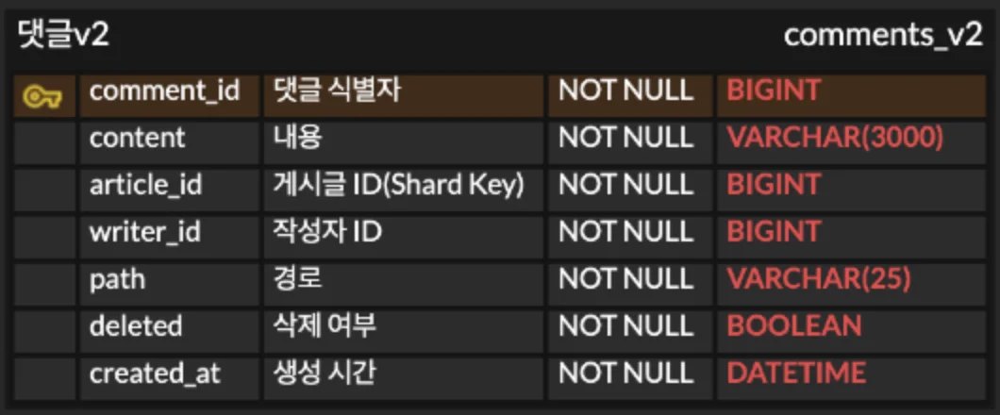
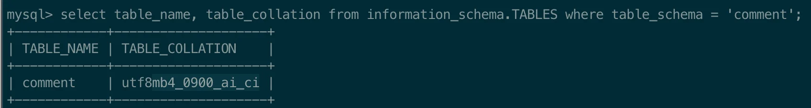

<a id="1c3eda9b0fe18104881eda2e0392e9cf"></a>

### <strong>ERD</strong>



<a id="1c3eda9b0fe181a7bc5fd71309181ad4"></a>

댓글 경로를 나타내기 위한 path 컬럼이 추가되었다&#46; 

- parent&#95;comment&#95;id는 제거됨

- 설계 구조상 depth는 무한할 수 있지만, 개발 편의 및 서비스 제한 사항으로<br> depth를 <code>5</code>로 제한한다&#46; 

<a id="1c3eda9b0fe181b0a1e9c6fbf10df64a"></a>

```sql
CREATE TABLE comment_v2 (
	comment_id bigint not null primary key,
	content varchar(3000) not null,
	article_id bigint not null,
	writer_id bigint not null,
	path varchar(25) character set utf8mb4 collate utf8mb4_bin not null,
	deleted bool not null,
	created_at datetime not null
);
```



<details>
<summary><code>utf8mb4&#95;0900&#95;ai&#95;ci</code></summary>

- <code>utf8mb4</code>
    - 문자 세트(character set) 이름

    - <code>utf8mb4</code>는 mysql에서 가장 완전한 UTF&#45;8 문자 세트를 의미한다&#46;

    - UTF&#45;8의 모든 4바이트 문자를 지원하므로 이모지, 특정한 CJK(중국어, 일본어, 한국어) 문자, 고유한 기호 등을 포함할 수 있다&#46;

- <code>0900</code>
    - collation이 도입된 MySQL 버전을 나타낸다&#46;

- <code>ai</code>
    - 악센트 비구분

- <code>ci</code>
    - 대소문자 비구분

</details>
