> ✏️ 
> 
> <a id="1c3eda9b0fe1813ab9cbc483a01479b2"></a>
> 
> 현업에서 <strong><code>EC2 &#45; Redis</code></strong>를 <strong><u>사용하지 않</u></strong>고 <strong><code>ElastiCache</code></strong><strong> </strong>를 <strong><u>사용</u></strong>한다&#46; 

<a id="1c3eda9b0fe1816cb9ddee7e4e9062c4"></a>

### <strong>실무에서 EC2&#45;Redis 대신 </strong><strong><u>ElastiCache를 사용</u></strong><strong>하는 이유</strong>

---

<a id="1c3eda9b0fe181d6a1a7cd81f405050b"></a>

실무에서는 EC2에 Redis를 직접 설치해서 사용하는 경우가 드물다&#46;

- Redis를 일일이 설치 및 관리 확장하려면 신경쓸 게 생각보다 많다&#46; 

<a id="1c3eda9b0fe181038a6ee2d30ade5b41"></a>

ElastiCache를 사용하면 setting 과 확장이 쉽고, 모니터링 기능도 기본적으로 제공하기 때문에, 오류 상황에 대한 대처도 용이하다&#46; 

<a id="1c3eda9b0fe1817b9ed3f924bcf857c4"></a>

이런 이유도, 실무에서는 Redis를 직접 설치해서 사용하는 것 대신 ElastiCache를 많이 사용한다&#46; 

> 🧐 그렇다면 왜 EC2에 직접 Redis를 설치해서 사용하는 방법을 학습했는가?

<a id="1c3eda9b0fe18101ac90da129774563e"></a>

EC2에서 Redis를 직접 사용하지 않고는 ElastiCache에 대한 동작 이해가 어렵다&#46; 

<a id="1c3eda9b0fe1818bbb99c3a8751b09e3"></a>

학습하는 입장에서는 이미 만들어져있는 서비스를 바로 사용하는 것 보다는 처음부터 구축하면서 어떠한 점을 개선하기 위해서 이런 기술들이 나왔는지, 그 이유를 알아가는 것이 올바르다&#46;

<a id="1c3eda9b0fe1815596e6e2de69f539d8"></a>

### ElastiCache를 도입한 아키텍처

<details>
<summary>이전 아키텍처</summary>

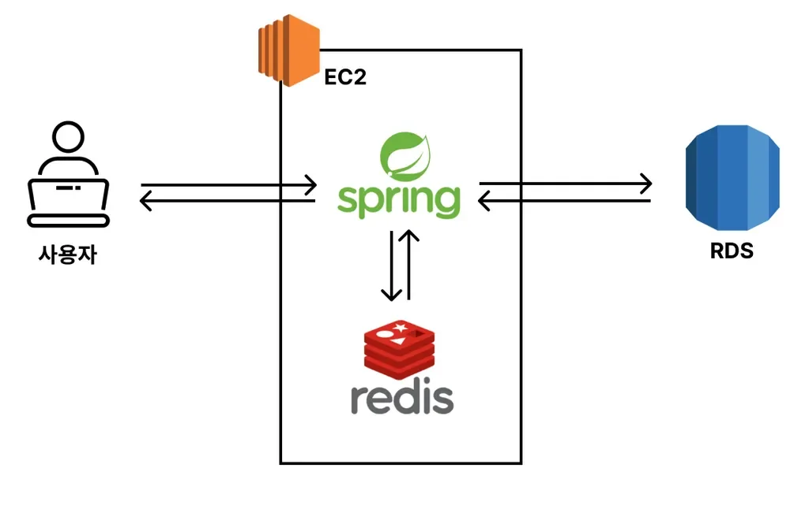

</details>

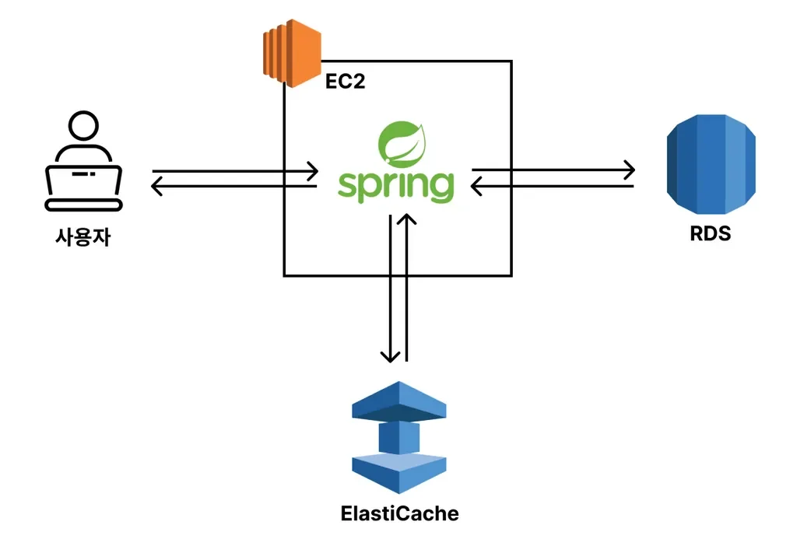

<a id="1c3eda9b0fe18145aef7e154025573e2"></a>

### AWS ElastiCache 세팅

---

<details>
<summary>🧐 <code>Valkey</code> vs <code>Memcached</code> vs <code>Redis OSS</code></summary>

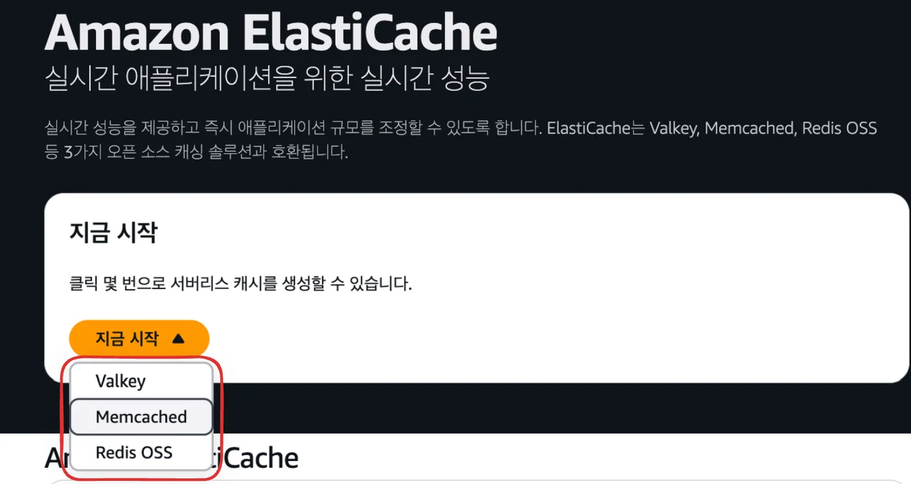

<a id="1c3eda9b0fe181be9fe0ef16cd01975a"></a>

### <code>Valkey</code>

<a id="1c3eda9b0fe18108ad82ed54a016a748"></a>

‣

- alkey는 AWS가 2024년 10월에 발표한 고성능 오픈 소스 키&#45;값 데이터 저장소이다&#46;

- Redis OSS의 드롭인 대체 솔루션으로 설계 되었다&#46;

<a id="1c3eda9b0fe181bbb9a6d83bd05455d3"></a>

<strong>Valkey</strong>는 AWS에서 2024년 10월에 발표한 <strong>고성능 오픈 소스 키&#45;값 데이터 저장소</strong>입니다&#46; 이 서비스는 Redis OSS의 드롭인 대체 솔루션으로 설계되었으며, <strong>메모리 내 캐싱</strong>과 <strong>빠른 데이터 액세스</strong>가 중요한 애플리케이션을 위해 최적화되었습니다&#46;

<a id="1c3eda9b0fe1810ca491ef1feddf7596"></a>

Valkey는 다음과 같은 특징을 가집니다&#58;

<a id="1c3eda9b0fe181ae9ccec36b63811198"></a>

1&#46;	<strong>고성능</strong>&#58; Valkey는 <strong>고속 데이터 접근</strong>을 위해 최적화되어 있으며, 높은 처리 성능을 제공합니다&#46;

<a id="1c3eda9b0fe1815eb248c4d3491bde3f"></a>

2&#46;	<strong>Redis 호환성</strong>&#58; Valkey는 Redis와 호환되며, 기존의 Redis 애플리케이션을 Valkey로 쉽게 이전할 수 있습니다&#46;

<a id="1c3eda9b0fe181b5a4f0c78bd78c18f0"></a>

3&#46;	<strong>비용 효율성</strong>&#58; AWS에서 제공하는 <strong>완전 관리형 서비스</strong>로, 운영과 관리가 용이하고 비용도 최적화할 수 있습니다&#46;

<a id="1c3eda9b0fe1819e86e6fbc7f422e6ce"></a>

4&#46;	<strong>자동 확장성</strong>&#58; 자동으로 성능과 용량을 확장할 수 있어 대규모 애플리케이션에서 유용합니다&#46;

<details>
<summary><strong>Valkey와 다른 캐시 옵션 비교</strong></summary>

<a id="1c3eda9b0fe1814ba1eefa634bdff3f6"></a>

<strong>특성</strong>	<strong>Redis (ElastiCache for Redis)</strong>	<strong>Memcached (ElastiCache for Memcached)</strong>	<strong>Valkey (ElastiCache for Valkey)</strong>

<a id="1c3eda9b0fe181d28df3ddc4e8287e19"></a>

<strong>성능</strong>	높은 성능, 복잡한 데이터 구조를 처리할 수 있음	메모리 기반 캐시로 빠른 성능 제공	Redis와 유사한 성능, 고속 데이터 액세스

<a id="1c3eda9b0fe181eb92d9eb911d148bd5"></a>

<strong>데이터 구조</strong>	스트링, 리스트, 셋, 해시 등 다양한 데이터 구조 지원	간단한 키&#45;값 구조	Redis와 동일한 데이터 구조 지원

<a id="1c3eda9b0fe18158afafe8e3267c62d5"></a>

<strong>복제 및 고가용성</strong>	지원 (Replication, 클러스터링)	기본적으로 제공되지 않음	지원 (자동 복제, 고가용성 옵션 제공)

<a id="1c3eda9b0fe181a6ad31c5034a245418"></a>

<strong>성장성 및 확장성</strong>	수평 확장 가능 (클러스터링)	제한적인 확장성	자동 확장성 제공 (MemoryDB와 유사)

<a id="1c3eda9b0fe18186afcbdd82186efbf0"></a>

<strong>호환성</strong>	Redis 애플리케이션과 호환	Memcached 애플리케이션과 호환	Redis와 호환, 드롭인 대체 가능

<a id="1c3eda9b0fe181128f7dd01ef99660d6"></a>

<strong>사용 사례</strong>	세션 관리, 캐싱, Pub/Sub, 큐 처리	간단한 캐싱 및 세션 관리	빠른 키&#45;값 데이터 저장 및 캐싱, Redis 대체

<a id="1c3eda9b0fe18132951cde59a4de861b"></a>

<strong>관리 용이성</strong>	AWS 관리형 서비스 (자동 백업, 보안 등)	AWS 관리형 서비스 (간단한 사용, 기본 설정)	AWS 관리형 서비스 (자동 백업, 보안 등)

<a id="1c3eda9b0fe181d99850f4d231939be0"></a>

<strong>지원 프로토콜</strong>	Redis 프로토콜 (Redis 클라이언트 사용)	Memcached 프로토콜 (Memcached 클라이언트 사용)

</details>

<details>
<summary><strong>Valkey의 주요 특징</strong></summary>

1. <strong>고성능 메모리 캐시</strong>&#58; Valkey는 높은 처리 성능을 자랑하며, Redis와 유사한 성능을 제공하면서도 <strong>보다 효율적인 비용</strong>과 <strong>자동 확장</strong>이 가능합니다&#46;

1. <strong>드롭인 Redis 대체</strong>&#58; 기존 Redis 애플리케이션을 <strong>간단하게 Valkey로 마이그레이션</strong>할 수 있습니다&#46; API 호환성 덕분에 Redis 클라이언트를 그대로 사용할 수 있습니다&#46;

1. <strong>메모리 관리 최적화</strong>&#58; Valkey는 메모리 사용 효율성이 뛰어나, 큰 데이터를 처리하면서도 성능 저하 없이 높은 응답 속도를 유지합니다&#46;

1. <strong>완전 관리형</strong>&#58; AWS에서는 <strong>Valkey를 완전 관리형 서비스</strong>로 제공하여, 인프라 관리에 대한 부담을 덜어주고, 자동 확장, 보안, 백업 등 필요한 기능들을 자동으로 처리합니다&#46;

1. <strong>고가용성 및 복제</strong>&#58; Redis와 유사하게, Valkey는 <strong>고가용성</strong>과 <strong>자동 복제</strong>를 지원하여 장애 시 빠르게 복구할 수 있습니다&#46;

</details>

<details>
<summary><strong>왜 Valkey를 선택 해야하는가</strong></summary>

<a id="1c3eda9b0fe181d0b9afe16ffb507ad1"></a>

Valkey는 <strong>기존 Redis 기반 애플리케이션</strong>을 효율적으로 대체할 수 있는 솔루션입니다&#46; AWS에서 제공하는 <strong>완전 관리형 서비스</strong>이므로 관리의 번거로움 없이 뛰어난 성능을 유지할 수 있습니다&#46; 특히 <strong>고성능 캐시</strong>를 필요로 하는 애플리케이션에서 매우 유용하며, 기존 Redis 환경과 호환이 되기 때문에 마이그레이션이나 변경이 매우 쉬운 장점이 있습니다&#46;

</details>

<a id="1c3eda9b0fe1814aa277c6f871aaff48"></a>

### Memcached

<a id="1c3eda9b0fe181c5a9c7c6779311e321"></a>

### <strong>Rediss OSS</strong>

<a id="1c3eda9b0fe1817a85efefb0c06b353a"></a>

Rediss OSS는 <strong>Redis</strong>의 오픈소스 버전으로, AWS ElastiCache는 관리형 서비스이기 때문에 Rediss OSS와 비교할 수는 없습니다&#46; Rediss는 보통 <strong>SSL을 사용하는 Redis</strong>를 지칭할 때 사용되는 약어입니다&#46; 만약 ElastiCache에서 SSL을 사용하려면 ElastiCache Redis는 <strong>TLS</strong> (Transport Layer Security)를 지원합니다&#46;

- <strong>Redis</strong>는 복잡한 데이터 구조와 영속성이 필요한 시스템에 적합합니다&#46; 실시간 데이터 처리, 큐 시스템, 세션 저장소 등 다양한 활용 사례가 가능합니다&#46;

- <strong>Memcached</strong>는 간단한 캐시 처리가 필요한 경우, 빠른 읽기 성능을 중요시하는 경우에 적합합니다&#46;

- <strong>Rediss OSS</strong>는 Redis에 <strong>SSL/TLS</strong>를 적용한 오픈소스 Redis이며, 보안 연결을 통해 안전하게 데이터를 전송할 수 있습니다&#46;

</details>

<details>
<summary>1&#46; <strong>ElastiCache 서비스</strong></summary>

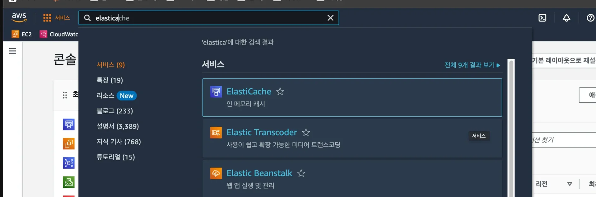

</details>

<details>
<summary>2&#46; <strong>캐시 생성을 위해 ‘지금 시작’ 버튼 누르기</strong></summary>

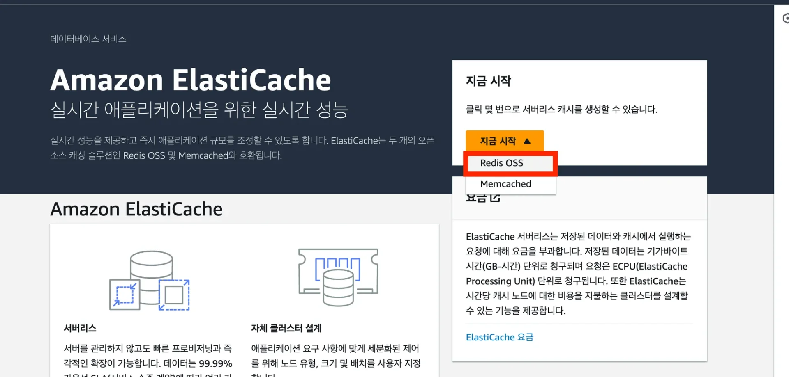

</details>

<details>
<summary><strong>🧐 </strong><strong><code>클러스터(cluster)</code></strong></summary>

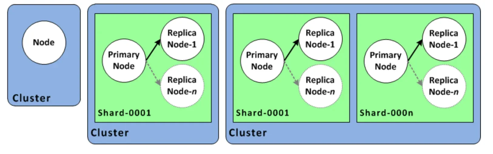

- <code>클러스터</code>란 <strong><u>여러 캐시 서버를 이루는 한 단위의 그룹</u></strong>을 뜻한다&#46;

- <strong><u>히나의 캐시 서버</u></strong>를 <strong><u>노드(Node)</u></strong>라고도 얘기한다&#46;

</details>

<details>
<summary>3&#46; <strong>클러스터 설정에서 ‘구성’ 선택</strong></summary>

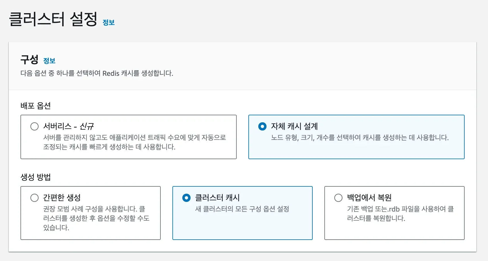

</details>

<details>
<summary>4&#46; <strong>클러스터 모드’ 설정</strong></summary>

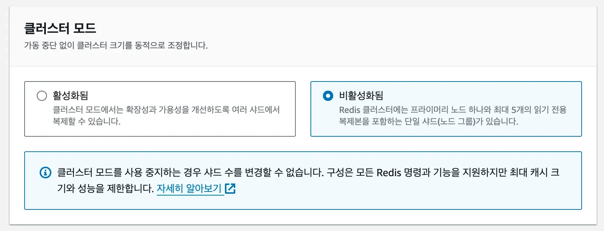

<a id="1c3eda9b0fe181699f74c7890cf4c574"></a>

대규모 트래픽 처리를 위한 ‘클러스터 모드’라는 게 있다&#46; 

<a id="1c3eda9b0fe181d0a3f0e2ef895dc595"></a>

하지만 어지간한 규모의 트래픽이 발생하는 서비스가 아니라면 ‘클러스터 모드’를 쓸 일은 없다&#46; 나중에

> 🧐 
> 
> <a id="1c3eda9b0fe181cf9a6cf0f2be3d939c"></a>
> 
> 관심이 있으면 따로 공부 진행
> 
> - 레디스를 입문할 때 우선순위가 높은 기능은 아니다&#46;

</details>

<details>
<summary>5&#46; <strong>‘클러스터 정보’ 입력</strong></summary>

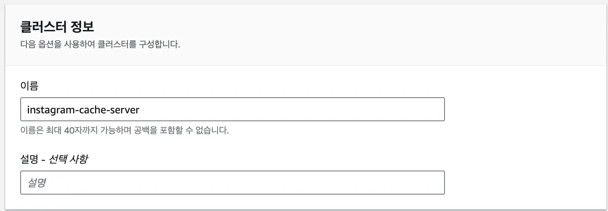

<a id="1c3eda9b0fe1819fac96dd05e0b9b58c"></a>

여러 클러스터를 생성했을 때 구별하기 위해 이름을 붙인다&#46;

-  이름은 이후에도 변경 가능하다&#46; 

</details>

<details>
<summary>6&#46; <strong>‘위치’ 설정</strong></summary>

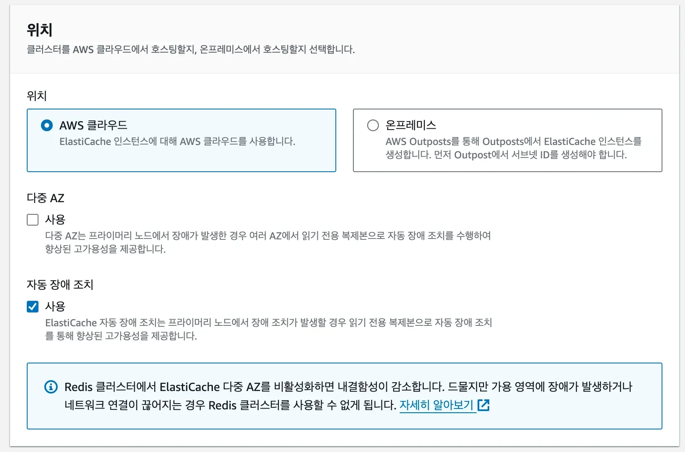

- <strong><code>다중 AZ(Multi AZ)</code></strong>
    - 여러 Region에 캐시 서버를 나눠서 셋팅해두는 것이다&#46; 

    - 특정 Region에서 재난이 발생해 서비스가 중단될 수도 있는 걸 방지하는 기능이다&#46; 

    - 하지만 재난이 발생할 가능성은 아주 적은데 비해서 비용은 추가로 발생하기 때문에, 재난으로 인해 서비스가 중단되는 게 치명적인 경우가 아니면 권장하지 않는다&#46;

- <strong><code>자동 장애 조치(Failover)</code></strong>
    - 클러스터 내부에 특정 노드(Node)가 장애가 났을 때 정상 노드(Node)로 교체하는 기능이다&#46;

    <a id="1c3eda9b0fe181af81a3caf5d1bd9319"></a>

         ⇒ 내부 장애 발생, 정상 노드로 자동 교체

    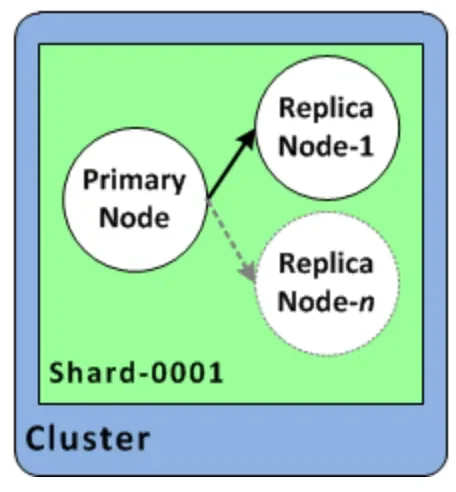

<a id="1c3eda9b0fe18142b4f5e16fdcb59b06"></a>

 

</details>

<details>
<summary><strong>7&#46; ‘클러스터 설정’ 셋팅</strong></summary>

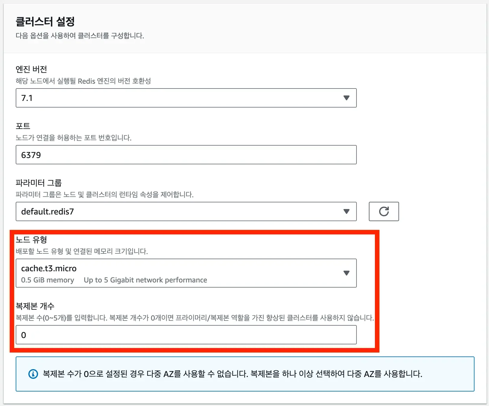

- 최소한의 비용으로 테스트하기 위해 복제본 개수는 <code>0</code> 추천
    - 제본 개수가 늘어날수록 노드(Node)가 늘어난다&#46;

    - ElastiCache는 노드(Node)당 가격을 매긴다&#46;

- 제본 개수를 1 이상 써야만 Failover 기능을 활용할 수 있다&#46; 이 때문에 프로덕션에서는 복제본 개수를 1개 이상 만드는 경우가 많다&#46; 

</details>

<details>
<summary>8&#46; <strong>기존 서브넷 그룹 선택</strong></summary>

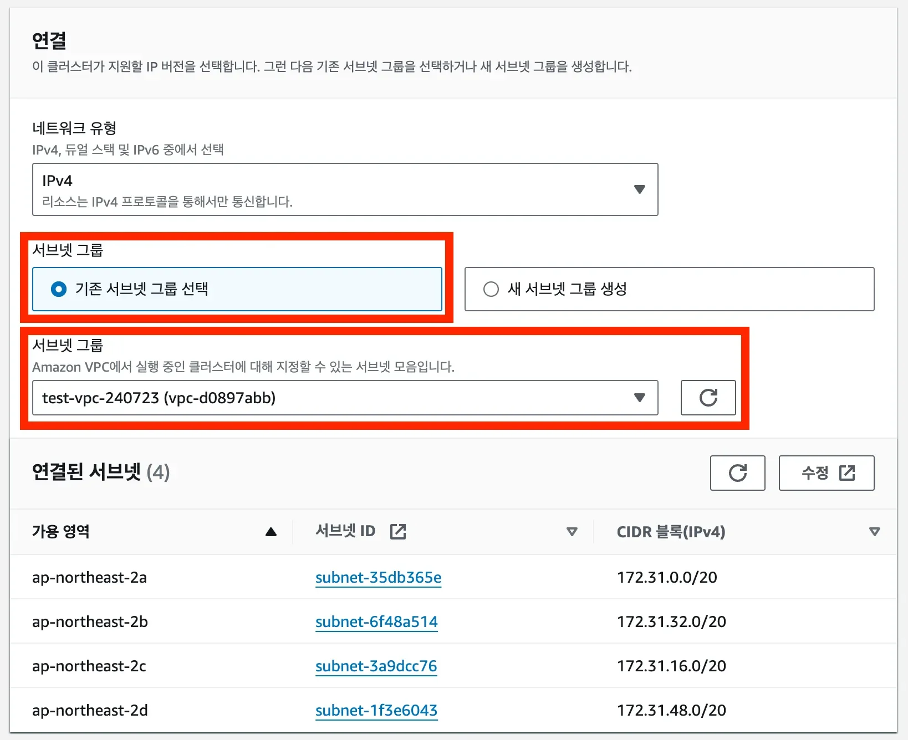

</details>

<details>
<summary>9&#46; <strong>‘가용 영역 배치’는 설정하지 않고 다음으로 넘어가기</strong></summary>

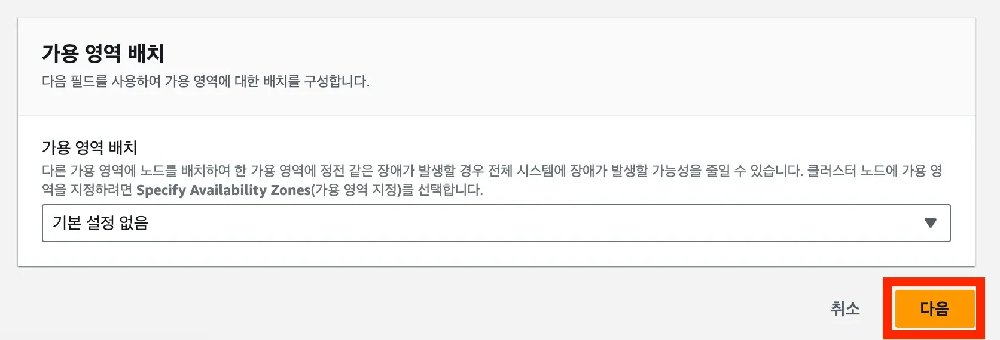

</details>

<details>
<summary>10&#46; <strong>‘보안’ 설정하지 않기</strong></summary>


<a id="1c3eda9b0fe18132916ad7b24372ccff"></a>

현재로썬 중요한 기능이 아니니 패스

- 해당 옵션을 체크하지 않는다고 해서 보안적으로 치명적적인 것은 아니니 걱정 X

</details>

<details>
<summary><strong>11&#46; EC2 서비스로 가서 보안그룹 생성</strong></summary>

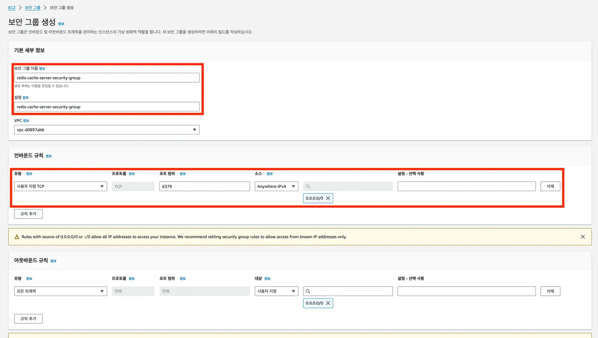

<a id="1c3eda9b0fe1819d98ced42597f4c30c"></a>

6379번 포트로 대해 모든 IP가 접근하게 허용하면 보안적으로 위험한 건 아닌가 걱정될 수 있다&#46; 하지만 ElastiCache는 기본적으로 같은 VPC 내에서만 접근을 할 수 있고, 외부 IP에 대해 접근하는 게 막혀있다&#46; 따라서 보안 그룹에서 모든 IP를 대상으로 허용한다고 하더라도 외부에서 접근할 수는 없으니 걱정하지 않아도 된다&#46; 

</details>

<details>
<summary><strong>12&#46; 보안그룹’ 셋팅하기</strong></summary>


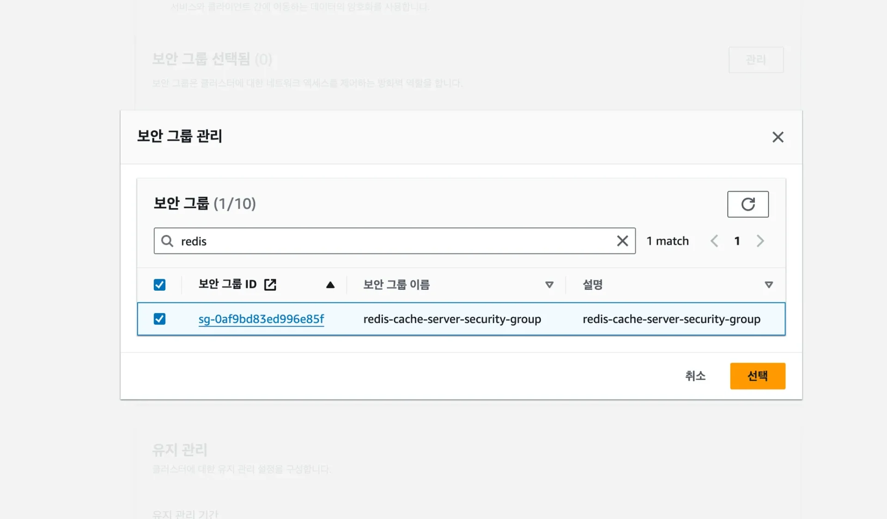

</details>

<details>
<summary><strong>13&#46; ‘백업’ 설정 해제하기</strong></summary>

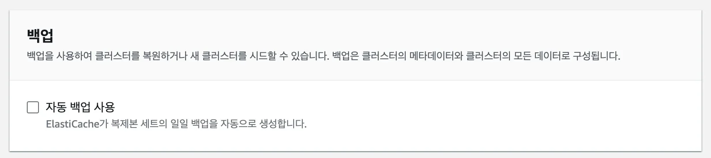

<a id="1c3eda9b0fe181999097e340ff269c1a"></a>

임시로 데이터를 저장하는 캐싱으로 사용

<a id="1c3eda9b0fe1818c888bcf5f36d833c7"></a>

  →  백업 옵션 해제

</details>

<details>
<summary>14&#46; <strong>나머지 옵션은 그대로 두고 다음으로 넘어감</strong></summary>

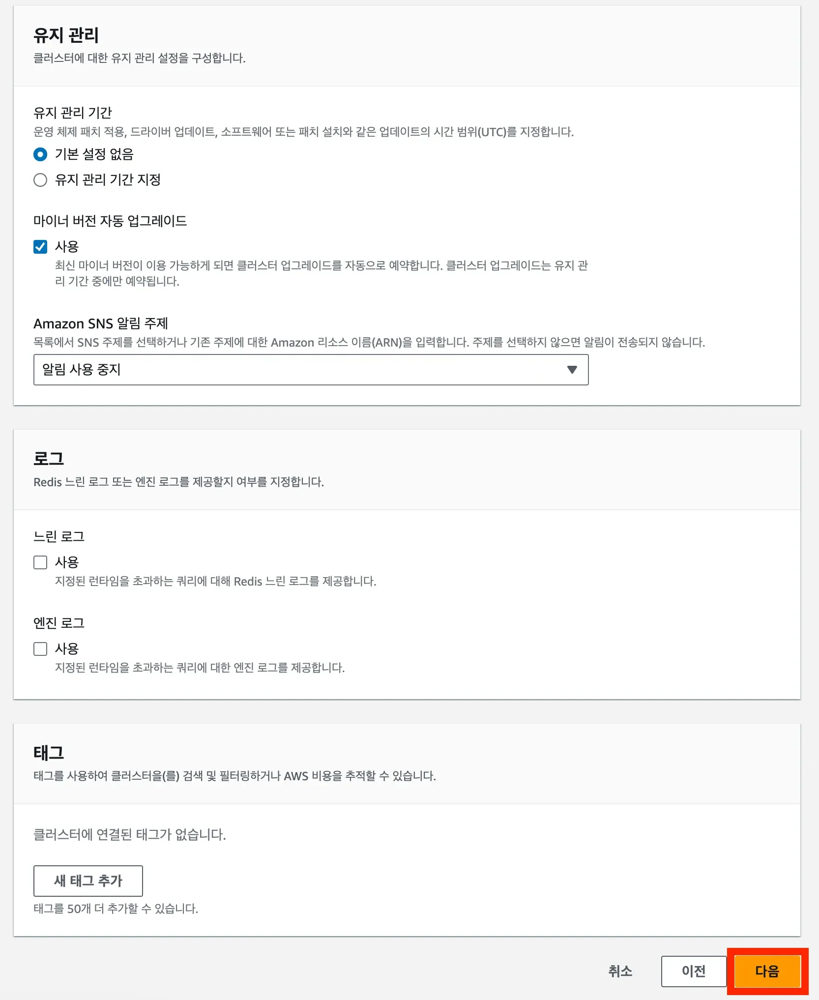

</details>

<details>
<summary><strong>15&#46; 생성’ 클릭</strong></summary>

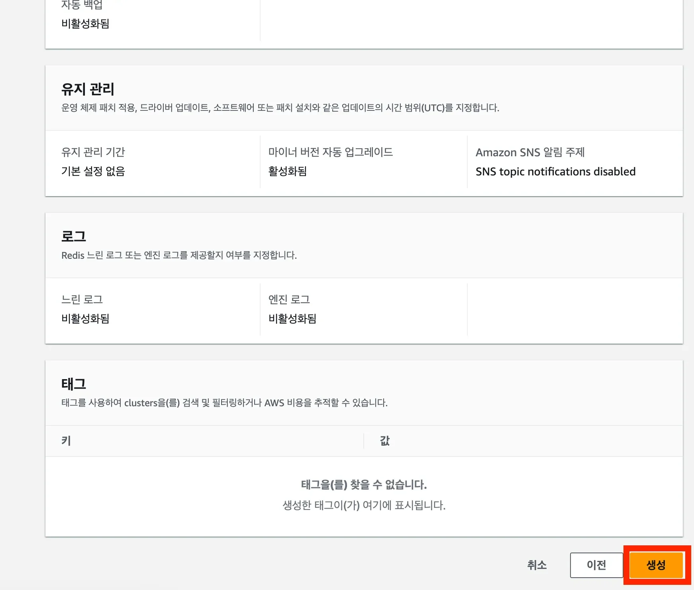

</details>

<a id="1c3eda9b0fe18181985efe0f4c29caa1"></a>

### AWS ElastiCache 정상 생성 확인

<details>
<summary><strong>1&#46; ElastiCache 대시보드</strong></summary>

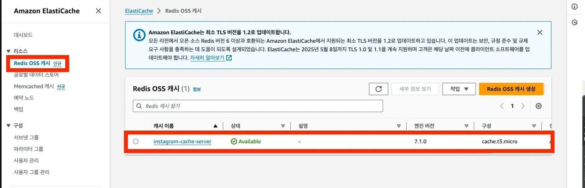

</details>

<details>
<summary>2&#46; <strong>‘기본 엔드포인트’ 주소에서 </strong><strong>포트 번호 빼고</strong><strong> 복사</strong></summary>

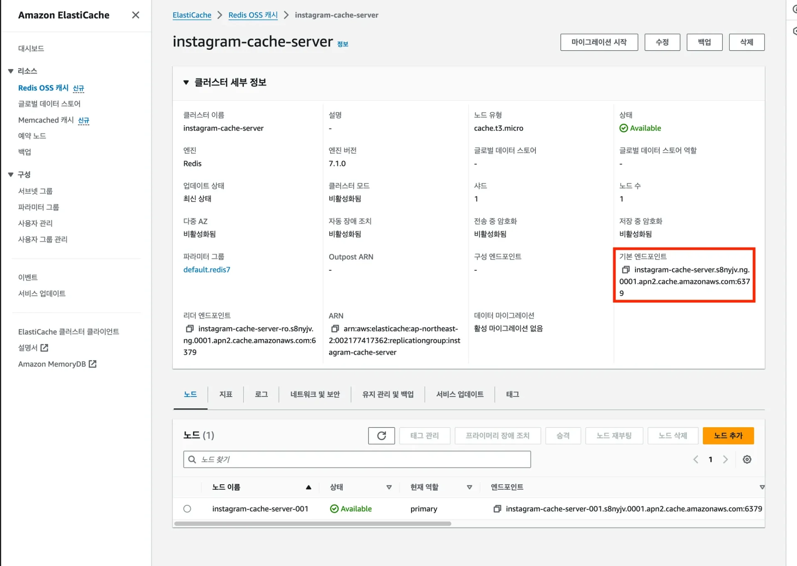

- <strong>참고)</strong> ‘리더(Reader) 엔드포인트’ = 읽기 전용 주소

</details>

<details>
<summary>3&#46; E<strong>C2에 들어가서 ElastiCache에 접속</strong></summary>

<a id="1c3eda9b0fe18103bc7ee19d7007e5b0"></a>

```bash
# redis-cli -h {호스트 주소}
$ redis-cli -h {ElastiCache의 기본 엔드포인트}
```

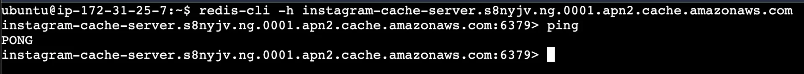

</details>

<details>
<summary>4&#46; <strong>로컬 환경에서 접속되는 지 테스트</strong></summary>

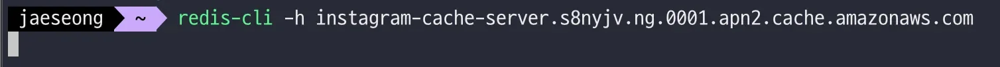

- 접속 ❌
    - ElastiCache는 같은 VPC일 때만 접속할 수 있기 때문

- <strong>EC2의 VPC 정보</strong>
    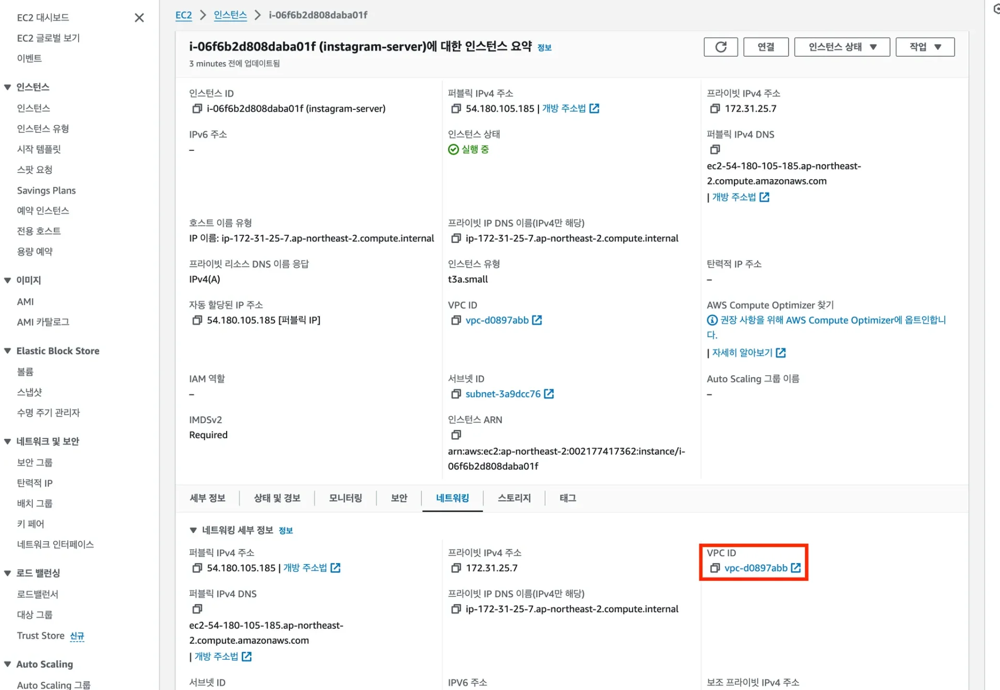

- <strong>ElasitCache의 VPC 정보</strong>
    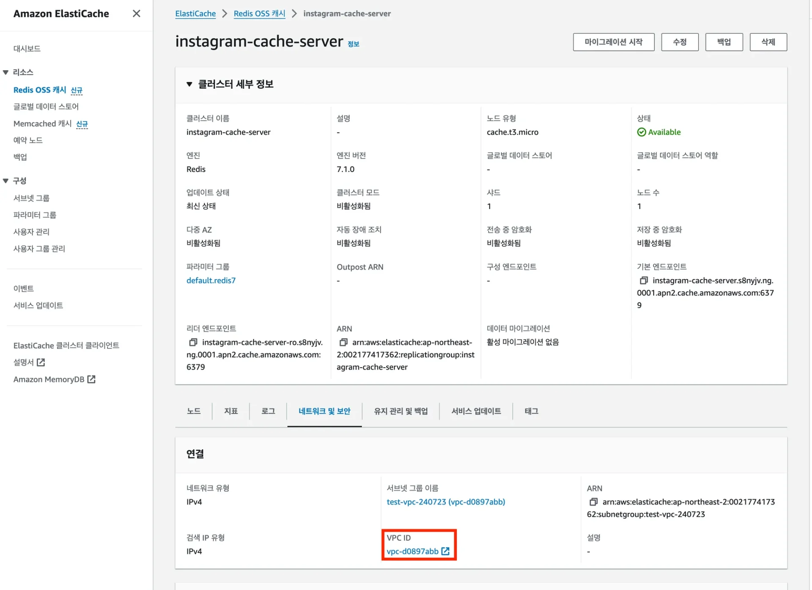

</details>
