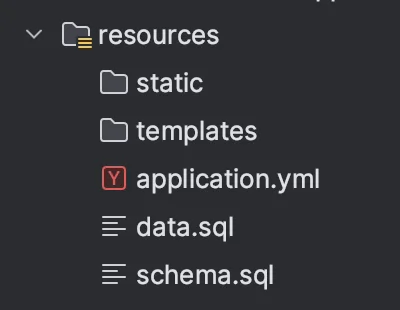
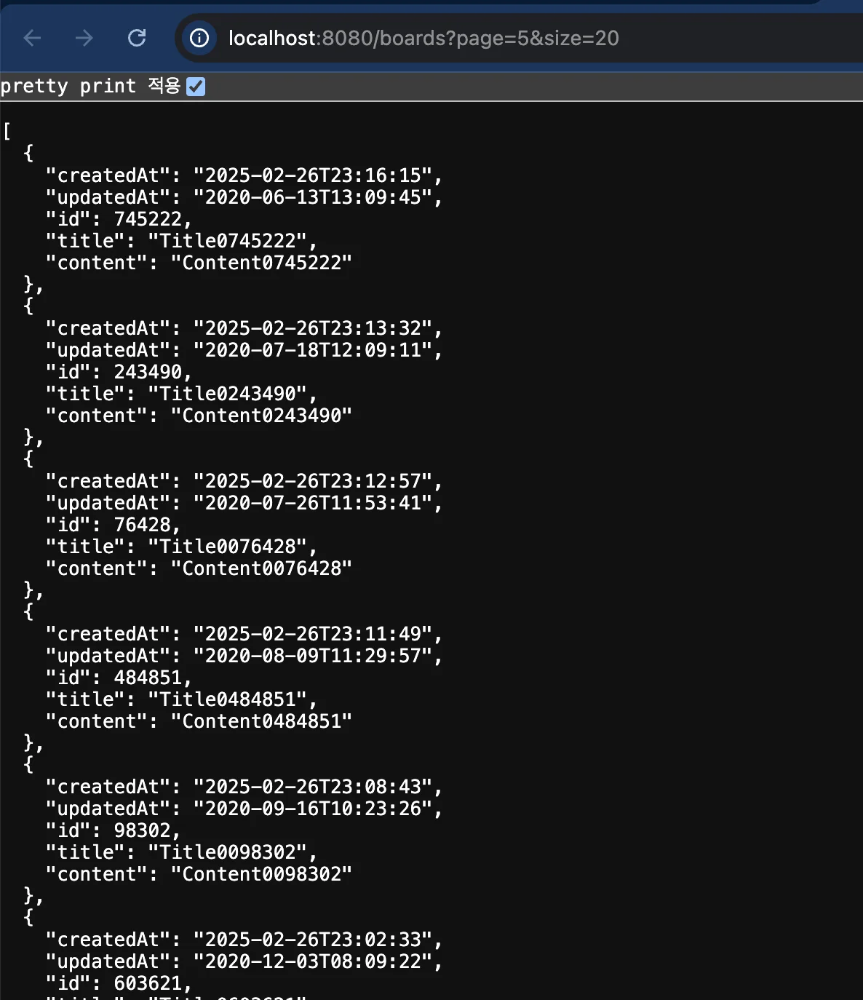

<a id="1c3eda9b0fe1816189afd09d4639a3b3"></a>

## 실습1) Spring Boot, MySQL, Redis

---

<a id="1c3eda9b0fe18122a1add355998f09eb"></a>

### 1&#46; Docker compose&#58; <strong>Spring Boot, MySQL, Redis 설정</strong>

<details>
<summary><strong><code>Dockerfile</code></strong></summary>

<a id="1c3eda9b0fe1811e9e71d099421ecbac"></a>

```docker
FROM openjdk:17-jdk-slim

WORKDIR /app

COPY build/libs/*SNAPSHOT.jar app.jar

EXPOSE 8080

ENTRYPOINT ["java", "-jar", "app.jar"]
```

</details>

<details>
<summary><strong><code>docker&#45;compose&#46;yml</code></strong></summary>

<a id="1c3eda9b0fe1817a8c36cb5eed7a4629"></a>

```yaml
services:
  server:
    container_name: my-server
    build: .
    environment:
      SPRING_DATASOURCE_URL: jdbc:mysql://mysql:3306/mydb?useSSL=false&serverTimezone=UTC&allowPublicKeyRetrieval=true
      SPRING_DATASOURCE_USERNAME: me
      SPRING_DATASOURCE_PASSWORD: 12345678
      SPRING_REDIS_HOST: redis
      SPRING_REDIS_PORT: 6379
    ports:
      - "8080:8080"
    restart: unless-stopped
    depends_on:
      mysql:
        condition: service_healthy
      redis:
        condition: service_healthy

  mysql:
    image: mysql:latest
    container_name: my-mysql
    environment:
      MYSQL_ROOT_PASSWORD: pwd123
      MYSQL_DATABASE: mydb
      MYSQL_USER: me
      MYSQL_PASSWORD: 12345678
    ports:
      - "3306:3306"
    volumes:
      - mysql_data:/var/lib/mysql
    restart: unless-stopped
    healthcheck:
      test: [ "CMD", "mysqladmin", "ping", "-h", "localhost" ]
      interval: 10s
      timeout: 5s
      retries: 5

  redis:
    image: redis:latest
    container_name: my-redis
    ports:
      - "6379:6379"
    restart: unless-stopped
    healthcheck:
      test: [ "CMD", "redis-cli", "ping" ]
      interval: 10s
      timeout: 5s
      retries: 5

volumes:
  mysql_data:
```

</details>

<details>
<summary><strong><code>application&#46;yml</code></strong></summary>

> src/main/resources

<a id="1c3eda9b0fe181ce9d50db22b19fd21e"></a>

```yaml
server:
  port: 8080

spring:
  datasource:
    url: ${SPRING_DATASOURCE_URL}
    username: ${SPRING_DATASOURCE_USERNAME}
    password: ${SPRING_DATASOURCE_PASSWORD}
    driver-class-name: com.mysql.cj.jdbc.Driver
    initialization-mode: always
  jpa:
    hibernate:
      ddl-auto: create
    show-sql: true
    properties:
      hibernate:
        format_sql: true

  redis:
    host: ${SPRING_REDIS_HOST}
    port: ${SPRING_REDIS_PORT}

  sql:
    init:
      mode: always

logging:
  level:
    org.springframework: INFO
```

</details>

<a id="1c3eda9b0fe1818a92a9d2a74999a838"></a>

### 2&#46; 기본 스키마, 데이터 생성

<details>
<summary>테이블 스키마 생성&#58; <code>schema&#46;sql</code></summary>

> src/main/resources



<a id="1c3eda9b0fe18152a545f988afe048c5"></a>

```sql
CREATE TABLE IF NOT EXISTS boards (
    id BIGINT AUTO_INCREMENT PRIMARY KEY,
    title VARCHAR(255) NOT NULL,
    content TEXT NOT NULL,
    created_at TIMESTAMP NOT NULL,
    updated_at TIMESTAMP NOT NULL
);
```

</details>

<details>
<summary>데이터 자동 생성&#58; <code>data&#46;sql</code></summary>

> src/main/resources


<a id="1c3eda9b0fe18187afa4c31b1292ebc4"></a>

```sql
-- 높은 재귀(반복) 횟수를 허용하도록 설정
SET SESSION cte_max_recursion_depth = 1000000;

-- boards 테이블에 더미 데이터 삽입
INSERT INTO boards (title, content, created_at, updated_at)
WITH RECURSIVE cte (n) AS
(
  SELECT 1
  UNION ALL
  SELECT n + 1 FROM cte WHERE n < 1000000 -- 생성하고 싶은 더미 데이터의 개수
)
SELECT
    CONCAT('Title', LPAD(n, 7, '0')) AS title,  -- 'Title' 다음에 7자리 숫자로 구성된 제목 생성
    CONCAT('Content', LPAD(n, 7, '0')) AS content,  -- 'Content' 다음에 7자리 숫자로 구성된 내용 생성
    TIMESTAMP(DATE_SUB(NOW(), INTERVAL FLOOR(RAND() * 3650 + 1) DAY) + INTERVAL FLOOR(RAND() * 86400) SECOND) AS created_at, -- 최근 10년 내의 임의의 날짜와 시간 생성
    TIMESTAMP(DATE_SUB(NOW(), INTERVAL FLOOR(RAND() * 3650 + 1) DAY) + INTERVAL FLOOR(RAND() * 86400) SECOND) AS updated_at  -- created_at과 비슷한 랜덤한 updated_at 날짜 생성
FROM cte;
```

</details>

<a id="1c3eda9b0fe181dbbb6bc5f6e8c8fb72"></a>

### 3&#46; Board 조회 API 

[실습1 - Spring Boot, Redis 세팅](https://github.com/gyungsubLee/Redis_prac/commit/18e84ca9facc87d31ee06ffe39a69552b1a6f828)

<details>
<summary>common&#58; <code>BaseEntity</code></summary>

<a id="1c3eda9b0fe1813eb60bd8590d3c6603"></a>

```java
package com.example.redis_prac.common;

import jakarta.persistence.Column;
import jakarta.persistence.EntityListeners;
import jakarta.persistence.MappedSuperclass;
import lombok.Getter;
import org.springframework.data.annotation.CreatedDate;
import org.springframework.data.annotation.LastModifiedDate;
import org.springframework.data.jpa.domain.support.AuditingEntityListener;

import java.time.LocalDateTime;

@MappedSuperclass
@EntityListeners(AuditingEntityListener.class)
@Getter
public abstract class BaseEntity {

    @CreatedDate
    @Column(updatable = false)
    private LocalDateTime createdAt;

    @LastModifiedDate
    private LocalDateTime updatedAt;
}
```

</details>

<details>
<summary>Entity&#58; <code>Board</code></summary>

<a id="1c3eda9b0fe1819b8bd0e292f597cff9"></a>

```java
@Entity
@Getter
@NoArgsConstructor(access = AccessLevel.PROTECTED)
@Table(name = "boards")
public class Board extends BaseEntity {

    @Id
    @GeneratedValue(strategy = GenerationType.IDENTITY)
    private Long id;

    @Column(nullable = false)
    private String title;

    @Column(nullable = false, columnDefinition = "TEXT")
    private String content;

    public Board(String title, String content) {
        this.title = title;
        this.content = content;
    }

//    public BoardResponse toDto() {
//        return BoardResponse.builder()
//                .id(id)
//                .title(title)
//                .content(content)
//                .createdDate(getCreatedAt())
//                .updatedDate(getUpdatedAt())
//                .build();
//    }

}
```

</details>

<details>
<summary>Controller&#58; <code>BoardController</code></summary>

<a id="1c3eda9b0fe18121b02dfd0735ba295e"></a>

```java
@RestController
@RequestMapping("/boards")
@RequiredArgsConstructor
public class BoardController {

    private final BoardService boardService;

    @GetMapping
    public List<Board> getBoards(
            @RequestParam(defaultValue = "1") int page,
            @RequestParam(defaultValue = "10") int size
    ) {
        return boardService.getBoards(page, size);
    }
}
```

</details>

<details>
<summary>Service&#58; <code>BoardService</code></summary>

<a id="1c3eda9b0fe18120869dcec316e48a58"></a>

```java
@Service
@RequiredArgsConstructor
public class BoardService {

    private final BoardRepository boardRepository;

    public List<Board> getBoards(int page, int size) {
        Pageable pageable = PageRequest.of(page - 1, size);
        Page<Board> pageOfBoards = boardRepository.findAllByOrderByCreatedAtDesc(pageable);
        return pageOfBoards.getContent();
    }
}
```

</details>

<details>
<summary>Repository&#58; <code>BoardRepository</code></summary>

<a id="1c3eda9b0fe1811cbb17dbceada16536"></a>

```java
public interface BoardRepository extends JpaRepository<Board, Long> {

    Page<Board> findAllByOrderByCreatedAtDesc(Pageable pageable);
}
```

</details>

---

<details>
<summary> API 호출</summary>

<a id="1c3eda9b0fe181079412c7def032fb48"></a>

```bash
 curl -X GET "http://localhost:8080/boards?page=5&size=20"
```



</details>

> 🤔 
> 
> <a id="1c3eda9b0fe18142aa07ffeb7512a1ac"></a>
> 
> 이후 고려 
> 
> - ResponseEntity 사용하여 Http 상태코드와 응답 포맷 통일하기
> 
> - &#64;GlobalExceptionHandler를 사용하여 예외처리하기
