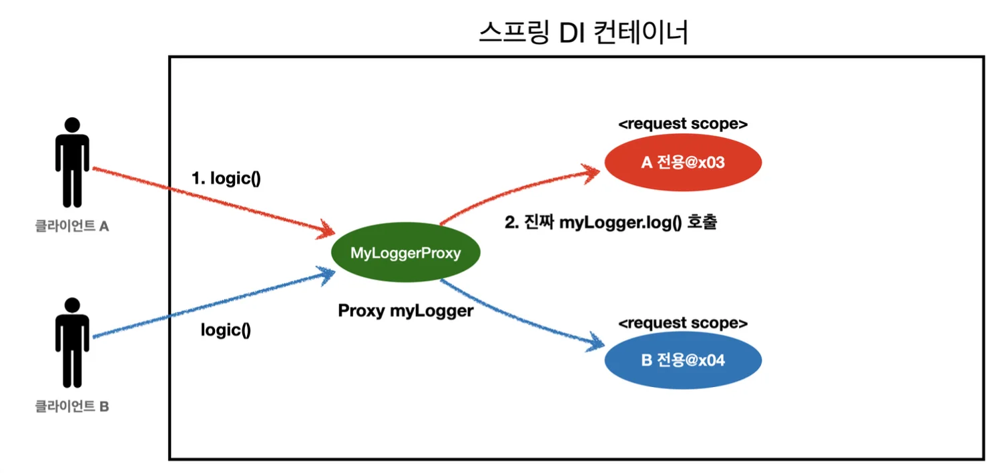

<a id="1c3eda9b0fe1817c9512e57be0fba06e"></a>

### 프록시 추가

<a id="1c3eda9b0fe18196844ef77b5bc64f59"></a>

```java
package hello.core.common;

import jakarta.annotation.PostConstruct;
import jakarta.annotation.PreDestroy;
import org.springframework.context.annotation.Scope;
import org.springframework.context.annotation.ScopedProxyMode;
import org.springframework.stereotype.Component;

import java.util.UUID;

@Component
@Scope(value = "request", proxyMode = ScopedProxyMode.TARGET_CLASS)
public class MyLogger {

    private String uuid;
    private String requestURL;

    public void setRequestURL(String requestURL) {
        this.requestURL = requestURL;
    }

    public void log(String message) {
        System.out.println("[" + uuid + "]" + "[" + requestURL + "] " + message);
    }

    @PostConstruct
    public void init() {
        uuid = UUID.randomUUID().toString();
        System.out.println("[" + uuid + "] request scope bean create:" + this);
    }

    @PreDestroy
    public void close() {
        System.out.println("[" + uuid + "] request scope bean close:" + this);
    }
}
```

<a id="1c3eda9b0fe181b786d5f911a532b4cf"></a>

주입된 myLogger 확인

<a id="1c3eda9b0fe181dd9ad4cd9e12ac98cd"></a>

```java
System.out.println("myLogger = " + myLogger.getClass());
```

<a id="1c3eda9b0fe18186b6e1d79b567990ed"></a>

<strong>출력결과</strong>

<a id="1c3eda9b0fe181c0b7a7dd81de073b10"></a>

```plaintext
myLogger = class hello.core.common.MyLogger$$EnhancerBySpringCGLIB$$b68b726d
```

<a id="1c3eda9b0fe1819f954dd85fb31172c3"></a>

## <strong>CGLIB라는 라이브러리로 내 클래스를 상속 받은 가짜 프록시 객체를 만들어서 주입한다&#46;</strong>

---

<a id="1c3eda9b0fe1813895cdd050657456b1"></a>

<code>&#64;Scope</code> 의 <code>proxyMode = ScopedProxyMode&#46;TARGET&#95;CLASS)</code> 를 설정하면 스프링 컨테이너는 CGLIB라는 바이트코드를 조작하는 라이브러리를 사용해서, MyLogger를 상속받은 가짜 프록시 객체를 생성한다&#46;<br>결과를 확인해보면 우리가 등록한 순수한 MyLogger 클래스가 아니라 <code>MyLogger&#36;</code>

<a id="1c3eda9b0fe1815f89cbc73060a1e62d"></a>

<code>&#36;EnhancerBySpringCGLIB</code> 이라는 클래스로 만들어진 객체가 대신 등록된 것을 확인할 수 있다&#46;<br>그리고 스프링 컨테이너에 &#34;myLogger&#34;라는 이름으로 진짜 대신에 이 가짜 프록시 객체를 등록한다&#46;

<a id="1c3eda9b0fe181768553f4829f21c2aa"></a>

<code>ac&#46;getBean(&#34;myLogger&#34;, MyLogger&#46;class)</code> 로 조회해도 프록시 객체가 조회되는 것을 확인할 수 있다&#46;<br>그래서 의존관계 주입도 이 가짜 프록시 객체가 주입된다&#46;



<a id="1c3eda9b0fe1815a9039d162fe41d6b1"></a>

### <strong>가짜 프록시 객체는 요청이 오면 그때 내부에서 진짜 빈을 요청하는 위임 로직이 들어있다&#46;</strong>

---

<a id="1c3eda9b0fe181c4aaebd2027752cbcc"></a>

가짜 프록시 객체는 내부에 진짜 <code>myLogger</code> 를 찾는 방법을 알고 있다&#46;<br>클라이언트가 <code>myLogger&#46;log()</code> 을 호출하면 사실은 가짜 프록시 객체의 메서드를 호출한 것이다&#46;<br>가짜 프록시 객체는 request 스코프의 진짜 <code>myLogger&#46;log()</code> 를 호출한다&#46;<br>가짜 프록시 객체는 원본 클래스를 상속 받아서 만들어졌기 때문에 이 객체를 사용하는 클라이언트 입장에서는 사<br>실 원본인지 아닌지도 모르게, 동일하게 사용할 수 있다(다형성)

<a id="1c3eda9b0fe1813d866cfffb8a72ea03"></a>

### <strong>동작 정리</strong>

---

<a id="1c3eda9b0fe1815abbe9c894cddc527a"></a>

CGLIB라는 라이브러리로 내 클래스를 상속 받은 가짜 프록시 객체를 만들어서 주입한다&#46;<br>이 가짜 프록시 객체는 실제 요청이 오면 그때 내부에서 실제 빈을 요청하는 위임 로직이 들어있다&#46;<br>가짜 프록시 객체는 실제 request scope 와는 관계가 없다&#46; 그냥 가짜이고, 내부에 단순한 위임 로직만 있고, 싱<br>글톤 처럼 동작한다&#46;

<a id="1c3eda9b0fe181299788ea742505b3d9"></a>

### <strong>특징 정리</strong>

---

<a id="1c3eda9b0fe181a09016dda5015a19c5"></a>

프록시 객체 덕분에 클라이언트는 마치 싱글톤 빈을 사용하듯이 편리하게 request scope를 사용할 수 있다&#46;<br>사실 <strong>Provider</strong>를 사용하든, <strong>프록시</strong>를 사용하든 <strong>핵심 아이디어</strong>는 <strong>진짜 객체 조회를 꼭 필요한 시점까지 지연처리<br>한다는 점</strong>이다&#46;

<a id="1c3eda9b0fe1811b990ed4a27e322928"></a>

<strong>단지 애노테이션 설정 변경</strong>만으로<strong> 원본 객체</strong>를 <strong>프록시 객체로 대체</strong>할 수 있다&#46; 이것이 바로<strong> </strong><strong>다형성</strong>과 <strong>DI 컨테이너</strong><br>가 가진 큰 강점이다 ( 꼭 웹 스코프가 아니어도 프록시는 사용할 수 있다&#46; )

<a id="1c3eda9b0fe181f9abd8cacefae622e6"></a>

### <strong>주의점</strong>

---

<a id="1c3eda9b0fe181e2b7c3e3af467c2842"></a>

마치 싱글톤을 사용하는 것 같지만 다르게 동작하기 때문에 결국 주의해서 사용해야 한다&#46;<br>이런<strong> 특별한 scope는 꼭 필요한 곳에만 최소화해서 사용</strong>하자, <u>무분별하게 사용하면 유지보수하기 어려워</u>진다&#46;
