<details>
<summary>Reference </summary>

<a id="1c3eda9b0fe1815db293e2055a979f1b"></a>

‣

<a id="1c3eda9b0fe1816485c1c433cadcfefb"></a>

<a href="https://beautiful-college-c84.notion.site/a9affdeece4b45efb1424835d9c2da46">페이지</a> 

<a id="1c3eda9b0fe181ea9cf0d4f24859f73c"></a>

‣

</details>

> ☝🏻 
> 
> <a id="1c3eda9b0fe18150a0b2f7b9ab872214"></a>
> 
> Docker에서 사용하는 명령어는 아주 많다&#46; 
> 
> <a id="1c3eda9b0fe181d4ad46c8aecda6faec"></a>
> 
> 그러나 실제로 도커를 쓰다보면 자주 쓰는 명령어만 주로 사용한다&#46; 
> 
> <a id="1c3eda9b0fe181f4a5a1dbba7e040cec"></a>
> 
> 이렇게 빈도가 높은 개념부터 학습을 하면, <u>해당 기술에 대해서 빠르게 익힐</u> 수 있으며 또한 잘 모르는 내용이 나오면 그때그때 찾아가면서 해결하면 된다&#46; 

[기본 개념 및 설치](#/post/1c3eda9b-0fe1-81e8-9e37-ce47a2e64747)

[이미지](#/post/1c3eda9b-0fe1-81d8-bf14-cc21692d404d)

[컨테이너](#/post/1c3eda9b-0fe1-814a-819a-d2f2a2117e19)

[옵션](#/post/1c3eda9b-0fe1-81ae-b625-ddd3ca590dbb)

[Docker Volume ( 도커 볼륨 )](#/post/1c3eda9b-0fe1-811a-a50d-d753071e0493)

[Named Volume](#/post/1c3eda9b-0fe1-81c3-ab1d-f65f6b13717a)

[[실습] Docker로 MySQL 실행](#/post/1c3eda9b-0fe1-8177-8cb6-e1146f1446bc)

[[실습] Docker로 PostgreSQL 실행](#/post/1c3eda9b-0fe1-8171-b34c-f4c874a7e8be)

[[실습] Docker로 MongoDB 실행](#/post/1c3eda9b-0fe1-8134-a5bd-e3744ff8b0d3)

[Dockerfile](#/post/1c3eda9b-0fe1-8161-a4c7-e9725ba81562)

[컨테이너 디버깅](#/post/1c3eda9b-0fe1-8175-a3c4-cecea92a4b56)

[[실습] 백엔트 프로젝트(Nest.js) Docker로 실행](#/post/1c3eda9b-0fe1-811c-bd2b-fbe6ee063202)

[[실습] 웹 프론트엔드 프로젝트(Next.js) Docker로 베포](#/post/1c3eda9b-0fe1-8175-b8a4-f77148b8cf11)

[[실습]  웹 프론트엔드 프로젝트(HTML, CSS, Nginx) Dokcer로 베포](#/post/1c3eda9b-0fe1-81b3-abb3-d29814be21bb)

[이미지 생성 시, 캐시를 활용한 최적화](#/post/1c3eda9b-0fe1-81d4-808e-fe095001fb38)

[Spring Boot에서 Docker 이미지 최적화](#/post/1c3eda9b-0fe1-8102-bc3b-f93a9ce1038d)

[Docker Compose](#/post/1c3eda9b-0fe1-81bf-a68c-e4783016377c)

[[실습] Dokcer Compose로 Redis 실행](#/post/1c3eda9b-0fe1-81fa-8c3b-e565b3dd1bac)

[[실습] Dokcer Compose로 MySQL 실행](#/post/1c3eda9b-0fe1-8129-b2ae-ce6b21ce2ae3)

[[실습] Dokcer Compose로 백엔드(SpringBoot) 실행](#/post/1c3eda9b-0fe1-81bc-a472-c5d7747ab9d3)

[[실습] Dokcer Compose로 백엔드(Next.js) 실행](#/post/1c3eda9b-0fe1-8163-adff-df595625441b)

[[실습] Dokcer Compose로 프론트(Next.js) 실행](#/post/1c3eda9b-0fe1-81db-9676-c7ec1e7387d7)

[[실습] Dokcer Compose로 프론트(HTML, CSS, Nginx) 실행](#/post/1c3eda9b-0fe1-81cb-9f5b-f855f07b7d1a)

[Docker CLI ↔ Docker Compose](#/post/1c3eda9b-0fe1-8181-b6ff-d2df6ba6e125)

[[ 실습 ] MySQL, Redis](#/post/1c3eda9b-0fe1-819c-a71f-e072ff165304)

[[ 실습 ] Spring Boot, MySQL](#/post/1c3eda9b-0fe1-8194-bfb7-ec969f2aac4c)

[[ 오류 ] 컨테이너로 실행 시킨 Spring Boot가 MySQL에 연결이 안되는 이유](#/post/1c3eda9b-0fe1-8110-80da-dd0dc1e70fca)

[[ 오류 ] MySQL ddl-auto 설정 추가 시, jar 파일 build  안됨](#/post/1c3eda9b-0fe1-818a-804f-d469d0495cc7)

[[ 실습 ] Spring Boot, MySQL, Redis](#/post/1c3eda9b-0fe1-812d-a03b-f194f55cc155)

[기본 개념](#/post/1c3eda9b-0fe1-8181-ac97-e934f36c0656)

[EC2 세팅](#/post/1c3eda9b-0fe1-8191-816d-cc5d3d2a6d54)

[EC2 콘솔 접속](#/post/1c3eda9b-0fe1-81b0-9b15-eb19f8d55bc2)

[[ 오류 ] VPC 기본 설정 X](#/post/1c3eda9b-0fe1-814b-bfca-e31831859d05)

[[ 실습 ] Express 서버 EC2에 배포](#/post/1c3eda9b-0fe1-8126-8e41-fa6a7f06935f)

[[ 실습 ] Spring Boot 서버 EC2에 배포](#/post/1c3eda9b-0fe1-8141-a134-f8f43d5a38a6)

[비용 나가지 않게 EC2 종료하기](#/post/1c3eda9b-0fe1-811f-b09b-e26214de0bb6)

[Ubuntu에서 Docker, Docker Compose 설치하기](#/post/1c3eda9b-0fe1-8152-8952-eaf9d0cc7ebf)

[AWS ECR( Elastic Container Registry )](#/post/1c3eda9b-0fe1-8104-b0ed-e0a4359a2aee)

[[ 실습 ] AWS ECR ( Elastic Container Registry ) 사용](#/post/1c3eda9b-0fe1-81f5-aae2-f39073a356a7)

[[ 실습 ] AWS EC2 - Spring Boot 베포](#/post/1c3eda9b-0fe1-81dc-87e3-e396c635e23c)

[[ 실습 ] AWS EC2 - Spring Boot, MySQL, Redis 베포](#/post/1c3eda9b-0fe1-810d-bffd-db686e061b22)

[gradle build + docker compose 실행 한번에 하기](#/post/1c3eda9b-0fe1-8155-aa4f-c2a4651eec4b)

<a id="1c3eda9b0fe181029447c760682c9d32"></a>

# Chapter

<a id="1c3eda9b0fe1813bacb4d3c5793a4440"></a>

## 1&#46;  도커 기본 개념

<details>
<summary><code>VM</code> vs <code>Container</code></summary>

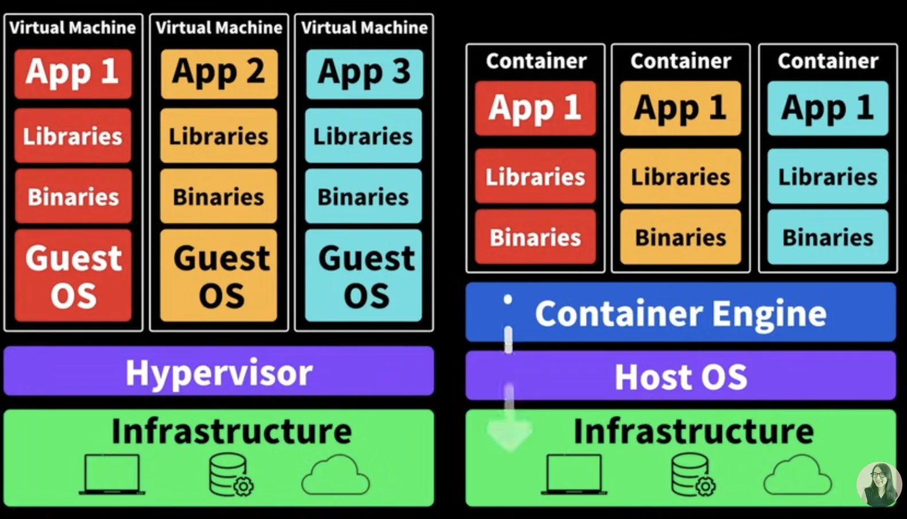

- VM 
    - 각각의 <strong><u>독립적인 운영체제를 사용</u></strong>하기 때문에, 굉장히 무겁다&#46;

- Container
    - 컨테이너 엔진 host OS에 접근해서 처리해준다&#46;

    - 컨테이너 엔진 중 가장 많이 사용하는 것이 Docker이다&#46; 

</details>

<details>
<summary>도커 설치 &#45; Mac OS</summary>

<details>
<summary>homebrew 사용한 설치</summary>

- homebrew 설치
    [Homebrew]()

- 도커 설치
    <a id="1c3eda9b0fe18135bdbceb0d048a5c65"></a>

    ```bash
    brew intall docker
    ```

- 도커 설치 확인
    <a id="1c3eda9b0fe18175b4e9c1c7a4b2a84e"></a>

    ```bash
    docker --version
    ```

<a id="1c3eda9b0fe18197a3f4db9657bb5b80"></a>

<br>

</details>

</details>

<details>
<summary>도커 사용 이유</summary>

> <code>이식성</code>&#58; 특정 프로그램을 다른 곳으로 쉽게 옮겨서 설치 및 실행할 수 있는 특성

- 매번 귀찮은 <strong><u>설치 과정</u></strong>을 일일이<u> 거치지  않</u>아도 된다&#46; 

- 항상 <strong>일관</strong>되게<u> 프로그램을 설치할 수 있</u>다&#46; ( 버전, 환경 설정, 옵션, 운영체제 등 )

- <strong><u>각 프로그램이 독립적인 환경에서 실행</u></strong>되기 때문에 프로그램 간에 서로 충돌이 일어나지 않는다&#46; 

</details>

<details>
<summary>Docker, 컨테이너, 이미지</summary>

- Docker 
    - <strong><u>컨테이너를 사용</u></strong>하여 각각의 프로그램을 <strong><u>분리된 환경</u></strong>에서 실행 및 관리할 수 있는 툴이다&#46; 

- 컨테이너 ( Container )
    - 호스트 컴퓨터, 컨테이너
        - 호스트 컴퓨터 내부에 컨테이너들이 독립적으로 존재한다&#46; 

    <details>
    <summary>컨테이너의 독립성</summary>

    > 컨테이너는 ‘독립적인 컴퓨터 환경’을 가지고 있다&#46; 

    - 디스크 ( 저장 공간)
        - 각 컨테이너마다 서로 각자의 저장 공간을 가지고 있다&#46;

        - 일반적으로 A 컨테이너 내부에서, B 컨테이너 내부에 있는 파일에 접근할 수 없다&#46; 

    - 각 컨테이너마다 고유의 네트워크를 가지고 있다&#46; ( IP, Port ) 

    </details>

- 이미지 ( Image )
    > ex) 닌텐도 &#45; 닌텐도 칩

    - 이미지는 프로그램을 실행하는데 필요한 설치 과정, 설정, 버전 정보 등을 포함하고 있다&#46; 

    - 즉, 프로그램을 실행하는데 필요한 모든 것을 포함하고 있다&#46; 

</details>

<details>
<summary>IP, Port</summary>


</details>

<details>
<summary>실습) Nginx 실행</summary>

<details>
<summary>🧐 Nginx 란?</summary>

- 웹 서버 ( HTML 웹 페이지를 렌더링 시키는 역할 )

- 로드 밸런싱

- 리버스 프록시 

</details>

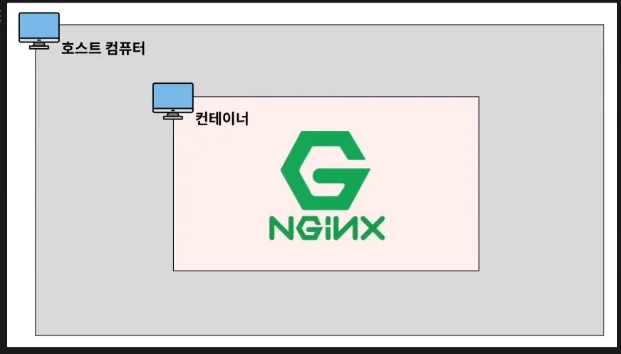

<details>
<summary>1&#46; docker 이미지(nginx) 다운</summary>

<a id="1c3eda9b0fe181d184aede3912164616"></a>

```docker
docker pull nginx
```

</details>

<details>
<summary>2&#46; docker 이미지 리스트 확인</summary>

<a id="1c3eda9b0fe181268f23fcd6895566f5"></a>

```docker
docker image ls
```

</details>

<details>
<summary>3&#46; docker 이미지 실행(run) → 컨네이너 실행</summary>

<a id="1c3eda9b0fe18184b0b3effb6fbb113b"></a>

```docker
docker run --name webserver -d -p 80:80 nginx
```

<details>
<summary>localhost&#58;80 접속 &#45; 실행 화면 확인</summary>

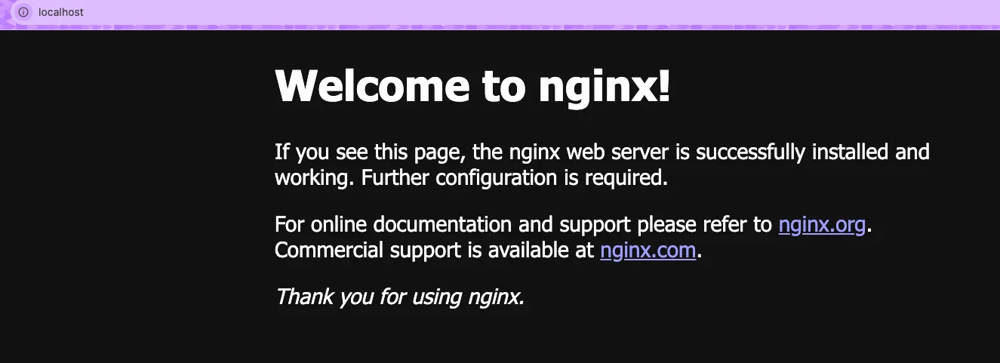

</details>

</details>

<details>
<summary>4&#46; docker 실행 중 인 컨테이너  확인</summary>

<a id="1c3eda9b0fe181f284b6d50f1eec6bed"></a>

```docker
docker ps 
```

</details>

<details>
<summary>5&#46; docker 컨테이너 멈춤(Stop)</summary>

<a id="1c3eda9b0fe1815389ded409d27f1ac9"></a>

```docker
docker stop [컨테이너 ID (or 컨테이너명)]
```

</details>

</details>

<a id="1c3eda9b0fe181cd847ec2fcd8da91e1"></a>

## 2&#46;  자주 사용하는 도커 CLI

<a id="1c3eda9b0fe181119575cdc07809cd1b"></a>

### 이미지 

<details>
<summary>이미지 다운 &#45; <code>pull</code></summary>

> ✏️ 
> 
> <a id="1c3eda9b0fe181c88a98f8777be3c3ad"></a>
> 
> <strong><code>github</code></strong>에서 프로젝트(코드)를 <code>git pull(clone)</code>  해서 받아올 수 있는 것 처럼<br>docker도 이미지를 <code>docker hub</code> 에서   <code>docker pull</code> 받아올 수 있다&#46;

<details>
<summary><a href="https://hub.docker.com/">도커 허브</a>에서 이미지 검색 및 다운 가능</summary>

<a id="1c3eda9b0fe181e19c9efeea55505697"></a>

ex) <a href="https://hub.docker.com/search?q=nginx">docker hub &#45; nginx 검색</a>

</details>

<details>
<summary>이미지도 버전 관리가 된다&#46;  &#45; <code>tag</code></summary>

> 👉🏻 
> 
> <a id="1c3eda9b0fe18128bb54f220bcf98f03"></a>
> 
> <code>tag</code>는  이미지의 특정 버전을 나타낸다
> 
> <a id="1c3eda9b0fe181359108d95a2ab5f819"></a>
> 
> 따라서 이미지에<strong><u> </u></strong><strong><u>특정 tag(버전)</u></strong><u>를 정</u>해서 다운 받을 수 있다&#46; 
> 
> <details>
> <summary><code>docker pull &#91;이미지명&#93;&#58;tag(버전)</code><br></summary>
> 
> - ex) docker pull nginx/unit<code>&#58;1&#46;29&#46;1&#45;minimal</code>
> 
> </details>
> 
> <a id="1c3eda9b0fe18165ba1be097f5072269"></a>
> 
> <u><code>tag(버전)</code></u><u>를 따로 명시하지 않</u>으면 <strong><u>default 값</u></strong>인 <code>&#58;latest</code> 로 명시 돼 <strong><u>최신 버전의 이미지를 다운</u></strong>한다&#46; 

<a id="1c3eda9b0fe18105b018de31d165ebab"></a>

버전마다 다른 종류의 이미지를 가지고 있다&#46;

<a id="1c3eda9b0fe181f196d1f9255ebe5c89"></a>

아래 그림을 통해 여러 버저닝된 이미지들을 확인할 수 있다&#46; 

- docker hub &#45; 이미지 &#45; <code>tags</code>
    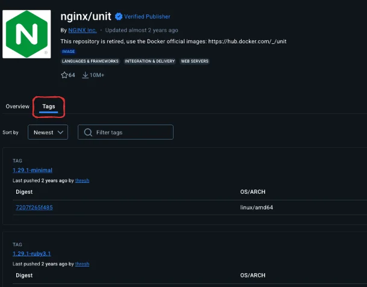

- 이미지의 버전(<code>tag</code>) 확인 
    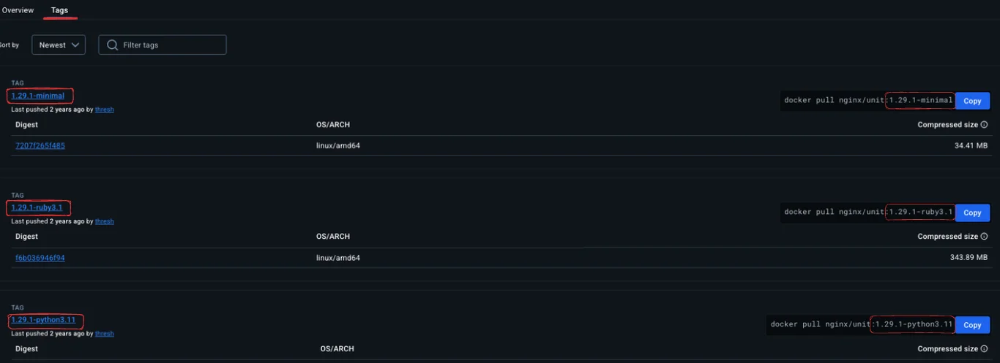

</details>

- 이미지 다운 &#45; <code>docker pull &#91;image&#93;</code>
    <a id="1c3eda9b0fe181cab092fde38fddf4b8"></a>

    ```docker
    docker pull [image]
    ```

</details>

<details>
<summary>이미지 검색 &#45; <code>ls</code></summary>


<a id="1c3eda9b0fe1819f998ff4407c6769c3"></a>

```docker
docker imgae ls
```

</details>

<details>
<summary>이미지 삭제 &#45; <code>rm</code></summary>

> ☝🏻 
> 
> <a id="1c3eda9b0fe181249302cd1b48e8e143"></a>
> 
> 이미지는 <strong><u>사용되지 않는 경우만 삭제가 가능</u></strong>하다&#46; 
> 
> <a id="1c3eda9b0fe1817cbfc9ccccee7a209b"></a>
> 
> 만약 해당 이미지를 사용하여 컨테이너가 실행되고 있는 경우, 해당 컨테이너를 종료하고 삭제해야 한다&#46;
> 
> - 삭제 시, image의 id 값 일부만 입력해도 가능하다
> 
> 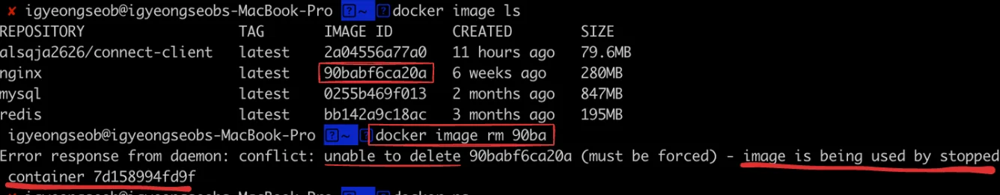
> 
> <a id="1c3eda9b0fe181f596a7da9168a81473"></a>
> 
> 컨테이너를 중단한 경우 (<code>docker stop &#91;컨테이너 ID or 명&#93;</code>) 
> 
> <a id="1c3eda9b0fe181b3ac43c9550477d7fa"></a>
> 
> <code>&#45;f</code> 옵션을  사용하여 중단(실행 X)된 컨테이너를 삭제할 수 있다&#46; 

<a id="1c3eda9b0fe18181b71cd20aadde1982"></a>

```docker
docker image rm [이미지 ID]
```

</details>

<details>
<summary>컨테이너에서 사용하지 않는 <strong><u>전체 이미지 삭제</u></strong> &#45; <code>docker image rm &#36;(docker images &#45;q)</code></summary>

<a id="1c3eda9b0fe181fc81daf7d41680a4d5"></a>

```docker
# 컨테이너에서 사용하지 않는 전체 이미지 삭제
docker image rm $(docker images -q)

# 중단된 컨테이너에서 사용하지 않는 전체 이미지 삭제
docker image rm -f $(docker images -q)
```

- 전체 이미지 지정&#58; <code>&#36;(docker images &#45;q)</code>

</details>

<a id="1c3eda9b0fe181efa05fddbadbb6f2de"></a>

### 컨테이너 

> 컨테이너 ID는 일부만 입력해도 식별이 가능하다

<details>
<summary>컨테이너 ( Container ) 생성 / 실행 &#45; <code>create</code>, <code>start</code></summary>

> 컨테이너&#58; 내 컴퓨터 안에서 미니 컴퓨터를 띄운다&#46; 

> ✏️ 
> 
> <a id="1c3eda9b0fe181e585a2ee8a68845815"></a>
> 
> 컨테이너 생성(<code>create</code>) 시, <strong><u>해당하는 이미지가 존재하지 않</u></strong>으면 자동으로 dockerhub에서 이미지를 다운받아 컨테이너를 생성한다&#46; 

- 컨테이너 생성 &#45; <code>create</code>
    <a id="1c3eda9b0fe18183994dffb2adf1e4fe"></a>

    ```docker
    docker create nginx
    ```

- 생성된 컨테이너 목록 확인 &#45; <code>ps &#45;a</code>
    <a id="1c3eda9b0fe181a196ecf81074c8a4c8"></a>

    ```docker
    docker ps -a
    ```

- 컨테이너 실행 &#45; <code>start</code>
    <a id="1c3eda9b0fe1813590e4cc61c8eae335"></a>

    ```docker
    docker start [컨테이너 ID] 
    # id 값은 일부만 입력해도 됨
    ```

    <details>
    <summary>ex)</summary>

    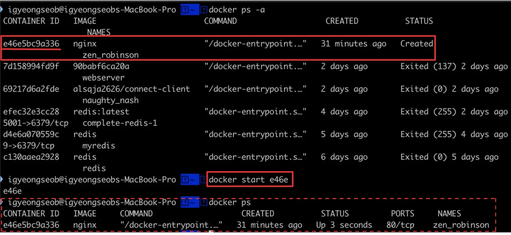

    - 실행(<code>start</code>) 시, 해당하는 컨테이너의 STATUS가 <code>UP</code>으로 변경된다&#46; 

    </details>

</details>

<details>
<summary>컨테이너 ( Container ) 생성 / 실행 2 &#45; <code>run</code> ( = pull &#43; create &#43; start )</summary>

<a id="1c3eda9b0fe181369a1fe2c7cdf8b7c9"></a>

```bash
# run: 이미지 다운 + 컨테이너 생성 + 실행
docker run 이미지명[:태그명]

# ex) docker run nginx
```

</details>

<details>
<summary>컨테이너 ( Container ) 조회 / 중지 / 삭제 &#45; <code>ps</code> / <code>stop</code>, <code>kill</code> / <code>rm</code></summary>

<details>
<summary>컨테이너 조회&#58; <code>ps</code>, <code>ps &#45;a</code></summary>

<a id="1c3eda9b0fe181229427fc98fac6bf72"></a>

```docker
# 실행 중인 컨테이너들 조회
docker ps

# 모든 (실행, 중단..) 컨테이너 조회 
docker ps -a
```

</details>

<details>
<summary>컨테이너 중단(중지)&#58; <code>stop</code>, <code>kill</code></summary>

- <code>stop</code>&#58; 컨테이너 종료 
    <a id="1c3eda9b0fe18104ad59f9a8fd02a6f4"></a>

    ```docker
    docker stop [컨테이너 ID, 명]
    ```

    - stop은 컴튜터를 시스템 종료 버튼을 눌러 정상적으로 종료하는 것과 비슷하다&#46;<br>따라서 기존의 실행시키던 자원들을 차근차근 안전하게 종료를 시킨다&#46; 

- <code>kill</code>&#58; 컨테이너 강제 종료
    <a id="1c3eda9b0fe1810294a1cd857bd8db0f"></a>

    ```bash
    docker kill [컨테이너 ID, 명]
    ```

    - kill 은 강제종료와 비슷하다&#46; 따라서 파일 손상이 발생될 수 있고, 중간에 데이터가 날아갈 수 도 있다&#46; 

    - 좋지 않는 방법이지만, 중간에 프로그램(컨테이너)가 먹통이면 어쩔 수 없이 사용한다&#46; 

</details>

<details>
<summary>컨테이너 삭제&#58; <code>rm</code></summary>

<a id="1c3eda9b0fe181b7a033d0550c8a61a0"></a>

```docker
docker rm [컨테이너 ID or 이름]

# 여러 컨테이너 한번에 삭제 가능 - 구분 ( 띄어쓰기 ) 
```

<details>
<summary>☝🏻 중지된 컨테이너만 삭제 가능하다&#46; </summary>

<a id="1c3eda9b0fe18186a53afaf87e6d4c85"></a>

```bash
docker run -d nginx

docker ps

docker rm [컨테이너 ID]

# Error response from daemon: cannot remove container 
# "/strange_franklin": container is running: stop tje container before removing or force remove
```

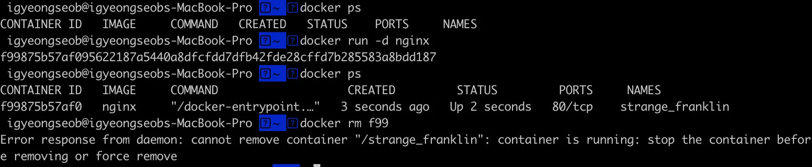

</details>

</details>

<details>
<summary>중지 되어있는 모든 컨테이너 삭제</summary>

<a id="1c3eda9b0fe1819aaaf4c187418c7e75"></a>

```bash
docker rm $(docker ps -qa)
```

</details>

<details>
<summary>실행 중인 컨테이너 강제 삭제&#58; <code>&#45;f</code></summary>

<a id="1c3eda9b0fe18128a46dd6ced68503e8"></a>

```bash
docker rm -f [컨테이너 ID or 이름]
```

</details>

</details>

<details>
<summary>컨테이너 ( Container ) 로그 조회 &#45; <code>logs</code></summary>

> ✏️ 
> 
> <a id="1c3eda9b0fe181c4855eeb2664b286dc"></a>
> 
> 로그를 통해 컨테이너(프로그램)가 정상 동작하는지, 어디서 오류가 발생 되었는지 확인 할 수 있다&#46; 따라서 로그를 확인하는 것은 매우 중요하다&#46; 
> 
> - 포그라운드로 컨테이너 실행 시, 실시간으로 로그를 확인할 수 있지만, 다른 커맨드 입력이 불가능하다&#46;
> 
> - 백그라운에서 <code>docker logs</code> 를 통해 로그 내역을 확인할 수 있따&#46; 

<a id="1c3eda9b0fe181bcb069d8cf34734b88"></a>

```bash
docker logs [컨테이너 ID]
```

<details>
<summary>옵션1) 끝에 있는 로그 <code>n</code> 줄만 출력 &#45; <code>—tail n</code></summary>

<a id="1c3eda9b0fe1811a9c08f34a91d8c0c9"></a>

```bash
docker logs --tail n [컨테이너 ID]
```

<details>
<summary>ex) 끝 10줄만 출력</summary>

<a id="1c3eda9b0fe18115bfeed3dac6635f57"></a>

```bash
docker logs --tail 10 1f505c84585c
```

- 로그 10 줄 출력 

</details>

</details>

<details>
<summary>옵션2) 로그 창 유지, 실시간으로 생성되는 내역 확인 가능 &#45; <code>&#45;f</code></summary>

<a id="1c3eda9b0fe1818b877ed93431886e16"></a>

```bash
docker logs -f [컨테이너 ID]
```

<details>
<summary>실습</summary>

<a id="1c3eda9b0fe181a7968ce7aa75febb3d"></a>

```bash
docker run -d -p 80:80 nginx

docker ps 

docker logs -f [컨테이너 ID]
```

- localhost&#58;80 접속
    

- <code>logs &#45;f</code> 사용 시, localhost&#58;80 접속 시 발생되는 GET 요청에 대해 실시간으로 로그가 찍히는 것을 확인할 수 있다&#46;
    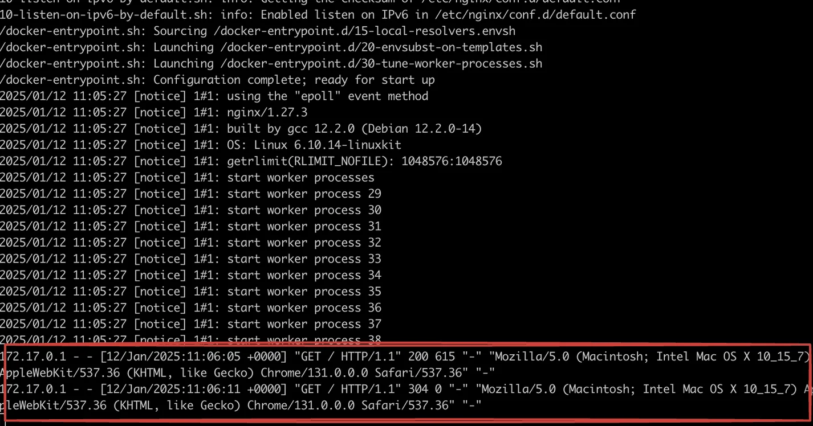

</details>

</details>

<details>
<summary>응용) 생성되는 실시간 로그만 확인&#58; <code>—tail 0 &#45;f</code></summary>

<a id="1c3eda9b0fe1817db26cf3f55f281b5c"></a>

```bash
docker logs --tail 0 -f [컨테이너 ID]
```

- <code>tail 0</code>&#58; 컨테이너 실행 시, 발생되는 로그를 표시하지 않음

- <code>&#45;f</code>&#58; 실시간으로 생성되는 로그 표시

</details>

</details>

<details>
<summary>실행 중인 컨테이너 내부에 접속하기 &#45; <code>exec &#45;it</code></summary>

> ✏️ 
> 
> <a id="1c3eda9b0fe181ce919bc8f17db79f95"></a>
> 
> 컨테이너는 호스트 안에 여러개를 띄울 수 있는 미니 컴퓨터이다&#46; 
> 
> <a id="1c3eda9b0fe1818f83cefda827d71333"></a>
> 
> 이 미니 컴퓨터는 호스트 안에 여러 개가 존재할 수 있으며, 각각 독립된 공간을 가지고 있다&#46; 
> 
> - 운영체제, 저장공간(메모리), 네트워크 …&#46;
> 
> 
> 
> <a id="1c3eda9b0fe18123a690cf515a2ce546"></a>
> 
> 따라서 독립된 컨테이너 내부를 확인하려고 할 떄, 해당 컨테이너에 접속하기 위해 사용하는 명령어가 <code>exec &#45;it</code> 이다&#46;

- 내부 컨테이너 접속 &#45; <code>docker exec &#45;it &#46;&#46;&#46;</code>
    <a id="1c3eda9b0fe181e394b7d10928db8385"></a>

    ```bash
    docker exec -it [컨테이너 ID] [프로그램명]
    ```

    <details>
    <summary>ex) 컨테이너 내부 bash 접속</summary>

    <a id="1c3eda9b0fe181c3847af19109f810e3"></a>

    ```bash
    # 컨테이너 내부 접속 및 bash 실행
    docker exec -it [컨테이너 ID] bash
    ```

    </details>

- 나가기 &#45; <code>exit</code>
    <a id="1c3eda9b0fe1817383b7e27c495a9eec"></a>

    ```bash
    exit
    ```

<details>
<summary>실습) 내부 컨테이너 접속 및 bash 실행</summary>

<a id="1c3eda9b0fe18137a354c8694784d6de"></a>

```bash
# nginx 컨테이너 실행 
docker run -d nginx

# 컨테이너 ID 확인
docker ps

# 컨테이너 내부 접속 및 bash 실행
docker exec -it [컨테이너 ID] bash

# cd /etc/nginx 
# cat nginx.conf  # nginx 내부  
```

</details>

</details>

<details>
<summary>실습 1) Nginx 설치 및 실행</summary>

<a id="1c3eda9b0fe1817e91cbfa97f4172cee"></a>

```bash
# 이미지 다운
docker pull nginx:latest

# 컨테이너 생성
docker create nginx

# 컨테이너 실행
docker start [컨테이너 ID]

# 위 3개 축약: run
docker run -d -p 80:80 --name test nginx

# 실행 중인 컨테이너 리스트 확인
docker ps

# 로그 확인
docker logs [컨테아너 ID]

# 로그 하위 5개 확인
docker logs --tail 5 [컨테아너 ID]

# 로그 실시간 확인
docker logs -f [컨테아너 ID]

# 실시간으로 생성되는 로그만 확인
docker logs --tail 0 -f [컨테아너 ID]


# 내부 컨테이너(nginx)의 bash에 접속하기
docker exec -it [컨테이너 ID] bash

# 나가기
exit

# 컨테이너 종료
docker stop [컨테아너 ID]

# 중단된 컨테이너들 확인
docker ps -a

# 중단된 컨테이너 삭제 ( 컨테이너가 중단되지 않으면 삭제되지 않음 )
docker rm [컨테아너 ID]

# 컨테이너 강제 종료 
docker kill [컨테아너 ID]

# 실행 중인 컨테이너 강제 삭제 
docker rm -f [컨테아너 ID]

# 이미지 조회
docker image ls

# 이미지 삭제
docker rm [이미지 ID]
```

</details>

<details>
<summary>실습 2) Redis 실행</summary>

<a id="1c3eda9b0fe18162bea5c2060dca61ce"></a>

```bash
# dockerhub에서 redis 이미지 다운
docker pull redis

# redis 기본 실행 포트: 6379
docker run -d -p 6379:6379 redis 

# 이미지 확인
docker image ls

# 실행 중인 컨테이너 확인
docker ps

# 내부 컨테이너에서 bash 실행
docker exec -it [컨테이너 ID] bash

# redis 접속
redis-cli

# 나가기
exit   # redis-cli
exit   # bash 

# 컨테이너 중단
docker stop [컨테이너 ID]

# 컨테이너 삭제 
docker rm [컨테이너 ID]

# 컨테이너 강제 중단 및 삭제
docker rm -f [컨테이너 ID]

# 이미지 삭제
docker image rm [이미지 ID]

```


</details>

<a id="1c3eda9b0fe18162af30eb9e91c4dd4e"></a>

### 옵션

<details>
<summary>컨테이너 백그라운드에서 실행&#58; <code>&#45;d</code></summary>

<details>
<summary>🧐 <code>포그라운드(foreground)</code>, <code>백그라운드(background)</code></summary>

<details>
<summary>포그라운드(foreground)</summary>

> 내가 실행시킨 프로그램의 내용이 화면에서 실행되고 출력되는 상태 ( 기본값 )

- <code>장점</code>&#58; 실시간으로 어떻게 실행되고 어떤 로그들이 찍히는지 확인 가능 

- <code>단점</code>&#58; 다른 프로그램 조작 불가능
    

</details>

<details>
<summary>백그라운드(background)</summary>

> 내가 실행시킨 프로그램이 컴퓨터 내부적으로 샐행되는 상태

- <code>장점</code>&#58; 백그라운드로 프로그램을 실행시키기 때문에, 해당 터미널에서 추가적으로 다른 명령어를 입력할 수 있다&#46;

- <code>단점</code>&#58; 실시간으로 프로그램이 어떻게 실행되는지 확인하지 못한다&#46; 

</details>

</details>

<a id="1c3eda9b0fe181d1ac78fbc86e5b7de0"></a>

```bash
# docker run 이미지명[:태그명]
$ docker run nginx # 포그라운드에서 실행 (추가적인 명령어 조작을 할 수가 없음)

# docker run -d 이미지명[:태그명]
$ docker run -d nginx  # 백그라운드 실행 
```

> ☝🏻 
> 
> <a id="1c3eda9b0fe181788b50d97aca86aeb7"></a>
> 
> 위치 중요&#33;, <code>run</code> 다음으로 명시해야 한다&#46; 
> 
> 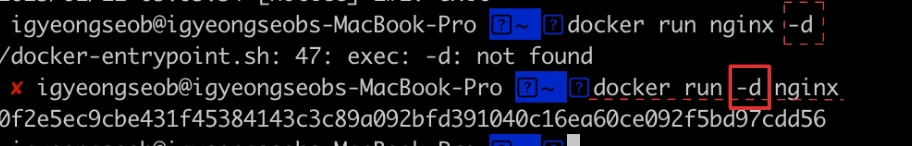

</details>

<details>
<summary>컨테이너에 <strong><u>이름을 붙</u></strong>여서 생성 및 실행하기&#58; <code>—name</code></summary>

<a id="1c3eda9b0fe181a48b27eb67fde70c1b"></a>

```docker
docker run -d  --name [컨테이너 이름] 이미지명[:태그명]
```

<details>
<summary>실습</summary>

<a id="1c3eda9b0fe1810c802af63eedc93872"></a>

```bash
# docker run -d --name [컨테이너 이름] 이미지명[:태그명]
$ docker run -d --name my-web-server nginx

# Nginx 컨테이너 중단 후 삭제하기
$ docker ps # 실행 중인 컨테이너 조회
$ docker stop {nginx를 실행시킨 Contnainer ID} # 컨테이너 중단
$ docker rm {nginx를 실행시킨 Contnainer ID} # 컨테이너 삭제
$ docker image rm nginx # Nginx 이미지 삭제
```

</details>

</details>

<details>
<summary><strong><u>호스트의 포트</u></strong>와 <strong><u>컨테이너의 포트</u></strong> 연결하기&#58; <code>&#45;p &#91;호스트 포트&#93;&#58;&#91;컨테이너 포트&#93;</code></summary>

<details>
<summary>🤬 문제) 아래와 같이 컨테이너 실행 시, nginx의 기본 브라이저에 접속 불가</summary>

- nginx 컨테이너 실행

<a id="1c3eda9b0fe18118af2cfe41c778d2fe"></a>

```docker
docker run -d nginx
```


<a id="1c3eda9b0fe18198a375d422636258bf"></a>

실행 중인 컨테이너가 80 포트에서 실행 중임을 확인할 수 있음 

<a id="1c3eda9b0fe18153b684f20796ab6f5b"></a>

그러나 실제 <code>localhost&#58;80</code>을 접속 시, 아래와 같이 nginx의 기본 브라우저에 접속되지 않는다&#46; 

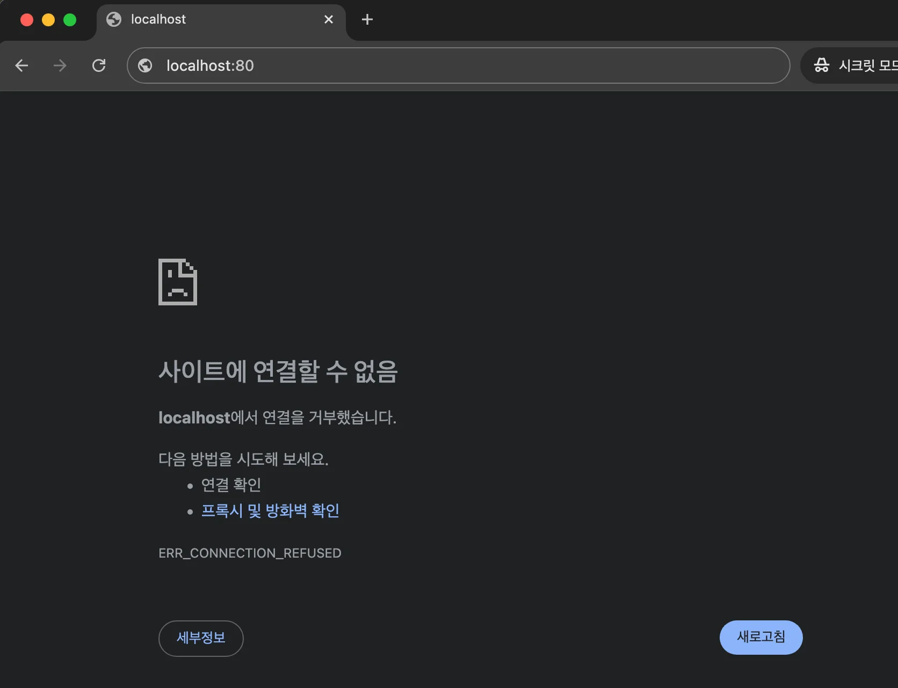

</details>

<a id="1c3eda9b0fe181beacb9e436de7d05e7"></a>

컨테이너는 호스트 컴퓨터 내부에 <strong><u>독립적인 환경</u></strong>을 가진다&#46; 

<a id="1c3eda9b0fe1817aa6a3eca3b4a983e0"></a>

즉, <strong><u>호스트 컴퓨터의 네트워크와 컨테이너 네트워크가 분리</u></strong> 되어 있기 때문에, <u>두 네트워크(포트)를 연결</u>해줘야한다&#46;


<a id="1c3eda9b0fe181609f6dd666cbfd5c5c"></a>

```bash
# docker run -d -p [호스트 포트]:[컨테이너 포트] 이미지명[:태그명]
$ docker run -d -p 4000:80 nginx
```

-  도커를 실행하는 <strong><u>호스트 컴퓨터의 4000번 포트</u></strong>를 <strong><u>컨테이너의 80번 포트</u></strong>로 연결하도록 설정한다&#46;
    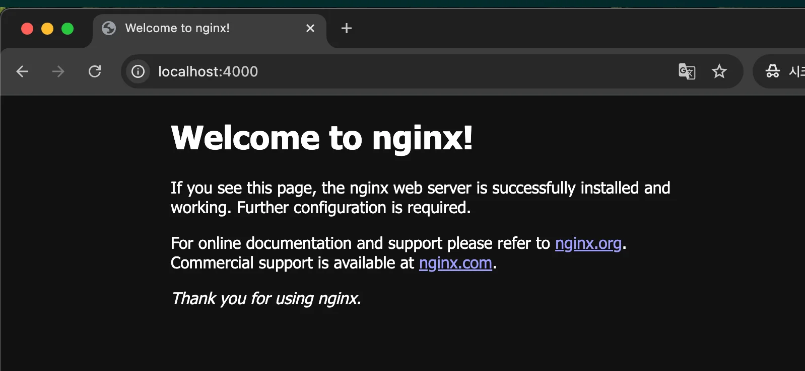

</details>

<details>
<summary>컨터이너 실행 중 명령어 활성화&#58; <code>&#45;i</code> </summary>

- <strong>interactive 약자</strong>

- 컨테이너와 <strong><u>상호작용(interaction)</u></strong>할 수 있도록 <strong><u>표준 입력(stdin)</u></strong>을 활성화

- 해당 옵션이 없으면 컨테이너 실행 중 입력을 받을 수 없다&#46;

</details>

<details>
<summary>컨테이너 가상 터미널 활성화&#58; <code>&#45;t</code></summary>

- 컨테이너에서 <strong><u>가상 터미널(TTY)</u></strong> 활성화

-  터미널에서 작업하는 것처럼 <strong><u>컨테이너 안에서 작업</u></strong>할 수 있다&#46;

</details>

<details>
<summary>응용) <code>&#45;it</code></summary>

- 쉘 인터페이스를 제공하여 컨테이너 안에서 명령을 실행하고 결과를 확인할 수 있다&#46;
    - 컨테이너 안에서 직접 작업하거나 디버깅할 때 사용

<details>
<summary>ex) </summary>

<a id="1c3eda9b0fe181ccb02feed8f804eed8"></a>

```bash
docker run -it ubuntu /bin/bash
```

- ubuntu 컨테이너를 실행하고 <strong>터미널 세션을 활성화</strong>한 뒤 /bin/bash 쉘을 실행한다&#46;

</details>

</details>

<details>
<summary>컨테이너 종료 후 컨테이너 자동 제거&#58; <code>&#45;&#45;rm</code></summary>

- 컨테이너가 종료되면 해당 컨테이너를 <strong>자동으로 삭제한다&#46;</strong>
    - 컨테이너의 <strong>데이터</strong>와 <strong>컨테이너 정보</strong>가 남지 않음

    - 디스크를 청소하거나 테스트 환경에서 유용함

    - 임시 테스트나 디스크 사용량 관리가 중요할 때 사용

<details>
<summary>ex)</summary>

<a id="1c3eda9b0fe18129967bfdf4fb93e2f9"></a>

```bash
# ubuntu 컨테이너에서 echo 명령을 실행하고, 명령이 완료되면 컨테이너를 삭제한다.
docker run --rm ubuntu echo "Hello, Docker!"
```

</details>

</details>

<a id="1c3eda9b0fe18169aa78fc397cc002f3"></a>

## 3&#46; 도커 볼륨&#58;  데이터 유실 방지 

<details>
<summary><code>도커 볼륨</code> 이란? </summary>


</details>

<details>
<summary>Tip) 특정 포트에서 실행 중인 프로그램 종</summary>

<a id="1c3eda9b0fe1812a9549fddd0d1b7b5d"></a>

```bash
# 3306 포트가 실행 중인지 확인 -> PID 확인
sudo lsof -i:3306

# 포트 종료
sudo kill [PID]
```

</details>

<details>
<summary>환경 변수 등록&#58; <code>&#45;e</code></summary>

<a id="1c3eda9b0fe181d2b667c22abecd4e42"></a>

```bash
docker run -e MYSQL_ROOT_PASSWORD=123 -d -p 3306:3306 mysql # mysql 기본 포트: 3306
```

- 등록된 환경변수 확인
    <a id="1c3eda9b0fe18114a1cdeee38a8e70ab"></a>

    ```bash
    # 내부 컨테이너(mysql) 접속
    docker exec -it [컨테이너 ID] bash

    # 환경변수 호출: echo $[환경변수명]
    echo $MYSQL_ROOT_PASSWORD
    ```

</details>

<a id="1c3eda9b0fe181158c80e61f8ca0940e"></a>

### 1&#46; Docker 기본 개념

<details>
<summary>Docker 사용 이유</summary>

> <code>이식성</code>&#58; 특정 버전 프로그램들을 다른 컴퓨터에서도 동일하게 설치 및 실행 가능 

<a id="1c3eda9b0fe18135822bf21d225694d2"></a>

앱 개발 후, 혹은 프로그램 설치 시  컴퓨터 환경(버전, 설정, 운영체제 등)이 변경됨에 따라 이전에 문제없이 작동한 것이 오류 상황이 발생하여 정상 실행 및 설치가 되지 않는 상황이 발생할 수 있다&#46; 

<a id="1c3eda9b0fe181b7828bf7cfa1098750"></a>

이를 도커라는 기술을 통해 각 앱에 맞는 독립적인 환경을 맞춰 설정할 수 있다&#46;

- 장점
    - 매번 귀찮은 설치 과정을 일일이 거치지 않아도 된다&#46;

    - 할상 일관되게 프로그램을 설치할 수 있다&#46; ( 버전, 환경 설정, 옵션, 운영체제 등 )

    - 각 프로그램이 독립적인 환경에서 실행되기 때문에 프로그램 간에 충돌이 일어나지 않는다&#46; 

</details>

<details>
<summary>Docker, 컨테이너, 이미지</summary>

- Docker 
    - <strong><u>컨테이너를 사용</u></strong>하여 각각의 프로그램을 <strong><u>분리된 환경</u></strong>에서 실행 및 관리할 수 있는 툴이다&#46; 

- 컨테이너 ( Container )
    - 호스트 컴퓨터, 컨테이너
        - 호스트 컴퓨터 내부에 컨테이너들이 독립적으로 존재한다&#46; 

    <details>
    <summary>컨테이너의 독립성</summary>

    > 컨테이너는 ‘독립적인 컴퓨터 환경’을 가지고 있다&#46; 

    - 디스크 ( 저장 공간)
        - 각 컨테이너마다 서로 각자의 저장 공간을 가지고 있다&#46;

        - 일반적으로 A 컨테이너 내부에서, B 컨테이너 내부에 있는 파일에 접근할 수 없다&#46; 

    - 각 컨테이너마다 고유의 네트워크를 가지고 있다&#46; ( IP, Port ) 

    </details>

- 이미지 ( Image )
    > ex) 닌텐도 &#45; 닌텐도 칩

    - 이미지는 프로그램을 실행하는데 필요한 설치 과정, 설정, 버전 정보 등을 포함하고 있다&#46; 

    - 즉, 프로그램을 실행하는데 필요한 모든 것을 포함하고 있다&#46; 

</details>

<details>
<summary>도커파일(Dockerfile), 컨테이너(Container), 이미지(Image)</summary>

> 📖 
> 
> <a id="1c3eda9b0fe181a59729efe043066ad9"></a>
> 
> Docker
> 
> <a id="1c3eda9b0fe181348ee6ebcaa8957225"></a>
> 
> <strong><u>컨테이너</u></strong>를 사용하여 <u>각각의 프로그램</u>을 <strong><u>분리된 환경</u></strong>에서 <u>실행 및 관리</u>할 수 있는 툴이다&#46;


<details>
<summary>Dockerfile</summary>


</details>

<details>
<summary>컨테이너 ( Container )</summary>


<a id="1c3eda9b0fe18160a52ee2905d5600fa"></a>

<u>하나의 컴퓨터 환경 내</u>에서 <strong><u>독립적인 컴퓨터 환경을 구성</u></strong>해서, <strong><u>각 환경애 프로그램을 별도로 설치</u></strong> 가능 하도록 하는개념이다&#46; 

<a id="1c3eda9b0fe18182a0fdf8af0909cfb1"></a>

하나의 컴퓨터 환경 내에서 여러개의 미니 컴퓨터 환경을 구성할 수 있는 형태이다&#46; 

<a id="1c3eda9b0fe18112aa34c8ac722cc44b"></a>

이러한 <strong><u>미니 컴퓨터</u></strong>를 <code>Docker</code>에서 <strong><u>컨테이너(Container)</u></strong>라고 부른다&#46; 

</details>

<details>
<summary>컨테이너의 독립성</summary>

<a id="1c3eda9b0fe181098245e7d294ca7f2f"></a>

위의 설명에서 컨테이너가 ‘독립적인 컴퓨터 환경’이라 설명했는데, 어떤 부분이 독립적으로 관리되는지는 아래와 같다&#46; 

- 디스크(저장 공간)
    - 각 컨테이너마다 서로 각자의 저장 공간을 가지고 있다&#46; 

    - 일반적으로 A 컨테이너 내부에서 B 컨테이너 내부에 있는 파일에 접근할 수 없다&#46; 

- 네트워크(IP, Port) 
    - 각 컨테이너마다 고유의 네트워크를 가지고 있다&#46; 

    - 컨테이너는 각자의 IP주소가 있다&#46;

</details>

<details>
<summary>이미지</summary>

> ✏️ 
> 
> <a id="1c3eda9b0fe18152a48ffec15c344f35"></a>
> 
> <code>이미지(Image)</code>는 프로그램을 실행하는데 필요한 <u>설치 과정, 설정, 버전 정보 등을 포함</u>하고 있다&#46; 그리고 이를 통해  Docker에서 이미지로 정의한 프로그램을 <u>Container 환경에서 손쉽게 실행 </u>시킬 수 있다&#46;

<a id="1c3eda9b0fe18139bcc0ea1af2283976"></a>

닌텐도와 같은 게임기에서 여러가지 칩을 꽃아서 다양한 게임을 할 수 있다&#46; Dokcer 또한 이와 유사하다&#46; 

<a id="1c3eda9b0fe181eeb8f4fe3159ead98a"></a>

 <code>Docker</code>에서는 <code>Image</code>를 통해 <strong><u>특정 프로그램을 도커 환경(Container)에서 실행</u></strong> 시킬 수 있다&#46; 

- 닌텐도 &#45; 게임 칩 = Docker &#45; Image
    

- ex 1) Node&#46;js 기반의 Express&#46;js 서버 프로젝트 이미지
    <a id="1c3eda9b0fe1816ba755e492e2ce97c5"></a>

    해당 이미지를 Docker로 실행시키면, Express&#46;js 서버 프로젝트가 컨테이너(Container) 환경에서 복잡한 설치 과정없이 손쉽게 실행된다&#46; 

- ex 2) MySQL 서버 이미지
    <a id="1c3eda9b0fe18132bff6ec3407894fd4"></a>

    해당 이미지를 Docker로 실행시키면 해당 버전의 MySQL 서버가 컨테이너(Container) 환경에서 실행된다&#46; 

    <a id="1c3eda9b0fe18140b64ecbe22f71428b"></a>

    일일이 MySQL을 설치할 필요없이 MySQL 데이터베이스를 사용할 수 있다&#46; 

</details>

</details>
