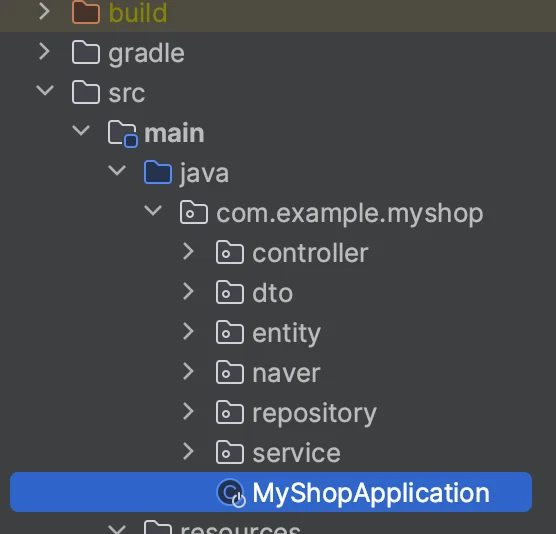
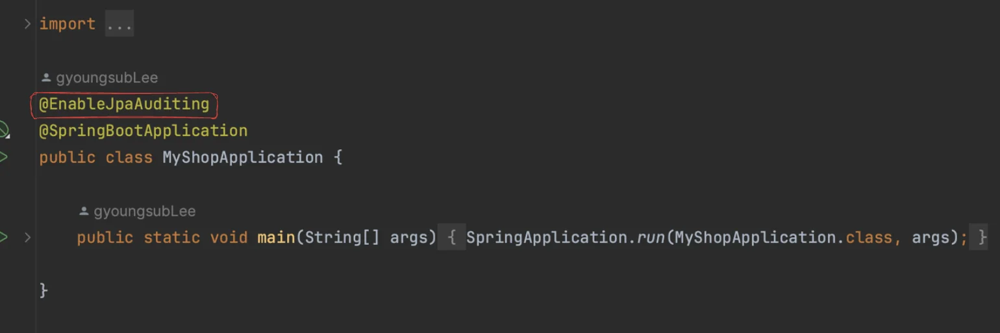
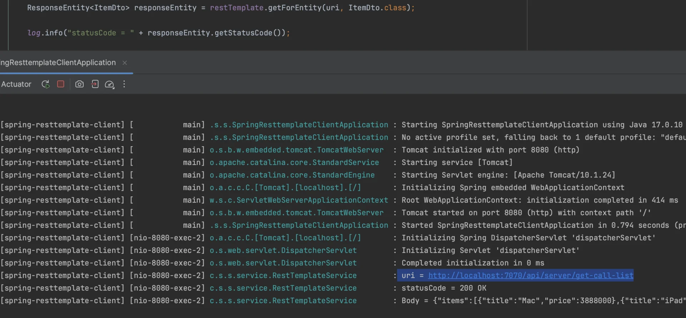
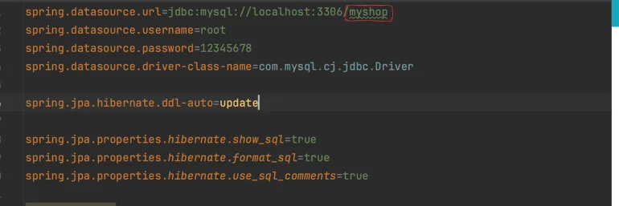

> <strong>항해 취업 리부트 코스 &#45; 사전 주특기 학습 내용</strong>
> 
> > <strong>기간&#58; 24&#46;05&#46;13 &#126; </strong>
> 
> <details>
> <summary><strong>Reference</strong></summary>
> 
> - <a href="https://beautiful-college-c84.notion.site/a2cd0bc80a5b495c9efa9c035c0f81f0?pvs=25">1주차 자료</a>
> 
> - <a href="https://beautiful-college-c84.notion.site/7767ed8defb946e5bafa1634e54d09ad?pvs=25">2주차 자료</a>
> 
> - <a href="https://beautiful-college-c84.notion.site/09710f1a35ab4bcab3003ec2ebcadf93?pvs=25">3주차 자료</a>
> 
> - <a href="https://beautiful-college-c84.notion.site/b3ae86f8518c491689320683c52a4e03?pvs=25">4주차 자료</a>
> 
> - <a href="https://beautiful-college-c84.notion.site/3ecdf6efc104448da71957aa031e914c?pvs=25">5주차 자료</a>
> 
> <details>
> <summary>블로그 </summary>
> 
> <a id="1c3eda9b0fe181d082b2dd62a0e15180"></a>
> 
> <a href="https://velog.io/@code-10/%EB%A1%AC%EB%B3%B5-AllNoArgsConstructor-%EC%A0%9C%EB%8C%80%EB%A1%9C-%EC%95%8C%EA%B3%A0-%EC%82%AC%EC%9A%A9%ED%95%B4%EB%B3%B4%EC%9E%90">롬복 &#45; </a><a href="https://velog.io/@code-10/%EB%A1%AC%EB%B3%B5-AllNoArgsConstructor-%EC%A0%9C%EB%8C%80%EB%A1%9C-%EC%95%8C%EA%B3%A0-%EC%82%AC%EC%9A%A9%ED%95%B4%EB%B3%B4%EC%9E%90"><code>&#64;</code></a><strong><a href="https://velog.io/@code-10/%EB%A1%AC%EB%B3%B5-AllNoArgsConstructor-%EC%A0%9C%EB%8C%80%EB%A1%9C-%EC%95%8C%EA%B3%A0-%EC%82%AC%EC%9A%A9%ED%95%B4%EB%B3%B4%EC%9E%90"><code>NoArgsConstructor</code></a></strong><strong><a href="https://velog.io/@code-10/%EB%A1%AC%EB%B3%B5-AllNoArgsConstructor-%EC%A0%9C%EB%8C%80%EB%A1%9C-%EC%95%8C%EA%B3%A0-%EC%82%AC%EC%9A%A9%ED%95%B4%EB%B3%B4%EC%9E%90">, </a></strong><strong><a href="https://velog.io/@code-10/%EB%A1%AC%EB%B3%B5-AllNoArgsConstructor-%EC%A0%9C%EB%8C%80%EB%A1%9C-%EC%95%8C%EA%B3%A0-%EC%82%AC%EC%9A%A9%ED%95%B4%EB%B3%B4%EC%9E%90"><code>&#64;AllArgsConstructor</code></a></strong><strong><a href="https://velog.io/@code-10/%EB%A1%AC%EB%B3%B5-AllNoArgsConstructor-%EC%A0%9C%EB%8C%80%EB%A1%9C-%EC%95%8C%EA%B3%A0-%EC%82%AC%EC%9A%A9%ED%95%B4%EB%B3%B4%EC%9E%90">, </a></strong><strong><a href="https://velog.io/@code-10/%EB%A1%AC%EB%B3%B5-AllNoArgsConstructor-%EC%A0%9C%EB%8C%80%EB%A1%9C-%EC%95%8C%EA%B3%A0-%EC%82%AC%EC%9A%A9%ED%95%B4%EB%B3%B4%EC%9E%90"><code>&#64;RequiredArgsConstructor</code></a></strong>
> 
> </details>
> 
> </details>

> ❗ 
> 
> <a id="338eda9b0fe18013b959f58b91db2567"></a>
> 
> 레퍼런스가 너무 오래된 관계로 진행 중단함

<a id="1c3eda9b0fe18188988aebadec84d495"></a>

## Chapter

<a id="1c3eda9b0fe18194910fd543a67fa7c2"></a>

### 1주차 정리

[1. 학습 준비](#/post/1c3eda9b-0fe1-8126-a49f-c250fbbe9ef1)

[2. Spring MVC](#/post/1c3eda9b-0fe1-8119-8572-c929d29562c6)

[3. 메모장 앱](#/post/1c3eda9b-0fe1-81e1-8de5-c1e2f02b7c5d)

[4. Database, SQL](#/post/1c3eda9b-0fe1-8171-896b-c9dbb540d403)

[SQL - 예시 문제](#/post/1c3eda9b-0fe1-81cb-bc0b-fd6a759639c8)

<a id="1c3eda9b0fe181738989e000036e47fc"></a>

### 2주차 정리

[1. 3Layer Achitecture](#/post/1c3eda9b-0fe1-814a-908e-d948c2c25cf6)

[2. IoC, DI](#/post/1c3eda9b-0fe1-811c-83f5-f20724855634)

[3. JPA CORE](#/post/1c3eda9b-0fe1-8158-9924-dd86076a6eca)

[4. Spring Data JPA](#/post/1c3eda9b-0fe1-8149-8ee2-cc88c47f91b1)

[[과제] QueryMethod를 사용한 keyword 조회](#/post/1c3eda9b-0fe1-8104-94ba-cf6cb8a95100)

<a id="1c3eda9b0fe1817183adfb0f71c7cf2d"></a>

### 3주차 정리

[1. 수동 빈 등록, 우선순위 명시](#/post/1c3eda9b-0fe1-81b5-b1c5-c8d5c92f899d)

[2. 인증, 인가](#/post/1c3eda9b-0fe1-8192-a5ad-e9936c44f3c8)

[3. 사용자 관리하기](#/post/1c3eda9b-0fe1-81a2-827b-cbe7902b44f2)

[4. 데이터 검증하기](#/post/1c3eda9b-0fe1-8173-ae9d-c4373e8ba145)

[[ 과제 ] 정규식을 사용하여 이메일 검증](#/post/1c3eda9b-0fe1-81da-9070-fe0b03d657bc)

<a id="1c3eda9b0fe1813cb208d4a3b280ba81"></a>

### 4주차 정리

[1. RestTemplate & Open API](#/post/1c3eda9b-0fe1-81d5-834b-d2067e7a783f)

[2. JPA: Entity 연관관계 매핑](#/post/1c3eda9b-0fe1-81fb-92f0-d8028f7f2811)

[3. [앱] My Select Shop](#/post/1c3eda9b-0fe1-81c3-8ede-e7f1f4c888fc)

[[ 숙제 ]](#/post/1c3eda9b-0fe1-81eb-8afe-dcb8cd4d7b08)

<a id="1c3eda9b0fe18148abe4cd1a3a2bbd49"></a>

### 5주차 정리

[1. 카카오 로그인](#/post/1c3eda9b-0fe1-81a6-9483-c654d49c3de7)

[2. 테스트](#/post/1c3eda9b-0fe1-81ae-ba6b-fba05a6b955f)

[3. Spring AOP](#/post/1c3eda9b-0fe1-818f-a2fa-dbad150171e4)

[4. API 예외처리](#/post/1c3eda9b-0fe1-81f3-b33f-d5a42110c3ad)

[[ 숙제 ]](#/post/1c3eda9b-0fe1-819d-998f-f82e074c96f4)

<a id="1c3eda9b0fe18197bab5c8f8b71431d1"></a>

## Notes 

<a id="1c3eda9b0fe181ac9491e42cdef906c4"></a>

## Anotations

<details>
<summary><code>&#64;Component</code></summary>

<a id="1c3eda9b0fe181e78557c2d7f2de110c"></a>

컴포넌트 스캔, 해당 클래스를 스프링 IoC 컨테이너에 빈으로 등록

</details>

<details>
<summary><code>&#64;Autowired</code></summary>

<a id="1c3eda9b0fe181fd8c85de43bb9d449f"></a>

의존성 자동 주입<br>생성자가 1일 시, 자동으로 명시되어 주입됨

</details>

<details>
<summary><code>&#64;Configuration</code></summary>


</details>

<details>
<summary><code>&#64;Bean</code></summary>


</details>

<details>
<summary><code>&#64;SpringBootTest</code></summary>

<a id="1c3eda9b0fe181bd9064da217af1f897"></a>

해당 Anotation을 명시해야 테스트 코드에서 DI 사용 가능

<a id="1c3eda9b0fe181578ea8cdef78225063"></a>

(스프링 IoC 컨테이너에서 Bean 가져오기 가능)

</details>

<details>
<summary><code>&#64;PostConstruct</code></summary>

<a id="1c3eda9b0fe181bcab2ee375cfdef235"></a>

 객체가 생성되고 나서 초기화 작업을 수행하기 위해 사용

</details>

<a id="1c3eda9b0fe1813a9638eadc11e5c001"></a>

### Lombok

- <code>&#64;Setter</code>

- <code>&#64;Getter</code>

<details>
<summary><code>&#64;RequiredArgsConstructor</code></summary>

<a id="1c3eda9b0fe1815ab8d3cb10c60ff9cf"></a>

 <strong><u>클래스의 final 필드</u></strong>나 <strong><u>&#64;NonNull로 표시된 필드</u></strong>를 <strong>인자로 받아 생성자를 자동으로 생성</strong>한다&#46;

<a id="1c3eda9b0fe181fb923cefb90187da89"></a>

아래와 같이 생성자를 통해 의존성 주입을 표현한 것을 

<a id="1c3eda9b0fe18140a526f760c17e85c8"></a>

```java
public UserService(UserRepository userRepository, EmailService emailService) {
    this.userRepository = userRepository;
    this.emailService = emailService;
}
```

<a id="1c3eda9b0fe181beb9cce5360a67142c"></a>

<br><code>&#64;RequiredArgsConstructor</code> 으로 간편하게 주입할 수 있다&#46; 

<a id="1c3eda9b0fe181fcaa72cc7f9a987394"></a>

```java
@RequiredArgsConstructor
public class UserService {
    private final UserRepository userRepository;
    private final EmailService emailService;
```

</details>

<details>
<summary><code>&#64;NoArgsConstructor</code></summary>

<a id="1c3eda9b0fe1815e87bafc129a1bb02c"></a>

<strong><u>파라미터가 없는 기본 생성자</u></strong>를 <strong>자동 생성</strong>한다&#46;

</details>

<a id="1c3eda9b0fe18105990cfd15c8fd5255"></a>

## SpringMVC

<a id="1c3eda9b0fe1814f9a31c9b226ec46a7"></a>

### RESTful 

<a id="1c3eda9b0fe1810b9379cd363f849327"></a>

스프링 프레임워크에서 RESTful 웹 서비스를 구축할 때 사용하는 애너테이션

<details>
<summary><strong><code>&#64;RestController</code></strong></summary>

> <code>&#64;RestController</code> = <code>&#64;Controller</code> &#43; <code>&#64;ResponseBody</code>

<a id="1c3eda9b0fe181df9353e22abde3dece"></a>

컨트롤러 클래스를 정의하고, 해당 클래스 내의 메서드들이 HTTP 요청을 처리하도록 한다&#46; 

<a id="1c3eda9b0fe1813a966cf4b6b3f0f1d1"></a>

1&#46;	<strong>자동 JSON 변환</strong>

<a id="1c3eda9b0fe181a8a1a3c12961852350"></a>

2&#46;	<strong>간결한 선언&#58; </strong><code>&#64;Controller</code> &#43; <code>&#64;ResponseBody</code>

</details>

---

- <strong><code>&#64;GetMapping</code></strong><strong>&#58; </strong>HTTP GET 요청을 처리

- <strong><code>&#64;PostMapping&#58;</code></strong><strong> </strong>HTTP POST 요청을 처리

- <strong><code>&#64;PutMapping</code></strong><strong>&#58; </strong>HTTP PUT 요청을 처리

- <strong><code>&#64;DeleteMapping</code></strong><strong>&#58; </strong>HTTP DELETE 요청을 처리

---

<details>
<summary><strong><code>&#64;PathVariable</code></strong></summary>

<a id="1c3eda9b0fe181d3bca1e4e2808736c8"></a>

<strong> </strong>URL 경로의 변수 값을 메서드 매개변수에 바인딩

<details>
<summary>ex) 기본 사용 &#45; <code>/users/{id}</code></summary>

<a id="1c3eda9b0fe1815b8b1eff67e6e86782"></a>

```java
import org.springframework.web.bind.annotation.GetMapping;
import org.springframework.web.bind.annotation.PathVariable;
import org.springframework.web.bind.annotation.RestController;

@RestController
public class UserController {

    @GetMapping("/users/{id}")
    public String getUserById(@PathVariable("id") Long id) {
        return "User ID: " + id;
    }
}
```

>  <code>/users/1</code> 로 요청

<a id="1c3eda9b0fe181e5a8d1d710823461b8"></a>

⇒   id 변수에 1이 매핑, <code>User ID&#58; 1</code> 반환

</details>

<details>
<summary> ex) 여러 PathVariable 사용 &#45; <code>/users/{userId}/orders/{orderId}</code></summary>

<a id="1c3eda9b0fe181ffb35cf7fe75e539de"></a>

```java
import org.springframework.web.bind.annotation.GetMapping;
import org.springframework.web.bind.annotation.PathVariable;
import org.springframework.web.bind.annotation.RestController;

@RestController
public class UserController {

    @GetMapping("/users/{userId}/orders/{orderId}")
    public String getOrderDetails(@PathVariable("userId") Long userId, @PathVariable("orderId") Long orderId) {
        return "User ID: " + userId + ", Order ID: " + orderId;
    }
}
```

> <code>/users/1/orders/100</code> 로 요청 

<a id="1c3eda9b0fe1819fb796d2fff70038e7"></a>

⇒  반환&#58; <code>“User ID&#58; 1, Order ID&#58; 100”</code><br>

</details>

</details>

<details>
<summary><strong><code>&#64;RequestMapping</code></strong></summary>

<a id="1c3eda9b0fe18112b50de57db49c583a"></a>

클래스 수준 또는 메서드 수준에서 URL 경로를 매핑한다&#46;

</details>

<details>
<summary><strong><code>&#64;RequestBody</code></strong></summary>

<a id="1c3eda9b0fe181dcaaddc724b6fb511d"></a>

HTTP 요청 본문을 객체로 변환하여 메서드 매개변수에 바인딩한다&#46;

<details>
<summary>ex) <strong>기본 사용법</strong></summary>

<a id="1c3eda9b0fe1817c8fc6d6578529549c"></a>

```java
import org.springframework.web.bind.annotation.PostMapping;
import org.springframework.web.bind.annotation.RequestBody;
import org.springframework.web.bind.annotation.RestController;

@RestController
public class UserController {

    @PostMapping("/users")
    public String createUser(@RequestBody User user) {
        return "User created: " + user.getName();
    }
}

class User {
    private String name;
    private int age;

    // getters and setters
}
```

> JSON 데이터 <code>{ &#34;name&#34;&#58; &#34;John&#34;, &#34;age&#34;&#58; 30 }</code> POST 요청

<a id="1c3eda9b0fe181799978effb789188b8"></a>

⇒ User 객체로 매핑,  <code>“User created&#58; John”</code> 반환<br>

</details>

<details>
<summary>ex) <strong>복잡한 객체 매핑</strong></summary>

<a id="1c3eda9b0fe18143941de44b0ca5be3e"></a>

```java
import org.springframework.web.bind.annotation.PostMapping;
import org.springframework.web.bind.annotation.RequestBody;
import org.springframework.web.bind.annotation.RestController;

import java.util.List;

@RestController
public class UserController {

    @PostMapping("/users")
    public String createUser(@RequestBody User user) {
        return "User created: " + user.getName() + ", with " + user.getRoles().size() + " roles.";
    }
}

class User {
    private String name;
    private int age;
    private List<String> roles;

    // getters and setters
}
```

> JSON 데이터 <code>{ &#34;name&#34;&#58; &#34;John&#34;, &#34;age&#34;&#58; 30, &#34;roles&#34;&#58; &#91;&#34;admin&#34;, &#34;user&#34;&#93; }</code> POST 요청

<a id="1c3eda9b0fe18150af7fea9d29c62e71"></a>

⇒ 반환&#58;  <code>“User created&#58; John, with 2 roles&#46;“</code>

</details>

</details>

<details>
<summary><strong><code>&#64;RequestParam</code></strong></summary>

<a id="1c3eda9b0fe181c880b5ed045844f95f"></a>

HTTP 요청 파라미터 값을 메서드 매개변수에 바인딩한다&#46;

- ex) <a href="http://localhost:8080/api/~">http&#58;//localhost&#58;8080/api/&#126;</a> /<code>?query=value</code>
    <a id="1c3eda9b0fe18193bba7ee5bd0681020"></a>

    파라미터인 <code>query=value</code> 를 가져온다&#46;

<details>
<summary></summary>


</details>

</details>

<details>
<summary><strong><code>&#64;ResponseBody</code></strong></summary>

> 템플릿 엔진이 적용된 SpringBoot에서는 Controller에서 문자열을 반환하면 templates 폴더에서 해당 문자열의 <code>&#46;html</code> 파일을 찾아서 반환한다&#46;

<a id="1c3eda9b0fe181faaad2e53e286435aa"></a>

메서드의 반환 값을 HTTP 응답 본문(JSON)으로 변환한다 (일반적으로 &#64;RestController를 사용할 때는 생략 가능하다)&#46;

<details>
<summary><strong>동작방식 </strong></summary>

<details>
<summary><strong>1&#46; 메서드 반환 값</strong></summary>

<a id="1c3eda9b0fe1812fb98ec8658a59797e"></a>

&#64;ResponseBody가 붙은 메서드의 반환 값은 객체일 수 있습니다&#46; 예를 들어, String, List, 사용자 정의 객체 등이 될 수 있다&#46;

</details>

<details>
<summary><strong>2&#46; 메시지 컨버터</strong></summary>

<a id="1c3eda9b0fe181c2bd1ecadbd569314b"></a>

스프링은 반환 값을 HTTP 응답 본문으로 변환하기 위해 메시지 컨버터를 사용합니다&#46; 기본적으로 <code>MappingJackson2HttpMessageConverter</code>가 사용되어 객체를 JSON으로 변환합니다&#46;

</details>

<details>
<summary><strong>3&#46; HTTP 응답</strong></summary>

<a id="1c3eda9b0fe181bbbef0c26ac7dbd11b"></a>

변환된 JSON 데이터는 HTTP 응답 본문에 포함되어 클라이언트로 전송됩니다&#46; 클라이언트는 이를 받아서 필요한 형태로 처리합니다&#46;

</details>

</details>

</details>

<a id="1c3eda9b0fe181dabce7c06ccd760d1a"></a>

### 3 Layer  Achitecture

<details>
<summary><code>&#64;Controller</code></summary>


</details>

<details>
<summary><code>&#64;Service</code></summary>


</details>

<details>
<summary><code>&#64;Repository</code></summary>


</details>

<a id="1c3eda9b0fe1819e8371cfde195f6b1d"></a>

## JPA

<details>
<summary><code>&#64;Transaction</code></summary>

<a id="1c3eda9b0fe18156ae47eba31af55cf8"></a>

스프링부트에서 해당 Anotaion을 통해 간단하게 트랙젝션 환경을 지원

</details>

<a id="1c3eda9b0fe181bebae8d663fcf81dea"></a>

### Auditing

<details>
<summary><strong>Timestamped</strong></summary>

> JPA(Java Persistence API)에서 엔티티의 생성 및 수정 시간을 자동으로 관리하기 위한 추상 클래스

<a id="1c3eda9b0fe181bc9a49dbe27b8bc484"></a>

```java
package com.example.myshop.entity;

import jakarta.persistence.*;
import lombok.Getter;
import org.springframework.data.annotation.CreatedDate;
import org.springframework.data.annotation.LastModifiedDate;
import org.springframework.data.jpa.domain.support.AuditingEntityListener;

import java.time.LocalDateTime;

@Getter
@MappedSuperclass
@EntityListeners(AuditingEntityListener.class)
public abstract class Timestamped {

    @CreatedDate
    @Column(updatable = false)
    @Temporal(TemporalType.TIMESTAMP)
    private LocalDateTime createdAt;

    @LastModifiedDate
    @Column
    @Temporal(TemporalType.TIMESTAMP)
    private LocalDateTime modifiedAt;
}
```

<a id="1c3eda9b0fe1816da449f824c443e76a"></a>

적용 시킬 Enity에 아래와 같이 extends 로 상속

<a id="1c3eda9b0fe1812aa8bbef651b5ec44b"></a>

```java
@Entity
@Getter
@Setter
@NoArgsConstructor
@Table(name = "product")
public class Product extends Timestamped {
```

</details>

<details>
<summary><code>&#64;EnableJpaAuditing</code></summary>

> JPA Auditing을 사용하기 위해 최상단 클래스에 <code>&#64;EnableJpaAuditing</code>를 명시해야한다&#46; 





</details>

<details>
<summary><code>&#64;MappedSuperClass</code></summary>


</details>

<details>
<summary><code>&#64;EntityListeners(AuditingEntityListener&#46;class)</code></summary>


</details>

<details>
<summary><code>&#64;Primary</code> </summary>

<a id="1c3eda9b0fe1815e9725dee07cc5754f"></a>

<strong><u>빈 우선순위 명시</u></strong>, 같은 타입(interface)의 구현체가 2개 이상 있는 경우 해당 타입이 이름을 통한 Autowire 시 주입 오류가 발생한다&#46; 

<a id="1c3eda9b0fe181e58f79eb2d6c6421a7"></a>

이를 <code>&#64;Primary</code>를 통해 같은 타입을 가지는 Bean들 중에 우선순위를 명시하여 해결한다&#46;

<details>
<summary>ex)</summary>

<details>
<summary>Pizza, <code>&#64;Primary</code>  명시</summary>

<a id="1c3eda9b0fe18167ac03c43bcf0f8168"></a>

```java
@Component
@Primary
public class Pizza implements Food {
    @Override
    public void eat() {
        System.out.println("피자를 먹습니다.");
    }
}
```

</details>

</details>

</details>

<details>
<summary><code>&#64;Value()</code></summary>

<a id="1c3eda9b0fe1810eb5c4eb38185fc257"></a>

<code>application&#46;properties</code>에 설정한 변수값 가져오기

<details>
<summary>ex)</summary>

- <code>application&#46;properties</code>
    <a id="1c3eda9b0fe181e78775eb38d45cccdf"></a>

    ```java
    jwt.secret.key=7Iqk7YyM66W07YOA7L2U65Sp7YG065+9U3ByaW5n6rCV7J2Y7Yqc7YSw7LWc7JuQ67mI7J6F64uI64ukLg==
    ```

- <code>JwtUtil&#46;java</code>
    <a id="1c3eda9b0fe18109be62ff6085d0b33b"></a>

    ```java
    @Value("${jwt.secret.key}") // Base64 Encode 한 SecretKey
    private String secretKey;
    ```

</details>

<a id="1c3eda9b0fe18191b08ce65d3ee59259"></a>

### Lombok

- <strong><code>&#64;Getter</code></strong><strong>&#58; 지정한 클래스의 필드들 Getter 자동생성</strong>

- <strong><code>&#64;Setter</code></strong><strong>&#58; 지정한 클래스의 필드들 Setter 자동생성</strong>

---

<details>
<summary><strong><code>&#64;NoArgsConstructor</code></strong><strong>&#58; 파라미터가 없는 디폴트 생성자를 생성</strong></summary>

> <code>&#64;NoArgsConstructor</code>를 사용한 기본생성자 자동생성

<a id="1c3eda9b0fe181cc83f2c8761e42cd40"></a>

```java
@NoArgsConstructor
public class Person {
    private String name;
    private int age;
}
```

<a id="1c3eda9b0fe1817ba95cdb2959b07e6a"></a>

```java
public class Person {
    private String name;
    private int age;
    
	public Person(){}
}
```

</details>

<details>
<summary><strong><code>&#64;AllArgsConstructor</code></strong><strong>&#58; 클래스의 모든 필드 값을 파라미터로 받는 생성자를 자동 생성함</strong></summary>

<a id="1c3eda9b0fe181bcb964c20dc78d3d94"></a>

```java
@AllArgsConstructor
public Class Person {
	private String name;
	private int age;
	
} 
```

> &#64;AllArgsConstructor 가 없는 직접 생성자 작성

<a id="1c3eda9b0fe181e789e1dfbfd28303b7"></a>

```java
public Class Person {
	private String name;
	private int age;
	
	public constructor(String name, int age){
				this.name = name;
        this.age = age;
	}
} 
```

</details>

<details>
<summary><strong><code>&#64;RequiredArgsConstructor</code></strong><strong>&#58; final, &#64;NonNull 로 선언된 필드만을 파라미터로 받는 생성자 생성</strong></summary>

<a id="1c3eda9b0fe1819895bce9f5083ba8ce"></a>

```java
@RequiredArgsConstructor
public class Person {
    private final String name;
    private final int age;
    private String address;
    // getters and setters
}
```

<a id="1c3eda9b0fe181e299dae921aa15562c"></a>

```java
public class Person {
    private final String name;
    private final int age;
    private String address;

		public Person(final String name, final int age) {
	    	this.name = name;
        this.age = age;
    }
}
```

</details>

<details>
<summary>각 Anotation에 세부 옵션 지정 가능</summary>

- staticName&#58; 정적 팩토리 메서드

<details>
<summary>access&#58; 접근 제한자 지정</summary>

- PUBLIC&#58; 기본값이며, 모든 클래스에서 생성자에 접근 가능

- PROTECTED&#58; 같은 패키지의 클래스와 상속받은 클래스에서 생성자에 접근 가능

- PACKAGE&#58; 같은 패키지의 클래스에서 생성자에 접근 가능

- PRIVATE&#58; 해당 클래스 내부에서만 생성자에 접근 가능

</details>

- onConstructor&#58; 생성자의 접근 제어자 설정, 기본값&#58; public

- force&#58; final 필드가 선언된 경우 컴파일 타임에 기본값을 0/null/false로 설정

</details>

---

<details>
<summary>Filter</summary>

<details>
<summary><code>&#64;Order(숫자)</code></summary>

<a id="1c3eda9b0fe1817494c1e7acc5323e6b"></a>

숫자를 부여함으로써 순서 지정

</details>

<details>
<summary><code>&#64;Slf4j</code></summary>


</details>

</details>

<a id="1c3eda9b0fe181bba875d740f0649f03"></a>

### Spring Security

<details>
<summary><code>&#64;EnableWebSecurity</code></summary>

<a id="1c3eda9b0fe18109b065d9ec80f932dc"></a>

Spring Security 지원

</details>

</details>

<details>
<summary><code>&#64;Slf4j</code> &#45; 로그 출력을 위한 Anotation</summary>

<a id="1c3eda9b0fe18179ac6cc726c2b1f3f2"></a>

log 찍기 가능

- ex) <em><code>log</code></em><code>&#46;info(&#34;uri = &#34; &#43; uri);</code>
    <a id="1c3eda9b0fe181d485b0e8cb9fe4d70e"></a>

    아래와 같이 log 확인

    

</details>

<a id="1c3eda9b0fe181a4bda8e81f7c7d2e29"></a>

## 🧐 의문점

<details>
<summary><code>final</code></summary>

- <code>변수</code>&#58; 초기화 후 값을 더이상 변경할 수 없도록 함

- <code>메서드</code>&#58; 오버라이드 할 수 없도록 함

- <code>클래스</code>&#58; 상속할 수 없도록 함 
    <a id="1c3eda9b0fe1819cbe63e210ccfe7759"></a>

    →<strong> 값 변경 X, 오버라이드 X, 상속 X</strong>

</details>

<details>
<summary><code>&#46;soutv</code></summary>

- ex)
    <a id="1c3eda9b0fe18177b3dfd2271b97aa9c"></a>

    ```java
    food.getUser().getId().souvt

    => System.out.println("food.getUser().getId() = " + food.getUser().getId());
    ```

    <a id="1c3eda9b0fe1817abc9ed6125f35ce72"></a>

    <br>

</details>

<details>
<summary><code>new ItemDto(</code><strong><code>(JSONObject)</code></strong><code> item);</code>&#58; <strong>형변환</strong></summary>

- 소괄호 <code>()</code>를  사용하여 타입캐스팅(형변환)

<a id="1c3eda9b0fe1811db1e0d7c2215287e9"></a>

 Item 객체를 JSONObject 타입으로 변환하여 ItemDto 생성자의 인자로 전달

</details>

<details>
<summary><code>&#64;PostConstruct</code></summary>

<a id="1c3eda9b0fe1811db3a2c436f5bfd9dd"></a>

해당 애노테이션이 붙은 메서드는 빈(Bean)이 초기화된 후 자동으로 호출된다&#46; 

<details>
<summary><strong>사용 예제</strong></summary>

- 서비스 클래스 정의
    <a id="1c3eda9b0fe1817e89d1e8f891fdefc0"></a>

    ```java
    import org.springframework.stereotype.Service;

    import javax.annotation.PostConstruct;

    @Service
    public class UserService {

        @PostConstruct
        public void init() {
            // 초기화 작업 수행
            System.out.println("UserService has been initialized");
            // 예를 들어, 초기 데이터 로딩이나 설정 작업 등을 수행할 수 있습니다.
        }

        public void performService() {
            // 서비스 로직 구현
            System.out.println("Performing user service operations");
        }
    }
    ```

<details>
<summary>설정 정보 정의&#58; <code>AppConfig</code><br></summary>

<a id="1c3eda9b0fe181d8a44cf817d94bc9e9"></a>

```java
import org.springframework.context.annotation.ComponentScan;
import org.springframework.context.annotation.Configuration;

@Configuration
@ComponentScan(basePackages = "com.example")
public class AppConfig {
    // 빈 설정 또는 추가 설정이 필요할 경우 여기에 작성
}
```

</details>

- 메인 클래스 정의
    <a id="1c3eda9b0fe181349a7dd4fdf24ece41"></a>

    ```java
    import org.springframework.context.ApplicationContext;
    import org.springframework.context.annotation.AnnotationConfigApplicationContext;

    public class Application {
        public static void main(String[] args) {
            ApplicationContext context = new AnnotationConfigApplicationContext(AppConfig.class);
            
            UserService userService = context.getBean(UserService.class);
            userService.performService();
        }
    }
    ```

- 실행결과
    > 앱 실행 시 <strong>UserService</strong>가 초기화되고, <code>&#64;PostConstruct</code>가 붙은 <code>init()</code>메서드가 호출되어 ‘UserService has been initialized’ 가 바로 출력된다&#46;

    <a id="1c3eda9b0fe18170a0e9d1585181e2e3"></a>

    ```plaintext
    UserService has been initialized
    Performing user service operations
    ```

</details>

</details>

<details>
<summary><code>&#46;orElseThrow()</code></summary>

- Optional의 메서드, Optional 객체를 벗겨내 value 값을 가져오거나 null 값인 경우 예외처리를 하기위해 사용함&#46;

- value가 <code>null</code> 이라면 <code>&#46;orElseThrow()</code> 소괄호 안에 로직 실행함&#46;

<details>
<summary>ex)</summary>

<a id="1c3eda9b0fe181bc97ebc67a147558f2"></a>

```java
User user = userRepository.findByUsername(username).orElseThrow(
    () -> new IllegalArgumentException("등록된 사용자가 없습니다.")
);
```

</details>

<details>
<summary><code>&#46;orElseThrow()</code></summary>

<a id="1c3eda9b0fe181d8b607d59ca2dc4b2e"></a>

```java
public <X extends Throwable> T orElseThrow(Supplier<? extends X> exceptionSupplier) throws X {
        if (value != null) {
            return value;
        } else {
            throw exceptionSupplier.get();
        }
    }
```

</details>

</details>

<details>
<summary><code>&#46;isPresent()</code></summary>

<a id="1c3eda9b0fe18196bbbff21d0f6c2c55"></a>

 Java의 Optional 클래스에서 사용되는 메서드로 <strong><u>Optional 객체에 </u></strong><strong><u>값이 존재하는지 여부</u></strong><strong><u>를 확인</u></strong>하는 데 사용한다&#46;

> Optional 클래스는 Java 8에서 도입된 기능으로, 값이 존재할 수도 있고 존재하지 않을 수도 있는 상황을 표현하기 위해 사용한다&#46;

<details>
<summary>ex) <strong> OptionalExample</strong></summary>

- <code>optionalValue&#46;isPresent()</code>&#58;  Optional 객체에 값이 존재하는지 확인

<a id="1c3eda9b0fe181dc9c8cde1b09e97ce3"></a>

```java
import java.util.Optional;

public class OptionalExample {
    public static void main(String[] args) {
        Optional<String> optionalValue = Optional.of("Hello, World!");

        if (optionalValue.isPresent()) {
            System.out.println("Value is present: " + optionalValue.get());
        } else {
            System.out.println("Value is not present");
        }
    }
} 
```

</details>

</details>

<details>
<summary><code>for문</code> 축약 → 스트림 변환( <code>Array&#46;stream()</code>), <em><code>forEach</code></em>, <em><code>map</code></em>&#46;&#46; 등 Stream 메서드 사용</summary>

- for문
    <a id="1c3eda9b0fe181aa9fb8e38c1b3312ce"></a>

    ```java
    List<Memo> memoList = memoRepository.findAll();
    List<MemoResponseDto> responseDtoList = new ArrayList<>();

    for (Memo memo : memoList) {
        responseDtoList.add(new MemoResponseDto(memo));
    }
    ```

- Stream 축약
    <a id="1c3eda9b0fe181f1b7a4de8f6fc1ae3d"></a>

    ```java
    memoList.stream()
        .map(MemoResponseDto::new)
        .forEach(responseDtoList::add);
    ```

</details>

<details>
<summary><code>new MemoResponseDto(memo)</code> → <code>MemoResponseDto&#58;&#58;new</code></summary>

- <code>&#58;&#58;</code>&#58;  메서드 축약, 체이닝하는 스트림의 요소들을 인자로 넣음 
    - 아래에 memoList 가 스트림 데이터로 변환되고 각 요소들이 map, forEach를 통해 소괄호<code>()</code> 안에 로직으로 넘어가 실행됨

    - <code>&#58;&#58;</code> 를 통해 체이닝되는 인자값을 자동으로 넘겨 실행

    <a id="1c3eda9b0fe181fbbc9bf0947af1798e"></a>

    ```java
    memoList.stream()
        .map(MemoResponseDto::new)
        .forEach(responseDtoList::add);
    ```

</details>

<details>
<summary>🧐 복습 시 발생한 오류&#58; “<code>Field ‘user&#95;id’ doesn’t have a default value&#34;</code></summary>

<a id="1c3eda9b0fe181b3886edb0d1accea1b"></a>

커밋 따라서 강의 복습하고 있는데 해당 오류가 발생함

<a id="1c3eda9b0fe181058c73d5c48df6e1ee"></a>

아직 회원 관련 로직을 생성하지도 않았는데 발생, 2차 캐시도 지우고 별 쌩쇼를 다했는데&#46;&#46;

<a id="1c3eda9b0fe18121b9d7eee00a0b891b"></a>

DB 설정을 이전 강의 학습때 사용한 DB로 했었음… 

<a id="1c3eda9b0fe1817b906cc3217b1a03eb"></a>

<code>application&#46;properties</code> 복사해올 시, 아래와 같이 db 명 바꿔주기…

<a id="1c3eda9b0fe181559f49fdab2e12872b"></a>

<del>이것떄문에 3시간 버림…Tb</del>



</details>

<a id="1c3eda9b0fe1813a9e54f9b45374aea7"></a>

### 로깅

<details>
<summary><strong>방법1)</strong> <code>LoggerFactory&#46;getLogger()</code>&#58; 로거를 생성할 클래스의 Class 객체를 인자로 넘긴다&#46; </summary>

<a id="1c3eda9b0fe1815c9a41e23add8a55e0"></a>

```java
public class MyClass {
    // Logger 객체 생성
    private static final Logger logger = LoggerFactory.getLogger(MyClass.class);
    
    public void performTask() {
        logger.info("Task is being performed");
        // 다른 로깅 수준의 예시
        logger.debug("This is a debug message");
        logger.error("An error occurred");
    }
}
```

</details>

<details>
<summary><strong>방법2) </strong><code>&#64;Slf4j</code>&#58; 해당 애노테이션을 사용하여<strong> Lombok</strong> 라이브러리가 <strong><u>자동으로 Logger객체를 생성</u></strong>한다&#46; </summary>

- <code>log</code>로 초기화

<a id="1c3eda9b0fe181c48e4fc9a6e680c3ed"></a>

```java
import lombok.extern.slf4j.Slf4j;

@Slf4j
public class MyClass {

    public void performTask() {
        log.info("Task is being performed");
        // 다른 로깅 수준의 예시
        log.debug("This is a debug message");
        log.error("An error occurred");
    }
}
```

<details>
<summary></summary>


</details>

</details>

- <code>info</code>&#58; 일반적인 정보를 기록할 때 사용

- <code>debug</code>&#58; 디버깅을 위한 자세한 정보를 기록할 때 사용

- <code>error</code>&#58; 오류가 발생했을 때 사용

<a id="1c3eda9b0fe18131809adf299b2933b1"></a>

### <strong>Optional 클래스와 함께 사용되는 메서드들</strong>

<details>
<summary><code>isPresent()</code></summary>

<a id="1c3eda9b0fe18179a02ee373eef50561"></a>

값이 존재하면 true를, 존재하지 않으면 false를 반환한다&#46;

</details>

<details>
<summary><code>get()</code></summary>

<a id="1c3eda9b0fe18156a005f80258d48513"></a>

값이 존재할 때 그 값을 반환합니다&#46; 값이 없으면 NoSuchElementException을 발생시킨다&#46;

</details>

<details>
<summary><code>ifPresent(Consumer&#60;? super T&#62; consumer)</code></summary>

<a id="1c3eda9b0fe181038290caa85c489523"></a>

값이 존재할 때 주어진 동작을 수행한다&#46;

</details>

<details>
<summary><code>orElse(T other)</code></summary>

<a id="1c3eda9b0fe181edbcd0e433ad890169"></a>

값이 존재하면 그 값을 반환하고, 그렇지 않으면 주어진 다른 값을 반환한다&#46; 

</details>

<details>
<summary><code>orElseGet(Supplier&#60;? extends T&#62; other)</code></summary>

<a id="1c3eda9b0fe181bebc84c0f0785c1775"></a>

값이 존재하면 그 값을 반환하고, 그렇지 않으면 주어진 Supplier의 결과를 반환한다&#46;

</details>

<details>
<summary><code>orElseThrow(Supplier&#60;? extends X&#62; exceptionSupplier)</code></summary>

<a id="1c3eda9b0fe181a78031ee93c0d3d314"></a>

값이 존재하면 그 값을 반환하고, 그렇지 않으면 주어진 예외를 발생시킨다&#46;

</details>

<a id="1c3eda9b0fe1812b98edd130211283cc"></a>

### JPA

<details>
<summary><code>mappedBy</code></summary>

<a id="1c3eda9b0fe1816db5ebe9e8c7d6e465"></a>

외래키의 주인을 지정하고 해당하는 필드명을 옵션의 속성값으로 줘야한다&#46;

</details>

<details>
<summary><code>Update</code> → <code>&#64;Transactional</code> &#45; Dirty Checking ( 변경감지 )</summary>


</details>

<details>
<summary>JPA &#45; <code>&#64;JoinColumn()</code>&#58; 연관관계 주인</summary>

<a id="1c3eda9b0fe18131ae76cdceef1a3387"></a>

```plaintext
@ManyToOne
@JoinColumn(name = "user_id", nullable=false)
private User user;
```

</details>

<details>
<summary><strong>JpaRepository</strong> &#45; <code>saveAll()</code></summary>


</details>

<a id="1c3eda9b0fe1812b89f5e08bc6f2fa0f"></a>

## JWT

<details>
<summary><strong>🧐 클레임(Claims)</strong></summary>

<a id="1c3eda9b0fe1813eaa61cc86fc267226"></a>

클레임(Claim)은 JWT(JSON Web Token)에서 사용자나 토큰에 대한 정보를 담고 있는 데이터이다&#46; <br>

</details>

<a id="1c3eda9b0fe1816ab1bff02bb93d82d8"></a>

### <strong>JWT 구성 요소 </strong>

1. <strong>헤더 (Header)</strong>
    - JWT의 타입과 서명 알고리즘을 명시

    - ex) <code>{&#34;alg&#34;&#58; &#34;HS256&#34;, &#34;typ&#34;&#58; &#34;JWT&#34;}</code>

1. <strong>페이로드 (Payload)</strong>
    - <strong><u>사용자 정보</u></strong>나 <strong><u>만료 시간</u></strong> 같은 데이터 명시<br>( <strong>클레임(Claim)</strong>이라고 부름 )

    - ex) <code>{&#34;sub&#34;&#58; &#34;1234567890&#34;, &#34;name&#34;&#58; &#34;John Doe&#34;, &#34;iat&#34;&#58; 1516239022}</code>

1. <strong>서명 (Signature)</strong>
    - 헤더와 페이로드를 암호화하여 생성된 값

    -  서명은 토큰의 무결성을 검증하는 데 사용됨

    - ex) <code>HMACSHA256(base64UrlEncode(header) &#43; &#34;&#46;&#34; &#43; base64UrlEncode(payload), secret)</code><br>

<a id="1c3eda9b0fe1819e8b3dd389d1f31f2b"></a>

### <strong>서명(Signature) 생성 과정</strong>

> 서명은 <strong><u>토큰이 변조되지 않았음을 확인</u></strong>하기 위해 사용된다&#46; 

<details>
<summary>🧐 <strong>Base64 URL&#45;safe </strong></summary>

<a id="1c3eda9b0fe181a1a2b0df49445659f4"></a>

Base64 인코딩 방식을 사용하되, URL이나 파일 경로에서 사용하기에 적합도록 약간 수정된 형태의 방식이다&#46; 

-   <code>&#43;</code>, <code>/</code>  →  <code>&#45;</code>, <code>&#95;</code>    

<a id="1c3eda9b0fe18194b987db6b32a7c74d"></a>

```plaintext
Input: "Hello, World!"

Base64: "SGVsbG8sIFdvcmxkIQ=="
URL-safe Base64: "SGVsbG8sIFdvcmxkIQ"
```

<details>
<summary>테스트 </summary>

<a id="1c3eda9b0fe181c29dfceb9806aa28e5"></a>

```java
@GetMapping("/base64-test")
public String base64UrlSafeExample(){
    String str = "Hello, World";

    // URL-safe Base64 인코딩
    String encodedString = Base64.getUrlEncoder().encodeToString(str.getBytes());
    System.out.println("Encoded (URL-safe Base64): " + encodedString);

    // URL-safe Base64 디코딩
    byte[] decodeBytes = Base64.getDecoder().decode(encodedString);
    String decodedString = new String(decodeBytes);
    System.out.println("decodedString = " + decodedString);
    
    return "Encoded (URL-safe Base64): " + encodedString + " " + "decodedString = " + decodedString;
}
```


</details>

</details>

<details>
<summary><strong>1&#46; 헤더와 페이로드 인코딩</strong></summary>

- 헤더와 페이로드를 각각 Base64 URL&#45;safe 방식으로 인코딩

</details>

<details>
<summary><strong>2&#46; 인코딩된 헤더와 페이로드 결합</strong></summary>

- 인코딩된 헤더와 페이로드를 마침표(&#46;)로 결합

- ex) <code>encodedHeader</code> &#43; <code>“&#46;”</code> &#43; <code>encodedPayload</code>

</details>

<details>
<summary><strong>3&#46; 서명 생성</strong></summary>

- <strong>결합된 문자열</strong>을 <strong>비밀 키(secret key)</strong>와 함께 <strong>지정된 알고리즘(HMAC SHA256 등)</strong>을 사용하여 <strong>암호화</strong>

- ex) <code>HMACSHA256(encodedHeader &#43; “&#46;” &#43; encodedPayload, secret)</code>

</details>

<details>
<summary><strong>4&#46; 서명 추가</strong></summary>

- <strong><u>생성된 서명</u></strong>을 <strong>토큰의 마지막 부분에 추가</strong>하여  JWT 생성

- 예&#58; <code>encodedHeader</code> &#43; <code>&#34;&#46;&#34; </code>&#43; <code>encodedPayload</code> &#43; <code>&#34;&#46;&#34;</code> &#43; <code>signature</code>

</details>

<details>
<summary><strong>ex) JWT </strong></summary>

<a id="1c3eda9b0fe18175954ef6b0529f2a86"></a>

```plaintext
eyJhbGciOiJIUzI1NiIsInR5cCI6IkpXVCJ9
.
eyJzdWIiOiIxMjM0NTY3ODkwIiwibmFtZSI6IkpvaG4gRG9lIiwiaWF0IjoxNTE2MjM5MDIyfQ
.
SflKxwRJSMeKKF2QT4fwpMeJf36POk6yJV_adQssw5c
```

- <strong>헤더</strong>&#58; eyJhbGciOiJIUzI1NiIsInR5cCI6IkpXVCJ9

- <strong>페이로드</strong>&#58; eyJzdWIiOiIxMjM0NTY3ODkwIiwibmFtZSI6IkpvaG4gRG9lIiwiaWF0IjoxNTE2MjM5MDIyfQ

- <strong>서명</strong>&#58; SflKxwRJSMeKKF2QT4fwpMeJf36POk6yJV&#95;adQssw5c

- <code>&#46;</code>&#58; 헤더, 페이로드, 서명 결합

</details>

<a id="1c3eda9b0fe181639f0bd85d3a6c3995"></a>

서명 부분은 헤더와 페이로드의 무결성을 확인하는데 사용된다&#46; 만약 JWT가 변조되었다면, 서명을 통해 이를 검증할 수 있다&#46; 

<a id="1c3eda9b0fe181969120e0a363fdacd2"></a>

### 서명 검증

<a id="1c3eda9b0fe181ab906cc83e1fc35417"></a>

JWT를 수신하는 쪽에서 서명을 검증하여 토큰이 변조되지 않았는지 확인한다&#46; 

<details>
<summary>1&#46; 헤더, 페이로드 &#45; 디코딩</summary>

- Base64로 인코딩된 헤더와 페이로드 디코딩

</details>

<details>
<summary>2&#46; 서명 재생성</summary>

- 디코딩된 헤더와 페이로드를 다시 결합하고, 동일한 secret key 와 알고리즘을 사용하여 서명을 재생성한다&#46; 

</details>

<details>
<summary>3&#46; 서명 비교</summary>

- 재생성된 서명과 토큰에 포함된 서명을 비교<br>서명 일치 → 토큰 유효

</details>

<a id="1c3eda9b0fe181e994cdcbd56ab6f480"></a>

## 인증 / 인가

<a id="1c3eda9b0fe181bfaac3df49507e1943"></a>

### <strong>액세스 토큰  / 리프레쉬 토큰</strong>

<a id="1c3eda9b0fe181d6a07fe28e545a1648"></a>

<strong>짧은 유효기간</strong>을 가지는<strong> </strong><strong><code>액세스 토큰</code></strong>으로 <strong><u>인가를 허용</u></strong>하고, <strong><u>액세스 토큰 만료</u></strong><strong> </strong>시, <strong>더 긴 유효기간</strong>을 가지는 <code>리프레시 토큰</code>을 사용하여 <strong><u>다시 액세스 토큰을 발급</u></strong> 받도록 한다

<details>
<summary>JwtUtil</summary>

<a id="1c3eda9b0fe1819a8196dbbd47b49460"></a>

```java
import io.jsonwebtoken.Claims;
import io.jsonwebtoken.Jwts;
import io.jsonwebtoken.SignatureAlgorithm;
import io.jsonwebtoken.ExpiredJwtException;

import java.util.Date;

public class JwtUtil {
    private static final String SECRET_KEY = "mySecretKey";
    private static final long ACCESS_TOKEN_VALIDITY = 5 * 1000; // 5초
    private static final long REFRESH_TOKEN_VALIDITY = 30 * 1000; // 30초

    public static String createAccessToken(String subject) {
        return createToken(subject, ACCESS_TOKEN_VALIDITY);
    }

    public static String createRefreshToken(String subject) {
        return createToken(subject, REFRESH_TOKEN_VALIDITY);
    }

    private static String createToken(String subject, long validity) {
        long nowMillis = System.currentTimeMillis();
        Date now = new Date(nowMillis);
        long expMillis = nowMillis + validity;
        Date exp = new Date(expMillis);

        return Jwts.builder()
                .setSubject(subject)
                .setIssuedAt(now)
                .setExpiration(exp)
                .signWith(SignatureAlgorithm.HS256, SECRET_KEY)
                .compact();
    }

    public static Claims validateToken(String token) throws ExpiredJwtException {
        return Jwts.parser()
                .setSigningKey(SECRET_KEY)
                .parseClaimsJws(token)
                .getBody();
    }
}
```

</details>

<details>
<summary>refresh token 생성 테스트</summary>

<a id="1c3eda9b0fe181448019eba28b204807"></a>

```java
import io.jsonwebtoken.Claims;
import io.jsonwebtoken.ExpiredJwtException;

public class Main {
    public static void main(String[] args) {
        // 유저 ID
        String userId = "user123";

        // 액세스 토큰과 리프레시 토큰 생성
        String accessToken = JwtUtil.createAccessToken(userId);
        String refreshToken = JwtUtil.createRefreshToken(userId);

        System.out.println("액세스 토큰: " + accessToken);
        System.out.println("리프레시 토큰: " + refreshToken);

        try {
            // 잠시 후 액세스 토큰 검증 (만료될 때까지 대기)
            Thread.sleep(6000); // 6초 대기 (액세스 토큰 만료 시간 초과)
            JwtUtil.validateToken(accessToken);
        } catch (ExpiredJwtException e) {
            System.out.println("액세스 토큰이 만료되었습니다: " + e.getMessage());

            // 리프레시 토큰으로 새로운 액세스 토큰 발급
            try {
                Claims claims = JwtUtil.validateToken(refreshToken);
                String newAccessToken = JwtUtil.createAccessToken(claims.getSubject());
                System.out.println("새로운 액세스 토큰: " + newAccessToken);
                
            } catch (ExpiredJwtException ex) {
                System.out.println("리프레시 토큰이 만료되었습니다. 다시 로그인해야 합니다.");
            }
        } catch (InterruptedException e) {
            e.printStackTrace();
        }
    }
}
```

</details>

<a id="1c3eda9b0fe181f385efebddfe0154ee"></a>

## 예외처리

<details>
<summary><code>&#46;orElseThrow(</code><strong><code>NullPointerException&#58;&#58;new</code></strong><code>)</code></summary>

> 예외처리, null 시 <code>NullPointerException</code> 발생시킴

- ex)
    <a id="1c3eda9b0fe181279493fe6b382bf3dc"></a>

    ```java
    Food food = foodRepository.findById(1L).orElseThrow(NullPointerException::new);
    ```

</details>

<details>
<summary><strong> 예외 유형(2)</strong>&#58; <code>체크 예외(Checked Exceptions)</code><strong>, </strong><code>언체크 예외(Unchecked Exceptions)</code></summary>

<a id="1c3eda9b0fe181abb8befb83a5f507e6"></a>

자바에서는 예외를 두 가지로 나눌 수 있다&#46;

<details>
<summary><strong>1&#46; 체크 예외 (Checked Exceptions)</strong></summary>

<a id="1c3eda9b0fe181a484c0d89215dcf42a"></a>

체크 예외는 프로그램을 컴파일할 때, 즉 <strong><u>코드를 실행하기 전에 반드시 처리</u></strong>해야 하는 예외로 컴파일러는 이런 예외를 처리하지 않으면 코드를 컴파일 하지 않는다&#46;

- <strong><code>IOException</code></strong>&#58; 입출력 작업이 실패하거나 인터럽트될 때 발생하는 예외

- <strong><code>FileNotFoundException</code></strong>&#58; 파일을 찾지 못했을 때 발생하는 예외
    - IOException 상속받음

- <strong><code>SQLException</code></strong>&#58; 데이터베이스 액세스 오류가 발생할 때 던져지는 예외

<a id="1c3eda9b0fe181918349e4f01fbaea5c"></a>

<br>따라서 아래와 같이 <code>try&#45;catch</code> 블록을 사용하여 반드시 예외를 처리해야 한다&#46;

<a id="1c3eda9b0fe181f1848ede314922e456"></a>

```java
import java.io.File;
import java.io.FileNotFoundException;
import java.io.FileReader;

public class CheckedExceptionExample {
    public static void main(String[] args) {
        try {
            File file = new File("somefile.txt");
            FileReader fr = new FileReader(file);
        } catch (FileNotFoundException e) {
            System.out.println("File not found!");
        }
    }
}
```

</details>

<details>
<summary><strong>2&#46; 언체크 예외 (Unchecked Exceptions)</strong></summary>

<a id="1c3eda9b0fe181a9afa3c5ed30611c10"></a>

언체크 예외는 프로그램을 컴파일할 때 강제로 처리하지 않아도 되는 예외이다&#46;이런 예외는 보통 프로그래밍의 논리적 오류에서 발생한다&#46; 예를 들어, 배열의 인덱스를 잘못 사용하거나 null 값을 사용하려고 할 때 발생하는 예외들이 있다&#46;

- <strong><code>NullPointerException</code></strong>&#58; 객체의 메서드나 필드를 참조하려고 할 때 그 객체가 null인 경우 발생하는 예외

- <strong><code>ArrayIndexOutOfBoundsException</code></strong>&#58; 배열의 잘못된 인덱스를 참조하려고 할 때 발생하는 예외

- <strong><code>ArithmeticException</code></strong>&#58; 수학적인 오류가 발생할 때 던져지는 예외, 예를 들어 0으로 나누기를 시도할 때

- <strong><code>IllegalArgumentException</code></strong>&#58; 메서드에 잘못된 인수를 전달할 때 발생하는 예외

</details>

<a id="1c3eda9b0fe181fe9a0dcd07327d4376"></a>

이러한 예외들을 이해하고 적절히 처리하는 것은 안정적이고 신뢰할 수 있는 소프트웨어를 개발하는 데 매우 중요하다&#46; 예외가 발생할 수 있는 상황을 미리 예측하고 대비하면 프로그램의 오류를 줄일 수 있다&#46;

</details>

<details>
<summary><strong> AuthenticationException</strong></summary>

> It serves as the superclass for various specific authentication exceptions, including <code>UsernameNotFoundException</code>, <code>BadCredentialsException</code>, and others&#46;

<a id="1c3eda9b0fe181359ff7ff7735c79127"></a>

다양한 <strong>인증 예외(</strong><code>Exception</code><strong>)</strong>들을 위한 <strong><u>수퍼 클래스&#46;</u></strong>

<details>
<summary><strong>AuthenticationException의 주된 서브클래스들</strong></summary>

<details>
<summary>1&#46;<strong> </strong><code>UsernameNotFoundException</code>&#58; Thrown when the user cannot be found&#46;</summary>

<a id="1c3eda9b0fe181ebad64c9dc5558ea75"></a>

```java
@Service
@RequiredArgsConstructor
public class UserDetailsServiceImpl implements UserDetailsService {

    private final UserRepository userRepository;

    @Override
    public UserDetails loadUserByUsername(String username) throws UsernameNotFoundException {
        User user = userRepository.findByUsername(username)
                .orElseThrow(() -> new UsernameNotFoundException("Not Found " + username));

        return new UserDetailsImpl(user);
    }
}
```

</details>

<details>
<summary><strong>2&#46; </strong><code>BadCredentialsException</code>&#58;  잘못된 자격 증명(비밀번호 오류 등)으로 인증 실패 시 발생</summary>

<a id="1c3eda9b0fe181919bf5f07824b82008"></a>

```java
@Component
public class CustomAuthenticationProvider implements AuthenticationProvider {

    @Autowired
    private UserDetailsService userDetailsService;

    @Autowired
    private PasswordEncoder passwordEncoder;

    @Override
    public Authentication authenticate(Authentication authentication) throws AuthenticationException {
        String username = authentication.getName();
        String password = (String) authentication.getCredentials();

        UserDetails user = userDetailsService.loadUserByUsername(username);
				
				// 비빌번호 인증, 실패 시 -> BadCredentialsException  
        if (!passwordEncoder.matches(password, user.getPassword())) {
            throw new BadCredentialsException("Invalid password");
        }

        return new UsernamePasswordAuthenticationToken(user, password, user.getAuthorities());
    }
}
```

</details>

<details>
<summary>3&#46;<strong> </strong><code>LockedException</code>&#58; 유저 계정 잠긴 경우 발생</summary>

- <strong>User</strong>
    <a id="1c3eda9b0fe181a386d4d71a429cf509"></a>

    ```java
    @Entity
    public class User {
        @Id
        @GeneratedValue(strategy = GenerationType.IDENTITY)
        private Long id;
        private String username;
        private String password;
        private boolean locked;

        // Getters and setters
    }
    ```

- <strong>UserDetailsService</strong>
    <a id="1c3eda9b0fe181fbbb12d959c20a3918"></a>

    ```java
    @Service
    public class CustomUserDetailsService implements UserDetailsService {

        @Autowired
        private UserRepository userRepository;

        @Override
        public UserDetails loadUserByUsername(String username) throws UsernameNotFoundException {
            User user = userRepository.findByUsername(username)
                    .orElseThrow(() -> new UsernameNotFoundException("User not found with username: " + username));
    				
            if (user.isLocked()) {
                throw new LockedException("User account is locked");
            }

            return new org.springframework.security.core.userdetails.User(user.getUsername(), user.getPassword(),
                    new ArrayList<>());
        }
    }
    ```

</details>

<details>
<summary>4&#46; <code>DisabledException</code>&#58; 사용자 계정이 비활성화된 경우 발생</summary>

- <strong>User</strong>
    <a id="1c3eda9b0fe18101a0f8d1782182a789"></a>

    ```java
    @Entity
    public class User {
        @Id
        @GeneratedValue(strategy = GenerationType.IDENTITY)
        private Long id;
        private String username;
        private String password;
        private boolean enabled;

        // Getters and setters
    }
    ```

- <strong>UserDetailsService</strong>
    <a id="1c3eda9b0fe18136bdfde39ddf3197cc"></a>

    ```java
    @Service
    public class CustomUserDetailsService implements UserDetailsService {

        @Autowired
        private UserRepository userRepository;

        @Override
        public UserDetails loadUserByUsername(String username) throws UsernameNotFoundException {
            User user = userRepository.findByUsername(username)
                    .orElseThrow(() -> new UsernameNotFoundException("User not found with username: " + username));

            if (!user.isEnabled()) {
                throw new DisabledException("User account is disabled");
            }

            return new org.springframework.security.core.userdetails.User(user.getUsername(), user.getPassword(),
                    new ArrayList<>());
        }
    }
    ```

</details>

<details>
<summary>5&#46;<strong> </strong><code>AccountExpiredException</code>&#58; 사용자 계정 만료된 경우 발생</summary>

- <strong>User</strong>
    <a id="1c3eda9b0fe181689936c90760c08508"></a>

    ```java
    @Entity
    public class User {
        @Id
        @GeneratedValue(strategy = GenerationType.IDENTITY)
        private Long id;
        private String username;
        private String password;
        private LocalDate accountExpiryDate;

        // Getters and setters
    }
    ```

- <strong>UserDetailsService</strong>
    <a id="1c3eda9b0fe181aa8daee8931964aef1"></a>

    ```java

    @Service
    public class CustomUserDetailsService implements UserDetailsService {

        @Autowired
        private UserRepository userRepository;

        @Override
        public UserDetails loadUserByUsername(String username) throws UsernameNotFoundException {
            User user = userRepository.findByUsername(username)
                    .orElseThrow(() -> new UsernameNotFoundException("User not found with username: " + username));

            if (user.getAccountExpiryDate().isBefore(LocalDate.now())) {
                throw new AccountExpiredException("User account has expired");
            }

            return new org.springframework.security.core.userdetails.User(user.getUsername(), user.getPassword(),
                    new ArrayList<>());
        }
    }
    ```

</details>

<details>
<summary>6&#46; <code>CredentialsExpiredException</code>&#58; 유저의 자격 증명이 만료된 경우 발생</summary>

- <strong>User</strong>
    <a id="1c3eda9b0fe1813fa8e4c41c816b05b7"></a>

    ```java
    @Entity
    public class User {
        @Id
        @GeneratedValue(strategy = GenerationType.IDENTITY)
        private Long id;
        private String username;
        private String password;
        private LocalDate credentialsExpiryDate;

        // Getters and setters
    }
    ```

- <strong>UserDetailsService</strong>
    <a id="1c3eda9b0fe181af8f74c554afb8d30d"></a>

    ```java
    @Service
    public class CustomUserDetailsService implements UserDetailsService {

        @Autowired
        private UserRepository userRepository;

        @Override
        public UserDetails loadUserByUsername(String username) throws UsernameNotFoundException {
            User user = userRepository.findByUsername(username)
                    .orElseThrow(() -> new UsernameNotFoundException("User not found with username: " + username));

            if (user.getCredentialsExpiryDate().isBefore(LocalDate.now())) {
                throw new CredentialsExpiredException("User credentials have expired");
            }

            return new org.springframework.security.core.userdetails.User(user.getUsername(), user.getPassword(),
                    new ArrayList<>());
        }
    }
    ```

</details>

</details>

<details>
<summary><strong>Custom Authentication Failure Handler</strong></summary>

- <strong>예시) Custom Authentication Failure Handler</strong>
    <a id="1c3eda9b0fe1817fbfc8fad37d159e32"></a>

    ```java
    @Component
    public class CustomAuthenticationFailureHandler extends SimpleUrlAuthenticationFailureHandler {

        @Override
        public void onAuthenticationFailure(HttpServletRequest request, HttpServletResponse response, AuthenticationException exception) throws IOException, ServletException {
            String errorMessage = "Invalid username or password";

            if (exception instanceof UsernameNotFoundException) {
                errorMessage = "User not found";
            } else if (exception instanceof BadCredentialsException) {
                errorMessage = "Invalid username or password";
            } else if (exception instanceof LockedException) {
                errorMessage = "Your account has been locked";
            } else if (exception instanceof DisabledException) {
                errorMessage = "Your account is disabled";
            } else if (exception instanceof AccountExpiredException) {
                errorMessage = "Your account has expired";
            } else if (exception instanceof CredentialsExpiredException) {
                errorMessage = "Your credentials have expired";
            }

            response.sendRedirect("/login?error=" + errorMessage);
        }
    }
    ```

- <strong>예시) the Custom Authentication Failure Handler 사용하기 위한 구성</strong>
    <a id="1c3eda9b0fe181079a5edb71ceb4ff0e"></a>

    ```java
    @Configuration
    @EnableWebSecurity
    public class WebSecurityConfig extends WebSecurityConfigurerAdapter {

        @Autowired
        private CustomUserDetailsService userDetailsService;

        @Autowired
        private CustomAuthenticationFailureHandler customAuthenticationFailureHandler;

        @Override
        protected void configure(AuthenticationManagerBuilder auth) throws Exception {
            auth.userDetailsService(userDetailsService).passwordEncoder(new BCryptPasswordEncoder());
        }

        @Override
        protected void configure(HttpSecurity http) throws Exception {
            http
                .authorizeRequests()
                    .anyRequest().authenticated()
                    .and()
                .formLogin()
                    .loginPage("/login")
                    .failureHandler(customAuthenticationFailureHandler)
                    .permitAll()
                    .and()
                .logout()
                    .permitAll();
        }
    }
    ```

</details>

</details>

<details>
<summary><strong>IllegalArgumentException</strong></summary>

<a id="1c3eda9b0fe181c2a59eca16d78f77f7"></a>

Java에서 발생하는 <strong><u>런타임 예외</u></strong>(언체크 예외) 중 하나로, <strong><u>메서드에 전달된 인수가 유효하지 않을 때 발생</u></strong>한다&#46; 이 예외는 주로 메서드 호출 시 전달된 인수가 예상된 범위나 형식에 맞지 않는 경우에 사용된다&#46;

<details>
<summary>예시1)  Argument 유효성 검사</summary>

<a id="1c3eda9b0fe181f88f57e3452fe49da3"></a>

메서드에 인수가 유효한지 검사, 유효하지 않은 경우 IllegalArgumentException을 던짐

<a id="1c3eda9b0fe18143bf48eb06ab092f93"></a>

```java
public class MathUtils {
    public static int divide(int a, int b) {
        if (b == 0) {
            throw new IllegalArgumentException("b는 0이 될 수 없다. ");
        }
        return a / b;
    }
}
```

</details>

<details>
<summary>예시2)  객체 생성 시 유효성 검사<br></summary>

<a id="1c3eda9b0fe181d4bed9f32d89320d9a"></a>

```java
public class Person {
    private String name;
    private int age;

    public Person(String name, int age) {
        if (name == null || name.isEmpty()) {
            throw new IllegalArgumentException("Name은 null 이나 empty 값을 가질 수 없다.");
        }
        if (age < 0) {
            throw new IllegalArgumentException("Age는 음수가 될 수 없다.");
        }
        this.name = name;
        this.age = age;
    }

    // Getter and Setter methods
}
```

</details>

</details>

<a id="1c3eda9b0fe181e98d68f07e8c91b88f"></a>

### <strong>JWT &#45; 검증(validate) 시, 발생되는 예외들</strong>

<details>
<summary>예외처리</summary>

- <strong><code>SecurityException</code></strong>&#58; JWT 서명 또는 클레임 JWS의 보안 문제 발생 시

- <strong><code>MalformedJwtException</code></strong>&#58; 구조적으로 잘못된 JWT 형식일 때 

- <strong><code>SignatureException</code></strong>&#58; JWT 서명이 유효하지 않을 때 
    <a id="1c3eda9b0fe18173ba37c694b19335eb"></a>

    ```java
    catch (SecurityException | MalformedJwtException | SignatureException e) {
        logger.error("Invalid JWT signature, 유효하지 않는 JWT 서명 입니다.");
    }
    ```

- <strong><code>ExpiredJwtException</code></strong>&#58;  JWT가 만료되었을 때 발생
    <a id="1c3eda9b0fe181c8bae2f3be030273a1"></a>

    ```java
    catch (ExpiredJwtException e) {
        logger.error("Expired JWT token, 만료된 JWT token 입니다.");
    }
    ```

- <strong><code>ExpiredJwtException</code></strong>&#58; JWT가 만료되었을 때 발생
    <a id="1c3eda9b0fe181eeb0dac9e77c53e42c"></a>

    ```java
    catch (UnsupportedJwtException e) {
      logger.error("Unsupported JWT token, 지원되지 않는 JWT 토큰 입니다.");
    } 
    ```

- <strong><code>IllegalArgumentException</code></strong>&#58; JWT 클레임이 비어 있거나 잘못된 경우 발생
    <a id="1c3eda9b0fe1815f8292e3dfdbedc529"></a>

    ```java
    catch (IllegalArgumentException e) {
            logger.error("JWT claims is empty, 잘못된 JWT 토큰 입니다.");
        }
    ```

</details>

<details>
<summary><strong>UnsupportedEncodingException</strong></summary>

- 원인
    - 자바에서 <strong><u>특정 문자 인코딩을 지원하지 않</u></strong>을 때 발생되는 예외

    - 주로 <code>String</code> ↔ <code>byte&#91;&#93;</code>  변환 시 발생됨
        - 문자 인코딩( <code>UTF&#45;8</code>, <code>ISO&#45;8859&#45;1</code> &#46;&#46;)을 사용하여 변환하는데, 해당하는 인코딩이 지원되지 않는 경우 발생된다&#46; 

- <code>체크 예외(Checked Exception)</code>, 따라서 반드시 예외처리를 해야함

<details>
<summary>ex) UnsupportedEncodingException 예외처리 </summary>

- <code>String</code> ↔ <code>byte&#91;&#93;</code> 인코더&#58; <code>UTF&#45;8</code>

<a id="1c3eda9b0fe18196b07ee742d1619bba"></a>

```java
import java.io.UnsupportedEncodingException;

public class Main {
    public static void main(String[] args) {
        String text = "Hello, World!";
        
        try {
            // 문자열을 바이트 배열로 변환 (UTF-8 인코딩 사용)
            byte[] bytes = text.getBytes("UTF-8");
            
            // 바이트 배열을 다시 문자열로 변환 (UTF-8 인코딩 사용)
            String newText = new String(bytes, "UTF-8");
            
            System.out.println(newText);
        } catch (UnsupportedEncodingException e) {
            // 지원하지 않는 인코딩 예외 처리
            System.err.println("지정한 인코딩을 지원하지 않습니다: " + e.getMessage());
        }
    }
}
```

</details>

<details>
<summary>ex) UnsupportedEncodingException 발생</summary>

> 의도적으로 지원되지 않는 인코딩( <code>&#34;INVALID&#95;ENCODING&#34;</code>)을 넣어 예외 발생시킴

<a id="1c3eda9b0fe18136bfa0d41f290d32b2"></a>

```java
import java.io.UnsupportedEncodingException;

public class Main {
    public static void main(String[] args) {
        String text = "Hello, World!";
        
        try {
            // 문자열을 바이트 배열로 변환 (존재하지 않는 인코딩 사용)
            byte[] bytes = text.getBytes("INVALID_ENCODING");
        } catch (UnsupportedEncodingException e) {
            // 지원하지 않는 인코딩 예외 처리
            System.err.println("지정한 인코딩을 지원하지 않습니다: " + e.getMessage());
        }
    }
}
```

</details>

</details>

<details>
<summary><strong>SecurityException</strong></summary>

- 자바의 <strong>보안 관리자</strong>가 <strong><u>특정 동작을 허용하지 않</u></strong>을 때 발생
    - 보안 관리자(Security Manager)가 <strong><u>특정 리소스 접근을 차단</u></strong>하거나, <strong><u>권한이 없는 작업을 수행하려고 할</u></strong> 때
        - 파일이나 네트워크 리소스에 대한 접근이 허용되지 않는 경우

        - 권한이 없는 클래스에서 시스템 속성에 접근하려고 하는 경우

    <a id="1c3eda9b0fe1811d874bf179a0ab7544"></a>

    → <code>인증</code>, <code>인가</code>가 되지 않는 경우 

</details>

<details>
<summary><strong>MalformedJwtException</strong></summary>

- 원인 
    - <code>형식 오류</code>&#58; 토큰의 구조가 잘못된 경우 발생 <br> ex) 토큰이 올바른 JWT 형식을 따르지 않는 경우

    - <code>잘못된 인코딩</code>&#58; JWT 페이로드나 헤더가 Base64로 인코딩되지 않는 경우 발생

- 해결
    - <code>토큰 형식 확인</code>&#58; JWT( <code>헤더&#46;페이로드&#46;서명</code> ) 형식 확인

    - <code>인코딩 확인</code>&#58; 토큰의 각 부분이 Base64로 인코딩되어 있는지 확인

<a id="1c3eda9b0fe1811eadf3c273d885f7e5"></a>

 

</details>

<details>
<summary><strong>SignatureException</strong> </summary>

- 원인
    - <code>잘못된 서명(signature)</code>&#58; 토큰의 서명이 유효하지 않거나 변조된 경우 발생

    - <code>잘못된 키</code>&#58; 서명 검증에 사용된 키가 올바르지 않는 경우 발생

    - <code>잘못된 서명 알고리즘</code>&#58; 서명에 사용된 알고리즘이 올바르지 않거나 지원되지 않는 경우

- 해결
    - <code>서명 검증</code>&#58;  검증 시 올바른 알고리즘과 키를 사용했는지 확인

    - <code>알고리즘 일치</code>&#58; 서명에 사용되 알고리즘이 서버에서 지원되는 알고리즘과 일치하는지 확인

</details>

<details>
<summary><strong>ExpiredJwtException </strong></summary>

- 원인
    - <code>토큰 만료</code>&#58; 토큰(JWT)의 유효기간이 지나 해당 토큰이 만료된 경우 발생

<details>
<summary>ex) ExpiredJwtException 예외 발생<strong> </strong></summary>

<a id="1c3eda9b0fe1811bbf5eebe82f857a4a"></a>

```java
import io.jsonwebtoken.Claims;
import io.jsonwebtoken.Jwts;
import io.jsonwebtoken.SignatureAlgorithm;
import io.jsonwebtoken.ExpiredJwtException;

import java.util.Date;

public class JwtExample {
    private static final String SECRET_KEY = "mySecretKey";

    public static void main(String[] args) {
        // JWT 생성
        String jwt = createJwt();
        System.out.println("Generated JWT: " + jwt);

        try {
            // 일정 시간 후 JWT 검증 (유효기간 만료 확인)
            Thread.sleep(6000); // 6초 대기 (유효기간 5초 초과) -> ExpiredJwtException
            validateJwt(jwt);
        } catch (InterruptedException e) {
            e.printStackTrace();
        } catch (ExpiredJwtException e) {
            System.err.println("JWT가 만료되었습니다: " + e.getMessage());
        }
    }

    private static String createJwt() {
        // 현재 시간
        long nowMillis = System.currentTimeMillis();
        Date now = new Date(nowMillis);

        // JWT 유효기간 설정 (5초)
        long expMillis = nowMillis + 5000;
        Date exp = new Date(expMillis);

        // JWT 생성
        return Jwts.builder()
                .setSubject("user")
                .setIssuedAt(now)
                .setExpiration(exp)
                .signWith(SignatureAlgorithm.HS256, SECRET_KEY)
                .compact();
    }

    private static void validateJwt(String jwt) {
        // JWT 검증
        Claims claims = Jwts.parser()
                .setSigningKey(SECRET_KEY)
                .parseClaimsJws(jwt)
                .getBody();

        System.out.println("JWT가 유효합니다. Subject: " + claims.getSubject());
    }
}
```

</details>

- 해결
    - <code>새 토큰 생성</code>
        - <code>액세스 토큰 / 리프레시 토큰</code>&#58;  <strong>짧은 유효기간</strong>을 가지는<strong> </strong><strong><code>액세스 토큰</code></strong>으로 <strong><u>인가를 허용</u></strong>하고, <strong><u>액세스 토큰 만료</u></strong><strong> </strong>시, <strong>더 긴 유효기간</strong>을 가지는 <code>리프레시 토큰</code>을 사용하여 <strong><u>다시 액세스 토큰을 발급</u></strong> 받도록 한다

</details>

<details>
<summary><strong>UnsupportedJwtException</strong></summary>


</details>

<details>
<summary><strong>IllegalArgumentException</strong></summary>


</details>

<details>
<summary>🧐 <strong>MalformedJwtException, SignatureException, UnsupportedJwtException</strong></summary>

> 🧐 <strong>예외가 발생되는데 비슷한 원인을 가지고 있어 상속 관계를 가지는지에 대한 의문점이 생김</strong>

<a id="1c3eda9b0fe181b6ad9de6783d5340b6"></a>

<code>MalformedJwtException</code>, <code>SignatureException</code>, <code>UnsupportedJwtException</code>은 모두 <code>io&#46;jsonwebtoken&#46;JwtException</code>을 상속받는 예외 클래스들로, JWT 처리 중 발생할 수 있는 <strong><u>서로 다른 문제를 나타낸</u></strong>다&#46;

<a id="1c3eda9b0fe18114911eedfbc50e6051"></a>

즉&#46; <strong><u>해당 예외들은 각각 다른 종류의 문제를 나태내</u></strong>므로, <strong>특정한 예외가 다른 예외를 포괄(상속)하지 않</strong>는다&#46; 

- <strong>MalformedJwtException</strong>&#58; JWT의 구조가 올바르지 않은 경우 발생

- <strong>SignatureException</strong>&#58; JWT의 서명이 유효하지 않은 경우 발생

- <strong>UnsupportedJwtException</strong>&#58; JWT의 특정 구성 요소(예&#58; 서명 알고리즘)가 지원되지 않는 경우 발생<br>

</details>

<a id="1c3eda9b0fe181a0a41ee6ead3da41c5"></a>

## Application

<a id="1c3eda9b0fe1818b93a2fc5d96afd92d"></a>

## Memo

<details>
<summary>project init</summary>

<details>
<summary>의존성 추가</summary>


</details>

</details>

<a id="1c3eda9b0fe1812485e1e5d3a34131d8"></a>

### API &#45;  CRUD

<a id="1c3eda9b0fe1818d92b8f7bbad97ecda"></a>

### JPA Auditing

<details>
<summary><code>&#64;EnableJpaAuditing</code> 명시</summary>

<a id="1c3eda9b0fe1813ab028d6da06d8aaad"></a>

```java
package com.sparta.memo;

import org.springframework.boot.SpringApplication;
import org.springframework.boot.autoconfigure.SpringBootApplication;
import org.springframework.data.jpa.repository.config.EnableJpaAuditing;

@EnableJpaAuditing
@SpringBootApplication
public class MemoApplication {

    public static void main(String[] args) {
        SpringApplication.run(MemoApplication.class, args);
    }

}

```

</details>

<details>
<summary><code>Entity</code>&#58; <code>Timestamped</code></summary>

<a id="1c3eda9b0fe181999c0cd611754ddbf1"></a>

```java
package com.sparta.memo.entity;

import jakarta.persistence.*;
import lombok.Getter;
import org.springframework.data.annotation.CreatedDate;
import org.springframework.data.annotation.LastModifiedDate;
import org.springframework.data.jpa.domain.support.AuditingEntityListener;

import java.time.LocalDateTime;

@Getter
@MappedSuperclass
@EntityListeners(AuditingEntityListener.class)
public abstract class Timestamped {

    @CreatedDate
    @Column(updatable = false)
    @Temporal(TemporalType.TIMESTAMP)
    private LocalDateTime createdAt;

    @LastModifiedDate
    @Column
    @Temporal(TemporalType.TIMESTAMP)
    private LocalDateTime modifiedAt;
}
```

</details>

<details>
<summary><code>Entity</code>&#58; <code>Memo</code> 에 <code>Timestamped</code> 상속</summary>

<a id="1c3eda9b0fe181d2b9a7cc0a50dd83de"></a>

```java
@Entity
@Getter
@NoArgsConstructor
public class Memo extends Timestamped {

		.  .  . 
```

</details>

<a id="1c3eda9b0fe181e4acc3cc2e60645ed5"></a>

### QueryMethod

<details>
<summary><code>findAllByOrderByModifiedAtDesc</code></summary>

<a id="1c3eda9b0fe1814b86b4d676c15658e0"></a>

가져온 모든 메모들(<code>findAll</code>) 수정된 시간(<code>ModifiedAt</code>)을 기준으로 내림차순(<code>Desc</code>) 정렬(<code>OrderBy</code>)<br>

<a id="1c3eda9b0fe1810383e0c537afad4267"></a>

```java
public interface MemoRepository extends JpaRepository<Memo, Long> {
    List<Memo> findAllByOrderByModifiedAtDesc();
}
```

</details>

<details>
<summary><code>findAllByContentsContainsOrderByModifiedAtDesc</code></summary>

- <code>findAllByContentsContains</code>&#58; 해당하는 contents를 포함하는 모든 메모 가져옴

- <code>OrderByModifiedAtDesc</code>&#58; 수정 날짜 기준으로 내림차순 정렬

</details>

<a id="1c3eda9b0fe18181b258e05080103b05"></a>

## Shop
