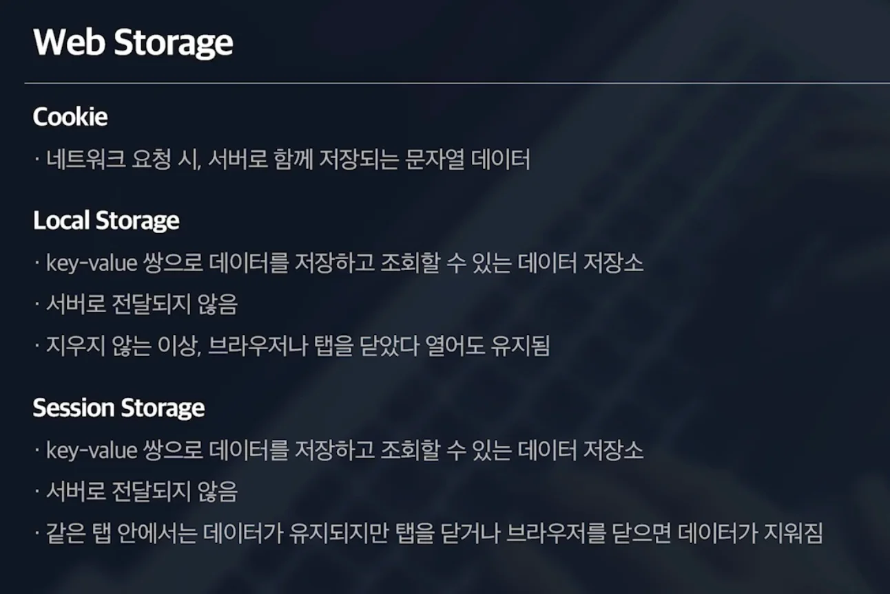
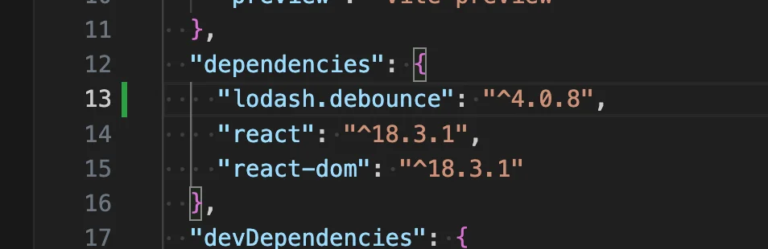
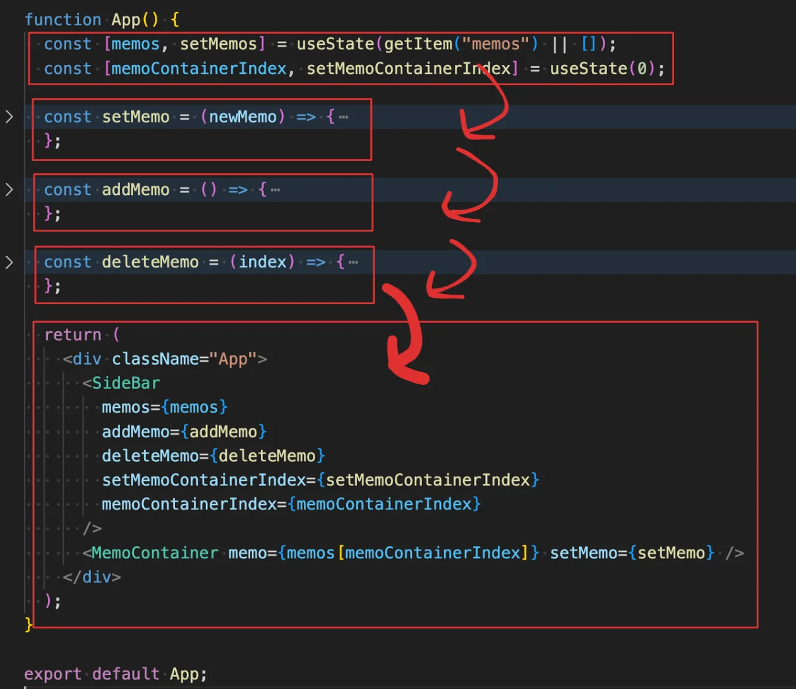
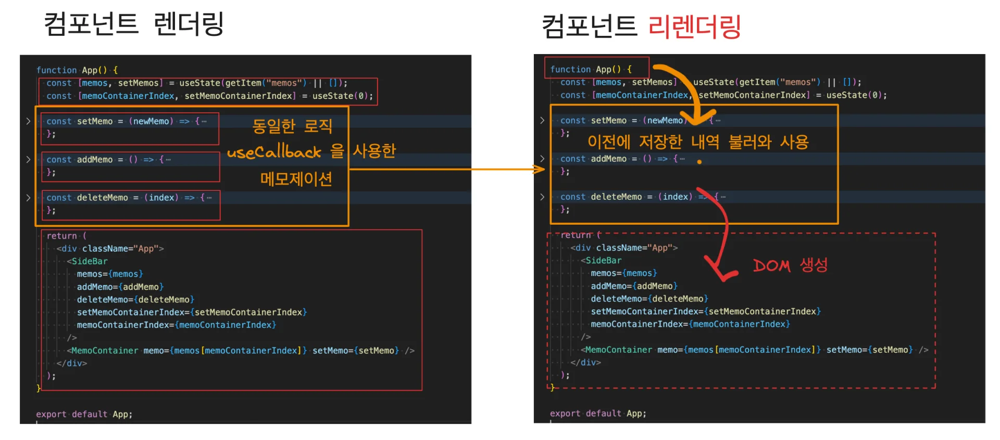

<a id="1c3eda9b0fe18112b06bd6faebfafdc5"></a>

## LocalStorage

<a id="1c3eda9b0fe18130a3adc8a5dd056d55"></a>

### Web Storage

---



<a id="1c3eda9b0fe1812ca42fe2b30c3bb6b2"></a>

브라우저를 닫아도 편집한 메모가 유지된다&#46;

- 캐싱

<a id="1c3eda9b0fe18163b549c5d5aa75610f"></a>

브라우저에는 크게 두개의 스토리지가 있다&#46;

<a id="1c3eda9b0fe18165bb1bce9ceb59944d"></a>

두 스토리지는 <code>key &#58; value</code> 형태로 데이터를 저장하고 조회할 수 있는 데이터 저장소이다&#46; 

- 로컬 스토리지

- 세션 스토리지

<a id="1c3eda9b0fe1816c962ae77827519e62"></a>

### 웹 스토리지 ( 로컬, 세션 )  탄생 배경 

---

<a id="1c3eda9b0fe1815390c2d6c5a9d6ccac"></a>

스토리지가 있기 이전에는 쿠키를 통해 데이터를 캐싱 했다&#46;

- 쿠키는 저장소이면서, 사용자의 활동 정보를 브라우저에 기록했다가 서버에 전달하는 역활로 쓰인다&#46;

<a id="1c3eda9b0fe181b7804ef793776b7b0d"></a>

쿠키는 모든 네트워크 요청마다 요청에 포함되어 서버로 전달되는데, 

<a id="1c3eda9b0fe18114809dd9fdd92b208c"></a>

이를 통해 로그인하면 생기는 <code>세션 ID </code>나, <code>Access token</code> 같은 사용자 정보를 쿠키에 저장했다가, 이를 서버에 전송할 요청에 담아 인가 처리를 한다&#46; 

<a id="1c3eda9b0fe181b2af3ff6a0feb827fb"></a>

그러나 쿠키는 <strong><u>모든 네트워크 요청에 포함</u></strong>되기 때문에, <strong><u>쿠기 많아</u></strong>지거나 <strong><u>네트워크 요청이 늘</u></strong>어나면 네트워크 요청에서 <strong><u>비효율</u></strong>이 발생하게 된다&#46; 

<a id="1c3eda9b0fe1819c9530fe3e014c60a2"></a>

그래서 이를 해결하기 위해 HTML5 스펙부터<code>웹 스토리지</code>  가 추가 되었다&#46; 

<a id="1c3eda9b0fe1817bbeadcb0148b67c13"></a>

그리고 이 웹 스토리지에 속한 것이 <code>local Storage</code> 와 <code>Session Storage </code>이다&#46; 

<a id="1c3eda9b0fe181f5becdf0e77d32ace9"></a>

이 둘은 네<strong><u>트워크 요청에 포함되지 않</u></strong>기 때문에 <strong><u>쿠키와 같은 비효율이 없다</u></strong>&#46; 

<a id="1c3eda9b0fe181f0b026d5b32271b140"></a>

### 로컬 스토리지, 세션 스토리지 차이점

---

<a id="1c3eda9b0fe181d1a2c9f3c50326f966"></a>

로컬 스토리지

- 한번 데이터를 저장해두면, 직접 지우지 않는 이상 브라우저나 탭을 닫았다 열어도 데이터가 유지된다&#46;

<a id="1c3eda9b0fe1814683c8c6ea03743163"></a>

세션 스토리지

- 같은 탭 안에서 데이터가 유지되지만, 탭이나 브라우저를 닫으면 데이터가 지워진다&#46; 
    - 현재의 세션에서만 데이터가 유지됨

<a id="1c3eda9b0fe181a8a110e9a42dba270b"></a>

### 로컬 스토리지 사용법

---

> <strong>로컬 스토리지 &#45; 저장, 조회</strong>

<a id="1c3eda9b0fe18104bbeae1f37695e10d"></a>

```javascript
// 저장(setter) - key : value
localstorage.setItem(key, value);

// 조회(getter)
localstorage.getItem(key);
```

> <strong>로컬 스토리지 &#45; Object 저장</strong>

<a id="1c3eda9b0fe18185bddec394438f04a4"></a>

로컬 스토리지는 기본적으로 <code>문자열</code>만 저장한다&#46; 

<a id="1c3eda9b0fe1819e8ef1f4a9f28860f3"></a>

따라서 Object(<code>rerference Type</code>)  형태를 스토리지에 저장하는 경우, <code>JSON&#46;straingfy</code>를 사용하여 저장한다&#46; 

> ✏️ 
> 
> - <code>JSON&#46;stringfy()</code>&#58; Object → String
> 
> - <code>JSON&#46;parse()</code>&#58;  String → Object

<details>
<summary>ex)</summary>

<a id="1c3eda9b0fe181d094e0fb90413ba5fc"></a>

```javascript
// JSON.stringfy를 통해, Object -> String 변환
localstorage.setItem('test', JSON.stringfy({'testKey':'testValue'}));

// 조회 - 문자열, 따라서 Object로 뱐환 필요
localstorage.getItem('test')
// 출력값: '{'testKey':'testValue'}' [ String ]

// JSON.parse: 문자열 -> Object
JSON.parse(localstorage.getItem('test'))
// 출력값: {'testKey':'testValue'}   [ Object ]
```

</details>

<a id="1c3eda9b0fe181038d42e0cf581d1d64"></a>

## 코드

---

> 📌 
> 
> <a id="1c3eda9b0fe1815da689f94ee4ccecea"></a>
> 
> 요구사항
> 
> <a id="1c3eda9b0fe181b9914dc483c54a415f"></a>
> 
> 이전에 작성했던 데이터를 새로고침이나 브라우저를 다시 열었다가 켰을 때, 데이터를 유지해야한다&#46;
> 
> - Local Storage를 사용하여 캐싱 처리 

<details>
<summary>github 코드</summary>

[project 1&#58; memo &#45; Local Storage를 통한 캐싱 · gyungsubLee/inflearn&#95;react&#95;prac&#64;a2b48b9]()

</details>

<a id="1c3eda9b0fe181d28b5afecce02a89d2"></a>

데이터(state)가 추가 되거나, 삭제되거나, 수정되는 경우 &#45; 로컬 스토리지에 저장 및 업데이트가 필요하다&#46;

<details>
<summary>&#91; 코드 &#93; App&#46;js</summary>

<a id="1c3eda9b0fe181969abec9e2a1bfebe8"></a>

```javascript
import "./App.css";
import MemoContainer from "./components/MemoContainer";
import SideBar from "./components/SideBar";
import { useState } from "react";
import { setItem, getItem } from "./lib/storage";

const time = new Date().getTime();

function App() {
  const [memos, setMemos] = useState(getItem("memos") || []);
  const [memoContainerIndex, setMemoContainerIndex] = useState(0);

  const setMemo = (newMemo) => {
    const newMemos = [...memos];
    newMemos[memoContainerIndex] = newMemo;

    setMemos(newMemos);
    setItem("memos", newMemos);
  };

  const addMemo = () => {
    const now = new Date().getTime();

    const newMemos = [
      ...memos,
      {
        title: "Untitled",
        content: "",
        createdAt: now,
        updatedAt: now,
      },
    ];

    setMemos(newMemos);
    setMemoContainerIndex(memos.length);
    setItem("memos", newMemos);
  };

  const deleteMemo = (index) => {
    const newMemos = [...memos];

    newMemos.splice(index, 1);

    setMemos(newMemos);

    if (index === memoContainerIndex) {
      setMemoContainerIndex(0);
    }

    setItem("memos", newMemos);
  };

  return (
    <div className="App">
      <SideBar
        memos={memos}
        addMemo={addMemo}
        deleteMemo={deleteMemo}
        setMemoContainerIndex={setMemoContainerIndex}
        memoContainerIndex={memoContainerIndex}
      />
      <MemoContainer memo={memos[memoContainerIndex]} setMemo={setMemo} />
    </div>
  );
}

export default App;
```

</details>

<details>
<summary>&#91; 코드 &#93; Storage&#46;js</summary>

<a id="1c3eda9b0fe1819b941be7296ec2283d"></a>

```javascript
export function setItem(key, value) {
  localStorage.setItem(key, JSON.stringify(value));
}

export function getItem(key) {
  return JSON.parse(localStorage.getItem(key));
}
```

</details>

---

<details>
<summary>Tip) <code>NullPointException</code>, <u>default 값 설정</u>을 통해 해결</summary>

<details>
<summary>🤬 오류 &#45; localstorage 에 값이 없는 경우 null 값이 들어가 <code>NullPointException</code>이 발생된다&#46; </summary>

<a id="1c3eda9b0fe181e98148c0cb4e585439"></a>

```
const defaultMemosData = JSON.parse(localStorage.getItem("memos"));

function App() {
  const [memos, setMemos] = useState(defaultMemosData);
  
  ...
```

</details>

<details>
<summary>👍🏻 해결 &#45; <code>&#124;&#124; &#91;&#93;</code></summary>

- <code>&#124;&#124;</code> 연산자 앞에 값이 null인 경우, false로 판단하여 뒤의 빈 배열<code>&#91;&#93;</code>이 할당된다&#46;
    <a id="1c3eda9b0fe1815daabee95831fc8d77"></a>

    ```javascript
     JSON.parse(localStorage.getItem("memos")) || [];
    ```

</details>

</details>

<a id="1c3eda9b0fe181638ee3d138543b0c3c"></a>

## 최적화 1) 디바운스

---

<details>
<summary>🤬 문제 상황</summary>

<a id="1c3eda9b0fe1818aa65bce21ea7b86f1"></a>

위  코드를 보면, 수정이 될때마다 매번 로컬 스토리지에 접근하여 데이터를 저장한다&#46; 

<a id="1c3eda9b0fe181b49915fd1686bf42a8"></a>

그러나 localstorage에 접근하여 데이터를 저장하는 작업은 비용을 꽤 소모하는 작업이다&#46; 

<a id="1c3eda9b0fe1817e980bf982db1a2f00"></a>

메모를 저장하는 코드를 보면, Input에 값이 입력될 때마다, state가 업데이트 되고 업데이트된 state를 포함하는 메모 list 전체가 매번 storage에 저장된다&#46; 

<details>
<summary>&#91; 코드 &#93; MemoContainer</summary>

<a id="1c3eda9b0fe181ad9ef9df5a0fdbf018"></a>

```javascript
import "./index.css";

const MemoContainer = ({ memo, setMemo }) => {
  if (memo === undefined) {
    return (
      <div>
        <h1>메모가 없습니다.</h1>
        <h2>메모를 추가해 주세요</h2>
      </div>
    );
  }

  return (
    <div className="MainContainer">
      <div>
        <input
          type="text"
          className="MainContainer__title"
          value={memo.title}
          onChange={(e) => {
            setMemo({
              ...memo,
              title: e.target.value,
              updatedAt: new Date().getTime(),
            });
          }}
        />
      </div>
      <div>
        <textarea
          className="MainContainer__content"
          value={memo.content}
          onChange={(e) => {
            setMemo({
              ...memo,
              content: e.target.value,
              updatedAt: new Date().getTime(),
            });
          }}
        />
      </div>
    </div>
  );
};

export default MemoContainer;

```

</details>

<a id="1c3eda9b0fe181969f6cd0ac3757e9bb"></a>

따라서 데이터가 입력될 수록 매번 setItem(<code>localstorage&#46;setItem()</code>)이 호출되고,<br>입력 데이터가 많아지면 많아질수록  로컬 스토리지에 데이터를 저장하는 작업이 계속해서 발생된다&#46; 

<a id="1c3eda9b0fe181f2ba0ce961446635c7"></a>

지금  작은 앱이라 성능상 이슈가 없지만,  앱이 커질 경우 해당 작업이 서버스 전체 성능에 영향을 줄 수 있다&#46;

</details>

<details>
<summary>👍🏻 해결 &#45; <strong><code>디바운스</code></strong> 기법 활용</summary>

<a id="1c3eda9b0fe181cda746d87dbe3160f2"></a>

그렇다면 이 setItem을 어떻게 최적화 할 수 있을까?

<a id="1c3eda9b0fe181079b41dcf5119a5278"></a>

여러가지 방법이 존재하겠지만, 그 중 하나는 <strong><u>여러번 실행 되었던 업데이트를 묶</u></strong>어서 나중에 <strong><u>한꺼번에 처리</u></strong>하는 것이다&#46;

<a id="1c3eda9b0fe1814fa6f0fafe62529e7e"></a>

이러한 기법을 <strong><code>디바운스</code></strong> 라고한다&#46; 

- ex) 
    <a id="1c3eda9b0fe181e598a5f891411de4d4"></a>

    사용자가 입력하는 순간 매번 업데이트를 하는 것이 아닌, 입력하는 멈추는 경우<br>예시로 <strong><u>3</u></strong><strong><u>초 정도 사용자가 멈춰 </u></strong><strong><u>있</u></strong>으면, 그때 입력 받은 데이터를 한꺼번에 저장한다&#46; 

</details>

---

<a id="1c3eda9b0fe18141a6eac11b6ab1c1f0"></a>

### 디바운스 라이브러리 &#45; <code>Lodash&#46;debounce</code>

---

<a id="1c3eda9b0fe181b3bab8d8e921c5f174"></a>

코드로 직접 구현할 수도 이지만, 시중에 디바운스 관련 라이브러리들이 존재한다&#46; 

<a id="1c3eda9b0fe181ec9cc4ff2aaa73f190"></a>

그 중, <code>Lodash</code> 라이브러리를 사용하여 해결한다&#46;

- Lodash에는 굉장히 많은 유틸 함수들이 있는데, 그 중에 디바운스 함수가 존재한다&#46; 
    [Lodash Documentation]()

<details>
<summary><code>lodash&#46;</code><strong><code>debounce</code></strong> 설치</summary>

<a id="1c3eda9b0fe181029740d76063b11f97"></a>

```bash
# i: install 약어
# --save: package.json에 설치 항목 명시
npm i --save lodash.debounce
```

> ☝🏻 
> 
> <a id="1c3eda9b0fe1819dac9af62c039e1a44"></a>
> 
> 협업의 경우, 라이브러리 설치 시  <code>—save</code> 옵션으로 해당 라이브러리 설치를 명시 해야한다&#46;
> 
> - 협업의 경우 save 옵션(<code>—save</code>)을 사용하여 설치하지 않으면, 다른 사람이 프로젝트를 다운 받아 의존성을 설치하는 경우 <u>해당 라이브러리 설치가</u><u> 누락</u><u>될 수 있</u>다&#46; 

<details>
<summary>package&#46;json 에서 설치 확인</summary>



</details>

</details>

<details>
<summary><strong>debouce 적용</strong></summary>

> ✏️ 
> 
> <a id="1c3eda9b0fe1814f9d44df6fc595c857"></a>
> 
> <code>debounce(setItem, 5000)</code> 
> 
> - 첫번째 인자가 두번째 인자로 설정한 시간 동안 조작이 없을 경우,  첫번쨰 인자 함수 실행
> 
> <details>
> <summary>즉, setItem이 명시된 함수(<code>setMemo</code>, <code>addMemo</code>, <code>deleteMemo</code> ) 가 5초 동안 동작을 하지 않는 경우, setItem이 실행되어 변경된 데이터가 저장됨</summary>
> 
> <a id="1c3eda9b0fe181bc953cda6bb275e9bf"></a>
> 
> ```bash
> const debounceSetItem = debounce(setItem, 5000);
> 
> 	 .  .  .
> 	 
>  const setMemo = (newMemo) => {
>     const newMemos = [...memos];
>     newMemos[memoContainerIndex] = newMemo;
> 
>     setMemos(newMemos);
>     debounceSetItem("memos", newMemos);
>   };
>   
>   const addMemo = () => {
>     const now = new Date().getTime();
> 
>     const newMemos = [
>       ...memos,
>       {
>         title: "Untitled",
>         content: "",
>         createdAt: now,
>         updatedAt: now,
>       },
>     ];
> 
>     setMemos(newMemos);
>     setMemoContainerIndex(memos.length);
>     debounceSetItem("memos", newMemos);
>   };
> 
>   const deleteMemo = (index) => {
>     const newMemos = [...memos];
> 
>     newMemos.splice(index, 1);
> 
>     setMemos(newMemos);
> 
>     if (index === memoContainerIndex) {
>       setMemoContainerIndex(0);
>     }
> 
>     debounceSetItem("memos", newMemos);
>   };
>    
>   . . .
> ```
> 
> </details>

<a id="1c3eda9b0fe18145b424ff3d84ee811c"></a>

```javascript
import "./App.css";
import MemoContainer from "./components/MemoContainer";
import SideBar from "./components/SideBar";
import { useState } from "react";
import { setItem, getItem } from "./lib/storage";
import debounce from "lodash.debounce";

const time = new Date().getTime();

const debounceSetItem = debounce(setItem, 5000);

function App() {
  const [memos, setMemos] = useState(getItem("memos") || []);
  const [memoContainerIndex, setMemoContainerIndex] = useState(0);

  const setMemo = (newMemo) => {
    const newMemos = [...memos];
    newMemos[memoContainerIndex] = newMemo;

    setMemos(newMemos);
    debounceSetItem("memos", newMemos);
  };

  const addMemo = () => {
    const now = new Date().getTime();

    const newMemos = [
      ...memos,
      {
        title: "Untitled",
        content: "",
        createdAt: now,
        updatedAt: now,
      },
    ];

    setMemos(newMemos);
    setMemoContainerIndex(memos.length);
    debounceSetItem("memos", newMemos);
  };

  const deleteMemo = (index) => {
    const newMemos = [...memos];

    newMemos.splice(index, 1);

    setMemos(newMemos);

    if (index === memoContainerIndex) {
      setMemoContainerIndex(0);
    }

    debounceSetItem("memos", newMemos);
  };

  return (
    <div className="App">
      <SideBar
        memos={memos}
        addMemo={addMemo}
        deleteMemo={deleteMemo}
        setMemoContainerIndex={setMemoContainerIndex}
        memoContainerIndex={memoContainerIndex}
      />
      <MemoContainer memo={memos[memoContainerIndex]} setMemo={setMemo} />
    </div>
  );
}

export default App;

```

</details>

<a id="1c3eda9b0fe1814f9c30c4ebeded8364"></a>

## 최적화 2) useCallback

---

<details>
<summary>🤬 문제 상황 &#45; 리렌더링 시, 동일한 코드 매번 생성됨</summary>

<a id="1c3eda9b0fe1811f81abd558e2b25a0a"></a>

App 컴포넌트가 이 렌더링 될 때, 내부 함수 로직을 차례대로 생성하고, DOM까지 렌더링한다&#46; 



<a id="1c3eda9b0fe1818b8d9ec489455d183d"></a>

<strong><u>state가 변경될 때</u></strong>마다, <u>리렌더링 시 해당 과정을 반복</u>한다&#46; 

<a id="1c3eda9b0fe18172adafc12d20f26113"></a>

연관없는 state 변경되어 리렌더링 시에도 매번 다시 함수를 생성하기 때문에 불필요한 낭비가 발생된다&#46; 

</details>

<details>
<summary>👍🏻 해결 &#45; useCallback를 사용한 메모제이션</summary>

---

<a id="1c3eda9b0fe181df8319db4b7cbf777c"></a>

<strong><u>변경된 state와 의존성이 없</u></strong><strong><u>는 함수도 매번 다시 생성</u></strong>하기 떄문에, 해당 함수를 <strong><u>useCallback</u></strong><strong><u>을 사용해 메모제이션</u></strong>하여 <strong><u>매번 다시 생성하지 않고 이전에 저장한 코드들을 불러와 최적화</u></strong> 할 수 있다&#46; 



</details>

<a id="1c3eda9b0fe1818d96a2ee869ba9e1e9"></a>

### 코드

<details>
<summary>1) useCallback 적용</summary>

<a id="1c3eda9b0fe181f9b903cead5f41dea3"></a>

```java
import "./App.css";
import MemoContainer from "./components/MemoContainer";
import SideBar from "./components/SideBar";
import { useCallback, useState } from "react";
import { setItem, getItem } from "./lib/storage";
import debounce from "lodash.debounce";

const time = new Date().getTime();

const debounceSetItem = debounce(setItem, 5000);

function App() {
  const [memos, setMemos] = useState(getItem("memos") || []);
  const [memoContainerIndex, setMemoContainerIndex] = useState(0);

  const setMemo = useCallback(
    (newMemo) => {
      const newMemos = [...memos];
      newMemos[memoContainerIndex] = newMemo;

      setMemos(newMemos);
      debounceSetItem("memos", newMemos);
    },
    [memos, memoContainerIndex]
  );

  const addMemo = useCallback(() => {
    const now = new Date().getTime();

    const newMemos = [
      ...memos,
      {
        title: "Untitled",
        content: "",
        createdAt: now,
        updatedAt: now,
      },
    ];

    setMemos(newMemos);
    setMemoContainerIndex(memos.length);
    debounceSetItem("memos", newMemos);
  }, [memos]);

  const deleteMemo = useCallback(
    (index) => {
      const newMemos = [...memos];

      newMemos.splice(index, 1);

      setMemos(newMemos);

      if (index === memoContainerIndex) {
        setMemoContainerIndex(0);
      }

      debounceSetItem("memos", newMemos);
    },
    [memos, memoContainerIndex]
  );

  return (
    <div className="App">
      <SideBar
        memos={memos}
        addMemo={addMemo}
        deleteMemo={deleteMemo}
        setMemoContainerIndex={setMemoContainerIndex}
        memoContainerIndex={memoContainerIndex}
      />
      <MemoContainer memo={memos[memoContainerIndex]} setMemo={setMemo} />
    </div>
  );
}

export default App;

```

</details>

<details>
<summary>⭐️ 2) <code>useState</code>의 <code>setter</code>의<u> state 자동 설정</u>을 활용하여  <u>dependency list(</u><u><code>&#91;&#93;</code></u><u>)</u>에 <strong><u>state 의존성 제거</u></strong>하기 </summary>

---

<details>
<summary><strong>🤬 문제 상황</strong><strong> &#45; useCallback 사용 시, </strong><strong><u>해당 컴포넌트에 정의된 state가 </u></strong><u>모두 dependency list</u><u>(</u><strong><u><code>&#91;&#93;</code></u></strong><u>)</u><u>에 포함</u><strong><u>되는 경우</u></strong><strong>, 오히려 </strong><strong><u>성능적인 이점이 없</u></strong><strong>이 </strong><strong><u>매번 메모제이션하는 비용만 추가</u></strong><strong>된다&#46;  </strong></summary>

- App&#46;js의 경우, 2개의 state만 사용하고 있다&#46; 
    - <code>memos</code>

    - <code>memoContainerIndex</code>

<a id="1c3eda9b0fe181b9a4e3fd30aeab63b8"></a>

아래의 코드의 경우, dependency list(<code>&#91;&#93;</code>)에 <code>memos</code>, <code>memoContainerIndex</code>가 의존성으로 추가되었고 두 state의 변경이 감지되는 경우, 해당 함수를 다시 생성한다&#46; 

<a id="1c3eda9b0fe181a19f59dde5f53f7c26"></a>

그러나 <strong><u>해당 컴포넌트에는 해당하는 2개의 state만 정의 되어있기 때문</u></strong>에 useCallback을 사용한 최적화와 사용하지 않을 시의 리렌더링 조건이 동일하다&#46; 

<a id="1c3eda9b0fe181759922ee42f81d30c4"></a>

따라서  오히려 매번 메모제이션하는 비용만 증가시킨다&#46;

<a id="1c3eda9b0fe181788acaf87970f8a6e9"></a>

```java
const setMemo = useCallback(
    (newMemo) => {
      const newMemos = [...memos];
      newMemos[memoContainerIndex] = newMemo;

      setMemos(newMemos);
      debounceSetItem("memos", newMemos);
    },
    [memos, memoContainerIndex]
  );
```

</details>

<details>
<summary>👍🏻 해결 &#45; setter함수 내부에 callback 함수 추가 및, 내부 state 변수를 정의</summary>

> ✏️ 
> 
> <a id="1c3eda9b0fe181f79269d558754dc1ad"></a>
> 
> <u><code>useState</code></u><u>의 </u><u><code>setter</code></u><u> 사용</u> 시, <u>첫번째 인자</u>로 <u><code>해당하는 state의 값</code></u>을 <u>react 내부에서 알아서 넣</u>어준다&#46;
> 
> <a id="1c3eda9b0fe181c3b81efbc0b3b382cc"></a>
> 
> ```java
> const [state, setState] = useState(0);
> 
> // 첫번쨰 인자의 명칭은 상관없음
> setState((state) => {
> 		 // state 조작
> });
> ```

<a id="1c3eda9b0fe18182bd5cf9f7ad5e97f8"></a>

setter함수 내부에 callback 함수 추가 및, 내부 state 변수를 정의하면 알아서 react에서 state를 넘기기 때문에 함수 내부에 state에 대한 의존성을 제거할 수 있다 

<a id="1c3eda9b0fe181e99c15eca914171abc"></a>

따라서 dependency list에도 state의 의존성을 제가할 수 있어, 위 문제를 해결할 수 있다&#46;

<a id="1c3eda9b0fe181f1a0f6e9d091090f06"></a>

```javascript
const setMemo = useCallback(
    (newMemo) => {
      setMemos((memos) => {
        const newMemos = [...memos];

        newMemos[memoContainerIndex] = newMemo;

        debounceSetItem("memos", newMemos);

        return newMemos;
      });
    },
    [memoContainerIndex]
  );
```

<details>
<summary>&#91; 전체 코드 &#93; App&#46;js</summary>

<a id="1c3eda9b0fe1811ca73ddfacaa99d922"></a>

```javascript
import "./App.css";
import MemoContainer from "./components/MemoContainer";
import SideBar from "./components/SideBar";
import { useCallback, useState } from "react";
import { setItem, getItem } from "./lib/storage";
import debounce from "lodash.debounce";


const debounceSetItem = debounce(setItem, 5000);

function App() {
  const [memos, setMemos] = useState(getItem("memos") || []);
  const [memoContainerIndex, setMemoContainerIndex] = useState(0);

  const setMemo = useCallback(
    (newMemo) => {
      setMemos((memos) => {
        const newMemos = [...memos];

        newMemos[memoContainerIndex] = newMemo;

        debounceSetItem("memos", newMemos);

        return newMemos;
      });
    },
    [memoContainerIndex]
  );

  const addMemo = useCallback(() => {
    setMemos((memos) => {
      const now = new Date().getTime();

      const newMemos = [
        ...memos,
        {
          title: "Untitled",
          content: "",
          createdAt: now,
          updatedAt: now,
        },
      ];

      debounceSetItem("memos", newMemos);

      return newMemos;
    });

    // index Setter 함수에 memos state를 사용하고 있어, 의존성을 제거할 수 없다.
    // 다른 state(memoContainerIndex)의 setter이기 때문에, memos state를 명시적으로 넣어줘야 한다. 
    setMemoContainerIndex(memos.length);
  }, [memos]);

  const deleteMemo = useCallback(
    (index) => {
      setMemos((memos) => {
        const newMemos = [...memos];

        newMemos.splice(index, 1);

        if (index === memoContainerIndex) {
          setMemoContainerIndex(0);
        } else {
          setMemoContainerIndex(memoContainerIndex - 1);
        }

        debounceSetItem("memos", newMemos);
        
        return newMemos;
      });
    },
    [memoContainerIndex]
  );

  return (
    <div className="App">
      <SideBar
        memos={memos}
        addMemo={addMemo}
        deleteMemo={deleteMemo}
        setMemoContainerIndex={setMemoContainerIndex}
        memoContainerIndex={memoContainerIndex}
      />
      <MemoContainer memo={memos[memoContainerIndex]} setMemo={setMemo} />
    </div>
  );
}

export default App;

```

</details>

</details>

</details>
