<a id="1c3eda9b0fe181429e2ef6810f2934b4"></a>

 

<details>
<summary>추가 자료</summary>

<a id="1c3eda9b0fe18144aa3dc0e558c0dc88"></a>

<a href="#/post/1c3eda9b-0fe1-8199-9d02-eeae5b4b5588">페이지</a> 

</details>

<a id="1c3eda9b0fe181c8a350fc5a4a5313ee"></a>

## MVC 디자인 패턴

<a id="1c3eda9b0fe1816daf83eb38750276e8"></a>

<a href="#/post/1c3eda9b-0fe1-8138-a969-d611d55902cd">페이지</a> 

> 📌 <strong>M</strong>odel <strong>V</strong>iew <strong>C</strong>ontroller 약자로, 소프트웨어 디자인 패턴 중 하나로<br>소프트웨어를 <strong>구성하는 요소들을</strong> <strong><code>Model</code></strong><strong>, </strong><strong><code>View</code></strong><strong>, </strong><strong><code>Controller</code></strong><strong>로 구분</strong>하여 각각의 <strong><u>역할을 분리</u></strong>한다&#46;
> 
> 

- <strong><code>컨트롤러</code></strong>&#58; <strong><u>HTTP 요청을 받</u></strong>아서 <strong><u>파라미터를 검증</u></strong>하고, <strong><u>비즈니스 로직을 실행 </u></strong>및 <strong><u>뷰에 전달할 결과 데이터를 조회해서 모델에 담</u></strong>는다&#46; 

- <strong><code>모델</code></strong>&#58; <strong><u>뷰에 출력할 데이터를 담</u></strong>아둔다&#46; 뷰가 필요한 데이터를 모두 모델에 담아서 전달해주는 덕분에 뷰는 비즈니스 로직이나 데이터 접근을 몰라도 되고, 화면을 렌더링 하는 일에 집중할 수 있다&#46;

- <strong><code>뷰</code></strong>&#58; <strong><u>모델에 담겨있는 데이터를 사용해서 화면을 그리</u></strong>는 일에 집중한다&#46; 여기서는 <strong>HTML을 생성</strong>하는 부분을 말한다
    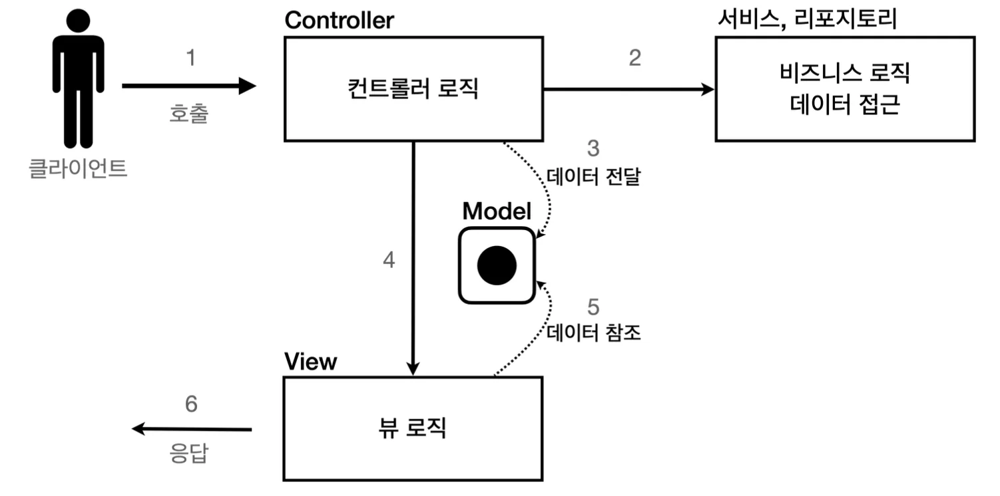

    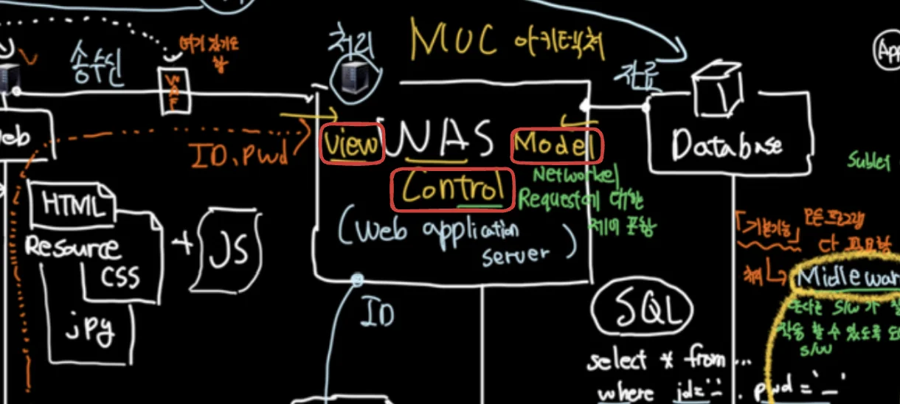

<a id="1c3eda9b0fe1813494a7dd367103189d"></a>

## Spring MVC

> Spring Web MVC는 Servlet API를 기반으로 구축된 독창적인 웹 프레임워크로, 처음부터 Spring Framework에 포함되어 왔으며, 정식 명칭인 &#34;Spring Web MVC&#34;는 소스 모듈(spring&#45;webmvc)의 이름에서 따왔으나,  &#34;Spring MVC&#34;로 더 일반적으로 알려져 있습니다&#46;<br>…
> 
> <a id="1c3eda9b0fe181c7b3f1f0c2ca9c57e0"></a>
> 
> Spring MVC는 중앙에 있는 DispatcherServlet이 요청을 처리하기 위한 공유 알고리즘을 제공하는 Front Controller 패턴을 중심으로 설계되어 있으며 이 모델은 유연하고 다양한 워크 플로우를 지원합니다&#46;
> 
> <a id="1c3eda9b0fe181338b60c4b1e422fbd2"></a>
> 
> <a href="https://docs.spring.io/spring-framework/reference/web/webmvc.html">https&#58;//docs&#46;spring&#46;io/spring&#45;framework/reference/web/webmvc&#46;html</a>

<a id="1c3eda9b0fe181599b39da8691c6057b"></a>

Spring에서 <strong><u>MVC 디자인 패턴</u></strong><strong><u>을 적용</u></strong>하여 <strong><u>Front Controller 패턴</u></strong><strong><u>으로 설계된 </u></strong><strong><u><code>DispatcherServlet</code></u></strong>을 통해 중앙에서 <strong><u>HTTP 요청을 효율적으로 처리</u></strong>한다&#46; 

<a id="1c3eda9b0fe1813fa75bf2c1d0a6dc59"></a>

### 서블릿

<details>
<summary>이전 정리 자료</summary>

<a id="1c3eda9b0fe181cf8f7ce1ceae548657"></a>

<a href="#/post/1c3eda9b-0fe1-812e-8a14-de0fd5f7ccbb">페이지</a> 

<details>
<summary><code>서블릿</code>이란?</summary>

> 📌 <strong>서블릿(Servlet)</strong>이란<strong><u> </u></strong><strong><u>동적 웹페이지를 만</u></strong>들 때 사용되는 자바 기반의 웹 애플리케이션 프로그래밍 기술이다&#46; <strong>서블릿은 웹 요청과 응답의 흐름</strong>을 <strong><u>간단한 메서드 호출</u></strong>만으로 체계적으로 다룰 수 있게 해준다&#46; 

<a id="1c3eda9b0fe1810db953c3a347aca327"></a>

### 특징

- 클라이언트의 Request에 대해 동적으로 작동하는 웹 어플리케이션 컴포넌트<br> →  기존의 정적 웹 프로그램의 문제점을 보완하여 동적인 여러 가지 기능을 제공한다&#46;

- Java Thread를 이용하여 동작

- MVC 패턴에서 Controller로 이용

<details>
<summary>HTTP 프로토콜 서비스를 지원하는 <code>jakarta&#46;servlet&#46;http </code>모듈 지원</summary>

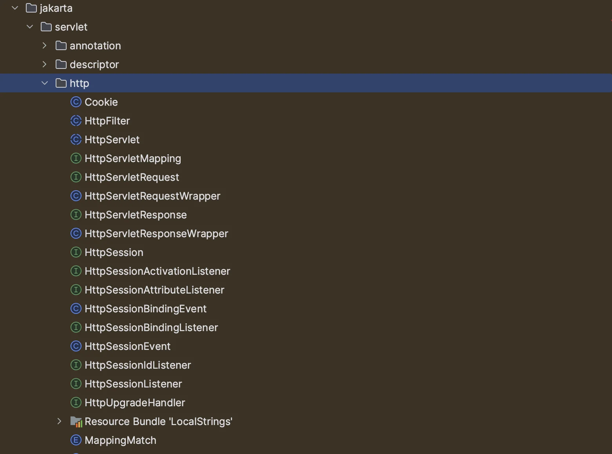

</details>

- UDP 보다 처리 속도가 느림

- HTML 변경 시 Servlet을 재컴파일해야 하는 단점이 있음

- 컨테이너에서 실행

- 보안 기능을 적용하기 쉽다&#46;

<a id="1c3eda9b0fe18169915bda05905d4f3a"></a>

###  서블릿 컨테이너 동작 방식 <br>

> 스프링부트에 생성되는 내장 톰켓 서버에서  서블릿을 생성

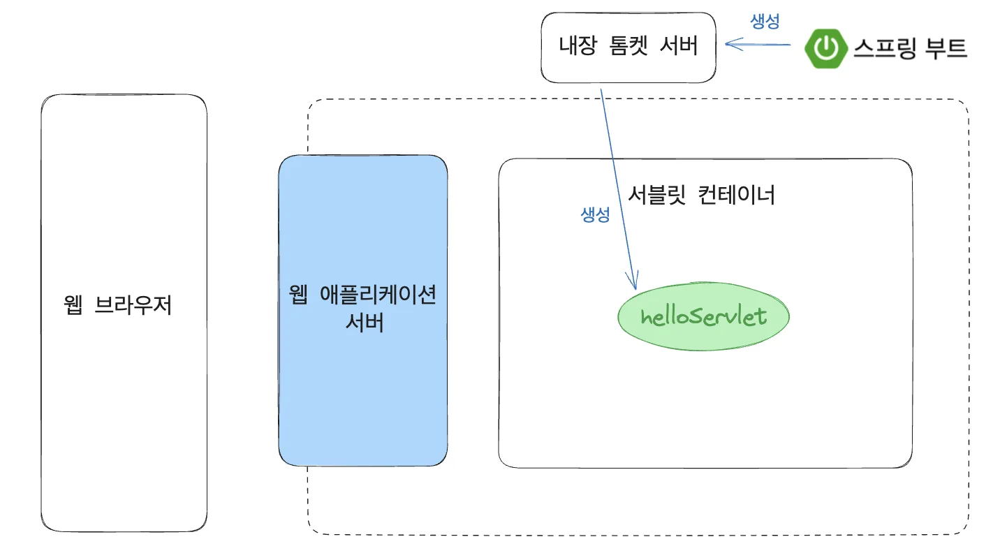

> HTTP 프로토콜을 지원하는 <code>HttpServlet</code> ( <code>request</code>, <code>response</code> ) 을 사용한 요청 응답 처리

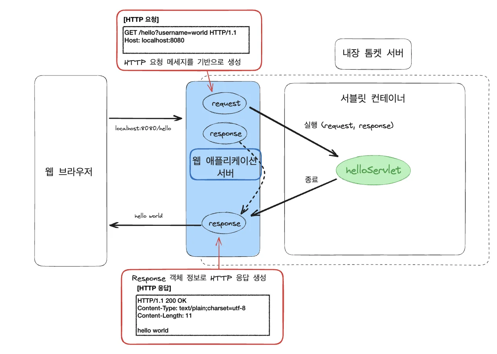

</details>

</details>

> 📌 <strong>Servlet (서블릿)</strong>은 자바를 사용하여 <strong><u>웹 페이지를 동적으로 생성</u></strong>하는 서버 측 프로그램 혹은 그 사양을 말한다&#46;

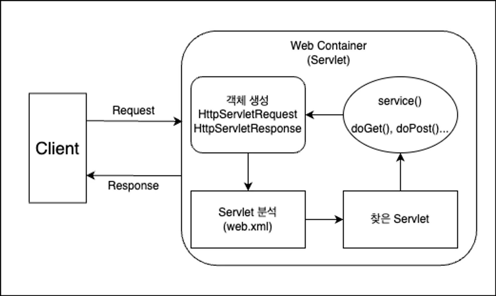

<details>
<summary><strong>동작 방식</strong></summary>

1. 사용자가 Client(브라우저)를 통해 서버에 HTTP Request 즉, API 요청을 한다&#46;

1. 요청을 받은 Servlet 컨테이너는 <code>HttpServletRequest</code>, <code>HttpServletResponse</code> 객체를 생성한다&#46;
    > • <code>HttpServletRequest</code>, <code>HttpServletResponse</code><br>약속된 HTTP의 규격을 맞추면서 쉽게 HTTP에 담긴 데이터를 사용하기 위한 객체

1. 설정된 정보를 통해 어떠한 Servlet에 대한 요청인지 찾는다&#46;

1. 해당 Servlet에서 service 메서드를 호출한 뒤 브라우저의 요청 Method에 따라 doGet 혹은 doPost 등의 메서드를 호출한다&#46;

1. 호출한 메서드들의 결과를 그대로 반환하거나 동적 페이지를 생성한 뒤 HttpServletResponse 객체에 응답을 담아 Client(브라우저)에 반환한다&#46;

1. 응답이 완료되면 생성한 HttpServletRequest, HttpServletResponse 객체가 소멸된다&#46;

</details>

<a id="1c3eda9b0fe181178a7ef08a3bcdce05"></a>

## Front Controller

<details>
<summary>추가 자료<br><a href="#/post/1c3eda9b-0fe1-8138-a969-d611d55902cd">페이지</a> </summary>

<details>
<summary>프론트 컨트롤러 패턴 </summary>

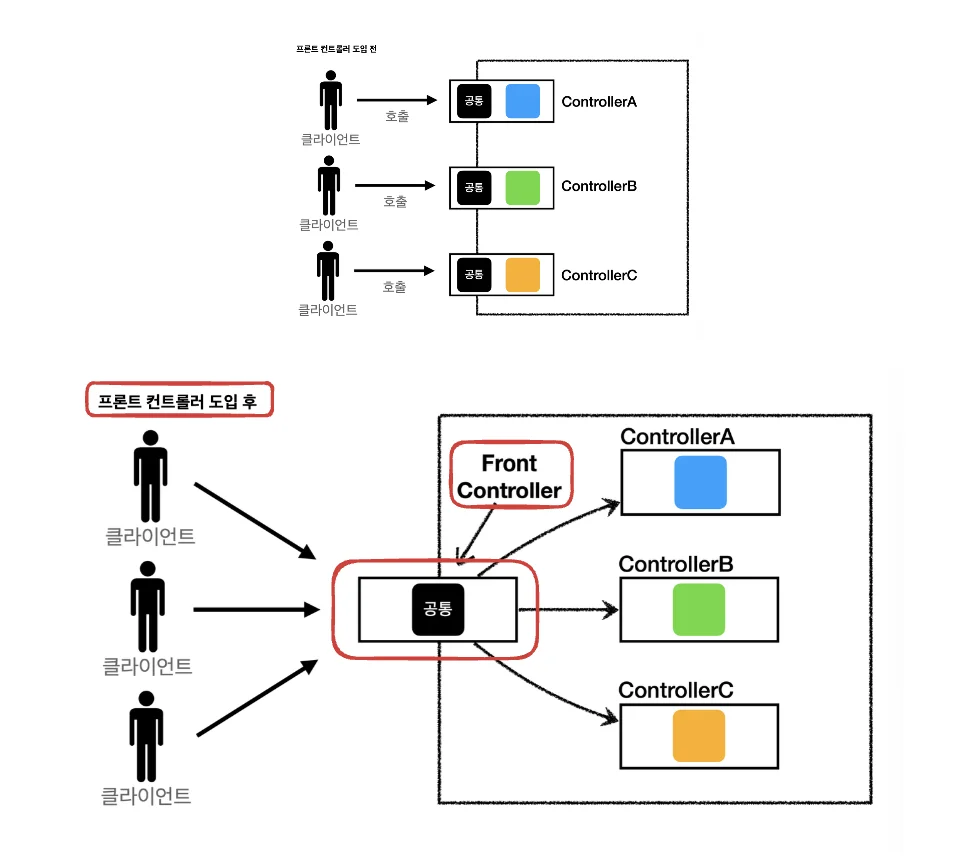

<a id="1c3eda9b0fe181e1aa45cac299fa2d27"></a>

### FrontController 패턴 특징

- <strong>프론트 컨트롤러 서블릿 하나로 클라이언트 요청을 받음</strong>

- <strong>프론트 컨트롤러가 요청에 맞는 컨트롤러를 찾아서 호출</strong>
    - 입구(프론트 컨트롤러) 하나로 공통 처리 가능 따라서 프론트 컨트톨러를 제외한 <strong><u>나머지 컨트롤러</u></strong>는 <strong><u>서블릿을 사용하지 않아도 됨<br></u></strong>

> /icons/cursor-button_blue.svg 스프링 웹 MVC의 핵심도 바로 <strong><u>프론트 컨트롤러 패턴</u></strong>이다&#46; <br>스프링 웹 MVC의 <strong><code>DispatcherServlet</code></strong>이 <strong><u>프론트 컨트롤러 패턴</u></strong>으로 구현되어 있다&#46;

</details>

</details>

> 📌 Spring은 <code>DispatcherServlet</code>을 사용하여<strong> Front Controller 패턴 방식</strong>으로 API 요청을 효율적으로 처리한다&#46;

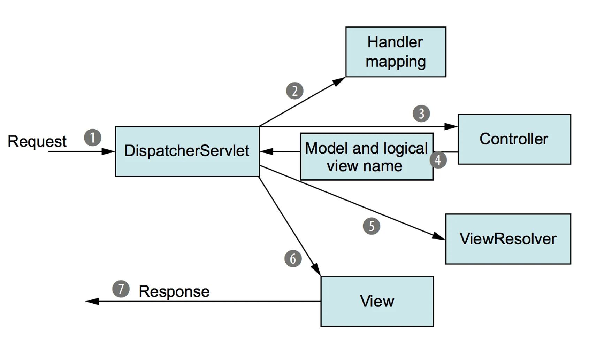

1. <strong>Client(브라우저)</strong>에서 <strong>HTTP 요청</strong>이 들어오면 <strong>DispatcherServlet</strong> 객체가 요청을 분석함<br>

1. <strong>DispatcherServlet</strong> 객체는 분석한 데이터를 토대로 <strong>Handler mapping</strong>을 통해 <strong>Controller</strong>를 찾아 요청을 전달함
    <a id="1c3eda9b0fe1811cbb6acc043f11bf97"></a>

    ```java
     // [Sample]
    GET /api/hello → HelloController 의 hello() 함수
    GET /user/login → UserController 의 login() 함수
    GET /user/signup → UserController 의 signup() 함수
    POST /user/signup → UserController 의 registerUser() 함수
    ```

    <a id="1c3eda9b0fe18166bedacf1d4d81db72"></a>

    ```java
    // Handler mapping: API pat, Controller 메서드 매칭
    @RestController
    public class HelloController {
        @GetMapping("/api/hello")
        public String hello() {
            return "Hello World!";
        }
    }
    ```

1. <strong>Controller</strong> → <strong>DispathcerServlet</strong>
    <a id="1c3eda9b0fe181569d41e1b07be87816"></a>

    해당 Controller는 요청에 대한 처리를 완료 후 처리에 대한 결과 즉, 데이터(&#39;<strong>Model</strong>&#39;)와 &#39;<strong>View&#39; 정보</strong>를 전달함

1. <strong>DispatcherServlet</strong> → <strong>Client</strong>
    <a id="1c3eda9b0fe1811f873eed3e8130c002"></a>

    ViewResolver 통해 View에 Model을 적용하여 View를 Client에게 응답으로 전달함

<a id="1c3eda9b0fe181af9b5acfd6f31981c1"></a>

## Controller

<a id="1c3eda9b0fe1812496dbd32a513eaddc"></a>

### 실습) 

[로그인 페이지](#/post/1c3eda9b-0fe1-81e0-ba03-d32ac071c265)

[로그아웃 처리](#/post/1c3eda9b-0fe1-81c0-ae64-ecab21d8c285)

[회원 가입 페이지](#/post/1c3eda9b-0fe1-816d-9c03-d108261feec6)

[회원 가입 처리](#/post/1c3eda9b-0fe1-81d8-bb98-e64438d19970)

<details>
<summary>🧐 Front Controller가 적용되지 않은 경우 </summary>

<a id="1c3eda9b0fe181db89fbc601272f73c8"></a>

아래와 같이 4개의 API를 처리하기 위해 3개의 클래스를 만들어야 한다&#46; 

<a id="1c3eda9b0fe181d7a07dce2a2b816642"></a>

```java
@WebServlet(urlPatterns = "/user/login")
public class UserLoginServlet extends HttpServlet {
	@Override
  protected void doGet(HttpServletRequest request, HttpServletResponse response) {
		// ... 
	}
}
```

<a id="1c3eda9b0fe18140a3d6f305b5946db1"></a>

```java
@WebServlet(urlPatterns = "/user/logout")
public class UserLogoutServlet extends HttpServlet {
	@Override
  protected void doGet(HttpServletRequest request, HttpServletResponse response) {
		// ... 
	}
}
```

<a id="1c3eda9b0fe1810e8efdcbc4bc710caf"></a>

```java
@WebServlet(urlPatterns = "/user/signup")
public class UserSingUpServlet extends HttpServlet {
	@Override
  protected void doGet(HttpServletRequest request, HttpServletResponse response) {
		// ... 
	}

	@Override
  protected void doPost(HttpServletRequest request, HttpServletResponse response) {
		// ... 
	}

}
```

</details>

<a id="1c3eda9b0fe18181bf97c4d1e45102fc"></a>

아래와 같이 <strong>Front Controller 패턴</strong>을 사용하여<u> </u><strong><u>하나의 Contoller 클래스로 매핑</u></strong><strong> </strong>가능하다&#46; 

> ☝🏻 보통 하나의 Contoller 에 모든 API를 넣지는 않는다<br><strong><u>유사한 성격의 API들</u></strong>끼리 묶어서 <strong><u>하나의 Controller로 관리</u></strong>한다&#46; 

<a id="1c3eda9b0fe181918524c2524f046420"></a>

```java
@Controller
@RequestMapping("/user")
public class UserController {
	@GetMapping("/login")
	public String login() {
	    return "login";
	}

  @GetMapping("/logout")
  public String logout() {
      return "redirect::/"
  }

	@GetMapping("/signup")
	public String signup() { 
		return "signup";
	}
	
	@PostMapping("/signup")
  public String registerUser(SignupRequestDto requestDto) {
		return "redirect::/"
	}
}
```

<a id="1c3eda9b0fe18106ae11d20cc2e41617"></a>

### Controller

> 📌 <code>&#64;Contoller</code> Anotation을 통해 스프링 컨테이너가 해당 빈을 Controller로 등록시킨다&#46; 

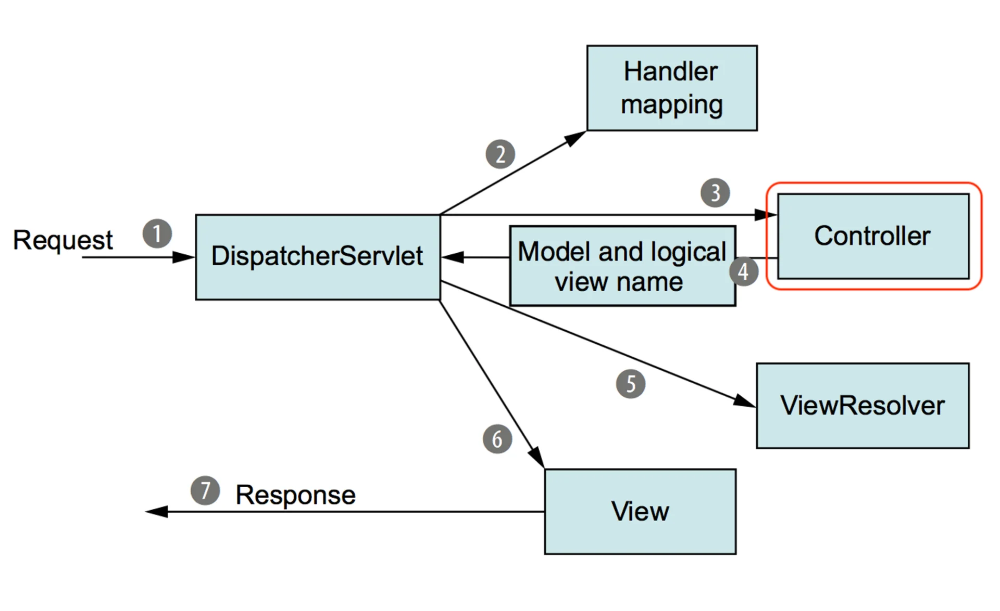

<a id="1c3eda9b0fe18142bbe6dd425b334b94"></a>

```java
@Controller
public class HelloController {
    @GetMapping("/api/hello")
    @ResponseBody
    public String hello() {
        return "Hello World!";
    }
}
```

<a id="1c3eda9b0fe181ff81dcf9e07902a320"></a>

<br>

<a id="1c3eda9b0fe1812ab97defba798af6b1"></a>

### <code>&#64;GET</code>, <code>&#64;POST</code>, <code>&#64;PUT</code>, <code>&#64;DELETE</code>

> 📌 각각의 HTTP Method에 매핑되는 Anotation이다&#46;

- <code>&#64;GET</code>
    <a id="1c3eda9b0fe18107b7b4e05e16e769d9"></a>

    ```java
    @GetMapping("/api/get")
    @ResponseBody
    public String get() {
        return "GET Method 요청";
    }
    ```

- <code>&#64;POST</code>
    <a id="1c3eda9b0fe181e08de5c77c8da7efe1"></a>

    ```java
    @PostMapping("/api/post")
    @ResponseBody
    public String post() {
        return "POST Method 요청";
    }
    ```

- <code>&#64;PUT</code>
    <a id="1c3eda9b0fe18167ac9ef9463ec9251a"></a>

    ```java
    @PutMapping("/api/put")
    @ResponseBody
    public String put() {
        return "PUT Method 요청";
    }
    ```

- <code>&#64;DELETE</code>
    <a id="1c3eda9b0fe1818a94a7e9bfa02ce301"></a>

    ```java
    @DeleteMapping("/api/delet")
    @ResponseBody
    public String delete() {
        return "DELETe Method 요청";
    }
    ```

<a id="1c3eda9b0fe181808d9cf587039d1267"></a>

### <code>&#64;RequestMapping</code>

> 📌 중복되는 URL 단축

<a id="1c3eda9b0fe181fcb61bc13fa37dcb77"></a>

```java
@Controller
@RequestMapping("/api")
public class HelloController {
    @GetMapping("/hello")
    @ResponseBody
    public String hello() {
        return "Hello World!";
    }

    @GetMapping("/get")
    @ResponseBody
    public String get() {
        return "GET Method 요청";
    }

    @PostMapping("/post")
    @ResponseBody
    public String post() {
        return "POST Method 요청";
    }

    @PutMapping("/put")
    @ResponseBody
    public String put() {
        return "PUT Method 요청";
    }

    @DeleteMapping("/delete")
    @ResponseBody
    public String delete() {
        return "DELETE Method 요청";
    }
}
```

<a id="1c3eda9b0fe181c183eae1e4a473fab7"></a>

## 정적 페이지와 동적 페이지

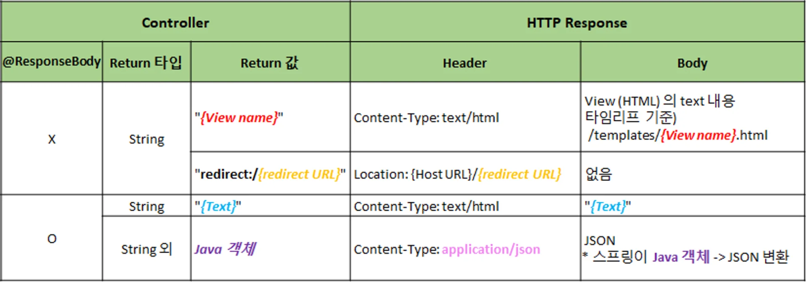

<a id="1c3eda9b0fe1819aa586c9fe7baf8c69"></a>

### 정적페이지

> 🔗 http&#58;//localhost&#58;8080<strong>/hello&#46;html</strong>

> 📂 /resources/static<strong>/hello&#46;html</strong>
> 
> 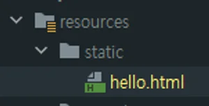
> 
> <details>
> <summary><strong>&#91;코드 스니펫&#93; /static/hello&#46;html</strong></summary>
> 
> <a id="1c3eda9b0fe181c9816ed7062cea9a1a"></a>
> 
> ```html
> <!DOCTYPE html>
> <html>
> <head>
>     <meta charset="UTF-8">
>     <title>Hello Spring</title>
> </head>
> <body>
> Hello, Spring 정적 웹 페이지!! (static)
> </body>
> </html>
> ```
> 
> </details>

<a id="1c3eda9b0fe1813fafa4f64697a37a67"></a>

SpringBoot 서버에서 html 파일을 요청 시 해다아 파일을 static 폴더에서 찾아 반환한다&#46;

> Controller를 통해 반환할 수있지만 Controller 동적 매핑을 하기 위해 사용하는 것이기 때문에 <br>굳이 이미 완성된 정적 html은 controller를 거쳐 반환할 필요가 없다&#46; 

<details>
<summary>🤔 Controller를 통한 반환 테스트</summary>

- <code>implementation &#39;org&#46;springframework&#46;boot&#58;spring&#45;boot&#45;starter&#45;thymeleaf’</code> 해당 dependency를 주석 처리
    > <code>thymeleaf</code> 는 동적 페이지 처리를 위한 템플릿 엔진이다&#46; &#46; 추가하면 자동으로 Controller에서 html 파일 찾는 경로를<code>/resources/templates</code> 로 설정한다&#46;

    <a id="1c3eda9b0fe181529369d1caf00ade82"></a>

    ```java
    @GetMapping("/static-hello")
    public String hello() {
        return "hello.html";
    }
    ```

    <a id="1c3eda9b0fe18139a36ef557369e08f1"></a>

    주석 처리한 후 <code>&#34;hello&#46;html&#34;</code> 이렇게 문자열로 반환하면 static 폴더의 해당 html 파일을 찾아 반환한다&#46;

</details>

<a id="1c3eda9b0fe18176a048e97d30bd632b"></a>

### 동적페이지<br>

> 🔗 http&#58;//localhost&#58;8080<strong>/html/dynamic</strong>

<details>
<summary><strong>/templates/hello&#45;visit&#46;html</strong></summary>

<a id="1c3eda9b0fe18171b458dbd4238b4d34"></a>

```html
<!DOCTYPE html>
<html>
<head><meta charset="UTF-8"><title>Hello Spring</title></head>
<body>
  <div>
    Hello, Spring 동적 웹 페이지!!
  </div>
  <div>
    (방문자 수: <span th:text="${visits}"></span>)
  </div>
</body>
</html>
```

</details>

<details>
<summary><strong>HtmlController</strong></summary>

<a id="1c3eda9b0fe181b4a9e3d9bb83ac2e7b"></a>

```java
package com.sparta.springmvc.html;

import org.springframework.stereotype.Controller;
import org.springframework.ui.Model;
import org.springframework.web.bind.annotation.GetMapping;

@Controller
public class HtmlController {

    private static long visitCount = 0;

    @GetMapping("/static-hello")
    public String hello() {
        return "hello.html";
    }

    @GetMapping("/html/redirect")
    public String htmlStatic() {
        return "redirect:/hello.html";
    }

    @GetMapping("/html/templates")
    public String htmlTemplates() {
        return "hello";
    }

    @GetMapping("/html/dynamic")
    public String htmlDynamic(Model model) {
        visitCount++;
        model.addAttribute("visits", visitCount);
        return "hello-visit";
    }
}
```

</details>

<a id="1c3eda9b0fe181b996c8d6299aef4d77"></a>

```java
private static long visitCount = 0;

...

@GetMapping("/html/dynamic")
public String htmlDynamic(Model model) {
    visitCount++;
    model.addAttribute("visits", visitCount);
    return "hello-visit";
}
```

- <strong>동적 페이지 처리 과정</strong>
    1. Client 의 요청을 <strong>Controller</strong>에서 <strong>Model</strong> 로 처리합니다&#46;
        1. DB 조회가 필요하다면 DB 작업 후 처리한 데이터를 <strong>Model</strong>에 저장합니다&#46;

    1. Template engine(Thymeleaf) 에게 <strong>View</strong>, <strong>Model </strong>전달합니다&#46;
        1. <strong>View</strong>&#58; 동적 HTML 파일

        1. <strong>Model</strong>&#58; View 에 적용할 정보들

    1. Template engine
        1. <strong>View</strong>에 <strong>Model</strong>을 적용 → 동적 웹페이지 생성
            1. 예) 로그인 성공 시, &#34;로그인된 사용자의 Nickname&#34;을 페이지에 추가

            1. Template engine 종류&#58; 타임리프(Thymeleaf), Groovy, FreeMarker, Jade, JSP 등

    1. Client(브라우저)에게 <strong>View</strong>(동적 웹 페이지, HTML)를 전달 해줍니다&#46;

<details>
<summary>Thymeleaf</summary>

<details>
<summary>view 정보</summary>

> &#34;hello&#45;visit&#34; → resources<strong>/templates/</strong>hello&#45;visit<strong>&#46;html</strong>

<a id="1c3eda9b0fe18160b51de2043ca27b9f"></a>

```html
<div>
  (방문자 수: <span th:text="${visits}"></span>)
</div>
```

</details>

<details>
<summary>Model 정보</summary>

> <strong>visits</strong>&#58; 방문 횟수 (visitCount)

- 예) 방문 횟수&#58; <strong>1,000,000</strong> 번

<a id="1c3eda9b0fe181b1936fc691cdb8a361"></a>

```html
<div>
  (방문자 수: <span>1000000</span>)
</div>
```

</details>

</details>

<a id="1c3eda9b0fe1817b9aaed005a4ece97c"></a>

##  데이터를 Client에 반환하는 방법

<a id="1c3eda9b0fe181c89192e08ab78aa610"></a>

### Responce 트렌드 변화

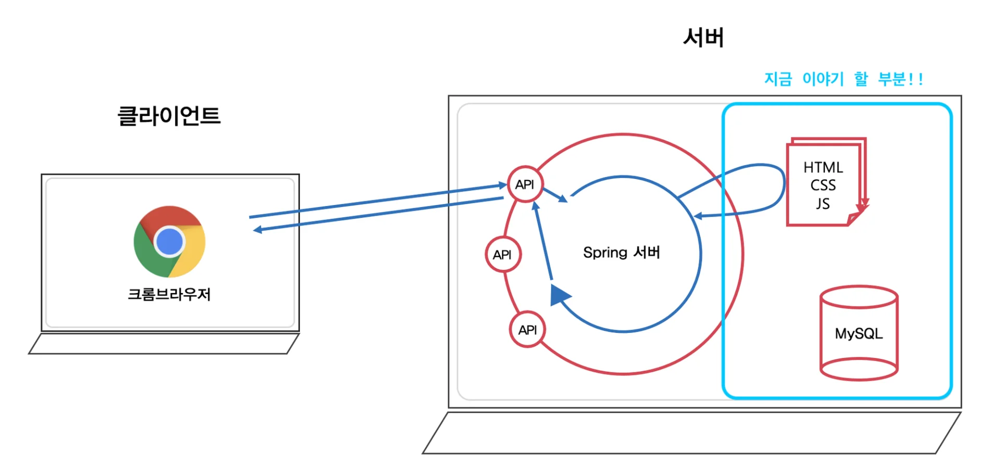

> 🧐 상대적으로 프론트엔드와 백엔드가 각각 따로 발전하게 되면서, 느슨하게 결합하는 방식을 더 많이 채택하게 되었고, 최근에는 서버가 직접 뷰(html/css/js)를 반환하기 보다는 요청에 맞는 특정한 정보만 반환하는 것을 더 선호한다&#46; <br>그래서 요즘은 서버에서는 데이터 교환 포맷 중<strong> </strong><strong><u><code>JSON 형태</code></u></strong>로 데이터를 반환하기도 한다&#46; 
> 
> 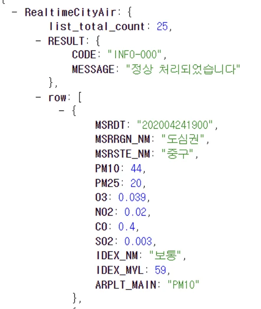

<a id="1c3eda9b0fe1815ba0a0f01b431fbbbf"></a>

### JSON 데이터 반환 방법

> 🔑 &#64;ResponceBody&#58; 

<details>
<summary>반환값&#58; <strong><code>String</code></strong></summary>

> 🔗 http&#58;//localhost&#58;8080<strong>/response/json/string</strong>

> <strong>Java</strong>는 <strong><u>JSON 타입을 지원하지 않</u></strong>기 때문에 JSON 형태의 <strong>String 타입으로 변환</strong>해서 사용

<a id="1c3eda9b0fe181988876c5b6bf26c03c"></a>

```java
@GetMapping("/json/string")
@ResponseBody
public String helloStringJson() {
    return "{\"name\":\"Robbie\",\"age\":95}";
}
```

</details>

<details>
<summary>반환값&#58;  <strong><code>클래스</code></strong></summary>

> 🔗 http&#58;//localhost&#58;8080<strong>/response/json/class</strong>

> <strong>자바 객체</strong> → <strong><code>JSON</code></strong><strong><br></strong>Spring에서 자동으로 Java의 객체를 JSON으로 변환해준다&#46;

<a id="1c3eda9b0fe1812ebf05ea268039ba8d"></a>

```java
@GetMapping("/response/json/class")
@ResponseBody
public Star helloClassJson() {

		// Spring에서 자동으로 Java의 객체를 JSON으로 변환해준다.
    return new Star("Robbie", 95);
}
```

<details>
<summary><strong>Star&#46;java</strong></summary>

<a id="1c3eda9b0fe181f9b56cda74457bc901"></a>

```java
package com.sparta.springmvc.response;

import lombok.Getter;

@Getter
public class Star {
    String name;
    int age;

    public Star(String name, int age) {
        this.name = name;
        this.age = age;
    }

    public Star() {}
}
```

</details>

<details>
<summary><strong>ResponseController&#46;java</strong></summary>

<a id="1c3eda9b0fe18172a957eedfb6466294"></a>

```java
package com.sparta.springmvc.response;

import org.springframework.stereotype.Controller;
import org.springframework.web.bind.annotation.GetMapping;
import org.springframework.web.bind.annotation.RequestMapping;
import org.springframework.web.bind.annotation.ResponseBody;

@Controller
@RequestMapping("/response")
public class ResponseController {
    // [Response header]
    //   Content-Type: text/html
    // [Response body]
    //   {"name":"Robbie","age":95}
    @GetMapping("/json/string")
    @ResponseBody
    public String helloStringJson() {
        return "{\"name\":\"Robbie\",\"age\":95}";
    }

    // [Response header]
    //   Content-Type: application/json
    // [Response body]
    //   {"name":"Robbie","age":95}
    @GetMapping("/json/class")
    @ResponseBody
    public Star helloClassJson() {
        return new Star("Robbie", 95);
    }
}
```

</details>

</details>

<a id="1c3eda9b0fe181ccb566e40e55c99c0b"></a>

### <code>&#64;RestController</code>

> 📌 <code>&#64;Controller</code> &#43; <code>&#64;ResponseBody</code>
> 
> <a id="1c3eda9b0fe181539ea4d69478cf88c6"></a>
> 
> <code>&#64;RestController</code>를 사용하면 해당 클래스의 모든 메서드에 <code>&#64;ResponseBody</code> anotation이 추가되는 효과를 부여할 수 있다&#46; 

<details>
<summary><strong>ResponseRestController&#46;java</strong></summary>

<a id="1c3eda9b0fe181f48790ca4c201c8ccd"></a>

```java
package com.sparta.springmvc.response;

import org.springframework.web.bind.annotation.GetMapping;
import org.springframework.web.bind.annotation.RequestMapping;
import org.springframework.web.bind.annotation.RestController;

@RestController
@RequestMapping("/response/rest")
public class ResponseRestController {
    // [Response header]
    //   Content-Type: text/html
    // [Response body]
    //   {"name":"Robbie","age":95}
    @GetMapping("/json/string")
    public String helloStringJson() {
        return "{\"name\":\"Robbie\",\"age\":95}";
    }

    // [Response header]
    //   Content-Type: application/json
    // [Response body]
    //   {"name":"Robbie","age":95}
    @GetMapping("/json/class")
    public Star helloClassJson() {
        return new Star("Robbie", 95);
    }
}
```

</details>

<a id="1c3eda9b0fe181188a55c6dbbd6cf528"></a>

## Jackson 

> ☝🏻 <strong>Jackson</strong>은 <u><code>JSON</code></u><u> 데이터 구조를 처리</u>해주는 라이브러리이다&#46;
> 
> - Object  → <code>JSON</code> 타입의 String
> 
> - <code>JSON</code> 타입의 String → Object

<a id="1c3eda9b0fe181d78c11d100744962d3"></a>

Spring은 3&#46;0 버전 이후로 <code>Jackson</code> 과 관련된 API를 제공한다&#46;<br>따라서 직접 소스 코드를 작성하여 JSON 데이터를 처리하지 않아도 자동으로 처리 해준다&#46; 

<a id="1c3eda9b0fe181558517f6cea2d9307e"></a>

SpringBoot의 <code>starter&#45;web</code>에서는 default로 Jackson 관련 라이브러리들을 제공하고 있다&#46;

<a id="1c3eda9b0fe18134bb47de4f8035cd46"></a>

직접 <code>JSON</code> 데이터를 처리해야할 때는 Jackson 라이브러리의 <strong><code>ObjectMapper</code></strong>를 사용할 수 있다&#46;

<a id="1c3eda9b0fe1811eb99ed68450f3fdde"></a>

### 객체 → JSON(string)

<a id="1c3eda9b0fe1816293fbedd6835bf5d4"></a>

```java
// 1. ObjectMapper 객체 생성
ObjectMapper objectMapper = new ObjectMapper();

// 2. writeValueAsString(Object): 객체 -> string(JSON)
objectMapper.writeValueAsString()
```

> <strong>Object</strong>를  <code>JSON</code> 타입의 <strong>String</strong>으로 변환하기 위해서는 해당 Object에 get Method가 필요함

<details>
<summary>ex) JSON To Object<br></summary>

<a id="1c3eda9b0fe18186b433f398490d8a44"></a>

```java
@Test
@DisplayName("JSON To Object : 기본 생성자 & (get OR set) Method 필요")
void test2() throws JsonProcessingException {
    String json = "{\"name\":\"Robbie\",\"age\":95}"; // JSON 타입의 String

    ObjectMapper objectMapper = new ObjectMapper(); // Jackson 라이브러리의 ObjectMapper

    Star star = objectMapper.readValue(json, Star.class);
    System.out.println("star.getName() = " + star.getName());
}
```

</details>

<a id="1c3eda9b0fe1817f8ee0fca83b4893cd"></a>

###  JSON(string) → 객체 

<a id="1c3eda9b0fe181a7bb48eb56d38b80e0"></a>

```java
// 1. ObjectMapper 객체 생성
ObjectMapper objectMapper = new ObjectMapper(); 

// 2. readValue(json, Object): string(JSON) -> 객체 
Star star = objectMapper.readValue(json, Star.class);
```

> <code>JSON</code> 타입의 <strong>String</strong>을 <strong>Object</strong>로 변환하기 위해서는 <u>해당 </u><strong><u>Objec</u></strong><strong><u>t</u></strong><u>에 </u><strong><u>기본 생성자</u></strong><u>와 </u><strong><u>getter</u></strong><strong><u> </u></strong><u>or </u><strong><u>sette</u></strong><strong><u>r</u></strong>가 필요

<details>
<summary>ex) JSON To Object</summary>

<a id="1c3eda9b0fe181c5a4eac824c1ed906c"></a>

```java
@Test
@DisplayName("JSON To Object : 기본 생성자 & (get OR set) Method 필요")
void test2() throws JsonProcessingException {
    String json = "{\"name\":\"Robbie\",\"age\":95}"; // JSON 타입의 String

    ObjectMapper objectMapper = new ObjectMapper(); // Jackson 라이브러리의 ObjectMapper

    Star star = objectMapper.readValue(json, Star.class);
    System.out.println("star.getName() = " + star.getName());
}
```

</details>

<a id="1c3eda9b0fe1818eb52bea6abc4c6552"></a>

## Path Variable과 Request Param

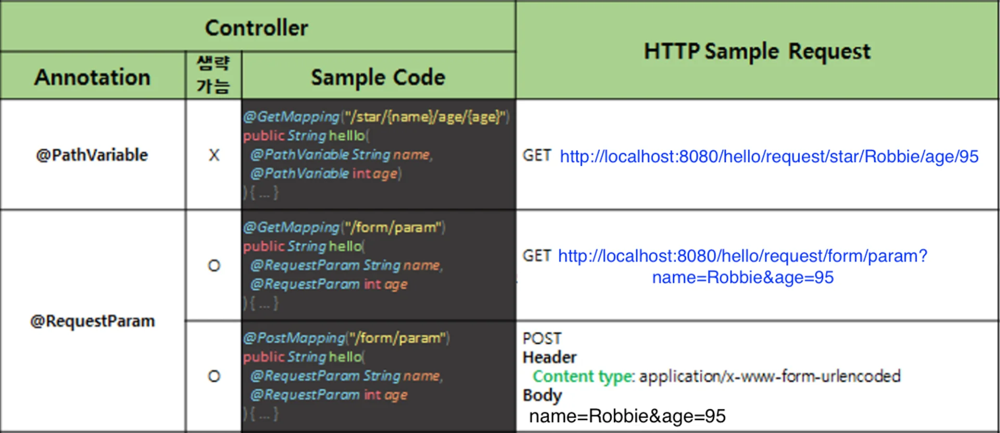

<a id="1c3eda9b0fe181db8d34d03eb355e63e"></a>

## HTTP 데이터를 객체로 처리하는 방법

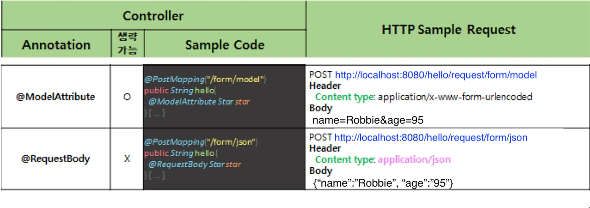

<details>
<summary>&#64;ModelAttribute</summary>

- form 태그 POST
    > 🌐 POST <a href="http://localhost:8080/hello/request/form/model">http&#58;//localhost&#58;8080/hello/request/form/model</a>

    <a id="1c3eda9b0fe181f2a8acff8c480d29cc"></a>

    <strong>&#91;코드 스니펫&#93; helloRequestBodyForm</strong>

    <a id="1c3eda9b0fe18104be3aec2eae195e35"></a>

    ```java
    // [Request sample]
    // POST http://localhost:8080/hello/request/form/model
    // Header
    //  Content type: application/x-www-form-urlencoded
    // Body
    //  name=Robbie&age=95
    @PostMapping("/form/model")
    @ResponseBody
    public String helloRequestBodyForm(@ModelAttribute Star star) {
        return String.format("Hello, @ModelAttribute.<br> (name = %s, age = %d) ", star.name, star.age);
    }
    ```

    - HTML의 form 태그를 사용하여 POST 방식으로 HTTP 요청을 보낼 수 있습니다&#46; 

    - 이때 해당 데이터는 HTTP Body에 <code>name=Robbie&#38;age=95</code> 형태로 담겨져서 서버로 전달됩니다&#46;

    - 해당 데이터를 Java의 객체 형태로 받는 방법은 &#64;ModelAttribute 애너테이션을 사용한 후 Body 데이터를 <code>Star star</code> 받아올 객체를 선언합니다&#46;

- Query String 방식
    > 🌐 GET <a href="http://localhost:8080/hello/request/form/param/model?name=Robbie&#38;age=95">http&#58;//localhost&#58;8080/hello/request/form/param/model?name=Robbie&#38;age=95</a>

    <a id="1c3eda9b0fe181838284edec9102e672"></a>

    <strong>&#91;코드 스니펫&#93; helloRequestParam</strong>

    <a id="1c3eda9b0fe181c09396e3cc90ae7e33"></a>

    ```java
    // [Request sample]
    // GET http://localhost:8080/hello/request/form/param/model?name=Robbie&age=95
    @GetMapping("/form/param/model")
    @ResponseBody
    public String helloRequestParam(@ModelAttribute Star star) {
        return String.format("Hello, @ModelAttribute.<br> (name = %s, age = %d) ", star.name, star.age);
    }
    ```

    - <code>?name=Robbie&#38;age=95</code> 처럼 데이터가 두 개만 있다면 괜찮지만 여러 개 있다면 &#64;RequestParam 애너테이션으로 하나 씩 받아오기 힘들 수 있습니다&#46;

    - 이때 &#64;ModelAttribute 애너테이션을 사용하면 Java의 객체로 데이터를 받아올 수 있습니다&#46;
        - 파라미터에 선언한 <code>Star</code> 객체가 생성되고, 오버로딩된 생성자 혹은 Setter 메서드를 통해 요청된 <code>name &#38; age</code> 의 값이 담겨집니다&#46;

    > ⚠️ &#64;ModelAttribute는 생략이 가능합니다&#46;<br>이때, 생각해볼 문제가있습니다&#33;<br><br>Spring에서는 &#64;ModelAttribute뿐만 아니라 &#64;RequestParam도 생략이 가능합니다&#46;<br>그렇다면 Spring은 이를 어떻게 구분할까요?<br><br>간단하게 설명하자면 Spring은 해당 파라미터(매개변수)가 SimpleValueType이라면 &#64;RequestParam으로 간주하고 아니라면 &#64;ModelAttribute가 생략되어있다 판단합니다&#46;<br> SimpleValueType은 원시타입(int), Wrapper타입(Integer), Date등의 타입을 의미합니다&#46;

</details>

<details>
<summary>&#64;RequestBody</summary>

- <strong>HTTP Body</strong>에 <strong>JSON 데이터를 담</strong>아 <strong>서버에 전달 시,</strong> 해당 Body 데이터를 Java의 객체로 전달 받을 수 있다&#46;

- Body JSON 데이터
    > 🌐 POST <a href="http://localhost:8080/hello/request/form/json">http&#58;//localhost&#58;8080/hello/request/form/json</a>

    <details>
    <summary><strong>&#91;코드 스니펫&#93; helloPostRequestJson</strong></summary>

    <a id="1c3eda9b0fe181b5abcee052c9d43931"></a>

    ```java
    // [Request sample]
    // POST http://localhost:8080/hello/request/form/json
    // Header
    //  Content type: application/json
    // Body
    //  {"name":"Robbie","age":"95"}
    @PostMapping("/form/json")
    @ResponseBody
    public String helloPostRequestJson(@RequestBody Star star) {
        return String.format("Hello, @RequestBody.<br> (name = %s, age = %d) ", star.name, star.age);
    }
    ```

    </details>

    -  HTTP Body에 <code>{&#34;name&#34;&#58;&#34;Robbie&#34;,&#34;age&#34;&#58;&#34;95&#34;}</code>  <code>JSON</code> 형태로 데이터가 서버에 전달되었을 때 &#64;RequestBody 애너테이션을 사용해 데이터를 객체 형태로 받을 수 있다&#46;

    > ⚠️ 데이터를 Java의 객체로 받아올 때 주의할 점
    > 
    > -  해당 객체의 필드에 데이터를 넣어주기 위해 set or get 메서드 또는 오버로딩된 생성자가 필요
    > 
    > - 예를 들어 &#64;ModelAttribute 사용하여 데이터를 받아올 때 해당 객체에 set 메서드 혹은 오버로딩된 생성자가 없다면 받아온 데이터를 해당 객체의 필드에 담을 수 없다&#46;
    > 
    > - 이처럼 객체로 데이터를 받아올 때 데이터가 제대로 들어오지 않는다면 우선 해당 객체의 set or get 메서드 또는 오버로딩된 생성자의 유무 확인 권장

<details>
<summary><strong>RequestController&#46;java</strong></summary>

<a id="1c3eda9b0fe181a683f5c9f700daa18f"></a>

```java
package com.sparta.springmvc.request;

import org.springframework.stereotype.Controller;
import org.springframework.web.bind.annotation.*;

@Controller
@RequestMapping("/hello/request")
public class RequestController {
    @GetMapping("/form/html")
    public String helloForm() {
        return "hello-request-form";
    }

    // [Request sample]
    // GET http://localhost:8080/hello/request/star/Robbie/age/95
    @GetMapping("/star/{name}/age/{age}")
    @ResponseBody
    public String helloRequestPath(@PathVariable String name, @PathVariable int age)
    {
        return String.format("Hello, @PathVariable.<br> name = %s, age = %d", name, age);
    }

    // [Request sample]
    // GET http://localhost:8080/hello/request/form/param?name=Robbie&age=95
    @GetMapping("/form/param")
    @ResponseBody
    public String helloGetRequestParam(@RequestParam(required = false) String name, int age) {
        return String.format("Hello, @RequestParam.<br> name = %s, age = %d", name, age);
    }

    // [Request sample]
    // POST http://localhost:8080/hello/request/form/param
    // Header
    //  Content type: application/x-www-form-urlencoded
    // Body
    //  name=Robbie&age=95
    @PostMapping("/form/param")
    @ResponseBody
    public String helloPostRequestParam(@RequestParam String name, @RequestParam int age) {
        return String.format("Hello, @RequestParam.<br> name = %s, age = %d", name, age);
    }

    // [Request sample]
    // POST http://localhost:8080/hello/request/form/model
    // Header
    //  Content type: application/x-www-form-urlencoded
    // Body
    //  name=Robbie&age=95
    @PostMapping("/form/model")
    @ResponseBody
    public String helloRequestBodyForm(@ModelAttribute Star star) {
        return String.format("Hello, @ModelAttribute.<br> (name = %s, age = %d) ", star.name, star.age);
    }

    // [Request sample]
    // GET http://localhost:8080/hello/request/form/param/model?name=Robbie&age=95
    @GetMapping("/form/param/model")
    @ResponseBody
    public String helloRequestParam(@ModelAttribute Star star) {
        return String.format("Hello, @ModelAttribute.<br> (name = %s, age = %d) ", star.name, star.age);
    }

    // [Request sample]
    // POST http://localhost:8080/hello/request/form/json
    // Header
    //  Content type: application/json
    // Body
    //  {"name":"Robbie","age":"95"}
    @PostMapping("/form/json")
    @ResponseBody
    public String helloPostRequestJson(@RequestBody Star star) {
        return String.format("Hello, @RequestBody.<br> (name = %s, age = %d) ", star.name, star.age);
    }
}
```

</details>

</details>
