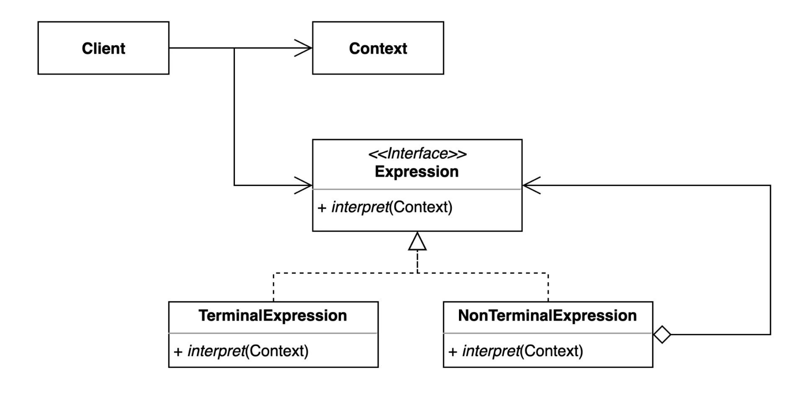
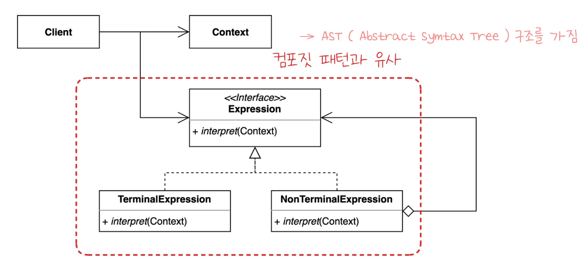

> 📝 
> 
> <a id="1d7eda9b0fe1805cb2b2e0a1b81b5f90"></a>
> 
> <strong>질문</strong>
> 
> <details>
> <summary>인터프리터 패턴이란 무엇인가?</summary>
> 
> 
> 
> </details>
> 
> <details>
> <summary>인터프리터 패턴의 장단점은?</summary>
> 
> 
> 
> </details>
> 
> <details>
> <summary>어디서 활용되는가?</summary>
> 
> 
> 
> </details>

<a id="1d7eda9b0fe18021802fc345e3f05537"></a>

## 인터프리터 ( Interpreter ) 패턴

---

> 📖 
> 
> <a id="1d7eda9b0fe18013ab24ca57c348f121"></a>
> 
> <strong>인터프리터 ( Interpreter ) 패턴</strong>
> 
> ---
> 
> > <strong><u>자주 등장하는 문제</u></strong>를 <strong>간단한 언어로 정의하고 재사용</strong>하는 패턴
> > 
> > - <strong>반복되는 문제 패턴</strong>을 <strong><u>언어</u></strong><em><strong> </strong></em>또는<em><strong> </strong></em><strong><u>문법으로 정</u></strong>의하고 확장할 수 있다&#46;
> 
> 
> 
> <details>
> <summary>구성요소</summary>
> 
> - <code>Context</code>&#58; 해석에 필요한 정보를 저장하고 관리하는 클래스 
> 
> - <code>Expresstion</code>&#58;  모든 해설 클래스가 구현해야하는 인터페이스(or 추상 클래스)
> 
> - <code>TermianlExpression</code>&#58; 문법에서 <strong><u>더 이상 분해되지 않는 최종 표현(터미널 심볼)을 해</u></strong><u>석</u>하는 클래스 
> 
> - <code>NonTerminalExpression</code>&#58; 다른 <code>Expression</code>들을 <strong><u>재귀적으로 참조</u></strong>하여 <strong>복합적인 문장을 해석</strong>하는 클래스
> 
> </details>
> 
> <details>
> <summary>장•단점</summary>
> 
> - 장점
>     - 문법을 클래스로 표현하므로 새로운 문법 추가 및 수정이 용이하다&#46; 
> 
>     - 스크립트 언어, 프로그래밍 언어 등 다양한 분야에서 활용할 수 있다&#46;
> 
> - 단점
>     - 문법 규칙의 수가 많아지면 클래스가 급격히 늘어나고, 구조가 복잡해진다&#46; 
> 
>     - 복잡한 문법의 경우 유지보수, 관리가 어려워질 수 있다&#46; 
> 
> </details>
> 
> <details>
> <summary>활용 예시</summary>
> 
> - 정규 표현식 엔진
> 
> - 수식 계산기
> 
> - SQL  파서
> 
> - 자바 컴파일러(JVM이 바이트코드로 변환)
> 
> <a id="1d7eda9b0fe180299380d985be17f667"></a>
> 
>  
> 
> </details>

<a id="1d7eda9b0fe180c593c7d7e2b330441c"></a>

### 1&#46; 기본 예제

<a id="1d7eda9b0fe1807e8665fcd26fad3a47"></a>

### 코드

<details>
<summary>&#91; 코드 &#93; PostFixNotation</summary>

<a id="1d7eda9b0fe180a3b58cffc4a8e3e3cf"></a>

```java
package _03_behavioral_patterns._15_interpreter._01_before;


import java.util.ArrayDeque;
import java.util.Deque;

public class PostFixNotation {

    private final String expression;

    public PostFixNotation(String expression) {
        this.expression = expression;
    }

    public static void main(String[] args) {
        PostFixNotation postFixNotation = new PostFixNotation("123+-");
        postFixNotation.calculate();
    }

    private void calculate() {
        // Stack<Integer> numbers = new Stack<>(); // 강의 코드
        Deque<Integer> numbers = new ArrayDeque<>();

        for (char c : this.expression.toCharArray()) {
            switch (c) {
                case '+':
                    numbers.push(numbers.pop() + numbers.pop());
                    break;
                case '-':
                    int right = numbers.pop();
                    int left = numbers.pop();
                    numbers.push(left - right);
                    break;
                default:
                    numbers.push(Integer.parseInt(c + ""));
            }
        }
        System.out.println(numbers.pop());
    }
}

```

</details>

<a id="1d7eda9b0fe180c18489cf37946b6c38"></a>

### 문제점

<a id="1d7eda9b0fe180aeb9b6df5079f581f8"></a>

단일 객체에 너무 많은 동작(책임)이 할당 되어있다&#46; 

<a id="1d7eda9b0fe180b0ad96f8a7080599ab"></a>

따라서 코드를 이해는 것도 어렵고, 재사용성이 떨어지며, 유지보수하기에 어렵다&#46;

- SRP, OCP 위반

<a id="1d7eda9b0fe180608e2ad3044f51c7d1"></a>

### 2&#46; 패턴 적용

> ✏️ 
> 
> 
> 
> <a id="1d7eda9b0fe180cbb8f1f506be9df23b"></a>
> 
> <code>NonTerminalExpression</code> 클래스는 <strong>하나 이상의 Expression을 재귀적으로 포함(참조)</strong>하여 <strong>구</strong><strong><u>문 트리(Abstract Syntax Tree, AST) 구조</u></strong>를 구성한다&#46;
> 
> - 컴포짓 패턴과 동일

<a id="1d7eda9b0fe180b8811ee07d7b1c2679"></a>

### 코드

> 구분하기 쉽게 색상 부여

<details>
<summary>&#91; 코드 &#93; PostfixParser &#45; <strong><code>Context</code></strong></summary>

<a id="1d7eda9b0fe1808a9522eb78642e6c16"></a>

```java
package _03_behavioral_patterns._15_interpreter._02_after;

import java.util.ArrayDeque;
import java.util.Deque;

public class PostfixParser {

    public static PostfixExpression parse(String expression) {
        Deque<PostfixExpression> stack = new ArrayDeque<>();
        for (char c : expression.toCharArray()) {
            stack.push(getExpression(c, stack));
        }
        return stack.pop();
    }

    private static PostfixExpression getExpression(char c, Deque<PostfixExpression> stack) {
        switch (c) {
            case '+':
                return new PlusExpression(stack.pop(), stack.pop());
            case '-':
                PostfixExpression right = stack.pop();
                PostfixExpression left = stack.pop();
                return new MinusExpression(left, right);
            default:
                return new VariableExpression(c);
        }
    }
}

```

</details>

<details>
<summary>&#91; 코드 &#93; &#60; interface &#62; PostfixExpression&#45;<strong><code>abstractExpression</code></strong></summary>

<a id="1d7eda9b0fe1805783acd2d6e4ad7c43"></a>

```java
package _03_behavioral_patterns._15_interpreter._02_after;

import java.util.Map;

public interface PostfixExpression {

    int interpret(Map<Character, Integer> context);
}

```

</details>

<details>
<summary>&#91; 코드 &#93; PlusExpression &#45; <strong><code>NonTerminalExpression</code></strong></summary>

<a id="1d7eda9b0fe18069b20dcf45f8a6ddd9"></a>

```java
package _03_behavioral_patterns._15_interpreter._02_after;

import java.util.Map;

public class PlusExpression implements PostfixExpression {

    private PostfixExpression left;
    private PostfixExpression right;

    public PlusExpression(PostfixExpression left, PostfixExpression right) {
        this.left = left;
        this.right = right;
    }

    @Override
    public int interpret(Map<Character, Integer> context) {
        return left.interpret(context) + right.interpret(context);
    }
}

```

</details>

<details>
<summary>&#91; 코드 &#93; MinusExpression &#45; <strong><code>NonTerminalExpression</code></strong></summary>

<a id="1d7eda9b0fe1800ca765e0e6c0194a9c"></a>

```java
package _03_behavioral_patterns._15_interpreter._02_after;

import java.util.Map;

public class MinusExpression implements PostfixExpression {

    private PostfixExpression left, right;

    public MinusExpression(PostfixExpression left, PostfixExpression right) {
        this.left = left;
        this.right = right;
    }

    @Override
    public int interpret(Map<Character, Integer> context) {
        return left.interpret(context) - right.interpret(context);
    }
}
s
```

</details>

<details>
<summary>&#91; 코드 &#93; MultiplyExpression &#45; <strong><code>NonTerminalExpression</code></strong></summary>

<a id="1d7eda9b0fe180a68364ecc21bca1b25"></a>

```java
package _03_behavioral_patterns._15_interpreter._02_after;

import java.util.Map;

public class MultiplyExpression implements PostfixExpression {

    private PostfixExpression left, right;

    public MultiplyExpression(PostfixExpression left, PostfixExpression right) {
        this.left = left;
        this.right = right;
    }

    @Override
    public int interpret(Map<Character, Integer> context) {
        return left.interpret(context) * right.interpret(context);
    }
}

```

</details>

<details>
<summary>&#91; 코드 &#93; VariableExpression &#45; <strong><code>TermianlExpression</code></strong></summary>

<a id="1d7eda9b0fe180628d00f012551935d7"></a>

```java
package _03_behavioral_patterns._15_interpreter._02_after;

import java.util.Map;

public class VariableExpression implements PostfixExpression {

    private Character character;

    public VariableExpression(Character character) {
        this.character = character;
    }

    @Override
    public int interpret(Map<Character, Integer> context) {
        return context.get(this.character);
    }
}

```

</details>

<details>
<summary>&#91; 코드 &#93; App &#45; <strong><code>client</code></strong></summary>

<a id="1d7eda9b0fe18052b683c6da043462c0"></a>

```java
package _03_behavioral_patterns._15_interpreter._02_after;

import java.util.Map;

public class App {

    public static void main(String[] args) {
        PostfixExpression expression = PostfixParser.parse("xyz+-a+");
        int result = expression.interpret(Map.of('x', 1, 'y', 2, 'z', 3, 'a', 4));
        System.out.println(result);
    }
}
```

</details>

<a id="1d7eda9b0fe18044a2a6e0009f84a02c"></a>

<strong>구현 2) </strong><strong><code>abstractExpression</code></strong><strong> ( </strong>PostfixExpression) <strong>에서 default로 동작 정의 </strong>

<details>
<summary>&#91; 코드 &#93; &#60; interface &#62; PostfixExpression <strong><code>abstractExpression</code></strong></summary>

<a id="1d7eda9b0fe1806985ecd405b8f44723"></a>

```java
package _03_behavioral_patterns._15_interpreter._02_after;

import java.util.Map;

public interface PostfixExpression {

    int interpret(Map<Character, Integer> context);
    
		static PostfixExpression plus(PostfixExpression left, PostfixExpression right) {
				return context -> left.interpret(context) + right.interpret(context);
		}		
		
		static PostfixExpression minus(PostfixExpression left, PostfixExpression right) {
				return context -> left.interpret(context) - right.interpret(context);
		}	
		
		static PostfixExpression variable(Character c) {
				return context -> context.get(c);
		}	
}

```

</details>

<details>
<summary>&#91; 코드 &#93; PostfixParser &#45; <strong><code>Context</code></strong></summary>

<a id="1d7eda9b0fe18046985fd5ac90ae9cf0"></a>

```java
package _03_behavioral_patterns._15_interpreter._02_after;

import java.util.ArrayDeque;
import java.util.Deque;

public class PostfixParser {

    public static PostfixExpression parse(String expression) {
        Deque<PostfixExpression> stack = new ArrayDeque<>();
        for (char c : expression.toCharArray()) {
            stack.push(getExpression(c, stack));
        }
        return stack.pop();
    }

    private static PostfixExpression getExpression(char c, Deque<PostfixExpression> stack) {
        switch (c) {
            case '+':
                return PostfixExpression.plus(stack.pop(), stack.pop());
            case '-':
                PostfixExpression right = stack.pop();
                PostfixExpression left = stack.pop();
                return PostfixExpression.minus(left, right);
            default:
                return PostfixExpression.variable(c);
        }
    }
}

```

</details>

> ☝🏻 
> 
> <a id="1d7eda9b0fe18017a68eed4071a4f292"></a>
> 
> 추가 동작을 정의하면 그 동작을 해석하는 Parser는 영향을 받는다&#46; 
> 
> <a id="1d7eda9b0fe180acab87e3eee616da37"></a>
> 
> 그외 Expression들은 기존 코드의 변경없이 확장 가능하다&#46; 

<a id="1d7eda9b0fe18098be82d3bcd32bb9b4"></a>

### 3&#46; 장•단점

- 장점
    - 자주 등장하는 문제 패턴을 언어와 문법으로 정의할 수 있다&#46;

    - 기존 코드를 변경하지 않고 새로운 <code>Expression</code>을 추가할 수 있다&#46; 

- 단점
    - 복잡한 문법을 표현하려면 <code>Expression</code>과 <code>Parser</code>가 복잡해진다&#46;

    - ROR( <code>Return Of Return</code> )를 잘 파악해서 해당 패턴을 적용해야 한다&#46;

<a id="1d7eda9b0fe1807cb1fcd7f7d1f18ba2"></a>

### 4&#46; 실무 활용

> ✏️ 
> 
> > 자바
> 
> - 자바 컴파일러
> 
> - 정규 표현식
> 
> > 스프링
> 
> - SpEL ( 스프링 Expression Language )

<a id="1d7eda9b0fe18063bd4ef73e70e5c4ba"></a>

### 코드

<details>
<summary>&#91; 코드 &#93; InterpreterInJava</summary>

<a id="1d7eda9b0fe18050ac1bd681dfbd567f"></a>

```java
package _03_behavioral_patterns._15_interpreter._03_java;

import java.util.regex.Pattern;

public class InterpreterInJava {

    public static void main(String[] args) {
        System.out.println(Pattern.matches(".pr...", "spring"));
        System.out.println(Pattern.matches("[a-z]{6}", "spring"));
        System.out.println(Pattern.matches("white[a-z][0-9]{4}", "whiteship2000"));
        System.out.println(Pattern.matches("\\d", "1"));  // one digit
        System.out.println(Pattern.matches("\\D", "a"));  // one non-digit
    }
}
```

</details>

<details>
<summary>&#91; 코드 &#93; App</summary>

<a id="1d7eda9b0fe1809e9848f756e929dfe3"></a>

```java
package _03_behavioral_patterns._15_interpreter._03_java;

import org.springframework.boot.SpringApplication;
import org.springframework.boot.WebApplicationType;
import org.springframework.boot.autoconfigure.SpringBootApplication;

@SpringBootApplication
public class App {

    public static void main(String[] args) {
        SpringApplication app = new SpringApplication(App.class);
        app.setWebApplicationType(WebApplicationType.NONE);
        app.run(args);
    }
}
```

</details>

<details>
<summary>&#91; 코드 &#93; Book</summary>

<a id="1d7eda9b0fe180f6baa3f445090af0f5"></a>

```java
package _03_behavioral_patterns._15_interpreter._03_java;

public class Book {

    private String title;

    public Book(String title) {
        this.title = title;
    }

    public String getTitle() {
        return title;
    }

    public void setTitle(String title) {
        this.title = title;
    }
}

```

</details>

<details>
<summary>&#91; 코드 &#93; MyService</summary>

<a id="1d7eda9b0fe180918322dd7cc49bf45e"></a>

```java
package _03_behavioral_patterns._15_interpreter._03_java;

import org.springframework.beans.factory.annotation.Value;
import org.springframework.boot.ApplicationArguments;
import org.springframework.boot.ApplicationRunner;
import org.springframework.stereotype.Service;

@Service
public class MyService implements ApplicationRunner {


    @Value("#{2 + 5}")
    private String value;

    @Override
    public void run(ApplicationArguments args) throws Exception {
        System.out.println(value);
    }
}

```

</details>

<details>
<summary>&#91; 코드 &#93; InterpreterInSpring</summary>

<a id="1d7eda9b0fe1802f8d5be92e3810042d"></a>

```java
package _03_behavioral_patterns._15_interpreter._03_java;

import org.springframework.expression.Expression;
import org.springframework.expression.spel.standard.SpelExpressionParser;

public class InterpreterInSpring {

    public static void main(String[] args) {
        Book book = new Book("spring");

        SpelExpressionParser parser = new SpelExpressionParser();
        Expression expression = parser.parseExpression("title");
        System.out.println(expression.getValue(book));
    }
}

```

</details>
