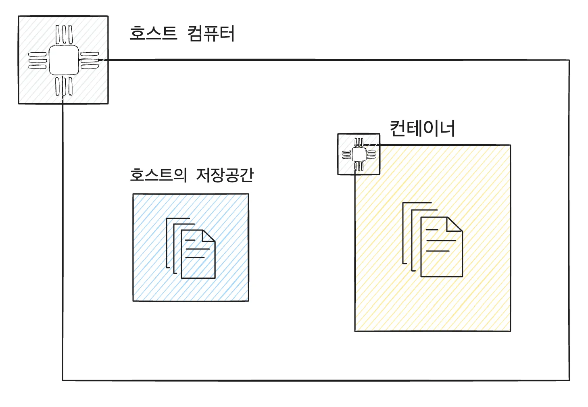
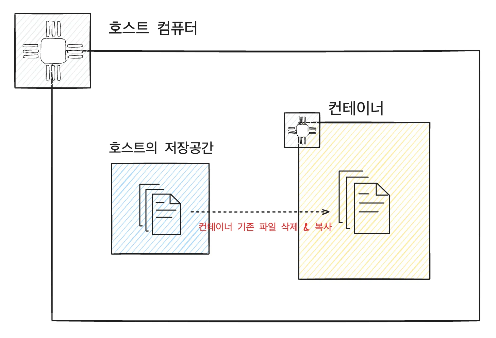
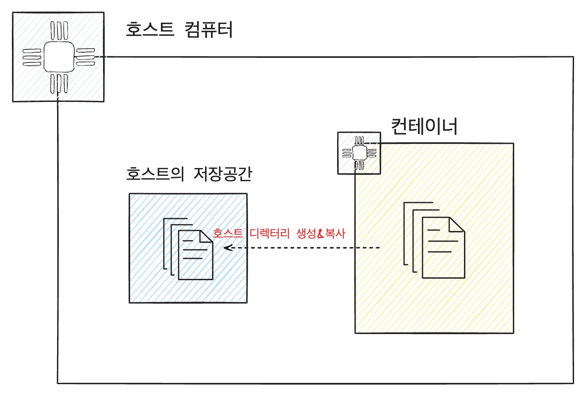

> ⚠️ 
> 
> <a id="1c3eda9b0fe181b58481e4c1d500c83c"></a>
> 
> ### 컨테이너의 문제점
> 
> ---
> 
> <a id="1c3eda9b0fe181499bfdd47ee241ec6c"></a>
> 
> Docker를 활용하면 특정 프로그램을 컨테이너로 띄울 수 있다&#46; 
> 
> <a id="1c3eda9b0fe1818d9779c397c2e8dce5"></a>
> 
> 해당 프로그램에 기능이 추가(버전업)된다면 새로운 이미지를 만들고 컨테이너를 실행시켜야 한다&#46;
> 
> - Docker는 기존 컨테이너에서 <u>변경된 부분을 수정하지 않</u>고 <strong><u>새로운 컨테이너를 만</u></strong>들어서 <u>통째로 갈아끼운다&#46;</u> 
> 
> <a id="1c3eda9b0fe18102a9c3d8b03d3a703d"></a>
> 
> 이런 특징 때문에 기존 컨테이너를 <strong><u>새로운 컨테이너로 교체</u></strong>하면 <strong>기존 컨테이너 내부에 있던 </strong><strong><u>데이터도 같이 삭제</u></strong>된다&#46; 
> 
> - 만약 이 컨테이너가 MySQL을 실행시키는 컨테이너 였다면 MySQL에 저장된 데이터도 같이 삭제된다&#46; 
> 
> <a id="1c3eda9b0fe181f38dddebd8da0fb68c"></a>
> 
> 이를 해결하기 위해 <strong><u>볼륨(Volume)</u></strong>을 활용한다&#46; 
> 
> - <strong><u>컨테이너 내부의 데이터</u></strong>를 <u>외부 환경에 저장</u>한다&#46; 

<a id="1c3eda9b0fe181ffb1a2dd98f99ed421"></a>

### Docker Volume ( 도커 볼륨 )

---

> 🖥️ 
> 
> <a id="1c3eda9b0fe18159a111db16cc529604"></a>
> 
> <code>도커의 볼륨(Volume)</code>이란, <strong>도커 컨테이너</strong>에서<strong><u> 데이터를 영속적으로 저장</u></strong>하기 위한 방법이다&#46; 
> 
> <a id="1c3eda9b0fe18154b171f72337e60ffe"></a>
> 
> <strong><code>볼륨(Volume)</code></strong>은 컨테이너 자체의 공간을 사용하지 않고, <strong><u>호스트의 저장 공간을 공유</u></strong>해서 사용한다&#46;
> 
> 

<details>
<summary>볼륨(Volume) CLI</summary>

<a id="1c3eda9b0fe1814fb299fdaf29bc20d4"></a>

```docker
docker run -v [호스트의 디렉토리 절대경로]:[컨테이너의 디렉토리 절대경로] [이미지명]:[태그명]
```

<details>
<summary><strong><code>&#91;호스트의 디렉토리 절대 경로&#93;</code></strong>에 디렉터리가 이미 존재하는 경우</summary>

- 호스트의 디렉터리가 컨테이너의 디렉터리를  덮어씌운다&#46; 



</details>

<details>
<summary><strong><code>&#91;호스트의 디렉토리 절대 경로&#93;</code></strong>에 디렉터리가 존재하지 않는 경우</summary>

- <strong><code>&#91; 호스트의 디렉터리 절대 경로 &#93;</code></strong>에 디렉터리를 새로 만들고 컨테이너의 디렉터리에 있는 파일들을 호스트의 디렉터리로 복사한다&#46;



</details>

</details>
