<a id="1c3eda9b0fe181b88cf0fb35a6a650f4"></a>

## 1&#46;  현재 VCS(Git &#46;&#46;&#46;) 와 이전 세대 VCS와의 차이점 

<a id="1c3eda9b0fe1817bb8ebc093c1ea134b"></a>

이전 세대의 VCS 와 현재 세대의 VCS 

<a id="1c3eda9b0fe1813681effd9266ca87d7"></a>

### 스냅샷(Snapshot)

> 👉🏻 Reference<br><a href="https://blog.git-init.com/snapshot-vs-delta-storage/">https&#58;//blog&#46;git&#45;init&#46;com/snapshot&#45;vs&#45;delta&#45;storage/</a><br><a href="https://www.inflearn.com/course/lecture?courseSlug=%EC%A0%9C%EB%8C%80%EB%A1%9C-%ED%8C%8C%EB%8A%94-%EA%B9%83&#38;unitId=102367&#38;tab=curriculum">https&#58;//www&#46;inflearn&#46;com/course/lecture?courseSlug=제대로&#45;파는&#45;깃&#38;unitId=102367&#38;tab=curriculum</a>

<details>
<summary>해당 <a href="https://blog.git-init.com/snapshot-vs-delta-storage/">Post</a> 참조</summary>

> <strong>“Snapshot storage</strong> saves the entire state of a file or system as a single instance, known as a snapshot&#46;<br>Each snapshot represents the system at a given time and serves as a reference point for future changes&#46; This method is simple, efficient, and straightforward, but it can consume a lot of storage space over time if there are frequent changes to the system&#46;”<br><br>스냅샷 저장은 파일이나 시스템의 전체 상태를 스냅샷으로 알려진 하나의 인스턴스로 저장한다&#46; <br>각 스냅샷은 특정 시점의 시스템을 나타내며 향후 변경 사항에 대한 참조 지점 역할을 한다&#46;<br>이 방법은 간단하고 효율적이며 간단하지만 시스템이 자주 변경되는 경우 시간이 지남에 따라 많은 저장 공간을 소비할 수 있다&#46;

</details>

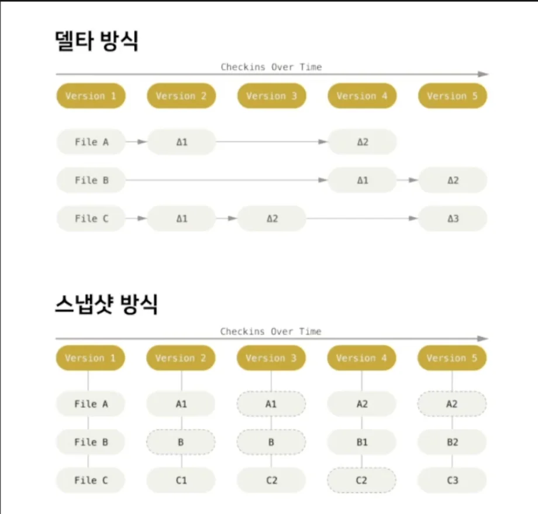

<a id="1c3eda9b0fe181ebbbc4c2b821d35c28"></a>

델타 방식은 git에서 branch를 변경하거나 작업을 불러오거나 하는 경우

<a id="1c3eda9b0fe181919816cd3d1e49cd0c"></a>

각파일들을 처음 만들어진 시점부터 변경사항들을 더해서 현재 내용을 계산하여 불러온다&#46; 따라서 관리 역사가 길수록 느려진다&#46; 

<a id="1c3eda9b0fe18156a5ddd5b1c70c07f3"></a>

스냅샷 방식은 특정 시점(commit 시점)마다 각 파일들이 전체 파일을 하나의 인스턴스로 저장하기 때문에 그냥 불러오기만 하면 돼서 빠르다&#46; 

<a id="1c3eda9b0fe1812aa850e15f989ef1a2"></a>

### 분산 버전 관리 

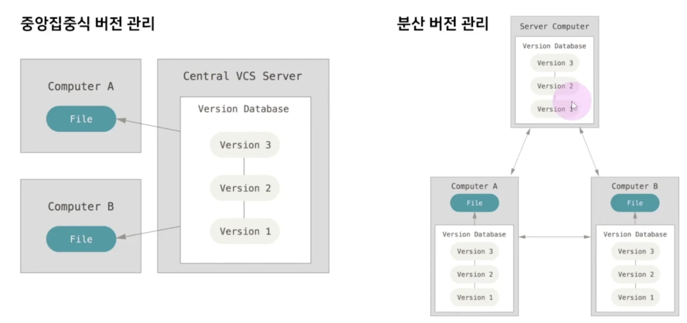

<a id="1c3eda9b0fe1812995c7ca4aa3e57484"></a>

CVS나 Subverstion 등의 VCS는 중앙집중식 버전 관리를 하며 원격 서버에 모든 작업 내역들이 저장된다&#46; 

<a id="1c3eda9b0fe181f0a2c5f271bfba1cd0"></a>

## 2&#46; Git의 3가지 공간

> <a href="#/post/1c3eda9b-0fe1-81db-b05a-c2afad5ca59f">페이지</a><strong> 참조</strong>

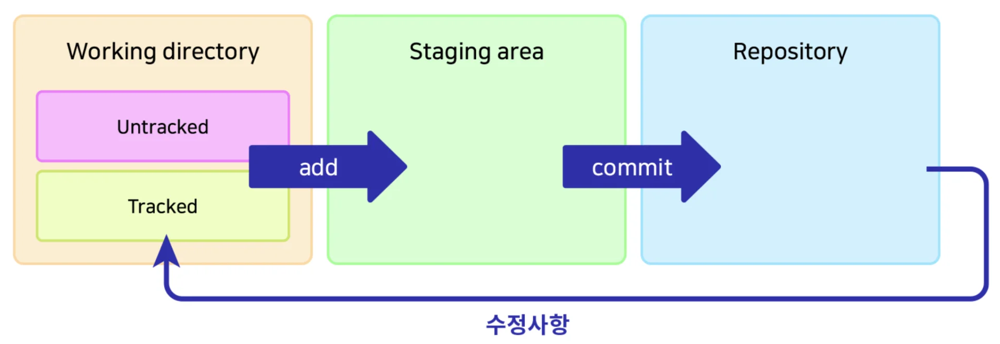

<a id="1c3eda9b0fe181c1bcebeaa3131e2667"></a>

### <strong>Working directory</strong>

- <strong><code>untracked</code></strong>&#58; Add된 적 없는 파일, ignore 된 파일

- <strong><code>tracked</code></strong>&#58; Add된 적 있고 변경내역이 있는 파일

> <strong><code>git add</code></strong> 명령어로 Staging area로 이동

<a id="1c3eda9b0fe181f8b6f4dbad4d045cba"></a>

### <strong>Staging area</strong>

- 커밋을 위한 준비 단계
    - 예시&#58; 작업을 위해 선택된 파일들

> <strong><code>git commit</code></strong> 명령어로 repository로 이동

<a id="1c3eda9b0fe181948558d6819a97f3c8"></a>

### Repository

- <code>&#46;git directory</code>라고도 불림

- 커밋된 상태

<details>
<summary><strong>비유) Git &#45; 그릇, 식기세척기 </strong></summary>

<a id="1c3eda9b0fe181c09c92eaff989daf1b"></a>

강의에서 설명해주신 비유임, 이해하기 쉬워서 가져옴<br>

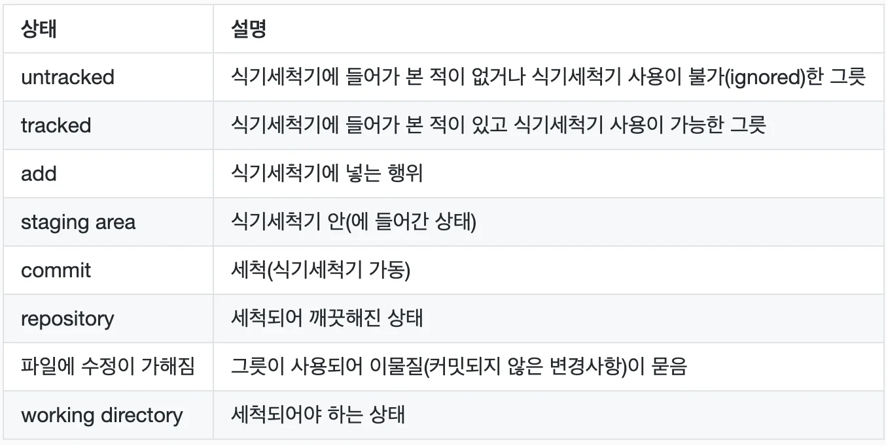

> <strong><code>tracked</code></strong>가 된다는 건, <strong><u>Git의 관리 대상으로 등록됨을 의미</u></strong>한다&#46;
> 
> <a id="1c3eda9b0fe181159223cecc08c404d1"></a>
> 
> 따라서 <strong><u>Git으로 관리해야 할 새로 추가된 파일</u></strong>은 반드시 <strong><code>add</code></strong>해줌으로써, <strong><u>해당 파일이 </u></strong><strong><u><code>tracked</code></u></strong><strong><u>될 것임을 명시</u></strong>해야 한다&#46; 
> 
> <a id="1c3eda9b0fe181bfb9f8c20ab5434b12"></a>
> 
> <em>(Git이 새 파일들을 무조건 다 관리해버리는 것을 방지)</em>

</details>

---

<a id="1c3eda9b0fe181369865d5c1bee31313"></a>

### 파일의 삭제(<code>git rm</code> ) / 이동 (<code>git mv</code>)

<details>
<summary><strong>기본 삭제&#58;</strong> <code>rm “파일”</code>  →<strong> Working directory</strong></summary>

- tigers&#46;yaml 삭제
    <a id="1c3eda9b0fe1817b98fff50d77ab1691"></a>

    ```bash
    rm "tigers.yaml"
    ```

- <code>git status</code>
    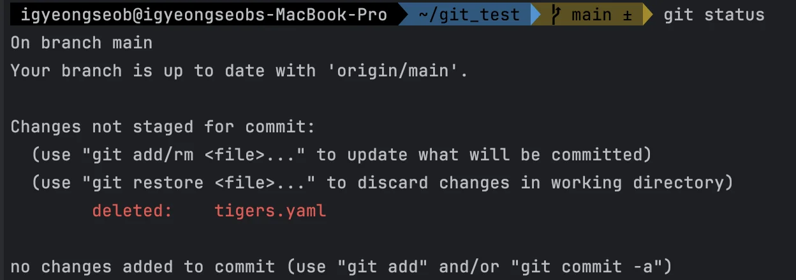

- 복원&#58; <code>git reset —&#45;hard</code>

</details>

<details>
<summary><strong>git 파일 삭제&#58; </strong><strong><code>git rm</code></strong><strong>  </strong>→<strong> Staging area</strong></summary>

- <strong><code>git rm</code></strong> 으로 <code>tigers&#46;yaml</code>삭제
    <a id="1c3eda9b0fe18112933fd389eb2cbac3"></a>

    ```bash
    git rm tigers.yaml
    ```

- <code>git status</code> 
    > 삭제한 파일이 Staging area에 있음

    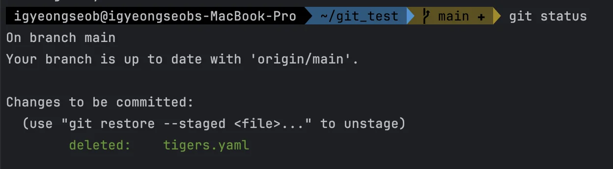

- 복원&#58; <code>git reset —hard</code>

</details>

---

<details>
<summary><strong>기본 이동&#58;</strong> <code>mv &#91;이전 명&#93; &#91;새로운 명&#93;</code>  → <strong>Working directory</strong></summary>

- 이름 변경&#58; <code>mv &#91;이전 명&#93; &#91;새로운 명&#93;</code>
    <a id="1c3eda9b0fe1810db549ff75b1bcf704"></a>

    ```bash
    mv tigers.yaml zzamtigers.yaml
    ```

- <code>git status</code>
    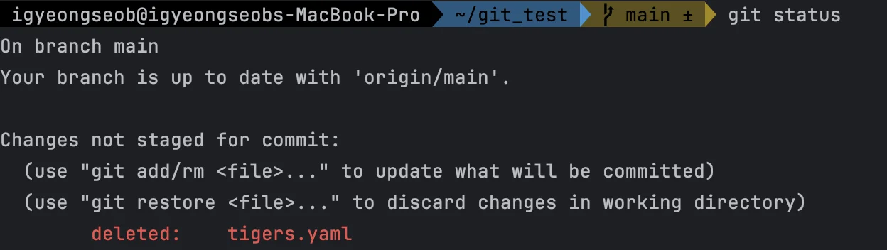

</details>

<details>
<summary><strong>git 파일 이동&#58; </strong><strong><code>git mv</code></strong><strong>  </strong>→  <strong>Staging area</strong></summary>

- <code>git mv</code>
    <a id="1c3eda9b0fe18158b750c40019763d75"></a>

    ```bash
    git mv tigers.yaml zzamtigers.yaml
    ```

- <code>git status</code>
    > 아래와 같이 변경 내용이

    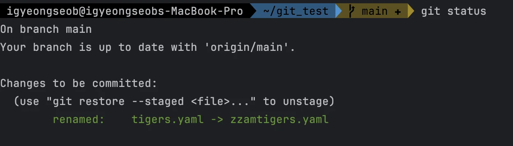

</details>

<a id="1c3eda9b0fe1810194aac859e16b0674"></a>

### <strong>파일  </strong><strong><code>staging area</code></strong><strong> &#45;&#62;</strong><strong> </strong><strong><code>working directory</code></strong><strong>&#58;  </strong><strong><code>restore</code></strong>

- 파일 <code>staging area</code>에서 제거
    <a id="1c3eda9b0fe1811db9fec245bd97e40b"></a>

    파일을 저장된 상태로 <code>working directory</code>로 되돌림

    <a id="1c3eda9b0fe18173b103e4f0f4c1bb68"></a>

    ```bash
    git restore --staged (파일명)
    ```

- <strong><u>파일 저장된 내용까지 제거</u></strong><strong> </strong>(<code>working directory</code>에서도 제거)<br> <code>&#45;&#45;staged</code>를 빼면  파일을 마지막 commit 내용으로 되돌림
    <a id="1c3eda9b0fe181ccb11ce6a94928af4a"></a>

    ```bash
    git restore (파일명)
    ```

- 예전&#58; <code>git reset HEAD (파일명)</code>

<a id="1c3eda9b0fe181089ea8d7f3b51bbead"></a>

### <code>reset</code>의 세 가지 옵션

- <code>—soft</code>&#58; repository에서<strong> staging area</strong>로 이동
    <a id="1c3eda9b0fe181ef922dc908e9b12941"></a>

    ```bash
    git reset --soft [commit hash]
    ```

- <code>—mixed(default)</code>&#58; repository에서 <strong>working directory</strong>로 이동 
    <a id="1c3eda9b0fe18100980ae5d89b317fa0"></a>

    ```bash
    git reset (--mixed) [commit hash]
    ```

- <code>—hard</code>&#58; 수정사항 완전히 삭제
    <a id="1c3eda9b0fe1813b9566cea6a3771652"></a>

    ```bash
    git reset --hard [commit hash]
    ```

<a id="1c3eda9b0fe1812a9307f53b584106d4"></a>

## 3&#46; HEAD

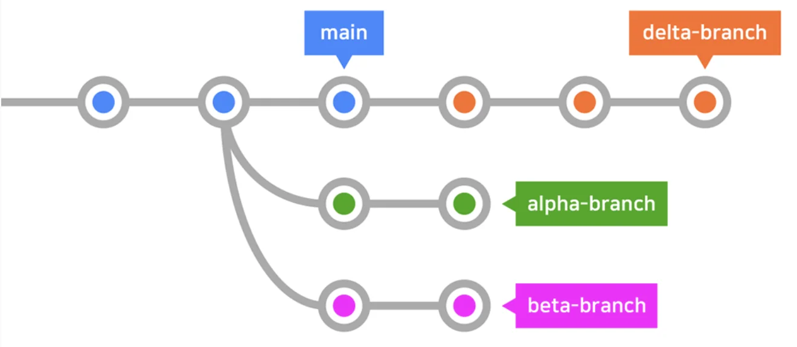

<a id="1c3eda9b0fe18103b977de9bf0cbc74d"></a>

### Git의 HEAD

<a id="1c3eda9b0fe1814b8053e1a76652cf44"></a>

<strong>현재 속한 브랜치의 </strong><strong><u>가장 최신 커밋</u></strong>

- <code>switch</code> 로 브랜치 이동해보기
    - <code>main</code> 과 <code>delta&#45;branch</code>

<details>
<summary><code>checkout</code> 으로 앞뒤 이동해보기</summary>

<a id="1c3eda9b0fe1811a8c2ef39946b0d8ea"></a>

```bash
git checkout HEAD^
```

- <code>^</code> 또는 <code>&#126;</code> &#58; 갯수만큼 이전으로 이동
    <a id="1c3eda9b0fe181fa8854dade220ba94b"></a>

    ```bash
    git checkout HEAD^^^  :  3번 이전으로 이동
    git checkout HEAD~5   :  5번 이전으로 이동
    ```

- <code>switch</code> HEAD 가장 최근 commit으로 다시 돌아옴
    <a id="1c3eda9b0fe181218b67cf52a81d4d92"></a>

    ```bash
    git switch main
    git switch [브랜치 명] 
         -> 가장 최상단 commit으로 돌아옴
    ```

- 이전 cmd 반복 실행
    <a id="1c3eda9b0fe181b2bf8be8454a49dce4"></a>

    ```bash
    git checkout - 
    ```

</details>

- 이전으로 <code>checkout</code> 된 상태에서 소스트리로 HEAD 상태보기
    <details>
    <summary><strong>예시1) alpha&#45;branch,  checkout HEAD^^^(3번)</strong></summary>

    <a id="1c3eda9b0fe18170a872ce412216c13e"></a>

    ```bash
    git switch alpha-branch
    git checkout HEAD^^^    :   3번 뒤로 이동
    ```

    <a id="1c3eda9b0fe1812d9d63ccfa40500b05"></a>

    아래와 같이 <code>alpha&#45;branch</code> 브랜치의 최신 commit 에서 3번 뒤로 와 FIrst commit 으로 HEAD가 이동한 것을 확인 할 수 있다&#46;

    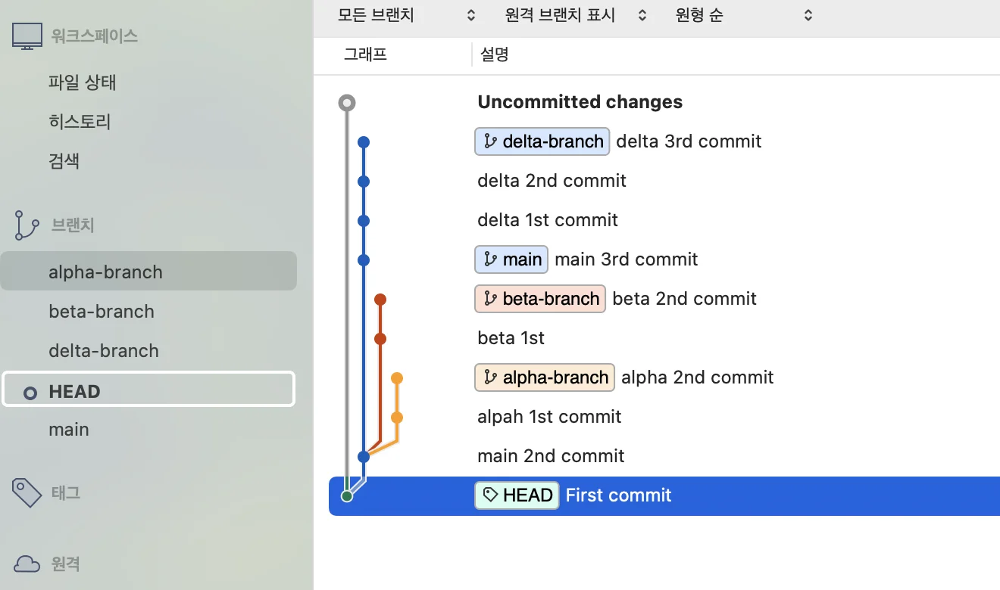

    </details>

    <details>
    <summary><strong>예시2) </strong><strong><code>main</code></strong><strong> → </strong><strong><code>git checkout HEAD^</code></strong><strong>  →  branch 생성 → commit 생성</strong></summary>

    <a id="1c3eda9b0fe181af903feb0d41b571e9"></a>

    ```bash
     git switch main
     
     git checkout HEAD^
     
     git branch test
     
     git add [파일명]
     
     git commit "commit message"
    ```

    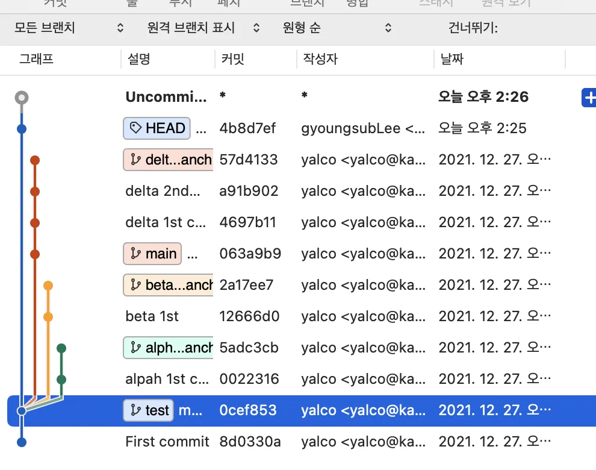

    </details>

- <strong>HEAD 사용하여 reset하기</strong>
    <a id="1c3eda9b0fe18116aca2efb69318ef10"></a>

    ```bash
    git reset HEAD(원하는 단계) (옵션)
    ```

<a id="1c3eda9b0fe181a7a21bf674250b7d5c"></a>

## 4&#46; <code>fetch</code>  vs <code>pull</code>

> 👉🏻 <code>fetch</code>&#58; 원격 저장소의 최신 커밋을 로컬로 가져오기만 함<br><code>pull</code>&#58; 원격 저장소의 최신 커밋을 로컬로 가져와 <code>merge</code> 또는 <code>rebase</code>
