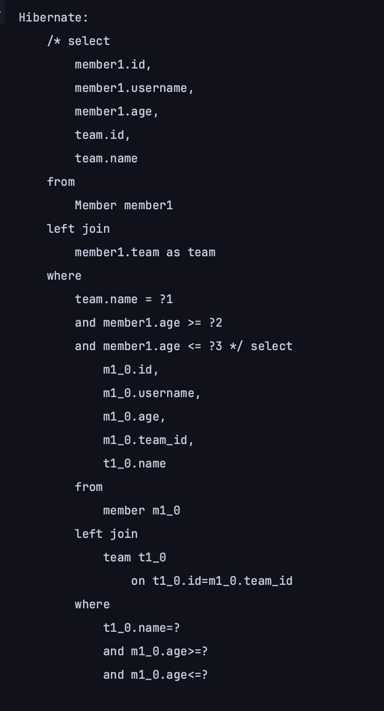

<a id="1c3eda9b0fe18109b9f7f2d633bab0d2"></a>

## 성능 최적화&#58; 동적 쿼리 조회 &#45; Where 절 파라미터 

---

> 📖 
> 
> <a id="1c3eda9b0fe1817980e2c266bfe9f481"></a>
> 
> <code>동적 쿼리 &#45; Where 절 파라미터</code> 방식은 코드를 재사용 할 수 있다는 큰 장점이 있다&#46; <br>따라서 해당 방법 사용을 권장한다&#46; 

<details>
<summary>동적 쿼리 Where 파라미터 방식으로 최적화 </summary>

<details>
<summary>&#91; 코드 &#93; <code>repsoitory</code>&#58; <code>MemberJpaRepository&#46;search()</code></summary>

<a id="1c3eda9b0fe181d68e83f4e19780947a"></a>

```java
public List<MemberTeamDto> search(MemberSearchCondition condition) {
    return queryFactory
            .select(new QMemberTeamDto(
                    member.id,
                    member.username,
                    member.age,
                    team.id,
                    team.name))
            .from(member)
            .leftJoin(member.team, team)
            .where(
                    usernameEq(condition.getUsername()),
                    teamNameEq(condition.getTeamName()),
                    ageGoe(condition.getAgeGoe()),
                    ageLoe(condition.getAgeLoe())
            )
            .fetch();
}

private BooleanExpression usernameEq(String username) {
    return hasText(username) ? member.username.eq(username) : null;
}

private BooleanExpression teamNameEq(String teamName) {
    return hasText(teamName) ? team.name.eq(teamName) : null;
}

private BooleanExpression ageGoe(Integer ageGoe) {
    return ageGoe != null ? member.age.goe(ageGoe) : null;
}

private BooleanExpression ageLoe(Integer ageLoe) {
    return ageLoe != null ? member.age.loe(ageLoe) : null;
}
```

</details>

<details>
<summary>&#91; 코드 &#93; 테스트 코드 </summary>

<a id="1c3eda9b0fe18199972afb0674787c74"></a>

```java
@Test
public void searchTestByWhereParamter() {
    Team teamA = new Team("teamA");
    Team teamB = new Team("teamB");
    em.persist(teamA);
    em.persist(teamB);

    Member member1 = new Member("member1", 10, teamA);
    Member member2 = new Member("member2", 20, teamA);
    Member member3 = new Member("member3", 30, teamB);
    Member member4 = new Member("member4", 40, teamB);

    em.persist(member1);
    em.persist(member2);
    em.persist(member3);
    em.persist(member4);

    MemberSearchCondition condition = new MemberSearchCondition();
    condition.setAgeGoe(35);
    condition.setAgeLoe(40);
    condition.setTeamName("teamB");

    List<MemberTeamDto> result = memberJpaRepository.search(condition);

    assertThat(result).extracting("username").containsExactly("member4");
}
```

- 쿼리 확인
    

</details>

</details>

<details>
<summary>장점 1) 다른 엔티티를 동일한 조건을 가지고 동적으로 조회해야 할떄, Where 절 파라미터 방식은<br>기존의 조건들을 명시한 코드를 재사용 가능하다</summary>

- &#91; 코드 &#93; Member 엔티티를 동적으로 조회하는 메서드 추가 
    - 아래와 같이 기존에 정의한 조건 파라미터 코드들을 그대로 재사용 가능하다&#46; 

    <a id="1c3eda9b0fe1819d9c7ceb77eb7fb9a0"></a>

    ```java
    public List<Member> searchMember(MemberSearchCondition condition) {
        return queryFactory
                .selectFrom(member)
                .leftJoin(member.team, team)
                .where(
                        usernameEq(condition.getUsername()),
                        teamNameEq(condition.getTeamName()),
                        ageGoe(condition.getAgeGoe()),
                        ageLoe(condition.getAgeLoe())
                )
                .fetch();
    }
    ```

</details>

<details>
<summary>장점 2) 하위 조건들을  묶어 한번에 처리하는 메서드를 생성해 가독성 및 유지보수 측면을 높일 수 있다&#46; </summary>

- 특정 서비스 로직들에서의 <u>공통적인 필수 조건들</u>을 묶어서(조립해서) <u>메서드로 만</u>들어 where 절에 명시한다 &#46;
    - 코드의 재사용성이 증가하고 관리 및 유지보수가 용이하다&#46; 

    - ex) <code>isValid(…)</code> …

- 조립 시, <u>null check를 주의</u>해서 처리하면 된다&#46; 

---

- ex)
    <a id="1c3eda9b0fe181b19d11d10aad059c7e"></a>

    ```java
    private BooleanExpression ageBetween(int ageLoe, int ageGoe) {
        return ageLoe(ageLoe).and(ageGoe(ageGoe));
    }

    // 하위 조건들 
    private BooleanExpression ageGoe(Integer ageGoe) {
        return ageGoe != null ? member.age.goe(ageGoe) : null;
    }

    private BooleanExpression ageLoe(Integer ageLoe) {
        return ageLoe != null ? member.age.loe(ageLoe) : null;
    }
    ```

</details>
