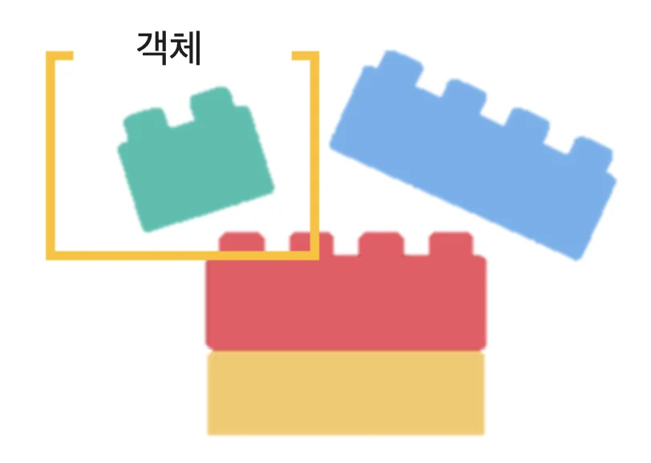
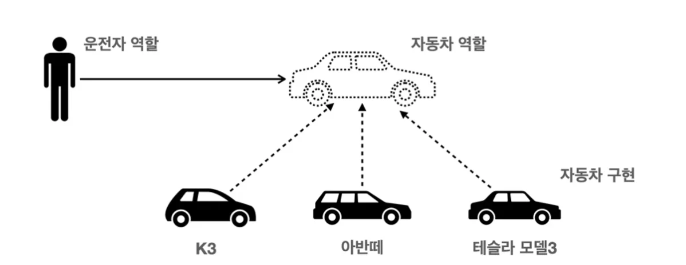
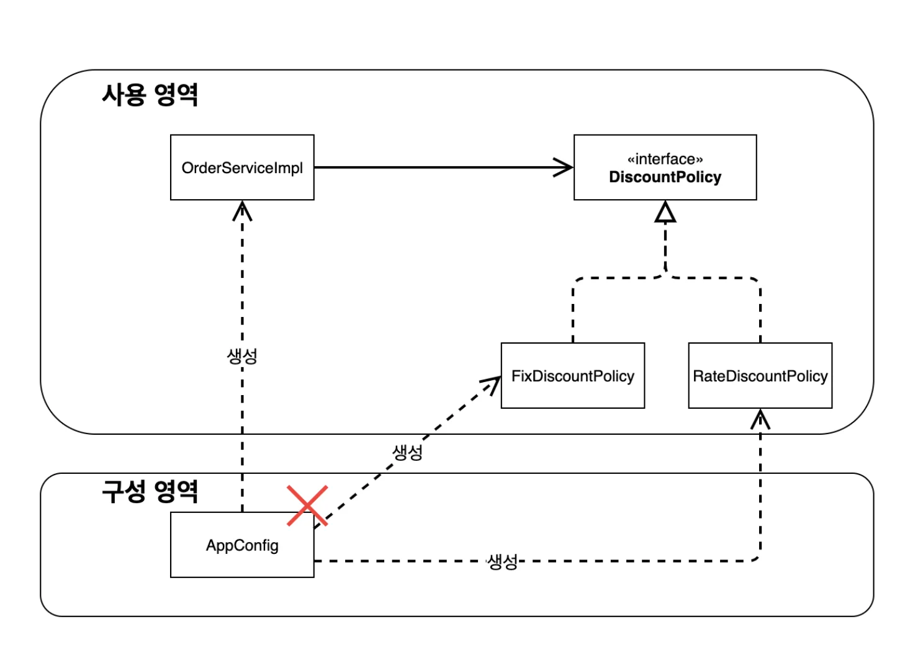
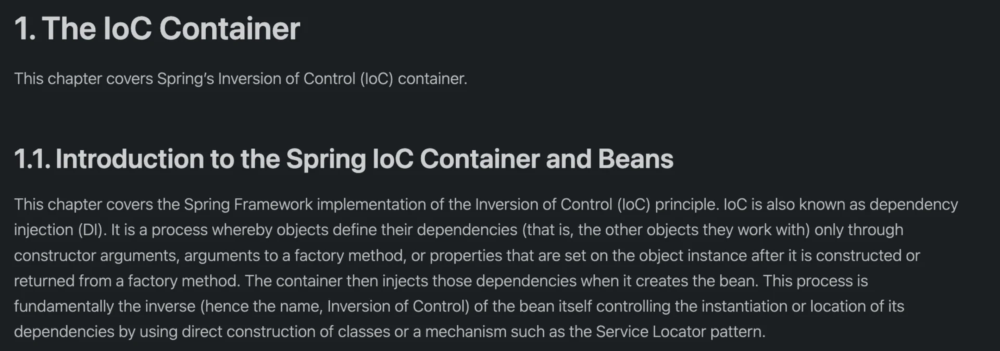
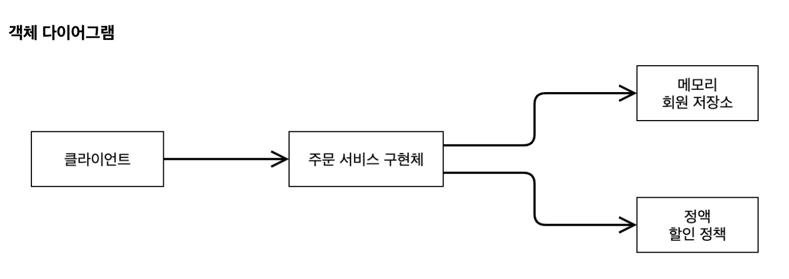
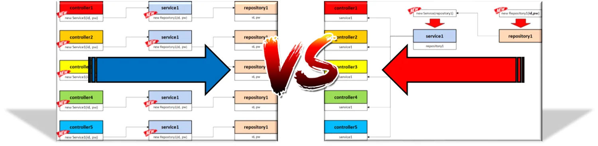
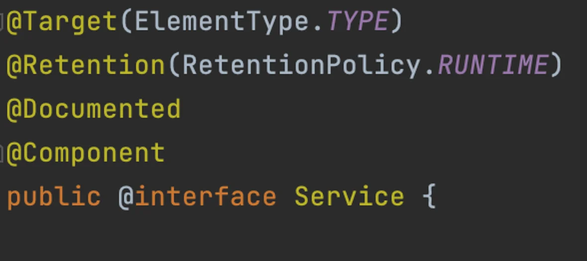

<a id="1c3eda9b0fe181fcaaaada0e05dba047"></a>

<a href="#/post/1c3eda9b-0fe1-818e-9f6b-dc5ebf58a405">페이지</a> 

<a id="1c3eda9b0fe181efa776e954ac95cbba"></a>

## 좋은 객체 지향 프로그램이란?

>  <a href="#/post/1c3eda9b-0fe1-8106-a21a-f1b7a1883901">페이지</a> 

> 📌 객체 지향 프로그래밍은 프로그램을 명령어의 목록으로 보는 시각에서 벗어나<strong><u> 여러 개의 독립된 단위</u></strong>, 즉 ‘<strong><u>객체’들의 모임</u></strong>으로 파악하고자 하는 것이다&#46; <br><strong><u>각각의 객체는 메세지를 주고 받</u></strong>고, <strong><u>데이터를 처리</u></strong>하며, <strong><u>서로 협력</u></strong>을 한다&#46; <br><br>객체 지향 프로그래밍은 프로그램을 <code>유연</code>하고 <code>변경이 쉽</code>게 만들기에 대규모 소프트웨어 개발에 많이 사용한다&#46; 

<a id="1c3eda9b0fe18169a9e9d2514d813547"></a>

### 다형성(Polymorphism) 

> 🤔 <strong>유연</strong>하고 <strong>변경이 용</strong>이하다?



<a id="1c3eda9b0fe181c0a30fe66e166f1ee4"></a>

<strong><u>‘ 유연하고 변경이 용이하다’</u></strong>  라는 표현은 <strong><u>객체들을 마치 블럭을 조립하는 것처럼</u></strong>  <strong><u>유연</u></strong><u>하고   </u><strong><u>변경이 쉽게</u></strong>  개발하는 방법이다&#46; <br>이러한 개발 방식은 <u>객체지향의 핵심</u>인 <strong>다향성</strong>을 통해 가능하다&#46;

<a id="1c3eda9b0fe1811d8180ff382ae94c0d"></a>

다형성은 <strong>객체들</strong>간의 <strong>의존성을 낮</strong>추는 <strong><a href="https://yozm.wishket.com/magazine/detail/1926/">느슨한 결합</a></strong><strong>을 만</strong>들어 준다&#46;

> 📌 <strong>다형성</strong>은 <strong>객체</strong>를<strong> </strong><strong><u>역할</u></strong>과 <strong><u>구현</u></strong>으로 <strong>구분</strong>한다&#46; 
> 
> ---
> 
> - <strong>역할</strong> = <code>인터페이스</code>
> 
> - <strong>구현</strong> = <code>인터페이스를 구현한 클래스</code>, <code>구현 객체(인스턴스)</code>

<details>
<summary><strong>⭐️ 중요&#33;</strong><strong> &#45;  예시) 운전자 &#45; 자동차</strong></summary>



> 👉🏻 <strong>역할 및 구현체</strong>
> 
> - 운전자 역할&#58; <code>Client</code>
> 
> - 자동차 역할&#58; <code>interface</code> 
> 
> - 자동차 구현&#58; <code>instance</code>     &#91;  K3, 아반떼, 테슬라  &#93;

<a id="1c3eda9b0fe18136ae98d7fd04f0aa45"></a>

운전자는 <strong><code>K3</code></strong>를 타다가 <strong><code>아반떼</code></strong><strong> </strong>로 자동차를 바꿔도 운전할 수 있다&#46;<br>왜냐하면 <strong><u>자동차의 종류(구현)만 변화</u></strong>되었을 뿐, <strong><u>자동차 내부 동작(역할)은 동일</u></strong>하기 때문이다&#46; 

<a id="1c3eda9b0fe1810981f6ef94145aa0f5"></a>

<strong><u>자동차 변경</u></strong>되어도 <strong><u>운전자가 운전하는 하는데 필요한 운전면허증, 운전 방법 등 이러한 요소들에 영향을 주지 않</u></strong>는다&#46; 

<a id="1c3eda9b0fe181a984a9d88183dbc6f9"></a>

즉, 자동차(<code>instace</code>)가 변해도 자동차의 역할(<code>interface</code>)은 변하지 않으며, 운전자(<code>client</code>)에게도 아무런 영향을 주지 않는다&#46; 

<a id="1c3eda9b0fe18136af4eefd152a9884a"></a>

→ <strong><u>운전자(instance)는 자동차 역할(interface)에  대해서만 의존</u></strong>함&#46;

<a id="1c3eda9b0fe1819a8a45f7d57d937f19"></a>

이러한 방식을<u> </u><u>‘유연하고 변경이 용이하다’</u> 라고 표현하며, 이러한 방식이 <strong><u>객체지향의 </u></strong><strong><u>다향성</u></strong><strong><u>의 특징</u></strong>이다&#46; 

</details>

> 📌 <strong>다형성의 장점</strong>
> 
> ---
> 
> - <strong>Client</strong>는 대상의 <strong><code>역할(interface)</code></strong>만 <u>의존</u>한다&#46;
> 
> - <strong>Client</strong>는 <strong>구현 대상의 내부 구조</strong>를 <u>몰라도 된</u>다&#46;
> 
> - <strong>Client</strong>는 <strong><code>구현 대상의 내부 구조</code></strong>가 변경되어도 <u>영향을 받지 않</u>는다&#46;
> 
> - <strong>Client</strong>는 <strong><code>구현 대상</code></strong> 자체를 변경해도 <u>영향을 받지 않</u>는다&#46; 

> ⚠️ <strong>일반 상속 관계</strong>도 <strong>다향성 구현이 가능</strong>하다&#46;<br>그러나, 인터페이스와 달리 <u>단일 상속만 가능</u>하여,<u> 여러가지 단점들이 있</u>다&#46;<br>따라서 <strong><u>다중 상속</u></strong>으로 구현이 가능한 <strong><u>인터페이스</u></strong>로 <strong><u>다형성을 구현</u></strong>하는 것을 권장한다&#46;

<a id="1c3eda9b0fe1814c8d3ecce8d42d4814"></a>

스프링에서 말하는  <strong><u>제어의 역전(IOC), 의존관계 주입(DI)</u></strong>은  이러한 객체지향의 핵심인 <strong><u>다향성을 활용한 역할과 구현을 구분하여 </u></strong>도록 하는 개념이다&#46; 

<a id="1c3eda9b0fe18187bce6d7df8df4eb50"></a>

### SOLID

> <a href="#/post/1c3eda9b-0fe1-8172-a336-dd711857d017">페이지</a> 

<details>
<summary><strong>SRP, 단일 책임 원칙</strong></summary>

> 📌 <strong>한 클래스</strong><strong>는 </strong><strong>하나의 책임</strong><strong>만 가져야 한다&#46;</strong>

<a id="1c3eda9b0fe181fc9444d47dab33c181"></a>

기존 클라이언트 객체에 <strong>다양한 책임(직접 구현 객체 생성 및 연결, 실행)</strong>이 적용됨

<a id="1c3eda9b0fe181cda0accb0c7da5700b"></a>

→ SRP(단일 책임) 에 따른 <strong>관심사 분리</strong>

> • 구현 객체 생성, 연결 책임&#58;  <code>AppConfig</code><br>• 실행 책임&#58; <code>클라이언트 객체</code>

</details>

<details>
<summary><strong>DIP, 의존관계 역전 원칙</strong></summary>

> 📌 <strong><u>추상화(인터페이스)에 의존</u></strong> 해야된다&#46; &#91;<strong>구현체 의존 X&#93;</strong>  <br> → <strong> </strong><strong>의존성(의존관계) 주입(DI)</strong>

<a id="1c3eda9b0fe18121a1a9cc938d1aaadd"></a>

새로운 할인 정책(정률 할인)을 개발 및 적용하려고 하니  클라이언트 코드도 함께 변경해야 되었음

<a id="1c3eda9b0fe18138a446d67000fe22e4"></a>

 → 기존 클라이언트 코드(<code>OrderServiceImpl</code>)가  인터페이스(<code>DiscountPolicy</code>)뿐만 아니라 구현 클래스(<code>FixDiscountPolicy</code>)에도 함께 의존함&#46;

<a id="1c3eda9b0fe181e28f5cfc48caf89cb2"></a>

따라서 <strong>DIP</strong> 에 따라, 클라이언트 코드에 인터페이스( <code>DiscountPolicy</code>)에만 의존하도록 코드 변경 및 <code>AppConfig</code>를 통해 <code>FixDiscountPolicy</code> 객체 인스턴스를 대신 생성하여, 클라이언트 코드에 의존관계를 주입 했다&#46; 

</details>

<details>
<summary><strong>OCP, Open/Close 원칙</strong></summary>

> 📌 소프트웨어 요소는 <strong>확장에는 열</strong>려 있으나 <strong>변경에는 닫</strong>혀 있어야 한다&#46;

<a id="1c3eda9b0fe181e09987d93323189708"></a>

<code>AppConfig</code>를 통해, 애플리케이션을 <strong>사용 영역</strong> 과<strong> </strong><strong>구성 영역</strong>으로 나누었다&#46;

<a id="1c3eda9b0fe1812a87a7f60c667d21db"></a>

따라서 요구사항 변경에 따른 정책이 바뀌어도,<strong><u> </u></strong><strong><u><code>AppConfig</code></u></strong><strong><u>에서 구현체만 변경</u></strong>하여 클라이언트 코드에 주입하기 때문에, <strong><u>구성 영역</u></strong><u> 를 새롭게 </u><strong><u>확장</u></strong>해도, <strong><u>사용 영역(클라이언트)</u></strong><u>의 변경은 닫혀</u>있다&#46;

<a id="1c3eda9b0fe181d28848db0ff19df033"></a>

할인 정책(구성 영역)이 변경( <code>FixDiscountPolicy</code> → <code>RateDiscountPolicy</code> ) 되어도, 사용 영역(클라이언트)은 변경되지 않음&#46;



</details>

<a id="1c3eda9b0fe181a29ed6faeb96b7a9c7"></a>

## IoC(제어의 역전), DI(의존성 주입) 이해

<a id="1c3eda9b0fe1814c969ae1324d9c7254"></a>

### 스프링의 <code>IoC</code>, <code>DI</code>

<details>
<summary>🧐 <strong><code>설계 원칙</code></strong><strong> 과 </strong><strong><code>디자인 패턴</code></strong><strong>의 차이</strong></summary>

> 🤔 • IoC(제어의 역전)&#58; <strong>설계 원칙</strong><br>• DI(의존성 주입)&#58; <strong>디자인패턴</strong>

<details>
<summary>김치 볶음밥 맛있게 만드는 방법 (설계 원칙)</summary>

> 🧑‍🍳 맛있는 김치 볶음밥을 만들기 위한 원칙
> 
> - 신선한 재료를 사용한다&#46;
> 
> - 신 김치를 사용한다&#46;
> 
> - 밥과 김치의 비율을 잘 맞춰야 한다&#46;
> 
> - 볶을 때 재료의 순서가 중요하다&#46;

</details>

<details>
<summary>김치 볶음밥 레시피 (디자인 패턴)</summary>

> 🍳 맛있는 김치 볶음밥을 만들기 위한 황금 레시피
> 
> 1. 오일을 두른 팬에 채썬 파를 볶아 파기름을 만든다&#46;
> 
> 1. 준비한 햄을 넣고 볶다가, 간장 한스푼을 넣어 풍미를 낸다&#46;
> 
> 1. 설탕에 버무린 김치를 넣고 함께 볶는다&#46;
> 
> 1. 미리 식혀 둔 밥을 넣어 함께 볶는다&#46;
> 
> 1. 참기름 한스푼을 넣어 마무리한다&#46;

<a id="1c3eda9b0fe181f29c26f5026c72d86c"></a>

### 

</details>

<a id="1c3eda9b0fe181b492ebe67d966ba454"></a>

강의 예시를 가져와 보았다&#46; 두 예시를 보면 <code>디자인 패턴</code>은 <strong><u>구체적인 방법론</u></strong>을 말하며 <code>설계 원칙</code>은 <u>조금더 큰 틀</u>에서의<u> 권고사항</u> 정도 인것 같다&#46;

</details>

<details>
<summary>🧐 좋은 코드란 무엇인가?</summary>

> <a href="https://velog.io/@dltjq2323/Day1-TIL-1%EC%9E%A5-%EA%B9%A8%EB%81%97%ED%95%9C-%EC%BD%94%EB%93%9C-24.05.04">추가내용&#58; 클린코드 &#45; 1장</a>

- 논리 단순

- 중복 제거, 표현 명확

- 의존성 최소화

- 처음 보는 사람도 쉽게 이해하고 수정할 수 있어야 함

- 새로운 기능을 추가 하더라도 크게 구조의 변경이 없어야 함(OCP)

- &#46;&#46;&#46;

</details>

<a id="1c3eda9b0fe181268b17eb00abf0c57d"></a>

<strong><code>Spring</code></strong>은 <u>개발자가 Java를 사용하여 </u><strong><u>쉽게 좋은 코드를 작성</u></strong><u>할 수 있</u>도록 도와주는 역할을 하는 기술이다&#46;

<a id="1c3eda9b0fe181c2bc87f783c724fed5"></a>

ex) 요리 도구까지 전부 들어있는 밀키트

<a id="1c3eda9b0fe181f4b4b1d3f054b14294"></a>

그리고 <strong><code>IoC</code></strong>와 <strong><code>DI</code></strong>는 <strong><u>좋은 코드 작성을 위한 Spring의 핵심 기술 중 하나</u></strong>이다&#46;

> <strong>DI 패턴을</strong> 사용하여 <strong>IoC 설계 원칙을 구현한다&#46;</strong>



- <a href="https://docs.spring.io/spring-framework/docs/current/reference/html/core.html#beans-introduction">Spring Docs </a> 발췌

<a id="1c3eda9b0fe181838245d381b1045abb"></a>

DI, IoC는 <strong><u>인스턴스(구현)를 외부에서 생성하여 주입(</u></strong><strong><u><code>DI</code></u></strong><strong><u>)하는 방법</u></strong>으로 <strong><u>각 객체들은 인터페이스(역할)에만 의존성을 갖</u></strong>는다&#46; 이를 통해 객체들은 <strong><u>느슨한 결합 상태의 의존성을 가</u></strong>져 <strong><u>앱의 유연성과 확장성을 높</u></strong>여준다&#46;<br>또한 와부에서 인스턴스를 주입하기 때문에 이전 제어의 흐름과 정반대인 <u>역전된 형태의 제어 흐름</u><u>(</u><u><code>IoC</code></u><u>)</u>가진다&#46;

<a id="1c3eda9b0fe18102b465f8907a5e5719"></a>

### 의존성

<details>
<summary><strong>강한 결합(Tight Coupling)</strong></summary>


<details>
<summary><strong>Consumer</strong></summary>

<a id="1c3eda9b0fe181abbfb2c25acf763b33"></a>

```java
public class Consumer {
		public static void main(String[] args) {
        Consumer consumer = new Consumer();
        consumer.eat();
    }

    void eat() {
			  // 의존성: Cunsumer  -> Chicken
        Chicken chicken = new Chicken();
        chicken.eat();
    }
}
```

</details>

<details>
<summary><strong>Chicken</strong></summary>

<a id="1c3eda9b0fe1815c8499f05392ef00dd"></a>

```java
class Chicken {
    public void eat() {
        System.out.println("치킨을 먹는다.");
    }
}
```

</details>

<a id="1c3eda9b0fe181b4a667d7ead6c33742"></a>

<strong>객체의 의존성 수정(</strong><strong><code>Chicken</code></strong><strong>  → </strong><strong><code>Pizza</code></strong><strong>)  시,  </strong><strong><code>Consumer&#46;eat()</code></strong><strong> 코드를 아래와 같이 수정해야 한다&#46; </strong>

<details>
<summary><strong>Consumer</strong></summary>

<a id="1c3eda9b0fe181929b75ecc4a0ec59ff"></a>

```java
public class Consumer {
		public static void main(String[] args) {
        Consumer consumer = new Consumer();
        consumer.eat();
    }

    void eat() {
			  // 의존성: Cunsumer  -> Pizza
        Pizza pizza = new Pizza();
        pizza.eat();
    }
}
```

</details>

<details>
<summary><strong>Pizza</strong></summary>

<a id="1c3eda9b0fe181d4bb26e2be85f7c4d7"></a>

```java
class Pizza {
    public void eat() {
        System.out.println("피자를 먹는다.");
    }
}
```

</details>

<a id="1c3eda9b0fe181a0ab60e6450b76a168"></a>

즉, <strong>객체에 역할과 구현이 구분되지 않</strong>아 <strong><u>객체의 변경이 일</u></strong>어날 시, <strong><u>다른 객체 내부에까지 수정</u></strong>이 이루어 진다&#46; 

<a id="1c3eda9b0fe18178addff7d4ab55f072"></a>

이는 <strong>앱의 유연성 및 확장성을 떨</strong>어뜨리는 객체지향의 중요한 특징인 <strong><u><code>다형성</code></u></strong><strong><u>을 활용하지 못</u></strong>하는 좋지 않은 방법이다&#46; 

<a id="1c3eda9b0fe181698523ce47e1a31fe3"></a>

프로젝트가 커질수록 수많은 객체들이 모여 앱을 이루는데, 객체간에 이렇게 <strong>강한 결합(Tight Coupling)</strong>으로 의존성이 구성된다면,  유지보수 및 앱이 확장 시… 생각만해도 끔찍히다<br>

</details>

<details>
<summary><strong> </strong><strong><a href="https://yozm.wishket.com/magazine/detail/1926/">느슨한 결합(Loosely Coupled)</a></strong><strong>&#58; </strong><strong><code>다형성</code></strong><strong> 활용</strong></summary>

> 📌 객체지향의 특징 중 하나인 <strong><code>다향성</code></strong>을 활용하여 <strong>객체간의 의존성을 낮</strong>추어 <strong><u>앱의 유연성과 변경 가능성을 용이</u></strong>하게 만들어주는 방법이다&#46; 

<a id="1c3eda9b0fe181e28e76df5a01fc6f18"></a>

위에서 설명했듯이 <strong>다향성</strong>은 <strong>객체를 </strong><strong><code>역할</code></strong><strong>과 </strong><strong><code>구현</code></strong><strong>으로 분리</strong>하는 것을 말한다&#46; 

<a id="1c3eda9b0fe1818faf40d930602d2605"></a>

즉, 객체를 <strong><code>interface</code></strong>와 <strong><code>interface 구현 클래스</code></strong>(or <strong><code>instance</code></strong>)로 구분하여  

<a id="1c3eda9b0fe18126aeecd4d6e0caafcb"></a>

<strong><u><code>interface 구현 클래스</code></u></strong>(or <strong><u><code>instance</code></u></strong><strong>) </strong>가 <strong><u><code>interface</code></u></strong><strong><u>(역할</u></strong>)에 <strong>의존</strong>하게 설계한다&#46;


<details>
<summary>Consumer</summary>

<a id="1c3eda9b0fe18106b7dad0c1a83c1c55"></a>

```java
public class Consumer {
		
		// 인터페이스 
    void eat(Food food) {
        food.eat();
    }

    public static void main(String[] args) {
        Consumer consumer = new Consumer();
        consumer.eat(new Chicken());
        consumer.eat(new Pizza());
    }
}
```

</details>

<details>
<summary><strong>&#60; interface &#62;</strong> Food</summary>

<a id="1c3eda9b0fe181b58bdbf74513169089"></a>

```java
interface Food {
    void eat();
}
```

</details>

<details>
<summary>Chiken</summary>

<a id="1c3eda9b0fe181a6b429e73baceb3535"></a>

```java
class Chicken implements Food{
    @Override
    public void eat() {
        System.out.println("치킨을 먹는다.");
    }
}
```

</details>

<details>
<summary>Pizza</summary>

<a id="1c3eda9b0fe181b89700e0cc6af1d136"></a>

```java
class Pizza implements Food{
    @Override
    public void eat() {
        System.out.println("피자를 먹는다.");
    }
}
```

</details>

</details>

<a id="1c3eda9b0fe181ef9acefebd8a3ecbea"></a>

### 주입

<a id="1c3eda9b0fe1814c845ecbea2fb505bf"></a>

### <strong>필드 주입</strong>

> 📌 필드 값을 통한 의존성 주입

<a id="1c3eda9b0fe181fb85ecebeb3827fcae"></a>

```java
public class Consumer {
		
		// 필드 주입
    Food food;

    void eat() {
        this.food.eat();
    }

    public static void main(String[] args) {
        Consumer consumer = new Consumer();
        
        consumer.food = new Chicken();
        consumer.eat();

        consumer.food = new Pizza();
        consumer.eat();
    }
}

// ... 
```

<a id="1c3eda9b0fe1818a8fc3fbfce94459b1"></a>

### <strong>메서드(setter) 주입</strong>

> 📌 setter를 통한 의존성 주입

<a id="1c3eda9b0fe1816b81f4c86d717ce091"></a>

```java
public class Consumer {

    Food food;

    void eat() {
        this.food.eat();
    }
    
		// 메서드(setter) 주입
    public void setFood(Food food) {
        this.food = food;
    }

    public static void main(String[] args) {
        Consumer consumer = new Consumer();
        consumer.setFood(new Chicken());
        consumer.eat();

        consumer.setFood(new Pizza());
        consumer.eat();
    }
}

// ... 
```

<a id="1c3eda9b0fe18109a44dc3e352e9cf7d"></a>

### <strong>권장) 생성자 주입</strong>

> 📌 <strong>생성자(Constructor)</strong>를 통한 의존성 주입

<a id="1c3eda9b0fe181379ce7fb3af09e001d"></a>

생성자 사용 시, 인스턴스 주입 여부를 검사한다&#46;

<a id="1c3eda9b0fe181b9bccdfe0296dc3ed2"></a>

```java
public class Consumer {

    Food food;
		
		// 생성자를 통한 의존성 주입
    public Consumer(Food food) {
        this.food = food;
    }

    void eat() {
        this.food.eat();
    }

    public static void main(String[] args) {
        Consumer consumer = new Consumer(new Chicken());
        consumer.eat();

        consumer = new Consumer(new Pizza());
        consumer.eat();
    }
}


//  ..

```

<a id="1c3eda9b0fe1817eaff7e0ad81a1873d"></a>

### &#43;)  <strong>정적인 클래스 </strong><strong>의존 관계</strong><strong>, 동적인 객체(인스턴스) 의존관계</strong>

> <a href="#/post/1c3eda9b-0fe1-8113-875c-da1894568c75">페이지</a> <br><a href="https://www.inflearn.com/course/%EC%8A%A4%ED%94%84%EB%A7%81-%ED%95%B5%EC%8B%AC-%EC%9B%90%EB%A6%AC-%EA%B8%B0%EB%B3%B8%ED%8E%B8">&#91;인프런&#93; &#45; 스프링 핵심원리 기본편</a> 참조

> ☝🏻 의존관계는 <strong>정적인 클래스 의존 관계</strong>와, <strong>실행 시점에 결정되는 동적인 객체(인스턴스) 의존관계</strong> 둘을 분리해서 생각해야 한다&#46; <br> → <code>클래스 다이어그램</code>, <code>객체 다이어그램</code>

<details>
<summary><strong>정적 클래스 의존관계</strong></summary>

> 정적인 의존관계는 애플리케이션을 실행하지 않아도 분석할 수 있다&#46;  <br>  →  <code>클래스 다이어그램</code>


<a id="1c3eda9b0fe18161bb93caa3358b91d0"></a>

위 클래스 다이어그램을 보면 <code>OrderServiceImpl</code>는 <code>MemoryRepository</code>, <code>DiscountPolicy</code> 에 의존한다는 것을  알 수 있다&#46; <br>그러나  이러한 클래스 의존관계만으로는 에는 <u>실제 어떤 객체가 </u><u><code>OrderSeviceImpl</code></u><u> 에 주입되는 지는 알 수 없</u>다&#46; 

</details>

<details>
<summary><strong>동적인 객체 인스턴스 의존관계</strong></summary>

> 👉🏻 애플리케이션 실행 시점에서, 실제 생성된 객체 인스턴스 의존관계



<a id="1c3eda9b0fe18158bf5cf513b0403f7a"></a>

애플리케이션 <strong>실행 시점(런타임)</strong>에 외부에서 실제 구현 객체를 생성하고 클라이언트에 전달(<code>DI, 의존관계 주입</code>)해서 클라이언트와 서버의 실제 의존관계가 형성

<a id="1c3eda9b0fe1816b94dcf56d6be242a5"></a>

→ 클라이언트 코드의 변경 X, 호출 대상의 타입 인스턴스를 변경 가능<br>→ 정적인 클래스 의존관계 변경  , 동적인 객체 인스턴스 의존관계 변경 가능

</details>

<a id="1c3eda9b0fe18170927ed62ce1f443a1"></a>

## 실습) 메모장 앱 &#45; IoC &#38; DI 적용

<details>
<summary><strong>실습) 중복 생성 로직 제거</strong></summary>

<details>
<summary><strong>MemoController</strong></summary>

<details>
<summary>문제) <code>memoService</code> 중복 생성 </summary>

<a id="1c3eda9b0fe181f0bda0cadc14ee01ca"></a>

```java
MemoRepository memoRepository = new MemoRepository(jdbcTemplate);
```

</details>

<details>
<summary> 개선1) <code>memoService</code> 생성자 주입 통한 중복 생성 로직 제거</summary>

<a id="1c3eda9b0fe181b1aac9dc4eecf97b32"></a>

```java
MemoService memoService;

public MemoController(JdbcTemplate jdbcTemplate) {
    this.memoService = new MemoService(jdbcTemplate);
}
```

</details>

<details>
<summary>개선2) <code>memoService</code> 생성자 주입 제거</summary>

> <code>memoService</code>를  Contructor에서 생성함으로써 <code>jdbcTemplate</code> 바로 인자로 전달함<br>→  <code>JdbcTemplate</code> 생성자 주입 로직은 필요가 없음

<a id="1c3eda9b0fe181be8958f5d0faff38b7"></a>

```java
private final JdbcTemplate jdbcTemplate;

public MemoService(JdbcTemplate jdbcTemplate) {
    this.jdbcTemplate = jdbcTemplate;
}
```

</details>

<details>
<summary><strong>개선코드) MemoController</strong></summary>

<a id="1c3eda9b0fe18121a38aedd120e20a1c"></a>

```java
package com.sparta.memo.controller;

import com.sparta.memo.dto.MemoRequestDto;
import com.sparta.memo.dto.MemoResponseDto;
import com.sparta.memo.service.MemoService;
import org.springframework.jdbc.core.JdbcTemplate;
import org.springframework.web.bind.annotation.*;
import java.util.List;

@RestController
@RequestMapping("/api")
public class MemoController {

    MemoService memoService;

    public MemoController(JdbcTemplate jdbcTemplate) {
        this.memoService = new MemoService(jdbcTemplate);
    }

    @PostMapping("/memos")
    public MemoResponseDto createMemo(@RequestBody MemoRequestDto requestDto) {
        return memoService.createMemo (requestDto);
    }

    @GetMapping("/memos")
    public List<MemoResponseDto> getMemos() {
        return memoService.getMemos ();
    }

    @PutMapping("/memos/{id}")
    public Long updateMemo(@PathVariable Long id, @RequestBody MemoRequestDto requestDto) {
        return memoService.updateMemo(id, requestDto);
    }

    @DeleteMapping("/memos/{id}")
    public Long deleteMemo(@PathVariable Long id) {
        return memoService.deleteMemo(id);
    }
}
```

</details>

</details>

<details>
<summary><strong>MemoService</strong></summary>

<details>
<summary>문제) <code>memoRepository</code> 중복 생성 </summary>

<a id="1c3eda9b0fe181ef97cacd88e44f093f"></a>

```java
MemoRepository memoRepository = new MemoRepository(jdbcTemplate);
```

</details>

<details>
<summary> 개선1) <code>memoRepository</code> 생성자 주입 통한 중복 생성 로직 제거</summary>

<a id="1c3eda9b0fe181168a9ceeb5b47526c1"></a>

```java
MemoRepository memoRepository;

public MemoService(JdbcTemplate jdbcTemplate) {
    this.memoRepository = new MemoRepository(jdbcTemplate);
}
```

</details>

<details>
<summary>개선2) <code>JdbcTemplate</code> 생성자 주입 제거</summary>

> MemoRepository를  Contructor에서 생성함으로 바로 인자로 전달하면 되기 때문에 <code>JdbcTemplate</code> 생성자 주입 로직은 필요가 없다&#46; 따라서 제거한다&#46; 

<a id="1c3eda9b0fe1817fbd3efa7935d12a98"></a>

```java
private final JdbcTemplate jdbcTemplate;

public MemoService(JdbcTemplate jdbcTemplate) {
    this.jdbcTemplate = jdbcTemplate;
}
```

</details>

<details>
<summary><strong>개선코드) MemoService</strong></summary>

<a id="1c3eda9b0fe181fb90a6fa9f44be2aa8"></a>

```java
package com.sparta.memo.service;

import com.sparta.memo.dto.MemoRequestDto;
import com.sparta.memo.dto.MemoResponseDto;
import com.sparta.memo.entity.Memo;
import com.sparta.memo.repository.MemoRepository;
import org.springframework.jdbc.core.JdbcTemplate;
import org.springframework.stereotype.Service;
import org.springframework.web.bind.annotation.PathVariable;
import org.springframework.web.bind.annotation.RequestBody;


import java.util.List;

@Service
public class MemoService {

    MemoRepository memoRepository;

    public MemoService(JdbcTemplate jdbcTemplate) {
        this.memoRepository = new MemoRepository(jdbcTemplate);
    }

    public MemoResponseDto createMemo(MemoRequestDto requestDto) {
        // RequestDto -> Entity
        Memo memo = new Memo(requestDto);

        // DB 저장
        Memo saveMemo = memoRepository.save(memo);

        // Entity -> ResponseDto
        MemoResponseDto memoResponseDto = new MemoResponseDto(saveMemo);

        return memoResponseDto;
    }

    public List<MemoResponseDto> getMemos() {
        return memoRepository.findAll();
    }

    public Long updateMemo(@PathVariable Long id, @RequestBody MemoRequestDto requestDto) {

        // 해당 메모가 DB에 존재하는지 확인
        Memo memo = memoRepository.findById(id);

        if(memo != null) {
            memoRepository.update(id, requestDto);

            return id;
        } else {
            throw new IllegalArgumentException("선택한 메모는 존재하지 않습니다.");
        }
    }

    public Long deleteMemo(Long id){

        // 해당 메모가 DB에 존재하는지 확인
        Memo memo = memoRepository.findById(id);

        if(memo != null) {
            memoRepository.delete(id);

            return id;
        } else {
            throw new IllegalArgumentException("선택한 메모는 존재하지 않습니다.");
        }
    }
}

```

</details>

</details>

</details>

> 🧐 <strong>문제점&#58; &#91;  Controller &#45; Service &#45; Repository &#93; 에 강한 결합 상태</strong>

<details>
<summary>강한 결합 </summary>

<details>
<summary><strong><code>문제</code></strong><strong>&#58; </strong>생성자 내부에서 인스턴스 생성</summary>

<a id="1c3eda9b0fe18137bdaae4c89c814f6f"></a>

```java
public MemoController(JdbcTemplate jdbcTemplate) {
    this.memoService = new MemoService(jdbcTemplate);
}

...


public MemoService(JdbcTemplate jdbcTemplate) {
    this.memoRepository = new MemoRepository(jdbcTemplate);
}
```

</details>

<details>
<summary><strong><code>해결</code></strong><strong>&#58; </strong>내부 인스턴스 생성 로직 제거 및 외부 생성자 주입</summary>

<a id="1c3eda9b0fe181519046e9c3424949f8"></a>

```java
public MemoController(MemoService memoService) {
    this.memoService = memoService;
}

...

public MemoService(MemoRepository memoRepository) {
    this.memoRepository = memoRepository;
}
```

</details>

</details>

<details>
<summary>제어의 역전 (<code>IoC</code>)</summary>



<a id="1c3eda9b0fe1810fb55cd72df9293172"></a>

<strong>객체들 간의 강한 결합을 제거</strong>하기 위해 <strong><u>인스턴스를 외부에서 생성해 주입(DI)</u></strong>하였다&#46; 이로 인해 <strong>객체들 간에 느슨한 결합 상태</strong>가 되어 유연성과 높아지고 변경이 용이 해졌다&#46; 그리고 이전 <code>Controller ⇒ Service ⇒ Repository</code>  제어 흐름에서 의존성 주입(DI)을 통해 <code>Repository ⇒ Service ⇒ Controller</code> 로 제어의 흐름이 역전 되었다&#46; 

> 🧐 해당 챕터에는 아직 외부 인스턴스(<code>수동 생성자 주입</code>)를 주입하는 방법이 나오지 않음&#46;<br>→ <strong><code>AppConfig</code></strong>

<a id="1c3eda9b0fe181f092e9e2084c1b0433"></a>

아래의 스프링<strong><u> IoC 컨테이너</u></strong>와 <strong><u>빈</u></strong>을 통한 <strong><code>자동 생성자 주입</code></strong> 방법을 통해 해결함&#46;

</details>

<a id="1c3eda9b0fe181fba586c804d4e46d8c"></a>

## IoC Container와 Bean

> 📌 <strong>Spring 프레임워크</strong>가 <strong><u>필요한 객체를 생성하고 관리하는 역할을 </u></strong><strong><u>대신</u></strong> 해준다&#46;
> 
> - <strong>빈 (Bean)</strong>&#58; Spring이 관리하는 객체
> 
> - <strong>Spring IoC 컨테이너</strong>&#58; &#39;<strong>Bean&#39;</strong>을 모아둔 컨테이너

<details>
<summary>빈 등록&#58; <strong><code>&#64;Component</code></strong><strong> </strong></summary>

> 📌 <code>&#64;Componet</code> Anotation을 통해 <strong>빈 등록 </strong>

> ‘Bean’으로 등록하고자 하는 클래스에 아래와 같이 <code>&#64;Component</code> Anotation 부여 

<a id="1c3eda9b0fe18181adc7db312f0dd279"></a>

```java
@Component
public class MemoService { ... }
```

<details>
<summary><strong>빈 스캔 및 등록&#58; </strong><strong><code>&#64;ComponentScan</code></strong></summary>

<a id="1c3eda9b0fe181209cdfde7a0a159c56"></a>

Spring 서버 실행 시, 해당 Anotation이  적용된 package의 하위 package들을 전부 확인하여 빈(<code>&#64;Component</code>)을 스프링 컨테이너에 등록한다&#46;

</details>

</details>

<details>
<summary><strong>자동 의존관계 주입&#58; </strong><strong><code>&#64;Autowired</code></strong></summary>

> 📌 필드 위에 <code>&#64;Autowired</code> 적용 시 <strong>자동</strong>으로<strong><u> 스프링 컨테이너에서 필드에 해당하는 빈을 찾고 의존성을 주입</u></strong>한다&#46; 

> ⚠️ <strong><code>&#64;Autowired</code></strong><strong> 적용 조건</strong>
> 
> - Spring IoC 컨테이너에 의해 관리되는 <code>빈</code>만 가능
>     <a id="1c3eda9b0fe18146b512f57e8a35d792"></a>
> 
>     즉, <code>&#64;Component</code>가 명시된 클래스만 사용 가능

> Spring에서 IoC 컨테이너에 저장된 memoRepository ‘Bean’을 해당 필드에 자동으로 의존성 주입(DI) 해준다&#46;

<a id="1c3eda9b0fe181609f25eaeecc7981d3"></a>

```java
@Component
public class MemoService {
		
    @Autowired
    private MemoRepository memoRepository;
		
		// ...
}
```

> <strong>객체의 불변성을 확보</strong>할 수 있기 때문에 일반적으로는 <strong>생성자를 사용</strong>하여 <strong>DI</strong>하는 것이 좋다&#46;

<a id="1c3eda9b0fe181ee8a97eb39121b9515"></a>

```java
@Component
public class MemoService {

    private final MemoRepository memoRepository;

    @Autowired
    public MemoService(MemoRepository memoRepository) {
        this.memoRepository = memoRepository;
    }
		
		// ...
}
```

<details>
<summary>생성자 선언이 1개 일 때, <code>&#64;Autowired</code> 생략가능</summary>

- 생성자 1개, <code>&#64;Autowired</code> 생략
    <a id="1c3eda9b0fe18143b61bd5f233b59202"></a>

    ```java
    public class A {
    	public A(B b) { ... }
    }
    ```

- 생성자 2개, <code>&#64;Autowired</code> 생략 불가
    <a id="1c3eda9b0fe18198adc5e7f73f4b4356"></a>

    ```java
    public class A {
    	@Autowired // 생략 불가
    	public A(B b) { ... }

    	@Autowired // 생략 불가
    	public A(B b, C c) { ... }
    }
    ```

</details>

</details>

<details>
<summary><strong>Lombok&#58;  </strong><strong><code>&#64;RequiredArgsConstructor</code></strong><strong> </strong></summary>

> 📌 <strong><u>final로 선언된 멤버 변수</u></strong>를 파라미터로 사용하여<strong> </strong><strong><u>생성자를 자동으로 생성</u></strong><strong>한다&#46;</strong>

<a id="1c3eda9b0fe1815ab817cdb8826fb5a5"></a>

```java
@Component
@RequiredArgsConstructor // final로 선언된 멤버 변수를 파라미터로 사용하여 생성자를 자동으로 생성합니다.
public class MemoService {

    private final MemoRepository memoRepository;

//    생성자 자동 생성   
//    public MemoService(MemoRepository memoRepository) {
//        this.memoRepository = memoRepository;
//    }
```

</details>

<details>
<summary><strong><code>&#64;Component</code></strong>를 포함하는 Anotation들</summary>

<a id="1c3eda9b0fe181a2864ed4da86b31c15"></a>

<strong>3 Layer Achitecture</strong>에 해당하는 <code>Controller</code>, <code>Service</code>, <code>Repository</code>에는 그에 대응되는 Anotation들이 있다&#46;

- <code>&#64;Controller</code>, <code>&#64;RestController</code>

- <code>&#64;Service</code>

- <code>&#64;Repositor</code>

<a id="1c3eda9b0fe181bca4aff3c6c85e61a2"></a>

해당하는 Anotation들 내부에는 <strong><code>&#64;Component</code></strong><strong>가 명시</strong>되어 있어 

<a id="1c3eda9b0fe181969e23d112a2d4309f"></a>

해당 Anotation들이 명시된 클래스를 <strong><u>스프링 컨테이너에 </u></strong><strong><u><code>빈</code></u></strong><strong><u>으로 등록</u></strong>한다&#46;



</details>

<details>
<summary><strong>스프링 컨테이너&#58; ApplicationContext&#93;</strong></summary>

<a id="1c3eda9b0fe181f9b260e05395c660b8"></a>

ApplicationContext는 BeanFactory등을 상속하여 기능을 확장한 Container이다&#46;

> BeanFactory는 ‘Bean’ 의 생성, 관계설정등의 제어를 담당하는 IoC 객체이다&#46;

<details>
<summary>스프링 IoC 컨테이너에서 ‘Bean’을 수동 가져오기</summary>

> ApplicationContext&#46;getBean(”가져올 빈 이름”)

<a id="1c3eda9b0fe181609736e9b8b2e5eae5"></a>

```java
@Component
public class MemoService {

		private final MemoRepository memoRepository;

    public MemoService(ApplicationContext context) {
        // 1.'Bean' 이름으로 가져오기
        MemoRepository memoRepository = (MemoRepository) context.getBean("memoRepository");

        // 2.'Bean' 클래스 형식으로 가져오기
        // MemoRepository memoRepository = context.getBean(MemoRepository.class);

        this.memoRepository = memoRepository;
    }

		...		
}
```

</details>

</details>

<a id="1c3eda9b0fe18145ac9bca7f7a485151"></a>

### 실습) 스프링(Ioc) 컨테이너와 빈을 통한 자동 생성자 주입

<details>
<summary><strong>MemoController</strong></summary>

<a id="1c3eda9b0fe181188d1ec434c4b8d7cd"></a>

```java
@RestController
@RequestMapping("/api")
public class MemoController {

    MemoService memoService;

    @Autowired
    public MemoController(MemoService memoService) {
        this.memoService = memoService;
    }
```

</details>

<details>
<summary><strong>MemoService</strong></summary>

<a id="1c3eda9b0fe181daaf18cd95272761f6"></a>

```java
@Service
public class MemoService {    

    MemoRepository memoRepository;
		
		Autowired
    public MemoService(MemoRepository memoRepository ) {
        this.memoRepository = memoRepository;
    }
	      .   .   .
```

</details>
