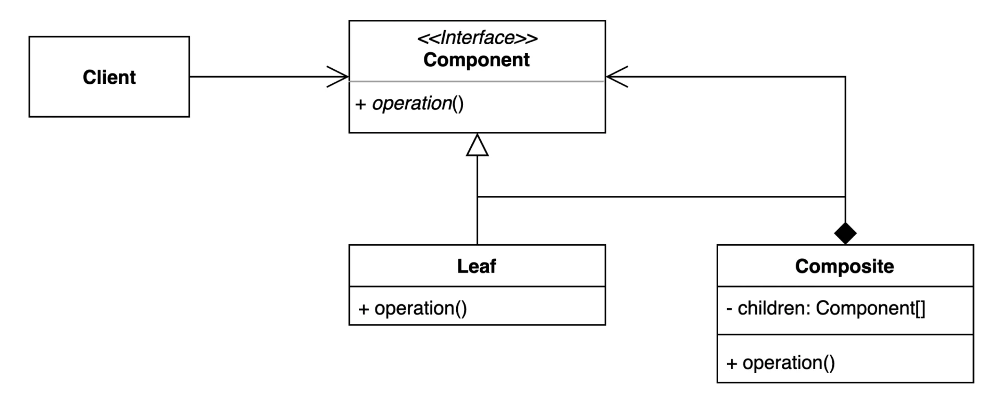
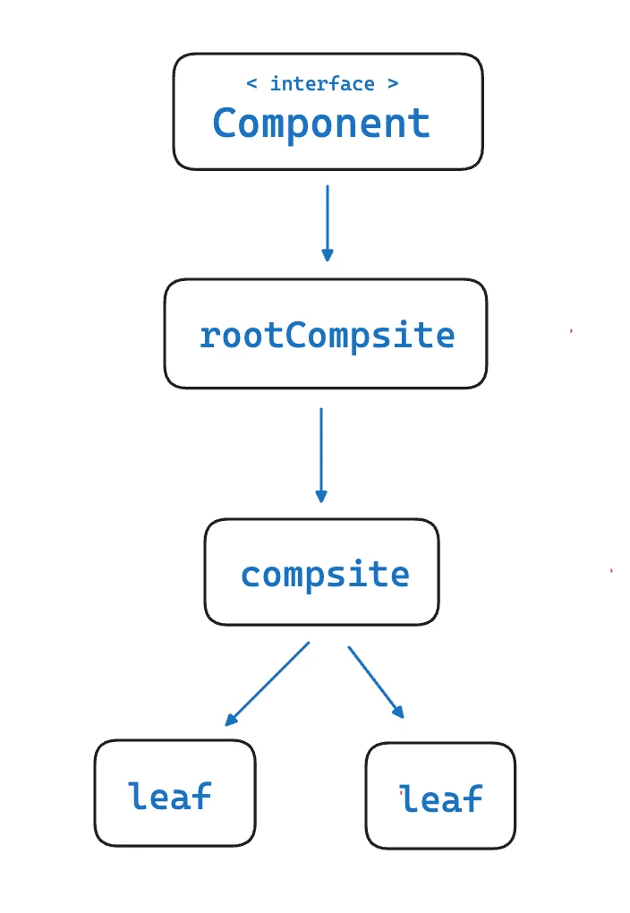
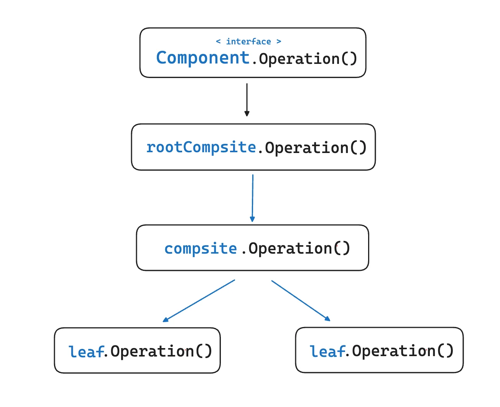
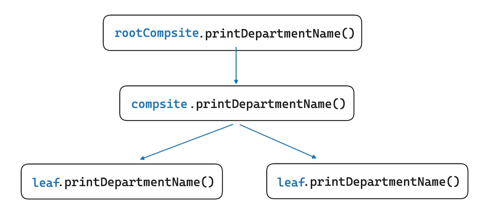
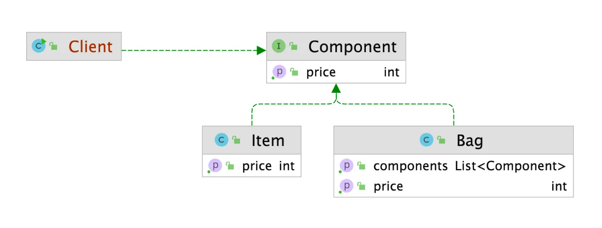
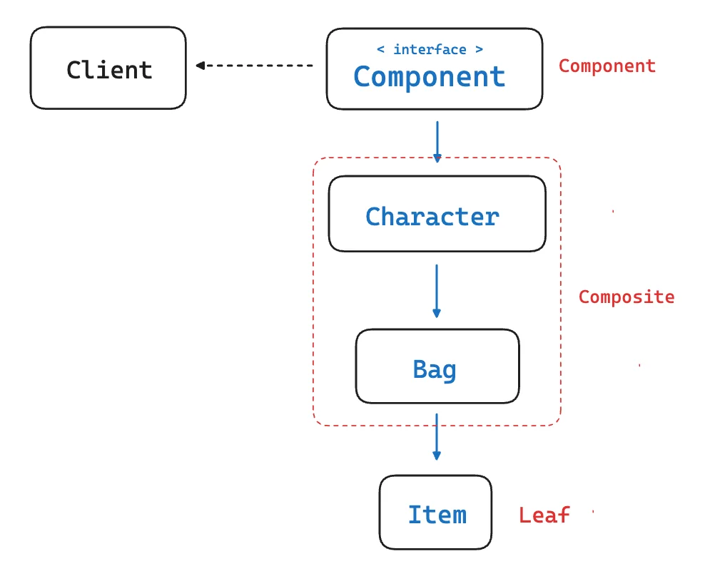
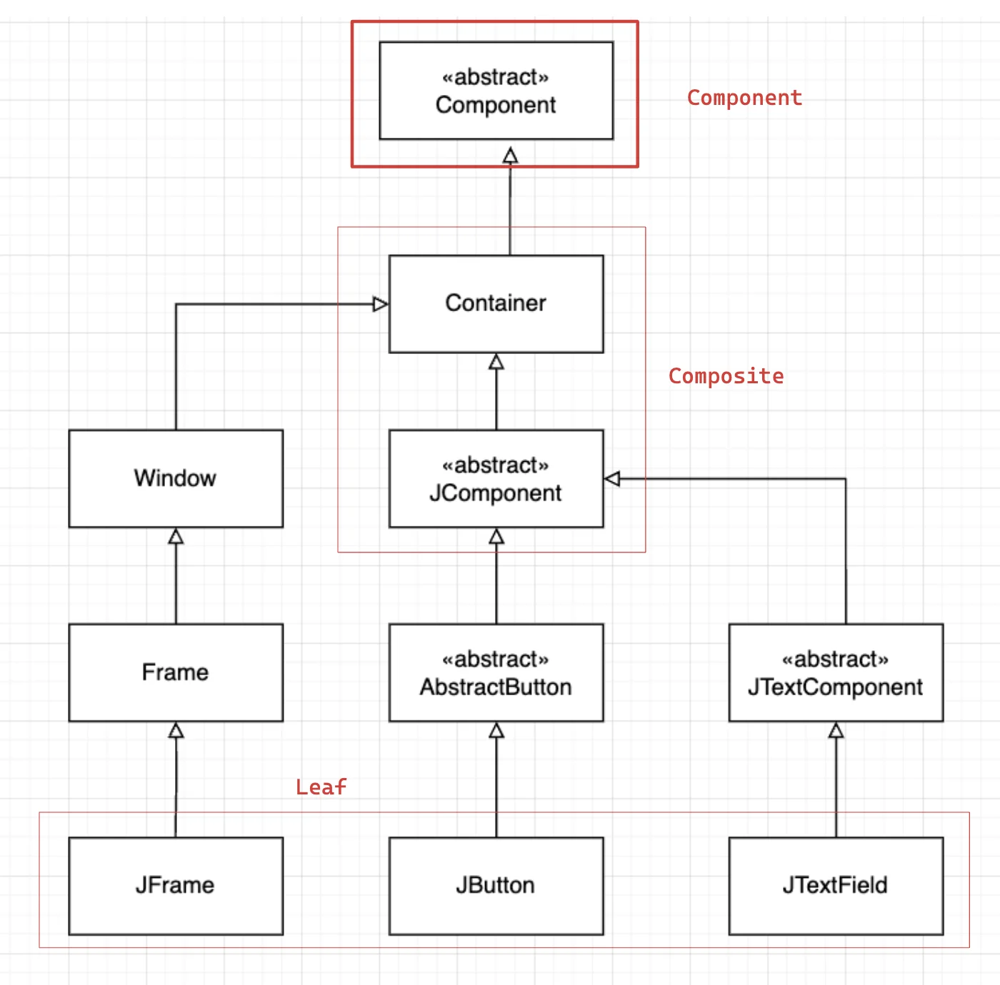

> 📝 
> 
> <a id="1cdeda9b0fe180819d91cd5074879cf0"></a>
> 
> <strong>질문</strong>
> 
> <details>
> <summary>컴포짓 패턴이란 무엇인가?</summary>
> 
> 
> 
> </details>
> 
> <details>
> <summary>컴포짓 패턴의 장 단점은?</summary>
> 
> 
> 
> </details>
> 
> <details>
> <summary>실제 적용된 사례는?</summary>
> 
> 
> 
> </details>

<a id="1cdeda9b0fe180fda86ec3f3b6e9a031"></a>

## 컴포짓 패턴

---

> 📖 
> 
> <a id="1cdeda9b0fe18099a88cd4c72f7f0885"></a>
> 
> <strong>컴포짓 ( Composite ) 패턴 </strong>
> 
> ---
> 
> 
> 
> > 컴포짓 패턴은 소프트웨어 디자인에서 <u>구조적 디자인 패턴</u>으로, 객체를 <strong><u>트리 구조</u></strong><strong><u>로 구성</u></strong>하여 <strong><u>개별 객체(Leaf)</u></strong>와 <strong><u>복합 객체(Composite)</u></strong>를 동일하게 취급할 수 있도록 하는 방법을 제공한다&#46;
> 
> ---
> 
> <a id="1cdeda9b0fe180dcb55ccebffe272180"></a>
> 
> 컴포짓 디자인 패턴은 <strong><u>전체 계층 구조</u></strong>와 <strong><u>그 계층 구조를 구성하는 어떤 부분적인 개체</u></strong>를 <strong>클라이언트 입장에서 동일하게 취급</strong>할 수 있게끔 <strong><u>구조를 만</u></strong>드는 것이다&#46; 
> 
> <a id="1cdeda9b0fe180be9e77cce69104d3ba"></a>
> 
> 따라서 클라이언트 입장에서는 전체인지,부분인지 상관없이 <strong><u>동일한 인터페이스를 사용하여 접근</u></strong>할 수 있다&#46;
> 
> <a id="1cdeda9b0fe18030ae14f873bdbcce20"></a>
> 
> 제약 사항으로는 <strong><u>트리 구조로 구성</u></strong>해야 한다는 점이 있다&#46; 
> 
> ---
> 
> <details>
> <summary>구성 요소 </summary>
> 
> | 구성 요소 | 설명 |
> | --- | --- |
> | Component<br>( client에 동일한 형식 제공 ) | • <u>공통 인터페이스</u> 또는 <u>추상 클래스</u><br>• Leaf와 Composite가 구현해야 할 메서드를 정의한다 |
> | Composite <br>( 복합 객체 ) | • 자식 객체를 포함할 수 있는 복합 객체<br>• 다른 Leaf 또는 Composite 객체들을 관리한다&#46;<br>• ex) 디렉토리 |
> | Leaf<br>( 개별 객체 ) | • 트리의 개별 요소<br>• 자식 객체가 없는 단일 객체를 말한다&#46; <br>• ex) 파일 시스템 &#45; 개별 파일 |
> 
> </details>
> 
> <details>
> <summary>트리 구조 </summary>
> 
> <a id="1ceeda9b0fe180868da8daffa98dec5a"></a>
> 
> ```java
> Component
> ├── Leaf (파일 같은 존재)
> └── RootComposite (폴더 같은 존재)
>      ├── Leaf
>      └── Composite
>            └── Leaf
>        . . .
> ```
> 
> <details>
> <summary>트리 구조</summary>
> 
> 
> 
> </details>
> 
> <details>
> <summary>&#46;operation()</summary>
> 
> 
> 
> </details>
> 
> </details>
> 
> <details>
> <summary>장•단점 </summary>
> 
> - 장점
>     - <code>코드 단순화</code>&#58; 클라이언트 코드가 단일 및 복합 객체를 구분하지 않아도 된다&#46;
> 
>     - <code>유연성 및 확장성</code>&#58; 새로운 타입의 구성 요소 (<code>Leaf</code> 또는 <code>Composite</code>)를 쉽게 추가할 수 있다&#46; 
> 
>     - <code>재사용성 향상</code><strong>&#58; 공통 인터페이스를 사용하여 코드의 중복을 줄이고 유지보수를 용이하게 한다&#46;</strong>
> 
> - 단점
>     - 복잡성 증가&#58; 계층 구조가 필요하지 않은 경우에는 해당 패턴이 과도한 복잡성을 초래할 수 있다&#46;
> 
> </details>
> 
> <details>
> <summary>사용 사례</summary>
> 
> 1. 파일 시스템
>     - 파일과 디렉토리를 트리 구조로 표현하여 디렉토리는 파일과 다른 디렉토리를 포함할 수 있다&#46;
> 
> 1. <a href="https://dev.to/superviz/design-pattern-6-composite-pattern-2k1l?t">그래픽 사용자 인터페이스(GUI)</a>
>     - 버튼, 텍스트 박스 등의 개별 UI 요소와 이들을 포함하는 컨테이너를 동일한 방식으로 처리합니다
> 
> 1. 메뉴 시스템
>     - 메뉴 항목(MenuItem)과 하위 메뉴(Menu)를 계층적으로 구성하여 관리
> 
> </details>
> 
> <details>
> <summary>코드 예제</summary>
> 
> <details>
> <summary>예제 1</summary>
> 
> <details>
> <summary>&#91; 코드 &#93; &#60; interface &#62; Component</summary>
> 
> <a id="1ceeda9b0fe180318fcfdb7293ef35ce"></a>
> 
> ```java
> // Component 인터페이스
> public interface Component<T> {
>     void operation();
> }
> ```
> 
> </details>
> 
> <details>
> <summary>&#91; 코드 &#93; Leaf</summary>
> 
> <a id="1ceeda9b0fe180099976eea521f52203"></a>
> 
> ```java
> // Leaf 클래스
> public class Leaf<T> implements Component<T> {
>     private T value;
> 
>     public Leaf(T value) {
>         this.value = value;
>     }
> 
>     @Override
>     public void operation() {
>         System.out.println("Leaf value: " + value);
>     }
> }
> ```
> 
> </details>
> 
> <details>
> <summary>&#91; 코드 &#93; Composite</summary>
> 
> <a id="1ceeda9b0fe1801fb769de33d345a51d"></a>
> 
> ```java
> import java.util.ArrayList;
> import java.util.List;
> 
> // Composite 클래스
> public class Composite<T> implements Component<T> {
>     private List<Component<T>> children = new ArrayList<>();
> 
>     public void add(Component<T> component) {
>         children.add(component);
>     }
> 
>     public void remove(Component<T> component) {
>         children.remove(component);
>     }
> 
>     @Override
>     public void operation() {
>         System.out.println("Composite operation:");
>         for (Component<T> child : children) {
>             child.operation(); // 다형성을 활용하여 자식들에게 작업 위임
>         }
>     }   
> }
> ```
> 
> </details>
> 
> <details>
> <summary>&#91; 코드 &#93; Main ( Client )</summary>
> 
> <a id="1ceeda9b0fe1807699e8f86565fda5c4"></a>
> 
> ```java
> // 사용 예제 (Main 클래스)
> public class Main {
>     public static void main(String[] args) {
>         // Leaf 객체 생성
>         Component<String> leaf1 = new Leaf<>("Leaf 1");
>         Component<String> leaf2 = new Leaf<>("Leaf 2");
> 
>         // Composite 객체 생성 및 구성
>         Composite<String> composite = new Composite<>();
>         composite.add(leaf1);
>         composite.add(leaf2);
> 
>         // 또 다른 Composite 생성
>         Composite<String> rootComposite = new Composite<>();
>         rootComposite.add(composite); // 복합 객체를 포함
> 
>         // 클라이언트는 Component 인터페이스만 사용하여 작업 수행
>         rootComposite.operation();
>     }
> }
> ```
> 
> </details>
> 
> </details>
> 
> <details>
> <summary>예제 2 &#45; Department, SalesDepartment, HeadDepartment …</summary>
> 
> <details>
> <summary>&#91; 코드 &#93; &#60; interface &#62; Department  ( Component )</summary>
> 
> <a id="1ceeda9b0fe18072966ad2d6b71d9a5d"></a>
> 
> ```java
> // Component 인터페이스
> public interface Department<T> {
>     void printDepartmentName();
> }
> ```
> 
> </details>
> 
> <details>
> <summary>&#91; 코드 &#93; SalesDepartment ( Leaf )</summary>
> 
> <a id="1ceeda9b0fe18068870ff5f2f2b616f5"></a>
> 
> ```java
> // Leaf 클래스
> public class SalesDepartment implements Department {
> 
> 		private String name;
> 		
> 		public SalesDepartment(String name) {
> 				this.name = name;
> 		}		
> 
>     @Override
>     public void printDepartmentName() {
>         System.out.println("Sales Department: " + name);
>     }
> }
> ```
> 
> </details>
> 
> <details>
> <summary>&#91; 코드 &#93; HeadDepartment ( Composite )</summary>
> 
> <a id="1ceeda9b0fe180da95dbfa293b54a896"></a>
> 
> ```java
> // Composite 클래스
> import java.util.ArrayList;
> import java.util.List;
> 
> public class HeadDepartment implements Department {
>     private List<Department> childDepartments = new ArrayList<>();
> 
>     public void addDepartment(Department department) {
>         childDepartments.add(department);
>     }
> 
>     public void removeDepartment(Department department) {
>         childDepartments.remove(department);
>     }
> 
>     @Override
>     public void printDepartmentName() {
>         for (Department dept : childDepartments) {
>             dept.printDepartmentName();
>         }
>     }
> }
> ```
> 
> </details>
> 
> <details>
> <summary>&#91; 코드 &#93; Main ( Client )</summary>
> 
> <a id="1ceeda9b0fe180f4848ce7ecd74ad58c"></a>
> 
> ```java
> // 사용 예제 (Main 클래스)
> public class Main {
>     public static void main(String[] args) {
>         // Leaf 객체 생성
>         Department<String> department1 = new Leaf<>("department 1");
>         Department<String> department2 = new Leaf<>("department 2");
> 
>         // Composite 객체 생성 및 구성
>         Department<String> composite = new HeadDepartment<>();
>         composite.add(department1);
>         composite.add(department1);
> 
>         // 또 다른 Composite 생성
>         Composite<String> rootComposite = new HeadDepartment<>();
>         rootComposite.add(composite); // 복합 객체를 포함
> 
>         // 클라이언트는 Component 인터페이스만 사용하여 작업 수행
>         rootComposite.printDepartmentName();
>     }
> }
> ```
> 
> </details>
> 
> <details>
> <summary>트리 형태 가지 때문에 <code>rootComposite&#46;printDepartmentName()</code> 재귀적으로 호출한다&#46;</summary>
> 
> 
> 
> <a id="1ceeda9b0fe180308aefee9c302a19ed"></a>
> 
> ```java
> rootComposite.printDepartmentName();
> ```
> 
> </details>
> 
> </details>
> 
> </details>

<a id="1cdeda9b0fe180b296a6cef36a80edc6"></a>

### 1&#46; 기본 예제

<a id="1cdeda9b0fe180af9673ca4bf0b53fab"></a>

### 코드

[[ 컴포짓 패턴 ] 기본 예제](https://github.com/gyungsubLee/DesignPattern_with_jave/commit/5ef7a5b85c0112c510c062e030030f8e09b79e81)

<details>
<summary>&#91; 코드 &#93; Item</summary>

<a id="1cdeda9b0fe180cc8e3ada91ded9dfa7"></a>

```java
package _02_structural_patterns._08_composite._01_before;

public class Item {

    private final String name;
    private final int price;

    public Item(String name, int price) {
        this.name = name;
        this.price = price;
    }

    public int getPrice() {
        return price;
    }
}
```

</details>

<details>
<summary>&#91; 코드 &#93; Bag</summary>

<a id="1cdeda9b0fe180b1981ff2928504562c"></a>

```java
package _02_structural_patterns._08_composite._01_before;

import java.util.ArrayList;
import java.util.List;

public class Bag {

    private final List<Item> items = new ArrayList<>();

    public void add(Item item) {
        items.add(item);
    }

    public List<Item> getItem() {
        return items;
    }

    public void getItems() {
        items.forEach(item-> System.out.println(item.getPrice()));
    }
}
```

</details>

<details>
<summary>&#91; 코드 &#93; Client</summary>

<a id="1ceeda9b0fe18023a2aff0423087ed51"></a>

```java
package _02_structural_patterns._08_composite._01_before;

public class Client {

    public static void main(String[] args) {
        Item item1 = new Item("아이템1", 450);
        Item item2 = new Item("아이템2", 300);

        Bag bag = new Bag();
        bag.add(item1);
        bag.add(item2);

        Client client = new Client();
        client.printPrice(item1);
        client.printPrice(bag);
    }

    private void printPrice(Item item) {
        System.out.println("arg: Item");
        System.out.println(item.getPrice());
    }

    private void printPrice(Bag bag) {
        System.out.println("arg: Bag");
        bag.getItems();
    }
}

```

</details>

<a id="1ceeda9b0fe18095959ef928350e74de"></a>

### 문제점

<a id="1ceeda9b0fe180a28313f7bd494ffb62"></a>

Item 외 Leaf(단일 객체) 추가 등 코드의 유연성 및 확장성 측면에서 제한적이다&#46; 

<a id="1cdeda9b0fe1804da91eda2e8006d1a3"></a>

### 2&#46; 패턴 적용

<a id="1cdeda9b0fe180d49493dc9979849043"></a>

### 코드



<details>
<summary>&#91; 코드 &#93; &#60; interface &#62; Component ( Component )</summary>

<a id="1cdeda9b0fe18036bbaee9ab88d3be38"></a>

```java
package _02_structural_patterns._08_composite._02_after;

public interface Component {

    int getPrice();
}

```

</details>

<details>
<summary>&#91; 코드 &#93; Character ( Composite )</summary>

<a id="1ceeda9b0fe180f19259c82335f69fe2"></a>

```java
package _02_structural_patterns._08_composite._02_after;

public class Character implements Component {

    private Bag bag;

    public Character(Bag bag) {
        this.bag = bag;
    }

    @Override
    public int getPrice() {
        return bag.getPrice();
    }
}
```

</details>

<details>
<summary>&#91; 코드 &#93; Bag  ( Composite )</summary>

<a id="1ceeda9b0fe180c5a40cd71fea6034f0"></a>

```java
package _02_structural_patterns._08_composite._02_after;

import java.util.ArrayList;
import java.util.List;

public class Bag implements Component{

    private List<Component> components = new ArrayList<>();

    public void add(Component component) {
        components.add(component);
    }

    public List<Component> getComponents() {
        return components;
    }

    @Override
    public int getPrice() {
        return components.stream().mapToInt(Component::getPrice).sum();
    }
}
```

</details>

<details>
<summary>&#91; 코드 &#93; Item  ( Leaf )</summary>

<a id="1cdeda9b0fe180a0bcacc30ced9444b0"></a>

```java
package _02_structural_patterns._08_composite._02_after;

public class Item implements Component{

    private final String name;
    private final int price;

    public Item(String name, int price) {
        this.name = name;
        this.price = price;
    }

    @Override
    public int getPrice() {
        return price;
    }
}
```

</details>

<details>
<summary>&#91; 코드 &#93; Client </summary>

<a id="1ceeda9b0fe180dbb55eee289ed8e72c"></a>

```java
package _02_structural_patterns._08_composite._02_after;

public class Client {

    public static void main(String[] args) {
        Item doranBlade = new Item("도란검", 450);
        Item healPotion = new Item("체력 물약", 50);

        Bag bag = new Bag();
        bag.add(doranBlade);
        bag.add(healPotion);

        Client client = new Client();
        client.printPrice(doranBlade);
        client.printPrice(bag);
        
        Character charactor = new Character(bag);
        client.printPrice(charactor);
    }

    private void printPrice(Component component) {
        System.out.println(component.getPrice());
    }
}
```

</details>

<a id="1ceeda9b0fe1800994edc038d2cf363c"></a>

### 설명



<a id="1ceeda9b0fe18069ac5cd51cb4f7c31a"></a>

트리 구조를 형성하여 재귀적으로 공통 메서드, <strong>operation </strong>(<code>getPrice()</code>)를 호출한다&#46; 

<a id="1cdeda9b0fe180ebb01ac1aa1a93fa8f"></a>

### 3&#46; 장•단점

- 장점
    - 복잡한 트리 구조를 편리하게 사용 가능하다&#46;

    - 다형성과 재귀를 활용할 수 있다&#46; 
        - 클라이언트 입장에서 트리의 헤드인지 리프인지 상관없이<br>즉, 어느 노드든 상관없이 공통된 인터페이스를 구현하고 있다면 해당 인터페이스를 기준으로 복잡한 트리 구조에 상관없이 편리하게 사용 가능하다&#46;

    - 클라이언트 코드를 변경하지 않고 새로운 엘리먼트 타입을 추가할 수 있다&#46;
        - 새로운 Leaf, Composite이 추가되더라도 클라이언트 코드는 변경되지 않는다&#46;

        - <code>OCP</code> 만족

- 단점
    - 트리를 만들어야 하기 때문에 ( 공통된 인터페이스를 정의해야 하기 때문에) <br>경우에 따라서 공통된 부분을 추상화하기 위해 지나친 일반화를 시킬 수있다&#46;

    - 해당 부작용으로 런타임 시 타입을 체크해야 되는 경우가 생길 수 있다&#46;
        - 만약 위와 같이 컴포짓 패턴을 적용하여 특정 타입에 대한 확인이 이뤄져야 하는 경우,<br>너무 특정 디자인 패턴에 종속적으로 코드를 작성하고 있는 것이 아닌지 의심을 해보면서 <br>다른 시각으로 바라볼 필요가 있다&#46;

<a id="1cdeda9b0fe18078a50cf7f23b775a4f"></a>

### 4&#46; 실무 활용

> ✏️ 
> 
> <a id="1cdeda9b0fe18073aaedc972eb89d43c"></a>
> 
> <strong>자바</strong>
> 
> - Swing 라이브러리
> 
> - JSF ( JavaServer Faces ) 라이브러리

<a id="1cdeda9b0fe18087b4c1e08de0e95add"></a>

### 코드



<details>
<summary>&#91; 코드 &#93; SwingExample</summary>

<a id="1cdeda9b0fe18093a03adc1d7cc39b36"></a>

```java
package _02_structural_patterns._08_composite._03_java;

import javax.swing.*;
import java.awt.event.ActionEvent;
import java.awt.event.ActionListener;

public class SwingExample {
    public static void main(String[] args) {
        JFrame frame = new JFrame();

        JTextField textField = new JTextField();
        textField.setBounds(200, 200, 200, 40);
        frame.add(textField);

        JButton button = new JButton("click");
        button.setBounds(200, 100, 60, 40);
        button.addActionListener(new ActionListener() {
            @Override
            public void actionPerformed(ActionEvent e) {
                textField.setText("Hello Swing");
            }
        });

        frame.add(button);

        frame.setSize(600, 400);
        frame.setLayout(null);
        frame.setVisible(true);
    }
}

```

</details>
