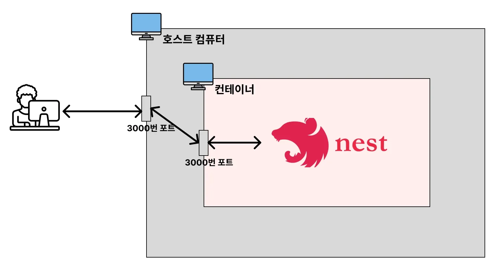
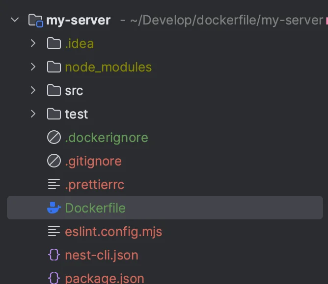
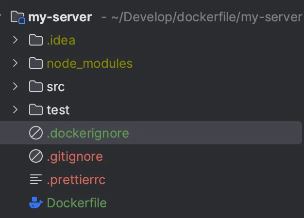
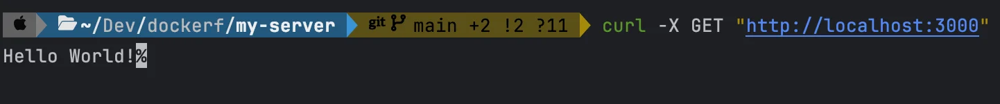

<a id="1c3eda9b0fe181948ba8d675290abe23"></a>

## 백엔드 프로젝트(Nest&#46;js)를 Docker로 실행

---



1. Next&#46;js 프로젝트 생성
    <a id="1c3eda9b0fe1812b8240e74f3ee51b9a"></a>

    ```bash
    # Nest CLI 설치
    npm i -g @nestjs/cli

    # nest new {프로젝트명}
    nest new my-server
    ```

1. Dockerfile 작성
    

    <a id="1c3eda9b0fe181189a7be9fd66008327"></a>

    ```docker
    FROM node

    WORKDIR /app

    COPY . .

    RUN npm install

    RUN npm run build

    EXPOSE 3000

    ENTRYPOINT [ "node", "dist/main.js" ]
    ```

1. <strong>&#46;dockerignore 작성</strong>
    

    <a id="1c3eda9b0fe1811ca29ad017ee0caa2f"></a>

    ```docker
    node_modules
    ```

    <a id="1c3eda9b0fe181b0a9e3d7365066983d"></a>

    이미지를 생성할 때 <code>npm install</code>을 통해, 필요한 의존성만 설치한다&#46;

    <a id="1c3eda9b0fe1818bbdbac80fe239dac1"></a>

     → 호스트 컴퓨터에 있는 <code>node&#95;modules</code>는 컨테이너로 복사할 필요가 없다&#46; 

1. 이미지 build
    <a id="1c3eda9b0fe181e19618c689cc15883d"></a>

    ```bash
    docker build -t my-server .

    # 이미지 생성 확인 
    docker image ls
    ```

1. <strong>생성한 이미지를 컨테이너로 실행</strong>
    <a id="1c3eda9b0fe181f4a1ece0cf7c6d1a15"></a>

    ```bash
    docker run -d -p 3000:3000 my-server

    # 컨테이너 실행 확인
    docker ps
    ```

1. <a href="http://localhost:3000">localhost&#58;3000</a> 호출
    <a id="1c3eda9b0fe1816eacc2fd2957977069"></a>

    ```bash
    curl -X GET "http://localhost:3000"
    ```

    

1. 실행 컨테이너 중지/삭제, 이미지 삭제
    <a id="1c3eda9b0fe181248184f6a1934349b8"></a>

    ```bash
    docker stop {컨테이너 ID}
    docker rm {컨테이너 ID}
    docker image rm {이미지 ID}
    ```
