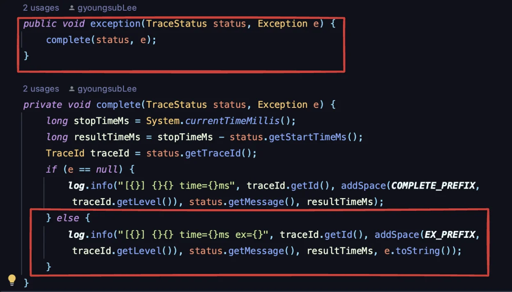
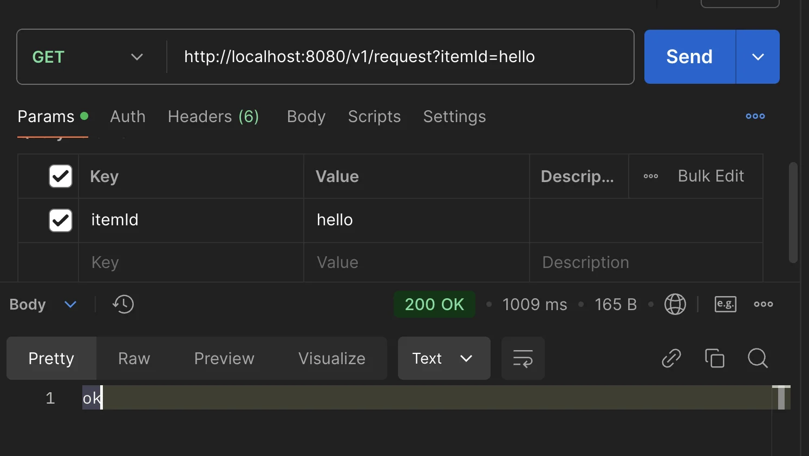
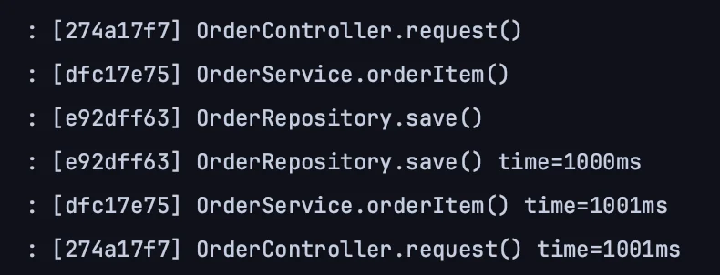
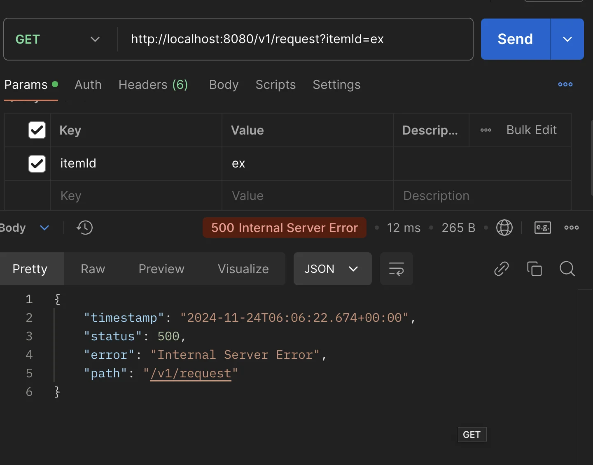
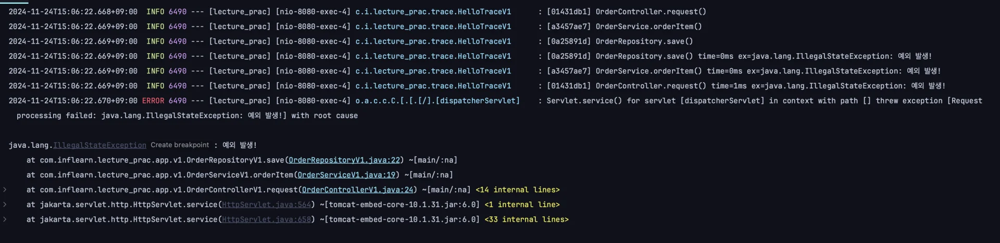
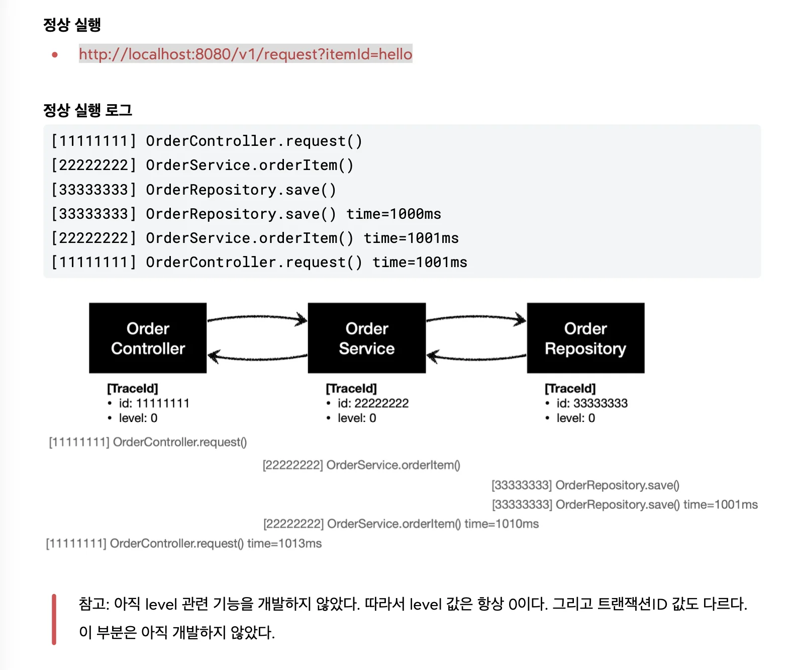
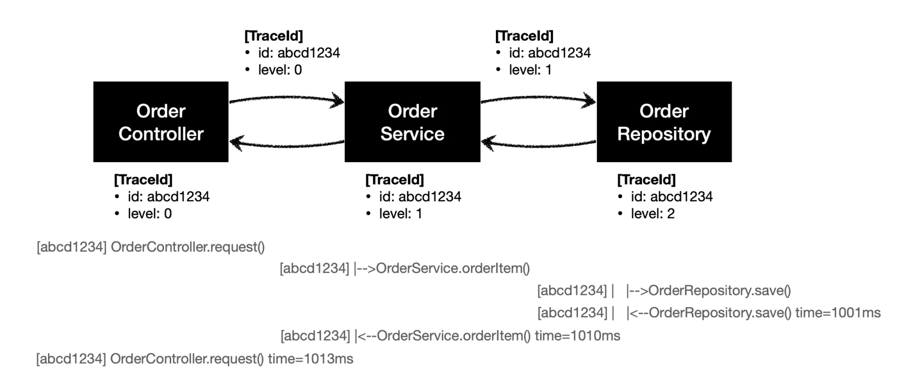
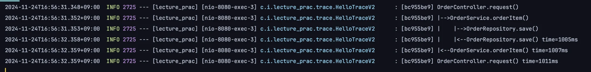
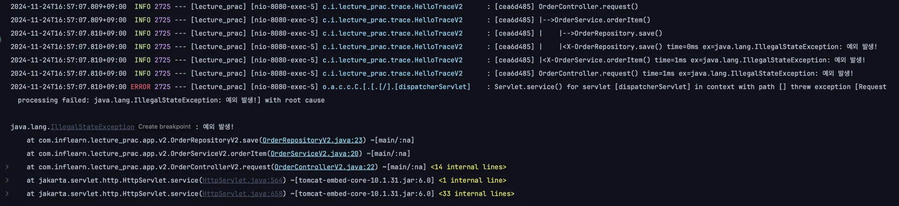

<details>
<summary>&#91; 코드 &#93;</summary>

<a id="1c3eda9b0fe18116a780dfbc4cd54f8e"></a>

```java

```

</details>

> ☝🏻 
> 
> <a id="1c3eda9b0fe1817aa2b2ef0c2a905c38"></a>
> 
> 개발을 진행할 때, 우선 돌아가도록 하는 것이 중요
> 
> <a id="1c3eda9b0fe181138953fc9d4e160716"></a>
> 
> 이후 예쁘게 리펙토링 진행

<a id="1c3eda9b0fe1810f8d1eeb72ccaa8f06"></a>

## 로그 추적기

---

<details>
<summary>기본 세팅</summary>

<details>
<summary>&#91; 코드 &#93; OrderControllerV0</summary>

<a id="1f6eda9b0fe180169e4dd9b2671b47f5"></a>

```java
package com.inflearn.lecture_prac.app.v0;

import lombok.RequiredArgsConstructor;
import org.springframework.web.bind.annotation.GetMapping;
import org.springframework.web.bind.annotation.RestController;

@RestController
@RequiredArgsConstructor
public class OrderControllerV0 {

    private final OrderServiceV0 orderServiceV0;

    @GetMapping("/v0/request")
    public String request(String itemId) {
        orderServiceV0.orderItem(itemId);
        return "ok";
    }
}

```

</details>

<details>
<summary>&#91; 코드 &#93; OrderServiceV0</summary>

<a id="1f6eda9b0fe1807cab56c56f1cb6b7a5"></a>

```java
package com.inflearn.lecture_prac.app.v0;

import lombok.RequiredArgsConstructor;
import org.springframework.stereotype.Service;

@Service
@RequiredArgsConstructor
public class OrderServiceV0 {

    private final OrderRepositoryV0 orderRepositoryV0;

    public void orderItem(String itemId) {
        orderRepositoryV0.save(itemId);
    }
}

```

</details>

<details>
<summary>&#91; 코드 &#93; OrderRepositoryV0</summary>

<a id="1f6eda9b0fe180a68c8ed824a273f979"></a>

```java
package com.inflearn.lecture_prac.app.v0;

import lombok.RequiredArgsConstructor;
import org.springframework.stereotype.Repository;

import static java.lang.Thread.sleep;

@Repository
@RequiredArgsConstructor
public class OrderRepositoryV0 {


    public void save(String itemId) {
        // 저장 로직
        if (itemId.equals("ex")) {
            throw new IllegalStateException("예외 발생!");
        }
        sleep(1000);
    }

    private void sleep(int millis) {
        try {
            Thread.sleep(millis);
        } catch (InterruptedException e) {
            e.printStackTrace();
        }
    }
}

```

</details>

</details>

<a id="1c3eda9b0fe181bd897cfd4d49958d24"></a>

### 요구사항 분석

> 💬 
> 
> <a id="1f6eda9b0fe18026ad74ced30d578a04"></a>
> 
> 배경
> 
> ---
> 
> <a id="1f6eda9b0fe18045a033c73ec73a15c4"></a>
> 
> 새로운 회사에 입사했는데, 수 년간 운영중인 거대한 프로젝트에 투입되었다&#46; <br><u>전체 소스 코드는 수 십만 라인</u>이고, 클래스 수도 수 백개 이상이다&#46;<br>여기에 처음 맡겨진<strong><u> 요구사항</u></strong>은 <u>로그 추적기를 만</u>드는 것이다&#46;<br>애플리케이션이 커지면서 점점 모니터링과 운영이 중요해지는 단계이다&#46; <br><strong>특히 최근 자주 병목이 발생</strong>하고 있다&#46; <u>어떤 부분에서 병목이 발생</u>하는지, 그리고 <strong><u>어떤 부분에서 예외가 발생</u></strong>하는지를 <strong>로그를 통해 확인</strong>하는 것이 점점 중요해지고 있다&#46;
> 
> <a id="1f6eda9b0fe1802f8f00f54da508a34e"></a>
> 
> 기존에는<u> 개발자가 문제가 발생한 다음에 관련 부분을 어렵게 찾아서 로그를 하나하나 직접 만들어서 남</u>겼다&#46; <u>로그를 미리 남겨둔다면 이런 부분을 손쉽게 찾을 수 있을 것</u>이다&#46; 이 부분을 개선하고 <u>자동화</u> 하는 것이 이번 챕터의 목표이다

> ☝🏻 
> 
> <a id="1c3eda9b0fe181919f11f369501967ef"></a>
> 
> 모니터링 툴을 도입하면 많은 부분이 해결되지만, <br>학습이 목적이기 때문에 <u>직접 로그추적기 개발</u>한다

<a id="1c3eda9b0fe181928825e1a8bc9d45d5"></a>

### 요구사항

> 📌 
> 
> - <strong>모든 </strong><strong><code>public</code></strong><strong> 메서드</strong>의 <u>호출</u>과 <u>응답</u> 정보를 <u>로그로 출력</u>
> 
> - <strong>애플리케이션 흐름</strong>이 <strong><u>변경되면 안</u></strong>됨
>     - 로그를 남긴다고 해서 비지니스 로직의 동작에 영향을 주면 안됨
> 
> - 메서드 호출에 걸린 시간
> 
> - 정상 흐름과 예외 흐름 구분
>     - 예외 발생 시 예외 정보가 남아야 함
> 
> - 메서드 호출의 깊이 표현
> 
> - HTTP 요청 구분
>     - HTTP 요청 단위를 특정 ID 구분하여 어떤 HTTP 요청에서 시작된 것인지 명확하게 구분이 가능해야 함
> 
>     - <code>트택젝션 ID</code> ( DB 트랜젝션 X ) 
>         -  하나의 HTTP 요청이 시작해서 끝날 때 까지를 <strong>하나의 트랜잭션</strong>이라 정의

<details>
<summary>ex) </summary>

<a id="1c3eda9b0fe1810780aac9103f9d18b1"></a>

```plaintext

// 정상 요청
[796bccd9] OrderController.request()
[796bccd9] |-->OrderService.orderItem()
[796bccd9] |   |-->OrderRepository.save()
[796bccd9] |   |<--OrderRepository.save() time=1004ms
[796bccd9] |<--OrderService.orderItem() time=1014ms
[796bccd9] OrderController.request() time=1016ms
 
// 예외 발생
[b7119f27] OrderController.request()
[b7119f27] |-->OrderService.orderItem()
[b7119f27] | |-->OrderRepository.save() 
[b7119f27] | |<X-OrderRepository.save() time=0ms 	ex=java.lang.IllegalStateException: 예외 발생! 
[b7119f27] |<X-OrderService.orderItem() time=10ms ex=java.lang.IllegalStateException: 예외 발생! 
[b7119f27] OrderController.request() time=11ms 	ex=java.lang.IllegalStateException: 예외 발생!
```

</details>

> ☝🏻 처음부터 완하게 설계해 개발하기는 어렵다&#46; <br>진행하면서 계속해서 리펙토링하면서 개발 해야한다&#46;

<a id="1c3eda9b0fe18135a787de22b5c40b9f"></a>

### 로그 추적기 V1 

<details>
<summary>트랜잭션 ID, 깊이 표현&#58; <code>TraceId</code></summary>

<a id="1f6eda9b0fe180c2b1c0c86d787c8967"></a>

###  코드

> ✏️ 
> 
> - 로그 추적기는 트랜잭션ID와 깊이를 표현하는 방법이 필요하다
>     - 트랜잭션ID와 깊이를 표현하는 level을 묶어서 <code>TraceId</code> 라는 개념 생성

<details>
<summary>&#91; 코드 &#93; TraceId</summary>

> 📌 
> 
> <details>
> <summary>트랜잭션ID 와 깊이를 표현</summary>
> 
> <a id="1c3eda9b0fe1817ab387e359df513182"></a>
> 
> ```java
> [796bccd9] OrderController.request() //트랜잭션ID:796bccd9, level:0
> [796bccd9] |-->OrderService.orderItem() //트랜잭션ID:796bccd9, level:1
> [796bccd9] | |-->OrderRepository.save()//트랜잭션ID:796bccd9, level:2
> ```
> 
> </details>
> 
> <details>
> <summary><strong>UUID</strong></summary>
> 
> - <code>UUID&#46;randomUUID()&#46;toString()&#46;substring(0, 8);</code>
> 
> <a id="1c3eda9b0fe1814088b0c68a8c32860e"></a>
> 
> ```java
> ab99e16f-3cde-4d24-8241-256108c203a2 //생성된 UUID 
> ab99e16f //앞 8자리만 사용
> ```
> 
> </details>
> 
> <details>
> <summary><strong><code>createNextId()</code></strong><strong> &#45; 동일한 Id, level(깊이)만 증가 </strong></summary>
> 
> <a id="1c3eda9b0fe18188993adff04a912706"></a>
> 
> ```java
> public TraceId createNextId() {
>     return new TraceId(id, level + 1);
> }
> ```
> 
> </details>
> 
> <details>
> <summary><strong><code>createPreviousId()</code></strong><strong> &#45; 동일한 Id, level(깊이)만 감소</strong></summary>
> 
> <a id="1c3eda9b0fe1817d905fd475bbd7ce06"></a>
> 
> ```java
> public TraceId createPreviousId() {
> 	  return new TraceId(id, level - 1);
> }
> ```
> 
> </details>
> 
> <details>
> <summary><strong><code>isFirstLevel()</code></strong><strong> &#45; 첫 번째 레벨 여부 확인</strong></summary>
> 
> <a id="1c3eda9b0fe181399a4cd7c276973abd"></a>
> 
> ```java
> public boolean isFirstLevel() {
>      return level == 0;
> }
> ```
> 
> </details>

<a id="1c3eda9b0fe1819a8ad3f6943731e295"></a>

```java
package com.inflearn.lecture_prac.trace;

import java.util.UUID;

@Getter
public class TraceId {

    private String id;
    private int level;

    public TraceId() {
        this.id = createId();
        this.level = 0;
    }

    public TraceId(String id, int level) {
        this.id = id;
        this.level = level;
    }

    private String createId() {
        return UUID.randomUUID().toString().substring(0, 8);
    }

    public TraceId createNextId() {
        return new TraceId(id, level + 1);
    }

    public TraceId createPreviousId() {
        return new TraceId(id, level - 1);
    }

    public boolean isFirstLevel() {
        return level == 0;
    }
}
```

</details>

<details>
<summary>&#91; 코드 &#93; TraceStatus</summary>

> 📌 
> 
> <a id="1f6eda9b0fe18090ae14c4c6a9e9d29a"></a>
> 
> 로그의 상태 정보를 나타낸다&#46;
> 
> <details>
> <summary>로그를 시작하면 끝이 있어야 한다</summary>
> 
> <a id="1f6eda9b0fe1800c9208f565a69795bd"></a>
> 
> ```yaml
> [796bccd9] OrderController.request() //로그 시작
> [796bccd9] OrderController.request() time=1016ms //로그 종료
> ```
> 
> - TraceStatus는 로그를 시작할 떄의 상태 정보를 가지고 있다&#46; 
> 
> - 이 상태 정보는 로그를 종료할 때 사용된다&#46;
> 
> </details>
> 
> <details>
> <summary>필드</summary>
> 
> - <code>traceId</code>&#58;  내부에 트랜잭션 ID와 level을 가지고 있다&#46;
> 
> - <code>startTimeMs</code>&#58; 로그 시작시간&#46; 로그 종료 시 해당 시작을 기준으로 시작&#45;종료까지 전체 수행 시간을 구할 수 있다&#46;
> 
> - <code>message</code>&#58; 시작 시 사용한 메세지&#46; 이후 로그 종료시에도 해당 메세지를 사용해 출력한다&#46;
> 
> </details>

<a id="1c3eda9b0fe1812db68ef36542662036"></a>

```java
package com.inflearn.lecture_prac.trace;

@Getter
@AllArgsConstructor
public class TraceStatus {

    private TraceId traceId;
    private Long startTimeMs;
    private String message;
}
```

</details>

<details>
<summary><strong>&#91; 코드 &#93; </strong>HelloTraceV1</summary>

> 📌 
> 
> <a id="1f6eda9b0fe180e4a983f07ad39fc197"></a>
> 
> 해당 클래스를 사용해 실제 로그를 시작하고 종료 가능하다&#46; 
> 
> <a id="1f6eda9b0fe1806d9df0dd34e1120681"></a>
> 
> 그리고 로그를 출력하고 실행 시간도 측정 가능하다&#46; 

<a id="1c3eda9b0fe18113a81df6805672a0b4"></a>

```java
package com.inflearn.lecture_prac.trace;


import lombok.extern.slf4j.Slf4j;
import org.springframework.stereotype.Component;

@Slf4j
@Component
public class HelloTraceV1 {

    private static final String START_PREFIX = "-->";
    private static final String COMPLETE_PREFIX = "<--";
    private static final String EX_PREFIX = "<X-";
		
		// 로그 시작
    public TraceStatus begin(String message) {
        TraceId traceId = new TraceId();
        Long startTimeMs = System.currentTimeMillis();
        log.info("[{}] {}{}", traceId.getId(), addSpace(START_PREFIX, traceId.getLevel()), message);
        return new TraceStatus(traceId, startTimeMs, message);
    }
		
		// 로그 종료
    public void end(TraceStatus status) {
        complete(status, null);
    }

		// 로그 예외
    public void exception(TraceStatus status, Exception e) {
        complete(status, e);
    }
		
    private void complete(TraceStatus status, Exception e) {
        long stopTimeMs = System.currentTimeMillis();
        long resultTimeMs = stopTimeMs - status.getStartTimeMs();
        TraceId traceId = status.getTraceId();
        if (e == null) {
            log.info("[{}] {}{} time={}ms", traceId.getId(), addSpace(COMPLETE_PREFIX, traceId.getLevel()), status.getMessage(), resultTimeMs);
        } else {
            log.info("[{}] {}{} time={}ms ex={}", traceId.getId(), addSpace(EX_PREFIX, traceId.getLevel()), status.getMessage(), resultTimeMs, e.toString());
        }
    }

    private Object addSpace(String prefix, int level) {
        StringBuilder sb = new StringBuilder();
        for (int i = 0; i < level; i++) {
            sb.append((i == level - 1) ? "|" + prefix : "|    ");
        }
        return sb.toString();
    }
}
```

</details>

<details>
<summary>&#91; 테스트 &#93; <strong>HelloTraceV1Test</strong></summary>

> ☝🏻 
> 
> <a id="1f6eda9b0fe180248103e1039f9804c9"></a>
> 
> 검증 과정 생략  → 콘솔 직접 확인

<a id="1c3eda9b0fe181bf9666d08bbfeb862c"></a>

```java

package com.inflearn.lecture_prac.trace;

import org.junit.jupiter.api.Test;

class HelloTraceV1Test {

    @Test
    void begin_end() {
        HelloTraceV1 trace = new HelloTraceV1();
        TraceStatus status = trace.begin("hello");
        trace.end(status);
    }

    @Test
    void begin_exception() {
        HelloTraceV1 trace = new HelloTraceV1();
        TraceStatus status = trace.begin("hello");
        trace.exception(status, new IllegalStateException());
    }
}
```

- <code>정상 흐름</code>&#58; begint&#95;end()&#58;
    <a id="1c3eda9b0fe181539875d5411b1a3584"></a>

    ```plaintext
     [41bbb3b7] hello
     [41bbb3b7] hello time=5ms
    ```

- <code>예외 발생</code>&#58;<code>begint&#95;exception()</code>
    <a id="1c3eda9b0fe1816cb56ac7ad3579526b"></a>

    ```plaintext
     [898a3def] hello
     [898a3def] hello time=13ms ex=java.lang.IllegalStateException
    ```

</details>

</details>

<details>
<summary>로그추적기 적용</summary>

<a id="1f6eda9b0fe1805c8ceec8116488b5fd"></a>

### 코드

<details>
<summary>&#91; 코드 &#93; OrderControllerV1</summary>

<a id="1f6eda9b0fe1805db65ce74fefef6f35"></a>

```java
package com.inflearn.lecture_prac.app.v1;

import com.inflearn.lecture_prac.trace.HelloTraceV1;
import com.inflearn.lecture_prac.trace.TraceStatus;
import lombok.RequiredArgsConstructor;
import org.springframework.web.bind.annotation.GetMapping;
import org.springframework.web.bind.annotation.RestController;

@RestController
@RequiredArgsConstructor
public class OrderControllerV1 {

    private final OrderServiceV1 orderService;
    private final HelloTraceV1 trace;

    @GetMapping("/v1/request")
    public String request(String itemId) {

        TraceStatus status = null;
        try {
            status = trace.begin("OrderController.request()");
            orderService.orderItem(itemId);
            trace.end(status);
            return "ok";
        } catch (Exception e) {
            trace.exception(status, e);
            throw e;  // 예외를 꼭 다시 던져야 함,  🧐why?)
        }
    }
}
```

</details>

<details>
<summary>&#91; 코드 &#93; OrderServiceV1</summary>

<a id="1f6eda9b0fe180e786efd43424a3e0dc"></a>

```java
package com.inflearn.lecture_prac.app.v1;

import com.inflearn.lecture_prac.trace.HelloTraceV1;
import com.inflearn.lecture_prac.trace.TraceStatus;
import lombok.RequiredArgsConstructor;
import org.springframework.stereotype.Service;

@Service
@RequiredArgsConstructor
public class OrderServiceV1 {

    private final OrderRepositoryV1 orderRepository;
    private final HelloTraceV1 trace;

    public void orderItem(String itemId) {
        TraceStatus status = null;
        try {
            status = trace.begin("OrderService.orderItem()");
            orderRepository.save(itemId);
            trace.end(status);
        } catch (Exception e) {
            trace.exception(status, e);
            throw e;
        }
    }
}
```

</details>

<details>
<summary>&#91; 코드 &#93; OrderRepositoryV1</summary>

<a id="1f6eda9b0fe18078b8bbd40c55f80755"></a>

```java
package com.inflearn.lecture_prac.app.v1;

import com.inflearn.lecture_prac.trace.HelloTraceV1;
import com.inflearn.lecture_prac.trace.TraceStatus;
import lombok.RequiredArgsConstructor;
import org.springframework.stereotype.Repository;

@Repository
@RequiredArgsConstructor
public class OrderRepositoryV1 {

    private final HelloTraceV1 trace;

    public void save(String itemId) {

        TraceStatus status = null;
        try {
            status = trace.begin("OrderRepository.save()");

            // 저장 로직
            if (itemId.equals("ex")) {
                throw new IllegalStateException("예외 발생!");
            }
            sleep(1000);

            trace.end(status);
        } catch (Exception e) {
            trace.exception(status, e);
            throw  e;
        }
    }

    private void sleep(int millis) {
        try {
            Thread.sleep(millis);
        } catch (InterruptedException e) {
            e.printStackTrace();
        }
    }
}
```

</details>

<a id="1f6eda9b0fe180789a0aeddd5c28317f"></a>

### 테스트

<details>
<summary>로그 출력 로직</summary>

- 아래의 로직을 각 클래스에 추가하여 시작 로그 출력 및, 종료 로그 출력 or 예외 발생 시 메세지 까지 출력한다&#46;

<details>
<summary>예외를 꼭 다시 던져야한다&#46; 안 그러면 정상흐름으로 동작한다&#46; </summary>

- <code>trace&#46;exception(status, e);</code>
    - 예외를 메세지로 출력만함
        

- 예외처리(<code>throw</code>) 필요
    - <code>throw e;</code>

</details>

<a id="1c3eda9b0fe18186903cf92c044fd227"></a>

```java
TraceStatus status = null;
try {
	  status = trace.begin("OrderController.request()");
	  
	  // 기존 로직
	  
	  trace.end(status);
}
} catch (Exception e) {
    trace.exception(status, e);
    throw e;  // 예외를 꼭 다시 던져야 함, 위에는 예외를 출력만 함. 즉, 예외처리가 되지 않음
}
```

</details>

<details>
<summary> 포스트맨 api 호출</summary>

<a id="1f6eda9b0fe18037a53ed43bae23dea5"></a>

```yaml
http://localhost:8080/v1/request?itemId=hello
```

<details>
<summary><code>success</code></summary>

<a id="1f6eda9b0fe18097b920eee77f6afe17"></a>

```yaml
http://localhost:8080/v1/request?itemId=hello
```





</details>

<details>
<summary><code>fail</code> &#45;  예외 발생</summary>

<a id="1f6eda9b0fe180fb8bd4dc6d666d2033"></a>

```yaml
http://localhost:8080/v1/request?itemId=ex
```



<a id="1c3eda9b0fe1812cb4d3f16e2c114f72"></a>

```plaintext
[5e110a14] OrderController.request()
[6bc1dcd2] OrderService.orderItem()
[48ddffd6] OrderRepository.save()
[48ddffd6] OrderRepository.save() time=0ms ex=java.lang.IllegalStateException: 예 외 발생!
[6bc1dcd2] OrderService.orderItem() time=6ms ex=java.lang.IllegalStateException: 예외 발생!
[5e110a14] OrderController.request() time=7ms ex=java.lang.IllegalStateException: 예외 발생!
```



</details>

</details>

</details>

<details>
<summary>정리 </summary>

> 📌 
> 
> <a id="1f6eda9b0fe18082916acab4258ab1b4"></a>
> 
> <strong>로그 추적기 v1 &#45; 요구사항 만족</strong>
> 
> ---
> 
> - [x] 모든 <code>public</code> 메서드의 호출과 응답 정보를 로그로 출력
> 
> - [x]  애플리케이션 흐름이 변경되면 안됨
>     - <del>로그를 남긴다고 해서 비지니스 로직의 동작에 영향을 주면 안됨</del>
> 
> - [x] 메서드 호출에 걸린 시간
> 
> - [x] 정상 흐름과 예외 흐름 구분
>     - <del>예외 발생 시 예외 정보가 남아야 함</del>
> 
>     - 지저분한 <code>try&#45;catch 문</code>으로 예외처리
> 
> - [ ] 메서드 호출의 깊이 표현
> 
> - [ ] HTTP 요청 구분
>     - HTTP 요청 단위를 특정 ID 구분하여 어떤 HTTP 요청에서 시작된 것인지 명확하게 구분이 가능해야 함
> 
>     - <code>트택젝션 ID</code> ( DB 트랜젝션 X ) 
>         -  하나의 HTTP 요청이 시작해서 끝날 때 까지를 하나의 트랜잭션이라 정의

> ❗ 
> 
> <a id="1f6eda9b0fe180a39236f7eee066484c"></a>
> 
> <strong>개선점</strong>
> 
> ---
> 
> - <strong>메서드 호출 깊이 표현</strong>
> 
> - 같은 HTTP 요청이면 같은 트랜잭션 ID를 기록
> 
> - 로그를 남기기 위한 코드가 너무 복잡함
> 
> - 예외 처리를 try&#45;catch로 처리해서 코드가 지저분함
> 
> ---
> 
> <details>
> <summary>로그 연동</summary>
> 
> 
> 
> <a id="1c3eda9b0fe18110ab70c973fd6a8944"></a>
> 
> 아직 요구사항을 만족하지 못한 기능은 <u>직전의 로그의 깊이</u>와 <u>트랜잭션 ID</u>가 무엇인지 알아야 할 수 있는 일이다&#46; 
> 
> <a id="1c3eda9b0fe181ee812de4c32263fce1"></a>
> 
> 예를 들어, <code>OrderController&#46;request()</code>에서 로그를 남길 때, 어떤 깊이와 어떤 트랜잭션 ID를 사용했는 지를 그 다음 로그를 남기는 <code>OrderService&#46;orderItem()</code>에서 로그를 남길 때 알아야 한다&#46; 
> 
> <a id="1c3eda9b0fe181dda04adb89560fa55e"></a>
> 
> 결국 <u>현재 로그의 상태 정보</u>인 <code>트랜젝션ID</code>와 <code>level</code>이 다음으로 다음 호출 레이어로 전달되어야 한다&#46; 
> 
> <a id="1c3eda9b0fe181cb99aad37472b5e88d"></a>
> 
> → 로그에 대한 문맥(Context) 정보가 필요하다&#46; 
> 
> - 다음 버전에서 문맥(Context) 정보를 파라미터로 넘겨주도록 리펙토링
> 
> </details>

</details>

<a id="1c3eda9b0fe18138a309d400e6fbc65e"></a>

### 로그 추적기 V2 &#45; 파라미터 동기화

> ✏️ 
> 
> <a id="1c3eda9b0fe181f69ca2fe8d85537db2"></a>
> 
> <strong><u>트랜잭션 ID</u></strong><strong>와 </strong><strong><u>메서드 호출 깊이</u></strong><strong>를 표현</strong>하는 <u>가장 단순한 방법</u>은 첫 로그에서 사용한 <code>트랜잭션ID</code> 와 <code>level</code>을 다음 로그로 넘겨주는 것이다&#46;
> 
> <a id="1c3eda9b0fe18168a4f1ec8b900625da"></a>
> 
> 현재 로그의 상태 정보인 <code>트랜잭션 ID</code> 와 <code>level</code>은 <code>TraceId</code> 에 포함되어 있다&#46; 따라서 <code>TraceId</code>를 다음 로그에 넘겨주면 된다&#46; 

<details>
<summary>파라미터 동기화</summary>

> 📌 
> 
> <a id="1f6eda9b0fe180bba56df80a231e68b6"></a>
> 
> 처음&#58; <code>begin(…)</code>으로  Trace 초기화
> 
> <a id="1f6eda9b0fe1808ca18eebfac33d8291"></a>
> 
> 이후&#58; <code>beginSync(…)</code> 호출, 직전의 <code>traceId</code>를 가져옴 

<details>
<summary><code>beginSync()</code> &#45;  로그의 깊이 표현, 한 요청 내 트랜잭션 id 공유 처리</summary>

<a id="1f6eda9b0fe18004bb50fcc4f81db58e"></a>

```java
public TraceStatus beginSync (TraceId beforeTraceId, String message) {
    TraceId nextId = beforeTraceId.createNextId();
    Long startTimeMs = System.currentTimeMillis();
    log.info("[{}] {}{}", nextId.getId(), addSpace(START_PREFIX, nextId.getLevel()), message);
    return new TraceStatus(nextId, startTimeMs, message);
}
```

<details>
<summary>이전 로그의 <code>트랜젝션 id</code> 값 넘기고 level <code>&#43;1</code></summary>

- <code>beforeTraceId&#46;createNextId()</code>
    <a id="1f6eda9b0fe180a09ca7e93033b8fdd8"></a>

    ```java
    public TraceId createNextId() {
        return new TraceId(id, level + 1);
    }
    ```

</details>

<details>
<summary>단계 표현&#58; <code>addSpace(START&#95;PREFIX, nextId&#46;getLevel())</code></summary>

<a id="1f6eda9b0fe18048af39c83c11ee5191"></a>

```java
private Object addSpace(String prefix, int level) {
    StringBuilder sb = new StringBuilder();
    for (int i = 0; i < level; i++) {
        sb.append((i == level - 1) ? "|" + prefix : "|    ");
    }
    return sb.toString();
}
```

</details>

</details>

<details>
<summary>&#91; 코드 &#93; HelloTraceV2</summary>

<a id="1f6eda9b0fe1805d8091d5af5a673ba7"></a>

```java
package com.inflearn.lecture_prac.trace;

import lombok.extern.slf4j.Slf4j;
import org.springframework.stereotype.Component;


@Slf4j
@Component
public class HelloTraceV2 {

    private static final String START_PREFIX = "-->";
    private static final String COMPLETE_PREFIX = "<--";
    private static final String EX_PREFIX = "<X-";

    public TraceStatus begin(String message) {
        TraceId traceId = new TraceId();
        Long startTimeMs = System.currentTimeMillis();
        log.info("[{}] {}{}", traceId.getId(), addSpace(START_PREFIX, traceId.getLevel()), message);
        return new TraceStatus(traceId, startTimeMs, message);
    }

    public TraceStatus beginSync(TraceId beforeTraceId, String message) {
        TraceId nextId = beforeTraceId.createNextId();
        Long startTimeMs = System.currentTimeMillis();
        log.info("[{}] {}{}", nextId.getId(), addSpace(START_PREFIX, nextId.getLevel()), message);
        return new TraceStatus(nextId, startTimeMs, message);
    }

    public void end(TraceStatus status) {
        complete(status, null);
    }

    public void exception(TraceStatus status, Exception e) {
        complete(status, e);
    }

    private void complete(TraceStatus status, Exception e) {
        long stopTimeMs = System.currentTimeMillis();
        long resultTimeMs = stopTimeMs - status.getStartTimeMs();
        TraceId traceId = status.getTraceId();
        if (e == null) {
            log.info("[{}] {}{} time={}ms", traceId.getId(), addSpace(COMPLETE_PREFIX, traceId.getLevel()), status.getMessage(), resultTimeMs);
        } else {
            log.info("[{}] {}{} time={}ms ex={}", traceId.getId(), addSpace(EX_PREFIX, traceId.getLevel()), status.getMessage(), resultTimeMs, e.toString());
        }
    }

    private Object addSpace(String prefix, int level) {
        StringBuilder sb = new StringBuilder();
        for (int i = 0; i < level; i++) {
            sb.append((i == level - 1) ? "|" + prefix : "|    ");
        }
        return sb.toString();
    }
}
```

</details>

<details>
<summary>&#91; 테스트 &#93; HelloTraceV2Test</summary>

<a id="1f6eda9b0fe180af862acc00e584bdb8"></a>

```java
package com.inflearn.lecture_prac.trace;

import org.junit.jupiter.api.Test;

import static org.junit.jupiter.api.Assertions.*;

class HelloTraceV2Test {

    @Test
    void begin_end_level2() {
        HelloTraceV2 trace = new HelloTraceV2();
        TraceStatus status1 = trace.begin("hello1");
        TraceStatus status2 = trace.beginSync(status1.getTraceId(), "hello2");
        trace.end(status2);
        trace.end(status1);
    }

    @Test
    void begin_exception_level2() {
        HelloTraceV2 trace = new HelloTraceV2();
        TraceStatus status1 = trace.begin("hello1");
        TraceStatus status2 = trace.beginSync(status1.getTraceId(), "hello2");
        trace.exception(status2, new IllegalStateException());
        trace.exception(status1, new IllegalStateException());
    }
}
```

> 💬 
> 
> <a id="1f6eda9b0fe180bfb4eade4f6f893872"></a>
> 
> 같은 <code>트랜잭션ID</code> 를 유지하고 <code>level</code> 을 통해 메서드 호출의 깊이가 잘 표현되는 것을 확인할 수 있다&#46;

- <strong><code>begin&#95;end&#95;level2()</code></strong><strong> &#45; 실행 로그</strong>
    <a id="1f6eda9b0fe180aeae3bf0a2611e6af2"></a>

    ```yaml
    [0314baf6] hello1
    [0314baf6] |-->hello2
    [0314baf6] |<--hello2 time=2ms
    [0314baf6] hello1 time=25ms
    ```

- <strong><code>begin&#95;exception&#95;level2()</code></strong><strong> &#45; 실행 로그</strong>
    <a id="1f6eda9b0fe18056a144f72edb935b0a"></a>

    ```yaml
    [37ccb357] hello
    [37ccb357] |-->hello2
    [37ccb357] |<X-hello2 time=2ms ex=java.lang.IllegalStateException
    [37ccb357] hello time=25ms ex=java.lang.IllegalStateException
    ```

</details>

</details>

<details>
<summary>로그추적기 적용</summary>

> 📌 
> 
> 
> 
> - <code>HelloTraceV2</code>를 사용해 메서드 호출 깊이를 표현하고, HTTP 요청도 구분한다&#46;
>     - 현재 로그의 <code>트랜잭션 ID</code>, <code>level</code> 값을 다음 로그로 넘겨야한다&#46; 
> 
>     - 해당 정보는 <code>TraceStatus&#46;traceId</code> 에 담겨있기 때문에 Controller에서 Service 레이어로 같이 해당 값을 넘겨주면 된다&#46;

<a id="1f6eda9b0fe18098a12ee365672ebf96"></a>

### 코드

<details>
<summary>&#91; 코드 &#93; OrderControllerV2</summary>

> 📌 
> 
> 1. <code>TraceStatus status = trace&#46;begin()</code>에서 반환받은 <code>TraceStatus</code>에는 트랜잭션 ID와 level 정보가 있는 TraceId가 있다&#46; 
> 
> 1. <code>orderService&#46;orderItem()</code>을 호출할 때 <code>TraceId</code>를 파라미터로 전달한다&#46; 
> 
> 1. <code>TraceId</code>를 파라미터로 전달하기 위해 <code>OrderServiceV2&#46;orderItem()</code>의 파라미터에 <code>TraceId</code>를 추가해야 한다&#46;

<a id="1f6eda9b0fe18066b7abd40d128b5cfd"></a>

```java
package com.inflearn.lecture_prac.app.v2;

import com.inflearn.lecture_prac.trace.HelloTraceV2;
import com.inflearn.lecture_prac.trace.TraceStatus;
import lombok.RequiredArgsConstructor;
import org.springframework.web.bind.annotation.GetMapping;
import org.springframework.web.bind.annotation.RequestParam;
import org.springframework.web.bind.annotation.RestController;

@RestController
@RequiredArgsConstructor
public class OrderControllerV2 {

    private final OrderServiceV2 orderService;
    private final HelloTraceV2 trace;

    @GetMapping("/v2/request")
    public String request(@RequestParam String itemId) {
        TraceStatus status = null;
        try {
            status = trace.begin("OrderController.request()");
            orderService.orderItem(status.getTraceId(), itemId);
            trace.end(status);
            return "ok";
        } catch (Exception e) {
            trace.exception(status, e);
            throw e;
        }
    }
}
```

</details>

<details>
<summary>&#91; 코드 &#93; OrderServiceV2</summary>

> 📌 
> 
> 1. <code>orderItem()</code>은 파라미터로 전달받은 traceId를  사용해서 trace&#46;beginSync()를 실행한다&#46;
> 
> 1. <code>beginSync()</code>는 내부에서 다음 traceId를 생성하면서 <code>트랜잭션 ID</code>는 유지시키고 <code>level</code>을 하나 증가시킨다&#46;
> 
> 1. <code>beginSync()</code>가 반환한 새로운 <code>TraceStatus</code>를 <code>orderRepository&#46;save()</code>를 호출하면서 파라미터로 전달한다&#46; 
> 
> 1. <code>TraceId</code>를 파라미터로 전달하기 위해  <code>orderRepository&#46;save()</code> 의 파라미터에 <code>TraceId</code> 를 추가한다&#46;

<a id="1f6eda9b0fe1803fbc04e25569bb31ae"></a>

```java
package com.inflearn.lecture_prac.app.v2;

import com.inflearn.lecture_prac.trace.HelloTraceV2;
import com.inflearn.lecture_prac.trace.TraceId;
import com.inflearn.lecture_prac.trace.TraceStatus;
import lombok.RequiredArgsConstructor;
import org.springframework.stereotype.Service;

@Service
@RequiredArgsConstructor
public class OrderServiceV2 {

    private final OrderRepositoryV2 orderRepository;
    private final HelloTraceV2 trace;

    public void orderItem(TraceId traceId, String itemId) {
        TraceStatus status = null;
        try {
            status = trace.beginSync(traceId, "OrderService.orderItem()");
            orderRepository.save(status.getTraceId(), itemId);
            trace.end(status);
        } catch (Exception e) {
            trace.exception(status, e);
            throw e;
        }
    }
}
```

</details>

<details>
<summary>&#91; 코드 &#93; OrderRepositoryV2</summary>

> 📌 
> 
> 1. <code>sava()</code>는 파라미터로 전달 받은 traceId를 사용해서 <code>trace&#46;beginSync()</code>를 실행한다&#46;
> 
> 1. <code>beginSync()</code>는 내부에서 다음 <code>traceId</code>를 생성하면서 <code>트랜잭션 ID</code>는 유지하고 <code>level</code>을 하나 증가시킨다&#46; 
> 
> 1. <code>beginSync()</code>는 이렇게 갱신된 <code>traceId</code>로 새로운 <code>TraceStatus</code>를 반환한다&#46; 
> 
> 1. <code>trace&#46;end(status)</code> 호출하면서 반환된 <code>TraceStatus</code>를 전달한다&#46; 

<a id="1f6eda9b0fe180f59228e78622fdd6de"></a>

```java
package com.inflearn.lecture_prac.app.v2;

import com.inflearn.lecture_prac.trace.HelloTraceV2;
import com.inflearn.lecture_prac.trace.TraceId;
import com.inflearn.lecture_prac.trace.TraceStatus;
import lombok.RequiredArgsConstructor;
import org.springframework.stereotype.Repository;

@Repository
@RequiredArgsConstructor
public class OrderRepositoryV2 {

    private final HelloTraceV2 trace;

    public void save(TraceId traceId, String itemId) {

        TraceStatus status = null;
        try {
            status = trace.beginSync(traceId, "OrderRepository.save()");

            // 저장 로직
            if (itemId.equals("ex")) {
                throw new IllegalStateException("예외 발생!");
            }
            sleep(1000);

            trace.end(status);
        } catch (Exception e) {
            trace.exception(status, e);
            throw  e;
        }
    }

    private void sleep(int millis) {
        try {
            Thread.sleep(millis);
        } catch (InterruptedException e) {
            e.printStackTrace();
        }
    }
}
```

</details>

<a id="1f6eda9b0fe1805ebec3d4ac95f8da5f"></a>

### 테스트

<details>
<summary>포스트맨 api 호출</summary>

> 📌 
> 
> <a id="1f6eda9b0fe180fb93dbfdaee7208353"></a>
> 
> 실행 로그를 통해 같은 HTTP 요청에 대해서 <code>트랜잭션ID</code>가 유지되고, <code>level</code>도 잘 표현되는 것을 확인할 수 있다&#46;

<details>
<summary><code>success</code></summary>

<a id="1f6eda9b0fe180348e47ebc17aa3007b"></a>

```yaml
http://localhost:8080/v2/request?itemId=hello
```

<a id="1f6eda9b0fe18094b5b9d600ed08b44e"></a>

```plaintext
[c80f5dbb] OrderController.request()
[c80f5dbb] |-->OrderService.orderItem()
[c80f5dbb] |   |-->OrderRepository.save()
[c80f5dbb] |   |<--OrderRepository.save() time=1005ms
[c80f5dbb] |<--OrderService.orderItem() time=1014ms
[c80f5dbb] OrderController.request() time=1017ms
```



</details>

<details>
<summary><code>fail</code> &#45; 예외 호출 </summary>

<a id="1f6eda9b0fe1802fbdf4d1df8ee0c4b8"></a>

```yaml
http://localhost:8080/v2/request?itemId=ex
```

<a id="1f6eda9b0fe180ba87eede44d44ebe1b"></a>

```plaintext
[ca867d59] OrderController.request()
[ca867d59] |-->OrderService.orderItem()
[ca867d59] | |-->OrderRepository.save() 
[ca867d59] | |<X-OrderRepository.save() time=0ms ex=java.lang.IllegalStateException: 예외 발생! 
[ca867d59] |<X-OrderService.orderItem() time=7ms ex=java.lang.IllegalStateException: 예외 발생! 
[ca867d59] OrderController.request() time=7ms ex=java.lang.IllegalStateException: 예외 발생!
```



</details>

</details>

</details>

<details>
<summary>정리 </summary>

> 📌 
> 
> <a id="1f6eda9b0fe180b696e8d81e8d88c9e6"></a>
> 
> <strong>로그 추적기 v2 &#45; 요구사항 만족</strong>
> 
> ---
> 
> - [x] 모든 <code>public</code> 메서드의 호출과 응답 정보를 로그로 출력
> 
> - [x]  애플리케이션 흐름이 변경되면 안됨
>     - <del>로그를 남긴다고 해서 비지니스 로직의 동작에 영향을 주면 안됨</del>
> 
> - [x] 메서드 호출에 걸린 시간
> 
> - [x] 정상 흐름과 예외 흐름 구분
>     - <del>예외 발생 시 예외 정보가 남아야 함</del>
>         > 지저분한 <code>try&#45;catch 문</code>으로 예외처리
> 
> - [x] 메서드 호출의 깊이 표현
> 
> - [x] HTTP 요청 구분
>     - HTTP 요청 단위를 특정 ID 구분하여 어떤 HTTP 요청에서 시작된 것인지 명확하게 구분이 가능해야 함
> 
>     - <code>트택젝션 ID</code> ( DB 트랜젝션 X ) 
>         -  하나의 HTTP 요청이 시작해서 끝날 때 까지를 하나의 트랜잭션이라 정의

> ❗ 
> 
> <a id="1f6eda9b0fe18055b47bebd0f84871cb"></a>
> 
> 모든 요구사항을 만족하지만, 여전히 아래와같은<strong><u> 문제점</u></strong>이 남아있다&#46; 
> 
> 1. HTTP 요청을 구분하고 깊이를 표현하기 위해 <code>TraceId</code> 동기화가 필요하다&#46;
> 
> 1. <code>TraceId</code>의 동기화를 위해서 관련 메서드의 모든 파라미터를 수정해야 한다&#46;
>     - 만약 인터페이스가 있다면 인터페이스까지 모두 고쳐야한다&#46;
> 
> 1. 로그를 처음 시작할 때, <code>begin()</code>을 호출하고, 처음이 아닐때는 <code>beginSync()</code>를 호출해야 한다&#46; 
>     - 만약 컨트롤러를 통해 서비스를 호출하는 것이 아니라, 다른 곳에서 서비스를 처음으로 호출하는 상황이라면 파라미터로 넘길 <code>TraceId</code>가 없다&#46;

</details>
