

## 클라우드 컴퓨팅

클라우드 컴퓨터란  인터넷(클라우드)을 통해 서버, 스토리지, 데이터베이스, 네트워킹, 소프트웨어, 분석, 인텔리전스 등 의 컴퓨팅 서비스를 제공하는 것이다&#46;

 IT 리소스를 인터넷을 통해 <u>필요한 만큼만 자원을 가져다가 쓰</u>는 On&#45;demand(주문형)으로 제공하며

사용한 만큼 비용을 지불 (Pay as you go) 하고

사용자가 <u>물리적 데이터 센터와 서버</u>를 <strong>구입, 소유 및 유지 관리하지 않</strong>는다&#46;

클라우드 공급자로부터 필요에 따라 컴퓨팅 파워, 스토리지, 데이터베이스 같은 기술 서비스에 액세스함

## 클라우드 컴퓨팅의 이점

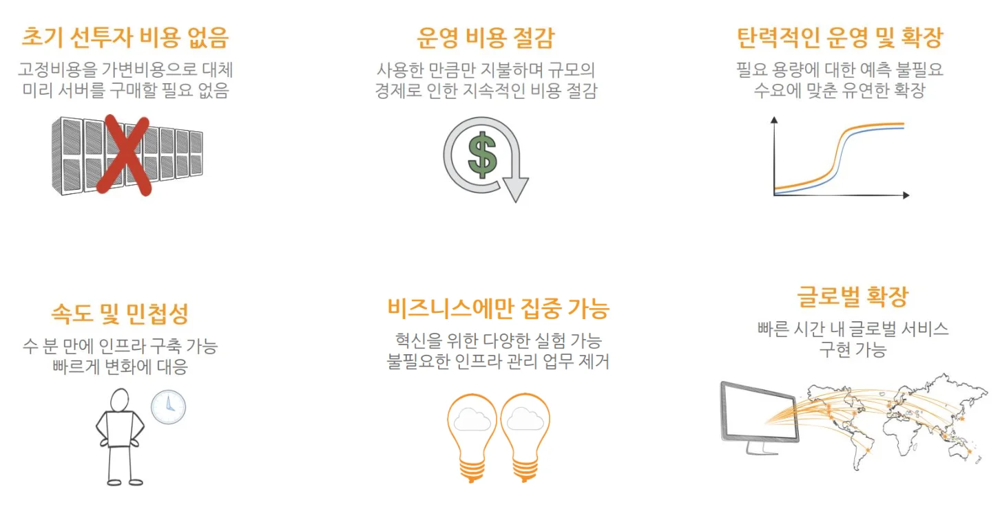

- <strong>보안(Security)</strong>
    

    광범위한 보안 정책 집합, 기술 및 컨트롤을 제공하여 데이터, 앱 및 인프라를 잠재적인 위협으로부터 보호 

- <strong>안정성(Reliability)</strong>
    

    클라우드 공급자 네트워크의 여러 중복 사이트에 데이터를 미러할 수 있으므로 데이터 백업, 재해 복구 및 비지니스 연속성을 더 쉽게 제공한다&#46;

- <strong>고가용성(High Availability)</strong>
    

    클라우드 공급자의 여러 리전, 가용영역, 데이터 센터를 활용하여 고가용성을 쉽게 설계 가능

    

    고가용성 설계를 통해 다운 타임을 최소화  하면서 장애를 견딜 수 있는 아키텍처 설계 가능

    

     ex)  여러 가용영역 (여러 데이터 센터)에 Amazon EC2 인스턴스를 배치

- <strong>탄력성(Elasticity), 확장성(Scalability)</strong>
    

    더 이상 어떤 용량이 필요할지 추측할 필요가 없으며 사용자는 리소스 용량에 대한 추측을 중지 가능

    

    사용자는 필요에 따라 컴퓨팅 용량을 프로비저닝 하거나 해제 가능하며 현재 수요를 처리하는 데 필요한 양의 리소스만 프로비저닝 가능

    

    수요 변화에 따라 리소스 크기를 조정 가능

    

    매우 동적인 사용 패턴(워크로드)을 지원하기 위해 알람 기능으로 자동 확장 및 축소 가능

- <strong>민첩성(Agility)</strong>
    

    프로비저닝 시간이 짧은 즉시 사용 가능한 리소스, 확장 가능한 컴퓨팅 용량 제공

    

    새로운 워크로드를 배포하는 데 필요한 직원의 시간 단축하여 애플리케이션 개발 팀의 생산성 향상

    

    개발자가 IT 리소스를 사용할 수 있도록 하는 데 필요한 시간 단축을 통해 혁신을 지원하는 능력 제공

    

    새로운 기능을 반복적인 방식으로 신속하게 제공하여 출시 시간을 최소화

    

      ex) 스타트 업이 빠르게 시장에 출시해야하는 새로운 애플리케이션을 개발하여 빠르게 클라우드에 베포 및 필요할 때마다 빠르게 조정 가능

- <strong>사용한 만큼 지불하는 요금제 (Pay&#45;as&#45;you go pricing)</strong>
    

    장기 계약이 필요하지 않는 종량제 모델을 사용

    

    초기 고정 비용/자본 비용(CAPEX)를 변동 비용/가변 비용(OPEX)으로 대체할 수 있도록 하는 온디멘드 기술 서비스 사용

    

    큰 자본 지출을 최소화함으로써 <u>총 소유 비용(TCO)</u>을 어떻게 줄일 수 있음

- <strong>글로벌 도달 (Global Reach, Global Footprint)</strong>
    

    지연 시간이 짧은 높은 처리량과 중복성을 가진 네트워크로 연결된 여러 지역으로 구성된 클라우드 인프라를 베포 

    

    회사의 서비스를 빠르게 글로벌화 할 수 있는 능력

    

    AWS 리전, 가용 영역 및 엣지 로케이션 네트워크를 통해 전 세계 사용자

- <strong>규모의 경제 (Economy of scale)</strong>
    

    AWS 등의 클라우드 회사에서 높은 구매량으로 인해 변동 비용을 낮출 수 있음

    

    AWS 클라우드 요금의 지속적인 감소

    

    온&#45;프레미스 데이터 센터를 구축하고 유지 관리하는데 드는 많은 비용을 없애 줌

- <strong>기타 클라우드 컴퓨팅 이점 </strong>
    

    클라우드 업체에서 인프라를 관리하기에 사용자는 데이터 센터 유지 관리에 돈을 쓰지 않아도 됨

    

    데이터센터 인프라는 클라우드 업체에서 관리하기에 사용자는 수익 창출(비즈니스) 활동에 집중할 수 있음

    

    AWS 관리형 서비스를 활용하면 사용자 관리가 최소화 되므로 AWS 클라우드에서 운영 효율성을 높일 수 있음

    

    반복되는 애플리케이션 설치 및 설정을 돕기 위해 클라우드 업체의 <strong>엔터프라이즈 지원을 사용</strong>하여 효율을 높일 수 있음

## AWS 란?

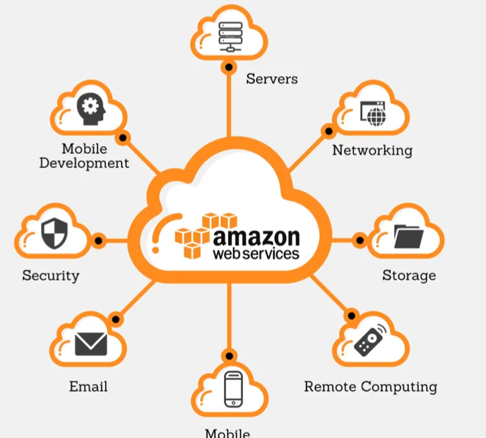

Amazon Web Services(AWS)의 줄임말로  말 그래도 아마존 사에서 제공하는 클라우드 서비스이다&#46; 

세계적으로 가장 많이 채택된 클라우드 플랫폼으로  200개가 넘는 서비스를 제공한다&#46;

물리적 서버의 용량, 계획 등 클라우드 인프라 유지 관리를 담당 

## AWS 글로벌 인프라의 의해

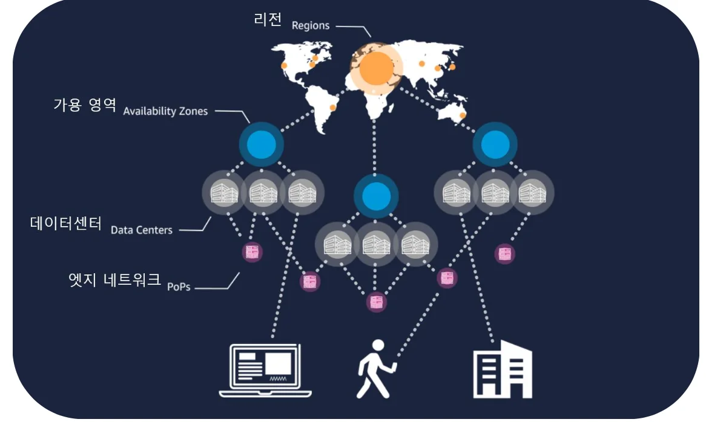

> 리전 → 가용영역 → 데이터 센터 → 엣지 네트워크

### 리전

데이터 센터를 클러스터링 하는 물리적 위치 ( 서울리전, 홍콩리전 등 )

전세계 주요국가에 위치

1개 AWS 서비스는 리전을 선택하여 시작 

(ex, EC2 서비스)

리전을 선택하지 않는 글로벌 서비스 있음  (ex, IAM 서비스)

재해복구(DR) 설계 = 2개 이상의 리전에 시스템을 배치 

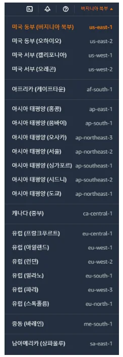

### 가용 영역 ( Availability Zone &#45; AZ)

가용 영역 = 하나 이상의 개별 데이터 센터

1개의 리전은 2개 이상은 가용영역으로 구성 ( 보통 3&#126;4개의 가용영역으로 구성)

가용영역끼리는 물리적으로 떨어져 있고 고속 네트워크로 연결됨

고가용성 설계 = 다중 AZ (Multi&#45;AZ), 2개 이상의 가용역에 시스템 배치

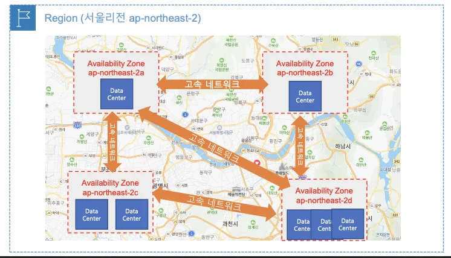

### 엣지 로케이션 ( Edge Location )

엣자 로케이션에 콘텐츠(데이터)를 캐싱하여 사용자에게 더 짧은 지연 시간으로 콘텐츠를 전송

글로벌 베포 서비스인 AWS CloudFront, Global Accelerator 에서 대표적으로 사용

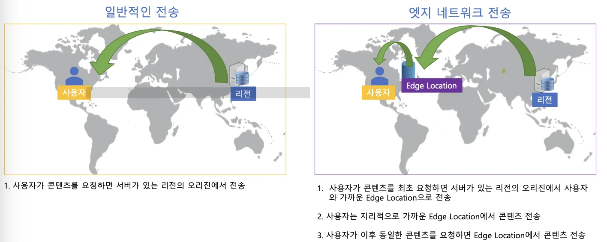

전세계 수백개의 엣지 로케이션을 운영 중

엣지로케이션과 AWS 리전, 가용영역끼리는 고속 네트워크로 연결되어 있음

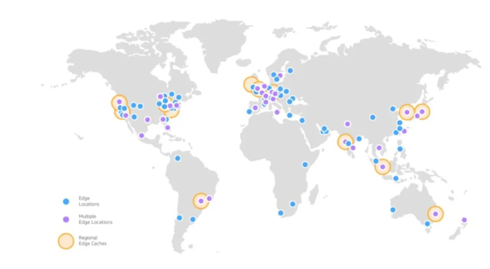

## 클라우드 베포 모델

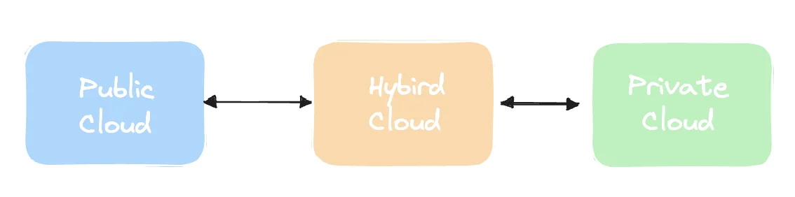

공용 인터넷을 통해 서비스 제공

누구에게나 서비스 제공

Azure, AWS, GCP 서비스가 대표적 

관리 비용이 낮음

퍼블릭 클라우드와 프라이빗 클라우드(온프레미스 데이터센터)를 네트워크로 연결

AWS VPN, AWS Direct Connect, 퍼블릭 인터넷 연결 서비스를 사용

개별 기업이 독점적으로 사용

클라우드 인프라가 온&#45;프레미스(온사이트) 데이터 센터에 있음

기업의 데이터 센터에 가상머신을 사용하여 시스템 운영

관리 비용이 높음

## 클라우드 컴퓨팅 모델

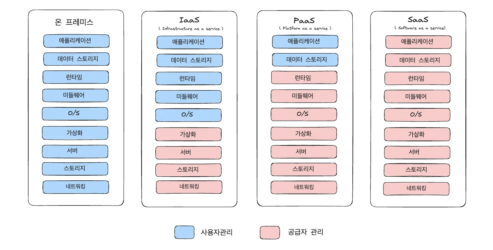

### IaaS &#45; Infrastructure as as Service, <strong>서비스형 인프라스트럭처</strong>

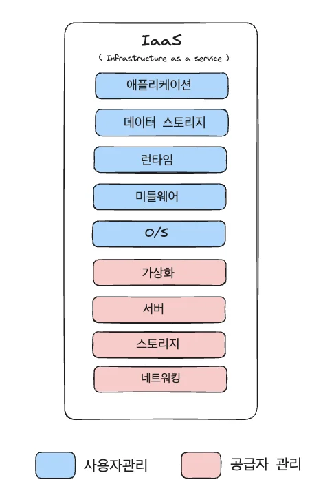

물리적인 부분은 공급자가 관리

사용자는 <strong>운영체제, 스토리지, 애플리케이션 관리</strong>

Amazon <strong>EC2 </strong>가 대표적인 서비스 

### PaaS &#45; Platform as a Service

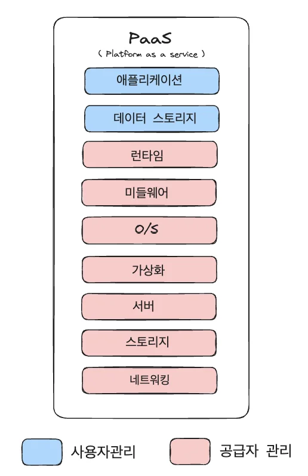

물리적인 부분, OS 등 공급자가 모든 플랫폼 관리 

사용자는 <strong>데이터</strong>와 <strong>애플리케이션</strong>만 관리

<strong><u>사용자는 애플리케이션 개발에만 집중 가능</u></strong>

<strong>AWS </strong><strong>Elastic Beanstalk</strong> 이 대표적인 서비스 

### SaaS &#45; Software as a Service

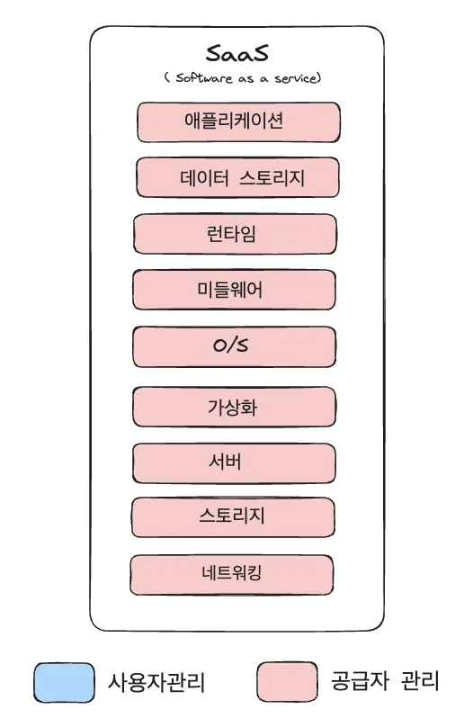

모든 부분을 공급자가 관리

사용자는 서비스를 사용만 하면 됨

Google <strong>Gmail </strong>등이 대표적인 서비스

## AWS 인터페이스 

### AWS Management

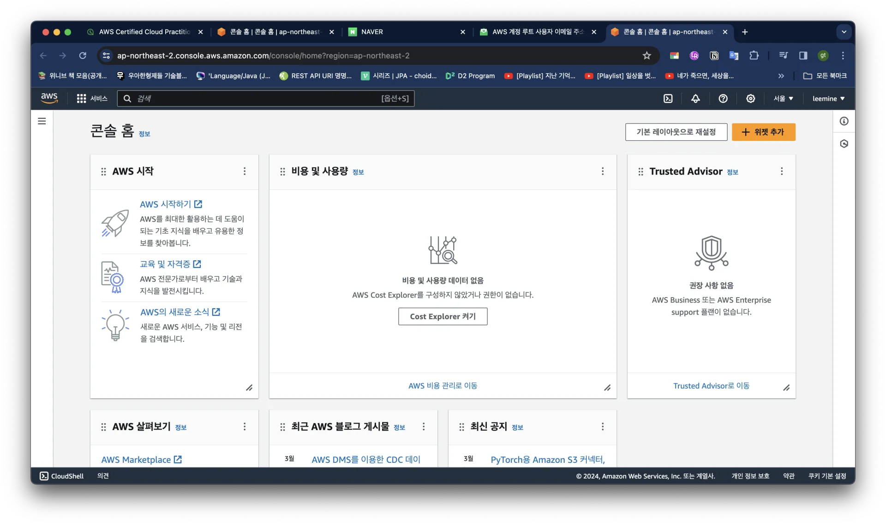

<a href="https://console.aws.amazon.com/console/home">웹 브라우저</a> 접속

ID, Password MFA를 사용해 로그인

### 명령줄 인터페이스(CLI)

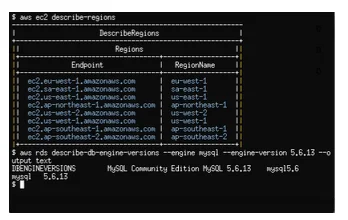

Command Line Interface

Window, Mac, Linux 명령어를 사용하여 서비스 제어

Access Key를 사용해 AWS 서비스 접속

Windows Powershell, Mac/Linux Teminal, Putty SSH 등의 도구를 사용

### 소프트웨어 개발 키드 (SDK)

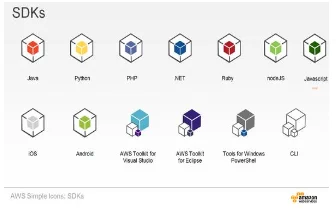

Software Development Kit

프로그래밍 코드를 사용해서 서비스 제어

Access Key를 사용해 AWS 서비스 접속

애플리케이션 개발에 사용
