<a id="1c3eda9b0fe181bdb2a2c8b434c2e607"></a>

스프링 부트 사용 시 환경 설정도 편리하게 하고 스프링 부트가 Tomcat 서버, WAS를 내장하고 있어 해당 부분을 편리하게 사용할 수 있다&#46;

<a id="1c3eda9b0fe181a099cbfc5eea14c79f"></a>

## 웹 서버, 웹 애플리케이션 서버

> 👉🏻 참고) <a href="#/post/1c3eda9b-0fe1-81c8-b57f-fa069abfcbbf">페이지</a> 

<details>
<summary><strong>HTTP </strong></summary>

<a id="1c3eda9b0fe1819cbc25dd88069156e5"></a>

HTTP 메서지를 통해 모든 것을 전송한다&#46; 

<a id="1c3eda9b0fe181b5b039fcd16d8d851e"></a>

HTML, Text, Image, 음성, 영상, 파일, JSON, XML(API) 등

<a id="1c3eda9b0fe1817aaac0c70b8bfa8d41"></a>

거의 모든 형태의 데이터 전송 가능하며 서버간에 데이터를 주고 받을 때도 대부분 HTTP를 사용한다&#46; 

</details>

<a id="1c3eda9b0fe181e880c7d212c5c53b0b"></a>

### 웹 서버(Web Server)

- 정적 리소스 제공을 위한 서버이다&#46; 

- 예전 방식

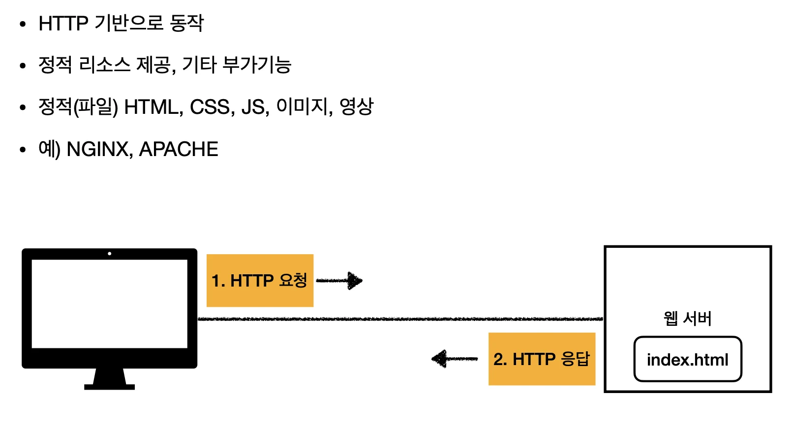

<a id="1c3eda9b0fe1819e9757f23bbc793fe5"></a>

### 웹 애플리케이션 서버 ( WAS &#45; Web Application Server )

- 

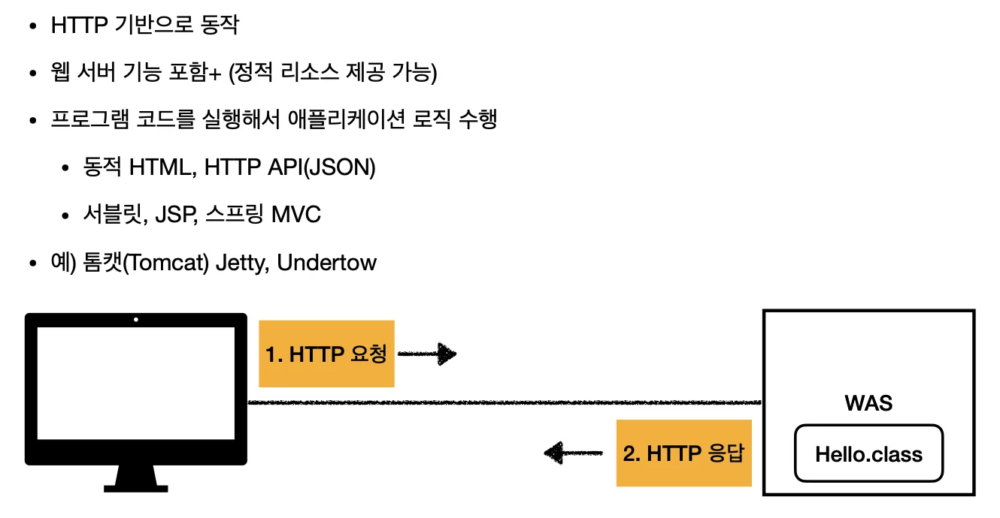

<a id="1c3eda9b0fe1816b805ad9c79428dca8"></a>

### <code>웹 서버</code> vs <code>웹 애플리케이션 서버(WAS)</code>

> 👉🏻 <code>웹 서버</code> → <strong>정적 리소스(파일)</strong>
> 
> <a id="1c3eda9b0fe18109bfcec59d56b18a31"></a>
> 
> <code>WAS</code> → <strong>애플리케이션 로직 </strong>

<a id="1c3eda9b0fe1815a94fec80a61716816"></a>

사실 둘의 용어도 경계도 모호하다&#46; <br>웹 서버도 프로그램을 실행하는 기능을 포함하기도 하며 <br>웹 애플리케이션 서버도 웹 서버의 기능을 제공한다&#46; 

<a id="1c3eda9b0fe18117a10bf233a6ee1c69"></a>

자바는 서블릿 컨테이너 기능을 제공하면 WAS이다&#46; <br>(서블릿 없이 자바 코드를 실행하는 서버 프레임워크도 있다&#46;)

<a id="1c3eda9b0fe181a5bf8ddbff18a63a00"></a>

WAS는 애플리케이션 코드를 실행하는데 더 특화 되어있다&#46; 

<a id="1c3eda9b0fe18197aec5faf2881c4555"></a>

### 웹 시스템 구성1) <code>WAS</code>, <code>DB</code>

> 🤫 WAS, DB 만으로 시스템 구성 가능하며<br>WAS는 정적 리소스, 애플리케이션 로직 모두 제공 가능하다&#46;

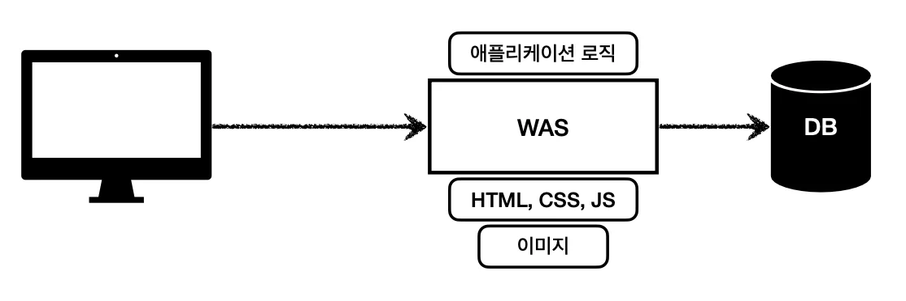

> ⚠️ 그러나 <code>WAS</code>, <code>DB</code>로만 시스템을 구성하면 WAS가 너무 많은 역할을 담당하며 서버 과부하의 우려가 있다&#46; 그리하여 가장 비싼 애플리케이션 로직이 정적 리소스 때문에 수행이 어려울 수 있다&#46;  WAS 장애는 오류 화면도 노출 불가능하다&#46; 

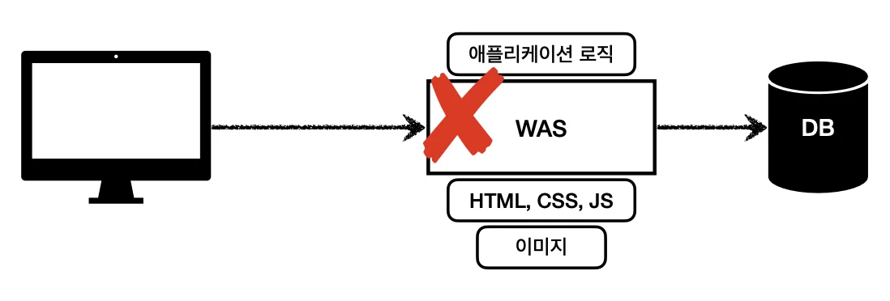

<a id="1c3eda9b0fe181809329f285790e4ed2"></a>

### 웹 시스템 구성2) <code>WEB</code>, <code>WAS</code>, <code>DB</code>

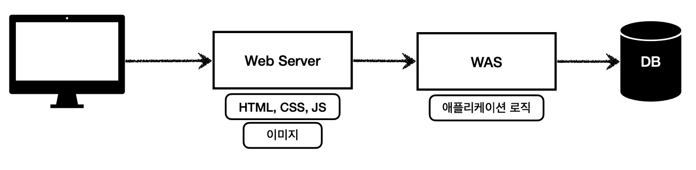

> 📌 웹서버  → 정적 리소스 
> 
> <a id="1c3eda9b0fe181769356d3663d81c2bd"></a>
> 
> 애플리케이션 로직 같은 <strong><u>동적 처리가 필요 시</u></strong><u> </u><strong><u>WAS에 요청을 위임</u></strong>
> 
> <a id="1c3eda9b0fe18174a60bcd7d1a6bbcce"></a>
> 
> WAS는 중요한 애플리케이션 로직 처리 전담

> 👍🏻 <strong>효율적인 리소스 관리</strong>
> 
> - 정적 리소스가 많이 사용되면 Web 서버 증설
> 
> - 애플리케이션 리소스가 많이 사용되면 WAS 증설

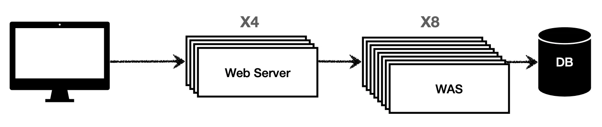

> 👍🏻 WAS, DB 장애시 WEB 서버가 오류 화면 제공 
> 
> - 정적 리소스만 제공하는 웹 서버는 잘 죽지 않음
> 
> - 애플리케이션 로직이 동작하는 WAS 서버는 잘 죽음
> 
> <a id="1c3eda9b0fe181de8c99d1d5e29edcb7"></a>
> 
>  ⇒ WAS, DB 장애시 WEB 서버가 오류 화면 제공 가능

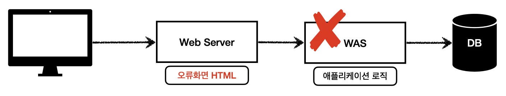

<a id="1c3eda9b0fe181f0bb61fde9dbf392f9"></a>

## 서블릿

<details>
<summary>🧐 웹 애플리케이션 서버 직접 구현</summary>

- 1&#46; TCP/IP 연결을 위한 로직 작성 

- HTTP 메서드 → 말그래도 텍스트이다&#46; 즉, 직접 잘라서 파싱을 하면 된다
    <a id="1c3eda9b0fe181d7844ae83408d7d23e"></a>

    &#46;  &#46;  &#46;

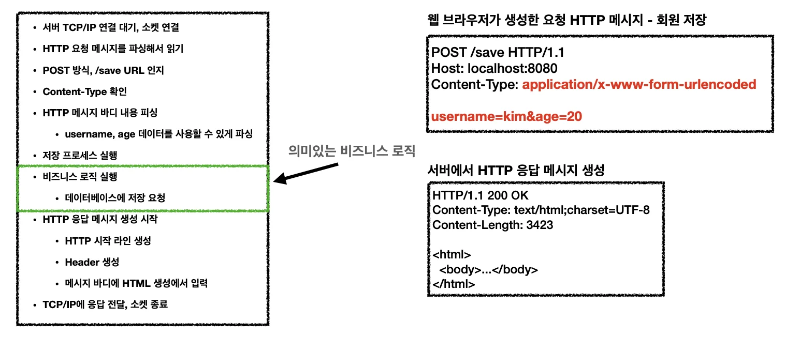

</details>

<details>
<summary>서블릿을 지원하는 WAS 사용</summary>

> 서블릿 사용 시, 아래의 일들을 다 자동화해준다&#46; 

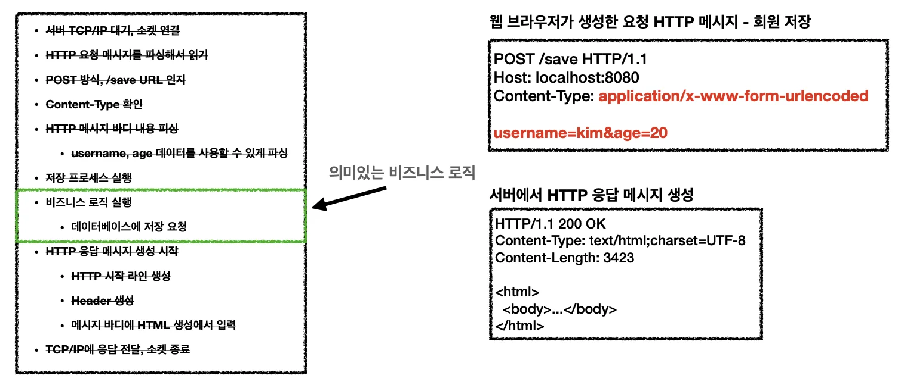

- 서버 TCP/IP 대기, 소캣 연결

<details>
<summary>HTTP 요청 메세지 파싱</summary>

- HTTP 메서드, URL  (RESTfull)

- Content&#45;type

- 메세지 바디 

</details>

- HTTP 응답 메세지 생성

- TCP/IP 응답 전달 및 소캣 종료

</details>

<details>
<summary>서블릿 </summary>

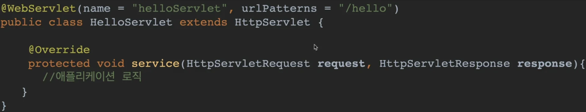

- <code>urlPatterns(/hello)</code>의 <strong><u>URL 호출</u></strong>되면 <strong><u>서블릿 코드 실행</u></strong>

- HTTP 요청 정보&#58; <code>HttpServeltRequest</code>

- HTTP 응답 정보&#58; <code>HttpServletResponse</code>
    <a id="1c3eda9b0fe18165bde9e1857346b4ed"></a>

    ⇒  헤당 서블릿을 통해 HTTP 스펙을 매우 편리하게 사용할 수 있다&#46; 

</details>

<details>
<summary>서블릿 사용 과정</summary>


1. 브라우저로부터 HTTP 요청(<code>hocalhost&#58;8080/hello</code> ) 받음

1. 요청 메세지를 기반으로 WAS(Web Application Server)에서  <code>request</code>, <code>response</code> 객체 생성

1. request, response 객체를 파라미터로 넘기면서 서블릿(helloServlet) 실행
    - 개발자는 Request 객체에서 HTTP 요청 정보를 편리하게 꺼내서 사용함

    - 또한 Response 객체에 HTTP 응답 정보를 편리하게 입력함

1. 서블릿 종료 시, WAS는<u> response 객체를 해석</u>하여 <strong><u>응답 메세지 생성</u></strong>, 웹 브라우저에 전달

</details>

<details>
<summary>서블릿 컨테이너</summary>


- 톰캣처럼 <strong><u>서블릿을 지원하는 WAS</u></strong>를 서블릿 컨테이너라 한다&#46; 
    - WAS 안에 있는 <strong><code>서블릿 컨테이너</code></strong>에서 <u>서블릿 객체를 자동으로 생성</u><strong> 및 </strong><strong><u>호출</u></strong>

- 서블릿 객체의 <strong><u>생명주기</u></strong>(<code>생성</code>, <code>초기화</code>, <code>호출</code>, <code>종료</code>) 관리
    - 서블릿 컨테이너 종료 시, 서블릿도 함께 종료된다&#46; 

- 서블릿 객체를 <strong><u>싱글톤</u></strong>으로 관리
    <details>
    <summary>🧐 하나의 서블릿으로 모든 요청이 처리된다면 <strong><u>여러개의 요청이 한번에 들</u></strong>어왔을 때, 어떻게 처리되는가? (동시성 문제)  </summary>

    - was에서 생성하여 <strong><u>서블릿이 파라미터로 받</u></strong>는 <code>request</code>, <code>response</code> 객체는<strong><u> 요청마다  항상 새로 생성</u></strong>된다&#46;

    - 그러나 서블릿은 resquest, reponse를 파싱하고 HTTP 메세지를 생성하는, 항상 동일한 로직을 수행하기 때문에 매번 새로 생성할 필요없이 하나의 인스텬스를 재활용한다&#46; (싱글톤)

    - 그러다보니 여기서 의문점이 생긴다&#46;
        > ‘여러개의 요청을 한번에 처리해야 하는 경우는 어떻게 동작되는가?’

        <a id="1c3eda9b0fe181adac0cfe8e5f19b62f"></a>

        그래서 <strong><u>동시 요청을 위한 멀티 쓰레드 처리를 지원</u></strong>한다&#46; <br>

    </details>

    - 고객의 요청이 올 때마다 계속 객체를 생성하는 것은 비효율이다&#46; <br><u>최초 로딩 시점에 서블릿 객체를 미리 생성</u> 후, 재활용한다&#46;<br>따라서 <strong><u>모든 고객 요청</u></strong>은 <strong><u>동일한 서블릿 객체  인스턴스 접근</u></strong>하여 처리된다&#46;
        - <code>공유 변수</code> 사용 주의 

- JSP도 서블릿으로 변환되어 사용된다&#46;

- 동시 요청을 위한 멀티 쓰레드 처리 지원

</details>

<a id="1c3eda9b0fe181078a67dd2537fb0e0e"></a>

## 동시 요청 &#45; 멀티 쓰레드

<details>
<summary>🧐 하나의 쓰레드가 차지하는 코어 용량 및 메모리 용량</summary>

<details>
<summary>CPU 코어 용량</summary>

<a id="1c3eda9b0fe181318630effc56ef57a4"></a>

쓰레드는 <strong><u>CPU의 ‘한’ 코어에서 실행</u></strong>되며, <u>각 쓰레드는 CPU 처리 시간을 공유</u>한다&#46;

<a id="1c3eda9b0fe18164966dedd714d7eec4"></a>

일반적으로 <u>쓰레드 하나가 CPU 전체 용량을 모두 차지하지 않</u>고, 그 코어에서 <u>사용 가능한 시간</u>을 <strong><u>분할</u></strong>해서 사용한다&#46; 

<details>
<summary>ex)</summary>

- CPU 코어 수&#58; 4코어 ( 4개의 병렬 작업 가능 )

- 스레드&#58; 8개의 스레드가 동시에 실행

<a id="1c3eda9b0fe181af88e2dcf5a9a64a2d"></a>

해당하는 경우 CPU는 4개의 코어가 존재함으로, 각 코어는 두개의 스레드를  번갈아가며 처리한다&#46; 

<a id="1c3eda9b0fe1813fad8dd30637dfcdbf"></a>

이때, 스레드 간의 <strong><u>컨텍스트 스위칭</u></strong>이 발생하며, 이것이 <strong><u>CPU 성능에 영향</u></strong>을 미친다&#46; 

</details>

</details>

<details>
<summary>메모리 용량</summary>

- <em><strong>각 스레드 </strong></em>는 자신만의 <strong><u>스택 메모</u></strong>리를 <strong><u>갖</u></strong>고 있으며, 해당 메모리에 <strong><u>지역 변수, 메서드 호출 기록 등이 저장</u></strong>된다&#46; 

- 스택 메모리 크기는 보통 1MB로 할당되며, JVM 옵션애서 이를 조장할 수있다&#46; 

- 스레드들은 <strong><u>힙 메모리 공간을 공유</u></strong>한다<br>따라서 동시 스레드 수가 늘어나면 메모리( 힙 메모리) 사용량이 급격이 증가할 수 있다&#46; 


</details>

- 정리
    <details>
    <summary>일꾼(코어), 작업(쓰레드)</summary>

    - <strong><u>일꾼 하나</u></strong>는<strong> </strong><strong><u>한가지 작업</u></strong><strong>만 가능</strong> (<code>쓰레드 1개 </code> → <code>코어 1개</code>)

    - 일꾼은 이 일하다가 저 일하는 <strong><u>여러가지 작업 가능</u></strong>, 물론 <u>동시에는 아님 ( </u><strong><code>코어 하나 </code></strong><strong>당 여러개 작업 할당 가능</strong><u> )</u>

    - 이때, 여기 다른 일하고 저기서 다른 일할 때, <strong><u>중간에 소모되는 시간이 발생</u></strong>함 ( <code>컨텍스트 스위칭 비용</code>)

    </details>

    - <strong>스레드 1개</strong>가 차지하는 메모리 용량
        - 보통 1MB (스택 메모리) &#43; 추가적인 힙 메모리 사용량

</details>

<details>
<summary>🧐 CPU, 쓰레드, 힙 메모리 </summary>


</details>

<details>
<summary>🧐 WAS(톰캣)의 주요 튜닝 표인트는 거의 <code>Max Thread</code> 이다&#46;</summary>

<a id="1c3eda9b0fe18145b6e3d8a01959e0b2"></a>

Max Thread 튜닝 시, 극적인 효과를 볼 확률이 높으나, 너무 높거나 낮게 설정하면 아래와 같은 문제가 발생 될 수 있다&#46;

- max thread 값을 너무 <strong><u>낮</u></strong>게 설정
    - <u>동시 요청이 많</u>으면, <u>서버 리소스는 여유</u>롭지만, <strong><u>클라이언트에게 받아오는 응답들이 지연</u></strong>된다&#46;

- max thread 값을 너무 <strong><u>높</u></strong>게 설정
    - <u>동시 요청이 많</u>으면 <strong><u>CPU, 메모리 리소스의 임계점이 초과</u></strong>되어 <u>서버가 다운</u>된다&#46;

</details>

<details>
<summary>🧐 스프링 부트 톰캣 <code>Max Thread</code> 설정</summary>

<a id="1c3eda9b0fe181d0bd2cfc7da1895edb"></a>

스프링부트에는 기본적으로 내장된 톰캣 서버가 존재하기에, <code>application&#46;properties</code>, <code>application&#46;yml</code>에서 Tomcat 설정을 쉽게 조정 할 수 있다&#46; 

<details>
<summary>1) application&#46;properties &#45; max thread</summary>

<a id="1c3eda9b0fe181828ef7eccb1108ec9d"></a>

```javascript
server.tomcat.max-threads=300
```

</details>

<details>
<summary>2) <strong>application&#46;yml</strong></summary>

<a id="1c3eda9b0fe181f49157f3dddc92a41e"></a>

```javascript
server:
  tomcat:
    max-threads: 300
```

</details>

<details>
<summary>3) Tomcat 커넥터 직접 설정</summary>

<a id="1c3eda9b0fe1816c9ec4fe095c97c40b"></a>

더 세부적인 설정이 필요한 경우, TomcatServletWebServerFactory 빈을 사용해 직접 설정할 수 있다&#46; 

<details>
<summary><strong>ex) TomcatServletWebServerFactory 빈을 통한 세부 설정</strong></summary>

- <code>maxThreads</code>&#58; 최대 쓰레드 수

<details>
<summary><code>minSpareThreads</code></summary>

- 최소 스레드 수를 설정

- 서버가 항상 유지하는 대기 스레드 수를 의미하며 요청이 없을 때에도 일정 수의 스레드를 유지한다&#46;

</details>

<details>
<summary><code>acceptCount</code></summary>

- maxThreads가 모두 사용 중일 때 대기할 수 있는 최대 요청 수를 설정

- 이 수를 초과하면 클라이언트는 연결을 거부 당할 수 있다&#46; 

</details>

<a id="1c3eda9b0fe181cd830dcecd2d1f50d3"></a>

```javascript
import org.springframework.boot.web.embedded.tomcat.TomcatServletWebServerFactory;
import org.springframework.context.annotation.Bean;
import org.springframework.context.annotation.Configuration;

@Configuration
public class TomcatConfig {

    @Bean
    public TomcatServletWebServerFactory tomcatFactory() {
        TomcatServletWebServerFactory factory = new TomcatServletWebServerFactory();
        factory.addConnectorCustomizers(connector -> {
            connector.setProperty("maxThreads", "300");  // 최대 스레드 수 설정
            connector.setProperty("minSpareThreads", "20");  // 최소 대기 스레드 수 설정
            connector.setProperty("acceptCount", "100");  // 대기 큐에서 기다릴 수 있는 최대 요청 수
        });
        return factory;
    }
}
```

- 최대 쓰래드 수는 ‘300’개 이고, (<code>maxTheads = 300</code>)

-  최소  20개의 쓰레드를 대기 상태로 유지하여 즉시 요청을 처리할 수 있도록 준비한다&#46; (<code>minSpareTheads = 20</code>)

- 300개의 쓰레드가 모두 사용 중일 때, 추가로 100개의 요청을 대기 큐에 넣는다&#46; (<code>acceptCount = 100</code>)

</details>

</details>

</details>

<details>
<summary>🧐 튜닝 후 성능 모니터링</summary>

<a id="1c3eda9b0fe181aab286e658787467c4"></a>

튜닝 후에는 반드시 모니터링 도구를 통해 스레드 풀 사용량을 체크해야 한다

<a id="1c3eda9b0fe1810cbc0dcbbfb445d67c"></a>

Actuator 나 외부 모니터링 툴을 통해 <strong><u>서버</u></strong>의 <u><code>CPU 및 메모리 사용률</code></u><code>,</code> <u><code>요청 처리 성능</code></u> 등을 모니터링하면서 <strong><u>최적화된 값을 찾는 것</u></strong>이 중요하다&#46; <br><br>

</details>

<details>
<summary>서블릿 객체 호출 → 쓰레드 </summary>

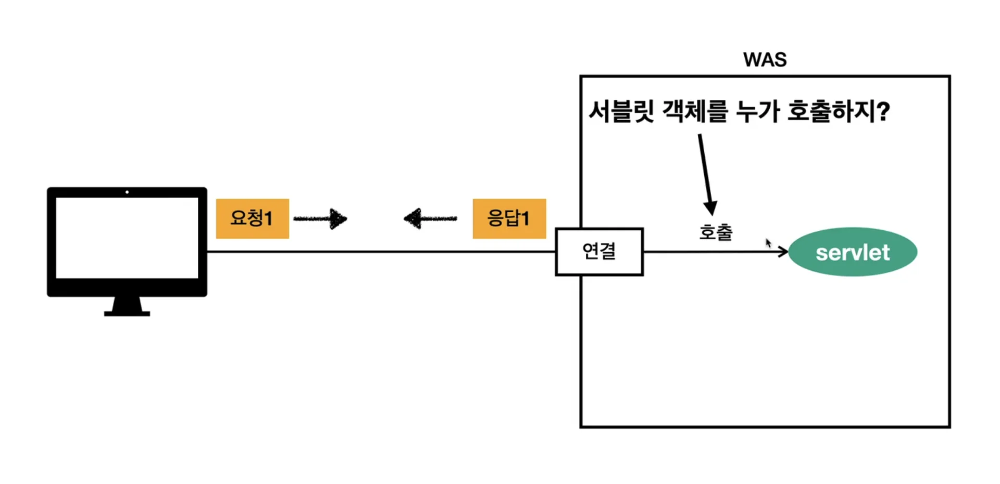

<a id="1c3eda9b0fe18117908dcd8cd9beb206"></a>

브라우저에서 HTTP 요청 메세지를 보내면, WAS에서 TCP/IP 커넥션이 연결되어 해당 요청을 받아온다&#46; 그리고 서블릿을 호출하여 해당 요청을 처리한다&#46; 

<a id="1c3eda9b0fe181d98556f1b613c50694"></a>

그런데 이 서블릿 객체를 호출 누가 담당하는가? 바로 <strong><u>‘쓰레드’</u></strong> 이다&#46;

</details>

<details>
<summary>쓰레드</summary>


</details>

<details>
<summary>단일 요청 &#45; 쓰레드 1개</summary>


</details>

<details>
<summary>다중 요청  &#45; 쓰레드 1개</summary>


</details>

<details>
<summary>다중 요청 &#45; 요청마다 쓰레드 생성</summary>


</details>

<details>
<summary><strong>다중 요청 &#45; 쓰레드 풀</strong></summary>


</details>

<a id="1c3eda9b0fe181759b72ed594733279f"></a>

##   HTML, HTTP API, CSR, SSR

<a id="1c3eda9b0fe1814f93daf175678bb3bb"></a>

## 자바 벡엔드 웹 기술 역사
