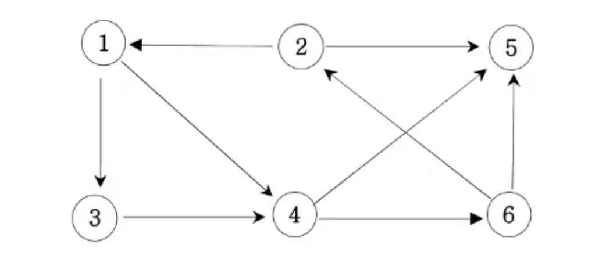

<a id="1c3eda9b0fe1817b9a1fd3f40b7605b4"></a>

# 문제

<a id="1c3eda9b0fe1816d8e39c4785f027504"></a>

## 14&#46; 그래플 최단거리(BFS)

<a id="1c3eda9b0fe1813bb28ad0db2a0c5902"></a>

### 설명

<a id="1c3eda9b0fe181ed82e4e58c7f7e97af"></a>

다음 그래프에서 1번 정점에서 각 정점으로 가는 최소 이동 간선수를 출력하세요&#46;&#35;



<a id="1c3eda9b0fe181ff8c2fc1d47039bf7c"></a>

### 입력

<a id="1c3eda9b0fe1812f8407d4d86e709655"></a>

첫째 줄에는 정점의 수 N(1≤N≤20)와 간선의 수 M가 주어진다&#46; 그 다음부터 M 줄에 걸쳐 연결정보가 주어진다&#46; 

<a id="1c3eda9b0fe181559217c02ca4480ada"></a>

### 출력

<a id="1c3eda9b0fe18195b0b1f4b61e420ab7"></a>

1번 정점에서 각 정점으로 가는 최소 간선수를 2번 정점부터 차례대로 출력하세요&#46;

<a id="1c3eda9b0fe181d79054d6323aa2b45d"></a>

### 예제 입력1

<a id="1c3eda9b0fe1814bbed0ea0d0e5070d6"></a>

```plaintext
6 9
1 3
1 4
2 1
2 5
3 4
4 5
4 6
6 2
6 5 
```

<a id="1c3eda9b0fe1814889efe4a13c058c55"></a>

### 예제 출력1

<a id="1c3eda9b0fe1814f93fad155384ef786"></a>

```plaintext
2 : 3
3 : 1
4 : 1
5 : 2
6 : 2
```

<a id="1c3eda9b0fe1816fbc7af9963e90fd6b"></a>

# 풀이

<a id="1c3eda9b0fe181c48495fe300ae599db"></a>

## 풀이1) <code>내풀이</code>  BFS, 메모제이션 , 이중ArrayList

> <em><strong>• 개선 필요</strong></em><br><code>BFS()&#95;for문</code> 에서 check&#95;list(ch)를 <u>매번 인스턴스를 생성하여 초기화</u>를 시켜 답을 구했음 → 메모리 낭비<br>⇒ 해당 로직을 각 target&#95;number를 구하고 다시 0으로 초기화하는 방법으로 수정  필요 → for문 사용하면 간단하나&#46;&#46; 그럼 복잡도가 쓸데없이 높아짐&#46;

<details>
<summary>개선 필요 </summary>

<a id="1c3eda9b0fe181228cdff8d0135ccc3f"></a>

```java
import java.lang.reflect.Array;
import java.util.*;

public class Main {
    // Adjacent Line: 인접라인 , 간선
    static int n, m;
    static int[] ch;
    static ArrayList<ArrayList<Integer>> graph;
    public void BFS(int v){
        Queue<Integer> Q=new LinkedList<>();
        for(int t=2; t<=n; t++){
            ch=new int[n+1];
            ch[1]=1;
            Q.offer(v);
            System.out.println();
            System.out.print(t+" : ");
            int L=0;
            while(!Q.isEmpty()){
                int len=Q.size();
                for(int i=0; i<len; i++){
                    int cur=Q.poll();
                    if(cur==t) {
                        System.out.print(L);
                        break;
                    }
                    for(int x : graph.get(cur)){
                        if(ch[x]==0){
                            Q.offer(x);
                            ch[x]=1;
                        }
                    }
                }
                L++;
            }
        }

    }

    public static void main(String args[]) {
        Main T=new Main();
        Scanner sc=new Scanner(System.in);
        n=sc.nextInt();
        m=sc.nextInt();
        graph=new ArrayList<ArrayList<Integer>>();
        for(int i=0; i<=n; i++) {
            graph.add(new ArrayList<Integer>());
        }

        for(int i=0; i<m; i++){
            int a=sc.nextInt();
            int b=sc.nextInt();
            graph.get(a).add(b);
        }
        T.BFS(1);
    }
}
```

</details>

<details>
<summary>개선) for 문</summary>

<a id="1c3eda9b0fe1818a9cc8eac17959c821"></a>

```java
import java.lang.reflect.Array;
import java.util.*;

public class Main {
    // Adjacent Line: 인접라인 , 간선
    static int n, m;
    static int[] ch;
    static ArrayList<ArrayList<Integer>> graph;
    public void BFS(int v){
        Queue<Integer> Q=new LinkedList<>();
        for(int t=2; t<=n; t++){
            for(int i=0; i<ch.length; i++) ch[i]=0;   // ch 초기화: for문
            Q.offer(v);
            System.out.println();
            System.out.print(t+" : ");
            int L=0;
            while(!Q.isEmpty()){
                int len=Q.size();
                for(int i=0; i<len; i++){
                    int cur=Q.poll();
                    if(cur==t) {
                        System.out.print(L);
                        break;
                    }
                    for(int x : graph.get(cur)){
                        if(ch[x]==0){
                            Q.offer(x);
                            ch[x]=1;
                        }
                    }
                }
                L++;
            }
        }

    }

    public static void main(String args[]) {
        Main T=new Main();
        Scanner sc=new Scanner(System.in);
        n=sc.nextInt();
        m=sc.nextInt();
        graph=new ArrayList<ArrayList<Integer>>();
        for(int i=0; i<=n; i++) {
            graph.add(new ArrayList<Integer>());
        }
        for(int i=0; i<m; i++){
            int a=sc.nextInt();
            int b=sc.nextInt();
            graph.get(a).add(b);
        }
        ch=new int[n+1];
        ch[1]=1;
        T.BFS(1);
    }
}
```

</details>

<a id="1c3eda9b0fe18100ba9ac4bf3e344f4c"></a>

## 풀이2) <code>강의풀이</code>  최적화(거리 배열), 이중ArrayList

<a id="1c3eda9b0fe181e7a5f7ef000152c918"></a>

<del>대박 왜 이 생각을 못했지… 압도적으로 복잡도가 낮아짐&#46;</del>

<a id="1c3eda9b0fe181c291d0d3d1bcd11d3d"></a>

```java
import java.lang.reflect.Array;
import java.util.*;

public class Main {
    // Adjacent Line: 인접라인 , 간선
    static int n, m;
    static int[] ch, dis;
    static ArrayList<ArrayList<Integer>> graph;

    public void BFS(int v){
        Queue<Integer> Q=new LinkedList<>();
        ch[v]=1;
        dis[v]=0;
        Q.offer(v);
        while(!Q.isEmpty()){
            int cv=Q.poll();
            for(int nv : graph.get(cv)){
                if(ch[nv]==0){
                    ch[nv]=1;
                    Q.offer(nv);
                    dis[nv]=dis[cv]+1;
                }
            }
        }
    }

    public static void main(String args[]) {
        Main T=new Main();
        Scanner sc=new Scanner(System.in);
        n=sc.nextInt();
        m=sc.nextInt();
        graph=new ArrayList<ArrayList<Integer>>();
        for(int i=0; i<=n; i++) {
            graph.add(new ArrayList<Integer>());
        }
        for(int i=0; i<m; i++){
            int a=sc.nextInt();
            int b=sc.nextInt();
            graph.get(a).add(b);
        }
        ch=new int[n+1];
        dis=new int[n+1];
        T.BFS(1);
        for(int i=2; i<dis.length; i++){
            System.out.println(i+" : "+dis[i]);
        }
    }
}
```

<a id="1c3eda9b0fe1815bbff9d372c991d2de"></a>

## 풀이3) 이중배열(int&#91;&#93;&#91;&#93;)

<a id="1c3eda9b0fe18172bc76c22fb6e3c224"></a>

```java
import java.lang.reflect.Array;
import java.util.*;

public class Main {
    static int n, m;
    static int[][] graph;
    static int[] ch, dis;
    public void BFS(int v){
        Queue<Integer> Q=new LinkedList<>();
        ch[v]=1;
        Q.offer(v);
        while(!Q.isEmpty()){
            int len=Q.size();
            for(int i=0; i<len; i++){
                int cur=Q.poll();
                for(int j=1; j<=n; j++){
                    if(ch[j]==0 && graph[cur][j]==1){
                        ch[j]=1;
                        dis[j]=dis[cur]+1;
                        Q.offer(j);
                    }
                }
            }
        }
    }


    public static void main(String args[]) {
        Main T=new Main();
        Scanner sc=new Scanner(System.in);
        n=sc.nextInt();
        m=sc.nextInt();
        graph=new int[n+1][n+1];
        for(int i=0; i<m; i++){
            int a=sc.nextInt();
            int b=sc.nextInt();
            graph[a][b]=1;
        }
        ch=new int[n+1];
        dis=new int[n+1];
        T.BFS(1);
        for(int i=2; i<=n; i++){
            System.out.println(i+" : "+dis[i]);
        }
    }

}
```

<a id="1c3eda9b0fe18138a27fc47fafd6bf32"></a>

## 풀이4) 2차 풀이, 이해하기 쉬운 풀이

<a id="1c3eda9b0fe181869574eb6fe4749368"></a>

가장 이해하기 쉬운 풀이인 듯 함&#46;

<a id="1c3eda9b0fe181629e78cca5bd0b4010"></a>

BFS 깊이(depth) 를 거리로 명시함&#46; 

<a id="1c3eda9b0fe18134bc72ec6378920ab8"></a>

```javascript
import java.util.*;

public class Main {
    static ArrayList<ArrayList<Integer>> graph;
    static int[] ch, dis;
    static int n, m;

    public void BFS(int v){
        Queue<Integer> Q = new LinkedList<>();
        int L=0;
        ch[v]=1;
        Q.offer(v);
        while(!Q.isEmpty()){
            int len = Q.size();x
            for(int i=0; i<len; i++){
                int cur = Q.poll();
                for(int x : graph.get(cur)){
                    if(ch[x]==0) {
                        ch[x] = 1;
                        dis[x]=L+1;
                        Q.offer(x);
                    }
                }
            }
            L++;
        }
    }

    public static void main(String args[]) {
        Main T=new Main();
        Scanner sc = new Scanner(System.in);
        n=sc.nextInt();
        m=sc.nextInt();
        graph = new ArrayList<>();
        for(int i=0; i<=n; i++){
            graph.add(new ArrayList<>());
        }
        for(int i=0; i<m; i++){
            int a = sc.nextInt();
            int b = sc.nextInt();
            graph.get(a).add(b);
        }
        ch= new int[n+1];
        dis=new int[n+1];
        T.BFS(1);
        for(int i=2; i<=n; i++){
            System.out.println(i+" : "+dis[i]);
        }
    }
}
```
