<a id="1caeda9b0fe180af9fffd0119e51b5bf"></a>

##  노드 연결

---

> 📖 
> 
> <a id="1caeda9b0fe180c18663c825f65414dc"></a>
> 
> 앞서 살펴본 <strong><code>배열</code></strong>은 <strong><u>크기가 고정적</u></strong>이고 <strong><u>중간 삽입, 삭제 시 빈공간을 만들거나 채워</u></strong>야하는 연산 처리가 필요했다&#46;
> 
> - 고정적인 크기를 가지기 때문에 사용되지 않는 공간이 있는 경우 → 메모리 낭비
> 
> - 중간 삭제, 삽입 시 추가로 공간을 비우거나 채우기위해 전체 요소를 이동시켜야 한다&#46; 
>     - 비효율적인 연산,  <code class="language-math">O(n)</code>
> 
> <a id="1caeda9b0fe180d3a2ebefc0aa4cc2a6"></a>
> 
> 이를 해결하는 자료구조가  <strong>Linked List ( 연결리스트 )</strong> 이다&#46;
> 
> <a id="1caeda9b0fe18066adb3c8aabe83daf3"></a>
> 
> 연결리스트는 <strong><u>노드 간의 연결</u></strong>을 통해서 데이터들의 간의 연결을 만드는 자료구이다&#46;
> 
> <a id="1caeda9b0fe18039a1e3f1ac50bdd44a"></a>
> 
> 따라서 <strong><u>데이터 추가</u></strong>가 필요한 경우,<strong><u> 데이터를 담은 새로운 노드를 만들어 연결</u></strong>하면 된다&#46; 
> 
> - 노드를 통해 낭비되는 메모리없이 딱 필요한 만큼 확보해 사용한다&#46; 
> 
> <a id="1caeda9b0fe180168099d5c152d0e207"></a>
> 
> 또한 <strong><u>중간에 데이터를 삽입 및 삭제</u></strong>하는 경우, <strong><u>새로 생성되는 노드와 기존 노드 사이의 연결을 만들거나 끊</u></strong>어서 효율적으로  처리할 수 있다&#46; 

<a id="1caeda9b0fe180619efed241619c576f"></a>

### V1&#58; 노드 연결 &#45; 기본

<a id="1caeda9b0fe18031bda2ecd598aade77"></a>

<strong>노드 클래스 </strong>

<a id="1caeda9b0fe180ff9568c247865b6605"></a>

```java
public class Node {
		Object item:
		Node next
}
```

- <code>item</code>&#58; 내부 데이터 저장

- <code>next</code>&#58; 다음 노드를 가르키는 포인터

<a id="1caeda9b0fe18058ba6af03f7d431bbd"></a>

### 코드

<details>
<summary>&#91; 코드 &#93; Node</summary>

> ☝🏻 
> 
> <a id="1caeda9b0fe1800cb81cc1ff7c111131"></a>
> 
> 필드의 접근 제어자는 <code>private</code> 으로 선언하는 것이 좋지만, 설명을 단순히 하기 위해 default 접근제어자를 사용했다&#46;

<a id="1caeda9b0fe1806fab3ac84c2f702029"></a>

```java
package collection.link.node;

public class Node {

    Object item;
    Node next;

    public Node(Object item) {
        this.item = item;
    }
}
```

</details>

<details>
<summary>&#91; 코드 &#93; NodeMain1</summary>

<a id="1caeda9b0fe180048850ef453508f013"></a>

```java
package collection.link.node;

public class NodeMain1 {

    public static void main(String[] args) {
        Node first = new Node("A");
        first.next = new Node("B");
        first.next.next = new Node("C");

        System.out.println("모든 노드 탐색하기");
        Node x = first;

        while (x != null) {
            System.out.println(x.item);
            x = x.next;
        }
    }
}
```

</details>

<details>
<summary>실행 결과</summary>

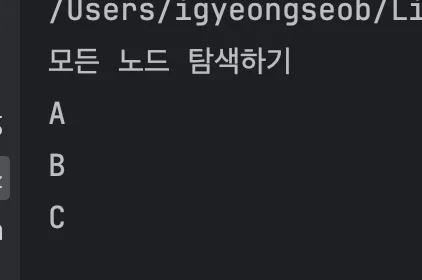

</details>

<a id="1caeda9b0fe180fb8f1fe64fb8cd5a84"></a>

### 설명

<details>
<summary>노드 연결</summary>

1. 데이터 A 담은 노드 생성
    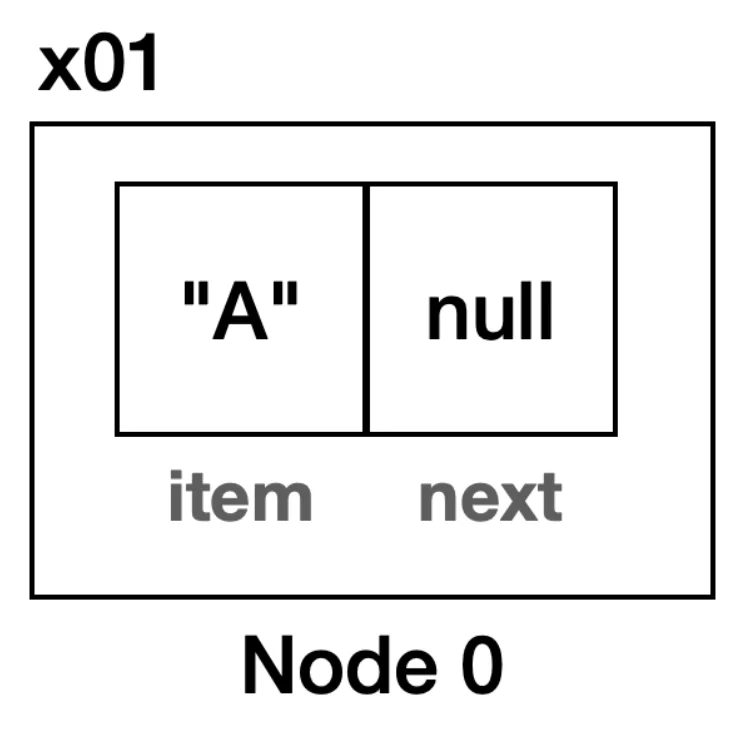

1. 데이터 B를 담은 노드 연결
    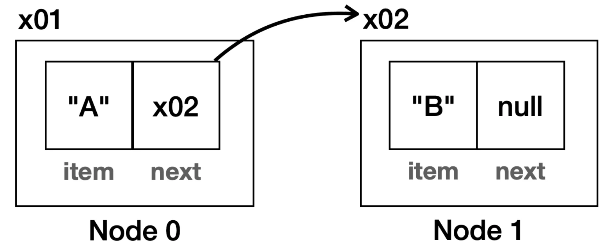

1. 데이터 C를 담은 노드 연결
    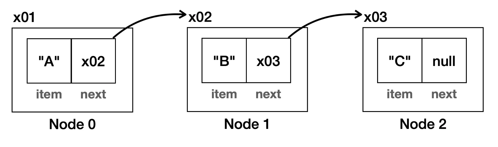

<a id="1caeda9b0fe180c58294fd7a4e6f453e"></a>

이렇게  <code>next</code> 포인터를 통해 순서를 가진  연결을 갖는다&#46; 

</details>

<a id="1caeda9b0fe180a4862ae6e87023f169"></a>

### V2&#58; 조회 최적화 &#45; <code>toString()</code>

> ✏️ 
> 
> <a id="1caeda9b0fe180658e31f0cc11b58ec5"></a>
> 
> 각 노드의 값을 더 편리하게 보기 위해 <code>toString()</code> 오버라이딩 

<a id="1caeda9b0fe18072bb5dd8730888f31c"></a>

### 코드

<details>
<summary>&#91; 코드 &#93; Node &#45; <code>toString()</code> 추가</summary>

<a id="1caeda9b0fe180aebbc8f290f726e04e"></a>

```java
package collection.link.node;

public class Node {

    Object item;
    Node next;

    public Node(Object item) {
        this.item = item;
    }
    
    // toString 직접 구현
		@Override
		public String toString() {
		    StringBuffer sb = new StringBuffer();
		    Node x = this;
		    sb.append("[");
		    while (x != null) {
		        sb.append(x.item);
		        if (x.next != null) {
		            sb.append("->");
		        }
		        x = x.next;
		    }
		    sb.append("]");
		    return sb.toString();
		}
}

```

</details>

<details>
<summary>&#91; 코드 &#93; NodeMain2</summary>

<a id="1caeda9b0fe18039aaf5f6a7ed8eebd4"></a>

```java
package collection.link.node;

public class NodeMain2 {

    public static void main(String[] args) {
		    // 노드 생성하고 연결하기: A -> B -> C
        Node first = new Node("A");
        first.next = new Node("B");
        first.next.next = new Node("C");

        System.out.println("모든 노드 탐색하기");
        System.out.println(first);
    }
}
```

</details>

<details>
<summary>실행 결과</summary>


</details>

<a id="1caeda9b0fe180b5b4bfe042552e9b40"></a>

### 설명 

<details>
<summary><strong><code>toString()</code></strong></summary>

> ☝🏻 
> 
> <a id="1caeda9b0fe180498a32fb7bd84d508f"></a>
> 
> <code>toString()</code>은 내부적으로 자동 호출된다&#46;
> 
> <details>
> <summary>&#91; <strong>O </strong>&#93; toString 호출 없이도 해당 객체 조회 시  내부적으로 toString()을 호출하여 String값으로 출력됨</summary>
> 
> 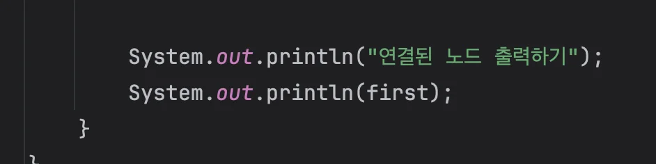
> 
> 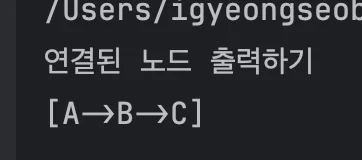
> 
> </details>
> 
> <details>
> <summary>&#91; ❌ &#93; <code>toStirng()</code>을 호출해도 사용되지 않음</summary>
> 
> 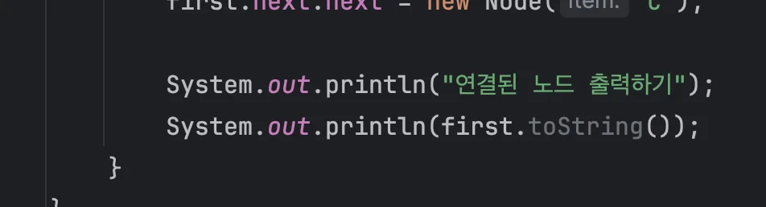
> 
> </details>
> 
> ---
> 
> <a id="1caeda9b0fe180928327cb087a802e7b"></a>
> 
> 결론&#58; <code>toString()</code>은 오버라이딩만하면 알아서 조회 시 적용시킨다&#46;

- 기본
    <a id="1caeda9b0fe18067a70af21822a6b6cd"></a>

    ```java
    @Override
    public String toString() {
        return "Node{" +
                "item=" + item +
                ", next=" + next +
                '}';
    }
    ```

    <a id="1caeda9b0fe180aba1f8e9ddc2edb23b"></a>

    <strong>실행 결과</strong>

    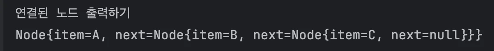

- 커스텀
    <a id="1caeda9b0fe180fe8219f6126fdf58ad"></a>

    ```java
    @Override
    public String toString() {
        StringBuffer sb = new StringBuffer();
        Node x = this;
        sb.append("[");
        while (x != null) {
            sb.append(x.item);
            if (x.next != null) {
                sb.append("->");
            }
            x = x.next;
        }
        sb.append("]");
        return sb.toString();
    }

    ```

    <a id="1caeda9b0fe1803380f4cea95396c102"></a>

    실행 결과

    

</details>

<a id="1caeda9b0fe180548526e0b240ac75b1"></a>

### V3&#58; 기능 추가

> ✏️ 
> 
> <a id="1caeda9b0fe1807da121f347ab09b101"></a>
> 
> <strong>기능 추가 </strong>
> 
> - 모든 노드 탐색
> 
> - 마지막 노드 조회
> 
> - 특정 index의 노드 조회
> 
> - 노드에 데이터 추가

<a id="1caeda9b0fe180a4bfd5e06b69adf8e9"></a>

### 코드

<details>
<summary>&#91; 코드 &#93; NodeMain3</summary>

<a id="1caeda9b0fe18017b766fcf00e787f8b"></a>

```java
package collection.link.node;

public class NodeMain3 {

    public static void main(String[] args) {
        Node first = new Node("A");
        first.next = new Node("B");
        first.next.next = new Node("C");

        System.out.println(first);

        // 모든 노드 탐색
        System.out.println("모든 노드 탐색하가");
        printAll(first);
        
        // 마지막 노드 조회
        Node lastNode = getLastNode(first);
        System.out.println("lastNode = " + lastNode);

        // 특정 index 노드 조회하기
        int index = 2;
        Node index2Node = getNode(first, index);
        System.out.println("index2Node = " + index2Node);

        // 데이터 추가하기
        System.out.println("데이터 추가하기");
        add(first, "D");
        System.out.println(first);

        add(first, "E");
        System.out.println(first);

        add(first, "F");
        System.out.println(first);

    }

    private static void printAll(Node node) {
        Node x = node;
        while (x != null) {
            System.out.println(x.item);
            x = x.next;
        }
    }

    private static Node getLastNode(Node node) {
        Node x = node;
        while (x.next != null) {
            x = x.next;
        }
        return x;
    }

    private static Node getNode(Node node, int index) {
        Node x = node;
        for (int i = 0; i < index; i++) {
            x = x.next;
        }
        return x;
    }

    private static void add(Node node, String param) {
        Node lastNode = getLastNode(node);
        lastNode.next = new Node(param);
    }
}

```

</details>

<details>
<summary>실행 결과</summary>

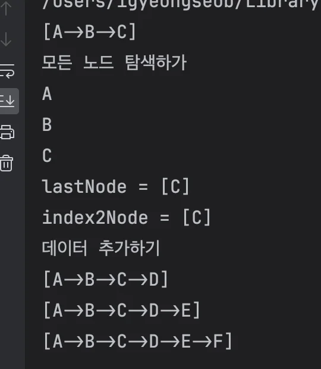

</details>

> 🗒️ 
> 
> <a id="1caeda9b0fe180519baed8e9c47465a9"></a>
> 
> <strong>정리</strong>
> 
> - 노드는 내부에 데이터와 다음 노드에 대한 참조를 가지고 있다&#46; 
> 
> - 각 노드들은 참조를 통해 연결(Link, 링크)가 되어있다&#46; 
> 
> - 데이터를 추가할 때 동적으로 필요한 만큼 노드를 만들어서 연결하기 때문에 배열과 다르게 메로리를 낭비하지 않는다&#46;
>     - 물론 <code>next</code>필드를 통해 참조값을 보관해야 하기 때문에 배열과 비교해서 추가적인 메모리 낭비도 발생한다&#46; 

<a id="1caeda9b0fe1804999fff4d4b431d553"></a>

## 연결 리스트 ( Linked List )

> ✏️ 
> 
> <a id="1caeda9b0fe180d29467d408ba54b15d"></a>
> 
> 이전 챕터에서 배열을 통해 리스트를 만들었다&#46; 그리고 이를 배열 리스트(ArrayList)라 부른다&#46; 
> 
> <a id="1caeda9b0fe180c182dfffc2ce901775"></a>
> 
> 이번에는 노드들을 통해서 연결을 유지하는 리스트를 만들 것이다&#46; 그리고 이를 연결리스트(Linked List)라 부른다&#46; 
> 
> <a id="1caeda9b0fe180edbed8fcc5dfab6d17"></a>
> 
> 연결 리스트는 배열 리스트의 단점인 메모리 낭비, 중간 위치 데이터 추가에 대한 성능 문제를 어느 정도 극복할 수 있다&#46;  

<a id="1caeda9b0fe180cea72ccea207e8bcb1"></a>

### V1&#58; 기본 구현

<a id="1caeda9b0fe18020a5d0d596752f09db"></a>

### 코드 

<details>
<summary>&#91; 코드 &#93; MyLinkedListV1</summary>

<a id="1caeda9b0fe180228b97ee6d56a22453"></a>

```java
package collection.link.linkedList;

import collection.link.node.Node;

public class MyLinkedListV1 {

    private Node first;
    private int size = 0;

    public void add(Object e) {
        Node newNode = new Node(e);
        if (first == null) {
            first = newNode;
        } else {
            Node lastNode = getLastNode();
            lastNode.next = newNode;
        }
        size++;
    }

    public Node getLastNode() {
        Node x = first;
        while (x.next != null) {
            x = x.next;
        }
        return x;
    }

    public Object set(int index, Object element) {
        Node x = getNode(index);
        Object oldValue = x.item;
        x.item = element;
        return oldValue;
    }

    public Object get(int index) {
        Node node = getNode(index);
        return node.item;
    }

    public Node getNode(int index) {
        Node x = first;
        for (int i = 0; i < index; i++) {
            x = x.next;
        }
        return x;
    }

    public int indexOf(Object o) {
        int index = 0;
        for (Node x = first; x != null; x = x.next) {
            if (o.equals(x.item))
                return index;
            index++;
        }
        return -1;
    }

    public int size() {
        return size;
    }

    @Override
    public String toString() {
        return "MyLinkedListV1{" +
                "first=" + first +
                ", size=" + size +
                '}';
    }
}
```

</details>

<details>
<summary>&#91; 코드 &#93; MyLinkedListV1Main</summary>

<a id="1caeda9b0fe1808dbe9fcf12bb143e33"></a>

```java
package collection.link.linkedList;

public class MyLinkedListV1Main {

    public static void main(String[] args) {
        MyLinkedListV1 list = new MyLinkedListV1();
        System.out.println("==데이터 추가==");
        System.out.println(list);
        list.add("a");
        System.out.println(list);
        list.add("b");
        System.out.println(list);
        list.add("c");
        System.out.println(list);

        System.out.println("==기능 사용==");
        System.out.println("list.size() = " + list.size());
        System.out.println("list.get(1) = " + list.get(1));
        System.out.println("list.indexOf('c') = " + list.indexOf("c"));
        System.out.println("list.set(2, 'z')  = " + list.set(2, "z"));
        System.out.println(list);

        System.out.println("==범위 초과==");
        list.add("d");
        System.out.println(list);
        list.add("e");
        System.out.println(list);
        list.add("f");
        System.out.println(list);
    }
}
```

</details>

<details>
<summary>실행 결과</summary>

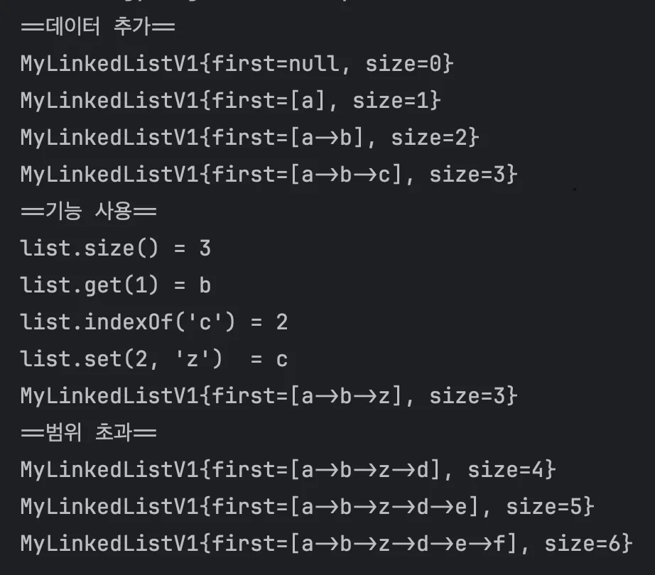

</details>

<a id="1caeda9b0fe180bf9de5d3059353e513"></a>

### 설명

> ☝🏻 
> 
> <a id="1caeda9b0fe180e0823cea91da902b11"></a>
> 
> 이해를 위해  복잡한 상황 및 예외처리를 배제한 코드이다&#46;

<details>
<summary>데이터 추가</summary>

<a id="1caeda9b0fe180c999d0c11c1ede78b3"></a>

```java
 public void add(Object e) {
    Node newNode = new Node(e);
    if (first == null) {
        first = newNode;
    } else {
        Node lastNode = getLastNode();
        lastNode.next = newNode;
    }
    size++;
}
```

- 마지막에 데이터 추가

- 새로운 노드를 만들고, 마지막 노드를 찾아서 새로운 노드를 연결한다&#46; ( 없을 시 head에 연결 )

</details>

<details>
<summary>특정 인덱스의 데이터 변경</summary>

<a id="1caeda9b0fe180c087f8f2ace1960547"></a>

```java
public Object set(int index, Object element) {
    Node x = getNode(index);
    Object oldValue = x.item;
    x.item = element;
    return oldValue;
}
```

</details>

<details>
<summary>특정 인덱스 노드 및 데이터 반환</summary>

<a id="1caeda9b0fe1801c9179fbd8a120e0a3"></a>

```java
// 노드 반환
public Node getNode(int index) {
    Node x = first;
    for (int i = 0; i < index; i++) {
        x = x.next;
    }
    return x;
}

// 데이터 반환
public Object get(int index) {
    Node node = getNode(index);
    return node.item;
}
```

- 특정 위치에 있는 데이터 및 노드를 반환

</details>

<details>
<summary>데이터 검색 및 위치 반환</summary>

<a id="1caeda9b0fe18094ac88eef887209b80"></a>

```java
public int indexOf(Object o) {
    int index = 0;
    for (Node x = first; x != null; x = x.next) {
        if (o.equals(x.item)) return index;
        index++;
    }
    return -1;
}
```

- 데이터를 검색하고 <code>해당 index</code>를 반환한다&#46; ( 없으면 <code>&#45;1</code> 반환

- 모든 노드를 순회하면서 <code>equals()</code>를 사용해 같은 데이터가 있는지 찾는다&#46;

</details>

<a id="1caeda9b0fe180418744e187ee28a934"></a>

### 연결리스트, 빅오

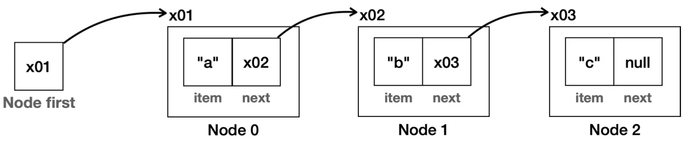

<details>
<summary><strong><code>조회</code></strong><strong>&#58; Object get(int index)</strong></summary>

> 특정 위치에 있는 데이터를 반환한다&#46;

- 배열은 인덱스로 원하는 데이터를 즉시 찾을 수있다&#46; 따라서 배열을 사용한 배열리스트(ArrayList)는 조회에 빠른 성능을 보장한다&#46;  ⇒  <code class="language-math">O(1)</code>

- 그러나 연결리스트 노드들을 순차적으로 탐색하여 데이터를 찾는다&#46;
    - head(first)로 부터의 참조를 따라가면서 노드를 탐색한다&#46; 

    <a id="1caeda9b0fe180f483a5dc69311cd2aa"></a>

    ⇒ <code class="language-math">O(n)</code>

</details>

<details>
<summary><strong><code>추가</code></strong><strong>&#58; void add(Object e)</strong></summary>

> 마지막에 데이터를 추가한다&#46;

- 마지막 노드를 찾는데 선행 탐색을 진행한다 <code class="language-math">O(n)</code>&#46; <br>그리고 새로운 노드를 추가하는데 <code class="language-math">O(1)</code>의 연산이 걸린다&#46; 
    <a id="1caeda9b0fe180de8dddf28880875de2"></a>

    ⇒ <code class="language-math">O(n &#43;1)</code> = <code class="language-math">O(n)</code>

</details>

<details>
<summary><code>수정</code>&#58; <strong>Object set(int index, Object element)</strong></summary>

> 특정 위치에 있는 데이터를 찾아서 변경한다&#46; 그리고 기존 값을 반환한다&#46;

- 특정 위치의 노드 탐색&#58; <code class="language-math">O(n)</code><br>데이터 수정&#58; <code class="language-math">O(1)</code>
    <a id="1caeda9b0fe180518341c7d8086c38b8"></a>

    ⇒ <code class="language-math">O(n)</code>

</details>

<details>
<summary><code>검색</code>&#58; <strong>int indexOf(Object o)</strong></summary>

> 데이터를 검색하고, 검색된 위치를 반환한다&#46;

- 모든 노드를 순회하면서 <code>equals()</code> 를 사용해서 같은 데이터가 있는지 찾는다&#46;
    <a id="1caeda9b0fe18047ad1bc5ef4f764a1c"></a>

    ⇒ <code class="language-math">O(n)</code>

</details>

<a id="1caeda9b0fe180a09077f29323e4cfb6"></a>

### V2&#58; 추가, 삭제

<a id="1caeda9b0fe1800ebfcae3ccafec09a3"></a>

### 설명

> ✏️ 
> 
> - 연결리스트는 배열처럼 실제 index가 존재하지 않는다&#46; <br>처음 연결된 노드를 index 0, 그 다음 노드는 index 1 …등 으로 가정한다&#46; 
>     - 연결리스트에서 index는 연결된 순서를 뜻한다&#46;
> 
> - 배열과 다르게 데이터 추가 시 공간에 대한 연산 없이 <strong><u>참조값만 변경</u></strong>하면된다&#46;  ( 삭제도 동일)
> 
> - 연결리스트는 탐색에 있어서 비용이 소모된다&#46;  ⇒ <code class="language-math">O(n)</code><br>데이터 추가, 삭제는 O(1)의 연산으로 처리가 가능하다&#46;  ⇒ <code class="language-math">O(1)</code>
>     - <strong><u>맨 앞에 데이터를 추가, 삭제</u></strong>하는 경우, 탐색을 할 필요가 없기 때문에 <code class="language-math">O(1)</code>으로 처리가 가능하다&#46; 
> 
>     - <strong><u>중간 데이터 추가, 삭제</u></strong>는 탐색 비용이 들기 때문에 <code class="language-math">O(n)</code>의 비용이 든다&#46;

<details>
<summary>첫 번째 위치에 데이터 추가</summary>

1. 신규 노드 생성
    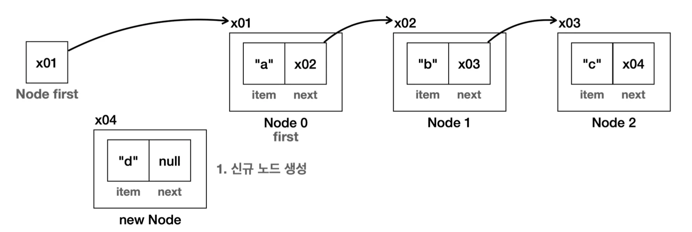

1. 다음 노드 연결
    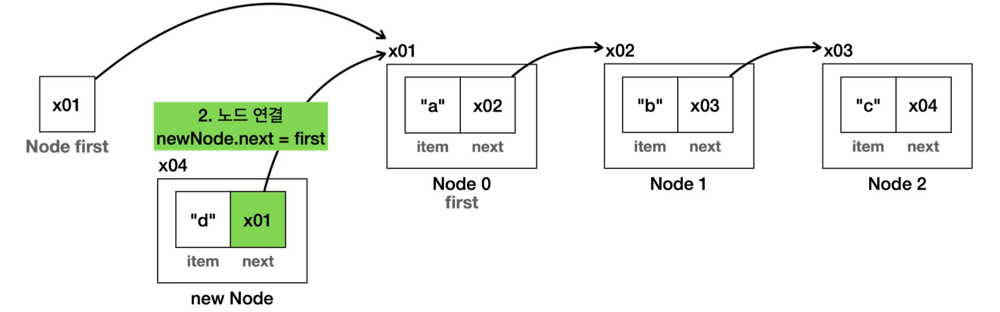

1. head(first) 연결
    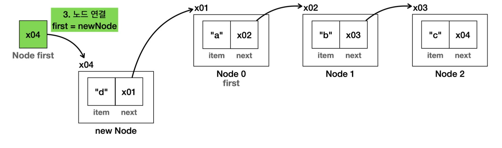

1. 최종 결과
    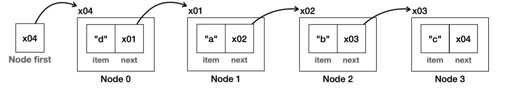

    - 시간복잡도&#58; <code class="language-math">O(1)</code>

</details>

<details>
<summary>첫 번째 위치의 데이터 삭제</summary>

1. 삭제 대상 탐색&#58; 맨 앞 = <code class="language-math">O(1)</code>
    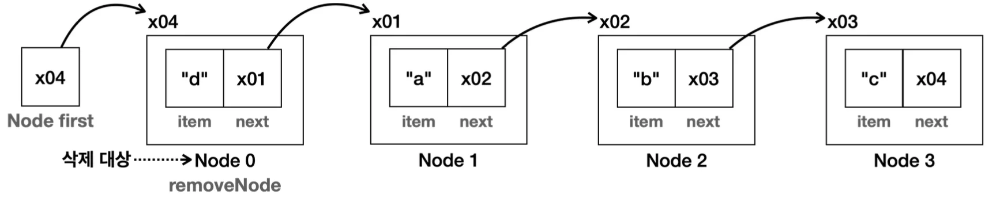

1. head(first)에 삭제 대상의 다음 노드 연결
    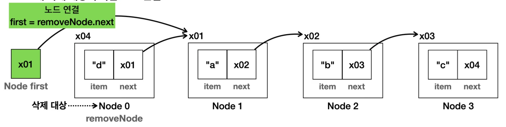

1. 삭제 대상의 데이터 초기화
    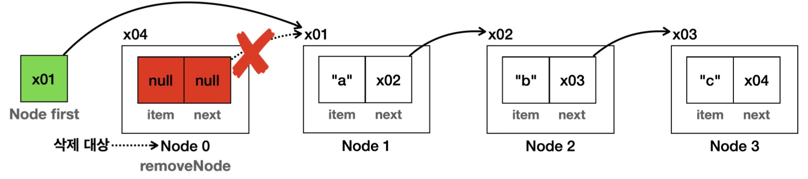

    - 삭제 노드의 참조 포인터를 제거하면 더이상 해당 노드는 참조가 되지 않기 때문에 GC가 알아서 삭제한다&#46;

1. 결과
    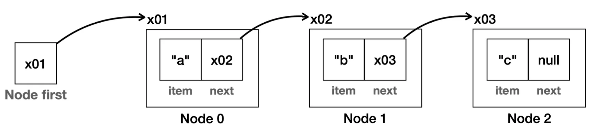

    - 맨 앞이기 떄문에 탐색을 비용이 <code class="language-math">O(1)</code> 이었다&#46;  삭제 포인터만을 변경하면 되기 때문에<code class="language-math">O(1)</code>으로 처리가 가능하다&#46;

    - 따라서 맨 앞 노드 제거 연산은  <code class="language-math">O(1)</code>  매우 빠르게 삭제된다&#46; 

    - 시간복잡도&#58; <code class="language-math">O(1)</code>

</details>

<details>
<summary>중간 위치의 데이터 추가</summary>

> <strong><code>&#91; a &#45;&#62; b &#45;&#62; c &#93;</code></strong>&#45;&#62;  <strong><code>&#91; a &#45;&#62; </code></strong><strong><code>e </code></strong><strong><code>&#45;&#62; b &#45;&#62; c &#93;</code></strong><strong>  </strong>

1. <strong>새로운 노드를 생성, 노드가 입력될 위치의 직전 노드(prev) 탐색</strong>
    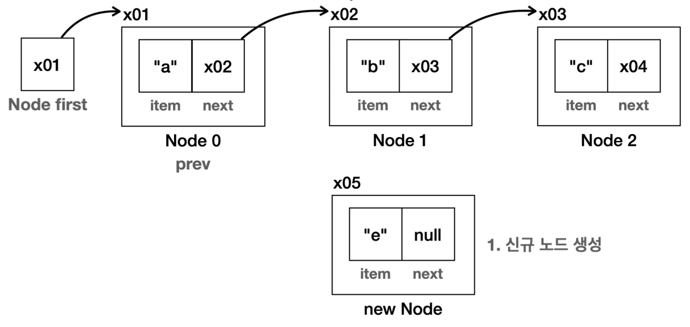

1. <strong>신규 노드와 다음 노드를 연결,  직전 노드(prev)의 다음 노드를 연결</strong>
    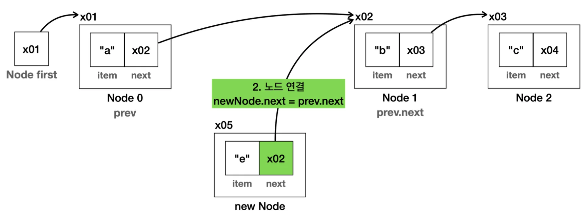

1. <strong>직전 노드(prev)에 신규 노드 연결</strong>
    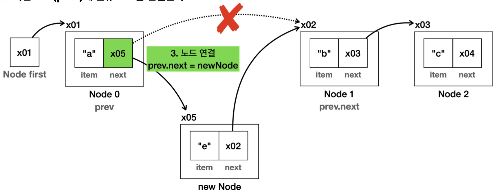

1. 결과
    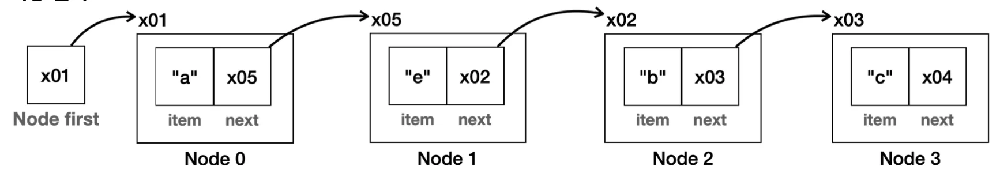

    - 배열의 경우 데이터가 추가되면 인덱스 위치 부터 모든 데이터를 오른쪽으로 하나씩 밀어야하지만 

    - 연결 리스트는 새로 생성한 노드의 참조만 변경하면 된다&#46; ( 나머지 노드는 어떤 일이 일어난지도 모른다&#46; )

    - 시간복잡도&#58;  <code class="language-math">O(n)</code>
        - 노드 탐색&#58; <code class="language-math">O(n)</code>

        - 포인터 변경&#58; <code class="language-math">O(1)</code><br>	<br>

</details>

<details>
<summary>중간 위치의 데이터 삭제</summary>

1. 삭제 대상,  직전 노드(prev) 탐색
    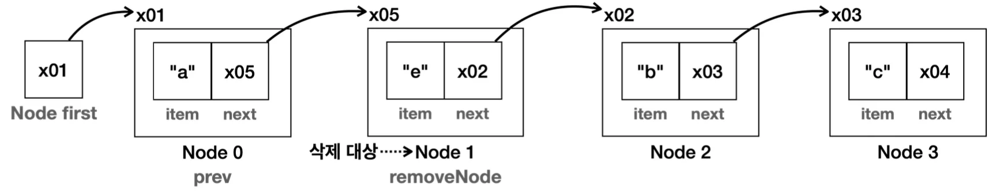

1. 직전 노드(prev)의 포인터를 삭제 노드의 다음 노드로 변경
    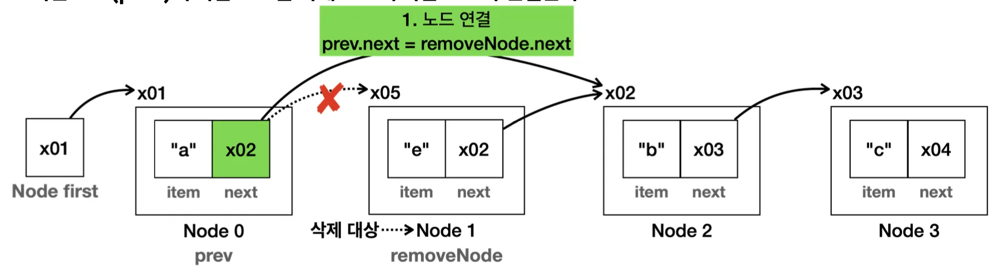

1. 삭제 노드의 데이터 초기화
    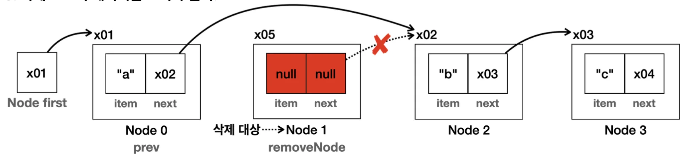

    - 삭제 노드의 참조 포인터를 제거하면 더이상 해당 노드는 참조가 되지 않기 때문에 GC가 알아서 삭제한다&#46;

1. 결과
    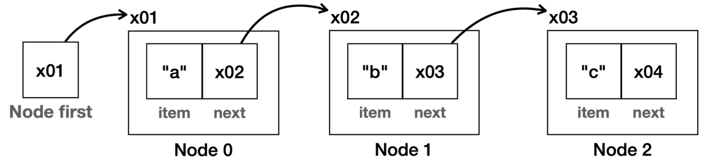

    - 시간복잡도&#58; <code class="language-math">O(n)</code>
        - 노드 탐색&#58; <code class="language-math">O(n)</code>

        - 포인터 변경&#58; <code class="language-math">O(1)</code>

</details>

<a id="1caeda9b0fe180a6b80dc77558ead1e0"></a>

### 코드

<details>
<summary>&#91; 코드 &#93; MyLinkedListV2</summary>

<a id="1caeda9b0fe180e6b74bec80b81cb89d"></a>

```java
package collection.link.linkedList;

import collection.link.node.Node;

public class MyLinkedListV2 {
    private Node first;
    private int size = 0;

    public void add(Object e) {
        Node newNode = new Node(e);
        if (first == null) {
            first = newNode;
        } else {
            Node lastNode = getLastNode();
            lastNode.next = newNode;
        }
        size++;
    }

    private Node getLastNode() {
        Node x = first;
        while (x.next != null) {
            x = x.next;
        }
        return x;
    }

    public void add(int index, Object e) {
        Node newNode = new Node(e);
        if (index == 0) {
            newNode.next = first;
            first = newNode;
        } else {
            Node prev = getNode(index - 1);
            newNode.next = prev.next;
            prev.next = newNode;
        }
        size++;
    }

    public Object set(int index, Object element) {
        Node x = getNode(index);
        Object oldValue = x.item;
        x.item = element;
        return oldValue;
    }

    // 추가 코드
    public Object remove(int index) {
        Node removeNode = getNode(index);
        Object removedItem = removeNode.item;
        if (index == 0) {
            first = removeNode.next;
        } else {
            Node prev = getNode(index - 1);
            prev.next = removeNode.next;
        }
        removeNode.item = null;
        removeNode.next = null;
        size--;
        return removedItem;
    }

    public Object get(int index) {
        Node node = getNode(index);
        return node.item;
    }

    private Node getNode(int index) {
        Node x = first;
        for (int i = 0; i < index; i++) {  // O(n)
            x = x.next;
        }
        return x;
    }

    public int indexOf(Object o) {
        int index = 0;
        for (Node x = first; x != null; x = x.next) {
            if (o.equals(x.item)) {
                return index;
            }
            index++;
        }
        return -1;
    }

    public int size() {
        return size;
    }

    @Override
    public String toString() {
        return "MyLinkedListV2{" +
                "first=" + first +
                ", size=" + size +
                '}';
    }
}

```

</details>

<details>
<summary>&#91; 코드 &#93; MyLinkedListV2Main</summary>

<a id="1caeda9b0fe180df96afee07561c44ce"></a>

```java
package collection.link.linkedList;

public class MyLinkedListV2Main {

    public static void main(String[] args) {
        MyLinkedListV2 list = new MyLinkedListV2();
        // 마지막에 추가 // O(n)
        list.add("a");
        list.add("b");
        list.add("c");
        System.out.println(list);

        System.out.println("첫 번째 항목에 추가");
        list.add(0, "d"); // O(1)
        System.out.println(list);

        System.out.println("첫 번쨰 항목 삭제");
        list.remove(0);  // remove First O(1)
        System.out.println(list);

        //중간 항목에 추가, 삭제
        System.out.println("중간 항목에 추가");
        list.add(1,"e"); //O(n)
        System.out.println(list);


        System.out.println("중간 항목 삭제");
        list.remove(1); //remove O(n)
        System.out.println(list);
    }
}

```

</details>

<details>
<summary>실행 결과</summary>

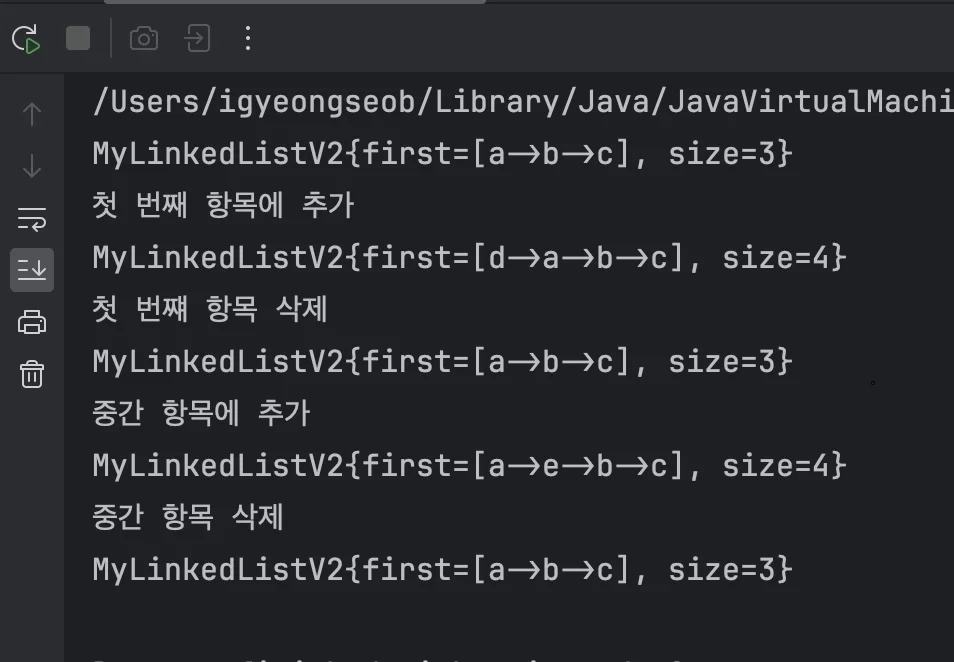

</details>

<a id="1caeda9b0fe180c888b9ec066703cd18"></a>

### Notes

<details>
<summary>🧐 <code>배열 리스트</code> vs <code>연결 리스트</code></summary>

- 데이터를 조회할 일이 많고, 뒷 부분에 데이터를 추가한다면 배열 리스트가 보통 더 좋은 성능을 제공한다&#46; 

- 앞 쪽에 데이터를 추가하거나 삭제할 일이 많다면 연결리스트가 더 성능이 좋다&#46;

</details>

<details>
<summary>단일 연결 리스트, 이중 연결리스트 </summary>

<a id="1caeda9b0fe180aba53ac0b5b44af5de"></a>

구현한 연결 리스트는 한 방향으로만 이동하는 단일 연결 리스트다&#46; <br>노드를 앞뒤로 모두 연결하는 이중 연결 리스트를 사용하면 성능을 더 개선할 수 있다&#46;<br>

<a id="1caeda9b0fe1803d8898f18f6be2c8f2"></a>

자바가 제공하는 연결 리스트는 이중 연결 리스트다&#46; 추가로 자바가 제공하는 연결 리스트는 마지막 노드를 참조하는 변수를 가지고 있어서, <strong><u>뒤에 추가하거나 삭제하는 삭제하는 경우에도 </u></strong><code class="language-math">O(1)</code><strong><u>의 성능을 제공한</u></strong>다<br>

<a id="1caeda9b0fe180e3bfe9d62150786aca"></a>

<strong>이중 연결리스트</strong>

<a id="1caeda9b0fe1808bb2f0e990f6b687f9"></a>

```java
public class Node {
		Object item;
		Node next; //다음 노드 참조
		Node prev; //이전 노드 참조 
}
```

<a id="1caeda9b0fe18075b815e2008f156acb"></a>

<strong>마지막 노드를 참조하는 연결리스트</strong>

<a id="1caeda9b0fe180649928f5ea7ce590b3"></a>

```java
public class LinkedList {
		private Node first;
		private Node last;   // 마지막 노드 참조
		private int size = 0;
}
```

</details>

> 🗒️ 
> 
> <a id="1caeda9b0fe180109b96e8fa98153fda"></a>
> 
> 성능 비교 표
> 
> | 기능 | 배열 리스트 | 연결 리스트 |
> | --- | --- | --- |
> | 인덱스 조회 | <code class="language-math">O(1)</code> | <code class="language-math">O(n)</code> |
> | 검색 | <code class="language-math">O(n)</code> | <code class="language-math">O(n)</code> |
> | 앞에 추가(삭제) | <code class="language-math">O(n)</code> | <code class="language-math">O(1</code><code>)</code> |
> | 뒤에 추가(삭제) | <code class="language-math">O(1)</code> | <code class="language-math">O(n)</code> |
> | 평균 추가(삭제) | <code class="language-math">O(n)</code> | <code class="language-math">O(n)</code> |

<a id="1caeda9b0fe180c99227ca1fb84e1c04"></a>

### V3&#58;  제네릭

> /icons/tag_green.svg 
> 
> - 제네릭 도입 → 타입 안정성 확보
> 
> - 중첩 클래스  → Node 클래스 내부에서만 사용

<a id="1caeda9b0fe1801ab144f241a7990622"></a>

### 코드

<details>
<summary>&#91; 코드 &#93; MyLikedListV3</summary>

<a id="1caeda9b0fe180abb51ff63fb927a4da"></a>

```java
package collection.link.linkedList.v3;

public class MyLikedListV3<E> {
    private Node<E> first;
    private int size = 0;

    public void add(E e) {
        Node<E> newNode = new Node<>(e);
        if (first == null) {
            first = newNode;
        } else {
            Node<E> lastNode = getLastNode();
            lastNode.next = newNode;
        }
        size++;
    }

    private Node<E> getLastNode() {
        Node<E> x = first;
        while (x.next != null) {
            x = x.next;
        }
        return x;
    }

    public void add(int index, E e) {
        Node<E> newNode = new Node<>(e);
        if (index == 0) {
            newNode.next = first;
            first = newNode;
        } else {
            Node<E> prev = getNode(index - 1);
            newNode.next = prev.next;
            prev.next = newNode;
        }
        size++;
    }

    public E set(int index, E element) {
        Node<E> x = getNode(index);
        E oldValue = x.item;
        x.item = element;
        return oldValue;
    }

    public E remove(int index) {
        Node<E> removeNode = getNode(index);
        E removedItem = removeNode.item;
        if (index == 0) {
            first = removeNode.next;
        } else {
            Node<E> prev = getNode(index - 1);
            prev.next = removeNode.next;
        }
        removeNode.item = null;
        removeNode.next= null;
        size--;
        return removedItem;
    }

    public E get(int index) {
        Node<E> node = getNode(index);
        return node.item;
    }

    private Node<E> getNode(int index) {
        Node<E> x = first;
        for(int i = 0; i < index; i++) {
            x = x.next;
        }
        return x;
    }

    public int indexOf(E o) {
        int index = 0;
        for (Node<E> x = first; x != null; x = x.next) {
            if (o.equals(x.item)) {
                return index;
            }
            index++;
        }
        return -1;
    }

    public int size() {
        return size;
    }

    @Override
    public String toString() {
        return "MyLikedListV3{" +
                "first=" + first +
                ", size=" + size +
                '}';
    }

    private static class Node<E> {
        E item;
        Node<E> next;

        public Node(E item) {
            this.item = item;
        }

        @Override
        public String toString() {
            StringBuilder sb = new StringBuilder();
            Node<E> temp = this;
            sb.append("[");
            while (temp != null) {
                sb.append(temp.item);
                if (temp.next != null) {
                    sb.append("->");
                }
                temp = temp.next;
            }
            sb.append("]");
            return sb.toString();
        }
    }
}

```

</details>

<details>
<summary>&#91; 코드 &#93; MyLikedListV3Main</summary>

<a id="1caeda9b0fe180d09d1ddc17260a3391"></a>

```java
package collection.link.linkedList.v3;

public class MyLikedListV3Main {
    public static void main(String[] args) {
        MyLikedListV3<String> stringList = new MyLikedListV3<>();
        stringList.add("a");
        stringList.add("b");
        stringList.add("c");
        String string = stringList.get(0);
        System.out.println("string = " + string);

        MyLikedListV3<Integer> intList = new MyLikedListV3<>();
        intList.add(1);
        intList.add(2);
        intList.add(3);
        Integer integer = intList.get(0);
        System.out.println("integer = " + integer);
    }
}

```

</details>

<details>
<summary>실행 결과 </summary>

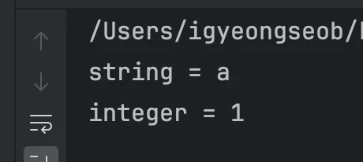

</details>

<a id="1caeda9b0fe180e6a0e4ddbf7eb8dbc6"></a>

### 설명

<details>
<summary>중접 클래스 </summary>

<a id="1caeda9b0fe180b5a1afc1dfa5e85b82"></a>

```java
 class OuterClass {
     ...
     static class StaticNestedClass {
         ...
		 }
}
```

- 위와 같이 클래스 안에서 클래스를 선언하는 것을 중첩 클래스라 한다&#46; 

- 중첩 클래스는 특정 클래스 안에서만 사용될 때 주로 사용한다&#46;

- <code>Node</code> 클래스는 <code>MyLinkedList</code> 안에서만 사용된다&#46; 외부에서는 사용할 이유가 없다&#46;<br>이럴 때 중첩 클래스를 사용하면 특정 클래스 안으로 클래스 선언을 숨길 수 있다&#46;

- 중첩 클래스를 사용하면 <code>MyLinkedListV3</code> 입장에서 외부에 있는 <code>Node</code> 클래스보다 내부에 선언한 <code>Node</code> 클래스를 먼저 사용한다&#46;

</details>
