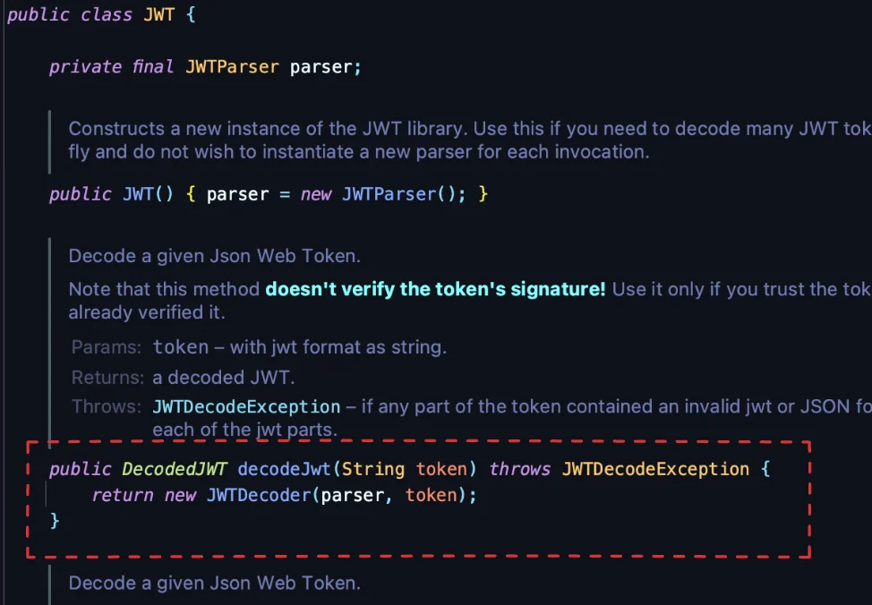
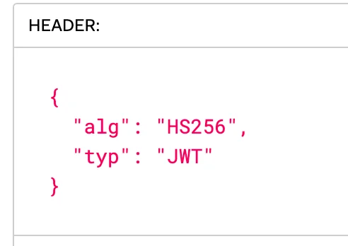
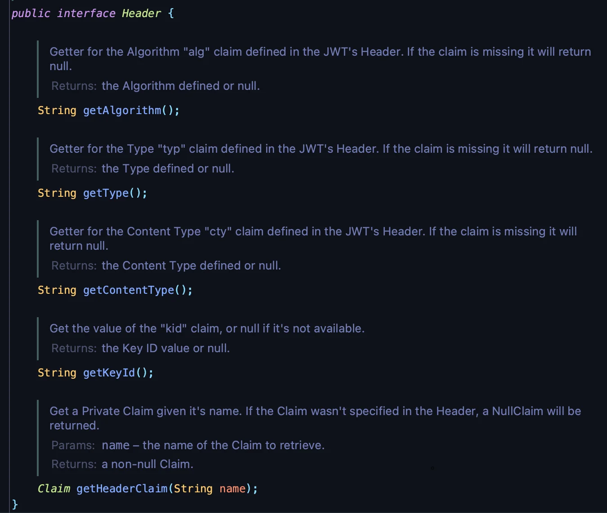
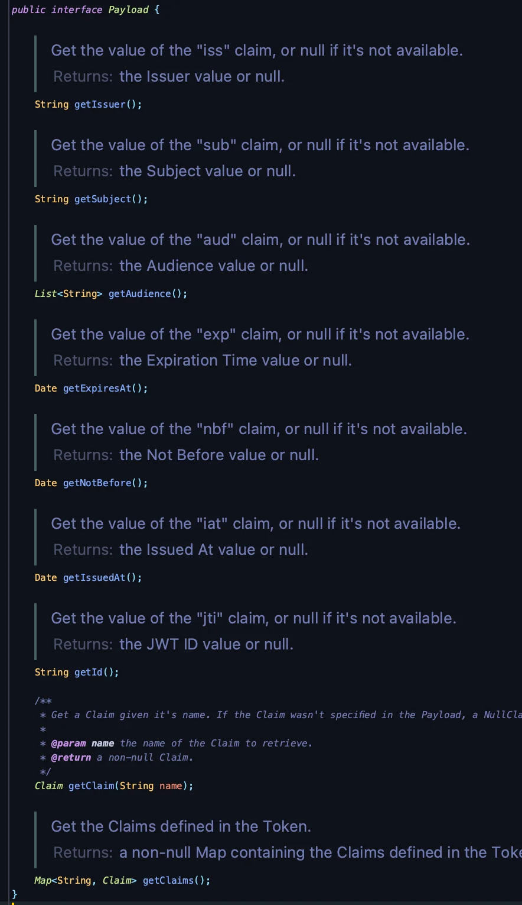

<a id="1c3eda9b0fe18171ab3eccb148f67990"></a>

## JWT  Verity(검증), 에러 핸들링

---

> 📖 

<details>
<summary>🧐 토큰 검증 &#45; <code>JWT&#46;require(Algorithm&#46;HMAC256(secretKey))&#46;build()&#46;verify(token)</code></summary>

> JWT(JSON Web Token) 검증

- <strong><code>JWT&#46;require</code></strong>
    - JWT를 검증할 때 조건(requirements) 설정

    - Algorithm&#46;HMAC256(secretKey)
        -  <strong>HMAC256</strong> 알고리즘을 사용하여 토큰을 검증하겠다는 것을 의미함

- <strong><code>Algorithm&#46;HMAC256(secretKey)</code></strong>
    - <strong>HMAC256</strong>은 대칭 키를 사용하는 해시 기반 메시지 인증 방식
        - secretKey는 서버만 알고 있는 비밀키로, 이 키를 사용해 JWT의 서명을 검증

- <strong><code>&#46;build()</code></strong>
    - 설정한 조건(requirements)을 기준으로 JWT 검증기 생성
        - 검증기는 이후 verify 메서드를 통해 JWT 토큰을 검증함

- <strong><code>verify(token)</code></strong>
    - 전달된 token에 대해 검증 수행

    - 검증에 성공하면 디코딩된 JWT 객체 반환

    - 검증 실패 시 예외 발생
        - 발생될 수 있는 예외
            - <code>AlgorithmMismatchException</code>

            - <code>SignatureVerificationException</code>

            - <code>InvalidClaimException</code>

            - <code>TokenExpiredException</code>

</details>

<details>
<summary>Header에 있는 정보 가져오기</summary>


</details>

<a id="1c3eda9b0fe1810589d4fa55b3047136"></a>

JWT를 사용한 인가 시, HTTP 메세지의  Authorization 헤더에  값을 기반으로 토큰을 

<a id="1c3eda9b0fe181a5bc9bda52f2e26523"></a>

## JWT 디코딩 &#45; DecodedJWT

---

> 📖 
> 
> <a id="1c3eda9b0fe181bbaf56eb62fdea3f59"></a>
> 
> JWT를 디코딩하여 Header와 Payload의 값을 조회할 수 있다&#46;

<details>
<summary> JWT 디코딩 &#45; <code>JWT&#46;decodeJwt(token)</code></summary>



</details>

<details>
<summary><code>DecodedJWT</code></summary>

<details>
<summary>상속 관계</summary>


</details>

<details>
<summary>내부 메서드 </summary>


- <code>getToken()</code>&#58; 토큰 조회

- <code>getHeader()</code>&#58; 헤더 조회

- <code>getPayload()</code>&#58; 페이로드 조회

- <code>getSignature()</code>&#58; 시그니처 조회 

</details>

</details>

<details>
<summary><code>Header</code></summary>

- Decoded Header
    

    - <code>alg</code>&#58; 알고리즘 

    - <code>typ</code>&#58; 타입

    - <code>cty</code>&#58; 컨텐츠 타입

    - <code>kid</code>&#58; Key ID

<details>
<summary>내부 메서드 </summary>



- <code>getAlgorithm()</code>&#58;  알고리즘(<code>Header&#46;alg</code>) 조회

- <code>getType()</code>&#58; 타입(<code>Header&#46;typ</code>) 조회

- <code>getContentType()</code>&#58; 컨텐츠 타입(<code>Header&#46;cty</code>)  조회

- <code>getKeyId()</code>&#58; Key ID(<code>Header&#46;kid</code>)  조회

- <code>getHeaderClaim(String name)</code>

</details>

</details>

<details>
<summary><code>Payload</code></summary>

- Decoded Payload
    

    - <code>iss</code>&#58; Issuer 

    - <code>sub</code>&#58;

    - <code>aud</code>&#58;

    - <code>exp</code>&#58;

    - <code>nbf</code>&#58;

    - <code>iat</code>&#58; 

    - <code>jti</code>&#58; JWT ID

<details>
<summary>내부 메서드 </summary>



</details>

<details>
<summary>ex)</summary>

<a id="1c3eda9b0fe1816ab186ddb914ab7acc"></a>

```java
// JWT 디코딩
DecodedJWT decodedJWT = JWT.decode(token);
Payload payload = decodedJWT.getPayload();

// Payload 데이터 추출
String issuer = payload.getIssuer();
String subject = payload.getSubject();
List<String> audience = payload.getAudience();
Date expiration = payload.getExpiresAt();
Date notBefore = payload.getNotBefore();
Date issuedAt = payload.getIssuedAt();
String jwtId = payload.getId();
```

</details>

</details>
