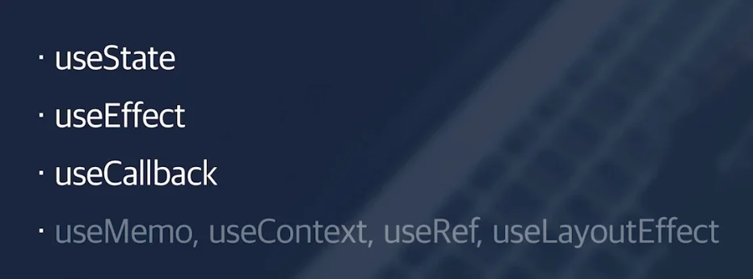
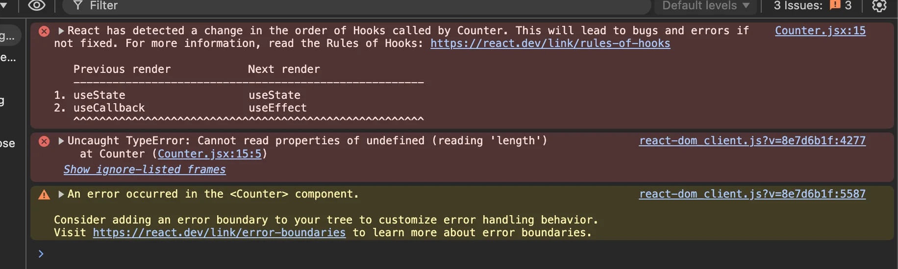
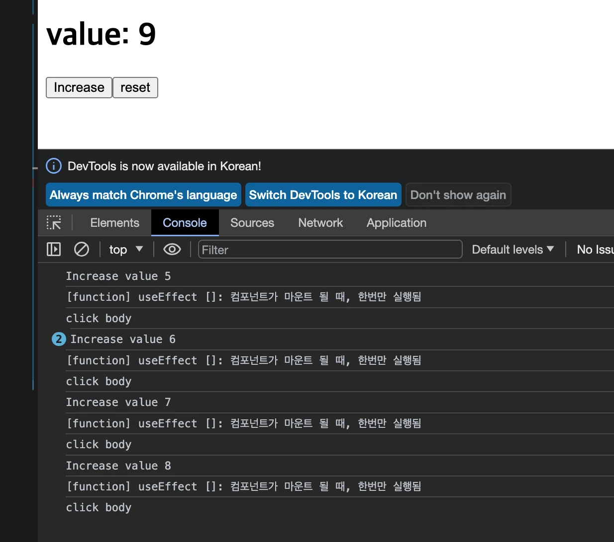
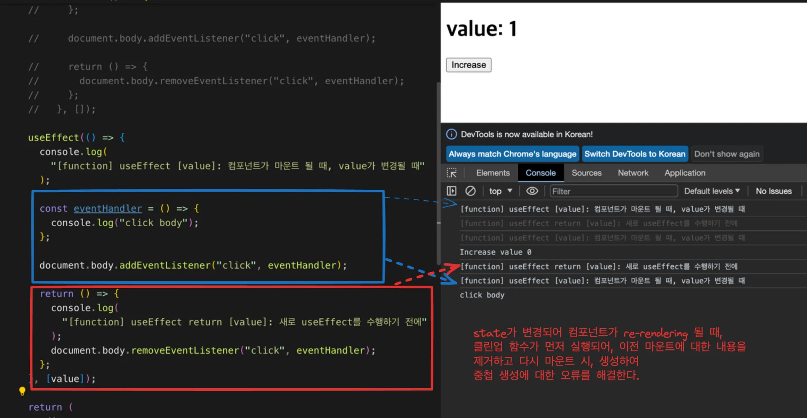
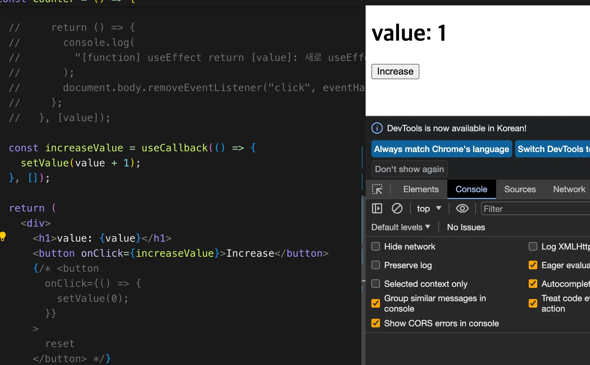
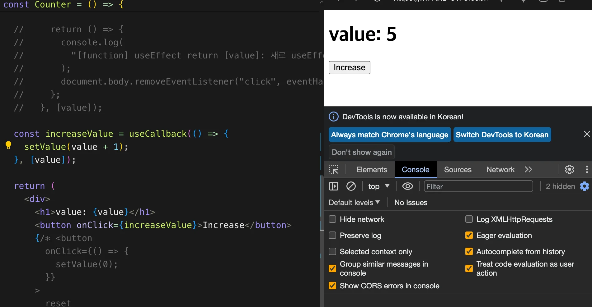

<a id="1c3eda9b0fe18189ac79c5f7003262b9"></a>

10개 정도의 훅이 존재한다

<a id="1c3eda9b0fe181c99bdaffae9e5a0483"></a>

그중 주로 <code>useState</code>, <code>useEffect</code>, <code>useCallback</code> 3개만 사용된다&#46;

> ☝🏻 
> 
> <a id="1c3eda9b0fe181279b1cf85f95c86e3e"></a>
> 
> Hook 외부에 조건문 사용 할수 없다&#46; 
> 
> <details>
> <summary>🤬 오류 &#45;  조건문 내부에 hooks 사용</summary>
> 
> <a id="1c3eda9b0fe18128a68fc7ee242b8676"></a>
> 
> ```javascript
> if (value === 3) {
>     useEffect(() => {
>       console.log(
>         "[function] useEffect []: 컴포넌트가 마운트 될 때, 한번만 실행됨"
>       );
> 
>       const eventHandler = () => {
>         console.log("click body");
>       };
> 
>       document.body.addEventListener("click", eventHandler);
> 
>       return () => {
>         document.body.removeEventListener("click", eventHandler);
>       };
>     }, []);
>   }
> ```
> 
> 
> 
> </details>
> 
> <a id="1c3eda9b0fe181eba2a5eb9702a5ce63"></a>
> 
> 컴포넌트 내부에 정의한 Hook들은 내부적으로 차례대로 배열에 담겨 관리되며, 해당 순서에 맞춰 차례대로 실행된다&#46;<br>따라서 조건문을 hook 외부에 명시하면, 해당 조건에 맞는 경우에만 hook이 호출되는데, 첫 컴포넌트 렌더링 시의 내부 hook 배열 안의 동작과 출동이 발생되어 오류가 발생한다&#46; <br>
> 
> <details>
> <summary>😁 해결 &#45; hook 내부에 조건문 명시</summary>
> 
> <a id="1c3eda9b0fe181a6a20edeb6a5f3d1e6"></a>
> 
> ```javascript
> useEffect(() => {
> 	  if (value === 3) {
> 		    console.log(
> 		      "[function] useEffect []: 컴포넌트가 마운트 될 때, 한번만 실행됨"
> 		    );
> 		
> 		    const eventHandler = () => {
> 		      console.log("click body");
> 		    };
> 		    
> 			  document.body.addEventListener("click", eventHandler);
> 	  }
> 		
> 	  return () => {
> 		    document.body.removeEventListener("click", eventHandler);
> 	  };
> }, []);
> ```
> 
> - 위와 같이 조건문이 필요한 경우, 해당 훅 내부의 함수에 조건문을 추가하여 설계한다&#46; 
> 
> </details>

<a id="1c3eda9b0fe18159b904cdcad7b17bc6"></a>

## useState

---

> 📖 
> 
> <a id="1c3eda9b0fe1810282e7e45cad99f79f"></a>
> 
> state 생성 훅, 설정한 state(변수)가 변경될 때마다 페이지를 자동으로 컴포넌트를 리렌더링하여 반영한다&#46;

- useState()
    > ✏️ 
    > 
    > <a id="1c3eda9b0fe1818a8462d1f319e9d28a"></a>
    > 
    > const &#91; state, setState(Setter) &#93; = useState(초기값)

    <details>
    <summary>ex) </summary>


    </details>

<a id="1c3eda9b0fe181888fe0c9654af5257f"></a>

## useEffect

---

> 📖 
> 
> <a id="1c3eda9b0fe181868d3cc35fac83464a"></a>
> 
> 컴포넌트가 렌더링(마운트), 제거(언마운트) 될때, 한번만 실행되는 함수
> 
> - <code>인자</code>&#58; 해당 컴포넌트 <u>마운트(렌더링)</u> 시, 인자로 받은 로직이 실행됨
> 
> - <code>return</code>&#58; 해당 컴포넌트 <strong>언마운트(제거)</strong> 시, return에 정의된 로직이 실행됨
> 
> - state가 변경되어 리렌더링되는 것도 다시 마운트 되는 것으로 판단하고 실행됨 
> 
> - 컴포넌트(함수) 내부에 선언해야지, 외부에 선언하면, 그냥 외부 인자로써 한번만 실행됨

<details>
<summary>☝🏻 state가 변경되어 리렌더링되는 것도 컴포넌트가 다시 마운트 되는 것이다 &#46;</summary>

<a id="1c3eda9b0fe1810cb082fcac65569c9b"></a>

state가 변경되어 리렌더링되는 것도 컴포넌트가 다시 마운트 되는 것이기 때문에, 

<a id="1c3eda9b0fe18124b7f1f47b16253d60"></a>

아래와 같이 useEffect에 인자로 넘긴 함수들이 state가 변경되어 해당 컴포넌트가 리렌더링 될 때, 다시 실행되는 것을 확인할 수 있다&#46;

<details>
<summary>&#91; 코드 &#93; </summary>

<a id="1c3eda9b0fe18188b8f6daa0983ada87"></a>

```javascript
export default function App() {
  const [value, setValue] = useState(0);

  /**
   * useEffect: 컴포넌트가 렌더링(마운트) 및 제거(언마운트)될 때, 특정 작업을 실행
   * - 인자
   *   - 실행하고자 하는 함수 (effect callback)
   *     - effect는 정리(clean-up) 함수를 반환할 수 있음
   *     - 반환된 함수는 컴포넌트가 언마운트 또는 effect 재실행 이전에 실행됨
   * - 의존성 배열 ( dependency list )
   */
  useEffect(() => {
    console.log(
      "[function] useEffect []: 컴포넌트가 마운트 될 때, 한번만 실행됨"
    );
    document.body.addEventListener("click", () => {
      console.log("click body");
    });
  });

  return (
    <div className="App">
      <h1>value: {value}</h1>
      <button
        onClick={() => {
          console.log("Increase value", value);
          setValue(value + 1);
          console.log("Increase value", value);
        }}
      >
        Increase
      </button>
      <button
        onClick={() => {
          setValue(0);
        }}
      >
        reset
      </button>
    </div>
  );
}
```

</details>



</details>

<details>
<summary>클린업(clean&#45;up) 함수&#58; 컴포넌트가 언마운트(제거) 될때 실행</summary>

<a id="1c3eda9b0fe181d5bce4ed8c43b4e9f3"></a>

useEffect로 마운트 시, 설정한 이벤트들이 렌더링 이후 남는다&#46;

<a id="1c3eda9b0fe181deb8bedd522affc168"></a>

<strong>만약 </strong><strong><u> 새로고침</u></strong>을 한다면, 이벤트들이 중첩으로 생성되고 처리된다&#46; 

<details>
<summary>&#91; 코드 &#93; 🤬 오류 &#45; 마운트 시, 실행될 특정 로직 설정</summary>

> 🤬 <u>클린 업 함수로 설정한 이벤트를 제거하지 않</u>아, <strong><u>새로고침</u></strong><strong> </strong>마다 이벤트가 <strong>중첩 생성</strong>되어 처리된다&#46; 

<a id="1c3eda9b0fe181298788c6972d276af8"></a>

```javascript
// 인자로 컴포넌트 마운트 시, 실행될 특정 로직 설정 
useEffect(() => {
  console.log(
    "[function] useEffect []: 컴포넌트가 마운트 될 때, 한번만 실행됨"
  );
	
  const eventHandler = () => {
    console.log("click body");
  };

  document.body.addEventListener(
    "click", 
    eventHandler
  );
}, []);
```

</details>

<a id="1c3eda9b0fe181d3936eea43c6fc205c"></a>

따라서 컴포넌트가 제거될 때, 해당 이벤트들도 제거를 해야하는데, 

<a id="1c3eda9b0fe181ca943fd7c9f5b7ab3c"></a>

이를 <u>클린업(clean&#45;up) 함수</u>를 통해 <u>해당 컴포넌트가 제거(언마운트) 될때</u> 마운트 시, <strong><u>설정한 이벤트를 정리</u></strong>할 수 있다&#46;

- 여기서 언마운트(제거)는 컴포넌트가 리렌더링 시 과정도 포함된다&#46;

- useEffect는 clean up 함수를 return에 명시하며 처리할 수 있다&#46; 

<details>
<summary>&#91; 코드 &#93; 😁 해결 &#45; 클린 업(clean&#45;up) 함수 실행</summary>

<a id="1c3eda9b0fe18183bb3fe3204ddbf3b1"></a>

```javascript
// 인자로 컴포넌트 마운트 시, 실행될 특정 로직 설정 
useEffect(() => {
  console.log(
    "[function] useEffect []: 컴포넌트가 마운트 될 때, 한번만 실행됨"
  );
	
  const eventHandler = () => {
    console.log("click body");
  };

  document.body.addEventListener(
    "click", 
    eventHandler
  );
	
	// 클린업 함수를 통해, 이벤트 제거
		// return은 값을 넘겨야 한다.
  return () => {
    document.body.removeEventListener(
      "click", 
      eventHandler
    );
  };
}, []);
```

</details>

</details>

<details>
<summary>State 설정</summary>

<details>
<summary>&#91; 코드 &#93;  useEffect &#45; state 설정</summary>

<details>
<summary>useEffect, state 설정</summary>

<a id="1c3eda9b0fe18198938dfc7780e1a977"></a>

```javascript
useEffect(() => {
    console.log(
      "[function] useEffect [value]: 컴포넌트가 마운트 될 때, value가 변경될 때"
    );

    const eventHandler = () => {
      console.log("click body");
    };

    document.body.addEventListener("click", eventHandler);

    return () => {
      console.log(
        "[function] useEffect return [value]: 새로 useEffect를 수행하기 전에"
      );
      document.body.removeEventListener("click", eventHandler);
    };
  }, [value]);

```

</details>

<a id="1c3eda9b0fe18107b3edc97fded29949"></a>

```javascript
import { useState, useEffect, useCallback } from "react";

const Counter = () => {
  const [value, setValue] = useState(0);
	
	// useEffect, state 설정: value
  useEffect(() => {
    console.log(
      "[function] useEffect [value]: 컴포넌트가 마운트 될 때, value가 변경될 때"
    );

    const eventHandler = () => {
      console.log("click body");
    };

    document.body.addEventListener("click", eventHandler);

    return () => {
      console.log(
        "[function] useEffect return [value]: 새로 useEffect를 수행하기 전에"
      );
      document.body.removeEventListener("click", eventHandler);
    };
  }, [value]);


  return (
    <div>
      <h1>value: {value}</h1>
      <button
        onClick={() => {
          console.log("Increase value", value);
          setValue(value + 1);
          console.log("Increase value", value);
        }}
      >
        Increase
      </button>
      {/* <button
        onClick={() => {
          setValue(0);
        }}
      >
        reset
      </button> */}
    </div>
  );
};

export default Counter;

```

</details>



- useEffect에 state를 설정하면, 해당 state가 변경될 때마다 컴포넌트가 다시 마운트(리렌더링)될 때, <strong><u>클린업 함수를 먼저 실행</u></strong>하여 이전 마운트 작업 시 발생된 로직을 지워<strong><u> 중첩 오류</u></strong>를 해결한다&#46; 

- 재 마운트 시 다시 실행한다&#46;  

</details>

<details>
<summary>코드 </summary>

> clean up 함수

- useEffect &#45; cleanup 설정 X

> Dependency list 

- useEffect &#45; state 설정 X

- useEffect &#45; state 설정

<details>
<summary>&#91; 코드 &#93;  useEffect </summary>

<a id="1c3eda9b0fe18110b2aded224cd4cc4f"></a>

```javascript
export default function App() {
  const [value, setValue] = useState(0);

  /**
   * useEffect: 컴포넌트가 렌더링(마운트) 및 제거(언마운트)될 때, 특정 작업을 실행
   * - 인자
   *   - 실행하고자 하는 함수 (effect callback)
   *     - effect는 정리(clean-up) 함수를 반환할 수 있음
   *     - 반환된 함수는 컴포넌트가 언마운트 또는 effect 재실행 이전에 실행됨
   * - 의존성 배열 ( dependency list )
   */
  useEffect(() => {
    console.log(
      "[function] useEffect []: 컴포넌트가 마운트 될 때, 한번만 실행됨"
    );
    document.body.addEventListener("click", () => {
      console.log("click body");
    });
  }, []);

  return (
    <div className="App">
      <h1>value: {value}</h1>
      <button
        onClick={() => {
          console.log("Increase value", value);
          setValue(value + 1);
          console.log("Increase value", value);
        }}
      >
        Increase
      </button>
      <button
        onClick={() => {
          setValue(0);
        }}
      >
        reset
      </button>
    </div>
  );
}
```

</details>

</details>

> ✏️ 
> 
> <a id="1c3eda9b0fe1818a870de04bf2f3cba2"></a>
> 
> useEffect( 첫번쨰 인자, 두번쨰 인자)
> 
> - 첫번쨰 인자 
>     - 컴포넌트가 마운트, 언마운트 될때의 동작을 정의할 수 있다&#46;
>         - 언마운트에서는 마운트 시 설정한 동작을 회수하는 로직을 정의한다&#46; <br>그렇지 않으면 계속 마운트 될때마다, 마운트 시 설정한 동작이 중첩으로 생성된다&#46; 
> 
> - <code>&#91; &#93;</code>&#58; dependency list
>     - state에 대한 의존성을 추가할 수 있다&#46; 
> 
>     - &#91; &#93;
> 
>     - &#91; state &#93;

<a id="1c3eda9b0fe181d3848ad3eb5128e35d"></a>

## useCallback

---

> 📖 
> 
> <a id="1c3eda9b0fe181778a76f6d0cbb2a597"></a>
> 
> 기능상 큰 문제가 없다&#46; 성능을 위해 이전 값에 대한 메모제이션 처리를 할 수 있는 훅이다&#46; 

<details>
<summary>useCallback을 사용하는 이유</summary>

<a id="1c3eda9b0fe1810a88a0eaba1422506d"></a>

컴포넌트 내부에 생성되는 함수는, 해당 컴포넌트가 다시 렌더링 될 때마다, 같이 렌더링 된다&#46; 

<a id="1c3eda9b0fe1819181cbf026f6c68fe8"></a>

즉, 기능은 동일한 함수가 컴포넌트가 리렌더링 될 때마다 다른 메모리에서 다시 생성된다&#46;

<a id="1c3eda9b0fe1814c8689db40ca3f8515"></a>

물론 이전에 생성한 함수는 더이상 참조가 발생되지 않아 브라우저 내부의 가비지 컬렉터가 정리를 해준다&#46; 

<a id="1c3eda9b0fe1814a9e4bebad37d1f34d"></a>

그러나 이런 필요없는 함수들이 앱이 커질수록 매번 다시 생성되는 것은 비용적으로 큰 낭비이다&#46; 

<a id="1c3eda9b0fe1816d91e7da0605816d93"></a>

이를 useCallback을 사용하여 해결할 수 있다&#46; 

</details>

<details>
<summary>useCallback 사용 시, 발생될 수 있는 문제점</summary>

> ☝🏻 
> 
> <a id="1c3eda9b0fe181e48d20c1c7c2a982ca"></a>
> 
> userCallback에서 정의한 함수가 State를 업데이트하는 함수인 경우
> 
> <a id="1c3eda9b0fe181e990a0ec025db67c2b"></a>
> 
> <strong><u>dependency list(</u></strong><strong><u><code>&#91;&#93;</code></u></strong><strong><u>)에 state를 명시하지 않</u></strong>으면, 처음 메모제이션된 state를 계속 사용하여 첫 업데이트 이후 state가 업데이트가 되지 않고 고정된다&#46; 

---

<details>
<summary>🤬 오류 &#45; state가 첫 업데이트 이후, 변경되지 않음</summary>

<a id="1c3eda9b0fe181009cf8de04373b1ef5"></a>

```javascript
const increaseValue = useCallback(() => {
		setValue(value + 1);
}, []);
```

- 첫 마운트 시, <code>value = 0</code>으로 메모제이션 돼 이후 업데이트 시, <code>0</code> 값을 계속 사용하여 <br>계속해서 <code>1</code>로만 업데이트 되어 <code>1</code>만 보이게 되는 오류가 발생한다&#46;
    

</details>

<details>
<summary>😁 해결 &#45; dependency list(<code>&#91;&#93;</code>)에 state(<code>value</code>) 명시</summary>

<a id="1c3eda9b0fe181d29491c77957f7a98e"></a>

```javascript
const increaseValue = useCallback(() => {
		setValue(value + 1);
}, [state]);
```

- 위와 같이 함수 내부에 사용되는 state를 dependency list에 추가를 하면 정상적으로 해당 state가 업데이트 된다&#46;
    

</details>

</details>

<details>
<summary>useCallback 사용 시, 주의점</summary>

<a id="1c3eda9b0fe181b4aea1c83627ba9003"></a>

useCallback 함수도 dependency list를 갖는다&#46;  <strong><u>dependency list(</u></strong><strong><u><code>&#91;&#93;</code></u></strong><strong><u>)에 state를 정의</u></strong>하면, <br><strong><u>해당 state가 변경</u></strong>되면 <u>메모제이션한 함수를 지우고, 현재 상태로 함수를 재생성</u>한다&#46;

<a id="1c3eda9b0fe181c79971c186d65f1481"></a>

따라서 값이 계속 변경되는 함수의 경우(state를 이벤트를 통해 실시간으로 업데이트하는 함수 등)

<a id="1c3eda9b0fe18175991fe13b5e0fb40f"></a>

해당하는 state가 변경될 때마다, 계속 함수를 새로 생성하기 떄문에 이전 값에 대해 메모제이션을 활용한 성능적 이점 얻을 수 없다&#46; 즉, useCallback을 사용하는 것이 오히려 더 많은 리소스를 낭비하는 행위가 된다&#46;

> 👍🏻 
> 
> <a id="1c3eda9b0fe1813bb596e472b9d819e0"></a>
> 
>  useCallback을 사용하기 적합한 상황
> 
> - <strong><u>값이 빈번하게 변경되지 않</u></strong>아 <strong><u>메모제이션한 값의 활용 빈도가 높</u></strong>은 경우
> 
> -  <u>state가 필요하지 않</u>는 초기값 설정
> 
> - 컴포넌트 내부에서 여러 state를 사용하는 경우, <br>다른 state가 변경되면 같이 다시 생성되는 경우를 막기 위해서 사용
>     - 사이드 이펙트 차단
> 
> <a id="1c3eda9b0fe1818e90edd49b18a4bbdb"></a>
> 
> 등…

</details>

<details>
<summary>실습</summary>

<a id="1c3eda9b0fe181fe8f68fe5844302f6b"></a>

```javascript
import { useState, useEffect, useCallback } from "react";

const Counter = () => {
  const [value, setValue] = useState(0);

  const increaseValue = () => {
    setValue(value + 1);
  };

  const resetValue = useCallback(() => {
    setValue(0);
  }, []);

  return (
    <div>
      <h1>value: {value}</h1>
      <button onClick={increaseValue}>Increase</button>
      <button onClick={resetValue}>reset</button>
    </div>
  );
};

export default Counter;

```

- useCallback 사용하여 처음 만든 함수는 다시 생성하지 않고, 기존에 만들었던 부분을 메모제이션하여 처리한다&#46; 

</details>

> ☝🏻 
> 
> <a id="1c3eda9b0fe181529b74d4e54e2f03c6"></a>
> 
> useCallback을 사용하는 것도 비용이 드는 행위이다&#46; <br>따라서 <strong><u>내부에 state를 사용하지 않는 함수</u></strong>의 경우,<u> 컴포넌트 외부에 선언</u>하여 참조하는 형태로 작성하면,<strong><u> 컴포넌트 리렌더링에 대한 영향을 받지 않</u></strong>고, <strong><u>처음 한번만 생성</u></strong>하여<u> 리소스를 절약</u>할 수 있다&#46;
