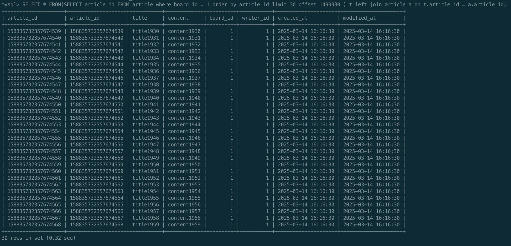

<details>
<summary><strong>DB  SQL 직접 날림</strong></summary>

<a id="1c3eda9b0fe181369d03e4d4978749d1"></a>

<strong>실제 쿼리</strong>

<a id="1c3eda9b0fe181328e08ddafcc5e0bd8"></a>

```sql
SELECT * FROM ( 
	 SELECT article_id FROM article 
			 WHERE board_id = 1 
			 ORDER BY article_id
			 limit 30 offset 1499930 
) t LEFT JOIN article a ON t.article_id = a.article_id;

# SELECT * FROM(SELECT article_id FROM article where board_id = 1 order by article_id limit 30 offset 1499930 ) t left join article a on t.article_id = a.article_id;
```



</details>

<a id="1c3eda9b0fe1816687dfc582584448af"></a>

### 코드 &#45; 게시글 전체 조회&#58; 페이징

[[ Dev ] 전체 게시글 조회  - 페이징](https://github.com/gyungsubLee/large-board/issues/16)

<details>
<summary>&#91; 코드 &#93; ArticleController</summary>

<a id="1c3eda9b0fe181eabdd0c2190fc8d2e1"></a>

```java
package sub.board.article.controller;
 
 import lombok.RequiredArgsConstructor;
 import org.springframework.web.bind.annotation.*;
 import sub.board.article.service.ArticleService;
 import sub.board.article.service.request.ArticleCreateRequest;
 import sub.board.article.service.request.ArticleUpdateRequest;
 import sub.board.article.service.response.ArticleResponse;
 
 @RestController
 @RequiredArgsConstructor
 @RequestMapping("/api/v1/articles")
 public class ArticleController {
    private final ArticleService articleService;
    
			 ...
		 
		@GetMapping
		public ArticlePageResponse readAll(
		        @RequestParam Long boardId,
		        @RequestParam Long page,
		        @RequestParam Long pageSize
		) {
		    return articleService.readAll(boardId, page, pageSize);
		}
 }
```

</details>

<details>
<summary>&#91; 코드 &#93; PageLimitCalculator</summary>

<a id="1c3eda9b0fe18124a4edf62ad6a21ee3"></a>

```java
package sub.board.article.service;

import lombok.AccessLevel;
import lombok.NoArgsConstructor;

@NoArgsConstructor(access = AccessLevel.PRIVATE)
public class PageLimitCalculator {

    public static Long calculatePageLimit(Long page, Long pageSize, Long movablePageCount) {
        return (((page - 1) / movablePageCount) + 1) * pageSize * movablePageCount + 1;
    }
}

```

</details>

<details>
<summary>&#91; 코드 &#93; ArticleService</summary>

<a id="1c3eda9b0fe181eb8469f8cf3925b133"></a>

```java
@Service
@RequiredArgsConstructor
public class ArticleService {
   private final Snowflake snowflake = new Snowflake();
   private final ArticleRepository articleRepository;
 
      ...
     
		 @Transactional(readOnly = true)
		 public ArticlePageResponse readAll(Long boardId, Long page, Long pageSize) {
					return ArticlePageResponse.of(
					    // Args: boardId, limit, offset
							articleRepository.findAllArticle(boardId, pageSize, (page - 1) * pageSize).stream()
							        .map(ArticleResponse::from)
							        .toList(),
							articleRepository.count(
							        boardId,
							        PageLimitCalculator.calculatePageLimit(page, pageSize, 10L))
		      );
     }
}
```

</details>

<details>
<summary>&#91; 코드 &#93; ArticleRepository</summary>

<a id="1c3eda9b0fe181a7bca7c3ff5beb8970"></a>

```java
@Repository
public interface ArticleRepository extends JpaRepository<Article, Long> {
    
    ...
		
		/**
		 * convering index를 활용한 페이징 조회 쿼리 최적화
		 */
    @Query(
        value = """
                SELECT a.article_id, a.title, a.content, a.board_id, a.writer_id, a.created_at, a.modified_at
                FROM (
                    SELECT article_id
                    FROM article
                    WHERE board_id = :board_id
                    ORDER BY article_id DESC
                    LIMIT :limit OFFSET :offset
                ) t
                LEFT JOIN article a ON t.article_id = a.article_id
            """,
        nativeQuery = true)
    List<Article> findAllArticle(
            @Param("board_id") Long boardId,
            @Param("limit") Long limit,
            @Param("offset") Long offset
    );
		
		/**
		 * 전체 페이지 계산: 전체 데이터 개수 / 한 페이지당 데이터 개수 (limit) -> count		 
		 */
    @Query(
        value = """
                SELECT COUNT(*) FROM (
                    SELECT article_id FROM article WHERE board_id = :boardId LIMIT :limit
                ) t
            """,
        nativeQuery = true)
    Long count(@Param("boardId") Long boardId, @Param("limit") Long limit);
}
```

<details>
<summary>🧐 전체 페이지 수 계산이 필요한 이유</summary>

<a id="1c3eda9b0fe181e1a2c1dd64e42d956c"></a>

<code>count()</code> 쿼리를 실행하지 않고도 페이징은 가능하지만, 문제가 발생된다&#46; 

1. 총 페이지 수를 알 수 없음
    - 클라이언트가 다음 페이지가 있는지 알 수 없음, 계속 요청 날림

1.  ‘마지막 페이지’ 판별이 어려움
    - 현제 페이지가 LIMIT 만큼 데이터가 조회되지 않으면 마지막 페이지라고 추측이 가능하지만,

    - 데이터가 딱 LIMIT 개수만큼 남아있으면 ‘마지막 페이지’ 인지 판단할 수 없음&#46;

</details>

</details>

<details>
<summary>&#91; 코드 &#93; Article</summary>

<a id="1c3eda9b0fe1816698d3de629f28d2fa"></a>

```java
package sub.board.article.entity;
 
 import jakarta.persistence.Entity;
 import jakarta.persistence.Id;
 import jakarta.persistence.Table;
 import lombok.*;
 
 import java.time.LocalDateTime;
 
 @Table(name = "article")
 @Entity
 @Getter
 @ToString
 @NoArgsConstructor(access = AccessLevel.PROTECTED)
 public class Article {
 
     @Id
     private Long articleId;
     private String title;
     private String content;
     private Long boardId; // Shard Key
     private Long writerId;
     private LocalDateTime createdAt;
     private LocalDateTime modifiedAt;
 
     @Builder
     public Article(Long articleId, String title, String content, Long boardId, Long writerId) {
         this.articleId = articleId;
         this.title = title;
         this.content = content;
         this.boardId = boardId;
         this.writerId = writerId;
         this.createdAt = LocalDateTime.now();
         this.modifiedAt = this.createdAt;
     }
 
     public void update(String title, String content) {
         this.title = title;
         this.content = content;
         modifiedAt = LocalDateTime.now();
     }
 }
```

</details>

<details>
<summary>&#91; 코드 &#93; ArticleCreateRequest</summary>

<a id="1c3eda9b0fe18105bafdc2921e7d4bcb"></a>

```java
package sub.board.article.service.request;
 
import lombok.Getter;
import lombok.ToString;

@Getter
@ToString
public class ArticleCreateRequest {
   private String title;
   private String content;
   private Long boardId;
   private Long writerId;
}
```

</details>

<details>
<summary>&#91; 코드 &#93; ArticleUpdateRequest</summary>

<a id="1c3eda9b0fe181fbba5de9c29c0c8ee1"></a>

```java
package sub.board.article.service.request;

import lombok.Getter;
import lombok.ToString;

@Getter
@ToString
public class ArticleUpdateRequest {
   private String title;
   private String content;
}
```

</details>

<details>
<summary>&#91; 코드 &#93; ArticleResponse</summary>

<a id="1c3eda9b0fe1816a8ee7cd6f50883bdc"></a>

```java
package sub.board.article.service.response;
 
 import lombok.*;
 import sub.board.article.entity.Article;
 
 import java.time.LocalDateTime;
 
 @Getter
 @ToString
 @NoArgsConstructor(access = AccessLevel.PRIVATE)
 public class ArticleResponse {
     private Long articleId;
     private String title;
     private String content;
     private Long boardId;
     private Long writerId;
     private LocalDateTime createdAt;
     private LocalDateTime modifiedAt;
 
     public static ArticleResponse from(Article article) {
         ArticleResponse response = new ArticleResponse();
         response.articleId = article.getArticleId();
         response.title = article.getTitle();
         response.content = article.getContent();
         response.boardId = article.getBoardId();
         response.writerId = article.getWriterId();
         response.createdAt = article.getCreatedAt();
         response.modifiedAt = article.getModifiedAt();
         return response;
     }
 }
```

</details>

<a id="1c3eda9b0fe18167b3fafd21ba951422"></a>

### 테스트코드 &#45; 게시글 CRUD

[[ Test ] 게시글 CRUD API](https://github.com/gyungsubLee/large-board/issues/10)

<details>
<summary>&#91; 코드 &#93; ArticleApiTest</summary>

<a id="1c3eda9b0fe181da9a5dda76a0bcfaf3"></a>

```java
package sub.board.article.api;


import jakarta.annotation.Nullable;
import lombok.AllArgsConstructor;
import lombok.Getter;
import org.junit.jupiter.api.BeforeEach;
import org.junit.jupiter.api.DisplayName;
import org.junit.jupiter.api.Test;
import org.springframework.web.client.RestClient;
import org.springframework.core.ParameterizedTypeReference;
import org.springframework.web.util.UriComponentsBuilder;
import sub.board.article.service.response.ArticlePageResponse;
import sub.board.article.service.response.ArticleResponse;

import java.util.List;

import static org.assertj.core.api.Assertions.assertThat;
import static org.junit.jupiter.api.Assertions.assertNotNull;
import static org.junit.jupiter.api.Assertions.assertThrows;

public class ArticleApiTest {
    RestClient restClient = RestClient.create("http://localhost:9000");

    // 생성 test 에서 출력된 id 값 사용
    Long articleId;

    // Article id 동적 생성
    @DisplayName("Article 생성")
    @BeforeEach
    void setUp() {
        //
        ArticleCreateRequest request = new ArticleCreateRequest("hi", "Ctest", 1L, 1L);

        // 테스트용 게시글을 먼저 생성하고 ID를 저장
        ArticleResponse response = create(request);
        assertNotNull(response, "생성된 게시글이 null이면 안 됩니다.");

        this.articleId = response.getArticleId();  // 동적으로 생성된 ID 저장
        System.out.println("생성된 articleId = " + this.articleId);
    }

    ArticleResponse create(ArticleCreateRequest request) {
        return restClient.post()
                .uri("/api/v1/articles")
                .body(request)
                .retrieve()
                .body(ArticleResponse.class);
    }

    @DisplayName("Article 조회")
    @Test
    void readTest() {
        // When
        ArticleResponse response = read(articleId);

        // Then
        assertNotNull(response, "response 객체가 null 이면 안됩니다.");
        assertThat(response.getArticleId()).isEqualTo(articleId);

        System.out.println("read = " + response);
    }

    ArticleResponse read(Long articleId) {
        return restClient.get()
                .uri("/api/v1/articles/{articleId}", articleId)
                .retrieve()
                .body(ArticleResponse.class);
    }

    @DisplayName("Article 수정")
    @Test
    void updateTest() {
        // Given
        ArticleUpdateRequest request = new ArticleUpdateRequest("h12", "Ctest2");

        // When
        ArticleResponse response = update(articleId, request);

        // Then
        assertNotNull(response, "response 객체는 null 이면 안됩니다.");
        assertThat(response.getTitle()).isEqualTo(request.getTitle());
        assertThat(response.getContent()).isEqualTo(request.getContent());

        System.out.println("response = " + response);
    }

    ArticleResponse update(Long articleId, ArticleUpdateRequest requset) {
        return restClient.patch()
                .uri("/api/v1/articles/{articleId}", articleId)
                .body(requset)
                .retrieve()
                .body(ArticleResponse.class);
    }

    @DisplayName("Article 삭제")
    @Test
    void deleteTest() {
        // When
        restClient.delete()
                .uri("/api/v1/articles/{articleId}", articleId)
                .retrieve();

        // Then
        Exception exception = assertThrows(Exception.class, () -> read(articleId));
        System.out.println("삭제 후 조회 시도 예외: " + exception.getMessage());
    }


    @Getter
    @AllArgsConstructor
    static class ArticleCreateRequest {
        private String title;
        private String content;
        private Long boardId;
        private Long writerId;
    }

    @Getter
    @AllArgsConstructor
    static class ArticleUpdateRequest {
        private String title;
        private String content;
    }
}

```

</details>

<a id="1c3eda9b0fe18113b385eaeae8591a07"></a>

```sql
 curl -X GET "http://localhost:9000/api/v1/articles?boardId=1&limit=30&offset=1499970"
```

<details>
<summary>&#91; 코드 &#93;</summary>

<a id="1c3eda9b0fe181b08ad8e913da92b372"></a>

```java

```

</details>
