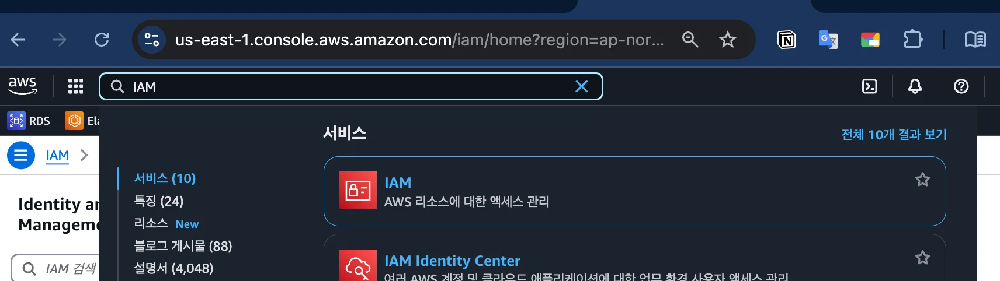
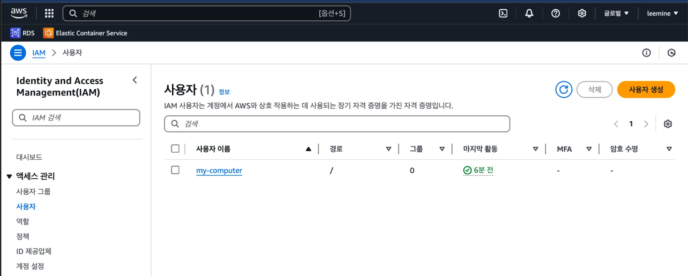
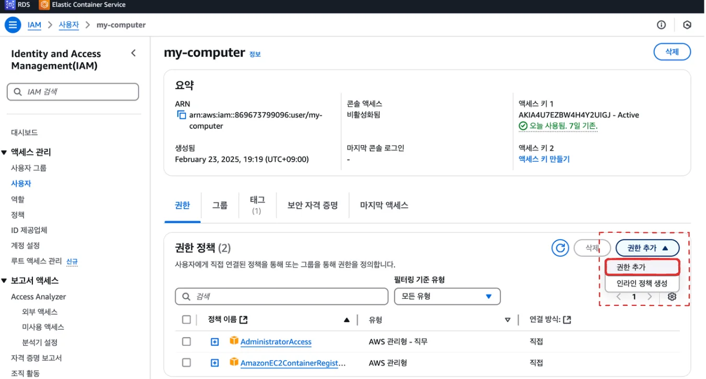
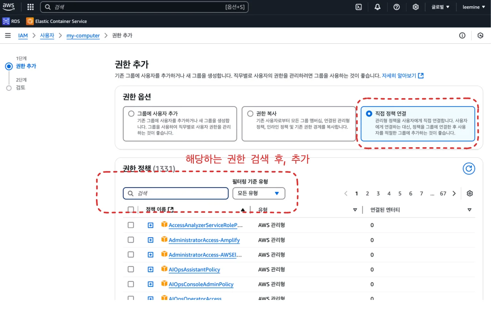

<a id="1c3eda9b0fe181d8a37cedff4d8f93c6"></a>

## IAM에 관리자 접근 권한 설정

---

<a id="1c3eda9b0fe18157b8fed1811ab9bbdd"></a>

### &#91; 🤬 오류 &#93; AccessDenied

<a id="1c3eda9b0fe181e6833fc5896ca8bbae"></a>

로컬에서 aws&#45;cli를 통해 EC2에 대한 작업을 하려고 하니, <u>접근 권한 오류</u>가 발생되었다&#46; 

<a id="1c3eda9b0fe1813c90dac9c25df2dfcc"></a>

```plaintext
An error occurred (AccessDenied) when calling the ListAttachedUserPolicies operation: User: arn:aws:iam::869673799096:user/my-computer is not authorized to perform: iam:ListAttachedUserPolicies on resource: user my-computer because no identity-based policy allows the iam:ListAttachedUserPolicies action
```

<a id="1c3eda9b0fe18125b78cfa6a7297653c"></a>

<strong><u>현재 사용 중인 IAM 사용자</u></strong>가 <strong><u>CLI 실행 권한이 없</u></strong>어 발생한 오류이다&#46;

<a id="1c3eda9b0fe1815daf47f0a124551dd4"></a>

이를 해당 계정에 접근 권한을 추가하여 해결하였다&#46; 

<a id="1c3eda9b0fe18181924bf9e7ddd90eaa"></a>

### &#91; 🤓 해결 &#93; IAM 계정에 권한 추가

- AWS &#45; IAM 접속
    

- 권한을 추가할 계정 선택
    

-  <code>권한 추가</code> 클릭
    

- 해당하는 권한 검색 후, 추가
    

    - <code>AdministratorAccess</code> (<strong>최대 권한</strong> / 모든 작업 가능)

    - <code>IAMReadOnlyAccess</code> (<strong>IAM 읽기 권한</strong> / 권한 조회 가능)

    - <code>AmazonEC2ReadOnlyAccess</code> (<strong>EC2 읽기 권한</strong> / 보안 그룹 조회 가능)

    - <code>AmazonEC2FullAccess</code> (EC2 관련 모든 작업 가능)

    - <code>AmazonEC2ReadOnlyAccess</code> (EC2 조회만 가능)

<a id="1c3eda9b0fe18110b174ddbf0c955b6e"></a>

### &#43; ) AWS CLI

<a id="1c3eda9b0fe181868430fcebaee17e2b"></a>

<a href="#/post/1c3eda9b-0fe1-815a-9667-d5d8dcc30a9d">페이지</a>
