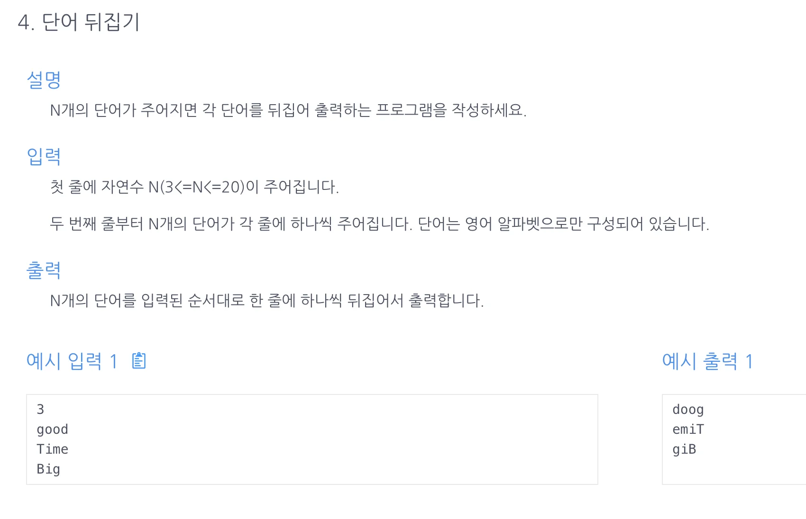

<a id="1c3eda9b0fe18166bec7d04849bc1983"></a>

## 문제)



<a id="1c3eda9b0fe181058d16de9ce618219d"></a>

```latex
3
good
Time
Big
```

<a id="1c3eda9b0fe181779fd2db3bd91211b4"></a>

## 풀이)

<details>
<summary>String ↔ Array</summary>

<a id="1c3eda9b0fe181e3b445cecd2212c2f5"></a>

<code>String → Array&#58; String&#46;toCharArray();</code>

<a id="1c3eda9b0fe18174a92dccf3fdb2b241"></a>

<code>Array → String&#58; String&#46;valueOf(Array)</code>

</details>

<a id="1c3eda9b0fe1818682aad464fe0807a5"></a>

### 풀이1) StringBuilder, List

<a id="1c3eda9b0fe18126bd0ade1c9100018c"></a>

```java
import java.util.Scanner;

public class Main {
    public String[] solution(int n, String[] s){
        String[] answer = new String[n];
        for (int i=0; i<n; i++) answer[i] = new StringBuilder(s[i]).reverse().toString();
        return answer;
    }
    public static void main(String[] args) {
        Main m = new Main();
        Scanner sc = new Scanner(System.in);
        int n = sc.nextInt();
        String[] str = new String[n];
        for (int i = 0; i < n; i++) {
            str[i] = sc.next();
        }
        String[] answer = m.solution(n, str);
        for (int i = 0; i < n; i++) {
            System.out.println(answer[i]);
        }
    }
}
```

<a id="1c3eda9b0fe181b8ad22e1d2e630bb26"></a>

### 풀이 2) StringBuilder, ArrayList

<a id="1c3eda9b0fe181468d2cebbbe3df5c56"></a>

```java
import java.util.*;

public class Main {
    public ArrayList<String> solution(int n, String[] str){
        ArrayList<String> answer = new ArrayList<>();
        for (String x : str){
						// StringBuilder().reverse() 시간복잡도: O(n)
            String tmp = new StringBuilder(x).reverse().toString();
            answer.add(tmp);
        }

        return answer;
    }
    public static void main(String[] args){
        Main m = new Main();
        Scanner sc = new Scanner(System.in);
        int n = sc.nextInt()
        String[] str = new String[n];
        for (int i=0; i<n; i++){
            str[i] = sc.next();
        }
        for ( String x: m.solution(n, str)){
            System.out.println(x);
        }
    }
}
```

<a id="1c3eda9b0fe1814e8755cd8167f5f520"></a>

### 풀이 3)  투포인터, String ↔ Array 

- 투포인터 &#45; while문

<a id="1c3eda9b0fe181168f5ff24787994a67"></a>

```java
import java.util.ArrayList;
import java.util.Scanner;

public class Main {
    // for문
        // String -> Array(toCharArray())
        // 양쪽 포인터 (left, right) 값 스왑,
        // left++; right--;
        // Array -> str: Stirng.valueOf(Array);
        // answer.add();
    public ArrayList<String> solution(int n, String[] str) {
        ArrayList<String> answer = new ArrayList<>();
        for (String x : str) {
            char[] s = x.toCharArray();
            int left=0, right=x.length()-1;
            // 파이써은 바로 스왑되던디... 메모리 낭비보소...
            while(left<right) {
                char tmp = s[left];
                s[left] = s[right];
                s[right] = tmp;
                left++;
                right--;
            }
            String tmp=String.valueOf(s);
            answer.add(tmp);
        }
        return answer;
    }

    public static void main(String[] args) {
        Main m = new Main();
        Scanner sc = new Scanner(System.in);
        int n = sc.nextInt();
        String[] str = new String[n];
        for (int i = 0; i < n; i++) {
            str[i] = sc.next();
        }
        for (String x : m.solution(n, str)) {
            System.out.println(x);
        }
    }
}
```

- 투포인터( for문)
    <a id="1c3eda9b0fe1816aa7d1e2ff06f5878b"></a>

    ```java
    import java.util.*;
    public class Main {
        public String[] solution(int n, String[] arr) {
            String[] answer = new String[n];
            for(int i=0; i<n; i++){
                char[] t = arr[i].toCharArray();
                int len = t.length;

                for(int j=0; j<len/2; j++){
                    char tmp = t[j];
                    t[j]=t[len-1-j];
                    t[len-1-j]=tmp;
                }
                answer[i]=String.valueOf(t);
            }
            return answer;
        }

        public static void main (String[] args){
            Main m = new Main();
            Scanner sc = new Scanner(System.in);
            int n = sc.nextInt();
            String[] arr = new String[n];
            for(int i=0; i<n; i++){
                arr[i] = sc.next();
            }
            for( String x: m.solution(n, arr)){
                System.out.println(x);
            }
        }
    }
    ```
