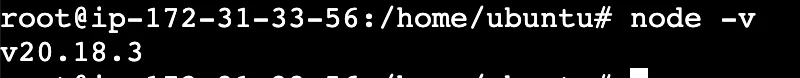
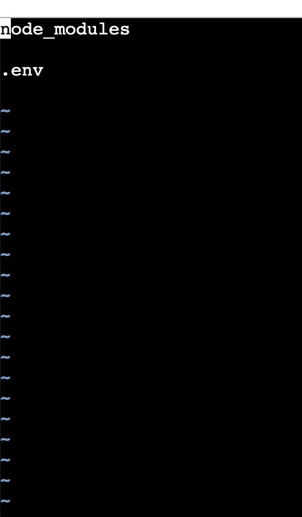
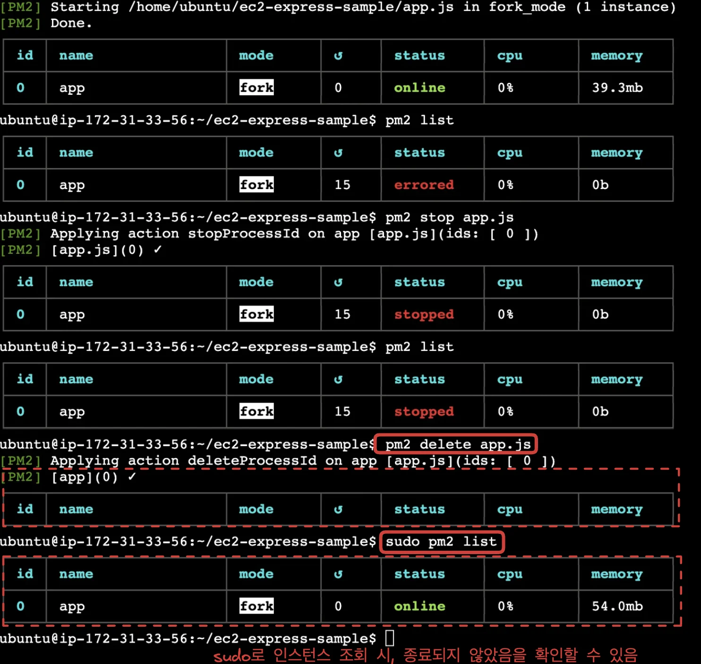
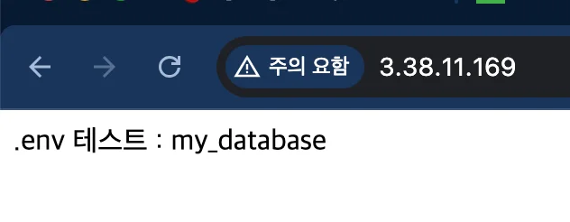
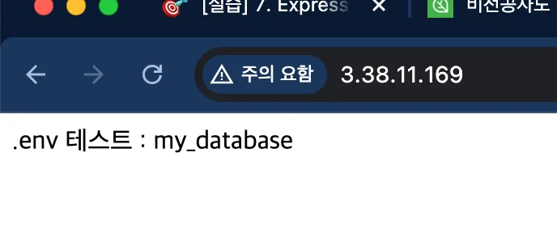

<details>
<summary>EC2 콘솔 접속</summary>

---

- 해당하는 인스턴스 클릭
    

- 연결 클릭
    

    

- 해당 EC2의 콘솔 창으로 접속 
    

</details>

<a id="1c3eda9b0fe1818b8356d4adbfda2e8d"></a>

## &#91; 실습 &#93; Express 서버 EC2에 배포

---

<a id="1c3eda9b0fe181cabe9ac20ad3d861ba"></a>

### 1&#46;  Ubuntu 환경에서 Node&#46;js 설치

[GitHub &#45; nodesource/distributions&#58; NodeSource Node&#46;js Binary Distributions]()

<a id="1c3eda9b0fe181da9034f1973e13ba76"></a>

```shell
#  root (슈퍼유저) 권한 설정 [현재 사용자의 환경($HOME, $PATH) 유지]
sudo su

apt-get update && /
apt-get install -y ca-certificates curl gnupg && /
mkdir -p /etc/apt/keyrings && /
curl -fsSL https://deb.nodesource.com/gpgkey/nodesource-repo.gpg.key | sudo gpg --dearmor -o /etc/apt/keyrings/nodesource.gpg && /
NODE_MAJOR=20 && /
echo "deb [signed-by=/etc/apt/keyrings/nodesource.gpg] https://deb.nodesource.com/node_$NODE_MAJOR.x nodistro main" | sudo tee /etc/apt/sources.list.d/nodesource.list && /
apt-get update && /
apt-get install nodejs -y
```

<details>
<summary>패키지 목록 업데이트</summary>

<a id="1c3eda9b0fe18182b922ef1fc2b45a55"></a>

```shell
sudo apt-get update
```

</details>

<details>
<summary>필요한 패키지 설치</summary>

<a id="1c3eda9b0fe181ce92c5cfd73a27736c"></a>

```shell
sudo apt-get install -y ca-certificates curl gnupg
```

</details>

<details>
<summary>GPG 키 저장 폴더 생성</summary>

<a id="1c3eda9b0fe181d29b37f694339a6ebb"></a>

```shell
sudo mkdir -p /etc/apt/keyrings
```

</details>

<details>
<summary><strong>Nodesource GPG 키 추가 (패키지 서명 검증용)</strong></summary>

<a id="1c3eda9b0fe181e7a9aed92d12b65c2d"></a>

```shell
curl -fsSL https://deb.nodesource.com/gpgkey/nodesource-repo.gpg.key | sudo gpg --dearmor -o /etc/apt/keyrings/nodesource.gpg://deb.nodesource.com/gpgkey/nodesource-repo.gpg.key | sudo gpg --dearmor -o /etc/apt/keyrings/nodesource.gpg
```

</details>

<details>
<summary><strong>Node&#46;js 20&#46;x 저장소 추가</strong></summary>

<a id="1c3eda9b0fe1810eb8d9fac8bf0c9f10"></a>

```shell
NODE_MAJOR=20
echo "deb [signed-by=/etc/apt/keyrings/nodesource.gpg] https://deb.nodesource.com/node_$NODE_MAJOR.x nodistro main" | sudo tee /etc/apt/sources.list.d/nodesource.list
```

</details>

<details>
<summary>저장소 업데이트</summary>

<a id="1c3eda9b0fe1810084f1f116a5ac166c"></a>

```shell
sudo apt-get update
```

</details>

<details>
<summary><strong>Node&#46;js 설치</strong></summary>

<a id="1c3eda9b0fe1818eaec9e328a7b10e69"></a>

```shell
sudo apt-get install -y nodejs
```

</details>

- <strong>설치 확인</strong>
    <a id="1c3eda9b0fe181e39e09fba04fb8e20f"></a>

    ```shell
    node -v 

    npm -v
    ```

    

<a id="1c3eda9b0fe181c38df7f4df93191384"></a>

### 2&#46; Github &#45; Express 프로젝트 clone

[GitHub &#45; JSCODE&#45;EDU/ec2&#45;express&#45;sample&#58; &#60;비전공자도 이해할 수 있는 AWS 입문/실전&#62; 中 예제 프로젝트]()

<a id="1c3eda9b0fe18184a7b1fc6873396ea9"></a>

```shell
# express clone
git clone https://github.com/JSCODE-EDU/ec2-express-sample

# clone한 프로젝트 폴더로 이동
cd ec2-express-sample

# 의존성(라이브러리) 설치
npm i
```

<a id="1c3eda9b0fe18165abdfc3358133d877"></a>

### 3&#46; <code>&#46;env</code> 파일 생성

---

<a id="1c3eda9b0fe18133b47ee08a396184c2"></a>

민간한 데이터 정보는 <code>&#46;env</code> 파일을 통해 관리해야 한다&#46; 

<a id="1c3eda9b0fe181f2988dfca463e63edd"></a>

따라서 <code>&#46;env</code> 파일은 별도로 EC2 인스턴스에 추가 해야한다&#46;

- <code>&#46;env</code> 파일을 EC2 인스턴스에 올리는 작업보다는, <code>&#46;env</code> 파일을 직접 만드는 게 훨씬 간단하다&#46; 

- <strong><code>&#46;env</code></strong>
    <a id="1c3eda9b0fe181649e8cee1eaf709d03"></a>

    ```shell
    DATABASE_NAME=my_database
    ```

- <code>&#46;gitignore</code> 등록
    <a id="1c3eda9b0fe1814cb731c970f5f5b5c5"></a>

    ```shell
    vim .gitignore

    # .env 등록 
    ```

    

    - <code>&#46;env</code> 등록 

    ---

    - insert 모드&#58; <code>i</code>

    - view 모드&#58; <code>esc</code>

    ---

    - 종료&#58; &#58;<code>q</code>

    - 강제 종료&#58; <code>&#58;q&#33;</code>

    - 저장 종료&#58; <code>&#58;wq</code>

<a id="1c3eda9b0fe1810c9ef4d2412359f485"></a>

### 4&#46; pm2 설치 및 서버 실행

<details>
<summary><code>PM2</code> CLI</summary>

> ☝🏻 
> 
> <a id="1c3eda9b0fe181a6aa78d9352390d6ca"></a>
> 
> <code>sudo</code> 를 통해 <strong><u>관리자 권한</u></strong><strong><u>으로 실행</u></strong>해야 한다&#46; 

- PM2 설치
    <a id="1c3eda9b0fe1814e9525dc2d6b086ca0"></a>

    ```shell
    # PM2 설치 
    npm install -g pm2

    # 설치 확인
    pm2 -v
    ```

- 애플리케이션 실행
    <a id="1c3eda9b0fe18189af12ec758e2d2e52"></a>

    ```shell
    # 일반 실행
    pm2 start app.js

    # 특정 이름으로 실행 
    pm2 start app.js --name my-app
    ```

- <strong>개별 애플리케이션 관리</strong>
    <details>
    <summary><strong>모든 애플리케이션 관리</strong></summary>

    <a id="1c3eda9b0fe181ed996be7edde98237f"></a>

    ```shell
    pm2 restart all

    pm2 stop all

    pm2 delete all
    ```

    </details>

    <a id="1c3eda9b0fe18142ac02f6538c380590"></a>

    ```shell
    # 재시작
    pm2 restart my-app   

    # 중지
    pm2 stop my-app      

    # 삭제
    pm2 delete my-app 
    ```

- 실행 중인 프로세스 확인
    <a id="1c3eda9b0fe18149baf2f07285feb050"></a>

    ```shell
    pm2 list
    ```

- 로그 확인
    <a id="1c3eda9b0fe181ec8551decbb29903f0"></a>

    ```shell
    pm2 logs [인스턴스 명]
    ```

</details>

<a id="1c3eda9b0fe181be9537f11b35dcc86b"></a>

Node 기반의 서버는 <code>pm2</code>를 활용해서 많이 실행한다&#46;

- 서비스를 운영하는 데 있어서 유용한 기능들을 <code>pm2</code>가 많이 가지고 있다&#46; 

> ☝🏻 
> 
> <a id="1c3eda9b0fe181a68e58f9090fda6f60"></a>
> 
> <code>sudo(관리자 권한)</code> 로 실행 시, 이후 명령어에 똑같이 <code>sudo</code>를 사용해야 적용된다&#46; 
> 
> <details>
> <summary><strong>&#91;🤬 오류 &#93;</strong> <code>sudo</code>  를 사용하지 않고 종료, 삭제 시 정상 동작되지 않는다&#46;</summary>
> 
> <a id="1c3eda9b0fe1819dbbb5db4335bd247a"></a>
> 
> ```shell
> # 앱 실행
> sudo pm2 start app.js
> 
> # pm2 인스턴스 확인
> pm2 list
> 
> # 실행 중인 인스턴스(앱) 중지
> pm2 stop app.js
> 
> # 인스턴스(앱) 삭제
> pm2 delete app.js
> ```
> 
> 
> 
> <a id="1c3eda9b0fe1814f9ac9efc4ce21e796"></a>
> 
> 출력 값을 보면 정상 동작하는 것 같지만, 
> 
> <a id="1c3eda9b0fe1812a9ba5f28eef1302da"></a>
> 
> 이후 <code>sudo</code>로 다시 조회를 하면 인스턴스(앱)이 종료되지 않은 것을 확인할 수 있다&#46; 
> 
> 
> 
> </details>

<a id="1c3eda9b0fe181f88af1f677010396b2"></a>

```shell
# pm2 설치 
sudo npm i -g pm2

# 앱 실행
sudo pm2 start app.js

# pm2 인스턴스 확인
sudo pm2 list

# 실행 중인 인스턴스(앱) 중지
sudo pm2 stop app.js

# 인스턴스(앱) 삭제
sudo pm2 delete app.js
```

- 동작 확인
    
