<a id="1c3eda9b0fe18133adfeeac7fd7f93b7"></a>

## Gradle

<a id="1c3eda9b0fe18141b676d76bc4476b6d"></a>

### <strong>• </strong><strong><code>Gradle</code></strong><strong> 이란?</strong>

---

<a id="1c3eda9b0fe1811f82abdb7a881e5cc2"></a>

<strong><u>빌드 자동화 시스템</u></strong>으로 작성한 Java 코드를 설정에 맞게 자동으로 <strong><code>Build</code></strong> 해준다&#46; 

> <strong><code>Build</code></strong>&#58;  소스 코드를 실행 가능한 결과물로 만드는 일련의 과정

<a id="1c3eda9b0fe181059394fb6ac05f58ff"></a>

<strong>Gradle</strong>을 통해 <strong><u>Java 소스 코드</u></strong>를 실행 가능하나 <strong><code>jar 파일</code></strong>로 간편하게 변환 가능

<a id="1c3eda9b0fe1811bac60d66f213756a3"></a>

### <strong>• </strong><code>build&#46;gradle</code>

---

<a id="1c3eda9b0fe181078c0ee4438a1cd8f3"></a>

<strong><u>Gradle 기반의 빌드 스크립트</u></strong>로 해당 스크립트를 통해 <strong><u>소스 코드를 빌드</u></strong>하고 <strong><u>라이브러리들의 의존성을 쉽게 관리</u></strong>할 수 있다&#46;

- <code>groovy</code>, <code>kotlin</code> 언어로 스크립트 작성 

<a id="1c3eda9b0fe181bd9b35ee485760f6bc"></a>

### <code>Dependencies</code>

---

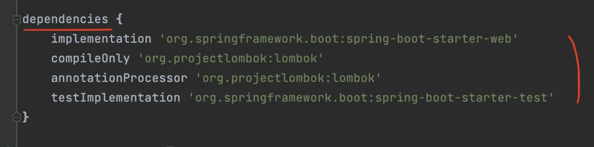

<a id="1c3eda9b0fe181afa866fc27930fc860"></a>

개발 시 필요한 외부 라이브러리들은 dependencies 부분에 작성하면 Gradle이 해당 라이브러리들을 <a href="https://mvnrepository.com/">Maven Repositroy</a> 와 같은 외부 저장소에서 자동으로 다운로드 한다&#46;

> Maven Repository&#58;  라이브러들을 모아둔 저장소

<a id="1c3eda9b0fe1810f8bf3f2660013d1bd"></a>

또한 다른 라이브러리들과의 의존성을 자동으로 관리해 주기 때문에 라이브러리들간의 충돌 걱정없이 개발에만 집중할 수 있다&#46; 

<a id="1c3eda9b0fe181ada06dd54dbf82e033"></a>

## 서버

<a id="1c3eda9b0fe181539745ef6c2ee20696"></a>

### 네트워크 

<details>
<summary>추가 자료</summary>

<a id="1c3eda9b0fe18137bf54f3986af35fae"></a>

<a href="#/post/1c3eda9b-0fe1-81a7-b264-d515204d6728">페이지</a> 

<details>
<summary> 네트워크 데이터 전달 (TCP/IP) 통신 흐름 </summary>

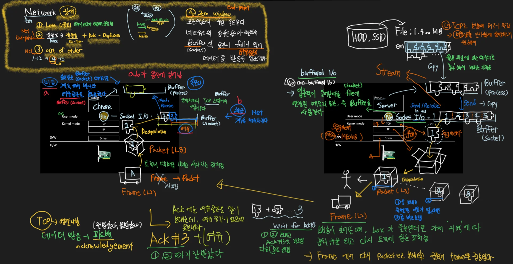

</details>

</details>

> 📌 네트워크는 여러대의 컴퓨터 또는 장비가 서로 연결되어 정보를 주고 받을 수 있게 도와주는 기술이다&#46; 
> 
> - 컴퓨터, 라우터, 스위치, 허브 등의 장비들이 각각의 역할을 수행하여 정보를 주고 받는다&#46; 
> 
> - IP 주소, 서브넷 마스크, 게이트웨이 등 정보를 설정 및 네트워크 프로토콜을 이용하여 통신함

<a id="1c3eda9b0fe18143a476d060170a26d3"></a>

### 웹서버 

> 📌 인터넷을 통해 HTTP를 이용하여 웹상의 클라이언트 요청을 응답해주는 컴퓨터

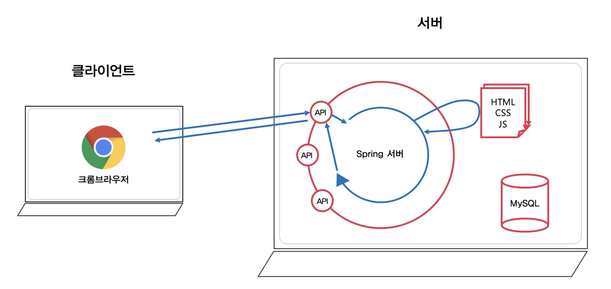

1. 브라우저를 통해 HTTP Request로 웹사이트를 웹서버에 요청

1. 웹서버는 요청을 승인하고 HTTP Response를 통해 웹사이트 데이터를 브라우저에 전송

1.  브라우저는 서버에서 받아온 데이터를 이용해 웹사이트를 브라우저에 보여줌

<a id="1c3eda9b0fe18150bafbde3d861151d4"></a>

### API

> 📌 <strong>API </strong>( <strong>A</strong>pplication <strong>P</strong>rogramming<strong> </strong><strong>I</strong>nterface )<br>다른 소프트웨어 시스템과 통신하기 위해 따라야 하는 규칙을 정의한다

<a id="1c3eda9b0fe181f0a554d7f10b4fc98f"></a>

개발자는 다른 애플리케이션이 프로그래밍 방식으로 애플리케이션과 통신할 수 있도록 API를 표시하거나 생성한다&#46;<br><strong>인터페이스</strong>(interface)는 서로 다른 두 개의 시스템, 장치 사이에서 정보나 신호를 주고받는 경우의 접점이나 경계면을 의미한다&#46; 

<a id="1c3eda9b0fe181c58bd7cb9e48d260b7"></a>

즉, 사용자가 기기를 쉽게 동작시키는데 도움을 주는 시스템이다&#46; 

<a id="1c3eda9b0fe18147ab01d8ab06745491"></a>

### RESTful API

> 📌 REST(<strong>Re</strong>presentation <strong>S</strong>tate <strong>T</strong>ransfer)<br>API 작동 방식에 대한 조건을 부과하는 소프트웨어 아키텍처이다&#46; 

<a id="1c3eda9b0fe1819f8993e35986f55a96"></a>

REST는 처음에 인터넷과 같은 복잡한 네트워크에서 통신을 관리하기 위한 지침으로 만들어졌다&#46; <br>REST 아키텍처 스타일을 따르는 API를 REST API라고 한다&#46; <br>REST 아키텍처를 구현하는 웹 서비스를 RESTful 웹 서비스라고 한다&#46; 

<a id="1c3eda9b0fe181bd9041ca5a189b6913"></a>

### Apache Tomcat?

> <a href="#/post/1c3eda9b-0fe1-8122-9763-dc464f02dc54">페이지</a> 

> 📌 <strong><code>Tomcat</code></strong>은 동적인 처리를 할 수 있는 웹 서버를 만들기 위한 웹 컨테이너이다&#46; 

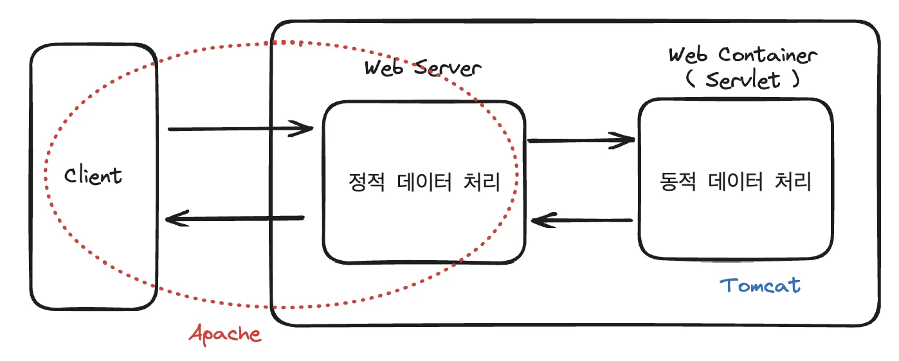

<a id="1c3eda9b0fe18135817dc4ec030fc9de"></a>

### Spring, Spring Boot

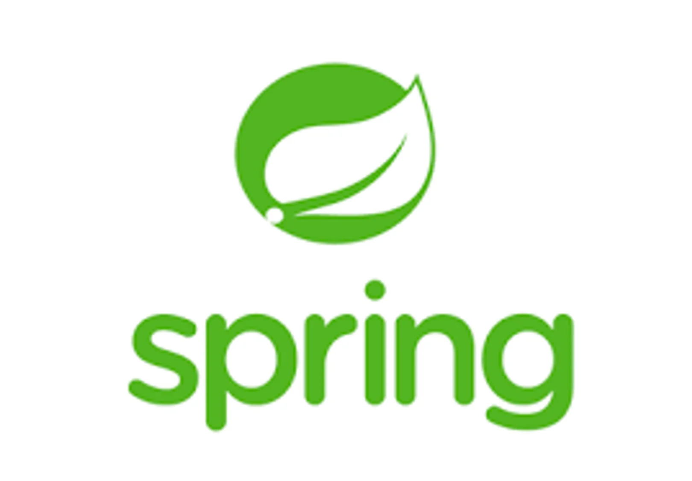

> Spring은 2004년에 1&#46;0이 등장한 이후 20년가까이 사랑받으며 계속해서 업그레이드 프레임워크이다&#46; (현재는 Spring 6&#46;xx 버전까지 등장함)

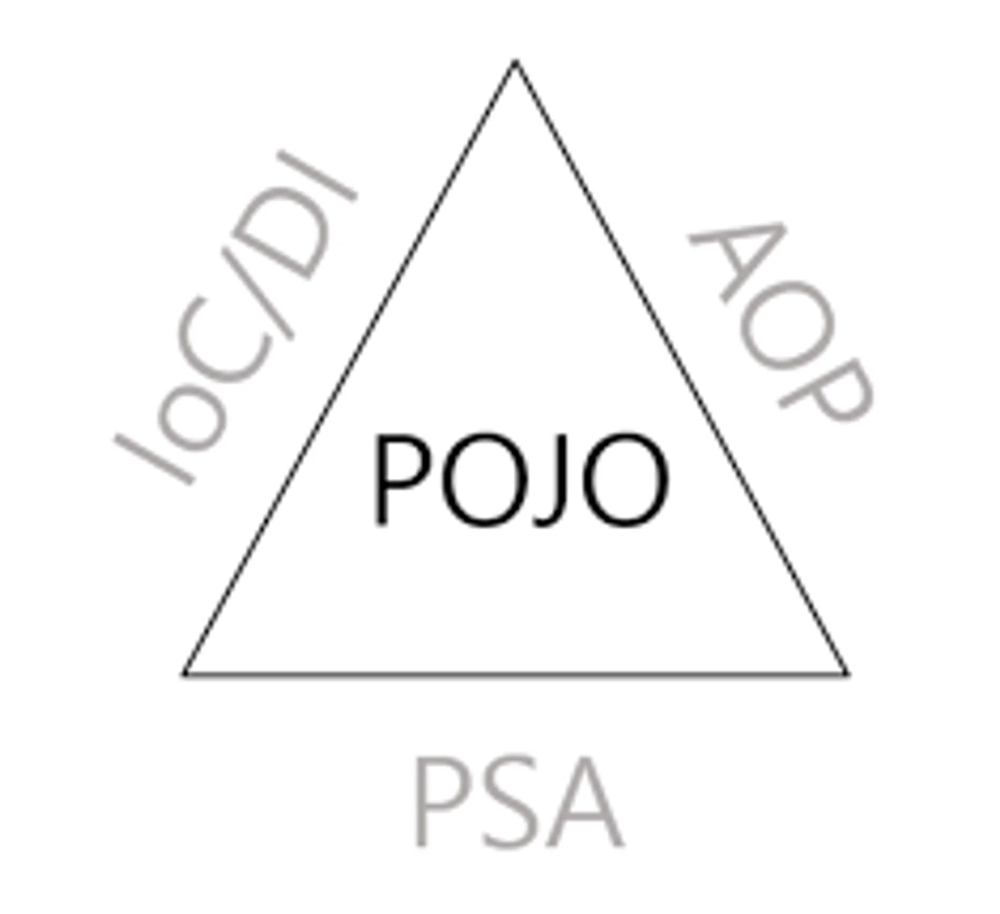

> Spring 프레임워크는 AOP, IoC/DI 등과 같은 아주 강력한 핵심 기능들을 가지고 있다&#46;<br>하지만 이러한 핵심 기능들을 사용하기 위해서는 너무나도 많은 xml 설정을 해야하는 단점이 있어<br>이러한 불편한 점들을 개선하기 위해 2014년 SpringBoot가 등장했다&#46;


<a id="1c3eda9b0fe1812d948adba9d41d4d90"></a>

SpringBoot는 기존의 xml 설정 대신<strong><u> Java의 Anotation 기반의 설정</u></strong>을 적극적으로 사용하고 있기 때문에 무겁고 작성하기 힘들던 xml 대신에 Anotation을 사용하여 아주 간편하게 설정할 수 있다&#46;

> 기본적으로 개발에 필요한 설정 정보들을 일반적으로 많이 사용하는 설정 값을 default로 하여 자동으로 설정해주고 있다&#46;

<a id="1c3eda9b0fe1810e960cc215e43ffcf6"></a>

외부 라이브러리나 하위 프레임워크들의 의존성 관리가 매우 쉬워졌다&#46;

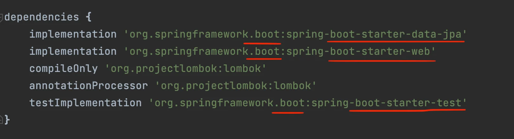

<a id="1c3eda9b0fe18138ab21dc6d1ab04921"></a>

스프링에서는 서버를 실행하기 위해 Apache Tomcat을 직접 다운로드 받고 설정하고 프로젝트에 삽입 했어야 했다&#46; 

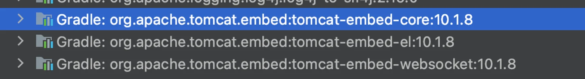

<a id="1c3eda9b0fe1810abb1bc15dbf603cf2"></a>

이러한 불편함 점들을 개선하여 <strong>SpringBoot</strong>에서는 기본적으로 <code>starter&#45;web</code> dependency를 설정하면 자동으로 <u>내장형 Apache Tomcat을 제공</u>한다&#46; 

> 📌 스프링 부트의 강점 
> 
> - 기존의 xml 설정 대신<strong>  </strong><strong><u>Java의 Anotation 기반의 설정 사용</u></strong>
> 
> - 매우 쉬운 <strong><u>외부 라이브러리</u></strong>나 <strong><u>하위 프레임워크</u></strong><strong>들의</strong><strong><u> 의존성 관리</u></strong>
> 
> - 내장 Apache Tomcat 

<a id="1c3eda9b0fe181d98cffe528ddee8e3d"></a>

### Postman

> 📌 <strong>Postman</strong><br>API 개발을 빠르고 쉽게 구현할 수 있도록 도와주는 소프트웨어 플렛폼이다&#46;

<a id="1c3eda9b0fe181f88851cf087cf4650c"></a>

<strong><u>API 맞춰  HTTP 요청을 서버에 보내고 응답을 확인</u></strong>해봐야 우리가 만든 서버가 제대로 동작 하는지 확인할 수 있다&#46;

<a id="1c3eda9b0fe18133ac14c9ec70738a95"></a>

이러한 확인 작업을 간편하게 할 수 있도록 도와주는 플렛폼 중 하나가 Postman이다&#46;

<details>
<summary>실습) <strong>Hello World&#33;</strong> 출력 확인</summary>

<details>
<summary>API 테이블</summary>


</details>

<details>
<summary>API 요청을 받아 처리하는 HelloController를 생성</summary>

<a id="1c3eda9b0fe1811784efcb44471e8a53"></a>

```java
package com.sparta.springprepare.controller;


import org.springframework.web.bind.annotation.GetMapping;
import org.springframework.web.bind.annotation.RestController;

@RestController
public class HelloController {

    @GetMapping("/api/hello")
    public String hello() {
        return "Hello World";
    }
}
```

</details>

<details>
<summary>Postman을 사용한 API 테스트 </summary>

<details>
<summary>Postman 사용방법</summary>

1. Workspaces 에서 워크 스페이스를 만들고 ‘New’를 클릭합니다&#46;
    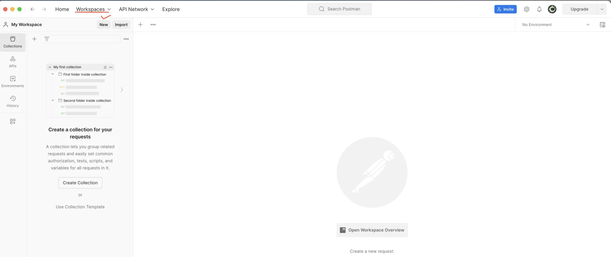

1. HTTP Request를 클릭합니다&#46;
    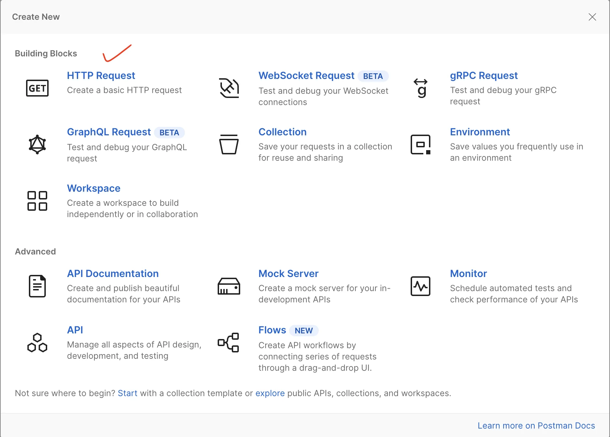

1. GET 방식을 선택하고 http&#58;//localhost&#58;8080/api/hello URL을 입력하고 ‘Send’를 클릭합니다&#46;
    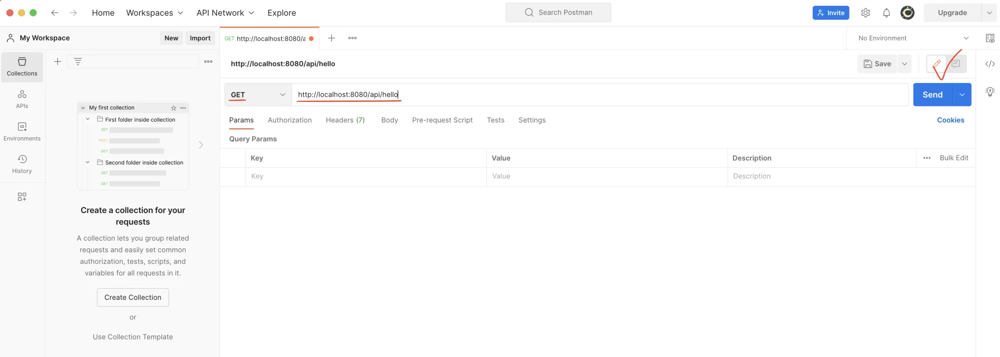

1. API 요청이 우리가 만든 서버에서 처리되어 “Hello World&#33;” 문자열이 출력된 것을 아래 Body 탭에서 확인할 수 있습니다&#46;

</details>

</details>

</details>

<a id="1c3eda9b0fe1815fabf6d6960f4b152f"></a>

## HTTP 프로토콜

<a id="1c3eda9b0fe1817fa6c1f4b1107cf68b"></a>

<a href="#/post/1c3eda9b-0fe1-81c8-b57f-fa069abfcbbf">페이지</a> 

> 📌 데이터를 주고 받는 양식을 정의한 &#34;<strong>통신 규약</strong>&#34;중 하나로<br>매우 범용적인 양식을 가지고 있어 전 세계에서 제일 널리 쓰이는 통신 규약이다&#46;

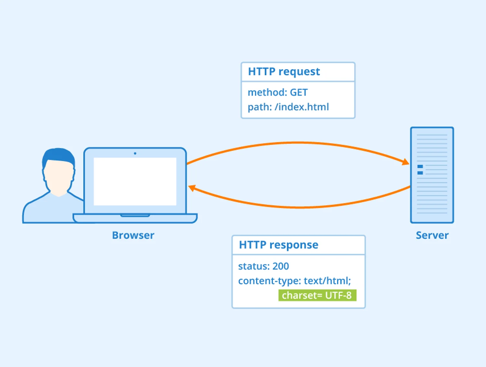

<a id="1c3eda9b0fe181589fa3ce0a5bcc0734"></a>

### 테스트 코드 &#45; JUnit

> 📌 <strong>JUnit</strong> <br>자바 프로그래밍 언어 용 단위 테스트 프레임워크이다&#46;


- dependencies 추가
    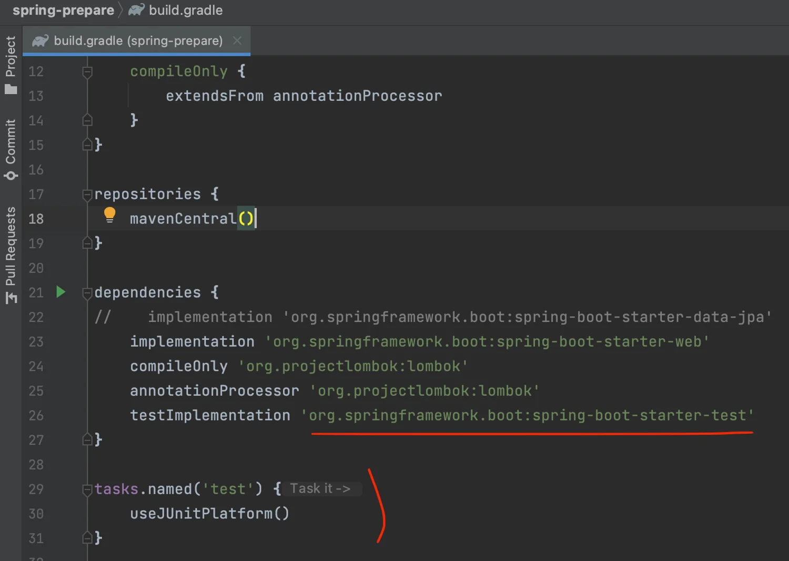

<a id="1c3eda9b0fe18175ad1bc618f0dffe29"></a>

### Lombok, <code>application&#46;properties</code>

<details>
<summary><strong>Lombok 설치</strong></summary>

1. 환경설정&#58; <code>command</code> &#43; <code>,</code>

1. 검색창에 &#34;Annotation Processors&#34; 입력 후, 우측 &#34;Enable &#126;&#34; 체크하고 OK 클릭
    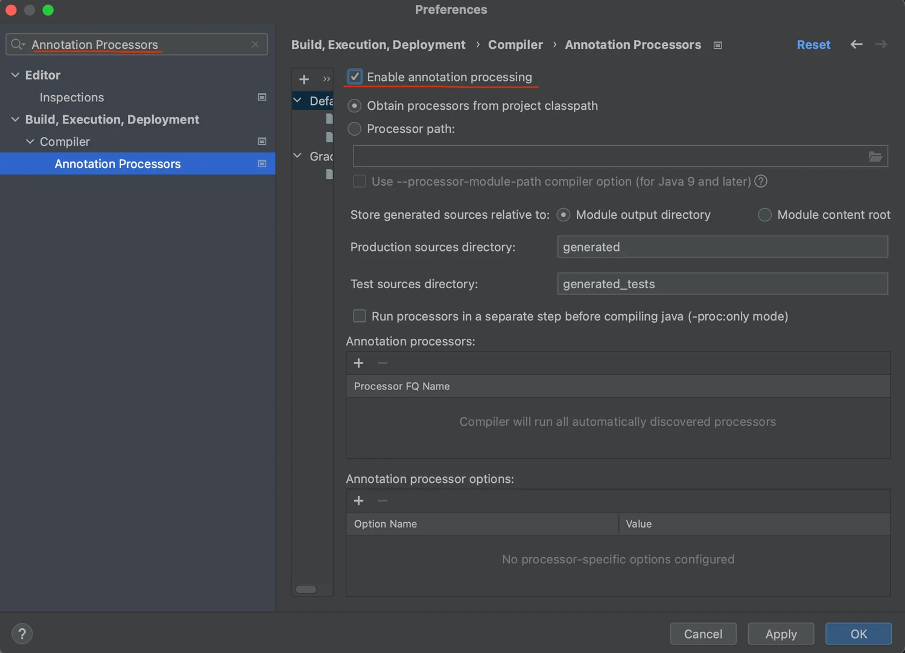

1. 검색창 ( <code>shift</code> &#42; 2 ), <strong>plugins</strong> 검색
    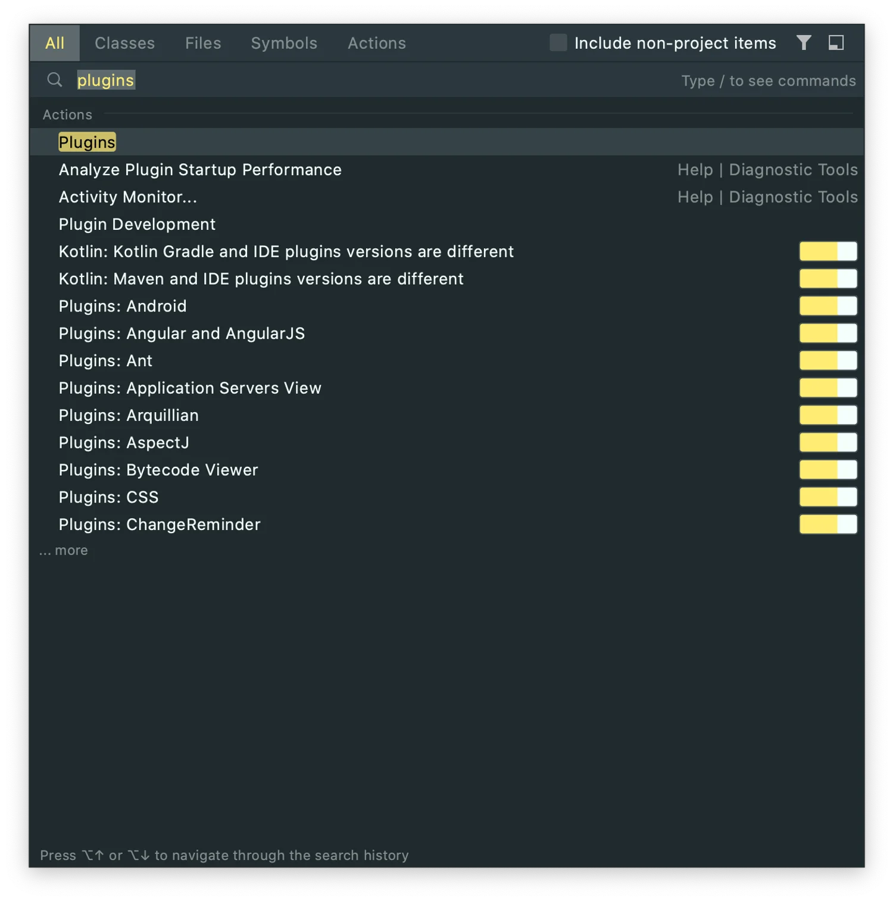

1. Lombok이 installed가 되지 않은 상태라면 아래처럼 생긴 아이콘의 우측 Install 버튼 클릭 → Intellij 재시작
    

1. Lombok을 검색했을 때 installed 상태라면 설치 완료

</details>

---

<details>
<summary><strong><code>&#64;AllArgsConstructor</code></strong>,<strong> </strong><strong><code>&#64;NoArgsConstructor</code></strong></summary>

> 기본 생성자와 모든 필드를 파라미터로 가진 오버로딩된 생성자를 만들어 준다&#46;

<a id="1c3eda9b0fe1814aa8b1de01c5c31e31"></a>

```java
@NoArgsConstructor
@AllArgsConstructor
public class Memo {
    private String username;
    private String contents;
}

...

public Memo() {
}

public Memo(String username, String contents) {
    this.username = username;
    this.contents = contents;
}
```

</details>

<details>
<summary><strong><code>&#64;RequiredArgsConstructor</code></strong></summary>

> final 제어자가 붙은 필드를 파라미터로 가진 오버로딩된 생성자를 만들어 준다&#46; 

<a id="1c3eda9b0fe181a2970fdf6db444c36f"></a>

```java
@RequiredArgsConstructor
public class Memo {
    private final Calculator calculator;
    private final String username;
    private String contents;
}

...

public Memo(Calculator calculator, String username) {
    this.calculator = calculator;
    this.username = username;
}
```

</details>

---

<details>
<summary><code>application&#46;properties</code></summary>

> Apache Tomcat을 사용하여 서버를 실행하면 <strong><u>기본 port</u></strong> 설정이 <code>8080</code>으로 되어 있다&#46; 

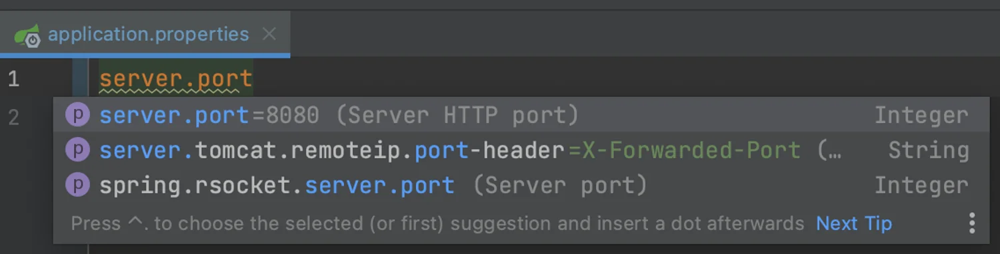

> <code>application&#46;properties </code>파일에서 <code>server&#46;port=8081</code>이렇게 설정을 하면 서버의 port 번호를 ‘8081’로 변경하여 실행시킬 수 있다&#46; 

</details>
