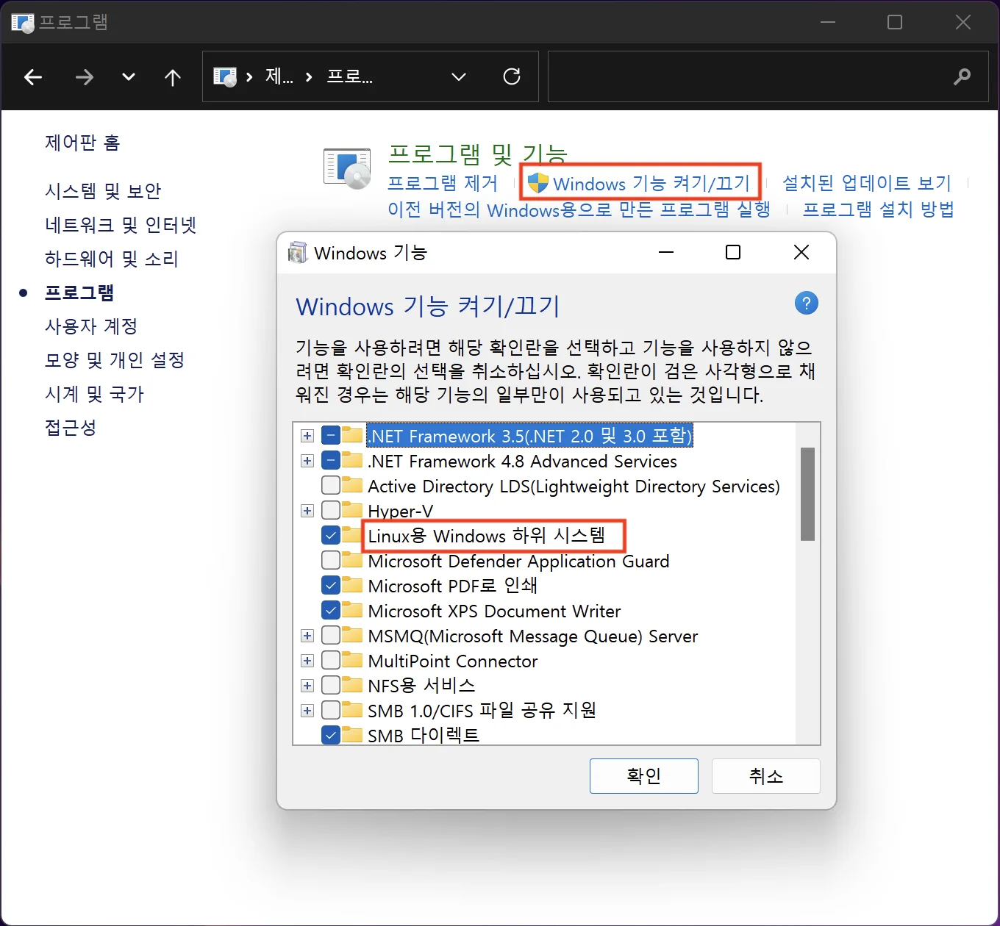
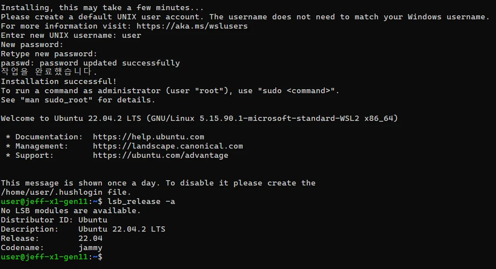
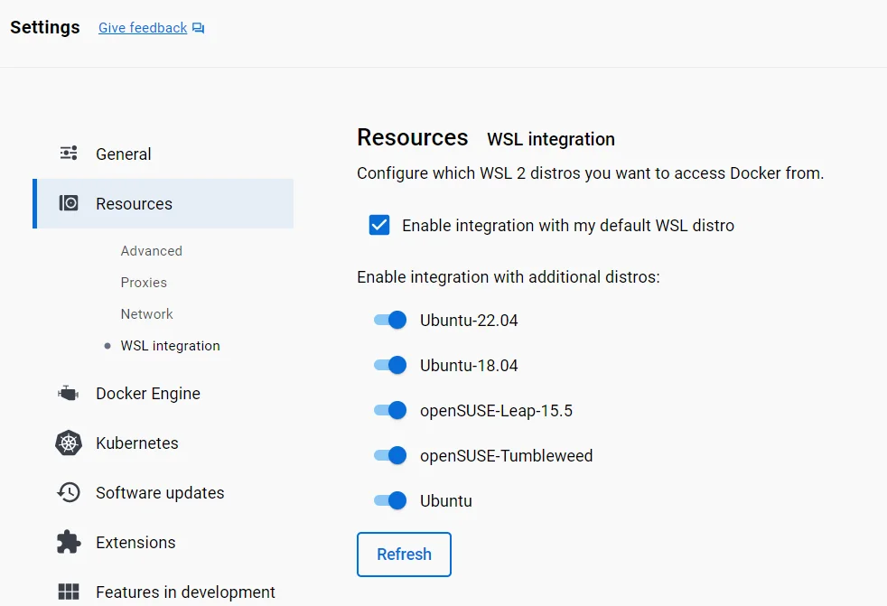
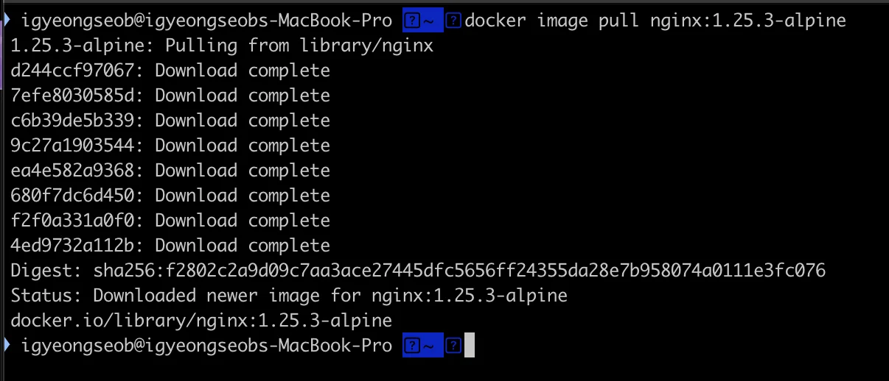
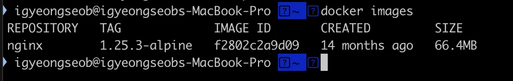
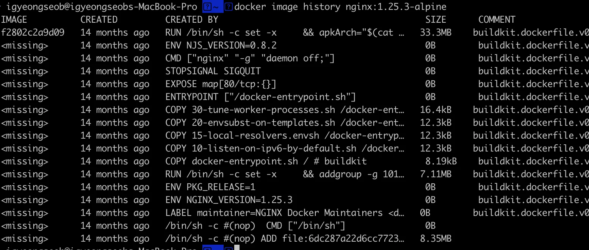
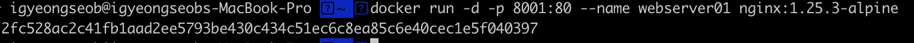
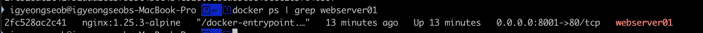
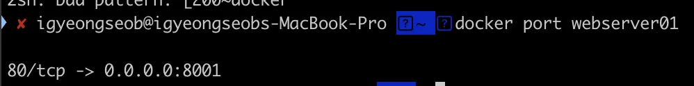
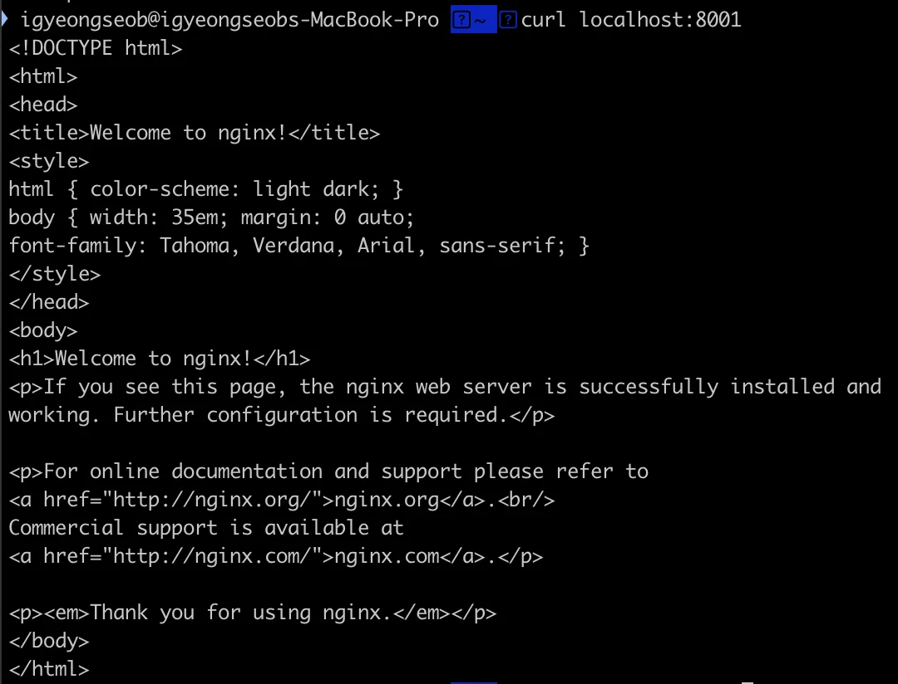

<details>
<summary><strong>패키지 관리자 (Apple Silicon/M1)</strong></summary>

<a id="1c3eda9b0fe18109a6ffcfdd6c6a52ea"></a>

‣

</details>

<a id="1c3eda9b0fe18139872cc584967ce765"></a>

### Docker,  Docker Compose 설치

<details>
<summary>Window 용</summary>

<details>
<summary>WSL2 설치를 위한 사전 준비</summary>

<a id="1c3eda9b0fe181f88f5af1b85d84ddc1"></a>

시작 버튼 → 제어판 → 프로그램 및 기능 → Windows 기능 켜기/끄기 → Linux용 Windows 하위 시스템



</details>

<details>
<summary>WSL2 설치</summary>

[WSL 설치]()

<details>
<summary>wsl 설치</summary>

<a id="1c3eda9b0fe18138a035d7f48e0dfff3"></a>

```javascript
wsl --install

dism.exe /online /enable-feature /featurename:VirtualMachinePlatform /all /norestart

wsl --update

```

</details>

</details>

<details>
<summary>Ubuntu 22&#46;04 설치</summary>

[Ubuntu 22&#46;04&#46;2 LTS &#45; Microsoft Store 공식 앱]()



</details>

<details>
<summary>Ubuntu 22&#46;04 에 최신 버전의 docker 설치</summary>

<a id="1c3eda9b0fe18165915feb905f673ee6"></a>

```bash
# docker engine gpg 키 등록
sudo apt-get update
sudo apt-get install ca-certificates curl gnupg
sudo install -m 0755 -d /etc/apt/keyrings
curl -fsSL https://download.docker.com/linux/ubuntu/gpg | sudo gpg --dearmor -o /etc/apt/keyrings/docker.gpg
sudo chmod a+r /etc/apt/keyrings/docker.gpg

# apt source 에 docker 관련 추가
echo \
  "deb [arch="$(dpkg --print-architecture)" signed-by=/etc/apt/keyrings/docker.gpg] https://download.docker.com/linux/ubuntu \
  "$(. /etc/os-release && echo "$VERSION_CODENAME")" stable" | \
  sudo tee /etc/apt/sources.list.d/docker.list > /dev/null
sudo apt-get update

# docker engine 설치
sudo apt-get install -y docker-ce docker-ce-cli containerd.io \
docker-buildx-plugin docker-compose-plugin docker-compose

# docker 그룹에 현재 계정을 등록하여 sudo 없이 docker 명령을 사용하게 함
sudo usermod -aG docker user
sudo service docker restart

# 새로운 터미널을 열고 확인
docker version
```

</details>

<details>
<summary>Docker 및 Docker Compose 버전 확인</summary>

<a id="1c3eda9b0fe18192a553f7b93e095721"></a>

```bash
# docker version 확인
docker --version

# docker compose version 확인
docker-compose --version
```

</details>

<details>
<summary>Windows 에 Docker Desktop 설치</summary>

[Install Docker Desktop on Windows]()

</details>

<details>
<summary>Windows Docker Desktop 설정</summary>

<a id="1c3eda9b0fe181b2b1eae530d5a56db3"></a>

우측 상단 톱니바퀴 → 왼쪽 Resources → WSL Integration → Apply&#38;restart



</details>

</details>

- Mac 용
    1. Homebrew 설치
        [Homebrew]()

    1. homebrew를 이용해 Docker, Docker Compose 설치
        <a id="1c3eda9b0fe1810a8295e262d11e398b"></a>

        ```bash
        # docker for mac설치
        brew install docker docker-compose

        # docker version 확인
        docker --version

        # docker compose version 확인
        docker-compose --version
        ```

    1. Docker Desktop 설치
        [Mac]()

<a id="1c3eda9b0fe1815ab178d8007c2c66e8"></a>

### Container 실행 테스트 

<details>
<summary>Docker 엔진과 구성 확인</summary>

> Docker Desktop을 실행하지 않으면 오류 메세지가 발생됨

<a id="1c3eda9b0fe181098c5df4a6fe3b96bf"></a>

```java
docker info
```

</details>

<details>
<summary>Container 실행 테스트</summary>

<a id="1c3eda9b0fe181a49a0bfe8605865c78"></a>

```bash
# nginx 이미지 다운받기
docker image pull nginx:1.25.3-alpine

docker images

docker image history nginx:1.25.3-alpine

docker run -d -p 8001:80 --name webserver01 nginx:1.25.3-alpine

docker ps | grep webserver01

docker port webserver01

curl localhost:8001
```

</details>

<a id="1c3eda9b0fe18162a788c8f19f0b5361"></a>

### Docker CLI 정리

<details>
<summary>특정 이미지 다운</summary>

<a id="1c3eda9b0fe181c8a216d9258620ce90"></a>

```java
docker image pull [설치할 이미지 명칭]
```

<details>
<summary>ex) </summary>

<a id="1c3eda9b0fe1817a85baf7de5423eab9"></a>

```java
docker image pull nginx:1.25.3-alpine
```



</details>

</details>

<details>
<summary>설치된 Docker 이미지 확인</summary>

<a id="1c3eda9b0fe18152b3f6d3050a1a8918"></a>

```java
docker images
```



</details>

<details>
<summary>특정 이미지 history 확인</summary>

<a id="1c3eda9b0fe181558e08c21bf94222a3"></a>

```java
docker image history [이미지 명칭] // 설치할 때 명칭과 동일
```

<details>
<summary>ex) </summary>

<a id="1c3eda9b0fe181f5a5acde15e20c0a19"></a>

```java
docker image history nginx:1.25.3-alpine
```



</details>

</details>

<details>
<summary>특정 컨테이너 생성 및 이미지 실행</summary>

<a id="1c3eda9b0fe181ed9945c912c2e5e80a"></a>

```java
docker run -d -p [호스트 포트]:[컨테이너 내부 이미지 포트] --name [컨테이너 이름] Docker 이미지와 태그
```

<details>
<summary><code>docker run</code> </summary>

- 새로운 컨테이너를 생성 및 실행

</details>

<details>
<summary><code>&#45;d</code></summary>

- 컨테이너를 <strong>디태치드(detached)</strong> 모드로 실행

- 컨테이너가 백그라운드에서 실행되며, 터미널을 점유하지 않음

</details>

<details>
<summary><code>&#45;p &#91;호스트 포트&#93;&#58;&#91;컨테이너 내부 이미지 포트&#93;</code></summary>

- 컨테이너의 포트를 호스트와 매핑 

- ex) <code>&#45;p 8001&#58;80</code>
    - <code>8001</code>&#58; 호스트 머신의 포트

    - <code>80</code>&#58; 컨테이너 내부의 Nginx 기본 HTTP 포트

    > 로컬 브라우저 <code>http&#58;//localhost&#58;8001</code>접근하면 컨테이너 내부의 Nginx가 제공하는 콘텐츠를 볼 수 있다&#46;

</details>

<details>
<summary><code>&#45;&#45;name &#91;이름&#93;</code></summary>

- 컨테이너 이름 지정

- ex) <code>&#45;&#45;name webserver01</code>&#58;  컨테이너 명칭 = webserver01

</details>

<details>
<summary><code>Docker 이미지와 태그</code></summary>

- 실행할 Docker 이미지와 태그를 지정

- ex) <code>nginx&#58;1&#46;25&#46;3&#45;alpine</code>
    - <code>nginx</code>
        - 이미지 이름, Nginx 웹 서버를 실행하는 데 사용

    - <code>1&#46;25&#46;3&#45;alpine</code>
        - Nginx의 특정 버전(1&#46;25&#46;3)

        - alpine 기반 경량 이미지
            - alpine은 매우 가벼운 리눅스 배포판으로, <br>디스크 사용량을 최소화하고 성능을 높이기 위해 사용

</details>

---

<details>
<summary>ex) </summary>

<a id="1c3eda9b0fe181a0bfa4c00f04011987"></a>

```java
docker run -d -p 8001:80 --name webserver01 nginx:1.25.3-alpine
```



</details>

</details>

<details>
<summary>특정 컨테이너 상태 확인</summary>

<a id="1c3eda9b0fe18186b73bd56c84cf5aab"></a>

```bash
docker ps | grep [컨테이너 명칭]
```

<details>
<summary><code>docker ps</code></summary>

- 현재 실행 중인 모든 컨테이너 목록 출력

- 출력 정보에는 <strong><u>컨테이너 ID, 이름, 상태, 이미지</u></strong> 등 다양한 정보가 포함됨

</details>

<details>
<summary><code>&#124; (파이프)</code></summary>

- 앞에 있는 명령어 결과를 다음 명령어로 전달함

- 여기서는 <strong><u>docker ps 명령의 출력</u></strong>을 <strong><u>grep 명령의 입력</u></strong>으로 전달

</details>

<details>
<summary><code>grep &#91;컨테이너 명칭&#93;</code></summary>

- <code>grep</code>&#58;  문자열을 검색하는 명령어

-  <strong><u>출력 중 컨테이너 명칭이 포함된 줄</u></strong>을 검색

---

- ex) <code>grep webserver01</code>
    - 출력 중 webserver01이 포함된 줄을 검색

</details>

---

<details>
<summary>ex)</summary>

- docker에서 실행 중이 모든 컨테이너 목록 중 webserver01 컨테이너에 대한 정보를 출력

<a id="1c3eda9b0fe181d9901dd47fe132cd02"></a>

```bash
docker ps | grep webserver01
```



</details>

<details>
<summary>추가 명령어</summary>

- <strong>모든 컨테이너(정지된 것 포함) 확인</strong>
    <a id="1c3eda9b0fe181b0868df7daaffef599"></a>

    ```bash
    docker ps -a | grep webserver01
    ```

- <strong>특정 컨테이너의 상태 확인</strong>
    <a id="1c3eda9b0fe18199a648dbbbe1d63b8c"></a>

    ```bash
    docker inspect webserver01
    ```

- <strong>컨테이너 로그 확인</strong>
    <a id="1c3eda9b0fe1816484d3cfcfd63dd864"></a>

    ```bash
    docker logs webserver01
    ```

- <strong>실행 중인 모든 컨테이너 이름 검색</strong>
    <a id="1c3eda9b0fe1811ab6cef58715b8b52e"></a>

    ```bash
    docker ps --filter "name=webserver01"
    ```

</details>

</details>

<details>
<summary>특정 컨테이너 port 번호 확인</summary>

<a id="1c3eda9b0fe1812ab983e73a97d8973f"></a>

```bash
docker port [컨테이너 명]
```

<details>
<summary>ex)</summary>

<a id="1c3eda9b0fe181119468d83d7a49af44"></a>

```bash
docker port webserver01
```



</details>

</details>

<details>
<summary>커맨드라인에서 HTTP 요청을 수행 &#45; <code>curl</code> ( default&#58; <code>GET</code> )</summary>

<a id="1c3eda9b0fe181de8789d318560d8e43"></a>

```bash
curl [ URI ]
```

<details>
<summary>ex) </summary>

<a id="1c3eda9b0fe1815b8164ee3dbd300f74"></a>

```bash
curl localhost:8001
```



</details>

</details>
