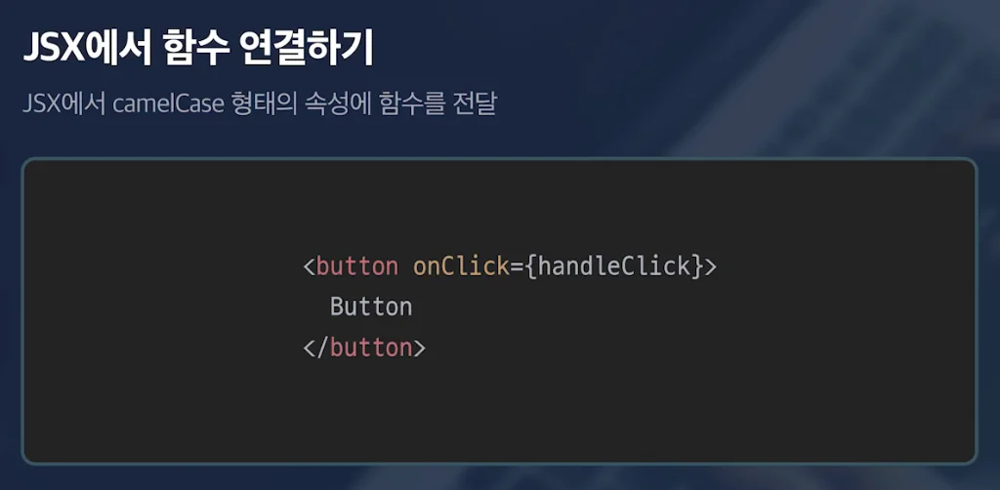
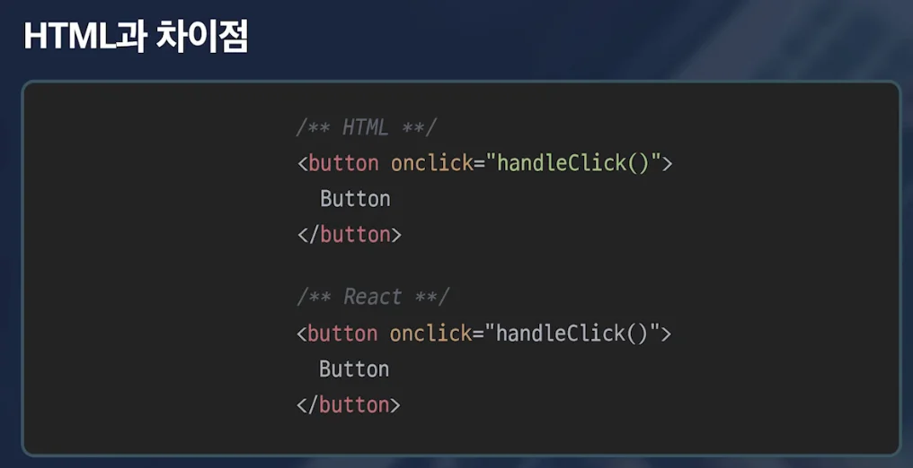

## 

---

> 📖 

JSX에서 함수 연결

- camelCase 로 작성 
    - 첫문자 소문자, 중간을 대문자로 연결

    - ex) <code>onClick</code>, <code>onMouse…</code> 

HTML과 차이점

이벤트 객체 

> ☝🏻 
> 
> 
> 
> 리액트의 합성 이벤트 객체와 자바스크립트의 이벤트 객체는 거의 동일한 인터페이스를 가졌기 때문에, 동일한 이벤트 객체라 생각해도 무방하다&#46;

자바스크립트에서 전달해주는 이벤트를 진짜 이벤트 객체라고 한다면, 리액트에서 연결하고 받게 되는 이벤트 객체는 합성 이벤트로 진짜 이벤트 객체(자바스크립트 이벤트 객체)를 원본에서 확장한 이벤트 객체이다&#46; 

- <code>(e) → e&#46;target&#46;value</code>

