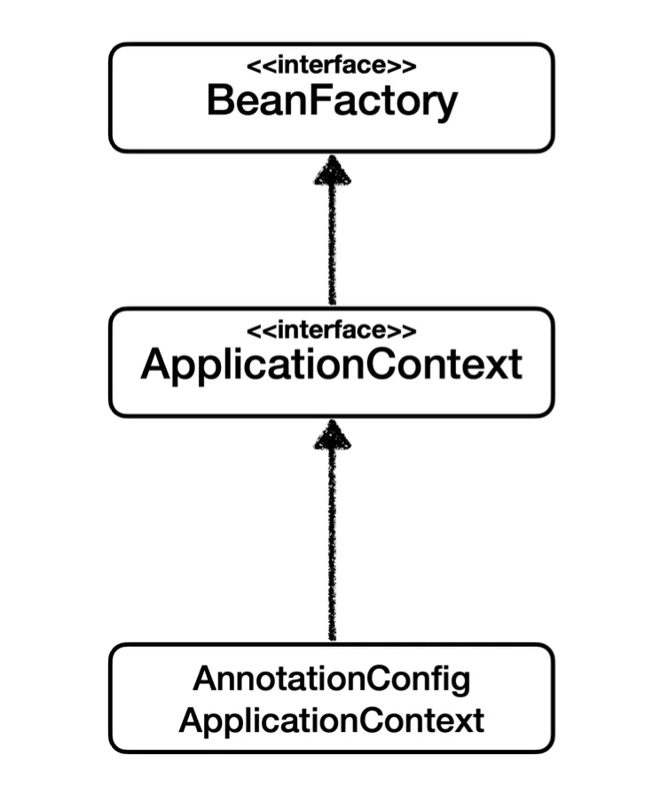
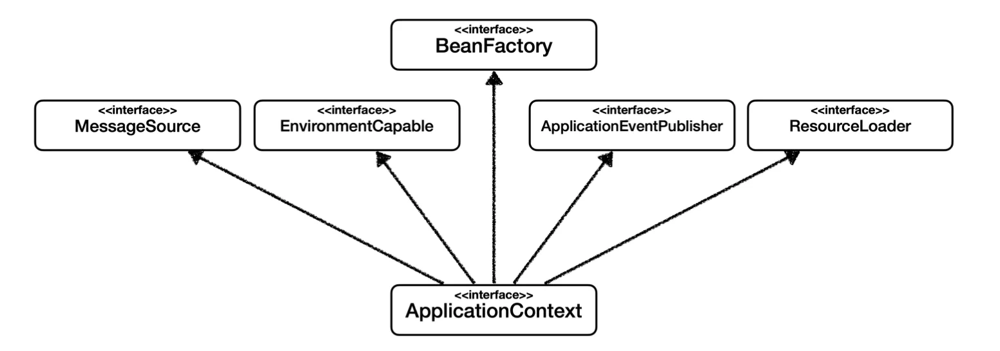

## BeanFactory <strong>와 </strong>ApplicationContext 

### BeanFactory

- 스프링 컨테이너의 최상위 인터페이스

- 스프링 빈을 관리하고 조회하는 역활을 담당함  ( <code>getBean()</code> )

- 지금까지 사용한 대부분의 기능이 BeanFactory가 제공하는 기능이다&#46; 

### ApplicationContext

- BeanFactory의 기능 모두 상속 받아서 제공함
    > 빈을 관리하고 검색하는 기능은 BeanFactory도 제공한다&#46;  그러나 애플리케이션 개발에는 빈의 관리, 조회 외 수많은 부가기능이 필요하며, 그 중 많은 기능을 ApplicationContext가 제공한다&#46; 

## <strong>ApplicatonContext가 제공하는 부가기능</strong>

- <strong><code>MessageSource</code></strong><strong>를 활용한 국제화 기능</strong>&#58;   한국 → 한국어, 영어권 → 영어

- <strong>환경변수(</strong><strong><code>EnvironmentCapable</code></strong><strong>)</strong>&#58; 로컬, 개발, 운영 등을 구분해서 처리

- <strong>애플리케이션 이벤트(</strong><strong><code>ApplicationEventPublisher</code></strong><strong>)</strong>&#58; 이벤트를 발행하고 구독하는 모델을 편리하게 지원

- <strong>편리한 리소스 조회(</strong><strong><code>ResourceLoader</code></strong><strong>)</strong>&#58; 파일 클래스패스, 외부 등에서 리소스를 편하게 조회

### 정리

- ApplicationContext는 BeanFactory의 기능을 상속 받는다&#46;

- ApplicationContext는 빈 관리, 조회 기능 &#43; 편리한 부가 기능 제공한다&#46; (따라서 BeanFactory를 직접 사용하지 않음)

- BeanFactory 나 ApplicationContext를 스프링 컨테이너라 한다&#46;
