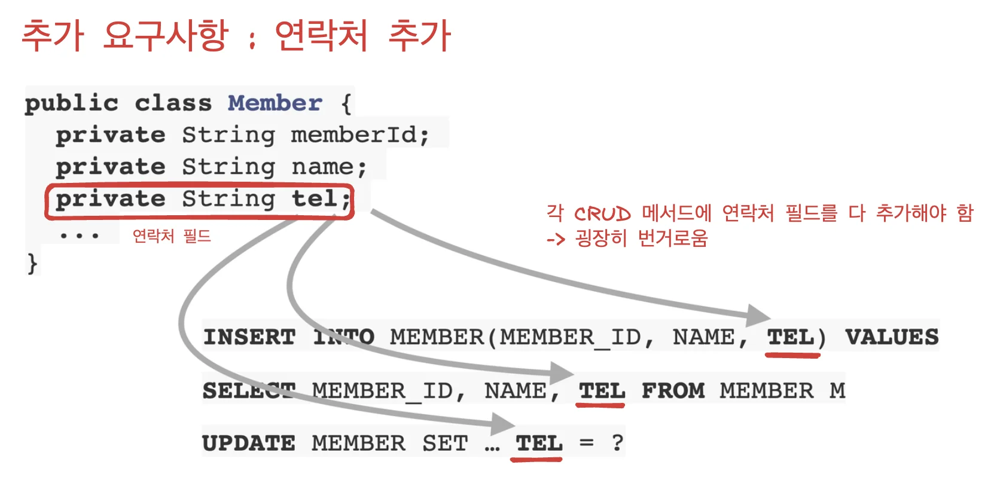
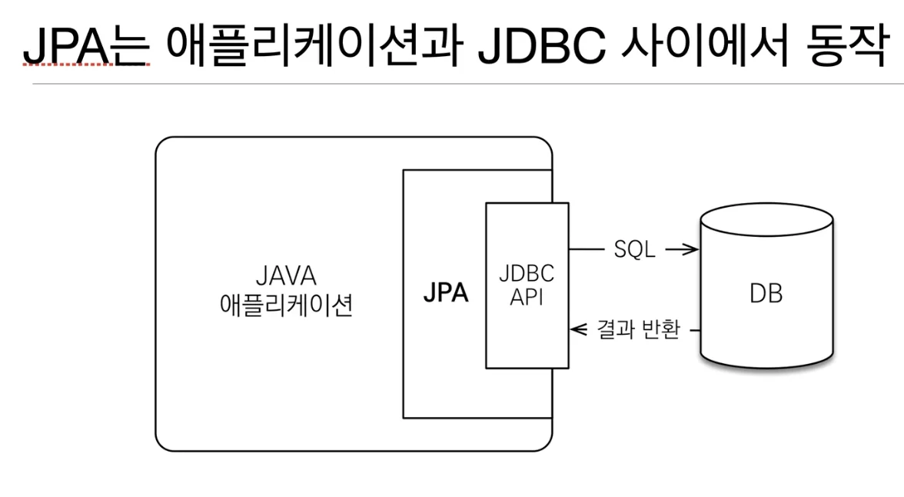

<a id="1c3eda9b0fe181e69530ebcd4b600cfe"></a>

## SQL 중심적인 개발의 문제점 

<a id="1c3eda9b0fe181edb6c0dceb244756ac"></a>

### SQL 중심 개발의 문제점이란 무엇인가?

> 무한 반복, 지루한 코드 

<a id="1c3eda9b0fe181debc46c7e1badaa14c"></a>

상품, 주문 등 각 resource 마다 CRUD를 매번 만들어야 함

<a id="1c3eda9b0fe1812fa732c3da248839d0"></a>

( 자바 객체를 SQL ↔ SQL을 자바 객체 )

<a id="1c3eda9b0fe1811ca12fe0ab127d8ee0"></a>

```java
// CRUD 
INSERT INTO ...
UPDATE ...
SELECT ...
DELETE ...
```

> 개발 도중 추가 요구사항(연락처 추가 등)이 들어오면 해당하는 필드를 CRUD 메서드에 일일이 추가 해야함

<a id="1c3eda9b0fe181dc9575ff3953361a56"></a>

⇒ 해당 필드를 일일이 추가하기  번거롭고 실수로 추가하지 않아  오류가 발생함



<a id="1c3eda9b0fe18123a995e42e6e2fb811"></a>

### 관게형 데이터베이스를 사용하기 때문에,  SQL에 의존적인 개발을 피할 수는 없다&#46;

<a id="1c3eda9b0fe181d68deee84626fc541d"></a>

### 패러다임의 불일치 

> 객체와 관계형 데이터 베이스의 테이블은 비슷한 것 같으면서도 굉장히 다르다&#46;

<a id="1c3eda9b0fe181129206c2afa888e6a6"></a>

객체 지향 프로그래밍은 추상화, 캡슐화, 정보은닉, 상속, 다형성 등 시스템의 복잡성을 제어할 수 있는 다양한 장치들을 제공한다&#46; 

<a id="1c3eda9b0fe1814a8141fd07fae90efb"></a>

## JPA 소개

<a id="1c3eda9b0fe181d78ab9df883a0f9fc9"></a>

### JPA?

<a id="1c3eda9b0fe18151b8c2dbfa01972fa9"></a>

Java Persistence API 

<a id="1c3eda9b0fe181b6a67fc7f3d8bcebe6"></a>

자바 진영의 ORM 기술 표준

<a id="1c3eda9b0fe181bca39fd3f3b63a26af"></a>

### ORM?

<a id="1c3eda9b0fe181e0892ac95649654452"></a>

Object&#45;relational mapping ( 객체 관계 매핑 )

> <code>객체</code> ←  ORM 매핑  →<code>관계형 데이터 베이스</code>

<a id="1c3eda9b0fe1817a94abcf07ec364d01"></a>

ORM 프레임워크가 중간에서 객체와 관계형 데이터베이스를 매핑해준다&#46; 

<a id="1c3eda9b0fe1819eb965ee677575c258"></a>

대중적인 언어 대부분이 ORM 기술이 존재한다&#46; 



<a id="1c3eda9b0fe181838059e90d808e5bb6"></a>

예전 java 애플리케이션에서 jdbc api
