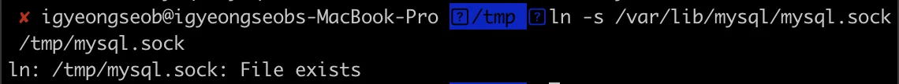
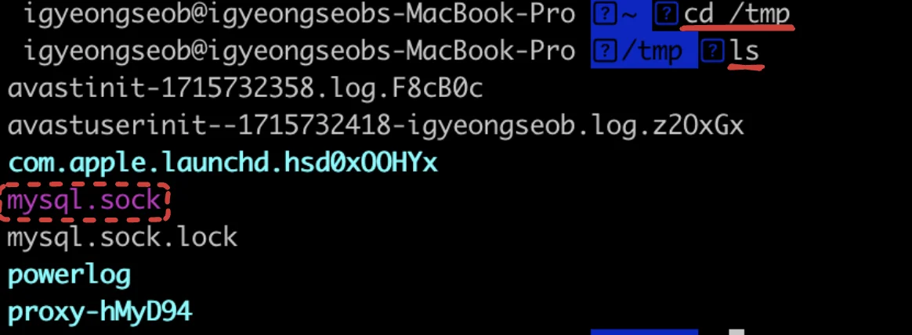
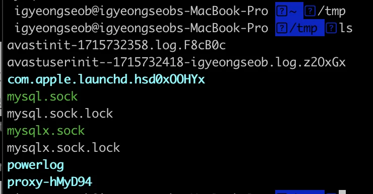
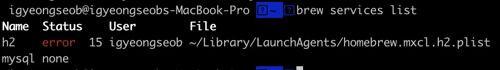
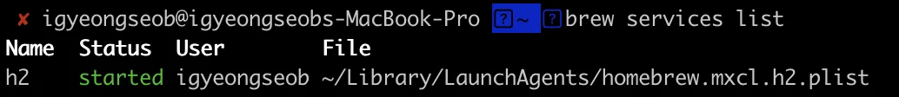
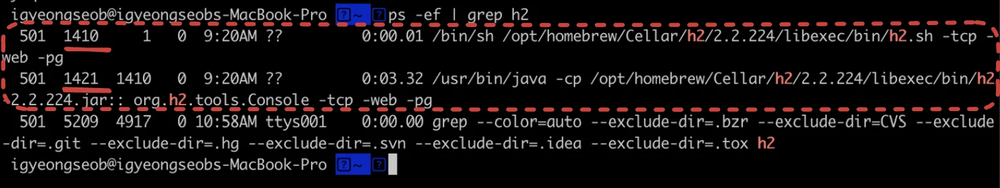
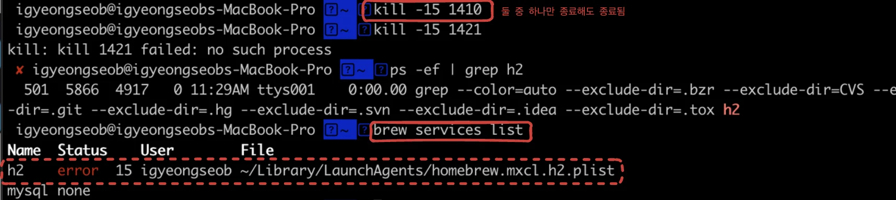
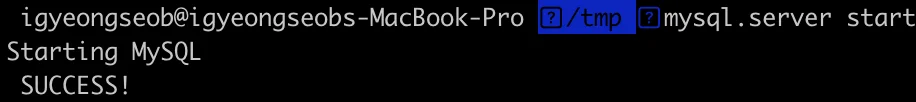

<details>
<summary>Reference</summary>

<a id="1c3eda9b0fe181259ff3fa0721b2b275"></a>

<a href="https://linked2ev.github.io/database/2021/06/11/MySQL,-MariaDB-ERROR-2002-(HY000)-Can&#39;t-connect-to-local-MySQL-server-through-socket-&#39;tmp-mysql.sock&#39;-(2)/">https&#58;//linked2ev&#46;github&#46;io/database/2021/06/11/MySQL,&#45;MariaDB&#45;ERROR&#45;2002&#45;(HY000)&#45;Can&#39;t&#45;connect&#45;to&#45;local&#45;MySQL&#45;server&#45;through&#45;socket&#45;&#39;tmp&#45;mysql&#46;sock&#39;&#45;(2)/</a><a href="https://developer-pi.tistory.com/290">https&#58;//developer&#45;pi&#46;tistory&#46;com/290</a>

<a id="1c3eda9b0fe181b0bc5eca61cea1ee72"></a>

<a href="https://developer-pi.tistory.com/290">https&#58;//developer&#45;pi&#46;tistory&#46;com/290</a>

</details>

<a id="1c3eda9b0fe18100ab47c51c99d02bd0"></a>

### 방법1) 링크 추가

> 🧐 “몇몇  프로그램들은 <code>/var/mysql/mysql&#46;sock</code> 파일을 찾는다&#46; <br>그런데 mac은 <code>/tmp/mysql&#46;sock</code>에 존재하기 때문에 저 위치에 링크를 걸어둬야 된다&#46;” 

> 링크 걸어줌 

<a id="1c3eda9b0fe1819aba93eb5e0047f677"></a>

 <a href="https://beautiful-college-c84.notion.site/b32f77f6e2ac434c81f4ccd3cb9c3b26">페이지</a> &#45; <code>ln</code> 참조

<a id="1c3eda9b0fe1814688ecdb0437bf8355"></a>

```shell
ln -s /var/lib/mysql/mysql.sock /tmp/mysql.sock
```

<a id="1c3eda9b0fe181f69b08ca4d7c9edf63"></a>

아래와 같은 메세지가 뜨면서 해결 안됨



> <code>/tmp/mysql&#46;sock</code>  존재 확인 



> <code>/var/lib/mysql/mysql&#46;sock</code> 존재 X

<a id="1c3eda9b0fe181aaaaf8d13f624e77e2"></a>

### 방법 2) <code>/tmp/mysql&#46;sock</code> 파일 손상 가정, 삭제 후 진행 

- <code>/tmp/mysql&#46;sock</code> 파일 삭제 후 진행
    

- 
    

<a id="1c3eda9b0fe181fab138cec31c24cf55"></a>

###  방법 3) 실행 중인 서버 종료  <code>h2</code> ( 해결 )

<a id="1c3eda9b0fe1810a8a8debfb4a4baf86"></a>

이전 JPA 학습을 위해 h2 DB를 사용한 적이 있는데, 그때 설치한 DB가 계속해서 실행 중이었다&#46; 

- h2 서버 실행 중임을 확인
    <a id="1c3eda9b0fe18145aa01e8a2faf7bc7e"></a>

    ```shell
    brew services list
    ```

    

- port &#45; pid 확인
    <a id="1c3eda9b0fe1817cbc2ec4e92441c949"></a>

    ```shell
    ps -ef | grep h2
    ```

    

    <a id="1c3eda9b0fe1818cac74c81347ac97bf"></a>

    1410, 1421  pid에서 h2가 실행되고 있음을 확인

- 포트 종료
    <a id="1c3eda9b0fe1812b9855d76f9e615239"></a>

    ```shell
    kill -15 {pid 번호}	// 종료

    kill -9 {pid 번호}	// 강제 종료
    ```

    <a id="1c3eda9b0fe181df9706c7d02ec7c61f"></a>

    아래와 같이 종료 처리

    

- h2 종료 후 실행하니 아래와 같이 정상적으로 실행됨 
    
