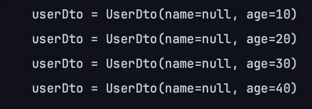
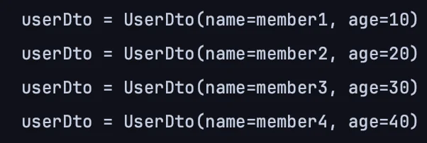

<a id="1c3eda9b0fe181a79b3bebae151a16bc"></a>

## 프로젝션, 결과 반환 &#45; DTO 조회

---

> 📖 
> 
> <a id="1c3eda9b0fe181a088f7c2e13361c77a"></a>
> 
> Querydsl에서는 <code>Projections</code>을 통해 DTO로 변환해서 반환할 수 있다 &#46;
> 
> - <code>Projections&#46;bean()</code> &#45; 프로퍼티(Setter) 접근
> 
> - <code>Projections&#46;fields()</code> &#45; 필드 접근
> 
> - <code>Projections&#46;constructor()</code> &#45; 생성자 접근

<details>
<summary>예시)  <strong><code>DTO</code></strong>&#58;  MemberDto</summary>

<a id="1c3eda9b0fe181419fa8c44f77052ca4"></a>

```java
package study.querydsl.dto;
import lombok.Data;
 
@Data
public class MemberDto {
		private String username;
		private int age;
		
		public MemberDto() {}
		
		public MemberDto(String username, int age) {
				this.username = username;
				this.age = age;
		} 
}
```

</details>

<details>
<summary>순수한 JPA(<code>JPQL</code>)에서의 DTO 조회</summary>

<details>
<summary>&#91; 코드 &#93; JPQL로 처리</summary>

- 아래와 같이 DTO의 directory까지 명시해야 한다&#46; 

<a id="1c3eda9b0fe18147841df21f66556a2a"></a>

```java
@Test
public void findDtoByJPQL() {
		List<MemberDto> result = em.createQuery(
							"select new study.querydsl.dto.MemberDto(m.username, m.age) " +
												"from Member m, MemberDto.class)
							.getResultList();					
}
```

</details>

---

<details>
<summary>JPQL 처리 특징</summary>

- <u>순수 JPA에서 DTO를 조회</u>할 때는 <code>new</code> 명령어를 사용해야 한다

- <u>DTO의 </u><u><code>package</code></u><u>이름을 다 적어</u>줘야해서 <u>지저분</u>하다&#46;

- <u>생성자 방식</u>만 지원한다&#46;

</details>

</details>

<a id="1c3eda9b0fe1815f9745d86ba4ab2e15"></a>

### Querydsl 빈 생성(Bean population)

> Querydsl은 위 단점을 극복하는 방법을 제공한다&#46; (3가지)

<details>
<summary>1&#46; 프로퍼티 접근 ( setter )</summary>

- <code>Projections&#46;bean(Dto, 필드1, 필드2 …)</code>

- DTO의 Setter를 통해 값이 주입된다&#46; 
    <details>
    <summary>MemberDto &#45; Setter 생성</summary>

    <a id="1c3eda9b0fe181c88d21deefeecdf68a"></a>

    ```java
    package study.querydsl.dto;

    // @Setter 
    public class MemberDto {
    		private String username;
    		private int age;
    		
    		public MemberDto() {}
    		
    		public MemberDto(String username, int age) {
    				this.username = username;
    				this.age = age;
    		} 
    		
    		// Setter
    		public void setUsername(String username) {
    				this.username = username;
    		}
    		
    		public void setAge(int age) {
    				this.age = age;
    		}
    }
    ```

    </details>

<a id="1c3eda9b0fe181828a89f45016a486b9"></a>

```java
@Test
public void findDtoBySetter() {

    List<MemberDto> result = queryFactory
            .select(Projections.bean(MemberDto.class,
                    member.username,
                    member.age))
            .from(member)
            .fetch();
            
    for (MemberDto memberDto : result) {
        System.out.println("memberDto = " + memberDto);
    }
}
```

</details>

<details>
<summary>2&#46; 필드 직접 접근</summary>

- <code>Projections&#46;</code><u><code>fields</code></u><code>(Dto, 필드1, 필드2 …)</code>

- Getter, Setter 무시하고 바로 값이 필드에 할당된다&#46; 
    - private이지만 자바 리플렉션 등 라이브러를 통해서 설정한다&#46; 

<a id="1c3eda9b0fe1813aa04cfcca8e9b2e88"></a>

```java
Test
public void findDtoByFeilds() {

    List<MemberDto> result = queryFactory
            .select(Projections.field(MemberDto.class,
                    member.username,
                    member.age))
            .from(member)
            .fetch();
            
    for (MemberDto memberDto : result) {
        System.out.println("memberDto = " + memberDto);
    }
}
```

</details>

<details>
<summary>3&#46; 생성자 사용</summary>

> <u>기본 생성자</u> 및 <u>생성자</u>를 정의해야 한다&#46; 

- <code>Projections&#46;</code><u><code>constructor</code></u><code>(Dto, 필드1, 필드2 …)</code>

- 타입이 동일해야 한다&#46; 

<a id="1c3eda9b0fe181d69df6ca383a8ea380"></a>

```java
Test
public void findDtoByConstructor() {

    List<MemberDto> result = queryFactory
            .select(Projections.constructor(MemberDto.class,
                    member.username,
                    member.age))
            .from(member)
            .fetch();
            
    for (MemberDto memberDto : result) {
        System.out.println("memberDto = " + memberDto);
    }
}
```

</details>

<details>
<summary><code>ExpresssionUtis&#46;as(member&#46;username, “name”)</code></summary>

- <strong><u>ExpressionUtils</u></strong>로도  별칭 지정이 가능하나 지저분하다&#46; 
    <a id="1c3eda9b0fe181e0adc8ee289a25894c"></a>

    → <code>&#46;as()</code> 사용 권장

</details>

> ✏️ 
> 
> <a id="1c3eda9b0fe1812c9e4bc7f58439aa15"></a>
> 
> <u>프로퍼티(Setter)</u>나, <u>필드 접근 생성</u> 방식에서 DTO의 <strong><u><code>필드명</code></u></strong><strong><u>과 </u></strong><strong><u><code>별칭(alias)</code></u></strong><strong><u>가 </u></strong><strong><u>동일하지 않</u></strong>으면 <strong>값이 매칭되지 않</strong>는다&#46; 따라서 <code>&#46;as()</code> 를 통해 <strong><u>동일한 별칭을 지정</u></strong>해 해결한다&#46;
> 
> > ☝🏻 생성자를 사용하여 DTO생성 시, 명칭은 상관없다&#46; 
> 
> <details>
> <summary>ex)</summary>
> 
> <details>
> <summary><strong>🤬 Error</strong> &#45; UserDto 로 변경, <code>UserDto&#46;name</code> ≠ <code>member&#46;username</code></summary>
> 
> - &#91; 코드 &#93; UserDto
>     <a id="1c3eda9b0fe181188f7bcfadc679ec9b"></a>
> 
>     ```java
>     @Data
>     public class UserDto {
>     		private String name;
>     		private Long age;
>     }
>     ```
> 
> - &#91; 코드 &#93; findUserDto
>     <a id="1c3eda9b0fe181b78d23e5e07bc0f158"></a>
> 
>     ```java
>     @Test
>     public void findUserDto() {
> 
>         List<MemberDto> result = queryFactory
>                 .select(Projections.fields(UserDto.class,
>                         member.username,
>                         member.age))
>                 .from(member)
>                 .fetch();
>                 
>         for (MemberDto memberDto : result) {
>             System.out.println("memberDto = " + memberDto);
>         }
>     }
>     ```
> 
> - 결과 
>     - 위와 같이 <code>Dto 필드명</code> 과  <code>별칭(alias)</code>가 동일하지 않은 경우, 아래와 같이 매칭이 되지 않아 <code>nul</code>l 값으로 나온다&#46; 
> 
>     
> 
> </details>
> 
> <details>
> <summary><strong>😁 해결</strong> &#45; <code>&#46;as(”name”)</code> 으로 동일한 별칭 지정</summary>
> 
> - &#91; 코드 &#93; findUserDto
>     <a id="1c3eda9b0fe181149bfee6bce527fd65"></a>
> 
>     ```java
>     @Test
>     public void findUserDto() {
> 
>         List<MemberDto> result = queryFactory
>                 .select(Projections.fields(UserDto.class,
>                         member.username.as("name"),
>                         member.age))
>                 .from(member)
>                 .fetch();
>                 
>         for (MemberDto memberDto : result) {
>             System.out.println("memberDto = " + memberDto);
>         }
>     }
>     ```
> 
> - 결과 
>     - 아래와 같이 값이 정상적으로 매핑됨
> 
>     
> 
> </details>
> 
> </details>

> ✏️ 
> 
> <a id="1c3eda9b0fe1813a8e0fcd3c6b821878"></a>
> 
> <u>필드에 서브쿼리를 적용</u>하고 싶은 경우, <code>ExpressionUtils&#46;as(JPAExpressions …))</code>를 사용하여 필드 단위에 서브 쿼리를 정의한다&#46; ( 자주 쓸일은 없음 )
> 
> <details>
> <summary>ex) </summary>
> 
> - &#91; 코드 &#93; findUserDto
> 
> <a id="1c3eda9b0fe181e0b309e7e48c4a7c11"></a>
> 
> ```java
> @Test
> public void findUserDto() {
> 
>     List<MemberDto> result = queryFactory
>             .select(Projections.fields(UserDto.class,
>                     member.username.as("name"),
>                     ExpressionUtils.as(
> 			                    JPAExpressions
> 						                    .select(memberSub.age.max())
> 						                    .from(memberSub), "age")
> 				            )
>             ).from(member)
>             .fetch();
>             
>     for (MemberDto memberDto : result) {
>         System.out.println("memberDto = " + memberDto);
>     }
> }
> ```
> 
> </details>
