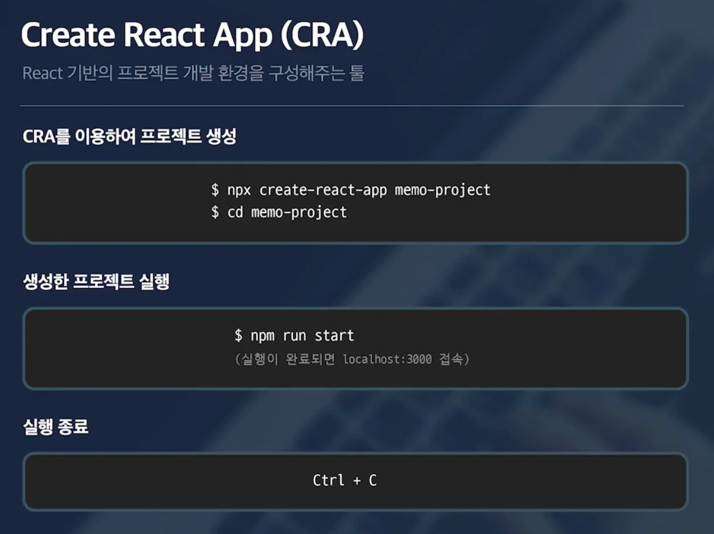
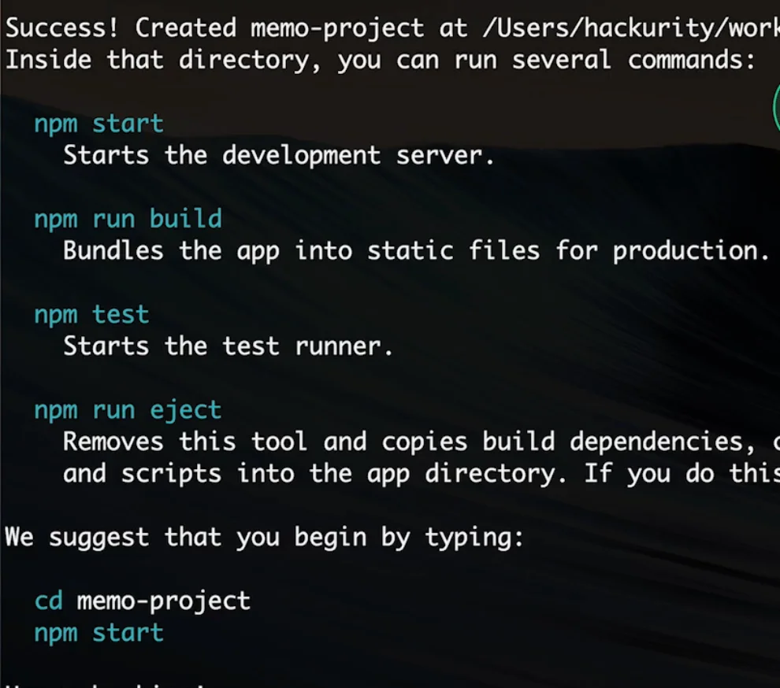

<a id="1c3eda9b0fe181cc9d2befa929552996"></a>

### CRA ( Create react App )

- React 기반의 프로젝트 개발 환경을 구성해주는 툴

- <code>CRA</code>를 통해 리액트 환경을 구축하면 <strong><u>단순히 리액트 하나만 설치하는 것이 아닌</u></strong><br><strong><u>리액트 개발을 도와주는 많은 툴들과 환경들을 함께 설치 및 설정</u></strong>해준다&#46; 

<a id="1c3eda9b0fe181f7bec5c9372181c45e"></a>

### npx

- npm 설치 시, 함께 설치된 tool

- 특정 모듈을 일일이 설치해서 실행하는 것이 아닌, npm 레지스트리에 올라가 있는 <strong><u>최신 버전의 모듈</u></strong>을 바로 <u>실행</u>해준다&#46; 

- 아래는 <u>최신 버전의 </u><u><code>createa&#45;react&#45;app</code></u><u>을 사용</u>하여 <code>Memo</code> 라는 이름의<strong><u> React 프로젝트를 생성</u></strong>해준다&#46; 

<a id="1c3eda9b0fe181849a32d2807e134941"></a>

### Create React App 프로젝트 생성

<a id="1c3eda9b0fe181ca8757c12fce28f409"></a>

```bash
# CRA 프로젝트 생성
npx create-react-app memo-project

# 생성한 프로젝트 폴더로 이동
cd memo-project
```

<a id="1c3eda9b0fe1818da892cd441201def5"></a>

### CRA 실행

<a id="1c3eda9b0fe1816f807dc6e68fae3df7"></a>

```bash

# 생성한 프로젝트 실행
npm run start

# localhost:3000 접속 -> 기본 react 브라우저 보임

실행 종료: ctrl + c
```

<a id="1c3eda9b0fe1815b8205e713e29b6442"></a>

### 프로젝트 기본 명령어



<a id="1c3eda9b0fe1815485c7cf2a172c3607"></a>

```bash
start

build

test
```
