<a id="1c3eda9b0fe18118958bcdc0c1c639e7"></a>

## Pub/Sub 모델을 이용한 뉴스레터 구독 예제

---

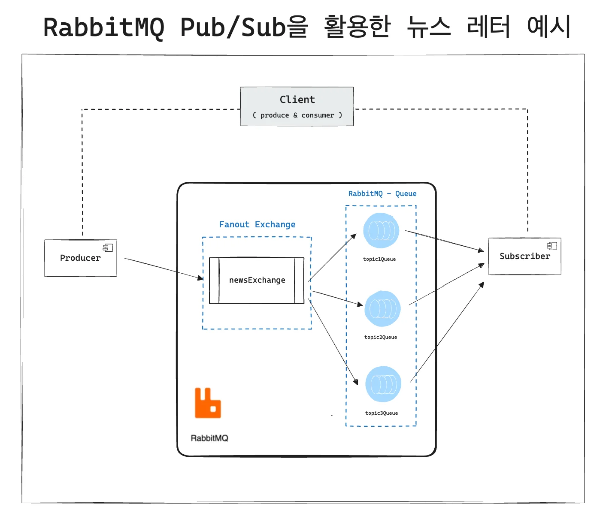

<a id="1c3eda9b0fe18116b81ec25e6acd4360"></a>

### 코드

[step4: 여러 큐 사용 예제](https://github.com/gyungsubLee/RabbitMQ_prac/commit/f0b0c28bb3bd1a4b1250c205b275730915cdeb26)

<details>
<summary><code>config</code> &#45;  RabbitMQConfig, WebsocketConfig</summary>

<details>
<summary>RabbitMQConfig</summary>

<a id="1c3eda9b0fe181f28779daea489ec213"></a>

```java
package com.prac.rabbimq.step4.config;

import org.springframework.amqp.core.Binding;
import org.springframework.amqp.core.BindingBuilder;
import org.springframework.amqp.core.FanoutExchange;
import org.springframework.amqp.core.Queue;
import org.springframework.context.annotation.Bean;
import org.springframework.context.annotation.Configuration;

@Configuration
public class RabbitMQConfig {
    public static final String FANOUT_EXCHANGE_FOR_NEWS = "newsExchange";
    public static final String TOPIC1_QUEQUE = "topic1";
    public static final String TOPIC2_QUEQUE = "topic2";
    public static final String TOPIC3_QUEQUE = "topic3";

    @Bean
    public Queue topic1Queue() {
        return new Queue(TOPIC1_QUEQUE, false);
    }

    @Bean
    public Queue topic2Queue() {
        return new Queue(TOPIC2_QUEQUE, false);
    }

    @Bean
    public Queue topic3Queue() {
        return new Queue(TOPIC3_QUEQUE, false);
    }

    @Bean
    public FanoutExchange fanoutExchange() {
        // 메세지를 수신하면 연결된 모든 큐로 브로드캐스트
        return new FanoutExchange(FANOUT_EXCHANGE_FOR_NEWS);
    }

    @Bean
    public Binding topic1Binding(Queue topic1Queue, FanoutExchange fanoutExchange) {
        return BindingBuilder.bind(topic1Queue).to(fanoutExchange);
    }

    @Bean
    public Binding topic2Binding(Queue topic2Queue, FanoutExchange fanoutExchange) {
        return BindingBuilder.bind(topic2Queue).to(fanoutExchange);
    }

    @Bean
    public Binding topic3Binding(Queue topic3Queue, FanoutExchange fanoutExchange) {
        return BindingBuilder.bind(topic3Queue).to(fanoutExchange);
    }
}
```

</details>

<details>
<summary>WebsocketConfig</summary>

<a id="1c3eda9b0fe181099b41ca0c0566b0d8"></a>

```java
package com.prac.rabbimq.step3.config;

import org.springframework.context.annotation.Configuration;
import org.springframework.messaging.simp.config.MessageBrokerRegistry;
import org.springframework.web.socket.config.annotation.EnableWebSocketMessageBroker;
import org.springframework.web.socket.config.annotation.StompEndpointRegistry;
import org.springframework.web.socket.config.annotation.WebSocketMessageBrokerConfigurer;

@Configuration
@EnableWebSocketMessageBroker
public class WebsocketConfig implements WebSocketMessageBrokerConfigurer {

    @Override
    public void configureMessageBroker(MessageBrokerRegistry registry) {
        registry.enableSimpleBroker("/sub");  // 클라이언트 구독 경로
        registry.setApplicationDestinationPrefixes("/pub");  // 메세지 발행 prefix
    }

    @Override
    public void registerStompEndpoints(StompEndpointRegistry registry) {
        registry.addEndpoint("/ws") // Websocket 연결 엔드포인트
                .setAllowedOriginPatterns("*")
                .withSockJS();
    }
}
```

</details>

</details>

<details>
<summary><code>controller</code> &#45; NotificationController, StompController</summary>

<details>
<summary>HomeController</summary>

<a id="1c3eda9b0fe18193b750fe4a496dc7d2"></a>

```java
package com.prac.rabbimq.step4.controller;

import org.springframework.stereotype.Controller;
import org.springframework.ui.Model;
import org.springframework.web.bind.annotation.GetMapping;

@Controller
public class HomeController {

    @GetMapping("/news")
    public String news(Model model) {
        model.addAttribute("message", "Welcome to RabbitMQ News Sample!");
        return "news";
    }
}
```

</details>

<details>
<summary>NewsController</summary>

<a id="1c3eda9b0fe181a3a176f25b79927f31"></a>

```java
package com.prac.rabbimq.step4.controller;

import com.prac.rabbimq.step4.NewsPublisher;
import org.springframework.messaging.handler.annotation.Header;
import org.springframework.messaging.handler.annotation.MessageMapping;
import org.springframework.stereotype.Controller;

@Controller
public class NewsController {

    private final NewsPublisher newsPublisher;

    public NewsController(NewsPublisher newsPublisher) {
        this.newsPublisher = newsPublisher;
    }

    // 발행 엔드포인트: /app/subscribe
    @MessageMapping("/subscribe")
    public void handleSubscribe(@Header("newsType") String newsType) {
        System.out.println("[#] newsType: " + newsType);

        newsPublisher.publish(newsType);
    }
}
```

</details>

<details>
<summary>NewsRestController</summary>

<a id="1c3eda9b0fe181a58903d44fe54762e8"></a>

```java
package com.prac.rabbimq.step4.controller;

import com.prac.rabbimq.step4.NewsPublisher;
import org.springframework.http.ResponseEntity;
import org.springframework.web.bind.annotation.PostMapping;
import org.springframework.web.bind.annotation.RequestMapping;
import org.springframework.web.bind.annotation.RequestParam;
import org.springframework.web.bind.annotation.RestController;

@RestController
@RequestMapping("/news/api")
public class NewsRestController {

    private final NewsPublisher newsPublisher;

    public NewsRestController(NewsPublisher newsPublisher) {
        this.newsPublisher = newsPublisher;
    }

    @PostMapping("/publish")
    public ResponseEntity<String> publishNews(@RequestParam String newsType) {
        String result = newsPublisher.publishAPI(newsType);
        return ResponseEntity.ok("# Message published to RabbitMQ: " + result);
    }
}
```

</details>

</details>

<details>
<summary><code>publisher</code>&#58; NewsPublisher</summary>

<a id="1c3eda9b0fe181cd8bb0ea2f3623d9e5"></a>

```java
package com.prac.rabbimq.step4;

import com.prac.rabbimq.step4.config.RabbitMQConfig;
import org.springframework.amqp.rabbit.core.RabbitTemplate;
import org.springframework.stereotype.Component;

@Component
public class NewsPublisher {

    private final RabbitTemplate rabbitTemplate;

    public NewsPublisher(RabbitTemplate rabbitTemplate) {
        this.rabbitTemplate = rabbitTemplate;
    }

    private String publishMessage(String news, String messageSuffix) {
        String message = news + messageSuffix;
        rabbitTemplate.convertAndSend(RabbitMQConfig.FANOUT_EXCHANGE_FOR_NEWS, news, message);
        System.out.println("News Published: " + message);
        return message;
    }

    public void publish(String news) {
        publishMessage(news, " 관련 새 소식이 있어요!");
    }

    public String publishAPI(String news) {
        return publishMessage(news, " - 관련 새 소식이 나왔습니다. (API)");
    }
}
```

</details>

<details>
<summary><code>subscriber</code>&#58; NewsSubscriber</summary>

<a id="1c3eda9b0fe18117a769c0e673073e29"></a>

```java
package com.prac.rabbimq.step4;

import com.prac.rabbimq.step4.config.RabbitMQConfig;
import org.springframework.amqp.rabbit.annotation.RabbitListener;
import org.springframework.messaging.simp.SimpMessagingTemplate;
import org.springframework.stereotype.Component;

@Component
public class NewsSubscriber {

    private final SimpMessagingTemplate messagingTemplate;

    public NewsSubscriber(SimpMessagingTemplate messagingTemplate) {
        this.messagingTemplate = messagingTemplate;
    }

    @RabbitListener(queues = RabbitMQConfig.TOPIC1_QUEQUE)
    public void topic1News(String message) {
        System.out.println("Topic1 Queue Received: " + message);
        messagingTemplate.convertAndSend("/topic/topic1", message);  // topic1 뉴스 브로드캐스트
    }

    @RabbitListener(queues = RabbitMQConfig.TOPIC2_QUEQUE)
    public void topic2News(String message) {
        System.out.println("Topic2 Queue Received: " + message);
        messagingTemplate.convertAndSend("/topic/topic2", message);  // topic2 뉴스 브로드캐스트
    }

    @RabbitListener(queues = RabbitMQConfig.TOPIC3_QUEQUE)
    public void topic3News(String message) {
        System.out.println("Topic3 Queue Received: " + message);
        messagingTemplate.convertAndSend("/topic/topic3", message);  // topic3 뉴스 브로드캐스트
    }

    // 중복 코드 추출: @RabbitListener ->  rabbitTemplate.receiveAndConvert()
    //    private void sendToTopic(String QueueName, String url) {
    //        String message = (String) rabbitTemplate.receiveAndConvert(QueueName);
    //        messagingTemplate.convertAndSend(url, message);
    //    }
}
```

</details>

---

<details>
<summary>클라이언트 </summary>

<details>
<summary>index&#46;html</summary>

<a id="1c3eda9b0fe18171be1ff8bddc9091a0"></a>

```html
<!DOCTYPE html>
<html lang="en" xmlns:th="http://www.w3.org/1999/xhtml">
<head>
    <meta charset="UTF-8">
    <meta name="viewport" content="width=device-width, initial-scale=1.0">
    <title>Real-Time Notifications</title>
    <link href="css/style.css" rel="stylesheet">  <!-- thymeleaf에서 'static'을 기본 경로로 찾음 -->
    <script src="https://cdnjs.cloudflare.com/ajax/libs/sockjs-client/1.5.1/sockjs.min.js"></script>
    <script src="https://cdnjs.cloudflare.com/ajax/libs/stomp.js/2.3.3/stomp.min.js"></script>
    <script src="js/script.js"></script>  <!-- thymeleaf에서 'static'을 기본 경로로 찾음 -->
</head>
<body>
<h1>Notifications</h1>
<div id="notifications"></div>

<form id="notificationForm">
    <input type="tel" id="notificationMessage" placeholder="입력하세요" required>
    <button type="submit">전송</button>
</form>
</body>
</html>
```

<details>
<summary>✎  thymeleaf에서는 css, js 파일을 로드르할때, <code>src/main/resouces/static</code>폴더를 기준으로 불러온다&#46; </summary>

- 실제 경로
    - index&#46;html 경로&#58; <strong><code>src/main/resouces/templates</code></strong>

    - css 경로&#58; <strong><code>src/main/resouces/static/css/style&#46;css</code></strong>

    - js 경로&#58; <strong><code>src/main/resouces/static/js/script&#46;js</code></strong>

<a id="1c3eda9b0fe1810cb9b0e1a6a5c91c89"></a>

index&#46;html을 기준(상대 경로)으로 css, js를 불러오는 경우, 아래와 같아야 하지만,

- <strong><code>&#46;&#46;/static/js/script&#46;js</code></strong>

- <strong><code>&#46;&#46;/static/css/style&#46;css</code></strong>

<a id="1c3eda9b0fe181afad1ee7ee78994808"></a>

thymleaf에서 static을 기본 경로로 매핑하기 때문에, 아래와 같이 static을 기준으로 불러오면 된다&#46; 

- <code>js/script&#46;js</code>

- <code>css/style&#46;css</code>

</details>

</details>

<details>
<summary>style&#46;css</summary>

<a id="1c3eda9b0fe181bbb18efe5db29da844"></a>

```css
body {
    font-family: Arial, sans-serif;
    margin: 0;
    padding: 20px;
}

h1 {
    color: #000000;
    background-color: green;
}
```

</details>

<details>
<summary>script&#46;js</summary>

<a id="1c3eda9b0fe181dba04ed036c0bc63d7"></a>

```javascript
const socket = new SockJS('/ws'); // 서버의 WebSocket Endpoint 연결
const stompClient = Stomp.over(socket); // SockJS 객체를 STOMP 클라이언트로 wrapping

stompClient.connect({}, function () {
    console.log('Connected to WebSocket');

    // 서버로부터 메시지 구독
    stompClient.subscribe('/sub/notifications', function (message) { // ✅ subscribe 메서드 수정
        const notificationsDiv = document.getElementById('notifications');
        if (notificationsDiv) { // ✅ notificationsDiv가 존재하는지 확인
            const newNotification = document.createElement('div');
            newNotification.textContent = message.body;
            notificationsDiv.appendChild(newNotification);
        }
    });

    // 폼이 존재하는 경우, 메시지 전송 이벤트 추가
    const form = document.getElementById('notificationForm');
    if (form) { // ✅ form이 존재하는지 확인
        form.addEventListener('submit', function (event) {
            event.preventDefault();
            const messageInput = document.getElementById('notificationMessage');
            if (messageInput) { // ✅ messageInput이 존재하는지 확인
                const message = messageInput.value;

                stompClient.send('/pub/send', {}, JSON.stringify({ message: message }));
                messageInput.value = '';
            }
        });
    }
});
```

- <code>SockJS</code>와 <code>Stomp</code>를 사용하여 websocket을 연결 한다&#46;

</details>

</details>

<a id="1c3eda9b0fe181a59b58e9496b873c0f"></a>

### 확인

<details>
<summary>management console </summary>

<details>
<summary>config에 정의한 Fanout Exchange 생성 확인</summary>

<details>
<summary>&#91; 코드 &#93; RabbitMQConfig</summary>

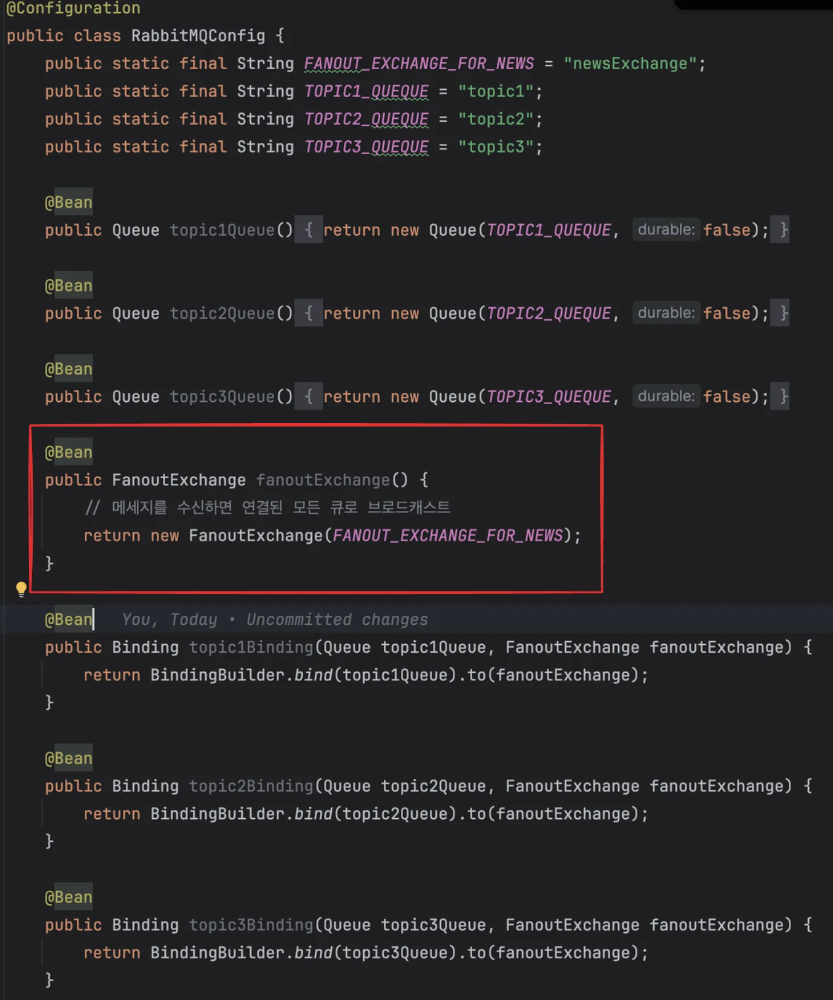

</details>

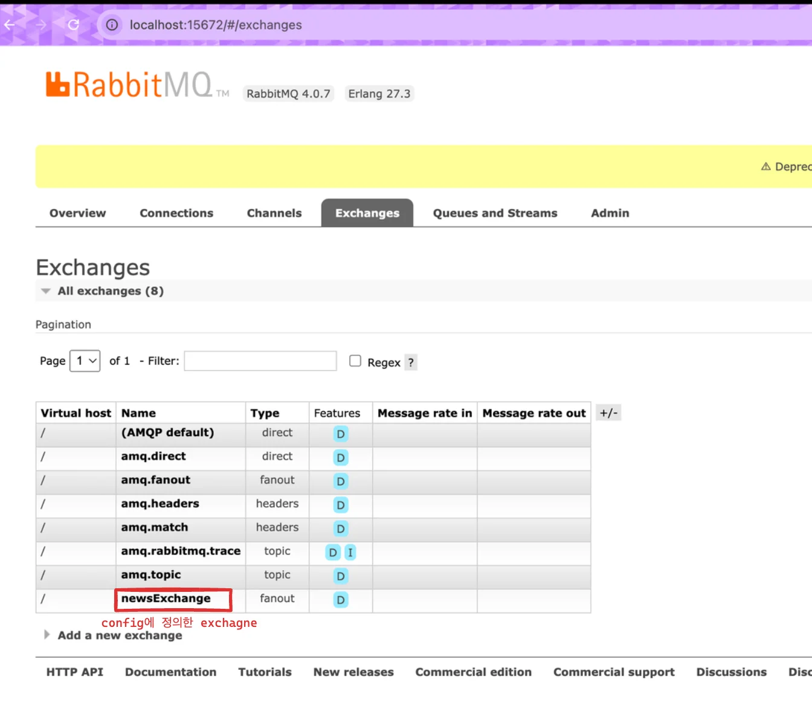

</details>

<details>
<summary>config에 정의한 큐들 확인</summary>

<details>
<summary>&#91; 코드 &#93; RabbitMQConfig</summary>

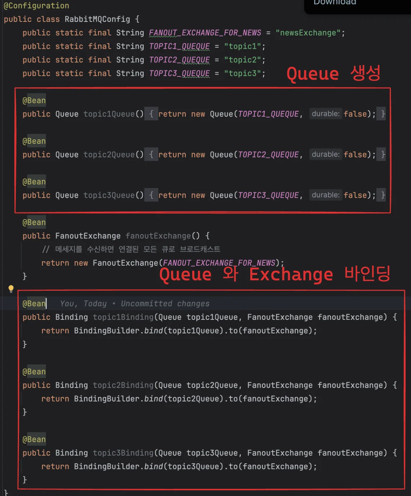

</details>

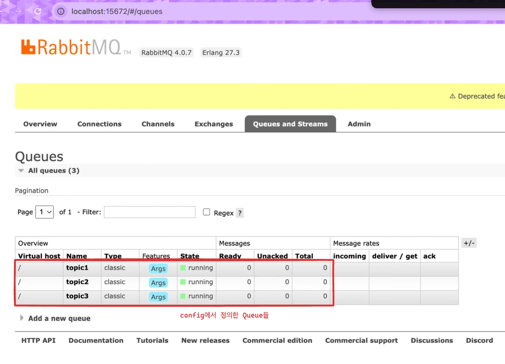

</details>

</details>

<details>
<summary>socket 호출</summary>

<details>
<summary>socket 호출</summary>

- 클라이언트 
    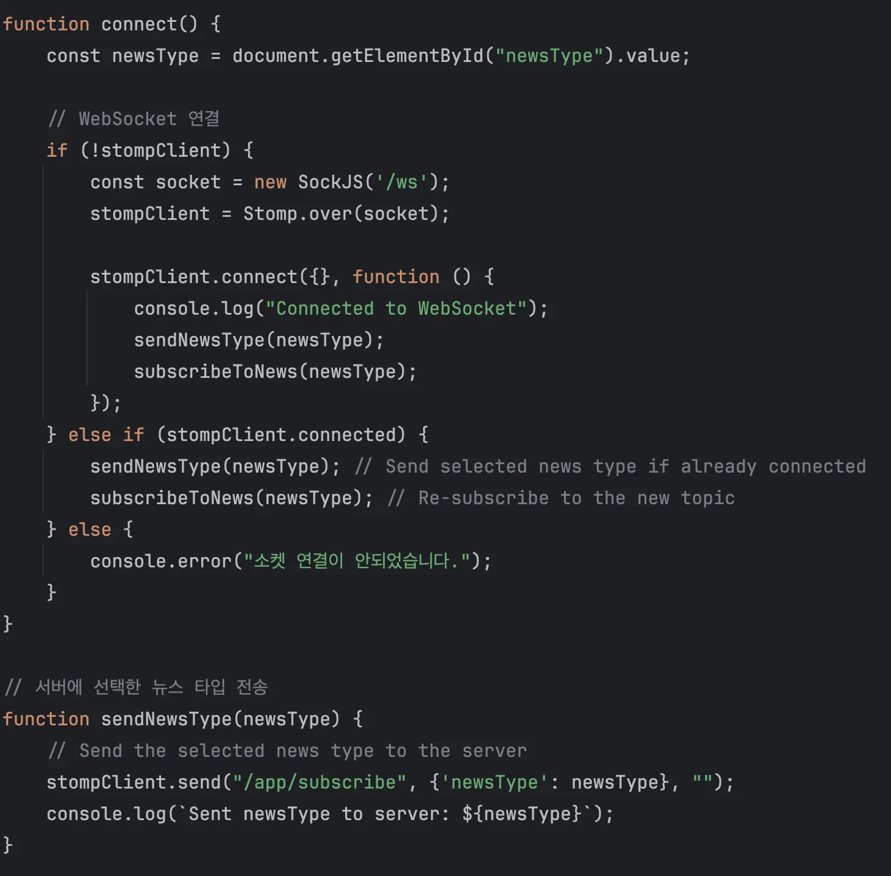

    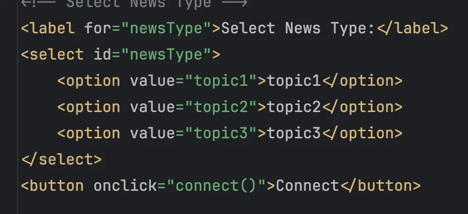

- 서버
    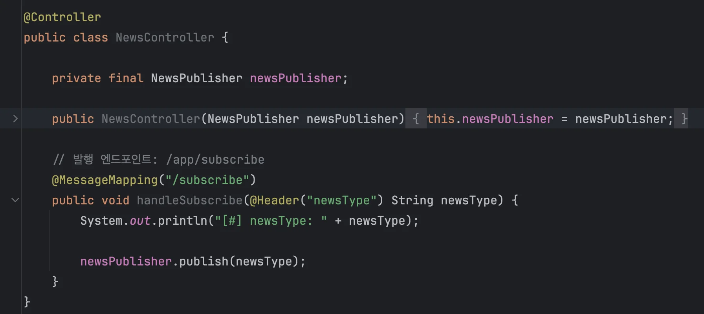

- 브라우저 화면 &#45; connect 클릭
    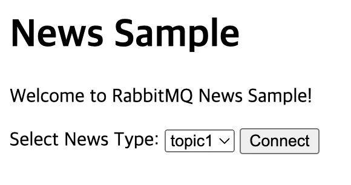

</details>

<details>
<summary>로그 확인</summary>

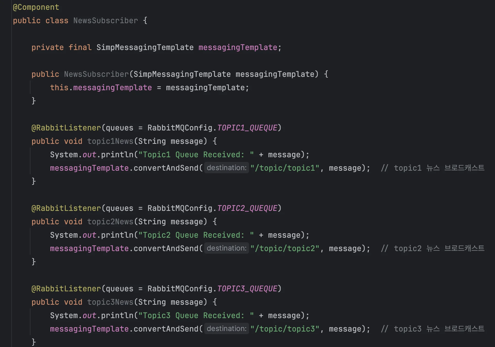

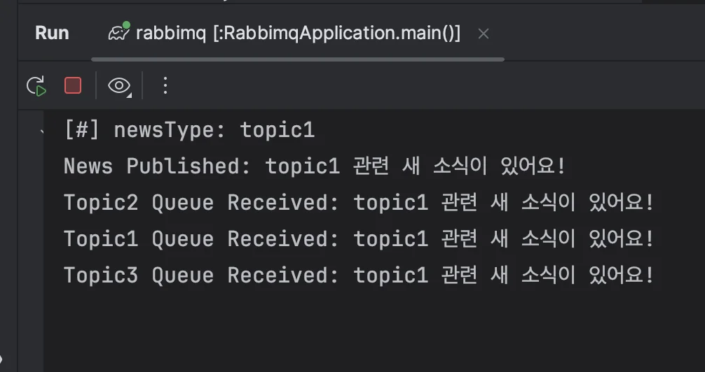

</details>

<details>
<summary> 결과 확인</summary>

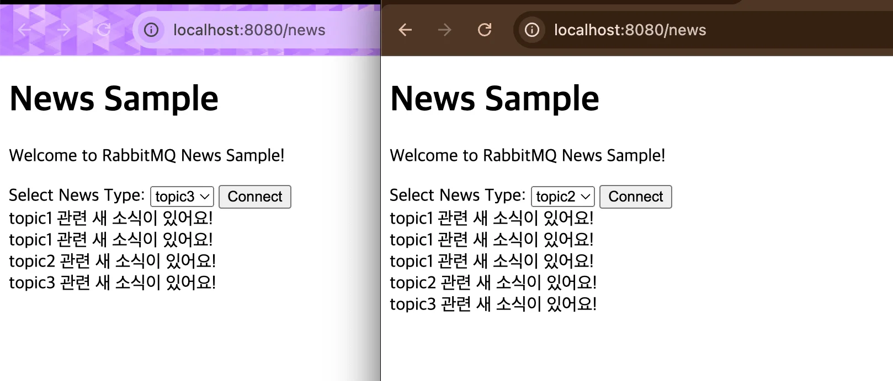

</details>

</details>

<details>
<summary>API 호출</summary>

- curl 호출
    <a id="1c3eda9b0fe1812baaa4de2bdc607851"></a>

    ```plaintext
     curl -X POST "http://localhost:8080/news/api/publish?newsType=topic2"
    ```

- postman 호출
    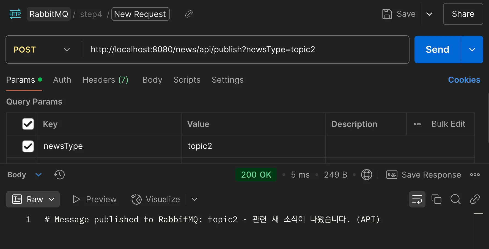

- 결과 확인
    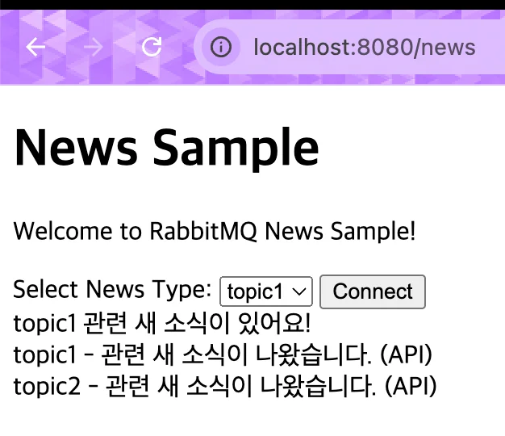

</details>

<a id="1c3eda9b0fe1811197e4ca0128df295e"></a>

### 오류

<details>
<summary>publisher에서 큐로 메세지 전송이 되지 않음</summary>

<a id="1c3eda9b0fe18194abfbd9ea694d22a4"></a>

### 오류) 큐 메세지 전송 실패

<a id="1c3eda9b0fe181e186bfe5dd02f4cce6"></a>

```java
rabbitTemplate.convertAndSend(RabbitMQConfig.FANOUT_EXCHANGE_FOR_NEWS, message);
```

<a id="1c3eda9b0fe181e3b7a6eeab6bc8729e"></a>

<code>fanout exchange</code>를 통해 큐와 binding 후, 위와 같이 큐에 exchage를 통해 메세지를 넘겼다&#46;

<a id="1c3eda9b0fe18126b717ea7e3e13fc47"></a>

그러나 앱 실행 시, 큐에 메세지가 넘어가지 않는 오류가 발생되었다&#46; 

<a id="1c3eda9b0fe181a2a9f6fa30c4981f99"></a>

### 원인) exchange 와 message만을 인자로 전송 시, 큐에 메세지가 전송되지 않는 이유

---

<details>
<summary>오버로딩된 <code>convertAndSend()</code> </summary>

<a id="1c3eda9b0fe181998722cc7a7185bb1e"></a>

```java
public class RabbitTemplate extends RabbitAccessor // NOSONAR type line count
		implements BeanFactoryAware, RabbitOperations, ChannelAwareMessageListener, ApplicationContextAware,ListenerContainerAware, PublisherCallbackChannel.Listener, BeanNameAware, DisposableBean {

		  .  .  .
		
		@Override
		public void convertAndSend(Object object) throws AmqpException {
			convertAndSend(this.exchange, this.routingKey, object, (CorrelationData) null);
		}
	
		@Override
		public void correlationConvertAndSend(Object object, CorrelationData correlationData) throws AmqpException {
			convertAndSend(this.exchange, this.routingKey, object, correlationData);
		}
	
		@Override
		public void convertAndSend(String routingKey, final Object object) throws AmqpException {
			convertAndSend(this.exchange, routingKey, object, (CorrelationData) null);
		}
	
		@Override
		public void convertAndSend(String routingKey, final Object object, CorrelationData correlationData)
				throws AmqpException {
	
			convertAndSend(this.exchange, routingKey, object, correlationData);
		}
	
		@Override
		public void convertAndSend(String exchange, String routingKey, final Object object) throws AmqpException {
			convertAndSend(exchange, routingKey, object, (CorrelationData) null);
		}
	
		@Override
		public void convertAndSend(String exchange, String routingKey, final Object object,
				@Nullable CorrelationData correlationData) throws AmqpException {
	
			send(exchange, routingKey, convertMessageIfNecessary(object), correlationData);
		}
	
		@Override
		public void convertAndSend(Object message, MessagePostProcessor messagePostProcessor) throws AmqpException {
			convertAndSend(this.exchange, this.routingKey, message, messagePostProcessor);
		}
	
		@Override
		public void convertAndSend(String routingKey, Object message, MessagePostProcessor messagePostProcessor)
				throws AmqpException {
	
			convertAndSend(this.exchange, routingKey, message, messagePostProcessor, null);
		}
	
		@Override
		public void convertAndSend(Object message, MessagePostProcessor messagePostProcessor,
				CorrelationData correlationData)
				throws AmqpException {
	
			convertAndSend(this.exchange, this.routingKey, message, messagePostProcessor, correlationData);
		}
	
		@Override
		public void convertAndSend(String routingKey, Object message, MessagePostProcessor messagePostProcessor,
				CorrelationData correlationData)
				throws AmqpException {
	
			convertAndSend(this.exchange, routingKey, message, messagePostProcessor, correlationData);
		}
	
		@Override
		public void convertAndSend(String exchange, String routingKey, final Object message,
				final MessagePostProcessor messagePostProcessor) throws AmqpException {
	
			convertAndSend(exchange, routingKey, message, messagePostProcessor, null);
		}
	
		@Override
		public void convertAndSend(String exchange, String routingKey, final Object message,
				final MessagePostProcessor messagePostProcessor,
				@Nullable CorrelationData correlationData) throws AmqpException {
	
			Message messageToSend = convertMessageIfNecessary(message);
			messageToSend = messagePostProcessor.postProcessMessage(messageToSend, correlationData,
					nullSafeExchange(exchange), nullSafeRoutingKey(routingKey));
			send(exchange, routingKey, messageToSend, correlationData);
		}
		
		  .  .  .
```

</details>

<a id="1c3eda9b0fe18137bb03ed62affcf71b"></a>

위 오버로딩된 <code>convertAndSend</code> 메서드를 확인 해보면 아래 유형이 정의가 되지 않은 것을 확인할 수 있다&#46;

<a id="1c3eda9b0fe1819d9b9efe9f28f51315"></a>

```java
// ❌ 아래 유형의 메서드가 오버로딩 되지 않았음
convertAndSend(String exchange, Object message)
```

<a id="1c3eda9b0fe181a69968cb92558b0056"></a>

따라서 <u>위 유형의 메세드가 호출</u>되면 내부적으로 올바른 메서드를 찾지 못해  해당 전송이 무시된다&#46; 

<details>
<summary>디버거를 통해 publisher에서 큐로 메세지 전송 시, management console을 통해 큐를 확인해보면 아래와 같이 메세지를 받아오지 못하는 것을 확인할 수 있다&#46; </summary>

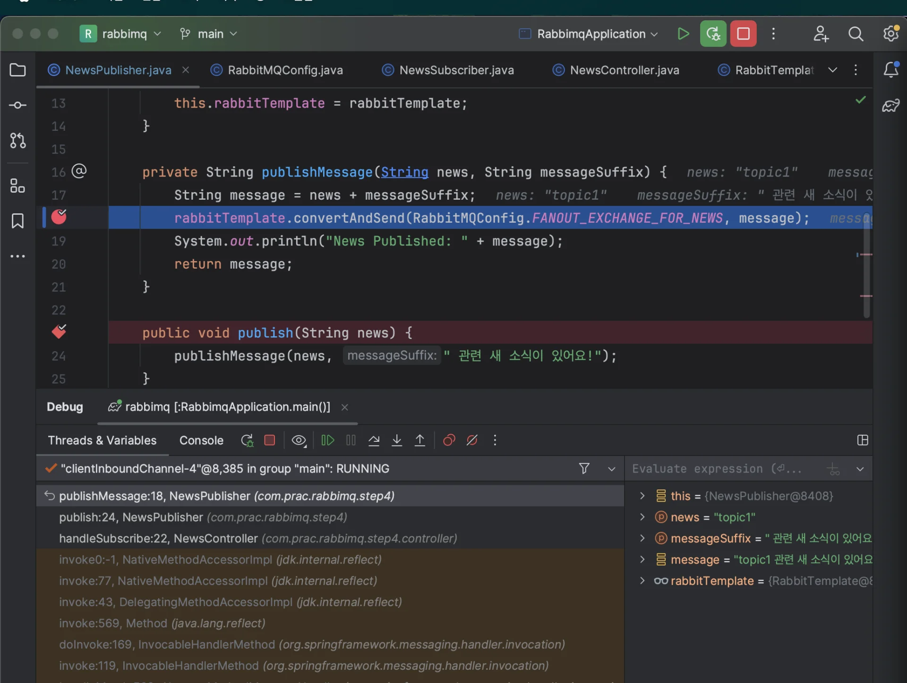

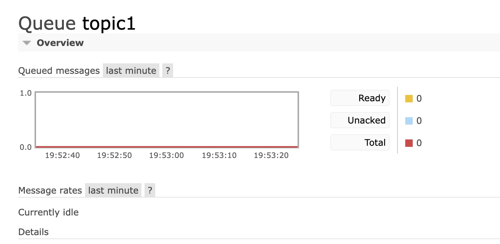

</details>

<a id="1c3eda9b0fe1818ea465da913f09a770"></a>

### 해결) 올바른 유형의 <code>convertAndSend</code> 호출

<a id="1c3eda9b0fe1810ebba9d7939d76e90b"></a>

```java
// ✅ 올바른 유형
// convertAndSend(exchange, routingKey, message);
rabbitTemplate.convertAndSend(FANOUT_EXCHANGE_FOR_NEWS, "", message);
```

<a id="1c3eda9b0fe18113b15ddf30e2b53c4f"></a>

위와 같이 RabbitTemplate에 오버로드된  convertAndSend를 호출하면 정상적으로 메세지가 큐로 전송된다&#46;

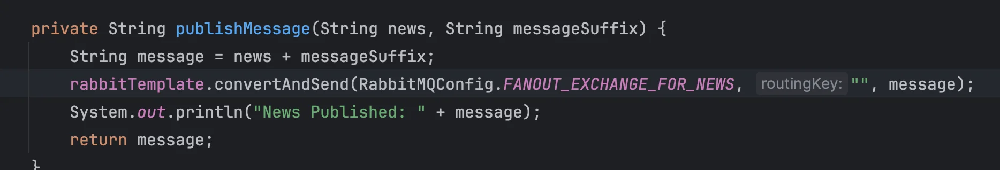

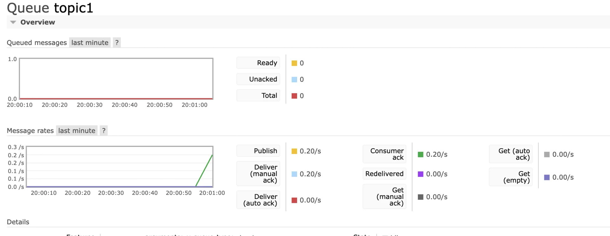

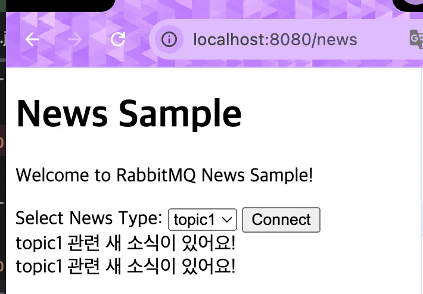

<a id="1c3eda9b0fe1816f85f5d02e57414e80"></a>

위와 같이 Queue에서 메세지를 정상 처리하고 브라우저에서 응답받은 메세지가 정상적으로 출력되는 것을 확인할 수 있다&#46; 

</details>

<a id="1c3eda9b0fe18185a119cd2bce719ae1"></a>

### 추가 정리 필요) 메세지 컨버터

- DefaultMessageConverter

- Jackson2JsonMessageConverter

<a id="1c3eda9b0fe181d98f40f9d8681a45b1"></a>

```java
rabbitTemplate.setMessageConverter(new Jackson2JsonMessageConverter());
```
