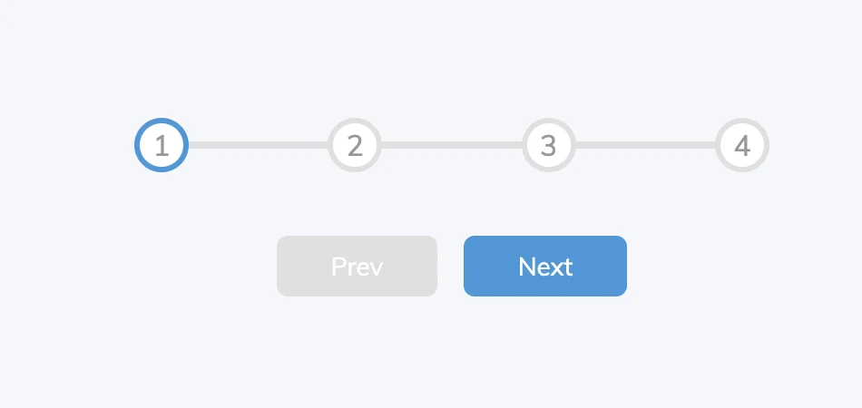
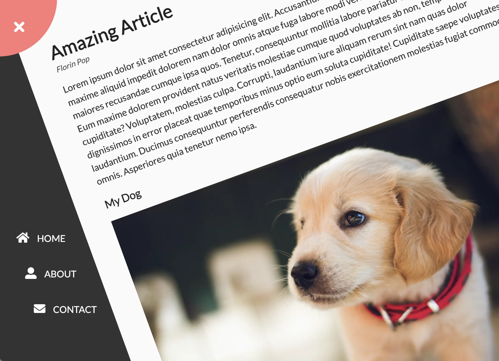
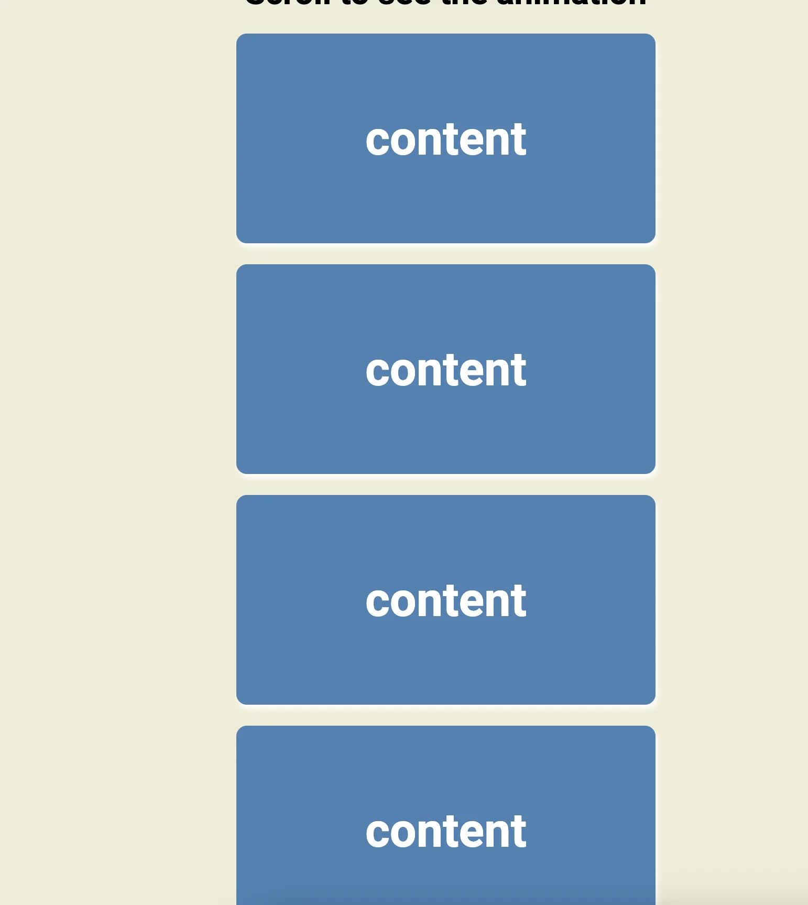
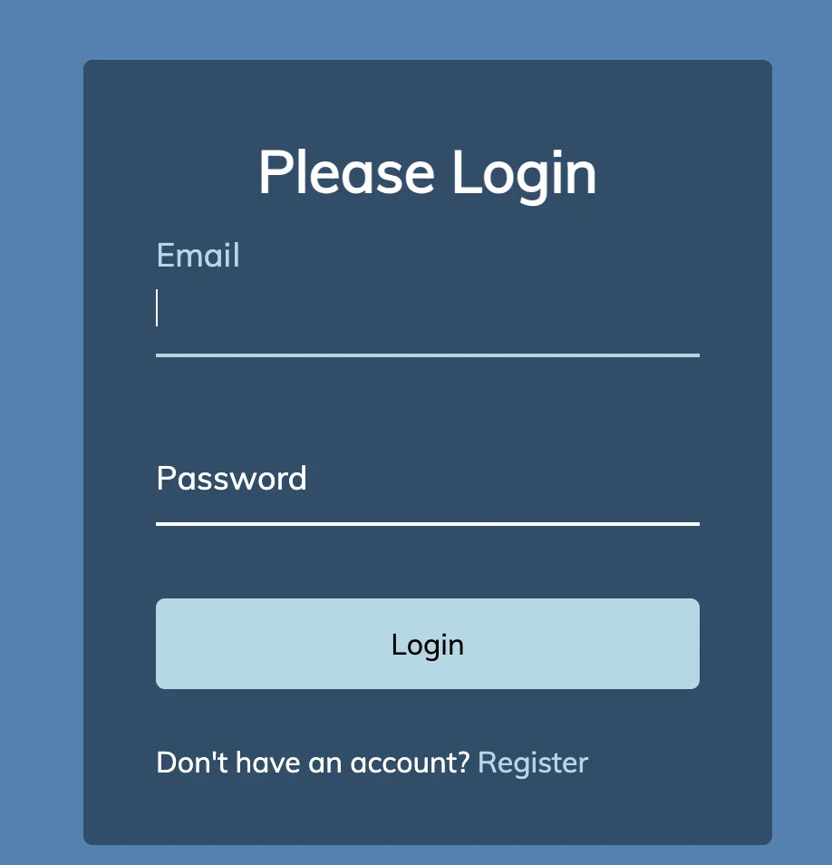

---

<a id="1c3eda9b0fe181f78aced6debdd4fbe3"></a>

<a href="https://www.udemy.com/course/50-projects-50-days/">강의 페이지</a>

<a id="1c3eda9b0fe181e99780eb30a499a638"></a>

<a href="https://github.com/bradtraversy/50projects50days">강의 코드</a>

<a id="1c3eda9b0fe181059fd9feceb3f4e205"></a>

<a href="https://50projects50days.com/">view</a>

> 💡 
> 
> <a id="1c3eda9b0fe181ecabcffd56ebf558c2"></a>
> 
> ### template
> 
> <a id="1c3eda9b0fe18100a199ff40dbc08e70"></a>
> 
> ### Day  &#45; 
> 
> 
> 
> <details>
> <summary>html</summary>
> 
> <a id="1c3eda9b0fe181d2b7a7d20ee49d4a0e"></a>
> 
> ```html
> 
> ```
> 
> </details>
> 
> <details>
> <summary>css </summary>
> 
> <a id="1c3eda9b0fe1817a89b1f0c66388ae2f"></a>
> 
> ```css
> 
> ```
> 
> </details>
> 
> <details>
> <summary>js</summary>
> 
> <a id="1c3eda9b0fe181aa9aaecf830026388e"></a>
> 
> ```javascript
> 
> ```
> 
> </details>
> 
> <details>
> <summary>추가 정리 내용</summary>
> 
> <a id="1c3eda9b0fe18113970bf42f3fbf2720"></a>
> 
> ### &#35; package&#46;json → script 실행 명령어
> 
> ---
> 
> > npm start&#58; 코드 실행<br>npm stop&#58; start 멈춤<br>npm restart&#58; stop 재실행
> 
> > npm test&#58; test 실행
> 
> > npm run 명령어&#58; 위를 제외한 명령어(작성한 명령어 포함)
> 
> <a id="1c3eda9b0fe181c195b9ce2e74a0ea87"></a>
> 
> ### 스크립트 명령어 등록
> 
> 1. <code>package&#46;json</code> 에서 scripts에 직접 작성 
> 
> 1. <code>npm set&#45;script {스크립트 이름} {명령어}</code> 명령어를 통한 작성 (권장)
>     <details>
>     <summary>ex) npm set&#45;script hi “echo ‘Hi&#33;’”</summary>
> 
>     <details>
>     <summary>package&#46;json</summary>
> 
>     <a id="1c3eda9b0fe1816b81ebdfe9ceccd94d"></a>
> 
>     ```json
>     `{
>       // 생략
>       "scripts": {
>         "hi": "echo 'Hi!'"  },
>       // 생략
>     }`
>     ```
> 
>     </details>
> 
>     </details>
> 
> </details>

<a id="1c3eda9b0fe181b085bdcb6be8d546a5"></a>

## CSS 정리 내용 

<a id="1c3eda9b0fe181e49691c2a0cf368f96"></a>

### <strong>Selector</strong>  특정 요소 지정

<a id="1c3eda9b0fe1816e8e17f113a4e10f96"></a>

 <code>,(콤마)</code> 로  여러개 중복 지정 가능    ex) &#46;split, &#46;split&#45;left, &#46;split&#45;right {}  

<a id="1c3eda9b0fe18121a62fcb4f6bd42c66"></a>

<code>띄어쓰기</code>로 부모, 자식 요소    ex) &#46;split &#46;split&#45;left {}

<a id="1c3eda9b0fe181da898de530c07a7d5a"></a>

‘class(id)&#39; 여러개 붙여쓰기    ex) &#46;split&#46;left {}

<a id="1c3eda9b0fe181829068d1c888e7a368"></a>

### 🧐 rem 단위?

<a id="1c3eda9b0fe18199a62dcc8fd0ff0b27"></a>

#  Prac

---

<a id="1c3eda9b0fe181a8a6e5c41d5b47b66d"></a>

### Day 1 &#45; 확장 카드들

<a id="1c3eda9b0fe1812cbdffc4de7e89726a"></a>

##  이미지


---

<a id="1c3eda9b0fe1818a839cf620c4bbd631"></a>

### <code>&#43;</code>

<details>
<summary>postition&#58; relative → position&#58; absolute </summary>

<a id="1c3eda9b0fe181ad8efdd78e0f6542d1"></a>

relative한 부모 태그를 기준으로 absolute 태그 조작 가능

</details>

<details>
<summary>flex</summary>


</details>

<details>
<summary>&#64;media () {}</summary>


</details>

<details>
<summary>selector&#58;nth&#45;of&#45;type()</summary>


</details>

<details>
<summary>background&#45;repeat</summary>


</details>

<details>
<summary>display&#58;none</summary>


</details>

<details>
<summary>html</summary>

<a id="1c3eda9b0fe18115a2a6c9a7c9c382d8"></a>

```html
<!DOCTYPE html>
<html lang="en">
  <head>
    <meta charset="UTF-8" />
    <meta name="viewport" content="width=device-width, initial-scale=1.0" />
    <link rel="stylesheet" href="style.css" />
    <title>Expanding Cards</title>
  </head>
  <body>
    <div class="container">
      <div
        class="panel active"
        style="
          background-image: url('https://images.unsplash.com/photo-1558979158-65a1eaa08691?ixlib=rb-1.2.1&ixid=eyJhcHBfaWQiOjEyMDd9&auto=format&fit=crop&w=1350&q=80');
        "
      >
        <h3>Explore The World</h3>
      </div>
      <div
        class="panel"
        style="
          background-image: url('https://images.unsplash.com/photo-1572276596237-5db2c3e16c5d?ixlib=rb-1.2.1&ixid=eyJhcHBfaWQiOjEyMDd9&auto=format&fit=crop&w=1350&q=80');
        "
      >
        <h3>Wild Forest</h3>
      </div>
      <div
        class="panel"
        style="
          background-image: url('https://images.unsplash.com/photo-1507525428034-b723cf961d3e?ixlib=rb-1.2.1&ixid=eyJhcHBfaWQiOjEyMDd9&auto=format&fit=crop&w=1353&q=80');
        "
      >
        <h3>Sunny Beach</h3>
      </div>
      <div
        class="panel"
        style="
          background-image: url('https://images.unsplash.com/photo-1551009175-8a68da93d5f9?ixlib=rb-1.2.1&ixid=eyJhcHBfaWQiOjEyMDd9&auto=format&fit=crop&w=1351&q=80');
        "
      >
        <h3>City on Winter</h3>
      </div>
      <div
        class="panel"
        style="
          background-image: url('https://images.unsplash.com/photo-1549880338-65ddcdfd017b?ixlib=rb-1.2.1&ixid=eyJhcHBfaWQiOjEyMDd9&auto=format&fit=crop&w=1350&q=80');
        "
      >
        <h3>Mountains - Clouds</h3>
      </div>
    </div>

    <script src="script.js"></script>
  </body>
</html>
```

</details>

<details>
<summary>css</summary>

<a id="1c3eda9b0fe181678d72dba8bd05a693"></a>

```css
@import url("https://fonts.googleapis.com/css2?family=Noto+Sans+KR:wght@100&display=swap");

* {
  box-sizing: border-box;
}

body {
  font-family: "Noto Sans KR", sans-serif;
  display: flex;
  align-items: center;
  justify-content: center;
  height: 100vh;
  overflow: hidden;
  margin: 0;
}

.container {
  display: flex;
  width: 90vw;
}

.panel {
  /* background-size: auto 100%; */
  background-size: cover;

  background-position: center;
  background-repeat: no-repeat;
  height: 80vh;
  border-radius: 50px;
  color: #fff;
  cursor: pointer;
  flex: 0.5;
  margin: 10px;
  position: relative;
  transition: flex 0.7s ease-in;
}

.panel h3 {
  font-size: 24px;
  position: absolute;
  bottom: 20px;
  left: 20px;
  margin: 0;
  opacity: 0;
}

.panel.active {
  flex: 5;
}

.panel.active h3 {
  opacity: 1;
}

@media (max-width: 480px) {
  .container {
    width: 100vw;
  }
  .panel:nth-of-type(4),
  .panel:nth-of-type(5) {
    display: none;
  }
}
```

</details>

<details>
<summary>js</summary>

<a id="1c3eda9b0fe181e284e5f183eb5e6f6f"></a>

```javascript
const cards = document.querySelectorAll(".panel");

cards.forEach((card) => {
  card.addEventListener("click", () => handleClassActive(card));
});

function handleClassActive(card) {
  removeActiveClasses();
  card.classList.add("active");
}

function removeActiveClasses() {
  cards.forEach((card) => {
    card.classList.remove("active");
  });
}
```

<a id="1c3eda9b0fe181d1a61cf6513c484ccf"></a>

✤ 시간복잡도(O^2) 개선 필요

</details>

<a id="1c3eda9b0fe1816b957aeabf7348d1e8"></a>

### Day 2 &#45; Progress Steps


> &#91;CSS&#93;
> 
> - &#46;selector&#46;selector&#58; 선택자 중복 선택으로 특정 DOM만 적용 가능
> 
> - &#58;active, &#58;focus, &#58;disabled
> 
> - 변수&#58; &#91; &#58;root{ —변수명&#58; 값 }, var(—변수명) &#93;
> 
> - cursor&#58; not&#45;allowed;
> 
> - 가운데 정렬?&#58; position&#58; absolute, top&#58;50%, left&#58;0, transform&#58; translateY(&#45;50%)
> 
> <a id="1c3eda9b0fe181bcacebcc7287667379"></a>
> 
> &#91;JS&#93; 
> 
> - Array&#46;forEach
> 
> - classLIst&#46;(add, remove)
> 
> - DOM&#46;style&#46;width
> 
> - DOM&#46;disabled

<details>
<summary>html</summary>

<a id="1c3eda9b0fe18154abb9ccfd08df0e3c"></a>

```html
<!DOCTYPE html>
<html lang="en">
  <head>
    <meta charset="UTF-8" />
    <meta name="viewport" content="width=device-width, initial-scale=1.0" />
    <title>Progress Steps</title>
    <link rel="stylesheet" href="style.css" />
  </head>
  <body>
    <div class="container">
      <div class="progress-container">
        <div class="progress" id="progress"></div>
        <div class="circle active">1</div>
        <div class="circle">2</div>
        <div class="circle">3</div>
        <div class="circle">4</div>
      </div>
      <button class="bnt" id="prev" disabled>Prev</button>
      <button class="bnt" id="next">Next</button>
    </div>
    <script src="script.js"></script>
  </body>
</html>
```

</details>

<details>
<summary>css </summary>

<a id="1c3eda9b0fe181dd94cccd3054dfdb97"></a>

```css
@import url("https://fonts.googleapis.com/css2?family=Muli&display=swap");

:root {
  --line-border-fill: #3498db;
  --line-border-empty: #e0e0e0;
}

* {
  box-sizing: border-box;
}

body {
  background-color: #f6f7fb;
  font-family: "Muli", sans-serif;
  display: flex;
  align-items: center;
  justify-content: center;
  height: 100vh;
  overflow: hidden;
  margin: 0;
}

.container {
  text-align: center;
}

.progress-container {
  display: flex;
  justify-content: space-between;
  position: relative;
  margin-bottom: 30px;
  max-width: 100%;
  width: 350px;
}

.progress-container::before {
  content: "";
  background-color: var(--line-border-empty);
  position: absolute;
  top: 50%;
  left: 0;
  transform: translateY(-50%);
  height: 4px;
  width: 100%;
  z-index: -1;
}

.progress {
  background-color: var(--line-border-fill);
  position: absolute;
  top: 50%;
  left: 0;
  transform: translateY(-50%);
  height: 4px;
  width: 0;
  z-index: -1;
  transition: 0.4s ease;
}

.circle {
  background-color: #fff;
  color: #999;
  border-radius: 50%;
  height: 30px;
  width: 30px;
  display: flex;
  align-items: center;
  justify-content: center;
  border: 3px solid var(--line-border-empty);
  transition: 0.4s ease;
}

.circle.active {
  border-color: var(--line-border-fill);
}

.btn {
  background-color: var(--line-border-fill);
  border-radius: 5px;
  font-size: 20px;
  color: #fff;
  border: none;
  padding: 10px 30px;
  margin: 0 20px;
  cursor: pointer;
}

.btn:active {
  transform: scale(0.98);
}

.btn:focus {
  outline: 0;
}

.btn:disabled {
  background-color: var(--line-border-empty);
  cursor: not-allowed;
}
```

</details>

<details>
<summary>js</summary>

<a id="1c3eda9b0fe181c4a9c4fb49af46efdd"></a>

```javascript
const progress = document.getElementById("progress");
const prev = document.getElementById("prev");
const next = document.getElementById("next");
const circles = document.querySelectorAll(".circle");

let currentActive = 1;

next.addEventListener("click", () => {
  currentActive++;

  if (currentActive > circles.length) {
    currentActive = circles.length;
  }

  update();
});

prev.addEventListener("click", () => {
  currentActive--;

  if (currentActive < 1) {
    currentActive = 1;
  }

  update();
});

function update() {
  toggleClassActiveInCircle();
  handleActiveBarView();
  handleBntDisabled();
}

function toggleClassActiveInCircle() {
  circles.forEach((circle, idx) => {
    if (idx < currentActive) {
      circle.classList.add("active");
    } else {
      circle.classList.remove("active");
    }
  });
}

function handleActiveBarView() {
  const actives = document.querySelectorAll(".active");
  progress.style.width =
    ((actives.length - 1) / (circles.length - 1)) * 100 + "%";
}

function handleBntDisabled() {
  if (currentActive === 1) {
    prev.disabled = true;
  } else if (currentActive === circles.length) {
    next.disabled = true;
  } else {
    prev.disabled = false;
    next.disabled = false;
  }
}
```

<a id="1c3eda9b0fe181e09867d6c065f09ac3"></a>

개선점&#58; 암묵적 변수(전역 변수 참조) 명시적으로 바꾸기

</details>

<a id="1c3eda9b0fe181b49e0bc8e32fdea3d4"></a>

### Day  3 &#45; Rotating navigation



<details>
<summary>html</summary>

<a id="1c3eda9b0fe181408816c07c8bc91dae"></a>

```html
<!DOCTYPE html>
<html lang="en">
  <head>
    <meta charset="UTF-8" />
    <meta name="viewport" content="width=device-width, initial-scale=1.0" />
    <link
      rel="stylesheet"
      href="https://cdnjs.cloudflare.com/ajax/libs/font-awesome/5.14.0/css/all.min.css"
      integrity="sha512-1PKOgIY59xJ8Co8+NE6FZ+LOAZKjy+KY8iq0G4B3CyeY6wYHN3yt9PW0XpSriVlkMXe40PTKnXrLnZ9+fkDaog=="
      crossorigin="anonymous"
    />
    <link rel="stylesheet" href="style.css" />
    <title>Rotating Navigation</title>
  </head>
  <body>
    <div class="container">
      <div class="circle-container">
        <div class="circle">
          <button id="close">
            <i class="fas fa-times"></i>
          </button>
          <button id="open">
            <i class="fas fa-bars"></i>
          </button>
        </div>
      </div>

      <div class="content">
        <h1>Amazing Article</h1>
        <small>Florin Pop</small>
        <p>
          Lorem ipsum dolor sit amet consectetur adipisicing elit. Accusantium
          quia in ratione dolores cupiditate, maxime aliquid impedit dolorem nam
          dolor omnis atque fuga labore modi veritatis porro laborum minus,
          illo, maiores recusandae cumque ipsa quos. Tenetur, consequuntur
          mollitia labore pariatur sunt quia harum aut. Eum maxime dolorem
          provident natus veritatis molestiae cumque quod voluptates ab non,
          tempore cupiditate? Voluptatem, molestias culpa. Corrupti, laudantium
          iure aliquam rerum sint nam quas dolor dignissimos in error placeat
          quae temporibus minus optio eum soluta cupiditate! Cupiditate saepe
          voluptates laudantium. Ducimus consequuntur perferendis consequatur
          nobis exercitationem molestias fugiat commodi omnis. Asperiores quia
          tenetur nemo ipsa.
        </p>

        <h3>My Dog</h3>
        
        <p>
          Lorem, ipsum dolor sit amet consectetur adipisicing elit. Sit libero
          deleniti rerum quo, incidunt vel consequatur culpa ullam. Magnam
          facere earum unde harum. Ea culpa veritatis magnam at aliquid.
          Perferendis totam placeat molestias illo laudantium? Minus id minima
          doloribus dolorum fugit deserunt qui vero voluptas, ut quia cum amet
          temporibus veniam ad ea ab perspiciatis, enim accusamus asperiores
          explicabo provident. Voluptates sint, neque fuga cum illum, tempore
          autem maxime similique laborum odio, magnam esse. Aperiam?
        </p>
      </div>
    </div>

    <nav>
      <ul>
        <li><i class="fas fa-home"></i><a href="#"> Home</a></li>
        <li><i class="fas fa-user-alt"></i><a href="#"> About</a></li>
        <li><i class="fas fa-envelope"></i><a href="#"> Contact</a></li>
      </ul>
    </nav>
    <script src="script.js"></script>
  </body>
</html>
```

</details>

<details>
<summary>css </summary>

<a id="1c3eda9b0fe18131ab78cec511d79337"></a>

```css
@import url("https://fonts.googleapis.com/css?family=Lato&display=swap");

* {
  box-sizing: border-box;
}

body {
  font-family: "Lato", sans-serif;
  background-color: #333;
  color: #222;
  overflow-x: hidden;
  margin: 0;
}

.container {
  background-color: #fafafa;
  transform-origin: top left;
  transition: transform 0.5s linear;
  width: 100vw;
  min-height: 100vh;
  padding: 50px;
}

.container.show-nav {
  transform: rotate(-20deg);
}

.circle-container {
  position: fixed;
  top: -100px;
  left: -100px;
}

.circle {
  background-color: #ff7979;
  height: 200px;
  width: 200px;
  border-radius: 50%;
  position: relative;
  transition: transform 0.5s linear;
}

.container.show-nav .circle {
  transform: rotate(-70deg);
}

.circle button {
  cursor: pointer;
  position: absolute;
  top: 50%;
  left: 50%;
  height: 100px;
  background: transparent;
  border: 0;
  font-size: 26px;
  color: #fff;
}

.circle button:focus {
  outline: none;
}

.circle button#open {
  left: 60%;
}

.circle button#close {
  top: 60%;
  transform: rotate(90deg);
  transform-origin: top left;
}

.container.show-nav + nav li {
  transform: translateX(0);
  transition-delay: 0.3s;
}

nav {
  position: fixed;
  bottom: 40px;
  left: 0;
  z-index: 100;
}

nav ul {
  list-style-type: none;
  padding-left: 30px;
}

nav ul li {
  text-transform: uppercase;
  color: #fff;
  margin: 40px 0;
  transform: translateX(-100%);
  transition: transform 0.4s ease-in;
}

nav ul li i {
  font-size: 20px;
  margin-right: 10px;
}

nav ul li + li {
  margin-left: 15px;
  transform: translateX(-150%);
}

nav ul li + li + li {
  margin-left: 30px;
  transform: translateX(-200%);
}

nav a {
  color: #fafafa;
  text-decoration: none;
  transition: all 0.5s;
}

nav a:hover {
  color: #ff7979;
  font-weight: bold;
}

.content img {
  max-width: 100%;
}

.content {
  max-width: 1000px;
  margin: 50px auto;
}

.content h1 {
  margin: 0;
}

.content small {
  color: #555;
  font-style: italic;
}

.content p {
  color: #333;
  line-height: 1.5;
}
```

</details>

<details>
<summary>js</summary>

<a id="1c3eda9b0fe1814991a0f4ba481f73df"></a>

```javascript
const open = document.getElementById("open");
const close = document.getElementById("close");
const container = document.querySelector(".container");

open.addEventListener("click", () => container.classList.add("show-nav"));

close.addEventListener("click", () => container.classList.remove("show-nav"));
```

</details>

<a id="1c3eda9b0fe18105b681e2240d20b478"></a>

### Day 4 &#45;  Hidden Search Button


<details>
<summary>html</summary>

<a id="1c3eda9b0fe181518e95ccf1efa2efc6"></a>

```html
<!DOCTYPE html>
<html lang="en">
  <head>
    <meta charset="UTF-8" />
    <meta name="viewport" content="width=device-width, initial-scale=1.0" />
    <link
      rel="stylesheet"
      href="https://cdnjs.cloudflare.com/ajax/libs/font-awesome/5.14.0/css/all.min.css"
      integrity="sha512-1PKOgIY59xJ8Co8+NE6FZ+LOAZKjy+KY8iq0G4B3CyeY6wYHN3yt9PW0XpSriVlkMXe40PTKnXrLnZ9+fkDaog=="
      crossorigin="anonymous"
    />
    <link rel="stylesheet" href="./style.css" />
    <title>Hidden Search Button</title>
  </head>
  <body>
    <div class="search">
      <input type="text" class="input" placeholder="search..." />
      <button class="btn">
        <i class="fas fa-search"></i>
      </button>
    </div>
  </body>
  <script src="./script.js"></script>
</html>
```

</details>

<details>
<summary>css </summary>

<a id="1c3eda9b0fe18161acdeef3d6955e8b5"></a>

```css
@import url("https://fonts.googleapis.com/css2?family=Roboto:wght@400;700&display=swap");

* {
  box-sizing: border-box;
}

body {
  background-image: linear-gradient(90deg, #7d5fff, #7158e2);
  font-family: "Roboto", sans-serif;
  display: flex;
  justify-content: center;
  align-items: center;
  height: 100vh;
  overflow-x: hidden;
  margin: 0;
}

.search {
  position: relative;
  height: 50px;
}

.search .input {
  background-color: #fff;
  border: 0;
  font-size: 18px;
  height: 50px;
  width: 50px;
  transition: width 0.3s ease;
  padding: 0 10px;
}

.btn {
  background-color: #fff;
  border: 0;
  cursor: pointer;
  font-size: 24px;
  position: absolute;
  top: 0;
  left: 0;
  height: 50px;
  width: 50px;
  transition: transform 0.3s ease;
}

.btn:focus,
.input:focus {
  outline: none;
}

.search.active .input {
  width: 200px;
}

.search.search.active .btn {
  transform: translateX(198px);
}
```

</details>

<details>
<summary>js</summary>

<a id="1c3eda9b0fe1814cb448d74bd63e41ca"></a>

```javascript
const search = document.querySelector(".search");
const input = document.querySelector(".input");
const btn = document.querySelector(".btn");

btn.addEventListener("click", toggleClassActive);

function toggleClassActive() {
  search.classList.toggle("active");
  input.focus();
}
```

</details>

<a id="1c3eda9b0fe18180a380e430efa12529"></a>

### Day 5 &#45; Blurry Loading


<details>
<summary>html</summary>

<a id="1c3eda9b0fe1815db83cf7552d041acb"></a>

```html
<!DOCTYPE html>
<html lang="en">
  <head>
    <meta charset="UTF-8" />
    <meta name="viewport" content="width=device-width, initial-scale=1.0" />
    <link rel="stylesheet" href="./style.css" />
    <title>Blurry Loading</title>
  </head>
  <body>
    <section class="bg"></section>
    <div class="loading-text">0%</div>
    <script src="./script.js"></script>
  </body>
</html>
```

</details>

<details>
<summary>css </summary>

<a id="1c3eda9b0fe18177a6c1f7c0e092cef4"></a>

```css
@import url('https://fonts.googleapis.com/css?family=Ubuntu');

* {
  box-sizing: border-box;
}

body {
  font-family: "Ubuntu", sans-serif;
  display: flex;
  align-items: center;
  justify-content: center;
  height: 100vh;
  overflow: hidden;
  margin: 0;
}

.bg {
  background: url("https://images.unsplash.com/photo-1576161787924-01bb08dad4a4?ixlib=rb-1.2.1&ixid=eyJhcHBfaWQiOjEyMDd9&auto=format&fit=crop&w=2104&q=80");
    no-repeat center center/cover;
  position: absolute;
  top: -30px;
  left: -30px;
  width: calc(100vw + 60px);
  height: calc(100vh + 60px);
  z-index: -1;
  filter: blur(0px);
}

.loading-text {
    font-size: 50px;
    color: #fff;
}
```

</details>

<details>
<summary>js</summary>

<a id="1c3eda9b0fe18125bdd9f899c6025434"></a>

```javascript
const loadText = document.querySelector(".loading-text");
const bg = document.querySelector(".bg");

let load = 0;

let int = setInterval(blurring, 30);

function blurring() {
  load++;

  if (load > 99) {
    clearInterval(int);
  }

  loadText.innerText = `${load}%`;
  loadText.style.opacity = scale(load, 0, 100, 1, 0);
  bg.style.filter = `blur(${scale(load, 0, 100, 30, 0)}px)`; //띄어쓰기 중요, '값'과 'px'사이 여백있으면 해당 값 인식 X
}

//https://stackoverflow.com/questions/10756313/javascript-jquery-map-a-range-of-numbers-to-another-range-of-numbers
function scale(number, inMin, inMax, outMin, outMax) {
  return ((number - inMin) * (outMax - outMin)) / (inMax - inMin) + outMin;
}
```

</details>

<a id="1c3eda9b0fe1814aa3d2fd7785c2c8a1"></a>

### Day 6 &#45; Scroll Animation 



> • selector&#58;nth&#45;of&#45;type( &#91; add / even &#93; )&#58;<br>&#91;  홀수 / 짝수 &#93;만 선택 가능<br><br>•<a href="https://developer.mozilla.org/ko/docs/Web/API/Window"> window</a><br>모든 요소들의 최상위, ‘전역객체’, 열고 있는 브라우저의 창(browser window) (이 창을 제어하는 다양한 메서드 제공됨&#46;)<br><br>• <a href="https://developer.mozilla.org/ko/docs/Web/API/Window/innerHeight">window&#46;innerHeight</a><br>창 내부 높이를 픽셀로 반환, ‘layout viewport’의 높이에서 가져옴&#46; <br><br>• <a href="https://developer.mozilla.org/ko/docs/Web/API/Element/getBoundingClientRect">getBoundingClientRect()</a>

<details>
<summary>html</summary>

<a id="1c3eda9b0fe181588922d33d8b0c3657"></a>

```html
<!DOCTYPE html>
<html lang="en">
  <head>
    <meta charset="UTF-8" />
    <meta name="viewport" content="width=device-width, initial-scale=1.0" />
    <title>Document</title>
    <link rel="stylesheet" href="./style.css" />
  </head>
  <body>
    <h1>Scroll to see the animation</h1>

    <div class="box">
      <h2>content</h2>
    </div>
    <div class="box">
      <h2>content</h2>
    </div>
    <div class="box">
      <h2>content</h2>
    </div>
    <div class="box">
      <h2>content</h2>
    </div>
    <div class="box">
      <h2>content</h2>
    </div>
    <div class="box">
      <h2>content</h2>
    </div>
    <div class="box">
      <h2>content</h2>
    </div>
    <div class="box">
      <h2>content</h2>
    </div>
    <div class="box">
      <h2>content</h2>
    </div>
    <div class="box">
      <h2>content</h2>
    </div>
    <div class="box">
      <h2>content</h2>
    </div>
    <div class="box">
      <h2>content</h2>
    </div>
    <div class="box">
      <h2>content</h2>
    </div>
    <div class="box">
      <h2>content</h2>
    </div>
    <div class="box">
      <h2>content</h2>
    </div>
    <div class="box">
      <h2>content</h2>
    </div>
    <div class="box">
      <h2>content</h2>
    </div>
    <div class="box">
      <h2>content</h2>
    </div>
    <div class="box">
      <h2>content</h2>
    </div>
    <div class="box">
      <h2>content</h2>
    </div>
    <div class="box">
      <h2>content</h2>
    </div>
    <div class="box">
      <h2>content</h2>
    </div>
    <div class="box">
      <h2>content</h2>
    </div>
    <div class="box">
      <h2>content</h2>
    </div>

    <script src="./script.js"></script>
  </body>
</html>
```

</details>

<details>
<summary>css </summary>

<a id="1c3eda9b0fe181f98636df58808cb5fe"></a>

```css
@import url("https://fonts.googleapis.com/css2?family=Roboto:wght@400;700&display=swap");

* {
  box-sizing: border-box;
}

body {
  background-color: #efedd6;
  font-family: "Roboto", sans-serif;
  display: flex;
  flex-direction: column;
  justify-content: center;
  align-items: center;
  margin: 0;
}

h1 {
  margin: 10px;
}

.box {
  background-color: steelblue;
  color: #fff;
  display: flex;
  align-items: center;
  justify-content: center;
  width: 400px;
  height: 200px;
  margin: 10px;
  border-radius: 10px;
  box-shadow: 2px 4px 5px;
  transition: transform 0.4s ease;
}

.box:nth-of-type(odd) {
  transform: translateX(200%);
}

.box:nth-of-type(even) {
  transform: translateX(-200%);
}

.box.show {
  transform: translateX(0);
}

.box h2 {
  font-size: 45px;
}
```

</details>

<details>
<summary>js</summary>

<a id="1c3eda9b0fe181c0aa5df4582ed2b33e"></a>

```javascript
const boxArray = document.querySelectorAll(".box");

window.addEventListener("scroll", checkBoxes);

checkBoxes();

function checkBoxes() {
  const triggerBottom = (window.innerHeight / 5) * 4;

  boxArray.forEach((box) => {
    const boxTop = box.getBoundingClientRect().top;

    if (boxTop < triggerBottom) {
      box.classList.add("show");
    } else {
      box.classList.remove("show");
    }
  });
}
```

</details>

<a id="1c3eda9b0fe1818c853def05e97694dc"></a>

### Day  7 &#45; Split Landing Page


> •<a href="https://developer.mozilla.org/ko/docs/Web/CSS/white-space"> white&#45;space</a>&#58; nowrap; (공백문자 처리 방법)
> 
> > • 요소 가운데 정렬(flex 말고)<br>position&#58; absolute;   (기준 요소 &#45; position&#58;relative;)<br>left&#58; 50%;<br>transform&#58; translateX(&#45;50%);<br>

<details>
<summary>html</summary>

<a id="1c3eda9b0fe181318f90f3ba68ea4742"></a>

```html
<!DOCTYPE html>
<html lang="en">
  <head>
    <meta charset="UTF-8" />
    <meta name="viewport" content="width=device-width, initial-scale=1.0" />
    <title>Split Landing Page</title>
    <link rel="stylesheet" href="style.css" />
  </head>
  <body>
    <div class="container hover-left">
      <div class="split left">
        <h1>Playstation 5</h1>
        <a href="#" class="btn">Buy now</a>
      </div>
      <div class="split right">
        <h1>XBox Series X</h1>
        <a href="#" class="btn">Buy now</a>
      </div>
    </div>
    <script src="./script.js"></script>
  </body>
</html>
```

</details>

<details>
<summary>css </summary>

<a id="1c3eda9b0fe1812f94b4fedebca167c6"></a>

```css
@import url("https://fonts.googleapis.com/css2?family=Roboto:wght@400;700&display=swap");

:root {
  --left-bg-color: rgba(87, 84, 236, 0.7);
  --right-bg-color: rgba(43, 43, 43, 0.8);
  --left-btn-hover-color: rgba(87, 84, 236, 1);
  --right-btn-hover-color: rgba(28, 122, 28, 1);
  --hover-width: 75%;
  --other-width: 25%;
  --speed: 1000ms;
}

* {
  box-sizing: border-box;
}

body {
  font-family: "Roboto", sans-serif;
  height: 100vh;
  margin: 0;
  overflow: hidden;
}

h1 {
  font-size: 4rem;
  color: #fff;
  position: absolute;
  left: 50%;
  top: 20%;
  transform: translateX(-50%);
  white-space: nowrap;
}

.btn {
  text-decoration: none;
  position: absolute;
  left: 50%;
  top: 40%;
  transform: translateX(-50%);
  border: 0.2rem solid #fff;
  color: #fff;
  font-size: 1rem;
  font-weight: bold;
  text-transform: uppercase;
  width: 15rem;
  padding: 1.5rem;
  text-align: center;
}

.split.left .btn:hover {
  background-color: var(--left-btn-hover-color);
  border-color: var(--left-btn-hover-color);
}

.split.right .btn:hover {
  background-color: var(--right-btn-hover-color);
  border-color: var(--right-btn-hover-color);
}

.container {
  position: relative;
  height: 100%;
  width: 100%;
  background-color: #333;
}

.split {
  position: absolute;
  width: 50%;
  height: 100%;
  overflow: hidden;
}

.split.left {
  left: 0;
  background: url(./ps.jpg);
  background-repeat: no-repeat;
  background-size: cover;
}

.split.left::before {
  content: "";
  position: absolute;
  width: 100%;
  height: 100%;
  background-color: var(--left-bg-color);
}

.split.right {
  right: 0;
  background: url(./xbox.jpg);
  background-repeat: no-repeat;
  background-size: cover;
}

.split.right::before {
  content: "";
  position: absolute;
  width: 100%;
  height: 100%;
  background-color: var(--right-bg-color);
}

.split.right,
.split.left,
.split.right::before,
.split.left::before {
  transition: all var(--speed) ease-in-out;
}

.hover-right .right {
  width: var(--hover-width);
}

.hover-right .left {
  width: var(--other-width);
}

.hover-left .left {
  width: var(--hover-width);
}

.hover-left .right {
  width: var(--other-width);
}

@media (max-width: 800px) {
  h1 {
    font-size: 2rem;
    top: 30%;
  }

  .btn {
    padding: 1.2rem;
    width: 12rem;
  }
}
```

</details>

<details>
<summary>js</summary>

<a id="1c3eda9b0fe1810882c2d91beef38d70"></a>

```javascript
const container = document.querySelector(".container");
const left = document.querySelector(".left");
const right = document.querySelector(".right");

left.addEventListener("mouseenter", () =>
  container.classList.add("hover-left")
);

left.addEventListener("mouseleave", () =>
  container.classList.remove("hover-left")
);

right.addEventListener("mouseenter", () =>
  container.classList.add("hover-right")
);

right.addEventListener("mouseleave", () =>
  container.classList.remove("hover-right")
);
```

</details>

<a id="1c3eda9b0fe1810ab056e5f7940371be"></a>

### Day  8 &#45; Form Wave Animation



<a id="1c3eda9b0fe181429323ece711635aad"></a>

###  CSS

> pointer&#45;evnets<br>&#60;a&#62; &#58; text&#45;decoration&#58; none;<br>position&#58; relative → absolute<br>selector  <code>&#58;active</code> , <code>&#58;valid</code><br>cubic&#45;bezier()<br>selector  selector&#58;focus <code>&#43;</code> selector

<a id="1c3eda9b0fe181f99667fe6ec7a50200"></a>

### JS

> queryselecter(”&#91;class&#93; &#91;tag&#93;”)  ← css selecter 와 형태 동일<br>

> string&#46;split(””) &#58; 각 문자마다 나눠서 배열로 만듬 <br><br>ex) 
> 
> <a id="1c3eda9b0fe181649bb9d1b658b96f6f"></a>
> 
> ```typescript
> const str = “example”
> const chars = str.split('');
> console.log(chars[3]);    // m
> ```

<details>
<summary>html</summary>

<a id="1c3eda9b0fe1813d8bc9d0e09cee7ca0"></a>

```html
<!DOCTYPE html>
<html lang="en">
  <head>
    <meta charset="UTF-8" />
    <meta name="viewport" content="width=device-width, initial-scale=1.0" />
    <title>Form Wave Animation</title>
    <link rel="stylesheet" href="style.css" />
  </head>
  <body>
    <div class="container">
      <h1>Please Login</h1>
      <form action="">
        <div class="form-control">
          <input type="text" required />
          <label for="">Email</label>
          <!-- <lable>
            <span style="transition-delay: 0ms">E</span>
            <span style="transition-delay: 50ms">m</span>
            <span style="transition-delay: 100ms">a</span>
            <span style="transition-delay: 150ms">i</span>
            <span style="transition-delay: 200ms">l</span>
          </lable> -->
        </div>

        <div class="form-control">
          <input type="password" required />
          <label for="">Password</label>
        </div>

        <button class="btn">Login</button>

        <p class="text">
          Don't have an account?
          <a href="#">Register</a>
        </p>
      </form>
    </div>
    <script src="./script.js"></script>
  </body>
</html>
```

</details>

<details>
<summary>css </summary>

<a id="1c3eda9b0fe1813a8121fd072b6b8bfe"></a>

```css
@import url("https://fonts.googleapis.com/css?family=Muli&display=swap");

:root {
  --container-background-color: rgba(0, 0, 0, 0.4);
}

* {
  box-sizing: border-box;
}

body {
  background-color: steelblue;
  color: #fff;
  font-family: "Roboto", sans-serif;
  display: flex;
  flex-direction: column;
  align-items: center;
  justify-content: center;
  height: 100vh;
  overflow: hidden;
  margin: 0;
}

.container {
  background-color: var(--container-background-color);
  padding: 20px 40px;
  border-radius: 5px;
}

.container h1 {
  text-align: center;
  margin-bottom: 30px;
}

.container a {
  text-decoration: none;
  color: lightblue;
}

.btn {
  cursor: pointer;
  display: inline-block;
  width: 100%;
  background-color: lightblue;
  padding: 15px;
  font-family: inherit;
  font-size: 16px;
  border: 0;
  border-radius: 5px;
}

.btn:focus {
  outline: 0;
}

/* actvie: 클릭 이벤트 발생하는 순간 */
.btn:active {
  transform: scale(0.98);
}

.text {
  margin-top: 30px;
}

.form-control {
  position: relative;
  margin: 20px 0 40px;
  width: 300px;
}

.form-control input {
  background-color: transparent; /* inherit*/
  border: 0;
  border-bottom: 2px #fff solid;
  display: block;
  width: 100%;
  padding: 15px 0;
  font-size: 18px;
  color: #fff;
}

.form-control input:focus,
.form-control input:valid {
  outline: 0;
  border-bottom-color: lightblue;
}

.form-control label {
  position: absolute;
  top: 15px;
  left: 0;
  pointer-events: none;
}

.form-control label span {
  display: inline-block;
  font-size: 18px;
  min-width: 5px;
  transition: 0.3s cubic-bezier(0.68, -0.55, 0.265, 1.55);
}

.form-control input:focus + label span,
.form-control input:valid + label span {
  color: lightblue;
  transform: translateY(-30px);
}
```

</details>

<details>
<summary>js</summary>

<a id="1c3eda9b0fe181e7bcace0c8f3e130da"></a>

```javascript
const labels = document.querySelectorAll(".form-control label");

labels.forEach((label) => {
  label.innerHTML = label.innerText
    .split("")
    .map(
      (letter, idx) =>
        `<span style="transition-delay:${idx * 50}ms">${letter}</span>`
    )
    .join("");
});
```

</details>
