<a id="1c3eda9b0fe18167a1f2ce464d723baf"></a>

## &#91;실습&#93; Dokcer Compose로 MySQL 실행

---

- Docker CLI로 컨테이너 실행
    <a id="1c3eda9b0fe181b6ab78f006740b2260"></a>

    ```bash
    $ docker run -e MYSQL_ROOT_PASSWORD=pwd1234 -p 3306:3306 -v /Users/igyeongseob/Develop/docker-mysql/mysql_data:/var/lib/mysql -d mysql
    ```

<a id="1c3eda9b0fe1816aafacfee773034956"></a>

### Docker Compose로 MySQL 실행

<details>
<summary>1&#46; compse 파일 작성</summary>

<a id="1c3eda9b0fe181e395f8c3896d26aef3"></a>

<strong>compose&#46;yml</strong>

<details>
<summary>nginx &#43; redis &#43; mysql</summary>

<a id="1c3eda9b0fe181568db4c5adb54d1b5d"></a>

```yaml
services:
  my-web-server:
    container_name: webserver
    image: nginx
    ports:
      - 80:80

  my-cache-server:
    container_name: my-redis
    image: redis
    ports:
      - 6379:6379

  my-db:
    container_name: my-mysql
    image: mysql
    environment:
      MYSQL_ROOT_PASSWORD: pwd1234
    volumes:
      - /Users/igyeongseob/Develop/docker-mysql/mysql_data:/var/lib/mysql
    ports:
      - 3306:3306
```

</details>

<a id="1c3eda9b0fe181b5b779f61ee1cde71e"></a>

```yaml
services:
	my-db:
		image: mysql
		environment:
			MYSQL_ROOT_PASSWORD: pwd1234
		volumes:
			- /Users/igyeongseob/Develop/docker-mysql/mysql_data:/var/lib/mysql
		ports:
			- 3306:3306
```

- <code>environment&#58; …</code>
    - CLI에서  <code>&#45;e MYSQL&#95;ROOT&#95;PASSWORD=pwd1234</code> 와 동일

- <code>volumes&#58; &#46;&#46;&#46;</code> 
    - CLI에서 <code>&#45;v {호스트 경로}&#58;/var/lib/mysql</code> 와 동일

</details>

<details>
<summary>2&#46; compose 파일 실행</summary>

<a id="1c3eda9b0fe1814ea64dcca4c2cb5a46"></a>

```bash
docker compose up -d
```

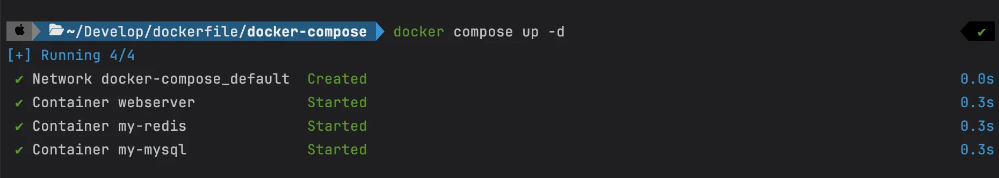

</details>

<details>
<summary>3&#46; compose 실행 현황 보기</summary>

<a id="1c3eda9b0fe181baa8aaf18c161753a7"></a>

```bash
docker compose ls
```

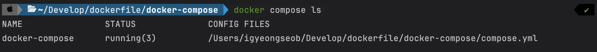

<a id="1c3eda9b0fe1810c988cc60f72d39c2a"></a>

```bash
docker compose ps
docker ps
```

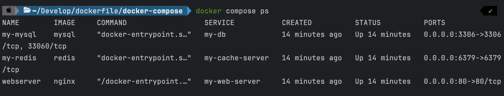

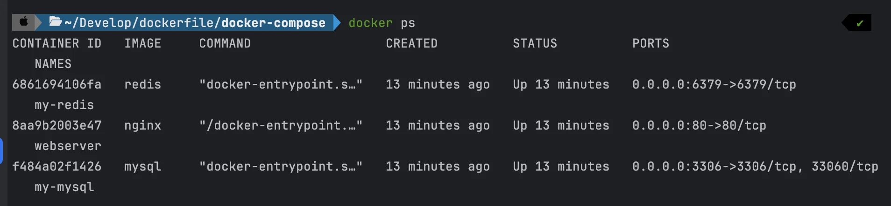

</details>

<details>
<summary>4&#46; DB 연결 → 정상 동작 확인</summary>

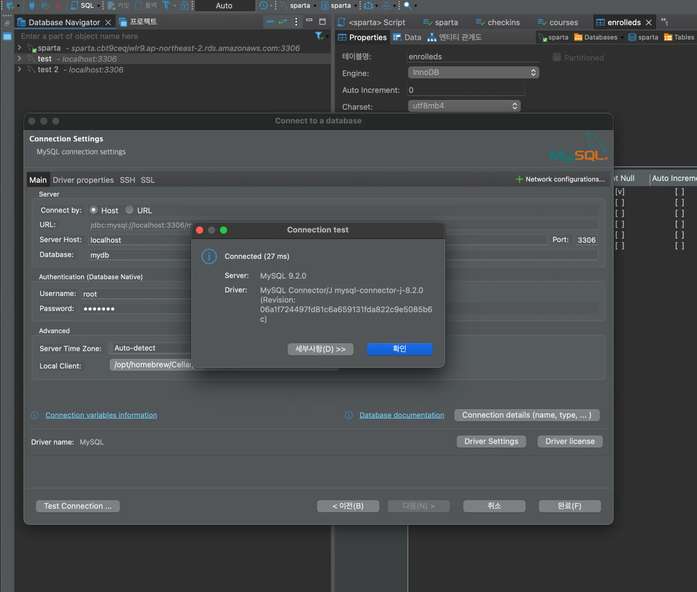

<details>
<summary>Driver properties 변경 필요</summary>

- <code>allowPublicKeyRetrieval</code>&#58; false → <code>true</code>
    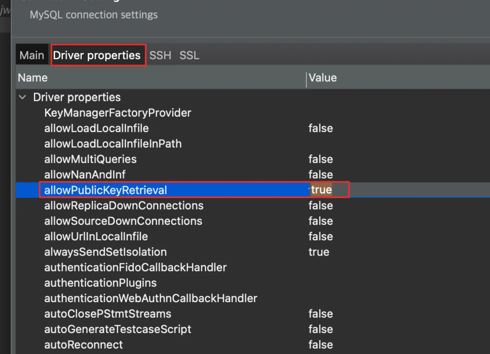

- <code>useSSL</code>&#58; true → <code>false</code>
    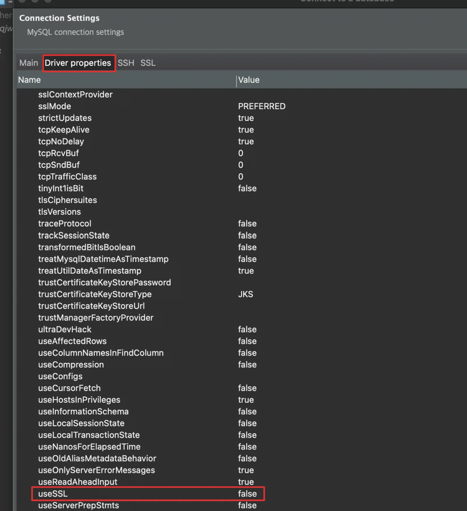

</details>

</details>

<details>
<summary>5&#46; volume 데이터 저장 확인</summary>

<a id="1c3eda9b0fe181c6b81bce9fe104357a"></a>

```bash
# local Voluem 설정 dir로 이동
cd /Users/igyeongseob/Develop/docker-mysql/mysql_data

# data 저장 확인
ls

# 생성한 db 내부 확인
ls ./mydb
```

- volume으로 설정한 directory로 이동
    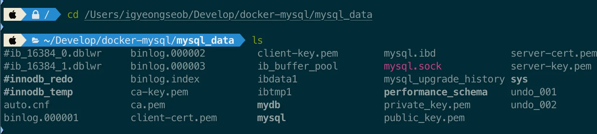

- 생성한 db 확인
    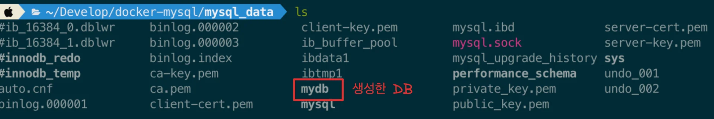

- 생성한 Table 확인
    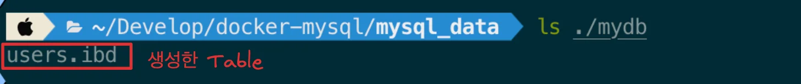

</details>

<details>
<summary>6&#46; compose 컨테이너 삭제</summary>

<a id="1c3eda9b0fe181309cc2c9153fb876c7"></a>

```bash
docker compose down
```

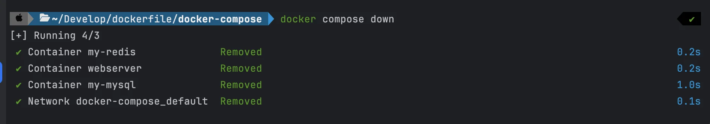

</details>
