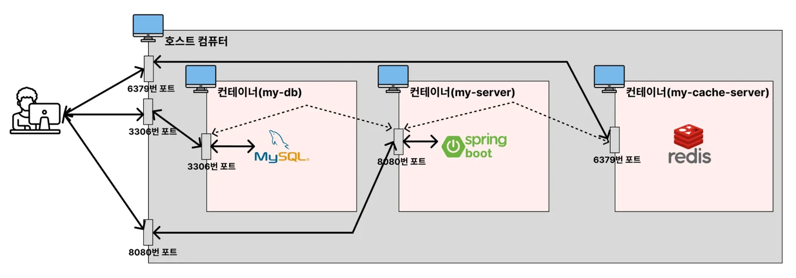
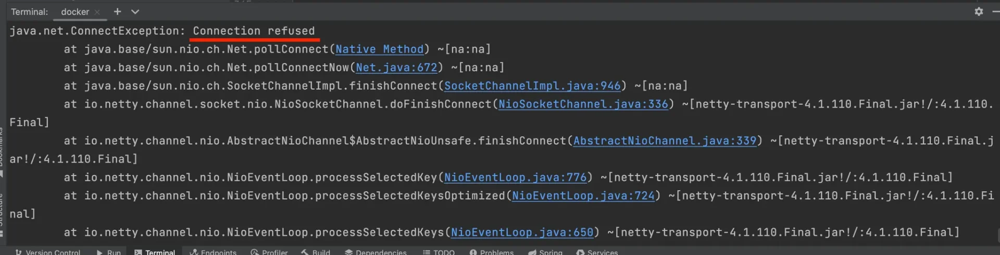
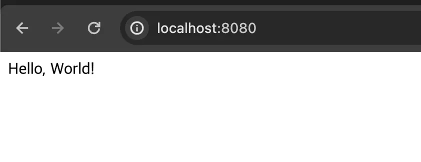
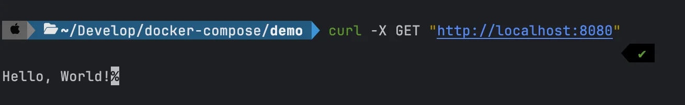
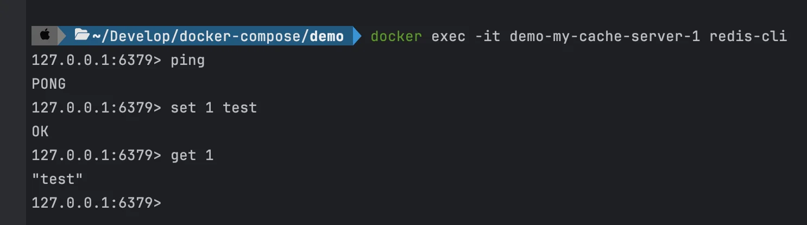

<a id="1c3eda9b0fe181dd9f91df5e3b78de2d"></a>

### &#91; 실습 &#93; Spring Boot, MySQL, Redis

---



<details>
<summary>1&#46; Redis dependency 추가</summary>

- <strong>build&#46;gradle</strong>
    <a id="1c3eda9b0fe1812080f7fd7fcdacd919"></a>

    ```bash
    ...

    dependencies {
    	...
    	implementation 'org.springframework.boot:spring-boot-starter-data-redis'
    }

    ```

</details>

<details>
<summary>2&#46;  Redis 설정 정보 추가 및 프로젝트 세팅</summary>

- <strong>RedisConfig</strong>
    <a id="1c3eda9b0fe181a7bac5daee3fa90868"></a>

    ```java
    @Configuration
    public class RedisConfig {

        @Bean
        public RedisTemplate<String, Object> redisTemplate(RedisConnectionFactory connectionFactory) {
            RedisTemplate<String, Object> template = new RedisTemplate<>();
            template.setConnectionFactory(connectionFactory);

            // 직렬화 설정
            template.setKeySerializer(new StringRedisSerializer());
            template.setValueSerializer(new GenericJackson2JsonRedisSerializer());
            
            return template;
        }
    }

    ```

- <strong>AppController</strong>
    <a id="1c3eda9b0fe181d5988de437a22c915e"></a>

    ```java
    @RestController
    public class AppController {

      @Autowired
      private RedisTemplate<String, Object> redisTemplate;

      @GetMapping("/")
      public String home() {
        redisTemplate.opsForValue().set("abc", "def");
        return "Hello, World!";
      }
    }
    ```

- Dockerfile
    <a id="1c3eda9b0fe181898528f629ab30108b"></a>

    ```docker
    FROM openjdk:17-jdk

    COPY build/libs/*SNAPSHOT.jar /app.jar

    ENTRYPOINT ["java", "-jar", "/app.jar"]
    ```

- <strong>application&#46;yml</strong>
    <a id="1c3eda9b0fe181dfa7daf7899bab9992"></a>

    ```yaml
    spring:
      datasource:
        url: jdbc:mysql://my-db:3306/mydb
        username: root
        password: pwd1234
        driver-class-name: com.mysql.cj.jdbc.Driver
      data:
        redis:
          host: localhost  -> 이전 챕터와 동일한 오류 발생
          port: 6379
    ```

- <strong>compose&#46;yml</strong>
    <a id="1c3eda9b0fe181469c55f7a58653a2d9"></a>

    ```yaml
    services:
      my-server:
        build: .
        ports:
          - 8080:8080
        depends_on:
          my-db:
            condition: service_healthy
          my-cache-server:
            condition: service_healthy  
      my-db:
        image: mysql
        environment:
          MYSQL_ROOT_PASSWORD: pwd1234
          MYSQL_DATABASE: mydb
        volumes:
          - ./mysql_data:/var/lib/mysql
        ports:
          - 3306:3306
        healthcheck:
          test: [ "CMD", "mysqladmin", "ping" ]
          interval: 5s
          retries: 10
      my-cache-server:
        image: redis
        ports:
          - 6379:6379
        healthcheck:
          test: [ "CMD", "redis-cli", "ping" ]
          interval: 5s
          retries: 10
    ```

</details>

<details>
<summary>3&#46; 컨테이너 실행</summary>

<a id="1c3eda9b0fe181248e7cd6e06e30523e"></a>

```bash
./gradlew clean build
docker compose down
docker compose up --build -d
```

- <a href="http://localhost">localhost</a>&#58;8080 호출
    

    - <code>Connection refused</code> 에러가 발생
        <a id="1c3eda9b0fe18185ae35eb22e73916f2"></a>

        → Redis 연결 실패

    - <strong>application&#46;yml</strong>
        <a id="1c3eda9b0fe1819f9610fef62dfa1f9f"></a>

        ```yaml
        spring:
          datasource:
            url: jdbc:mysql://my-db:3306/mydb
            username: root
            password: pwd1234
            driver-class-name: com.mysql.cj.jdbc.Driver
          data:
            redis:
              host: localhost
              host: my-cache-server
              port: 6379
        ```

    <a id="1c3eda9b0fe181f4b9e8e43734495534"></a>

    <strong><u>각 컨테이너는 각자의 네트워크를 가지고 있</u></strong>기 때문에, localhost가 아니라 <strong><u>Redis가 실행되고 있는 컨테이너로 통신</u></strong>을 해야 한다

    <a id="1c3eda9b0fe1812d9b1afe3ad42f6bc2"></a>

    따라서 localhost가 아닌 <code>compose&#46;yml</code>에 정의한 <strong><u>service 이름으로 수정</u></strong>해야 한다&#46;

    - host&#58; <code>localhost</code> → <code>my&#45;cache&#45;server</code>

    <a id="1c3eda9b0fe181558ca8f7d6c41fabc8"></a>

    ```bash
    ./gradlew clean build
    docker compose down
    docker compose up --build -d
    ```

    

    <a id="1c3eda9b0fe181d989d6e08231c1833e"></a>

    컨테이너 재실행 시 , 위와 같이 오류없이 정상 실행되는 것을 확인할 수 있다&#46;

    <a id="1c3eda9b0fe18101904df0ca0ffe9929"></a>

    ```plaintext
    curl -X GET "http://localhost:8080"
    ```

    

    

</details>
