<details>
<summary><strong>이전 요구사항</strong></summary>

> 📌 
> 
> <a id="1faeda9b0fe180139f86d118e7b2a484"></a>
> 
> <strong>기존 요구사항</strong>
> 
> ---
> 
> - 모든 PUBLIC 메서드의 호출과 응답 정보를 로그로 출력
> 
> - 애플리케이션의 흐름을 변경하면 안됨
>     - 로그를 남긴다고 해서 비즈니스 로직의 동작에 영향을 주면 안됨
> 
> - 메서드 호출에 걸린 시간
> 
> - 정상 흐름과 예외 흐름 구분
>     - 예외 발생시 예외 정보가 남아야 함
> 
> - 메서드 호출의 깊이 표현
> 
> - HTTP 요청을 구분
>     - HTTP 요청 단위로 특정 ID를 남겨서 어떤 HTTP 요청에서 시작된 것인지 명확하게 구분이 가능해야 함
> 
>     - 트랜잭션 ID (DB 트랜잭션X)

<details>
<summary>로그추적기 실행 예시 </summary>

<a id="1faeda9b0fe1806ab855e5b39573f080"></a>

```java
// 정상 요청
[796bccd9] OrderController.request()
[796bccd9] |-->OrderService.orderItem()
[796bccd9] |   |-->OrderRepository.save()
[796bccd9] |   |<--OrderRepository.save() time=1004ms
[796bccd9] |<--OrderService.orderItem() time=1014ms
[796bccd9] OrderController.request() time=1016ms
 
// 예외 발생
[b7119f27] OrderController.request()
[b7119f27] |-->OrderService.orderItem()
[b7119f27] | |-->OrderRepository.save() 
[b7119f27] | |<X-OrderRepository.save() time=0ms ex=java.lang.IllegalStateException: 예외 발생! 
[b7119f27] |<X-OrderService.orderItem() time=10ms ex=java.lang.IllegalStateException: 예외 발생! 
[b7119f27] OrderController.request() time=11ms ex=java.lang.IllegalStateException: 예외 발생
```

</details>

<a id="1faeda9b0fe180a99509d1608b1f8eaf"></a>

해당 요구사항을 적용하여 위 예시와 같이 출력하기 위해서는 기존의 코드를 많이 수정해야 했다&#46; 

<a id="1faeda9b0fe180f3b041d56525a7e147"></a>

코드 수정을 최소화하기 위해 템플릿 메서드 패턴, 콜백 패턴도 사용했지만, 결과적으로 <strong><u>로그를 남기고 싶은 클래스가 수백개라면 수백개의 클래스를 모두 고쳐야한다</u></strong>&#46; 

<a id="1faeda9b0fe18060bbe6c1711a67ce41"></a>

<strong>로그를 남길 때 기존 원본 코드를 변경</strong>해야 한다는 것 자체가 <strong><u>여전히 문제로 남</u></strong>는다&#46;

</details>

> 📌 
> 
> <a id="1faeda9b0fe180c4bfe8cfafe81c6527"></a>
> 
> <strong>요구사항</strong>
> 
> ---
> 
> - <strong>원본 코드를 수정하지 않고, 로그 추적기 적용</strong>
> 
> - 특정 메서드는 로그를 출력하지 않아야 함
>     - 보안상 일부는 로그를 출력하면 안된다&#46;
> 
> - 아래와 같은 다양한 케이스에 적용할 수 있어야 한다&#46;
>     - <code>V1</code> &#45; 인터페이스가 있는 구현 클래스
> 
>     - <code>V2</code> &#45; 인터페이스가 없는 구체 클래스 
> 
>     - <code>V3</code> &#45; 컴포넌트 스캔 대상에 기능 적용

> ☝🏻 
> 
> <a id="1faeda9b0fe1801eaf35fe13231d2e9a"></a>
> 
> 가장 어려운 문제는 <strong><u>원본 코드를 전혀 수정하지 않고, 로그 추적기를 도입</u></strong>하는 것이다&#46; 
> 
> <a id="1faeda9b0fe180c0a54ff31906783849"></a>
> 
> 해당 문제를 해결하기 위해서 먼제 <strong><u>프록시(Proxy)</u></strong><strong><u>의 개념</u></strong>을 이해해야 한다&#46; 

<a id="1faeda9b0fe180f3b316ecdde1a24b68"></a>

## 프록시, 프록시 패턴, 데코레이터 패턴

---

<a id="1faeda9b0fe18044b356ee413f4a4b1b"></a>

### 프록시 

> ✏️ 
> 
> <a id="1faeda9b0fe1804ba6ecc29bcba00840"></a>
> 
> <strong>프록시의 주요 기능</strong>
> 
> ---
> 
> <a id="1faeda9b0fe18056aebcf2cd9c97f3e4"></a>
> 
> 프록시를 통해서 할 수 있는 일은 크게 2가지로 구분할 수 있다&#46;
> 
> 1. <strong><code>접근 제어</code></strong>
>     - 권한에 따른 접근 차단
> 
>     - 캐싱
> 
>     - 지연 로딩
> 
> 1. <strong><code>부가 기능 추가</code></strong>
>     - 원래 서버가 제공하는 기능에 더해서 부가 기능을 수행한다 &#46;
> 
>     - ex) 요청 값이나, 응답 값을 중간에 변형한다&#46;
> 
>     - ex) 실행 시간을 측정해서 추가 로그를 남긴다&#46; 

<details>
<summary><code>Client</code> 와 <code>Server</code>의 의미</summary>

<a id="1faeda9b0fe1808dad12e27a4aa25f14"></a>

클라이언트 와 서버라고 하면 일반적으로 서버 컴퓨터를 생각한다&#46;

<a id="1faeda9b0fe180cd8a1adbf734c2f8ce"></a>

그러나 실제로 클라이언트와 서버의 개념은 상당히 넓게 사용된다&#46; 

<a id="1faeda9b0fe180e291a1c5d92aa59f24"></a>

<code>클라이언트</code>는 ‘<strong><u>의뢰인’</u></strong>이라는 뜻이고, <code>서버</code>는 ‘<strong><u>서비스나 상품을 제공하는 사람이나 물건’</u></strong>을 뜻한다&#46; 

<a id="1faeda9b0fe180bcafd6e9df1bb338fb"></a>

따라서 클라이트와 서버의 기본 개념을 정의한다면 아래와 같다&#46; 

> ✏️ 
> 
> <a id="1faeda9b0fe180c18072f5355672ecfa"></a>
> 
> <strong>클라이언트와 서버의 정의</strong>
> 
> ---
> 
> 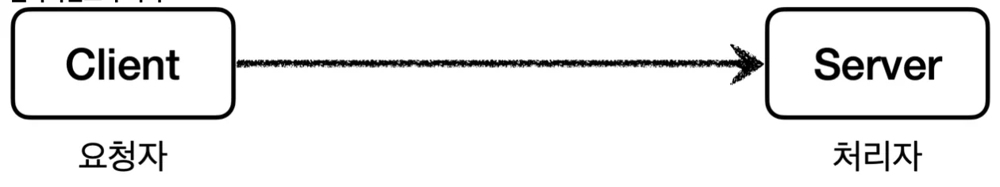
> 
> - <code>클라이언트</code>&#58; 서버에 필요한 것을 요청
> 
> - <code>서버</code>&#58; 클라이언트의 요청을 처리

- 이러한 개념을 <strong>컴퓨터 내트워크에 도입</strong>하면 <code>클라이언트</code>는 <strong><u>웹 브라우저</u></strong>가 되고, <strong><u>요청을 처리</u></strong>하는 <strong><code>서버</code></strong>는 <strong><u>웹 서버</u></strong>가 된다 &#46;

- 또한 <strong>객체에 도입</strong>하면, <strong><u>요청하는 객체</u></strong>는 <code>클라이언트</code>가 되고, <strong><u>요청을 처리하는 객체</u></strong>는 <code>서버</code>가 된다&#46; 

</details>

<details>
<summary><code>직접 호출</code>, <code>간접 호출</code></summary>


- 클라이언트와 서버 개념에서 일반적으로 클라이언트가 서버를 직접 호출하고, 처리 결과를 직접 받는다&#46;  
    <a id="1faeda9b0fe18080bc02c3c370d3fc5a"></a>

      ⇒ <strong>직접 호출</strong>

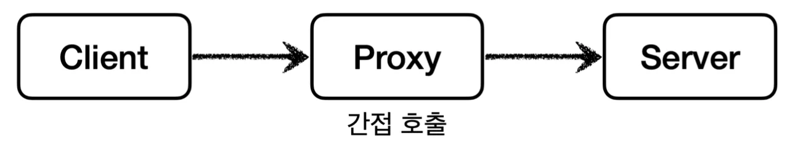

- 클라이언트가 요청한 결과를 서버에 직접 요청하는 것이 아닌 <strong><u>어떤 대리자를 통해서 간접적으로 서버에 요청 가능</u></strong>하다&#46; 

- 이렇게 간접 처리를 해주는 <strong><u>대리자</u></strong><strong>를 영어로 </strong><strong><u>프록시(Proxy)</u></strong>라 한다 &#46;

</details>

<details>
<summary><strong><u>프록시</u></strong>의 역할</summary>

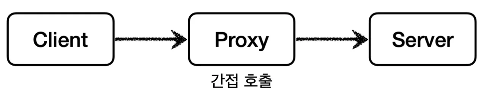

<a id="1faeda9b0fe1806f8877e0eb87203b43"></a>

이렇게 <strong><u>대리자( 프록시 )를 통해 </u></strong><strong><u>간접 호출</u></strong>을 하면 <strong>대리자가 중간에 여러가지 일을 할 수 있</strong>다&#46; 

<details>
<summary><strong>1&#46; 접근 제어, 캐싱</strong></summary>

- ex)
    > ✏️ 
    > 
    > - 나&#58; 클라이언트 
    > 
    > - 어머니(집)&#58; 프록시
    > 
    > - 라면&#58; 응답
    > 
    > - 가게&#58; 서버 

    - 집에서 라면을 먹고 싶어 어머니에게 라면을 사달라고 부탁을 했는데, 어머니께서 집에 라면이 이미 있다고 하신다&#46; 그러면 장보는 시간을 기다릴 필요없이 집에 가서 바로 라면을 먹을 수 있다&#46; 

</details>

<details>
<summary><strong>2&#46; 부가 기능 추가</strong></summary>

- ex)
    > ✏️ 
    > 
    > - 나&#58; 클라이언트 
    > 
    > - 아버지&#58; 프록시
    > 
    > - 자동차 주유&#58; 요청
    > 
    > - 세차&#58; 부가기능

    - 아버지께 자동차 주유를 부탁했는데, 차가 더럽다고 세차까지 해주셨다&#46; 

    - 내가 실제 요청한 기대 값 외에 부가적인 기능까지 얻었다&#46; 

</details>

<details>
<summary><strong>3&#46; 프록시 체인</strong></summary>

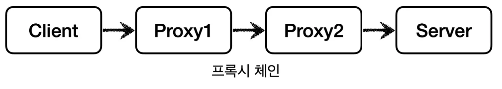

- 대리자가 또 다른 대리자를 부를 수 있다&#46; <br>이를 체인 형태를 이룬다고 하여 프록시 체인이라고 한다&#46; 

- ex)
    > ✏️ 
    > 
    > - 나&#58; 클라이언트
    > 
    > - 동생, 어머니, 아버지&#58; 프록시
    > 
    > - 라면&#58; 요청

    - 내가 동생에게 라면을 사와달라고 했는데 동생은 어머니에게 부탁을 했다&#46; <br>또 어머니는 아버지에게 부탁을 했다&#46; 

    - 여기서 중요한 점을 나는 동생에게 부탁을 했기 때문에 이후 과정에 대해서는 모르며 동생을 통해서 나에게 라면을 도착하는 것을 기다리기만 하면 된다

</details>

</details>

<details>
<summary>프록시 조건 &#45; 대체 가능</summary>

> 📌 
> 
> <a id="1faeda9b0fe180789453ca8e81f46c14"></a>
> 
> <strong>프록시 &#45; 대체가능</strong>
> 
> ---
> 
> - 아무 객체나 프록시가 될수 없다&#46; 
> 
> - 객체에서 프록시가 되려면 <strong><u>클라이언트는 서버에게 요청을 한것인지, 프록시에게 요청한 것인지 조차 몰</u></strong>라야 한다&#46;
> 
> - 쉽게 얘기해서 서버와 프록시는 <strong><u>같은 인터페이스를 사용</u></strong>해야 한다&#46; 
> 
> - 그리고 클라이언트가 사용하는 서버 객체를 <strong><u>프록시 객체로 변경</u></strong>해도 <strong><u>클라이언트 코드를 변경하지 않</u></strong><strong><u>고 동작할 수 있</u></strong>어야 한다&#46;

<details>
<summary><code>서버</code>와 <code>프록시</code>는 <strong><u>같은 인터페이스를 사용</u></strong>해야 한다&#46;</summary>

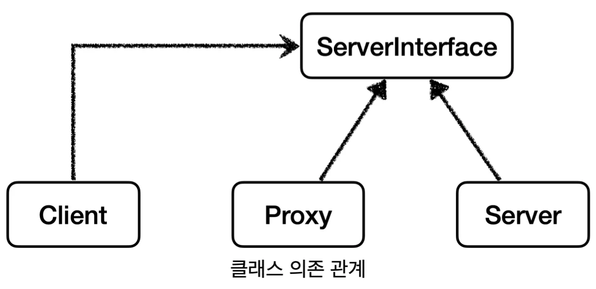

- 클라이언트는 서버 인터페이스(<code>ServerInterface</code>)에만 의존한다&#46; <br>그리고 서버와 프록시가 같은 인터페이스를 사용한다&#46; 

- 따라서 <code>DI</code>를 통해 대처 가능하다&#46; 

</details>

<details>
<summary> <code>DI</code>를  통해 <strong><u>클라이언트 코드 변경없이 유연하게 프록시를 주입</u></strong>할 수 있다&#46; </summary>

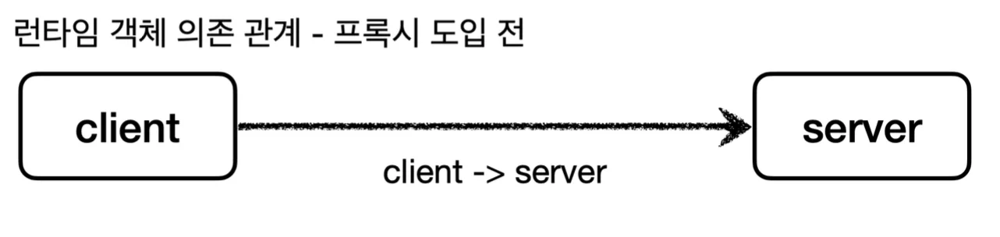

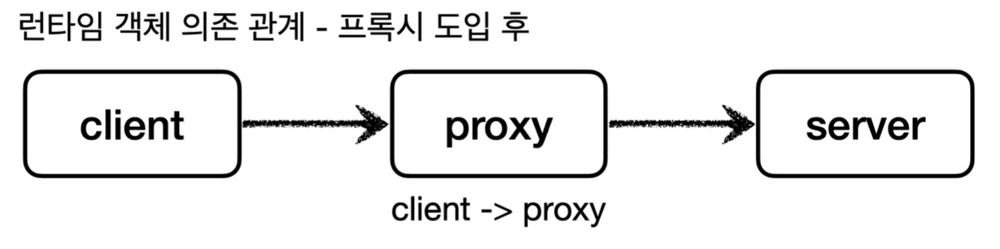

- 런타임(애플리케이션 실행 시점)에 클라이언트 객체에 <code>DI</code>를 사용해 <code>Client</code> → <code>Server</code> 에서 <code>Client</code> → <code>Proxy</code>로 객체 의존관계가 변경되어도 클라이언트 코드가 변경되지 않는다&#46; 

- 클라이언트 입장에서는 변경 사실 조차 모른다&#46; 

</details>

</details>

> ✏️ 
> 
> <a id="1faeda9b0fe1806f9a7ae80b1e1076ac"></a>
> 
> <strong>GOF 디자인 패턴 &#45; 프록시 </strong>
> 
> ---
> 
> > 프록시 패턴과 데코레이터 패턴 모두 프록시를 사용한다&#46;
> > 
> > -  둘다 프록시를 사용하지만, 목적이 다르다&#46; 
> 
> <a id="1faeda9b0fe180faa90ef30137dea713"></a>
> 
> GOF 디자인 패턴에서는 이 둘을 <strong><u>의도(intent)</u></strong>에 따라서 프록시 패턴과 데코레이터 패턴으로 구분한다&#46; 
> 
> - <code>프록시 패턴</code>&#58; 접근 제어가 목적
> 
> - <code>데코레이터 패턴</code>&#58; 새로운 기능 추가가 목적
> 
> <a id="1faeda9b0fe1809ba5fdc2b9ad282f62"></a>
> 
> 자세한 내용은 아래 예제 코드 확인

> ☝🏻 
> 
> <a id="1faeda9b0fe180af9774eccf825611d7"></a>
> 
> <strong>참고</strong>
> 
> <a id="1faeda9b0fe180c196befae540971cd5"></a>
> 
> ‘프록시’ 라는 개념은 클라이언트, 서버라는 큰 개념안에서 자연스럽게 발생할 수 있다&#46; 
> 
> <a id="1faeda9b0fe180f3afcfd5dc14659c04"></a>
> 
> 프록시는 객체 안에서의 개념도 있고, <strong><u>웹 서버에서의 프록시</u></strong>도 있다&#46; 
> 
> <a id="1faeda9b0fe18002b8d2f14158791d4b"></a>
> 
> 객체 안에서 객체로 구현되어있는가, 웹 서버로 구현되어 있는가 처럼 <strong><u>규모의 차이가 있을 뿐 근본적인 역할은 같</u></strong>다&#46;

<a id="1faeda9b0fe180a0bd82f27c3a42b196"></a>

### 프록시 패턴

<details>
<summary>1&#46; 기본 예제 ( 프록시 패턴 적용 전 )</summary>

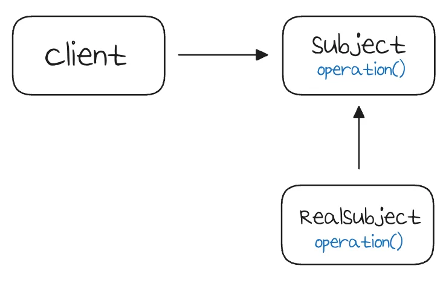

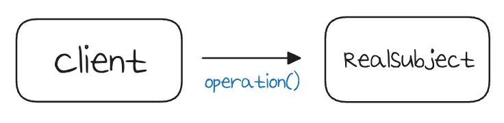

<a id="1faeda9b0fe180fa9513fb859f9c1ab8"></a>

### 코드

<details>
<summary>&#91; 코드 &#93; &#60;<strong>interface</strong>&#62; Subject</summary>

<a id="1faeda9b0fe1800fa2c9e82a0b56dff0"></a>

```java
package com.inflearn.lecture_prac.pureproxy.proxy.code;

public interface Subject {
    String operation();
}
```

</details>

<details>
<summary>&#91; 코드 &#93; RealSubject</summary>

<a id="1faeda9b0fe180289db9c340c345e2ba"></a>

```java
package com.inflearn.lecture_prac.pureproxy.proxy.code;

import lombok.extern.slf4j.Slf4j;

@Slf4j
public class RealSubject implements Subject {

    @Override
    public String operation() {
        log.info("실제 객체 호출");
        sleep(1000);
        return "data";
    }

    private void sleep(int millis) {
        try {
            Thread.sleep(millis);
        } catch (InterruptedException e) {
            e.printStackTrace();
        }
    }
}
```

- Subject 인터페이스를 구현한 구현체이다&#46; 

- operation()은 데이터 조회를 시뮬레이션 하기위해 1초 쉬도록 했다&#46; 

- 예를 들어서 데이터를 DB나 외부에서 조회하는데 1초가 걸린다 라고 생각하면 된다&#46; 

- 호출할 때 마다 시스템에 큰 부하를 주는 데이터 조회라고 가정하자&#46;

</details>

<details>
<summary>&#91; 코드 &#93; ProxyPatternClient</summary>

<a id="1faeda9b0fe1806fabbaf22b5d075223"></a>

```java
package com.inflearn.lecture_prac.pureproxy.proxy.code;

public class ProxyPatternClient {

    private Subject subject;

    public ProxyPatternClient(Subject subject) {
        this.subject = subject;
    }

    public void excute() {
        subject.operation();
    }
}
```

</details>

<details>
<summary>&#91; 코드 &#93; ProxyPatternTest</summary>

<a id="1faeda9b0fe1804b8e2ae2d6d972dc1d"></a>

```java
package com.inflearn.lecture_prac.pureproxy.proxy;

import com.inflearn.lecture_prac.pureproxy.proxy.code.ProxyPatternClient;
import com.inflearn.lecture_prac.pureproxy.proxy.code.RealSubject;
import org.junit.jupiter.api.Test;

public class ProxyPatternTest {

    @Test
    void noProxyTest() {
        RealSubject realSubject = new RealSubject();
        ProxyPatternClient client = new ProxyPatternClient(realSubject);
        client.excute();
        client.excute();
        client.excute();
    }
}
```

<a id="1faeda9b0fe1800f9910c7845f191ac5"></a>

<strong>실행 로그</strong>

<a id="1faeda9b0fe180f5a6dccd409817f331"></a>

```java
RealSubject -- 실제 객체 호출
RealSubject -- 실제 객체 호출
RealSubject -- 실제 객체 호출
```

</details>

> ✏️ 
> 
> <a id="1faeda9b0fe180909336cc9a31a1679d"></a>
> 
> 프록시 객체 &#45; 접근제어, 캐시
> 
> ---
> 
> <a id="1faeda9b0fe180a190e5f0648267aafd"></a>
> 
> <code>ProxyPatternTest</code> 에서 <code>client&#46;execute()</code>을  3번 호출한다&#46;
> 
> 1. <code>client → realSubject</code> 를 호출해서 값을 조회한다&#46; (1초)
> 
> 1. <code>client → realSubject</code> 를 호출해서 값을 조회한다&#46; (1초)
> 
> 1. <code>client → realSubject</code> 를 호출해서 값을 조회한다&#46; (1초)
> 
> <a id="1faeda9b0fe180468c4ee5749f0d12d3"></a>
> 
> 조회하는 데이터가 변하지 않는 값이라면, 위와 같이 매번 조회하기 보다는 어딘가 보관해두고 이미 조회한 데이터를 사용하는 것이 성능상 좋다&#46; 
> 
> <a id="1faeda9b0fe180df97ceede5f635fd10"></a>
> 
> 이것을 ‘캐시’라 한다&#46; 
> 
> <a id="1faeda9b0fe18055846becdbf8051758"></a>
> 
> 프록시 패턴의 주요 기능은 접근 제어이다&#46; 그리고 캐시도 접근 자체를 제어하는 기능 중 하나이다&#46; 
> 
> - 서버에 접근하기 전에 캐시 저장소에 저장된 데이터를 응답한다&#46; 
> 
> <a id="1faeda9b0fe180efb0ebfc79ab038917"></a>
> 
> 프록시 패턴을 사용하면 기존 로직을 전혀 수정하지 않고, 프록시 객체를 통해서 캐시를 적용할 수 있다&#46; 

</details>

<details>
<summary>2&#46; 프록시 패턴 적용</summary>

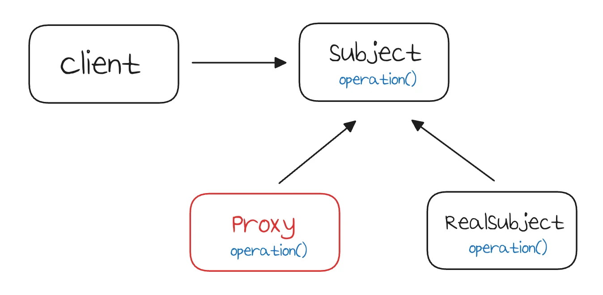

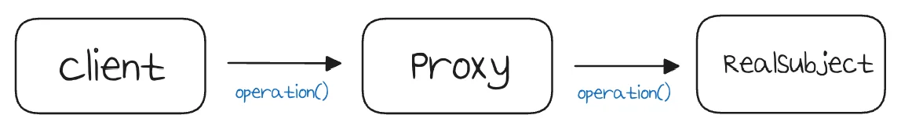

<a id="1faeda9b0fe180969717ec35761f529d"></a>

### 코드

<details>
<summary>&#91; 코드 &#93; CacheProxy</summary>

<a id="1faeda9b0fe180c79d96c626f8fc9d85"></a>

```java
package com.inflearn.lecture_prac.pureproxy.proxy.code;

import lombok.extern.slf4j.Slf4j;

@Slf4j
public class CacheProxy implements Subject {

    private Subject target;
    private String cacheValue;

    public CacheProxy(Subject target) {
        this.target = target;
    }

    @Override
    public String operation() {
        log.info("프록시 호출");
        if (cacheValue == null) {
            cacheValue = target.operation();
        }
        return cacheValue;
    }
}
```

</details>

<details>
<summary>&#91; 코드 &#93; ProxyPatternTest</summary>

<a id="1faeda9b0fe18035b4b1d9e9a96c28f1"></a>

```java
package com.inflearn.lecture_prac.pureproxy.proxy;

import com.inflearn.lecture_prac.pureproxy.proxy.code.ProxyPatternClient;
import com.inflearn.lecture_prac.pureproxy.proxy.code.RealSubject;
import com.inflearn.lecture_prac.pureproxy.proxy.code.CacheProxy;
import org.junit.jupiter.api.Test;

public class ProxyPatternTest {

		. . .

    @Test
    void noProxyTest() {
				Subject realSubject = new RealSubject();
        Subject cacheProxy = new CacheProxy(realSubject);
        ProxyPatternClient client = new ProxyPatternClient(cacheProxy);
        client.excute();
        client.excute();
        client.excute();
    }
}
```

<a id="1faeda9b0fe180e8af00ec6d5ce676cb"></a>

<strong>실행 로그</strong>

<a id="1faeda9b0fe18096a2a6cfba9ecefc13"></a>

```java
CacheProxy -- 프록시 호출
RealSubject -- 실제 객체 호출
CacheProxy -- 프록시 호출
CacheProxy -- 프록시 호출
```

<details>
<summary><code>cacheProxyTest()</code></summary>

<a id="1faeda9b0fe18038bfd6db6de24877d6"></a>

<code>realSubject</code> 와 <code>cacheProxy</code>를 생성하고 둘을 연결한다&#46;  

<a id="1faeda9b0fe180f2ba17f49f39b16119"></a>

결과적으로 <code>cacheProxy</code>가 <code>realSubject</code>를 참조하는 런타임 객체 의존관계가 완성된다&#46; 그리고 마지막으로 <code>client</code>에 <code>realSubject</code>가 아닌 <code>cacheProxy</code>를 주입한다&#46; 

- <strong><code>client</code></strong><code> → </code><strong><code>cacheProxy</code></strong><code> → </code><strong><code>realSubject</code></strong>

</details>

<details>
<summary><code>client&#46;execute()</code> 3번 호출</summary>

> 이전 테스트와 동일하게  <code>client&#46;execute()</code> 3번 호출한다&#46; 

> /icons/refresh_gray.svg 
> 
> 1. client의 cacheProxy 호출 → cacheProxy에 캐시 값이 없다&#46; → realSubject를 호출, 결과를 캐시에 저장 (<code>1초</code>)
> 
> 1. client의 cacheProxy 호출 → cacheProxy에 캐시 존재  → cacheProxy에서 즉시 반환 (<code>0초</code>)
> 
> 1. client의 cacheProxy 호출 → cacheProxy에 캐시 존재 → cacheProxy에서 즉시 반환 (<code>0초</code>)

<a id="1faeda9b0fe180468a1ddf17ae72e72d"></a>

결과적으로 캐시 프록시를 도입하기 전에 3초가 걸렸지만, 캐시 프록시 도입 후 최초의 한번만 1초가 걸리고, 이후에는 거의 즉시 반환한다&#46; 

- 캐시를 통해 테스트 실행 속도가 <strong><u>약 2배 더 빠르게 개선</u></strong>됨
    ![[프록시 객체 - 캐시\] 적용 전](7222dbb538693b9e.webp)

    ![[프록시 객체 - 캐시\] 적용 후](f6097171b9390f3a.webp)

</details>

</details>

</details>

> 🗒️ 
> 
> <a id="1faeda9b0fe1800b88fbe3cd3b7cb6e5"></a>
> 
> <strong>정리</strong>
> 
> ---
> 
> <a id="1faeda9b0fe180deada4cc02c4edf25d"></a>
> 
> 프록시 패턴의 핵심은 <strong><u>RealSubject 코드와 클라이언트 코드를 </u></strong><strong><u>전혀 변경하지 않</u></strong>고 <strong><u>프록시를 도입</u></strong>해서<strong><u> </u></strong><strong><u>접근 제어</u></strong><strong><u>를 했다</u></strong>는 점이다&#46;<br>그리고<u> 클라이언트 코드의 변경 없</u>이 <u>자유롭게 프록시를 넣고 뺄 수 있</u>다&#46; <br>실제 <strong>클라이언트 입장</strong>에서는 <u>프록시 객체가 주입되었는지, 실제 객체가 주입되었는지 알지 못</u>한다&#46;

<a id="1faeda9b0fe1807f9fede805ee7f1efc"></a>

### 데코레이터 패턴

> ✏️ 
> 
> <a id="1fbeda9b0fe1803fae53cedfdd5dccf2"></a>
> 
> 앞서 프록시를 통해 가능한 기능은 크게 <code>접근 제어</code> 와 <code>부가 기능 추가</code>, 2가지가 있다는 것을 배웠다&#46; 그리고 <u>프록시 패턴</u>에서 <strong><u>캐시</u></strong>를 통한 <code>접근 제어</code>를 알아보았다&#46; 
> 
> <a id="1fbeda9b0fe180fbafd6f39c2e043ee1"></a>
> 
> 이번에는 <strong><u>프록시를 활용한 부가 기능을 추가</u></strong>하는 방법을 배우며, 이러한 문제해결 방식을 <strong>데코레이터 패턴</strong>이라 한다&#46; 

<details>
<summary>1&#46; 기본 예제  &#45; 데코레이터 패턴 적용 전</summary>

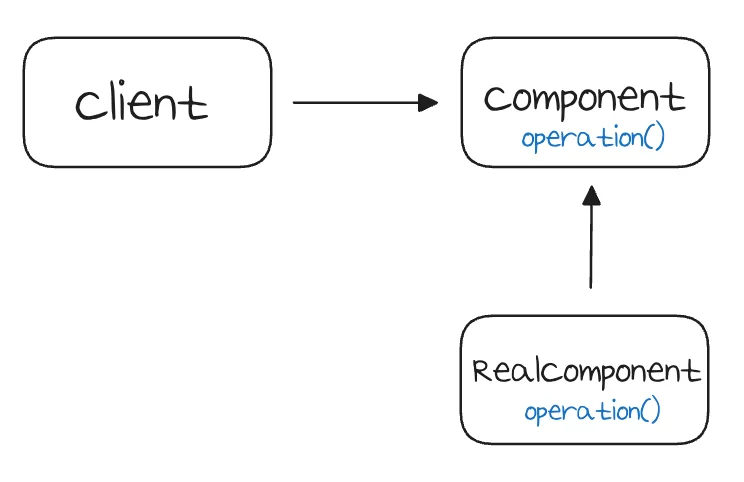

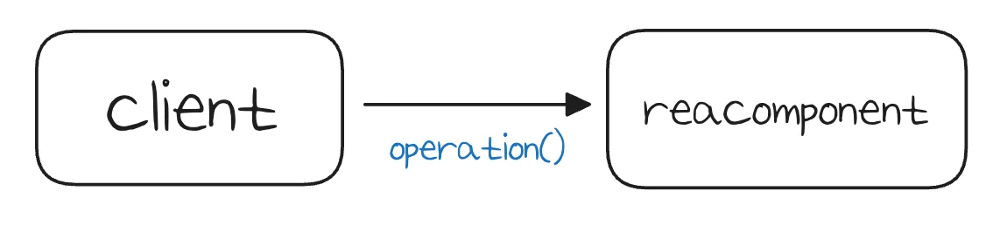

<a id="1fbeda9b0fe18067b4c0fc8219a7205b"></a>

### 코드

<details>
<summary>&#91; 코드 &#93; <strong>Component</strong></summary>

<a id="1fbeda9b0fe180e6945df774bfc55f29"></a>

```java
package com.inflearn.lecture_prac.pureproxy.decorator.code;

public interface Component {
    String operation();
}
```

</details>

<details>
<summary>&#91; 코드 &#93; <strong>RealComponent</strong></summary>

<a id="1fbeda9b0fe180f3ae81c9814c7b899f"></a>

```java
package com.inflearn.lecture_prac.pureproxy.decorator.code;

import lombok.extern.slf4j.Slf4j;

@Slf4j
public class RealComponent implements Component {

    @Override
    public String operation() {
        log.info("RealComponent 실행");
        return "data";
    }
}
```

</details>

<details>
<summary>&#91; 코드 &#93; <strong>DecoratorPatternClient</strong></summary>

<a id="1fbeda9b0fe180469cb1d3f93d47e97e"></a>

```java
package com.inflearn.lecture_prac.pureproxy.decorator.code;

import lombok.extern.slf4j.Slf4j;

@Slf4j
public class DecoratorPatternClient {

    private Component component;

    public DecoratorPatternClient(Component component) {
        this.component = component;
    }

    public void execute() {
        String result = component.operation();
        log.info("result={}", result);
    }
}
```

</details>

<details>
<summary>&#91; 테스트 &#93; <strong>DecoratorPatternTest</strong></summary>

<a id="1fbeda9b0fe18093b2fddadb411e2606"></a>

```java
package com.inflearn.lecture_prac.pureproxy.decorator;

import com.inflearn.lecture_prac.pureproxy.decorator.code.Component;
import com.inflearn.lecture_prac.pureproxy.decorator.code.DecoratorPatternClient;
import com.inflearn.lecture_prac.pureproxy.decorator.code.RealComponent;
import org.junit.jupiter.api.Test;

public class DecoratorPatternTest {

    @Test
    void noDecorator() {
        Component realComponent = new RealComponent();
        DecoratorPatternClient client = new DecoratorPatternClient(realComponent);
        client.execute();
    }
}
```

<a id="1fbeda9b0fe18001a0e3e112ffd1aa88"></a>

<strong>실행 로그</strong>

<a id="1fbeda9b0fe180a687a6d57c165151b6"></a>

```java
RealComponent -- RealComponent 실행
DecoratorPatternClient -- result=data
```

</details>

</details>

<details>
<summary>2&#46; 데코레이터 패턴 적용</summary>

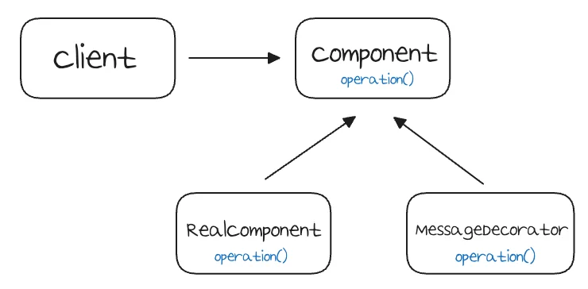

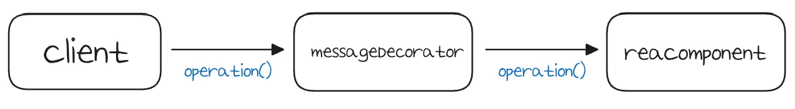

<a id="1fbeda9b0fe180eea536ebc69475358d"></a>

### 코드

<details>
<summary>&#91; 코드 &#93; <strong>MessageDecorator</strong></summary>

<a id="1fbeda9b0fe180519f06c0ace713b64e"></a>

```java
package com.inflearn.lecture_prac.pureproxy.decorator.code;

import lombok.extern.slf4j.Slf4j;

@Slf4j
public class MessageDecorator implements Component {

    private Component component;

    public MessageDecorator(Component component) {
        this.component = component;
    }

    @Override
    public String operation() {
        log.info("MessageDecorator 실행");

        String result = component.operation();
        String decoResult = "*****" + result + "*****";
        log.info("MessageDecorator 꾸미기 적용 전 ={}, 적용 후={}", result, decoResult);

        return decoResult;
    }
}
```

</details>

<details>
<summary>&#91; 테스트 &#93; <strong>DecoratorPatternTest</strong></summary>

<a id="1fbeda9b0fe18081869df15c8c5d8b84"></a>

```java
package com.inflearn.lecture_prac.pureproxy.decorator;

import com.inflearn.lecture_prac.pureproxy.decorator.code.Component;
import com.inflearn.lecture_prac.pureproxy.decorator.code.DecoratorPatternClient;
import com.inflearn.lecture_prac.pureproxy.decorator.code.RealComponent;
import org.junit.jupiter.api.Test;

public class DecoratorPatternTest {

		. . .

    @Test
    void decorator1() {
        Component realComponent = new RealComponent();
        Component messageDecorator = new MessageDecorator(realComponent);
        DecoratorPatternClient client = new DecoratorPatternClient(messageDecorator);
        client.execute();
    }
}
```

<a id="1fbeda9b0fe1802eb32dd6c4b614667d"></a>

<strong>실행 로그</strong>

<a id="1faeda9b0fe180f2bbd6ef2d73181e18"></a>

```java
MessageDecorator -- MessageDecorator 실행
RealComponent -- RealComponent 실행
MessageDecorator -- MessageDecorator 꾸미기 적용 전 =data, 
																		 적용 후=*****data*****
DecoratorPatternClient -- result=*****data*****
```

</details>

</details>

<details>
<summary>3&#46; 데코레이터 추가</summary>

> 실행 시간을 측정하는 기능 추가 &#45; <code>TimeDecorator</code>

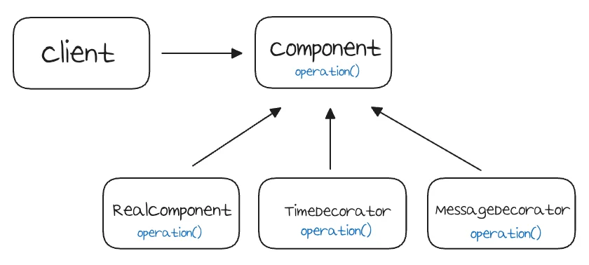

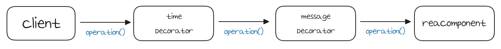

<a id="1faeda9b0fe180dd86daeaf7cbb1261d"></a>

### 코드

<details>
<summary>&#91; 코드 &#93; <strong>TimeDecorator</strong></summary>

<a id="1fbeda9b0fe180daaa24ddc59167af28"></a>

```java
package com.inflearn.lecture_prac.pureproxy.decorator.code;

import lombok.extern.slf4j.Slf4j;

@Slf4j
public class TimeDecorator implements Component {

    private Component component;

    public TimeDecorator(Component component) {
        this.component = component;
    }

    @Override
    public String operation() {
        log.info("TimeDecorator 실행");
        long startTime = System.currentTimeMillis();

        String result = component.operation();

        long endTime = System.currentTimeMillis();
        long resultTime = endTime - startTime;
        log.info("TimeDecoratort 종료 resultTime={}ms", resultTime);
        return result;
    }
}

```

</details>

<details>
<summary>&#91; 코드 &#93; <strong>DecoratorPatternTest</strong></summary>

<a id="1fbeda9b0fe1800791e6c4622ff7f1a2"></a>

```java
package com.inflearn.lecture_prac.pureproxy.decorator;

import com.inflearn.lecture_prac.pureproxy.decorator.code.*;
import org.junit.jupiter.api.Test;

public class DecoratorPatternTest {

    . . .

    @Test
    void decorator2() {
        Component realComponent = new RealComponent();
        Component messageDecorator = new MessageDecorator(realComponent);
        Component timeDecorator = new TimeDecorator(messageDecorator);
        DecoratorPatternClient client = new DecoratorPatternClient(timeDecorator);
        client.execute();
    }
}
```

<a id="1fbeda9b0fe180bd8fd5e7fed37a8d04"></a>

<strong>실행 로그</strong>

<a id="1faeda9b0fe180a898d0f31fa983f5f7"></a>

```java
TimeDecorator 실행
MessageDecorator 실행
RealComponent 실행
MessageDecorator 꾸미기 적용 전=data, 적용 후=*****data*****
TimeDecoratort 종료 resultTime=1ms
result=*****data*****
```

<a id="1faeda9b0fe1803dbc63c1416eb4aaa0"></a>

실행 로그를 보면, <strong>TimeDecorator</strong>가 <strong>MessageDecorator</strong>를 실행하고 실행 시간을 측정해서 출력한 것을 확인할 수 있다&#46;

</details>

</details>

> 📌 
> 
> <a id="1fbeda9b0fe18008acdfe8517fdf0381"></a>
> 
> <strong>GOF 데코레이터 패턴</strong>
> 
> ---
> 
> 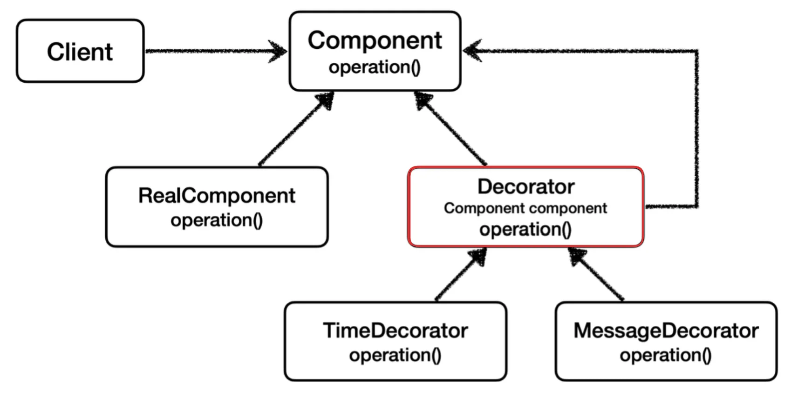
> 
> - <strong>Decorator</strong>에 일부 중복이 존재한다&#46;
>     - 꾸며주는 역할을 하는 Decorator들은 스스로 존재할 수 없다&#46; <br>즉, 항상 꾸며줄 대상이 존재해야한다&#46; <br>따라서 내부에 호출 대상인 <code>component</code>를 가지고 있어야 하며,<br> 항상 <code>component</code>를 호출해야 한다&#46; 
>         - 이 부분이 중복이다&#46; 
> 
> - 이러한 중복을 제거하기 위해 <code>component</code>를 속성으로 가지고 있는 <strong><code>Decorator</code></strong>라는 <strong><u>추상 클래스를 생성</u></strong>한다&#46; 
>     - 이렇게 Decorator 클래스를 추가하면 <strong><u>실제 컴포넌트인지, 데코레이터인지 명확하게 구분할 수 있</u></strong>다&#46; 
> 
>     - 여기까지 고민한 것이 <u>GOF에서 설명하는 데코레이터 패턴의 기본 예제</u>이다&#46; 

> 🗒️ 
> 
> <a id="1fbeda9b0fe180398278d0863280b115"></a>
> 
> <strong>정리</strong>
> 
> ---
> 
> <a id="1fbeda9b0fe1805b86b2e60e038fa798"></a>
> 
> 프록시 패턴과 데코레이터 패턴은 모양이 거의 비슷하다&#46; 
> 
> - 클래스 명칭만 차이가 있을 뿐 거의 로직 흐름은 동일하다&#46; 
> 
> <a id="1fbeda9b0fe18080ab2bd947135222ae"></a>
> 
> 또한 상황에 따라 완전히 똑같은 경우도 있다&#46; 
> 
> > 🧐 <strong>그렇다면 어떻게 둘을 구분하는 것인가?</strong>
> 
> <a id="1fbeda9b0fe180c8adbfc148f5be3ad2"></a>
> 
> <strong>디자인 패턴에서 중요한 것</strong>은 해당 패턴의 겉모양이 아닌, 그 패턴을 만든 <strong><u>의도</u></strong>이다&#46; 
> 
> - <code>프록시 패턴</code>&#58;  다른 개체에 대한 <strong><u>접근을 제어</u></strong>하기 위해 대리자 제공
> 
> - <code>데코레이터 패턴</code>&#58; 객체에 <strong><u>추가 책임(기능)을 동적으로 추가</u></strong>하고, 기능 확장을 위한 유연한 대안 제공
> 
> <a id="1fbeda9b0fe180bf83bdc01543ab37bc"></a>
> 
> <br>따라서 <strong><u>프록시를 사용</u></strong>하면서 <strong><u>접근 제어가 목적</u></strong>이라면 <code>프록시 패턴</code>이고, <br><strong><u>새로운 기능을 추가하는 것이 목적</u></strong>이라면 <code>데코레이터 패턴</code>이 된다&#46; 

<a id="1fbeda9b0fe18007aa77cd2a2c436cbf"></a>

### &#91; 실습 &#93; 애플리케이션 프록시 적용

---

<a id="1faeda9b0fe1809f8ddbd3d35f30b32a"></a>

### 기본 예제

> ☝🏻 
> 
> <a id="1faeda9b0fe1803a8e8ce359f159af45"></a>
> 
> 학습을 위해 여러 버전을 폴더로 구분해서 작성한다&#46; Config 파일, 또한 버전업을 하면서 작성한다&#46; 
> 
> <a id="1faeda9b0fe180d4a538df7cdb7ac110"></a>
> 
> 따라서 이전 버전에 대한 내용이 같이 스캔되어 충돌되지 않기 위해서 컴포넌트 스캔 범위를 <code>/app</code> 으로 지정하고 <code>&#64;Import</code>를 통해서 특정 config 파일만을 불러온다 &#46;
> 
> - <code>&#64;Configuration</code> 내부에 <code>&#64;Component</code> 가 포함되어 자동 스캔 범위에 들어간다&#46; 

<details>
<summary>V1  &#45; 인터페이스 적용, 빈 수동 등록</summary>

<a id="1faeda9b0fe180eea35ffa8c30ff00f5"></a>

### 코드

- 📁 app&#46;v1
    <details>
    <summary>&#91; 코드 &#93; <strong>&#60;interface&#62;</strong> <strong>OrderControllerV1</strong></summary>

    <a id="1faeda9b0fe1807fb799eb048def889c"></a>

    ```java
    package com.inflearn.lecture_prac.proxy.app.v1;

    import org.springframework.web.bind.annotation.GetMapping;
    import org.springframework.web.bind.annotation.RequestParam;
    import org.springframework.web.bind.annotation.RestController;

    @RestController
    public interface OrderControllerV1 {

        @GetMapping("/v1/request")
        String request(@RequestParam("itemId") String itemId);

        @GetMapping("/v1/no-log")
        String noLog();
    }

    ```

    </details>

    <details>
    <summary>&#91; 코드 &#93; <strong>OrderControllerV1Impl</strong></summary>

    <a id="1faeda9b0fe18038b7c6d5a973752962"></a>

    ```java
    package com.inflearn.lecture_prac.proxy.app.v1;

    import lombok.RequiredArgsConstructor;
    import org.springframework.web.bind.annotation.RestController;
    @RequiredArgsConstructor
    public class OrderControllerV1Impl implements OrderControllerV1 {

        private final OrderServiceV1 orderService;

        @Override
        public String request(String itemId) {
            orderService.orderItem(itemId);
            return "ok";
        }

        @Override
        public String noLog() {
            return "ok";
        }
    }

    ```

    </details>

    <details>
    <summary>&#91; 코드 &#93; <strong>&#60;interface&#62; </strong><strong>OrderServiceV1</strong></summary>

    <a id="1faeda9b0fe1803d92f4ce14b04eb3a5"></a>

    ```java
    package com.inflearn.lecture_prac.proxy.app.v1;

    public interface OrderServiceV1 {
        void orderItem(String itemId);
    }
    ```

    </details>

    <details>
    <summary>&#91; 코드 &#93; <strong>OrderServiceV1Impl</strong></summary>

    <a id="1faeda9b0fe1806889e1e4991fa6e120"></a>

    ```java
    package com.inflearn.lecture_prac.proxy.app.v1;

    import lombok.RequiredArgsConstructor;

    @RequiredArgsConstructor
    public class OrderServiceV1Impl implements OrderServiceV1 {

        private final OrderRepositoryV1 orderRepository;

        @Override
        public void orderItem(String itemId) {
            orderRepository.save(itemId);
        }
    }
    ```

    </details>

    <details>
    <summary>&#91; 코드 &#93; <strong>&#60;interface&#62;</strong> <strong>OrderRepositoryV1</strong></summary>

    <a id="1faeda9b0fe1804cb2c9c73d48c92601"></a>

    ```java
    package com.inflearn.lecture_prac.proxy.app.v1;

    public interface OrderRepositoryV1 {

        void save(String itemId);
    }
    ```

    </details>

    <details>
    <summary>&#91; 코드 &#93; <strong>OrderRepositoryV1Impl</strong></summary>

    <a id="1faeda9b0fe1804b8499d45b86b24877"></a>

    ```java
    package com.inflearn.lecture_prac.proxy.app.v1;

    public class OrderRepositoryV1Impl implements OrderRepositoryV1 {

        @Override
        public void save(String itemId) {
            // 저장 로직
            if (itemId.equals("ex")) {
                throw new IllegalStateException("예외 발생!");
            }
            sleep(1000);
        }

        private void sleep(int millis) {
            try {
                Thread.sleep(millis);
            } catch (InterruptedException e) {
                e.printStackTrace();
            }
        }
    }

    ```

    </details>

---

- 📁 config
    <details>
    <summary>&#91; 코드 &#93; <strong>AppV1Config &#45; 빈 수동 등록</strong></summary>

    <a id="1faeda9b0fe180dda16bda6bf12e63a0"></a>

    ```java
    package com.inflearn.lecture_prac.proxy.config;

    import com.inflearn.lecture_prac.proxy.app.v1.*;
    import org.springframework.context.annotation.Bean;
    import org.springframework.context.annotation.Configuration;

    @Configuration
    public class AppV1Config {

        @Bean
        public OrderControllerV1 orderControllerV1() {
            return new OrderControllerV1Impl(orderServiceV1());
        }

        @Bean
        public OrderServiceV1 orderServiceV1() {
            return new OrderServiceV1Impl(orderRepositoryV1());
        }

        @Bean
        public OrderRepositoryV1 orderRepositoryV1() {
            return new OrderRepositoryV1Impl();
        }
    }

    ```

    </details>

---

<details>
<summary>&#91; 코드 &#93; <strong>LecturePracApplication</strong></summary>

> ✏️ 
> 
> <details>
> <summary><code>&#64;Import</code></summary>
> 
> - 해당 클래스를 스프링 빈으로 등록한다&#46; 
> 
> - 일반적으로 <code>&#64;Configuration</code> 같은 설정 파일을 등록할 때, 사용하지만, 스프링 빈을 등록할 때도 사용 가능하다&#46; 
> 
> </details>
> 
> <details>
> <summary><code>&#64;SpringBootApplication(scanBasePackages =  &#46;&#46;&#46; )</code></summary>
> 
> - 컴포넌트 스캔을 시작할 위치를 지정한다&#46; 
> 
> - 설정한 값을 통해 해당 패키지와 그 하위 패키지를 컴포넌트 스캔한다&#46; 
> 
> </details>

<a id="1faeda9b0fe1806882d5d67dcb9db2e0"></a>

```java
package com.inflearn.lecture_prac;

import com.inflearn.lecture_prac.proxy.config.AppV1Config;
import org.springframework.boot.SpringApplication;
import org.springframework.boot.autoconfigure.SpringBootApplication;
import org.springframework.context.annotation.Import;


@Import(AppV1Config.class)
@SpringBootApplication(
		scanBasePackages = "com.inflearn.lecture_prac.proxy.app.v1"
)
public class LecturePracApplication {

    public static void main(String[] args) {
        SpringApplication.run(LecturePracApplication.class, args);
    }
}
```

</details>

</details>

<details>
<summary>V2 &#45;  인터페이스 제거, 빈 수동 등록</summary>

<a id="1faeda9b0fe180569d73fa8a6af517ec"></a>

### 코드

- 📁 app&#46;v2
    <details>
    <summary>&#91; 코드 &#93; <strong>OrderControllerV2</strong></summary>

    <a id="1faeda9b0fe180768ccdedf18e9047e2"></a>

    ```java
    package com.inflearn.lecture_prac.proxy.app.v2;

    import lombok.RequiredArgsConstructor;
    import lombok.extern.slf4j.Slf4j;
    import org.springframework.web.bind.annotation.GetMapping;
    import org.springframework.web.bind.annotation.RequestParam;
    import org.springframework.web.bind.annotation.RestController;

    @Slf4j
    @RequiredArgsConstructor
    @RestController
    public class OrderControllerV2 {

        private final OrderServiceV2 orderService;

        @GetMapping("/v2/request")
        public String request(@RequestParam String itemId) {
            orderService.orderItem(itemId);
            return "ok";
        }

        @GetMapping("/v2/no-log")
        public String noLog() {
            return "ok";
        }
    }
    ```

    </details>

    <details>
    <summary>&#91; 코드 &#93; <strong>OrderServiceV2</strong></summary>

    <a id="1faeda9b0fe1800bb017ed2a39bcf9e8"></a>

    ```java
    package com.inflearn.lecture_prac.proxy.app.v2;

    import lombok.RequiredArgsConstructor;

    @RequiredArgsConstructor
    public class OrderServiceV2 {

        private final OrderRepositoryV2 orderRepository;
        
        public void orderItem(String itemId) {
            orderRepository.save(itemId);
        }
    }
    ```

    </details>

    <details>
    <summary>&#91; 코드 &#93; <strong>OrderRepositoryV2</strong></summary>

    <a id="1faeda9b0fe180ab9218d5c7056143b1"></a>

    ```java
    package com.inflearn.lecture_prac.proxy.app.v2;


    public class OrderRepositoryV2 {

        public void save(String itemId) {
            // 저장 로직
            if (itemId.equals("ex")) {
                throw new IllegalStateException("예외 발생!");
            }
            sleep(1000);
        }

        private void sleep(int millis) {
            try {
                Thread.sleep(millis);
            } catch (InterruptedException e) {
                e.printStackTrace();
            }
        }
    }
    ```

    </details>

---

- 📁 config
    <details>
    <summary>&#91; 코드 &#93; <strong>AppV2Config</strong></summary>

    <a id="1faeda9b0fe180b69232e9c7d90d115c"></a>

    ```java
    package com.inflearn.lecture_prac.proxy.config;

    import com.inflearn.lecture_prac.proxy.app.v2.OrderControllerV2;
    import com.inflearn.lecture_prac.proxy.app.v2.OrderRepositoryV2;
    import com.inflearn.lecture_prac.proxy.app.v2.OrderServiceV2;
    import org.springframework.context.annotation.Bean;
    import org.springframework.context.annotation.Configuration;

    @Configuration
    public class AppV2Config {

        @Bean
        public OrderControllerV2 orderControllerV2() {
            return new OrderControllerV2(orderServiceV2());
        }

        @Bean
        public OrderServiceV2 orderServiceV2() {
            return new OrderServiceV2(orderRepositoryV2());
        }

        @Bean
        public OrderRepositoryV2 orderRepositoryV2() {
            return new OrderRepositoryV2();
        }
    }
    ```

    </details>

---

<details>
<summary>&#91; 코드 &#93; <strong>LecturePracApplication</strong></summary>

> ✏️ 
> 
> <details>
> <summary><code>&#64;Import</code></summary>
> 
> - 해당 클래스를 스프링 빈으로 등록한다&#46; 
> 
> - 일반적으로 <code>&#64;Configuration</code> 같은 설정 파일을 등록할 때, 사용하지만, 스프링 빈을 등록할 때도 사용 가능하다&#46; 
> 
> </details>
> 
> <details>
> <summary><code>&#64;SpringBootApplication(scanBasePackages =  &#46;&#46;&#46; )</code></summary>
> 
> - 컴포넌트 스캔을 시작할 위치를 지정한다&#46; 
> 
> - 설정한 값을 통해 해당 패키지와 그 하위 패키지를 컴포넌트 스캔한다&#46; 
> 
> </details>

<a id="1faeda9b0fe1801aaed1e4f95140a128"></a>

```java
package com.inflearn.lecture_prac;

import com.inflearn.lecture_prac.proxy.config.AppV1Config;
import org.springframework.boot.SpringApplication;
import org.springframework.boot.autoconfigure.SpringBootApplication;
import org.springframework.context.annotation.Import;


@Import(AppV1Config.class, AppV2Config.class)
@SpringBootApplication(
		scanBasePackages = "com.inflearn.lecture_prac.proxy.app"
)
public class LecturePracApplication {

    public static void main(String[] args) {
        SpringApplication.run(LecturePracApplication.class, args);
    }
}

```

</details>

</details>

<details>
<summary>V3 &#45;  빈 자동 등록</summary>

<a id="1faeda9b0fe180129002e51ea3c10df4"></a>

### 코드

- 📁 app&#46;v3
    > ✏️ 
    > 
    > <a id="1faeda9b0fe180ca9d8ed0580a0b0930"></a>
    > 
    > 클래스에 <code>&#64;Component</code>를 명시하면 컴포넌트 스캔 대상이 되어서, 빈으로 자동 등록된다&#46; 
    > 
    > - <code>&#64;Controller</code>, <code>&#64;Service</code>, <code>&#64;Repository</code> 내부에 <code>&#64;Component</code>를 포함하고 있다&#46; 

    <details>
    <summary>&#91; 코드 &#93; <strong>OrderControllerV3</strong></summary>

    <a id="1faeda9b0fe18029b7ccf84e7c39fca1"></a>

    ```java
    package com.inflearn.lecture_prac.proxy.app.v3;

    import lombok.RequiredArgsConstructor;
    import lombok.extern.slf4j.Slf4j;
    import org.springframework.web.bind.annotation.GetMapping;
    import org.springframework.web.bind.annotation.RequestParam;
    import org.springframework.web.bind.annotation.RestController;

    @Slf4j
    @RequiredArgsConstructor
    @RestController
    public class OrderControllerV3 {

        private final OrderServiceV3 orderService;

        @GetMapping("/v3/request")
        public String request(@RequestParam String itemId) {
            orderService.orderItem(itemId);
            return "ok";
        }

        @GetMapping("/v3/no-log")
        public String noLog() {
            return "ok";
        }
    }
    ```

    </details>

    <details>
    <summary>&#91; 코드 &#93; <strong>OrderServiceV3</strong></summary>

    <a id="1faeda9b0fe1800eb79adcb264c02118"></a>

    ```java
    package com.inflearn.lecture_prac.proxy.app.v3;

    import lombok.RequiredArgsConstructor;
    import org.springframework.stereotype.Service;

    @Service
    @RequiredArgsConstructor
    public class OrderServiceV3 {

        private final OrderRepositoryV3 orderRepository;

        public void orderItem(String itemId) {
            orderRepository.save(itemId);
        }
    }
    ```

    </details>

    <details>
    <summary>&#91; 코드 &#93; <strong>OrderRepositoryV3</strong></summary>

    <a id="1faeda9b0fe180639712e5f870dae0e6"></a>

    ```java
    package com.inflearn.lecture_prac.proxy.app.v3;


    import org.springframework.stereotype.Repository;

    @Repository
    public class OrderRepositoryV3 {

        public void save(String itemId) {
            // 저장 로직
            if (itemId.equals("ex")) {
                throw new IllegalStateException("예외 발생!");
            }
            sleep(1000);
        }

        private void sleep(int millis) {
            try {
                Thread.sleep(millis);
            } catch (InterruptedException e) {
                e.printStackTrace();
            }
        }
    }
    ```

    </details>

</details>

<a id="1fbeda9b0fe180b699aefa477e226e35"></a>

### &#91; V1 &#93; 인터페이스 기반 프록시 적용

> ✏️ 
> 
> - 각 레이어마다 인터페이스를 만들어 구현
> 
> - 빈 수동 등록

<details>
<summary>V1 &#45; 기본 클래스 의존 관계</summary>

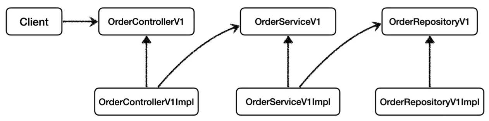

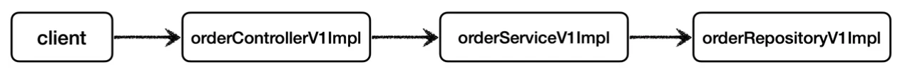

</details>


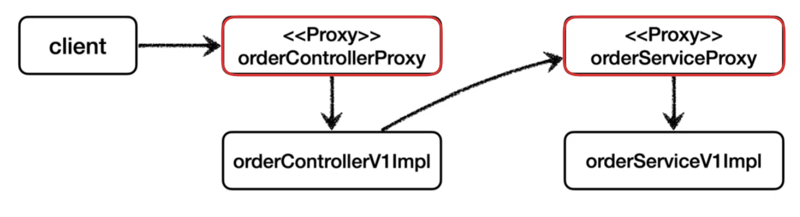

<a id="1fbeda9b0fe1808db283c27898f6e109"></a>

### 코드

<details>
<summary>&#91; 코드 &#93; <strong>OrderControllerInterfaceProxy</strong></summary>

<a id="1fbeda9b0fe1805aaa5bc17739a9a636"></a>

```java
package com.inflearn.lecture_prac.proxy.app.v1_proxy.interface_proxy;

import com.inflearn.lecture_prac.proxy.app.trace.TraceStatus;
import com.inflearn.lecture_prac.proxy.app.trace.logtrace.LogTrace;
import com.inflearn.lecture_prac.proxy.app.v1.OrderControllerV1;
import lombok.RequiredArgsConstructor;
import org.springframework.web.bind.annotation.GetMapping;
import org.springframework.web.bind.annotation.RestController;

@RequiredArgsConstructor
@RestController
public class OrderControllerInterfaceProxy implements OrderControllerV1 {

    private final OrderControllerV1 target;
    private final LogTrace logTrace;

    @GetMapping("/v1/request")
    @Override
    public String request(String itemId) {

        TraceStatus status = null;
        try {
            status = logTrace.begin("OrderController.request()");
            // target 호출
            String result = target.request(itemId);
            logTrace.end(status);
            return result;
        } catch (Exception e) {
            logTrace.exception(status, e);
            throw e;
        }
    }

    @GetMapping("/v1/no-log")
    @Override
    public String noLog() {
        return target.noLog();
    }
}
```

</details>

<details>
<summary>&#91; 코드 &#93; <strong>OrderServiceInterfaceProxy</strong></summary>

<a id="1fbeda9b0fe180ce8c9bfb8facd72553"></a>

```java
package com.inflearn.lecture_prac.proxy.app.v1_proxy.interface_proxy;

import com.inflearn.lecture_prac.proxy.app.trace.logtrace.LogTrace;
import com.inflearn.lecture_prac.proxy.app.v1.OrderServiceV1;
import com.inflearn.lecture_prac.template_strategy.trace.basic.TraceStatus;
import lombok.RequiredArgsConstructor;

@RequiredArgsConstructor
public class OrderServiceInterfaceProxy implements OrderServiceV1 {

    private final OrderServiceV1 target;
    private final LogTrace logTrace;

    @Override
    public void orderItem(String itemId) {
        TraceStatus status = null;
        try {
            status = logTrace.begin("OrderService.orderItem()");
            // target 호출
            target.orderItem(itemId);
            logTrace.end(status);
        } catch (Exception e) {
            logTrace.exception(status, e);
            throw e;
        }
    }
}
```

</details>

<details>
<summary>&#91; 코드 &#93; <strong>OrderRepositoryInterfaceProxy</strong></summary>

<a id="1fdeda9b0fe1808497ccfe7d8dcbb18a"></a>

```java
package com.inflearn.lecture_prac.proxy.app.v1_proxy.interface_proxy;

import com.inflearn.lecture_prac.proxy.app.trace.logtrace.LogTrace;
import com.inflearn.lecture_prac.proxy.app.v1.OrderRepositoryV1;
import com.inflearn.lecture_prac.template_strategy.trace.basic.TraceStatus;
import lombok.RequiredArgsConstructor;

@RequiredArgsConstructor
public class OrderRepositoryInterfaceProxy implements OrderRepositoryV1 {

    private final OrderRepositoryV1 target;
    private final LogTrace logTrace;

    @Override
    public void save(String itemId) {

        TraceStatus status = null;
        try {
            status = logTrace.begin("OrderRepository.save()");
            // target 호출
            target.save(itemId);
            logTrace.end(status);
        } catch (Exception e) {
            logTrace.exception(status, e);
            throw e;
        }
    }
}

```

</details>

<details>
<summary>&#91; 코드 &#93; <strong>InterfaceProxyConfig</strong> &#45; 빈 수동 등록</summary>

<a id="1fdeda9b0fe1806391bce2d677274f3f"></a>

```java
package com.inflearn.lecture_prac.proxy.app.v1_proxy;

import com.inflearn.lecture_prac.proxy.app.trace.logtrace.LogTrace;
import com.inflearn.lecture_prac.proxy.app.trace.logtrace.ThreadLocalLogTrace;
import com.inflearn.lecture_prac.proxy.app.v1.*;
import com.inflearn.lecture_prac.proxy.app.v1_proxy.interface_proxy.OrderRepositoryInterfaceProxy;
import com.inflearn.lecture_prac.proxy.app.v1_proxy.interface_proxy.OrderServiceInterfaceProxy;
import org.springframework.context.annotation.Bean;
import org.springframework.context.annotation.Configuration;

@Configuration
public class InterfaceProxyConfig {

    LogTrace logTrace;

    @Bean
    OrderControllerV1 target() {
        return new OrderControllerV1Impl(orderService(logTrace));
    }

    @Bean
    public OrderServiceV1 orderService(LogTrace logTrace) {
        OrderServiceV1Impl serviceImpl = new OrderServiceV1Impl(orderRepository(logTrace));
        return new OrderServiceInterfaceProxy(serviceImpl, logTrace);
    }

    @Bean
    public OrderRepositoryV1 orderRepository(LogTrace logTrace) {
        OrderRepositoryV1Impl repositoryImpl = new OrderRepositoryV1Impl();
        return new OrderRepositoryInterfaceProxy(repositoryImpl, logTrace);
    }
}
```

</details>

<details>
<summary>&#91; 테스트 &#93; API 호출</summary>

<a id="1fdeda9b0fe180219292faae777562b3"></a>

```java
http://localhost:8080/v1/request?itemId=1
```


<a id="1fdeda9b0fe1801eb51ce7691fb10bd5"></a>

<strong>실행 로그</strong>

<a id="1fdeda9b0fe1808db2e0c5ad4d0d50ad"></a>

```java
[455379f5] OrderController.request()
[455379f5] |-->OrderService.orderItem()
[455379f5] |   |-->OrderRepository.save()
[455379f5] |   |<--OrderRepository.save() time=1005ms
[455379f5] |<--OrderService.orderItem() time=1007ms
[455379f5] OrderController.request() time=1009ms
```

- 로그 정상 출력 확인

</details>

<a id="1fdeda9b0fe18021bff6ce10527f3695"></a>

### NOTES

<details>
<summary><strong>프록시의 런타임 객체 의존 관계</strong></summary>

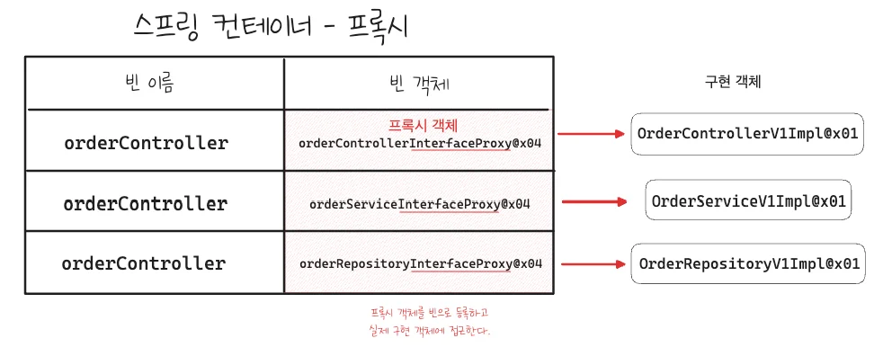

<a id="1fdeda9b0fe180f3907ac4aca62da4e5"></a>

기존 구체 클래스를 직접 빈으로 등록해 사용한 방식에서, 프록시를 사용해 요청을 위임하는 방식으로 변경했다&#46; 

<a id="1fdeda9b0fe18076aa25c8fba31a6e61"></a>

따라서 실제 빈으로 등록되는 것은 위 그림과 같이 프록시 객체들이다&#46;

- 예제 &#45; InterfaceProxyConfig를 통해 수동 빈 등록

- 실제 객체는 스프링 빈으로 등록하지 않는다&#46; 

- 프록시 객체가 실제 객체를 참조하기 때문에 프록시를 통해서 실제 객체를 호출할 수 있다&#46;

<a id="1fdeda9b0fe180568370e4548f45779b"></a>

 

</details>

<details>
<summary><strong>&#91; 🤬 오류 &#93;</strong> &#45; HTTP 요청 및 헨들러 매핑 오류</summary>

> ☝🏻 
> 
> <a id="1fdeda9b0fe18094bba7ed781dcb2a99"></a>
> 
> 강의가 예전 버전이라, 현재(25&#46;05&#46;25)는 Controller를 수동 빈으로 등록 시 헨들러 매핑이 되지 않는다&#46; 
> 
> <a id="1fdeda9b0fe180b98be2ef2fdb018c47"></a>
> 
> 컨트롤러에 명시적으로 <code>&#64;Controller</code>가 선언되어 있어야 MVC에서 해당 하는 빈을 핸들러와 매핑한다&#46; 

<a id="1fdeda9b0fe180038493c9d4f67aba1a"></a>

### 원인

<a id="1fdeda9b0fe180ee973bebc0039449a7"></a>

Controller 계층에 프록시 패턴을 적용해서 프록시 객체에서 요청을 받고 컨트롤러로 위임하는 구조를 형성했다&#46;  ( 자세한 내용은 아래 코드 참조 )

<details>
<summary>&#91; 코드 &#93; OrderControllerInterfaceProxy</summary>

<a id="1fdeda9b0fe1809ea635dad24180ff73"></a>

```java
package com.inflearn.lecture_prac.proxy.app.v1_proxy.interface_proxy;

import com.inflearn.lecture_prac.proxy.app.trace.logtrace.LogTrace;
import com.inflearn.lecture_prac.proxy.app.v1.OrderControllerV1;
import com.inflearn.lecture_prac.template_strategy.trace.basic.TraceStatus;
import lombok.RequiredArgsConstructor;

@RequiredArgsConstructor
public class OrderControllerInterfaceProxy implements OrderControllerV1 {

    private final OrderControllerV1 target;
    private final LogTrace logTrace;

    @Override
    public String request(String itemId) {

        TraceStatus status = null;
        try {
            status = logTrace.begin("OrderController.request()");
            // target 호출
            String result = target.request(itemId);
            logTrace.end(status);
            return result;
        } catch (Exception e) {
            logTrace.exception(status, e);
            throw e;
        }
    }

    @Override
    public String noLog() {
        return target.noLog();
    }
}
```

</details>

<a id="1fdeda9b0fe180a9bc51f7cb416007fa"></a>

그러나 요청을 전송해서 <code>404 Not Found</code>로 헨들러와 매핑되지 않는 오류가 발생되었다&#46;

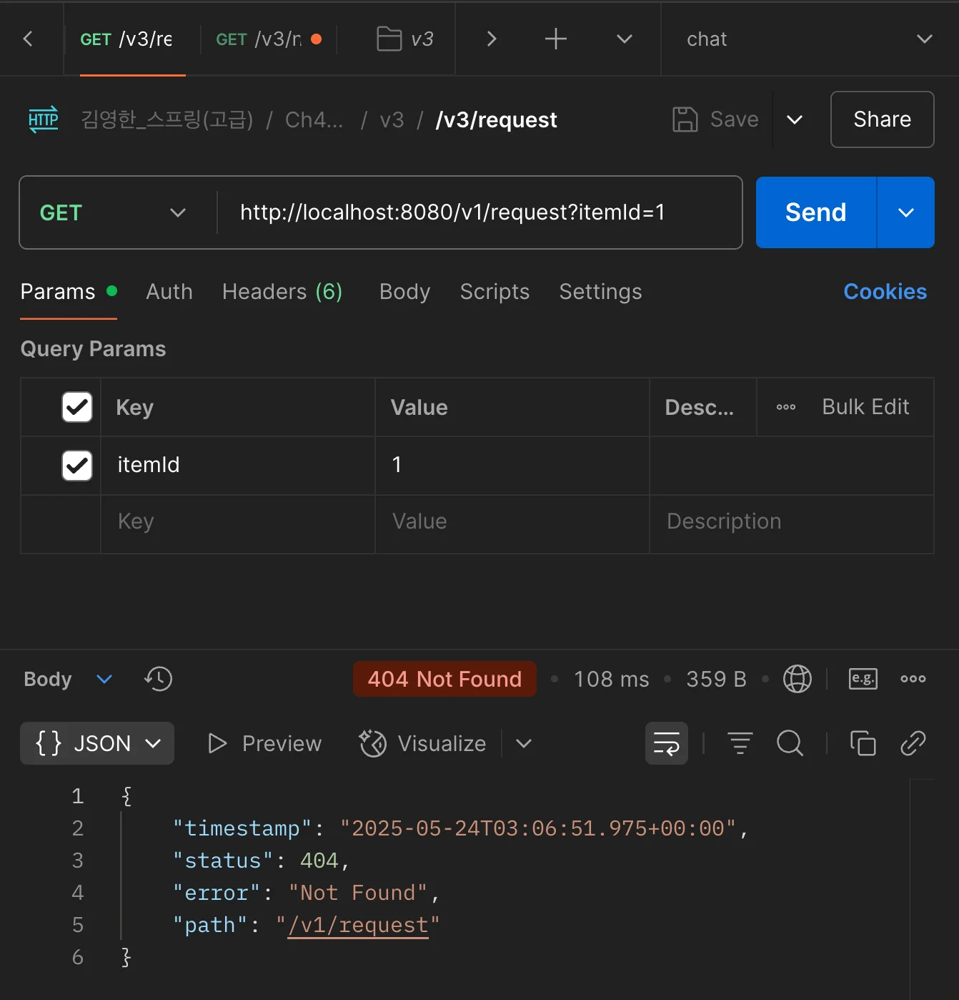

<a id="1fdeda9b0fe1808f8fe3d652efab6a32"></a>

### 이유

> ✏️ 
> 
> <a id="1fdeda9b0fe180c5a87ed87a6fcd0b98"></a>
> 
> <strong>Spring MVC는 </strong><strong><code>&#64;Controller</code></strong><strong> 또는 </strong><strong><code>&#64;RestController</code></strong><strong>가 붙은 빈 클래스들 중에서, </strong><strong><code>&#64;RequestMapping</code></strong><strong>, </strong><strong><code>&#64;GetMapping</code></strong><strong> 등의 어노테이션이 붙은 메서드들을 탐색하여 </strong><strong><u>HTTP 요청 핸들러로 등록</u></strong><strong>한다&#46;</strong>
> 
> - <strong><u>핸들러(handler)</u></strong>는 <strong>클래스 단위가 아니라 </strong><strong><u>메서드 단위</u></strong><strong><u>로 정의</u></strong>되고,<br><strong><u>HTTP 요청은 각각의 메서드에 매핑(mapping)</u></strong>된다&#46; 

<a id="1fdeda9b0fe1801892dbd053f6232feb"></a>

<code>&#64;RestController</code>, <code>&#64;Controller</code>로 등록된 빈에서만 찾는다&#46; 

<a id="1fdeda9b0fe180f59956c50a80489113"></a>

Spring MVC는 내부적으로 <code>RequestMappingHandlerMapping</code>을 사용하여, HTTP 요청을 어떤 컨트롤러 메서드에 매핑할지를 결정한다&#46;

<a id="1fdeda9b0fe18000bcb7fc6b36a0adb8"></a>

```java
// spring-webmvc 패키지
org.springframework.web.servlet.mvc.method.annotation.RequestMappingHandlerMapping
```

<a id="1fdeda9b0fe1805b8d47e66bb2fc00aa"></a>

<strong>내부 코드</strong>

<a id="1fdeda9b0fe1803cb564cd9560cf8941"></a>

```java
@Override
protected boolean isHandler(Class<?> beanType) {
		return AnnotatedElementUtils.hasAnnotation(beanType, Controller.class);
}
```

- <code>RequestMappingHandlerMapping</code>의 내부 코드를 살펴보면, <code>isHandler</code> 메서드를 통해  Controller Annotaions만을 탐색해서 헨들러로 등록한다&#46; 


<a id="1fdeda9b0fe1808c9247cbaae7cc7091"></a>

따라서 Controller를 헨들러로 등록하려는 경우, 해당 컨트롤러에 <code>&#64;Controller</code>가 명시되어야 한다&#46; 

<details>
<summary><code>&#64;RestController</code>로 내부에 <code>&#64;Controller</code>가 명시되어 있다&#46; </summary>

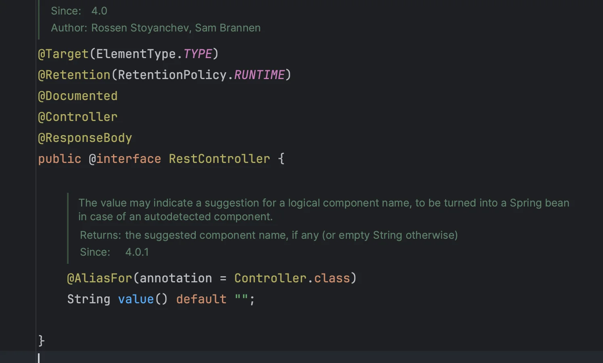

</details>

</details>

<details>
<summary><strong>&#91;☝🏻 주의 &#93;</strong><strong> </strong>&#45; <code>&#64;RequestMapping</code>으로는 Controller를 <strong>헨들러로 등록할 수 없</strong>다&#46; </summary>

<a id="1fdeda9b0fe1807c8a53cc39f4f4e85c"></a>

```java
package com.inflearn.lecture_prac.proxy.app.v3;

import lombok.RequiredArgsConstructor;
import lombok.extern.slf4j.Slf4j;
import org.springframework.web.bind.annotation.GetMapping;
import org.springframework.web.bind.annotation.RequestMapping;
import org.springframework.web.bind.annotation.RequestParam;
import org.springframework.web.bind.annotation.RestController;

@Slf4j
@RequiredArgsConstructor
@RequestMapping
public class OrderControllerV3 {

    private final OrderServiceV3 orderService;

    @GetMapping("/v3/request")
    public String request(@RequestParam String itemId) {
        orderService.orderItem(itemId);
        return "ok";
    }

    @GetMapping("/v3/no-log")
    public String noLog() {
        return "ok";
    }
}
```

- &#64;RequestMapping을 Controller에 명시

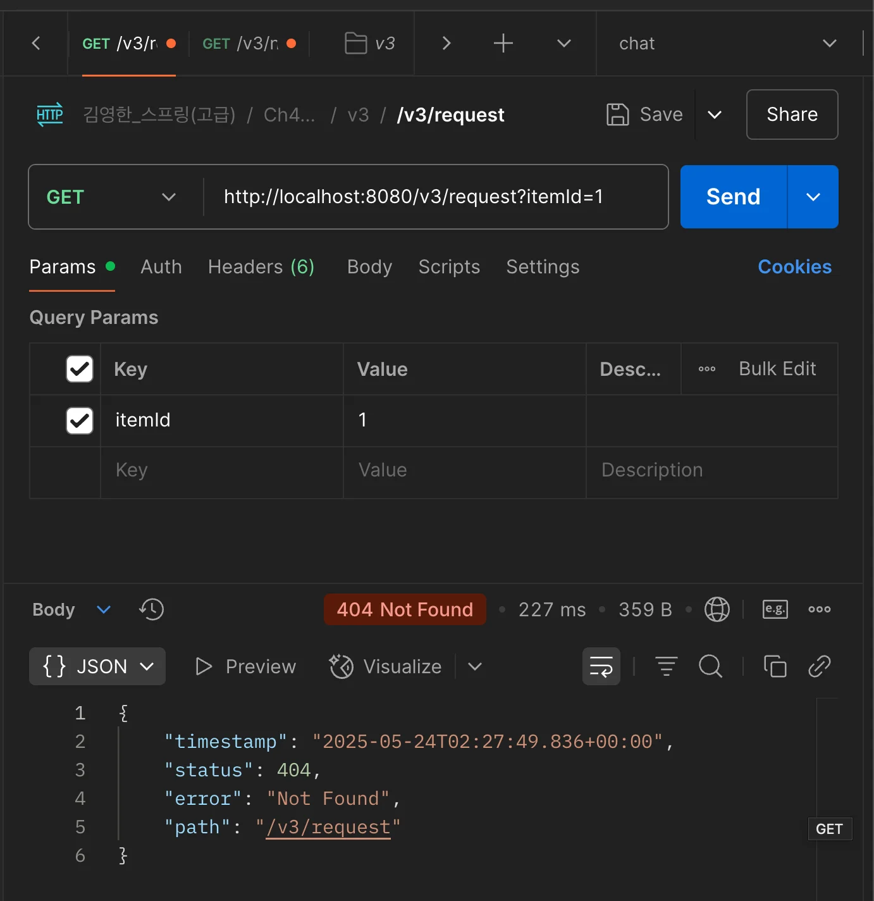

- 해당 컨트롤러의 API 호출 시, 헨들러로 등록되지 않아 <code>404 Not Found</code> 오류가 발생되는 것을 확인할 수 있다&#46;

</details>

<details>
<summary><strong>&#91; ✅ 수정 &#93;</strong> &#45; 강의 예제 수정 &#45; Controller에 프록시 패턴 제거</summary>

<a id="1fdeda9b0fe1803baa4ded8fd2872a32"></a>

Controller에 프록시 패턴을 적용하여 테스트를 했더니 아래와 같은 문제가 발생되었다 &#46;

<a id="1fdeda9b0fe180f9befcd1e81043d309"></a>

### 문제

<details>
<summary>문제 1) 컨트롤러를 수동 빈 등록 시, <code>&#64;Controller</code>를 명시할 수 없다&#46; 따라서 MVC에서 핸들러 매핑이 이뤄지지 않는다&#46; </summary>

<a id="1fdeda9b0fe1809eb39bea83c999caec"></a>

```java
@Configuration
public class InterfaceProxyConfig {

   @Bean
   public OrderControllerV1 orderController(LogTrace logTrace) {
       OrderControllerV1Impl controllerImpl = new OrderControllerV1Impl(orderService(logTrace));
       return new OrderControllerInterfaceProxy(controllerImpl, logTrace);
   }
   
   . . .
```

<a id="1fdeda9b0fe1808e9554ff72b9412064"></a>

```java
@RequiredArgsConstructor
public class OrderControllerInterfaceProxy implements OrderControllerV1 {

    private final OrderControllerV1 target;
    private final LogTrace logTrace;

    @GetMapping("/v1/request")
    @Override
    public String request(String itemId) {

			. . .
```

<a id="1fdeda9b0fe180128df9fd020f88d745"></a>

Controller를 수동 빈으로 등록 시, 컨트롤러에 <code>&#64;Controller</code>를 선언할 수 없다&#46; 

- 동일한 클래스가 중복되게 빈으로 등록되어 오류가 발생된다&#46; 

<a id="1fdeda9b0fe180f1a778e54dd4cec152"></a>

따라서 MVC에서 핸들러 매핑이 이뤄지지 않는다&#46; 

- 자세한 내용은 위 오류 참조 

</details>

<details>
<summary>문제 2) <code>&#64;Controller</code>를 명시하여 자동 빈 등록 시, 순환 참조 문제가 발생된다&#46;</summary>

<a id="1fdeda9b0fe1809598e6e0a11d211b50"></a>

```java
OrderController → Proxy → OrderController → ... (무한 루프)
```

<a id="1fdeda9b0fe180bc97a3eff190296935"></a>

Proxy와 실제 구현 객체 모두 동일한 인터페이스로 구현된다&#46; 

<a id="1fdeda9b0fe180a4a769d2894ddcfd19"></a>

그리고 프록시 객체에서 실제 구현 객체로 요청을 넘기기 위해 다형성과 DI를  활용한다&#46; 

<a id="1fdeda9b0fe180e2acc2e0f932f8b95e"></a>

그러나 스프링은 예상과 다르게 구현 객체가 아닌 프록시 객체를 주입한다&#46; 

<a id="1fdeda9b0fe1804885f4f4bfb9eba4b6"></a>

```java
@Configuration
public class InterfaceProxyConfig {

   @Bean
   public OrderControllerV1 orderController(LogTrace logTrace) {
       OrderControllerV1Impl controllerImpl = new OrderControllerV1Impl(orderService(logTrace));
       return new OrderControllerInterfaceProxy(controllerImpl, logTrace);
   }
   
   . . .
```

- 따라서 위와 같이 수동 빈 등록에서 직접 구체 클래스를 명시적으로 지정하면 해결할 수 있지만, 그러면 다시 돌아  <code>문제 1</code>의 상황을 직면하게 된다&#46; 

</details>

<a id="1fdeda9b0fe180eea9f5c6c7b933ad10"></a>

### 해결

---

<details>
<summary>해결 1) 직접 빈 등록</summary>

<a id="1fdeda9b0fe1806da286cd1f63a09d8f"></a>

결국 <code>문제2</code>는 실제 하위 구현체를 명시적으로 알려주지 않아서 생기는 오류이다 &#46;

<a id="1fdeda9b0fe180a0a0d5d199f8b71ab0"></a>

따라서 프록시 객체는 자동 등록하고, 실제 구현 객체는 &#64;Bean으로 수동 등록하여 Controller로 인식되지 않도록하면 해결할 수 있다&#46;

- 쓸데없이 복잡하고 실용성이 없다&#46; 따라서  권장하지 않는다&#46; 

<details>
<summary>&#91; 코드 &#93; InterfaceProxyConfig</summary>

<a id="1fdeda9b0fe180b1ae53c9a651fb856b"></a>

```java
package com.inflearn.lecture_prac.proxy.app.v1_proxy;

import com.inflearn.lecture_prac.proxy.app.trace.logtrace.LogTrace;
import com.inflearn.lecture_prac.proxy.app.trace.logtrace.ThreadLocalLogTrace;
import com.inflearn.lecture_prac.proxy.app.v1.*;
import com.inflearn.lecture_prac.proxy.app.v1_proxy.interface_proxy.OrderControllerInterfaceProxy;
import com.inflearn.lecture_prac.proxy.app.v1_proxy.interface_proxy.OrderRepositoryInterfaceProxy;
import com.inflearn.lecture_prac.proxy.app.v1_proxy.interface_proxy.OrderServiceInterfaceProxy;
import org.springframework.context.annotation.Bean;
import org.springframework.context.annotation.Configuration;

@Configuration
public class InterfaceProxyConfig {

    @Bean
    LogTrace logTrace() {
        return new ThreadLocalLogTrace();
    }

    @Bean
    OrderControllerV1 target() {
        return new OrderControllerV1Impl(orderService(logTrace()));
    }

    @Bean
    public OrderServiceV1 orderService(LogTrace logTrace) {
        OrderServiceV1Impl serviceImpl = new OrderServiceV1Impl(orderRepository(logTrace));
        return new OrderServiceInterfaceProxy(serviceImpl, logTrace);
    }

    @Bean
    public OrderRepositoryV1 orderRepository(LogTrace logTrace) {
        OrderRepositoryV1Impl repositoryImpl = new OrderRepositoryV1Impl();
        return new OrderRepositoryInterfaceProxy(repositoryImpl, logTrace);
    }
}

```

</details>

</details>

<details>
<summary>해결 2)  어댑터 추가</summary>

<a id="1fdeda9b0fe180dca7f3de47a1c9e109"></a>

```java
[클라이언트 HTTP 요청]
        ↓
@RestController
OrderControllerAdapter  <-- 핸들러 매핑 OK
        ↓
   OrderControllerInterfaceProxy         <-- 로그 추적 시작
        ↓
   OrderControllerV1Impl                 <-- 실제 비즈니스 로직
        ↓
   OrderServiceInterfaceProxy → OrderServiceV1Impl
        ↓
   OrderRepositoryInterfaceProxy → OrderRepositoryV1Impl
```

<a id="1fdeda9b0fe180b3a07ae99b2fc86ae3"></a>

### 코드

<details>
<summary>&#91; 코드 &#93; <strong>&#60;interface&#62;</strong> OrderControllerV1</summary>

<a id="1fdeda9b0fe1808f8e3cd78f7d91b9a7"></a>

```java
public interface OrderControllerV1 {
    String request(String itemId);
    String noLog();
}
```

</details>

<details>
<summary>&#91; 코드 &#93; OrderControllerV1Impl</summary>

<a id="1fdeda9b0fe180a79c76db3dc0af07eb"></a>

```java
@RequiredArgsConstructor
public class OrderControllerV1Impl implements OrderControllerV1 {

    private final OrderServiceV1 orderService;

    @Override
    public String request(String itemId) {
        orderService.orderItem(itemId);
        return "ok";
    }

    @Override
    public String noLog() {
        return "ok";
    }
}
```

</details>

<details>
<summary>&#91; 코드 &#93; OrderControllerInterfaceProxy</summary>

<a id="1fdeda9b0fe18038adfece8871e43599"></a>

```java
@RequiredArgsConstructor
public class OrderControllerInterfaceProxy implements OrderControllerV1 {

    private final OrderControllerV1 target;
    private final LogTrace logTrace;

    @Override
    public String request(String itemId) {
        var status = logTrace.begin("OrderController.request()");
        try {
            String result = target.request(itemId);
            logTrace.end(status);
            return result;
        } catch (Exception e) {
            logTrace.exception(status, e);
            throw e;
        }
    }

    @Override
    public String noLog() {
        return target.noLog();
    }
}
```

</details>

<details>
<summary>&#91; 코드 &#93; OrderControllerAdapter</summary>

<a id="1fdeda9b0fe1809db40be91251f82291"></a>

```java
@RestController
@RequiredArgsConstructor
public class OrderControllerAdapter {

    private final OrderControllerV1 controllerProxy; // 인터페이스 타입으로 프록시 주입됨

    @GetMapping("/v1/request")
    public String request(@RequestParam String itemId) {
        return controllerProxy.request(itemId);
    }

    @GetMapping("/v1/no-log")
    public String noLog() {
        return controllerProxy.noLog();
    }
}
```

</details>

<details>
<summary>&#91; 코드 &#93; <strong>InterfaceProxyConfig (프록시 수동 등록)</strong></summary>

<a id="1fdeda9b0fe180c6835ddddd188b4d83"></a>

```java
@Configuration
public class InterfaceProxyConfig {

    @Bean
    public OrderControllerV1 orderControllerV1(LogTrace logTrace) {
        OrderControllerV1Impl impl = new OrderControllerV1Impl(orderService(logTrace));
        return new OrderControllerInterfaceProxy(impl, logTrace); // 프록시 생성
    }

    @Bean
    public OrderServiceV1 orderService(LogTrace logTrace) {
        return new OrderServiceInterfaceProxy(new OrderServiceV1Impl(orderRepository(logTrace)), logTrace);
    }

    @Bean
    public OrderRepositoryV1 orderRepository(LogTrace logTrace) {
        return new OrderRepositoryInterfaceProxy(new OrderRepositoryV1Impl(), logTrace);
    }
}
```

</details>

<a id="1fdeda9b0fe18088a209e117e4a0891f"></a>

어댑터를 도입하여 프록시 와 컨트롤러를 별도 클래스로 분리하여 해결 

- 순환 참조 ❌

- 핸들러 매핑 정상 작동

- 프록시 책임 명확화 &#45; 로깅 책임만 수행

- config 수정만을 통해 프록시를 언제든지 적용 및 제거 가능함

</details>

<details>
<summary>해결 3) Controller 프록시 적용 제거 ( 권장 )</summary>

<a id="1fdeda9b0fe180798ec1dbdbf1824e6b"></a>

프록시 패턴의 적용 목적은 <strong><u>특정 객체에 대한 접근 제어</u></strong>에 있다&#46;

- ex) <code>캐시</code>&#58; 서버에 대한 접근 제어, 서버에  접근해 데이터를 가져오는 것이 아닌 캐시 저장소에서 가져온다 &#46;

<a id="1fdeda9b0fe18089a814ce518198d05d"></a>

그리고 이러한 AOP의 목적은 비지니스 로직에 대한 부가 기능 처리에 있다&#46; 

<a id="1fdeda9b0fe180b58a69cd0661d8fe2a"></a>

그러나 Controller는 보통 <u>요청/응답 포맷 처리, 유효성 검증, 서비스 위임에 대한 책임</u>을 가지기 때문에 <strong>AOP 대상으로는 적절하지 않</strong>다&#46; 

> ☝🏻 
> 
> <a id="1feeda9b0fe1804593c9f631ff95b07f"></a>
> 
> <strong>프록시를 Controller에 적용해야 하는 예외적인 상황</strong>
> 
> ---
> 
> <a id="1fdeda9b0fe180b896a4e65491c6d492"></a>
> 
> Web 요청에 대한 <strong><u>특별한 로깅, 모니터링, 보안 정책</u></strong>을 컨트롤러 단위로 명확히 감싸야 하는 경우, 프록시 사용이 적절하다 &#46;
> 
> <a id="1fdeda9b0fe1806c9614d755ec10a64c"></a>
> 
> 그러나 이럴 경우에도 <code>HandlerInterceptor</code>, <code>Filter</code>, <code>&#64;ControllerAdvice</code> 등을 먼저 고려한다&#46; 

<a id="1fdeda9b0fe180afb8b2f894048856dc"></a>

### 코드

> 기존 예제 코드와 동일하다&#46; 

<details>
<summary>&#91; 코드 &#93; <strong>&#60;interface&#62;</strong> <strong>OrderControllerV1</strong></summary>

<a id="1fdeda9b0fe180689ebefb5ecf717d70"></a>

```java
package com.inflearn.lecture_prac.proxy.app.v1;

import org.springframework.web.bind.annotation.GetMapping;
import org.springframework.web.bind.annotation.RequestParam;
import org.springframework.web.bind.annotation.RestController;

@RestController
public interface OrderControllerV1 {

    @GetMapping("/v1/request")
    String request(@RequestParam("itemId") String itemId);

    @GetMapping("/v1/no-log")
    String noLog();
}
```

</details>

<details>
<summary>&#91; 코드 &#93; <strong>OrderControllerV1Impl</strong></summary>

<a id="1fdeda9b0fe180d68ea3eb82b13c40de"></a>

```java
package com.inflearn.lecture_prac.proxy.app.v1;

import lombok.RequiredArgsConstructor;

@RestController
@RequiredArgsConstructor
public class OrderControllerV1Impl implements OrderControllerV1 {

    private final OrderServiceV1 orderService;

    @Override
    public String request(String itemId) {
        orderService.orderItem(itemId);
        return "ok";
    }

    @Override
    public String noLog() {
        return "ok";
    }
}

```

</details>

</details>

<a id="1fdeda9b0fe1807eb18edb65e30979cc"></a>

### 정리

<a id="1fdeda9b0fe180faa614fcd67a446887"></a>

Controller 계층의 <code>인터페이스</code>나 <code>프록시 적용</code>은 실무에선 권장되지 하지 않는다&#46;( 안씀 )

- 여러 상황에 대한 실습을 위해서 발생된 상황이었을 뿐, 실제 상황에서는 거의 일어나지 않음

<a id="1fdeda9b0fe180faaea4f7c27e85ba04"></a>

만약 프록시가 적용되어야 하는 예외 상황의 경우, <code>HandlerInterceptor</code>, <code>Filter</code>, <code>&#64;ControllerAdvice</code>  먼저 고려하는 것이 선호된다 &#46;

<a id="1fdeda9b0fe180799bc4d3f495d2515b"></a>

또한 Adapter를 도입하여 요청을 처리하는 객체와 프록시 객체의 책임을 명확하게 분리하는 것이 더 좋다&#46; 

</details>

<a id="1fdeda9b0fe180ecba0cd79528e920a3"></a>

### 정리

> 📌 
> 
> <a id="1fdeda9b0fe180ab93cdc27ba7e14f9b"></a>
> 
> <strong>요구사항</strong>
> 
> ---
> 
> - <del><strong>원본 코드를 수정하지 않고, 로그 추적기 적용</strong></del>
> 
> - <del>특정 메서드는 로그를 출력하지 않아야 함</del>
>     - <del>보안상 일부는 로그를 출력하면 안된다&#46;</del>
> 
> - 아래와 같은 다양한 케이스에 적용할 수 있어야 한다&#46;
>     - <del><code>V1</code></del><del> &#45; 인터페이스가 있는 구현 클래스</del>
> 
>     - <code>V2</code> &#45; 인터페이스가 없는 구체 클래스 
> 
>     - <code>V3</code> &#45; 컴포넌트 스캔 대상에 기능 적용

<a id="1fdeda9b0fe180c197aef682c80e2dde"></a>

프록시와 DI를 통해 <strong><u>원본 코드를 전혀 수정하지 않고, 로그 추적기 도입 가능</u></strong>

- ❗️ <strong>너무 많은 프록시를 만</strong>들어야 하는 <strong><u>단점</u></strong>이 있다&#46;

<a id="1fdeda9b0fe1809c9ee7cfdde2d4f05f"></a>

###  구체 클래스 기반 프록시 

> ✏️ 
> 
> > 자바 언에서 <code>다형성</code>은 <strong><u>인터페이스나 클래스를 구분하지 않</u></strong>고 모두 적용된다&#46; <br>즉, 해당 타입과 그 타입의 하위 타입은 모두 다형성의 대상이 된다&#46; 
> 
> <a id="1fdeda9b0fe180b3a6f0f18d8cd6eb06"></a>
> 
> <strong><u>구체 클래스</u></strong>만으로 프록시 적용
> 
> - 상위 클래스를 정의 후, 상속을 통해 다형성 및 오버라이딩 활용

<details>
<summary>기본 예제</summary>

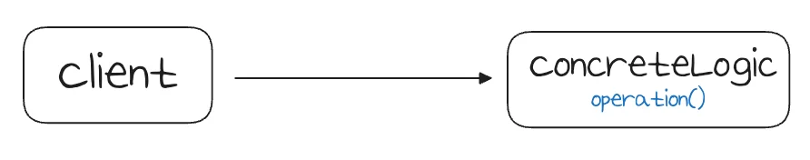

<a id="1fdeda9b0fe18012b02fdd82843f3825"></a>

### 코드

<details>
<summary>&#91; 코드 &#93; ConcreteLogic</summary>

<a id="1fdeda9b0fe180ac8e92dba65cde17c6"></a>

```java
package com.inflearn.lecture_prac.pureproxy.concreteproxy.code;

import lombok.extern.slf4j.Slf4j;

@Slf4j
public class ConcreteLogic {
    public String operation() {
        log.info("ConcreteLogic 실행");
        return "data";
    }
}
```

</details>

<details>
<summary>&#91; 코드 &#93; ConcreteClient</summary>

<a id="1fdeda9b0fe180cab814c71b5ecc0317"></a>

```java
package com.inflearn.lecture_prac.pureproxy.concreteproxy.code;

public class ConcreteClient {
    
    private ConcreteLogic concreteLogic; 

    public ConcreteClient(ConcreteLogic concreteLogic) {
        this.concreteLogic = concreteLogic;
    }

    public void execute() {
        concreteLogic.operation();
    }
}
```

</details>

<details>
<summary>&#91; 코드 &#93; ConcreteProxyTest</summary>

<a id="1fdeda9b0fe180779ed6f4d4355a5ec2"></a>

```java
package com.inflearn.lecture_prac.pureproxy.concreteproxy;

import com.inflearn.lecture_prac.pureproxy.concreteproxy.code.ConcreteClient;
import com.inflearn.lecture_prac.pureproxy.concreteproxy.code.ConcreteLogic;
import com.inflearn.lecture_prac.pureproxy.concreteproxy.code.TimeProxy;
import org.junit.jupiter.api.Test;

public class ConcreteProxyTest {

    @Test
    void noProxy() {
        ConcreteLogic concreteLogic = new ConcreteLogic();
        ConcreteClient client = new ConcreteClient(concreteLogic);
        client.execute();
    }
}
```

</details>

</details>

<details>
<summary>클래스 기반 프록시 적용</summary>

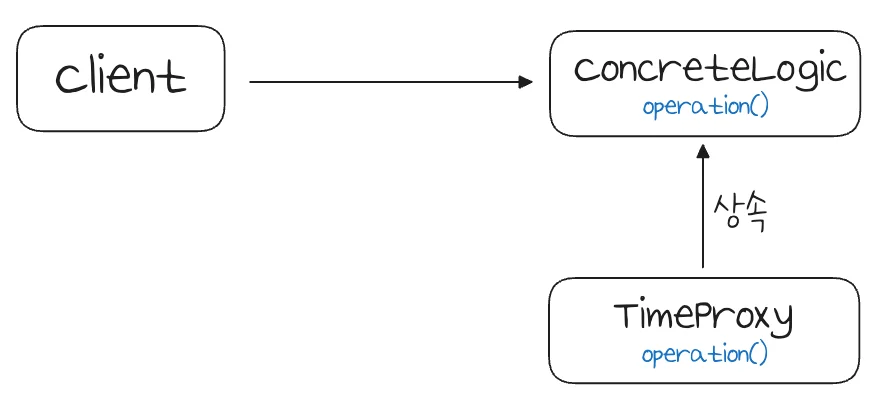

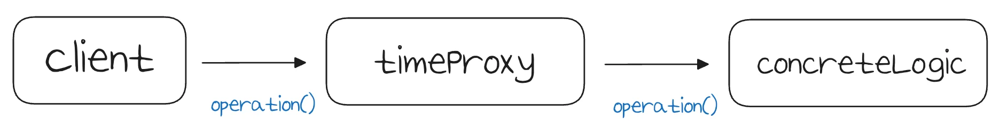

<a id="1fdeda9b0fe180ec986de8b247920958"></a>

### 코드

<details>
<summary>&#91; 코드 &#93; TimeProxy</summary>

<a id="1fdeda9b0fe180669dbdcde21c349497"></a>

```java
package com.inflearn.lecture_prac.pureproxy.concreteproxy.code;

import lombok.extern.slf4j.Slf4j;

@Slf4j
public class TimeProxy extends ConcreteLogic {

    private ConcreteLogic realLogic;

    public TimeProxy(ConcreteLogic realLogic) {
        this.realLogic = realLogic;
    }

    @Override
    public String operation() {
        log.info("TimeDecorator 실행");
        long startTime = System.currentTimeMillis();

        String result = realLogic.operation();

        long endTime = System.currentTimeMillis();
        long resultTime = endTime - startTime;
        log.info("TimeDecorator 종료 resultTime={}", resultTime);
        return result;
    }
}
```

</details>

<details>
<summary>&#91; 테스트 &#93; ConcreteProxyTest</summary>

<a id="1fdeda9b0fe18071ae97e06471bb62dd"></a>

```java
package com.inflearn.lecture_prac.pureproxy.concreteproxy;

import com.inflearn.lecture_prac.pureproxy.concreteproxy.code.ConcreteClient;
import com.inflearn.lecture_prac.pureproxy.concreteproxy.code.ConcreteLogic;
import com.inflearn.lecture_prac.pureproxy.concreteproxy.code.TimeProxy;
import org.junit.jupiter.api.Test;

public class ConcreteProxyTest {
		
		  . . .

    @Test
    void addProxy() {
        ConcreteLogic concreteLogic = new ConcreteLogic();
        TimeProxy timeProxy = new TimeProxy(concreteLogic); // 데코레이터 추가
        ConcreteClient client = new ConcreteClient(timeProxy);
        client.execute();
    }
}
```

<a id="1fdeda9b0fe1806bb24fc032935a03b0"></a>

<strong>실행 로그</strong>

<a id="1fdeda9b0fe180bdb15fe609d891e793"></a>

```java
TimeDecorator 실행 
ConcreteLogic 실행
TimeDecorator 종료 resultTime=1
```

</details>

</details>

<a id="1fdeda9b0fe1808bacddf126cd213f5b"></a>

### &#91; V2 &#93; 구체 클래스 기반 프록시 적용

<a id="1fdeda9b0fe180928f91d4a7273e02c1"></a>

### 코드

<details>
<summary>&#91; 코드 &#93; <strong>OrderControllerConcreteProxy</strong></summary>

<a id="1fdeda9b0fe1804c87d3ec9575fb23f7"></a>

```java
package com.inflearn.lecture_prac.proxy.app.v1_proxy.concrete_proxy;

import com.inflearn.lecture_prac.proxy.app.trace.TraceStatus;
import com.inflearn.lecture_prac.proxy.app.trace.logtrace.LogTrace;
import com.inflearn.lecture_prac.proxy.app.v2.OrderControllerV2;

public class OrderControllerConcreteProxy extends OrderControllerV2 {

    private final OrderControllerV2 target;
    private final LogTrace logTrace;

    public OrderControllerConcreteProxy(OrderControllerV2 target2, LogTrace logTrace) {
        super(null);
        this.target = target2;
        this.logTrace = logTrace;
    }

    @Override
    public String request(String itemId) {

        TraceStatus status = null;
        try {
            status = logTrace.begin("OrderRepository.save()");
            // target 호출
            target.request(itemId);
            logTrace.end(status);
        } catch (Exception e) {
            logTrace.exception(status, e);
            throw e;
        }
        return "proxy";
    }
}
```

</details>

<details>
<summary>&#91; 코드 &#93; <strong>OrderServiceConcreteProxy</strong></summary>

<a id="1fdeda9b0fe180028919d5f8be78c460"></a>

```java
package com.inflearn.lecture_prac.proxy.app.v1_proxy.concrete_proxy;

import com.inflearn.lecture_prac.proxy.app.trace.TraceStatus;
import com.inflearn.lecture_prac.proxy.app.trace.logtrace.LogTrace;
import com.inflearn.lecture_prac.proxy.app.v2.OrderServiceV2;

public class OrderServiceConcreteProxy extends OrderServiceV2 {

    private final OrderServiceV2 target;
    private final LogTrace logTrace;

    public OrderServiceConcreteProxy(OrderServiceV2 target, LogTrace logTrace) {
        super(null);
        this.target = target;
        this.logTrace = logTrace;
    }

    @Override
    public void orderItem(String itemId) {

        TraceStatus status = null;
        try {
            status = logTrace.begin("OrderService.orderItem()");
            // target 호출
            target.orderItem(itemId);
            logTrace.end(status);
        } catch (Exception e) {
            logTrace.exception(status, e);
            throw e;
        }
    }
}

```

</details>

<details>
<summary>&#91; 코드 &#93; <strong>OrderRepositoryConcreteProxy</strong></summary>

<a id="1fdeda9b0fe180359c97c3b8729e9301"></a>

```java
package com.inflearn.lecture_prac.proxy.app.v1_proxy.concrete_proxy;

import com.inflearn.lecture_prac.proxy.app.trace.TraceStatus;
import com.inflearn.lecture_prac.proxy.app.trace.logtrace.LogTrace;
import com.inflearn.lecture_prac.proxy.app.v2.OrderRepositoryV2;
import lombok.RequiredArgsConstructor;

@RequiredArgsConstructor
public class OrderRepositoryConcreteProxy extends OrderRepositoryV2 {

    private final OrderRepositoryV2 target;
    private final LogTrace logTrace;

    @Override
    public void save(String itemId) {

        TraceStatus status = null;
        try {
            status = logTrace.begin("OrderRepository.save()");
            // target 호출
            target.save(itemId);
            logTrace.end(status);
        } catch (Exception e) {
            logTrace.exception(status, e);
            throw e;
        }
    }
}

```

</details>

<details>
<summary>&#91; 코드 &#93; <strong>ConcreteProxyConfig</strong></summary>

<a id="1fdeda9b0fe180859194d22362037162"></a>

```java
package com.inflearn.lecture_prac.proxy.app.v1_proxy;

import com.inflearn.lecture_prac.proxy.app.trace.logtrace.LogTrace;
import com.inflearn.lecture_prac.proxy.app.v1_proxy.concrete_proxy.OrderControllerConcreteProxy;
import com.inflearn.lecture_prac.proxy.app.v1_proxy.concrete_proxy.OrderRepositoryConcreteProxy;
import com.inflearn.lecture_prac.proxy.app.v1_proxy.concrete_proxy.OrderServiceConcreteProxy;
import com.inflearn.lecture_prac.proxy.app.v2.OrderControllerV2;
import com.inflearn.lecture_prac.proxy.app.v2.OrderRepositoryV2;
import com.inflearn.lecture_prac.proxy.app.v2.OrderServiceV2;
import org.springframework.context.annotation.Bean;
import org.springframework.context.annotation.Configuration;

@Configuration
public class ConcreteProxyConfig {

    @Bean
    public OrderControllerV2 target2(LogTrace logTrace) {
        return new OrderControllerV2(orderSerivceV2(logTrace));
    }

    @Bean
    public OrderServiceV2 orderSerivceV2(LogTrace logTrace) {
        OrderServiceV2 orderServiceImpl = new OrderServiceV2(orderRepositoryV2(logTrace));
        return new OrderServiceConcreteProxy(orderServiceImpl, logTrace);
    }

    @Bean
    public OrderRepositoryV2 orderRepositoryV2(LogTrace logTrace) {
        OrderRepositoryV2 repositoryImpl = new OrderRepositoryV2();
        return new OrderRepositoryConcreteProxy(repositoryImpl, logTrace);
    }

}

```

</details>

<details>
<summary>&#91; 코드 &#93; <strong>LecturePracApplication</strong></summary>

<a id="1fdeda9b0fe180c98093cc6c7d77a4ff"></a>

```java
package com.inflearn.lecture_prac;

import com.inflearn.lecture_prac.proxy.app.trace.logtrace.LogTrace;
import com.inflearn.lecture_prac.proxy.app.trace.logtrace.ThreadLocalLogTrace;
import com.inflearn.lecture_prac.proxy.app.v1_proxy.ConcreteProxyConfig;
import com.inflearn.lecture_prac.proxy.app.v1_proxy.InterfaceProxyConfig;
import org.springframework.boot.SpringApplication;
import org.springframework.boot.autoconfigure.SpringBootApplication;
import org.springframework.context.annotation.Bean;
import org.springframework.context.annotation.Import;


// @Import({AppV1Config.class, AppV2Config.class})
// @Import(InterfaceProxyConfig.class)
@Import(ConcreteProxyConfig.class)
@SpringBootApplication(scanBasePackages = "com.inflearn.lecture_prac.proxy.app")
public class LecturePracApplication {

    public static void main(String[] args) {
        SpringApplication.run(LecturePracApplication.class, args);
    }

    @Bean
    public LogTrace logTrace() {
        return new ThreadLocalLogTrace();
    }
}
```

</details>

<details>
<summary>&#91; 코드 &#93; OrderControllerV2 &#45; <code>&#64;GetMapping</code> 제거</summary>

> ☝🏻 
> 
> <a id="1fdeda9b0fe180a9a2a1efded9f04c5c"></a>
> 
> 상위 클래스에서 매핑되는 path를 명시하면, 상속하는 하위 클래스에서도 동일하게 해당 path로 중복 등록된다&#46; → 오류

<a id="1fdeda9b0fe18004bd2bcf7fa6346fed"></a>

```java
package com.inflearn.lecture_prac.proxy.app.v2;

import lombok.RequiredArgsConstructor;
import lombok.extern.slf4j.Slf4j;
import org.springframework.web.bind.annotation.GetMapping;
import org.springframework.web.bind.annotation.RequestParam;

@Slf4j
@RequiredArgsConstructor
public class OrderControllerV2 {

    private final OrderServiceV2 orderService;

//    @GetMapping("/v2/request")
    public String request(@RequestParam String itemId) {
        orderService.orderItem(itemId);
        return "ok";
    }

//    @GetMapping("/v2/no-log")
    public String noLog() {
        return "ok";
    }
}
```

</details>

<a id="1fdeda9b0fe18073b481d57dec50599a"></a>

### NOTES

> ☝🏻 
> 
> <a id="1fdeda9b0fe180d2a9c2dc859536dd64"></a>
> 
> <strong>클래스 기반 프록시의 단점</strong>
> 
> ---
> 
> - <code>super(null)</code>
>     <a id="1fdeda9b0fe180d68d65fe672ea8db34"></a>
> 
>     부모 클래스를 상속하는 자식 클래스의 경우, 자바 기본 문법에 의해 클래스 생성 시, 항상 <code>super()</code>로 부모 클래스의 생성자를 호출해야 한다&#46; 
> 
>     - 기본 생성자만 있는 경우, 자동으로 상속
> 
>     - 파라미터가 있는 경우, <code>super(…)</code>에도 파라미터를 넘겨 호출해야 한다&#46;<br>필요없는 경우, <code>null</code>을 넣어도 된다&#46; 
> 
>     - 인터페이스 기반 프록시는 해당 부분을 고려하지 않아도 된다&#46; 

<a id="1fdeda9b0fe180a6b8a1e1393295dcd2"></a>

### 정리

<a id="1fdeda9b0fe180aaa2d7cb357af933cd"></a>

<strong>프록시 구현 방식</strong>

> ✏️ 
> 
> <a id="1fdeda9b0fe18080958ecc8b5deb172b"></a>
> 
> <code>인퍼페이스 기반 프록시</code>  vs <code>클래스 기반 프록시</code>
> 
> ---
> 
> - 인터페이스가 없어도 클래스 기반으로 프록시를 생성할 수 있다&#46; 
> 
> - 클래스 기반 프록시는 해당 클래스에만 적용 가능하다&#46; 
>     - 인터페이스 기반 프록시는 인터페이스만 같으면 모든 곳에 적용할 수 있다
> 
> - 클래스 기반 프록시는 상속을 사용하기 때문에 몇가지 제약이 있다&#46; 
>     - 부모 클래스의 생성자를 호출해야 한다&#46; (<code>super(…)</code>)
> 
>     - 클래스에 final 키워드가 붙으면 상속이 불가능하다&#46;
> 
>     - 메서드에 final 키워드가 붙으면 해당 메서드를 오버라이딩 할 수 없다&#46;

<a id="1fdeda9b0fe1806b8252e26c86756525"></a>

인터페이스 기반 프록시는 <strong><u>‘상속’의 제약을 벗</u></strong>어날 수 있으며, 역할과 구현을 명확히 나눌 수 있어 더 좋다&#46; 

- 단점은 인터페이스가 필요하는 그 자체이다&#46; 

- 캐스팅 관련해서도 단점이 있다&#46; 해당 내용은 나중 챕터에서 다룬다&#46;

<a id="1fdeda9b0fe18022b79addaffa29ae7b"></a>

이론적으로는 모든 객체에 인터페이스를 도입해, 역할과 구현을 나누는 것이 좋다&#46; 

<a id="1fdeda9b0fe180338585e8a635a65285"></a>

이렇게 하면 역할과 구현을 나눠 구현체를 편리하게 변경할 수 있다&#46; 

<a id="1fdeda9b0fe18071a978fee765700a14"></a>

그러나 실제로 구현을 거의 변경할 일이 없는 클래스도 많다&#46; 

<a id="1fdeda9b0fe1806690f7cffacd13d8aa"></a>

인터페이스를 도입은 구현을 변경할 가능성이 있을 때 효과적이지, 변경이 필요없는 코드의 경우 오히려 번거롭고, 유지보수 해야할 코드만 늘어난다&#46; 

<a id="1fdeda9b0fe18052b78dd3fc9dbd7017"></a>

따라서 이러한 곳에는 오히려 인터페이스 보다는 구체 클래스를 상속하는 구조가 더 효과적이다 &#46;

<a id="1fdeda9b0fe180b1914bce9692ac7291"></a>

결국 실무에서 프록시 적용 시, 변경 가능 여부를 측정하여 각 상황에 맞게 인터페이스 기반이나 클래스 기반으로 대응할 수 있어야 한다&#46; 

<a id="1fdeda9b0fe1806b9b50e9e5de756b94"></a>

<strong>프록시 적용의 단점</strong>

<a id="1fdeda9b0fe180f78b19fc5392e502d6"></a>

<code>프록시</code>를 통해서 <strong><u>원본 코드를 전혀 변경하지 않</u></strong>고, <code>V1</code>, <code>V2</code> 애플리케이션에 <u>LogTrace 기능을 적용</u>했다&#46;

> ❗ 
> 
> <a id="1fdeda9b0fe18087acc2ef7d2d2ba845"></a>
> 
> <strong>단점) 너무 많은 프록시 클래스 </strong>
> 
> ---
> 
> <a id="1fdeda9b0fe18095abc5e1bf28f8fcd4"></a>
> 
> 원본 코드를 변경하지 않고 프록시를 적용할 수 있었지만, 너무 많은 프록시 클래스를 만들어야 한다는 단점이 있다&#46; 
> 
> <a id="1fdeda9b0fe18006a85ff568e989b0be"></a>
> 
> 예제에서는 프록시를 통해 로그 추적하는 기능을 추가했다&#46; 그러나 대상 클래스만 다를 뿐, 로직을 모두 같다&#46;
> 
> <a id="1fdeda9b0fe180418abfc8aa5b8026ce"></a>
> 
> 결국  <strong><u>매번 적용하려는 클래스마다 중복된 로직을 담은 프록시 객체를 생성</u></strong> 해야한다&#46;
> 
> <a id="1fdeda9b0fe180828943e05af2c570e1"></a>
> 
> 이는 유지보수 와 확장성 측면에서 매우 좋지 못한 코드이다&#46; 
> 
> - 이를 다음 챕터에서 설명할 <strong><u>동적 프록시 기술</u></strong>로 해결한다 &#46;
